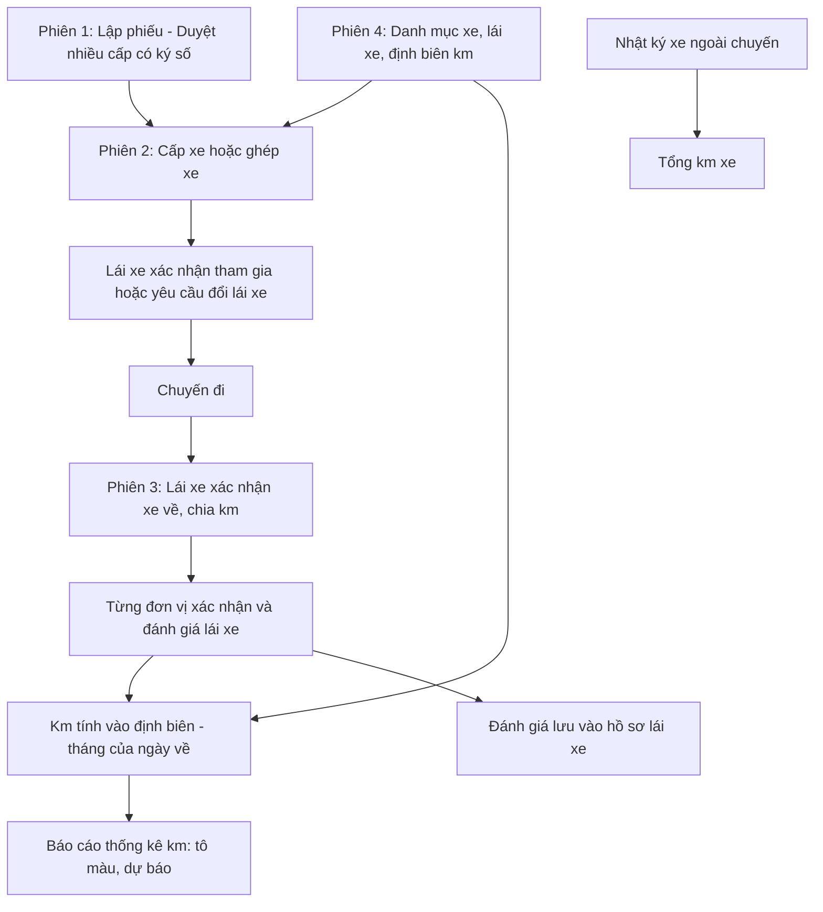
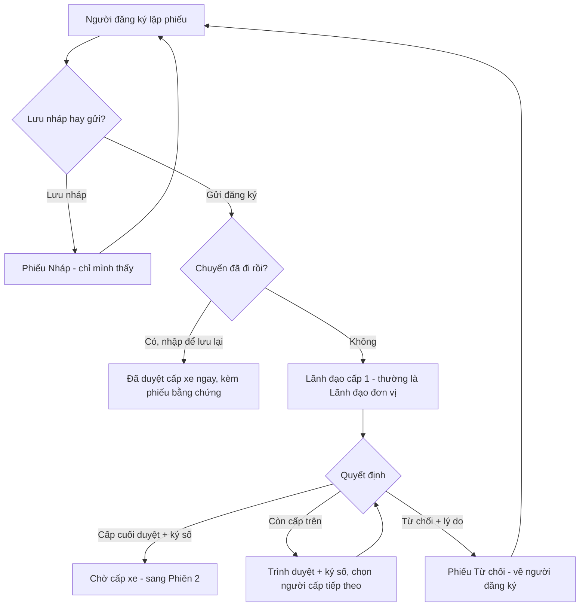
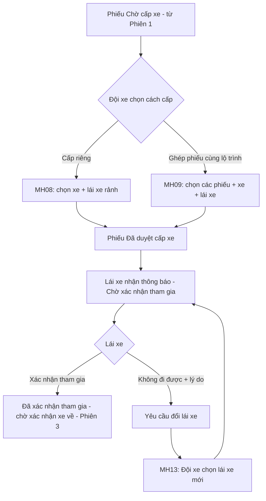
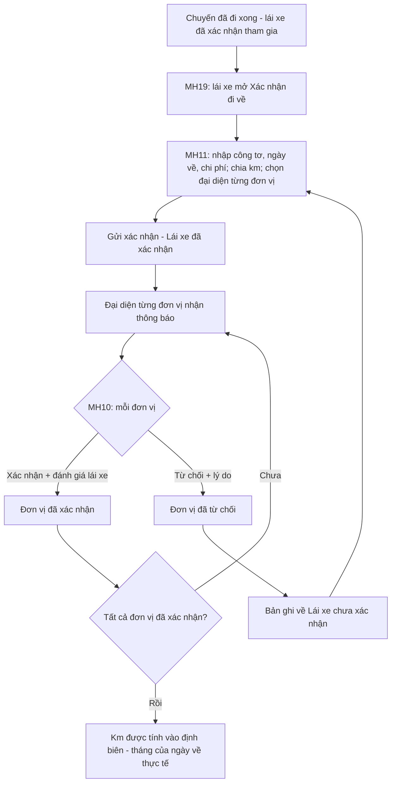
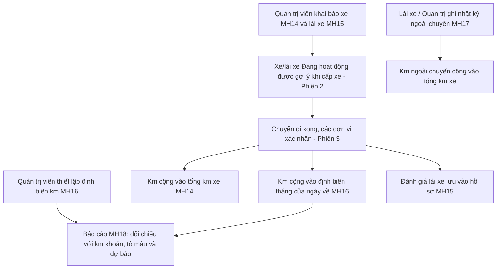
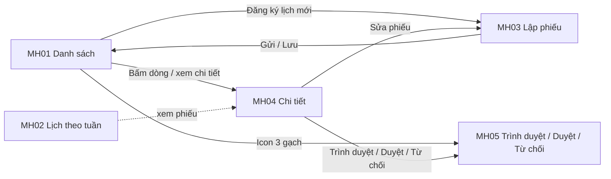
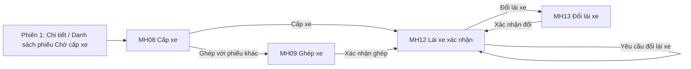
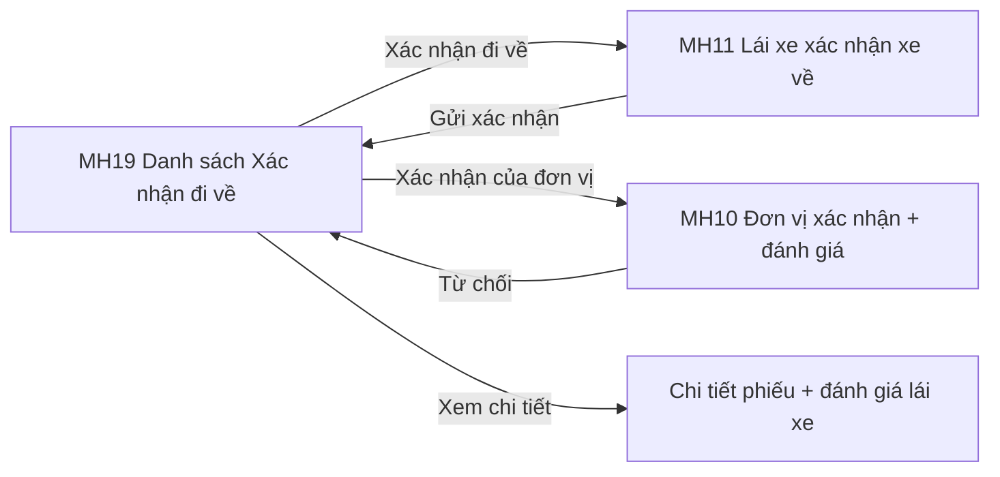
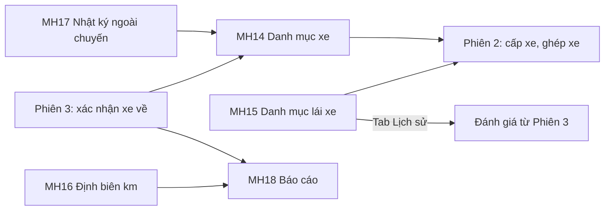

# TÀI LIỆU YÊU CẦU NGƯỜI DÙNG (URD)
## Module Quản lý đăng ký xe — Tập đoàn TKV

| Thông tin | Nội dung |
|---|---|
| Khách hàng | Tập đoàn Công nghiệp Than – Khoáng sản Việt Nam (TKV) |
| Phiên bản | v1.0 — bản tổng hợp 4 phiên chốt (viết lại từ URD v1.1 ngày 25/08/2026, bổ sung các CR phát sinh đến 09/2026) |
| Ngày | 16/10/2026 |
| Người soạn | BA VNPT-IT |
| Trạng thái | Dự thảo — chờ chốt |
| Phạm vi | Toàn module (19 màn hình MH01–MH19) |

> **Ghi chú cho người đọc:** Tài liệu này mô tả **hệ thống sẽ hỗ trợ những công việc gì** và **giao diện thể hiện ở mức tổng quan**, để quý khách hàng cùng rà soát và xác nhận trước khi đội kỹ thuật xây dựng chi tiết. Tài liệu **không** đi vào chi tiết kỹ thuật (cấu trúc dữ liệu, kiểm tra từng ô nhập...) — phần đó nằm ở tài liệu đặc tả (SRS) dành cho đội phát triển.
>
> Nội dung chia thành **4 nhóm nghiệp vụ (Phiên 1–4)** theo đúng thứ tự một chuyến xe đi qua: Phiên 1 — Đăng ký & duyệt; Phiên 2 — Cấp xe & lái xe; Phiên 3 — Xác nhận xe về & đánh giá; Phiên 4 — Danh mục, định biên km, nhật ký ngoài chuyến, báo cáo. Mã yêu cầu **UR01–UR41** đánh số liên tục, không trùng.
>
> **[ĐỀ XUẤT]** là nội dung BA đề xuất để khách hàng cho ý kiến. **[CHỜ HÌNH]** là phần chờ hình thiết kế. **[GIẢ ĐỊNH]** là nội dung suy ra, cần xác nhận. **⚠** ở mục nghiệm thu là tiêu chí còn phụ thuộc một quyết định chưa chốt (mã **Qxx**, xem Phụ lục C).

---

## TÓM TẮT NHANH (đọc trong 3 phút)

| Mục | Nội dung |
|---|---|
| **Vấn đề đang gặp** | Đăng ký xe gắn với luồng văn bản, chưa có bước xác nhận nhiều cấp và ký số; chưa ghép được phiếu cùng lộ trình; lái xe chỉ xác nhận sau chuyến, không đổi được lái xe; chưa chia km theo từng ban, chưa kiểm soát định biên km; chưa lưu hồ sơ xe – lái xe và km đi ngoài chuyến. |
| **Mục tiêu hệ thống mới** | Một chuyến xe được xử lý trọn vẹn trên hệ thống: đăng ký → duyệt nhiều cấp có ký số → cấp xe/ghép xe → lái xe xác nhận → xác nhận xe về, chia km, đơn vị đánh giá lái xe → tính vào định biên → báo cáo có cảnh báo và dự báo. |
| **Phạm vi** | 4 nhóm nghiệp vụ, 19 màn hình, 41 yêu cầu, 53 tiêu chí nghiệm thu. |
| **Đối tượng sử dụng** | Người đăng ký, Lãnh đạo duyệt (các cấp), Đội trưởng/phó đội xe, Lái xe, Đại diện đơn vị tham gia chuyến, Quản trị viên, Người xem báo cáo |
| **Cần khách hàng quyết định** | 23 quyết định ở Phụ lục C (mã Q01–Q23); 5 tiêu chí nghiệm thu đang phụ thuộc vào các quyết định này. |

🖼️ *Hai màn hình dùng nhiều nhất — Danh sách đăng ký xe và Báo cáo thống kê km:*

---

## MỤC LỤC

1. [Bối cảnh & Mục tiêu](#1-bối-cảnh--mục-tiêu)
2. [Đối tượng sử dụng](#2-đối-tượng-sử-dụng) (kèm ma trận ai được làm gì)
3. [Luồng nghiệp vụ tổng quan](#3-luồng-nghiệp-vụ-tổng-quan) (kèm bảng trạng thái 3.5, bảng thông báo 3.6)
4. [Màn hình & thao tác](#4-màn-hình--thao-tác) (kèm danh mục màn hình)
5. [Yêu cầu chức năng chi tiết](#5-yêu-cầu-chức-năng-chi-tiết) (kèm bảng tổng hợp UR01–UR41)
6. [Ngoài phạm vi](#6-ngoài-phạm-vi)
7. [Tiêu chí nghiệm thu](#7-tiêu-chí-nghiệm-thu) (kèm điều kiện nghiệm thu tổng thể, yêu cầu phi chức năng)
8. [Xác nhận chốt nghiệp vụ](#8-xác-nhận-chốt-nghiệp-vụ)
9. [Phụ lục](#phụ-lục): A. Thiết lập theo đơn vị · B. Thuật ngữ · C. Quyết định cần khách hàng chốt · D. Chi tiết câu hỏi theo phiên

---

## 1. Bối cảnh & Mục tiêu

**Vấn đề hiện tại**
> Đội xe TKV phục vụ cả khối cơ quan Tập đoàn (trụ sở chính và Hạ Long) lẫn khối đảng, đoàn thể.
> - **Đăng ký & duyệt:** gắn với luồng văn bản; người đăng ký không biết phiếu đang chờ ai; khó tra lại ai đã xử lý, ý kiến thế nào; phiếu xóa đi là mất hẳn.
> - **Cấp xe:** không ghép được các phiếu cùng tuyến nên tốn xe; lái xe chỉ xác nhận sau chuyến; lái xe có việc đột xuất thì không đổi được lái xe sau khi đã cấp.
> - **Xác nhận xe về:** chỉ một người xác nhận chung, không đánh giá lái xe, không chia km theo từng ban; chuyến qua tháng dễ tính km sai tháng.
> - **Danh mục & báo cáo:** chưa lưu mốc đăng kiểm/bảo hiểm/bảo dưỡng, chưa có định biên km theo ban/cá nhân, km xe đi ngoài chuyến bị thất thoát.

**Mục tiêu khi có hệ thống mới**
> - Phiếu đi qua đúng chuỗi duyệt của từng đơn vị, lãnh đạo ký số ngay khi chuyển duyệt; người đăng ký luôn biết phiếu ở "Cấp mấy/tổng số cấp — ai đang xử lý".
> - Cấp xe nhanh, không trùng lịch; ghép được phiếu cùng lộ trình; lái xe xác nhận tham gia trước chuyến và đổi được khi cần.
> - Mỗi đơn vị xác nhận phần km của mình và đánh giá lái xe; km tính vào định biên theo tháng của ngày về thực tế.
> - Quản lý tập trung xe, lái xe, định biên; báo cáo theo tháng/quý/năm có tô màu cảnh báo và dự báo cả năm.

**Phạm vi**
> - **Phiên 1:** lập phiếu, lưu nháp, đăng ký muộn, duyệt nhiều cấp có ký số, danh sách – chi tiết – lịch sử phiếu, hủy phiếu, xuất Word, lịch đã duyệt theo tuần.
> - **Phiên 2:** cấp xe, ghép xe, lái xe xác nhận tham gia, báo không đi được, đổi lái xe, thông báo.
> - **Phiên 3:** lái xe xác nhận xe về và chia km, km cá nhân đặc thù, đơn vị xác nhận và đánh giá lái xe, xử lý từ chối, danh sách xác nhận đi về.
> - **Phiên 4:** danh mục xe, danh mục lái xe, định biên km, nhật ký xe ngoài chuyến, báo cáo thống kê theo dõi km.

### Điểm mới so với hệ thống hiện tại (V5)

| Nhóm | Điểm mới / thay đổi | Yêu cầu |
|---|---|---|
| Đăng ký | Lưu nháp; nhiều đơn vị cùng đi kèm số người; nhập lại chuyến đã đi kèm phiếu bằng chứng; văn bản liên quan; tạo phiếu Word theo mẫu và ký số | UR02–UR05 |
| Duyệt | Duyệt nhiều cấp theo đơn vị, ký số ở bước trình/duyệt, hiển thị "Cấp X/N", từ chối kèm lý do | UR09–UR11 |
| Phiếu | Chi tiết phiếu có thanh tiến trình và lịch sử xử lý; hủy phiếu giữ lại để tra cứu; xuất Word; lịch sử phiên bản file | UR08, UR12–UR14 |
| Cấp xe | Gợi ý xe/lái xe đang rảnh; cấp nhiều xe; **ghép phiếu cùng lộ trình** | UR15, UR16 |
| Lái xe | **Xác nhận tham gia trước chuyến**; báo không đi được; **đổi lái xe** sau khi đã cấp | UR17–UR19 |
| Xe về | Số công tơ đầu/cuối; **chia km theo từng đơn vị**; km riêng cá nhân đặc thù; tính theo tháng của ngày về | UR21–UR24 |
| Xác nhận | **Từng đơn vị xác nhận độc lập và đánh giá lái xe** theo 3 tiêu chí; từ chối và xác nhận lại | UR25–UR29 |
| Danh mục | Mốc đăng kiểm/bảo hiểm/bảo dưỡng, trạng thái sử dụng, tổng km xe; giấy phép lái xe, lịch sử phục vụ và đánh giá | UR31–UR35 |
| Định biên & báo cáo | **Định biên km theo đơn vị/cá nhân**; nhật ký xe ngoài chuyến; báo cáo tháng/quý/năm có cảnh báo màu và dự báo | UR36–UR41 |

---

## 2. Đối tượng sử dụng

### 👤 Người đăng ký (chuyên viên / văn thư ban)
- **Là ai:** Chuyên viên hành chính của một ban, thay trưởng đoàn lập phiếu khi có chuyến công tác.
- **Công việc liên quan hệ thống:** lập phiếu, đính kèm giấy tờ, theo dõi phiếu đã gửi, sửa lại phiếu bị từ chối; thỉnh thoảng nhập lại chuyến đã đi để lưu hồ sơ; nhận thông báo ở các bước sau.
- **Điều họ cần:** biết phiếu đang ở đâu; có sẵn phiếu Word đúng mẫu để lãnh đạo ký.

### 👤 Lãnh đạo duyệt (nhiều cấp)
- **Là ai:** Lãnh đạo đơn vị (trưởng/phó ban) và Lãnh đạo Văn phòng phụ trách quản trị (Chánh/Phó Chánh Văn phòng). Lãnh đạo đơn vị xác nhận nội dung ngay bằng chức năng "Trình duyệt". Số cấp duyệt khác nhau tùy đơn vị (tối đa 5 cấp).
- **Công việc liên quan hệ thống:** mở các phiếu đến lượt mình, ký số, trình tiếp lên cấp trên hoặc duyệt/từ chối.
- **Điều họ cần:** chỉ thấy phiếu đến lượt mình; từ chối phải ghi được lý do.

### 👤 Đội trưởng/Đội phó đội xe (người cấp xe)
- **Là ai:** Người điều vận của đội xe, được phân quyền cấp xe và (thường) đổi lái xe.
- **Công việc liên quan hệ thống:** nhận phiếu "Chờ cấp xe", chọn xe và lái xe, ghép phiếu cùng tuyến, xử lý khi lái xe báo không đi được; xem hồ sơ lái xe và báo cáo theo quyền.
- **Điều họ cần:** chỉ thấy xe và lái xe đang rảnh; biết lái xe đã nhận lịch chưa.

### 👤 Lái xe
- **Là ai:** Người lái xe phục vụ chuyến đi, thường có xe biên chế cố định.
- **Công việc liên quan hệ thống:** xem chuyến được cấp, xác nhận tham gia hoặc báo không đi được; sau chuyến nhập công tơ, chia km, gửi xác nhận; ghi nhật ký xe đi ngoài chuyến.
- **Điều họ cần:** nhập một lần, hệ thống tự tính; chỉ thấy chuyến của mình.

### 👤 Đại diện đơn vị tham gia chuyến
- **Là ai:** Người được lái xe chọn làm đại diện cho một ban cùng đi.
- **Công việc liên quan hệ thống:** xem số người/số km phần mình, đánh giá lái xe, xác nhận hoặc từ chối.
- **Điều họ cần:** chỉ thấy và xử lý phần của ban mình, độc lập với ban khác.

### 👤 Quản trị viên hệ thống
- **Là ai:** Cán bộ hành chính/CNTT quản trị danh mục xe, lái xe, định biên km.
- **Công việc liên quan hệ thống:** khai báo xe và lái xe; cập nhật mốc đăng kiểm/bảo hiểm/bảo dưỡng; thiết lập định biên km hằng năm; ghi nhật ký ngoài chuyến khi cần.

### 👤 Người xem báo cáo
- **Là ai:** Ba nhóm theo quyền: người dùng thông thường (chỉ đơn vị trực tiếp của mình), người được gán quyền xem theo đơn vị, người được gán quyền xem toàn hệ thống.

### Ma trận: ai được làm gì

*(✔ làm được · 👁 chỉ xem · — không. Dấu (Qxx) là điểm còn chờ khách hàng chốt.)*

| Chức năng | Người đăng ký | Lãnh đạo duyệt | Đội xe (cấp xe) | Lái xe | Đại diện đơn vị | Quản trị viên |
|---|---|---|---|---|---|---|
| Lập, lưu nháp, gửi, sửa, hủy phiếu | ✔ (phiếu của mình) | — | — | — | — | — |
| Nhập lại chuyến đã đi (đăng ký muộn) | ✔ (Q03) | — | — | — | — | — |
| Xem danh sách, chi tiết phiếu | 👁 phiếu của mình | 👁 theo phạm vi quyền (Q06) | 👁 từ "Chờ cấp xe" (Q06) | — | — | — |
| Trình duyệt, ký số, duyệt, từ chối | — | ✔ (người đang giữ phiếu) | — | — | — | — |
| Cấp xe, ghép xe, hủy duyệt/hủy cấp (nếu bật) | — | ✔ nếu kiêm quyền cấp xe | ✔ | — | — | — |
| Xác nhận tham gia, báo không đi được | — | — | — | ✔ (chuyến của mình) | — | — |
| Đổi lái xe / đổi xe | — | — | ✔ người được phân quyền (Q12) | — | — | — |
| Xác nhận xe về, chia km, km riêng cá nhân đặc thù | — | — | — | ✔ | — | — |
| Xác nhận / từ chối và đánh giá lái xe | — | — | — | — | ✔ (đơn vị của mình) | — |
| Khai báo xe, lái xe | — | — | 👁 hồ sơ, lịch sử lái xe (Q06) | — | — | ✔ (hồ sơ lái xe: người tạo sửa/xóa — Q22) |
| Thiết lập định biên km | — | — | — | — | — | ✔ |
| Ghi nhật ký xe ngoài chuyến | — | — | — | ✔ (chỉ thấy của mình) | — | ✔ (xem tất cả nếu có quyền; người tạo sửa/xóa — Q22) |
| Xem báo cáo thống kê km | 👁 theo quyền | 👁 theo quyền | 👁 theo quyền | — | — | 👁 theo quyền |

*Báo cáo: người dùng thông thường thấy một dòng đơn vị của mình; người được gán quyền theo đơn vị thấy các đơn vị được gán kèm đơn vị phụ thuộc; người được gán quyền toàn hệ thống thấy tất cả kèm dòng tổng cộng.*

---

## 3. Luồng nghiệp vụ tổng quan

🖼️ *Sơ đồ toàn module:*

**Tóm tắt các bước chính:**
1. **Đăng ký và duyệt** — Người đăng ký lập phiếu; lãnh đạo các cấp trình duyệt, ký số, duyệt hoặc từ chối (3.1).
2. **Cấp xe** — Đội xe cấp xe riêng hoặc ghép nhiều phiếu cùng lộ trình; lái xe xác nhận tham gia hoặc báo không đi được để đổi lái xe (3.2).
3. **Sau chuyến** — Lái xe nhập số liệu thực tế, chia km; từng đơn vị xác nhận và đánh giá lái xe; đủ đơn vị thì km mới vào định biên (3.3).
4. **Dữ liệu nền và báo cáo** — Xe, lái xe, định biên được khai báo sẵn; nhật ký ngoài chuyến bổ sung km; báo cáo tổng hợp, cảnh báo và dự báo (3.4).

**Ví dụ xuyên suốt một chuyến xe:**
> Ngày 05/08, chị Hoa (văn thư Ban Vận tải) lập phiếu đi Hà Nội – Hạ Long cho Ban Tổ chức (3 người) và Ban Kỹ thuật (2 người) → anh Minh (lãnh đạo đơn vị) xác nhận, ký số, trình duyệt → chị Thu (Lãnh đạo Văn phòng) ký số và duyệt → phiếu "Chờ cấp xe" → anh Dũng (đội trưởng đội xe) cấp xe 16 chỗ, lái xe là bác D → bác D xác nhận tham gia và chạy chuyến → bác D nhập công tơ 12.000 → 12.220 (220 km), ghi 20 km riêng cho một cá nhân đặc thù, chia 100/100 cho hai ban, chọn chị Lan và anh Quân làm đại diện → hai đại diện xác nhận và đánh giá bác D → km cộng vào định biên của tháng chứa ngày về → cuối tháng lãnh đạo xem báo cáo thấy Ban Tổ chức đã dùng bao nhiêu % km khoán.

### 3.1 Phiên 1 — Đăng ký & duyệt phiếu đăng ký xe

🖼️ *Sơ đồ luồng:*

**Diễn giải bằng lời:**
1. **Lập phiếu** — Người đăng ký điền thông tin chuyến đi, chọn đơn vị cùng đi và số người mỗi đơn vị, chọn lãnh đạo duyệt cấp 1. Có thể **Lưu nháp** để làm tiếp sau.
2. **Gửi đăng ký** — Phiếu chuyển tới đúng lãnh đạo cấp 1 đã chọn, trạng thái "Chờ duyệt".
3. **Trình duyệt** — Lãnh đạo đơn vị xác nhận nội dung đúng thực tế, **ký số**, rồi chọn người duyệt cấp kế tiếp theo chuỗi duyệt của đơn vị mình; ghi thêm ý kiến nếu muốn. Phiếu **chỉ nằm ở danh sách việc cần làm của đúng một người** tại mỗi thời điểm.
4. **Duyệt** — Lãnh đạo cấp cuối (thường là Lãnh đạo Văn phòng) **ký số** và duyệt, phiếu chuyển sang "Chờ cấp xe".
5. **Từ chối** — Bất kỳ cấp nào cũng từ chối được, **bắt buộc ghi lý do**; phiếu về thẳng người đăng ký (không trả về cấp trước). Người đăng ký sửa và gửi lại từ cấp 1.
6. **Nhập lại chuyến đã đi (đăng ký muộn)** — Chuyến đã diễn ra nên **không cần duyệt**; phiếu chỉ để lưu lại số liệu. Người đăng ký chọn xe + lái xe đã dùng và **bắt buộc đính kèm phiếu bằng chứng**; phiếu vào thẳng "Đã duyệt cấp xe".

> **Ví dụ về số cấp:** Ban Vận tải dùng 3 cấp (chuyên viên → phó ban → trưởng ban); Phòng Hành chính chỉ dùng 1 cấp. Số cấp và người duyệt từng cấp lấy từ phân quyền theo đơn vị đã có sẵn.

### 3.2 Phiên 2 — Cấp xe & lái xe

🖼️ *Sơ đồ luồng:*

**Diễn giải bằng lời:**
1. **Cấp xe** — Đội xe mở phiếu "Chờ cấp xe", hệ thống gợi ý xe và lái xe đang rảnh trong đúng khung giờ chuyến. Đội xe chọn loại xe, biển số, lái xe (mặc định là lái xe biên chế của xe, sửa lại được). Phiếu cần nhiều xe thì cấp nhiều dòng.
2. **Hoặc ghép phiếu** — Nếu có nhiều phiếu cùng lộ trình, đội xe bấm "Ghép với phiếu khác cùng lộ trình", chọn các phiếu muốn ghép rồi chọn xe + lái xe chung. Tất cả phiếu trong nhóm cùng chuyển "Đã duyệt cấp xe" một lúc.
3. **Lái xe xác nhận tham gia** — Lái xe nhận thông báo, vào danh sách chuyến của mình, xác nhận từng chuyến hoặc nhiều chuyến cùng lúc. Chuyến có ghép nhiều phiếu thì hiện **một dòng cho mỗi xe** và xác nhận một lần là cho cả nhóm.
4. **Không đi được** — Lái xe bấm "Yêu cầu đổi lái xe", **bắt buộc ghi lý do**. Phiếu chuyển "Yêu cầu đổi lái xe".
5. **Đổi lái xe** — Người có quyền chọn lái xe khác đang rảnh (đổi cả xe nếu cần). Lái xe mới phải xác nhận tham gia; lái xe cũ không còn thấy chuyến; trạng thái phiếu không quay về "Chờ cấp xe".

> Ví dụ: Ngày 05/08 có hai phiếu — Ban Tổ chức đi Hà Nội – Hạ Long (3 người) và Ban Kỹ thuật đi Hà Nội – Hải Phòng (2 người). Đội xe ghép hai phiếu vào cùng một xe; sau chuyến, km chia riêng cho từng ban (Phiên 3).

### 3.3 Phiên 3 — Xác nhận xe về & đánh giá lái xe

🖼️ *Sơ đồ luồng:*

**Diễn giải bằng lời:**
1. **Lái xe xác nhận xe về** — Từ danh sách "Xác nhận đi về", lái xe mở phiếu, nhập số công tơ đầu/cuối, ngày đi/về thực tế, chi phí. Hệ thống tự tính km thực tế và **gợi ý chia km đều theo số đơn vị** cùng đi; lái xe chỉnh lại khi có nối/ghép chuyến. Lái xe chọn người đại diện cho từng đơn vị, có thể hạch toán km riêng cho cá nhân đặc thù, tạo hoặc đính kèm file xác nhận rồi **Gửi xác nhận**.
2. **Mỗi đơn vị xác nhận độc lập** — Đại diện từng đơn vị nhận thông báo, xem số người/số km của chuyến, đánh giá lái xe theo 3 tiêu chí (Tốt / Trung bình / Yếu), có thể đính kèm và ký số file xác nhận, rồi **Xác nhận**.
3. **Đơn vị từ chối** — Đại diện chọn "Từ chối", **bắt buộc ghi lý do**. Bản ghi của lái xe quay về "Lái xe chưa xác nhận"; lái xe chỉnh số liệu và gửi lại. Khi đó **tất cả** đơn vị (kể cả đơn vị đã xác nhận) phải xác nhận lại.
4. **Tính định biên** — Khi **tất cả đơn vị đã xác nhận**, km mới được cộng vào định biên của từng đơn vị/cá nhân, theo **tháng của ngày về thực tế**.

> **Ví dụ:** Chuyến đi 30/8, về 02/9, tổng 220 km. Toàn bộ km tính vào định biên **tháng 9**, không phải tháng 8.

### 3.4 Phiên 4 — Danh mục, định biên km, nhật ký ngoài chuyến, báo cáo

🖼️ *Sơ đồ luồng:*

**Diễn giải bằng lời:**
1. **Khai báo nền** — Quản trị viên khai báo xe (kèm lái xe biên chế, mốc đăng kiểm/bảo hiểm/bảo dưỡng, trạng thái) và lái xe (kèm giấy phép lái xe, trạng thái).
2. **Thiết lập định biên** — Quản trị viên nhập hạn mức km theo năm cho từng đơn vị hoặc cá nhân đặc thù, có thời hạn hiệu lực và văn bản căn cứ.
3. **Dùng trong nghiệp vụ** — Chỉ xe và lái xe "đang hoạt động" mới được gợi ý khi cấp xe, ghép xe, đổi lái xe (Phiên 2). Sau chuyến, km và đánh giá lái xe được ghi nhận (Phiên 3).
4. **Ngoài chuyến** — Lái xe hoặc quản trị ghi các lượt xe đi không gắn với phiếu nào để không mất km.
5. **Báo cáo** — Người dùng xem báo cáo theo tháng/quý/năm: km đã dùng, còn lại bao nhiêu, tỷ lệ so với **km khoán**, tô màu và dự báo cả năm.

### 3.5 Bảng trạng thái và mức cảnh báo (tổng hợp)

**Trạng thái của phiếu đăng ký xe**

| Trạng thái | Ý nghĩa |
|---|---|
| Nháp | Đã Lưu, chưa Gửi. Chỉ người tạo thấy. |
| Chờ duyệt | Đang chờ một lãnh đạo duyệt. Đơn vị nhiều cấp có thêm "Cấp X/N — người đang xử lý". |
| Đã trình cấp trên | Nhãn riêng cho người đã trình phiếu đi, chỉ hiện trong danh sách của họ; phiếu thật vẫn là "Chờ duyệt". |
| Chờ cấp xe | Đã duyệt xong, chờ đội xe gán xe và lái xe. |
| Đã duyệt cấp xe | Đã gán xe và lái xe (kể cả phiếu nhập lại chuyến đã đi). Ở thanh tiến trình bước cuối ghi "Đã cấp xe" — cùng nghĩa. |
| Từ chối | Một cấp bất kỳ từ chối; người đăng ký sửa và gửi lại. |
| Đã hủy | Người đăng ký đã hủy; vẫn xem lại được, không sửa được nữa. |

**Trạng thái lái xe tại mỗi chuyến (trước chuyến)**

| Trạng thái | Ý nghĩa |
|---|---|
| Chờ xác nhận tham gia | Đã được cấp xe, lái xe chưa xác nhận. |
| Yêu cầu đổi lái xe | Lái xe báo không đi được, chờ người có quyền đổi. |
| Đã xác nhận tham gia | Lái xe đã xác nhận; chuyến chờ xác nhận xe về sau khi đi. |

**Trạng thái xác nhận đi về (sau chuyến)**

| Trạng thái | Ý nghĩa |
|---|---|
| Lái xe chưa xác nhận | Lái xe chưa gửi số liệu, hoặc bị đơn vị từ chối nên phải gửi lại. (Tên cũ: "Chờ xác nhận") |
| Lái xe đã xác nhận | Lái xe đã gửi số liệu, chờ các đơn vị xác nhận. (Tên cũ: "Đã xác nhận") |
| Đơn vị đã xác nhận | Đại diện đơn vị đã xác nhận phần của đơn vị mình (lưu theo từng đơn vị). |
| Đơn vị đã từ chối xác nhận | Đại diện đơn vị từ chối phần của đơn vị mình (lưu theo từng đơn vị). |

*Hai trạng thái của đơn vị và tên trạng thái mới chỉ áp dụng cho đơn vị bật tính năng này (xem Phụ lục A và câu hỏi Q17).*

**Trạng thái xe, lái xe, định biên và mức cảnh báo**

| Đối tượng | Giá trị | Ý nghĩa |
|---|---|---|
| Xe | Đang hoạt động / Ngừng sử dụng | Xe "Ngừng sử dụng" không còn được gợi ý khi cấp/ghép xe; vẫn ghi được nhật ký ngoài chuyến. |
| Lái xe | Đang làm việc / Ngừng sử dụng | Lái xe "Ngừng sử dụng" không còn được chọn khi cấp xe, ghép xe, đổi lái xe. |
| Định biên | Còn hiệu lực / Hết hiệu lực | Tính theo ngày hiện tại so với thời hạn hiệu lực. |
| Mức sử dụng hạn mức (báo cáo) | **Bình thường** (< 85%) / **Sắp hết hạn mức** (85% – 100%) / **Quá hạn mức** (> 100%) | Tô màu xanh / cam / đỏ; so với **Km khoán HĐ**. |

### 3.6 Bảng thông báo (tổng hợp)

| Khi nào | Ai nhận | Kênh | Nguồn |
|---|---|---|---|
| Trình duyệt thành công | Lãnh đạo cấp kế tiếp | Trên hệ thống (SMS chưa chốt — Q04) | UR09 |
| Duyệt cấp cuối, chuyển "Chờ cấp xe" | Người có quyền cấp xe | Như cách hiện nay | UR10 |
| Duyệt / Từ chối | Người đăng ký | **Chưa nêu** — Q04 | UR09–UR11 |
| Đăng ký muộn gửi thành công | Người đăng ký; lái xe đã chọn | SMS | UR04 |
| Hủy phiếu | Lái xe; người tham gia luồng | Mọi kênh | UR12 |
| Cấp xe / Ghép xe | Lái xe được cấp; người đăng ký (từng phiếu trong nhóm) | Trên hệ thống | UR15, UR16, UR20 |
| Lái xe xác nhận tham gia | Người đăng ký; đội xe | Mọi kênh | UR17 |
| Lái xe yêu cầu đổi lái xe | Đội xe | **Chưa nêu** — Q04 | UR18 |
| Đổi lái xe | Lái xe mới; lái xe cũ; người đăng ký | Mọi kênh | UR19 |
| Lái xe gửi xác nhận xe về | Đại diện từng đơn vị; người đăng ký | Mọi kênh (tùy thiết lập nhận thông báo của người dùng) | UR30 |
| Đơn vị xác nhận / từ chối | Lái xe; đội xe | Mọi kênh | UR30 |
| Tất cả đơn vị đã xác nhận | Người đăng ký; đội xe | Mọi kênh | UR30 |
| Sắp hết định biên km | **Không gửi thông báo** — chỉ tô màu trên báo cáo | — | UR40, Q19 |

---

## 4. Màn hình & thao tác

> 19 màn hình MH01–MH19, trình bày theo nhóm nghiệp vụ. Mỗi màn hình gồm ảnh minh họa và bảng diễn giải đi kèm.

### Danh mục màn hình

| Mã | Tên màn hình | Nhóm | Yêu cầu liên quan |
|---|---|---|---|
| MH01 | Danh sách đăng ký xe | Phiên 1 | UR03, UR06, UR09, UR12 |
| MH02 | Danh sách lịch đăng ký xe (lịch đã duyệt theo tuần) | Phiên 1 | UR07 |
| MH03 | Đăng ký xe (lập phiếu mới / sửa phiếu) | Phiên 1 | UR01, UR02, UR03, UR04, UR05 |
| MH04 | Chi tiết đăng ký xe | Phiên 1 | UR05, UR08, UR09, UR10, UR11, UR12, UR13, UR14 |
| MH05 | Trình duyệt phiếu đăng ký xe | Phiên 1 | UR09, UR10 |
| MH06 | Duyệt chuyển cấp xe | Phiên 1 | UR10 |
| MH07 | Từ chối đăng ký xe | Phiên 1 | UR11 |
| MH08 | Điều động xe (cấp xe) | Phiên 2 | UR15, UR16, UR20 |
| MH09 | Ghép xe & Điều động | Phiên 2 | UR16, UR20 |
| MH12 | Danh sách đăng ký xe cần lái xe xác nhận | Phiên 2 | UR17, UR18, UR19, UR20 |
| MH13 | Đổi lái xe | Phiên 2 | UR19, UR20 |
| MH19 | Danh sách Xác nhận đi về | Phiên 3 | UR21, UR26, UR27, UR28, UR30 |
| MH11 | Xác nhận xe về (của lái xe) | Phiên 3 | UR21, UR22, UR23, UR24, UR25, UR27, UR30 |
| MH10 | Đơn vị/Cá nhân tham gia xác nhận | Phiên 3 | UR24, UR25, UR26, UR27, UR30 |
| — | Chi tiết phiếu (mở từ danh sách Xác nhận đi về) | Phiên 3 | UR29 |
| MH14 | Danh mục xe (thêm mới / chỉnh sửa) | Phiên 4 | UR31, UR32, UR33 |
| MH15 | Danh mục lái xe (thêm/sửa, hồ sơ, lịch sử) | Phiên 4 | UR34, UR35 |
| MH16 | Quản lý định biên km theo đơn vị | Phiên 4 | UR36 |
| MH17 | Nhật ký xe ngoài chuyến đăng ký | Phiên 4 | UR33, UR37, UR38 |
| MH18 | Báo cáo thống kê theo dõi km | Phiên 4 | UR39, UR40, UR41 |

### 4.1 Phiên 1 — Đăng ký & duyệt phiếu đăng ký xe

#### 🖥️ Màn hình MH01 — Danh sách đăng ký xe
**Ai dùng:** Người đăng ký, Lãnh đạo duyệt, Người cấp xe · **Dùng để:** tra cứu và theo dõi các phiếu mà mình được phép xem.

| # | Khu vực | Diễn giải |
|---|---|---|
| ① | Ô tìm kiếm (Trưởng đoàn, Ngày đi, Ngày về, Trạng thái) | Lọc phiếu. Trạng thái có thêm **"Đã hủy"** và **"Đã trình cấp trên"** (giá trị sau chỉ hiện với đơn vị dùng nhiều cấp, và chỉ cho lãnh đạo xem lại phiếu mình đã trình đi). |
| ② | Nút "Đăng ký lịch mới" | Mở màn hình lập phiếu (MH03). |
| ③ | Bảng danh sách | Hiển thị trưởng đoàn, số người, số xe, nơi xuất phát, ngày đi/về, trạng thái. Với phiếu đang chờ duyệt ở đơn vị nhiều cấp có thêm "Cấp X/N — tên người đang xử lý". Bấm vào bất kỳ dòng nào để mở chi tiết (MH04). |
| ④ | Cột Thao tác | Biểu tượng xem chi tiết. Ngoài ra, mỗi dòng có thể có thêm biểu tượng "3 gạch" để Duyệt / Từ chối / Cấp xe nhanh ngay trên danh sách — **mặc định ẩn**, đơn vị nào cần thì bật (hình mẫu hiện chưa thể hiện biểu tượng này). |

> **Ai thấy phiếu nào:** theo nguyên tắc phân quyền hiện có của hệ thống — **[CHỜ XÁC NHẬN]** xem câu hỏi Q06.

#### 🖥️ Màn hình MH02 — Danh sách lịch đăng ký xe (lịch đã duyệt theo tuần)
**Ai dùng:** Người đăng ký, đội xe · **Dùng để:** xem các lịch đăng ký xe đã được duyệt theo từng tuần.

🖼️ **[CHỜ HÌNH]** *Đây là màn hình danh sách lịch đăng ký xe hiện có của hệ thống; khách hàng sẽ gửi hình thiết kế sau.*

- Hiển thị các lịch đã duyệt (kể cả chuyến nhập lại sau khi đã đi), xem được theo từng tuần.
- Nội dung chi tiết sẽ bổ sung khi nhận được hình.

#### 🖥️ Màn hình MH03 — Đăng ký xe (lập phiếu mới / sửa phiếu)
**Ai dùng:** Người đăng ký · **Dùng để:** lập, lưu nháp và gửi phiếu đăng ký xe.

| # | Khu vực | Diễn giải |
|---|---|---|
| ① | Thông tin chung | **Bắt buộc (theo hình mẫu có dấu \*):** mục đích/lộ trình, loại xe, lãnh đạo duyệt, trưởng đoàn, số ĐT trưởng đoàn, tổng số người, thời gian đi/về, giờ đón/đến, địa điểm đón/đến, số lượng xe, số km dự kiến. **Không bắt buộc:** nguồn kinh phí, lịch trình chi tiết, ghi chú. Người đăng ký và đơn vị tự điền theo tài khoản. Ô "Tổng số người" nhập tay, **độc lập** với số người từng đơn vị ở dưới. |
| ② | Bảng "Đơn vị tham gia chuyến đi" | Chọn từng đơn vị + số người. Không chọn trùng đơn vị. Luôn còn ít nhất 1 dòng (mặc định là đơn vị đăng ký). |
| ③ | Khối "Đăng ký backdate" (chuyến đã hoàn thành, nhập sau) | Tick khi chuyến **đã đi xong**, nhập để lưu lại. Hiện thêm bảng chọn **xe đã dùng + lái xe đã dùng**; không chọn được xe/lái xe đang trùng giờ với chuyến khác. **Bắt buộc đính kèm phiếu bằng chứng** ở khối Tệp tin đính kèm. |
| ④ | Lịch trình chi tiết, Ghi chú | Mô tả thêm. |
| ⑤ | Văn bản liên quan | Chọn 1 văn bản có sẵn từ hệ thống văn bản đi/đến; hiện thành thẻ gồm số hiệu + trích yếu; có nút gỡ (chỉ gỡ liên kết, không xóa văn bản). |
| ⑥ | Tệp tin đính kèm | Tải file lên; nút **"Tạo biểu mẫu đăng ký xe"** tự sinh phiếu Word từ mẫu của đơn vị; mỗi file có **Ký số / Xem / Xóa**. |
| ⑦ | Nút ở chân màn hình | **Lưu** (lưu nháp, không kiểm tra), **Gửi đăng ký**, hoặc **Trình duyệt đăng ký** (chỉ hiện khi lãnh đạo đang xử lý phiếu chưa phải cấp cuối). |

#### 🖥️ Màn hình MH04 — Chi tiết đăng ký xe
**Ai dùng:** mọi người có quyền xem phiếu · **Dùng để:** xem đầy đủ nội dung, tiến độ, lịch sử và xử lý phiếu ngay tại đây.

| # | Khu vực | Diễn giải |
|---|---|---|
| ① | Thanh tiến trình 4 bước | Đăng ký → Lãnh đạo phê duyệt → Chờ cấp xe → Đã cấp xe. Bước đang xử lý được tô sáng; **Từ chối** dừng ở bước dở và đổi **đỏ**; **Đã hủy** đổi **xám**; **Nháp** làm mờ cả 4 bước. Đơn vị nhiều cấp có thêm "Cấp X/N — người đang xử lý" dưới bước 2. |
| ② | Thông tin chuyến | Hiển thị lại toàn bộ nội dung đã nhập (chỉ đọc), kèm đơn vị tham gia dạng "Ban A (3 người), Ban B (2)", lý do từ chối (chỉ khi bị từ chối). |
| ③ | Văn bản liên quan, File đính kèm | Bấm vào để xem văn bản/file. Mỗi file có nút **Lịch sử file** và **Ký số**. |
| ④ | Bảng "Lịch sử xử lý" | Ai làm gì, lúc nào, nội dung/ý kiến; xếp theo thời gian; nhiều dòng thì phân trang. |
| ⑤ | Nhóm nút ở chân màn hình | **Sửa phiếu, Hủy phiếu, Trình duyệt, Duyệt, Từ chối, Cấp xe, Duyệt và cấp xe, Xuất Word, Đóng** — mỗi người chỉ thấy các nút phù hợp với quyền và trạng thái phiếu (xem bảng dưới). |

**Ai thấy nút nào (tóm tắt):**

| Trạng thái phiếu | Người đăng ký | Lãnh đạo đang giữ phiếu | Người có quyền cấp xe |
|---|---|---|---|
| Nháp | Sửa, Hủy phiếu | — | — |
| Chờ duyệt, chưa tới cấp cuối | Sửa, Hủy phiếu | Trình duyệt, Từ chối | — |
| Chờ duyệt, ở cấp cuối | Sửa, Hủy phiếu | Duyệt, Từ chối (nếu đồng thời có quyền cấp xe: Duyệt và cấp xe, Từ chối) | — |
| Chờ cấp xe | **[ĐỀ XUẤT]** Hủy phiếu (nếu chuyến chưa khởi hành) | — | Cấp xe (hoặc Hủy duyệt nếu đơn vị bật) |
| Đã duyệt cấp xe | **[ĐỀ XUẤT]** Hủy phiếu (nếu chuyến chưa khởi hành) | — | Hủy cấp nếu đơn vị bật |
| Từ chối | Sửa (để gửi lại), Hủy phiếu | — | — |
| Đã hủy | chỉ Xuất Word, Đóng | — | — |

*Nút **Xuất Word** và **Đóng** luôn hiển thị.*

**Cửa sổ "Lịch sử file":** liệt kê các phiên bản của một file (tên, người sửa, thời gian, tải/xem), bản mới nhất ở trên.

#### 🖥️ Màn hình MH05 — Trình duyệt phiếu đăng ký xe
**Ai dùng:** Lãnh đạo duyệt chưa phải cấp cuối (ví dụ Lãnh đạo đơn vị) · **Dùng để:** ký số và chuyển phiếu lên người duyệt cấp kế tiếp.

| # | Khu vực | Diễn giải |
|---|---|---|
| ① | Lãnh đạo duyệt | Chọn đích danh một người đang giữ quyền duyệt cấp kế tiếp của đơn vị (theo chuỗi duyệt đơn vị thiết lập). Bắt buộc chọn khi trình. Không chọn chính mình. |
| ② | Ý kiến | Tối đa 1.000 ký tự; không bắt buộc khi trình hoặc duyệt, **bắt buộc khi từ chối**. Được lưu vào lịch sử xử lý. |
| ③ | Ký số | Lãnh đạo ký số phiếu ngay tại bước này. **[GIẢ ĐỊNH]** ký trên file phiếu đăng ký đính kèm (Word/PDF); chờ xác nhận chi tiết ở câu hỏi Q01. |
| ④ | Nút | **Trình duyệt đăng ký xe** (khi còn cấp trên), **Duyệt** (khi ở cấp cuối), **Từ chối**. Mỗi lúc chỉ hiện nút phù hợp. |

#### 🖥️ Màn hình MH06 — Duyệt chuyển cấp xe
**Ai dùng:** Lãnh đạo duyệt cấp cuối (thường là Lãnh đạo Văn phòng) · **Dùng để:** ký số và duyệt phiếu để chuyển sang đội xe cấp xe.

- Dùng chung khung cửa sổ ở MH05 (và nút Duyệt trên MH04); khi bấm **Duyệt**, lãnh đạo ký số, phiếu chuyển "Chờ cấp xe" và hiện trong danh sách việc của người cấp xe.
- Nếu người duyệt cuối đồng thời có quyền cấp xe thì có thêm nút **Duyệt và cấp xe**.
- Đơn vị chỉ dùng 1 cấp: lãnh đạo bấm thẳng **Duyệt**, không có bước trình.

#### 🖥️ Màn hình MH07 — Từ chối đăng ký xe
**Ai dùng:** Lãnh đạo duyệt ở bất kỳ cấp nào · **Dùng để:** từ chối phiếu và ghi lý do.

- Bấm **Từ chối** trong cửa sổ ở MH05 (hoặc nút Từ chối ở MH04). Bắt buộc nhập **Ý kiến** (thiếu thì báo "Vui lòng nhập ý kiến trước khi từ chối").
- Phiếu về thẳng người đăng ký, trạng thái "Từ chối", hiển thị lý do ở MH04.

#### Luồng chuyển giữa các màn hình

#### Ví dụ tình huống thực tế

> **Tình huống 1 — đi nhiều đơn vị, 3 cấp duyệt:** Chị Hoa (văn thư Ban Vận tải) mở **MH01** → bấm "Đăng ký lịch mới" → ở **MH03** điền chuyến Hà Nội – Hạ Long, thêm "Ban Kỹ thuật (2 người)", chọn lãnh đạo cấp 1, bấm **Tạo biểu mẫu** → **Gửi đăng ký**. Phiếu hiện "Chờ duyệt — Cấp 1/3 — anh Minh (Lãnh đạo đơn vị)". Anh Minh mở phiếu ở **MH04** → thấy nội dung đúng thực tế → bấm **Trình duyệt**, ký số, chọn phó ban, ghi ý kiến "Đồng ý, đề nghị xếp xe 16 chỗ" (**MH05**). Chị Hoa thấy "Cấp 2/3 — chị Lan". Cấp 3 (Lãnh đạo Văn phòng) ký số và bấm **Duyệt** → "Chờ cấp xe".
>
> **Tình huống 2 — bị từ chối:** Ở cấp 2, chị Lan thấy ngày đi trùng lịch họp, bấm **Từ chối**, ghi lý do. Chị Hoa mở **MH04** thấy thanh tiến trình đỏ ở bước 2 và lý do; bấm **Sửa phiếu**, đổi ngày, **Gửi đăng ký** lại từ cấp 1.
>
> **Tình huống 3 — nhập lại chuyến đã đi:** Đoàn khách đột xuất đã đi xong hôm qua. Anh Tuấn tick "Đăng ký backdate", chọn xe + lái xe đã dùng, đính kèm phiếu bằng chứng, **Gửi đăng ký** → phiếu vào thẳng "Đã duyệt cấp xe" để lưu lại số liệu, không cần ai duyệt.
>
> **Tình huống 4 — hủy phiếu [ĐỀ XUẤT]:** Chuyến đã được cấp xe nhưng ngày mai đoàn hoãn đi. Chị Hoa mở **MH04**, bấm **Hủy phiếu**; xe và lái xe được trả lại lịch trống, lái xe và đội xe nhận thông báo, phiếu chuyển "Đã hủy" nhưng vẫn xem lại được.

### 4.2 Phiên 2 — Cấp xe & lái xe

#### 🖥️ Màn hình MH08 — Điều động xe (cấp xe)
**Ai dùng:** Đội trưởng/phó đội xe · **Dùng để:** chọn xe và lái xe cho một phiếu đã duyệt.

| # | Khu vực | Diễn giải |
|---|---|---|
| ① | Các dòng cấp xe (Loại xe – Chọn xe – Chọn lái xe) | Mở ra sẵn số dòng bằng số xe đã đăng ký trên phiếu. Chọn loại xe → danh sách biển số chỉ gồm xe thuộc loại đó **và đang rảnh** trong khung giờ chuyến. Chọn biển số → tự điền lái xe biên chế của xe đó, sửa lại được. Có thể thêm dòng để cấp nhiều xe. |
| ② | Xem toàn bộ danh sách xe | Mở danh sách tất cả xe (không chỉ gợi ý) để chọn xe khác; vẫn chỉ hiện xe đang rảnh. |
| ③ | Nội dung | Ghi chú của đội xe, không bắt buộc. |
| ④ | Ghép với phiếu khác cùng lộ trình | Chuyển sang MH09 để ghép phiếu thay vì cấp riêng. Chỉ hiện khi phiếu còn "Chờ cấp xe". |
| ⑤ | Nút Cấp xe / Đóng | **Cấp xe** chỉ chạy khi đã chọn đủ xe + lái xe cho mọi dòng; phiếu chuyển "Đã duyệt cấp xe", lái xe và người đăng ký nhận thông báo. |

#### 🖥️ Màn hình MH09 — Ghép xe & Điều động
**Ai dùng:** Đội trưởng/phó đội xe · **Dùng để:** gộp nhiều phiếu cùng lộ trình vào chung xe.

| # | Khu vực | Diễn giải |
|---|---|---|
| ① | Danh sách phiếu đăng ký ghép | Phiếu đang xử lý luôn được chọn sẵn. Hệ thống **gợi ý** các phiếu "Chờ cấp xe" khác cùng điểm đón/đến và cùng ngày, cùng buổi (sáng/chiều) với phiếu này; đội xe tick thêm ít nhất 1 phiếu. Có thể mở "toàn bộ danh sách phiếu Chờ cấp xe" để tự chọn phiếu khác. Hiện tổng số người của các phiếu đã chọn. |
| ② | Thông tin cấp xe và lái xe | Giống MH08: chọn loại xe, biển số, lái xe; xe/lái xe phải rảnh trong khung giờ chung của cả nhóm; thêm xe nếu nhóm đông. Nếu số xe không đủ chỗ cho tổng số người, hệ thống **chỉ cảnh báo, không chặn**. |
| ③ | Nội dung và lưu ý | Ghi chú cho cả nhóm. Dòng nhắc: "Sau chuyến, km sẽ tự chia theo từng phiếu gốc". |
| ④ | Nút | **Xác nhận ghép xe & cấp xe** (cần tối thiểu 2 phiếu và đủ xe/lái xe); **Đóng**. |

#### 🖥️ Màn hình MH12 — Danh sách đăng ký xe cần lái xe xác nhận
**Ai dùng:** Lái xe · **Dùng để:** xem chuyến được cấp cho mình, xác nhận tham gia hoặc báo không đi được.

| # | Khu vực | Diễn giải |
|---|---|---|
| ① | Ô tìm kiếm | Lọc theo thời gian đi, thời gian về, điểm đón, điểm đến, trạng thái (mặc định "Chờ xác nhận tham gia"). Nút **Xác nhận hàng loạt**. |
| ② | Bảng danh sách | Chỉ hiện chuyến của **chính lái xe đang đăng nhập** (xếp theo ngày đi mới nhất trước). Gồm trưởng đoàn, đơn vị tham gia, nơi xuất phát/đến, ngày đi/về, biển số xe, lái xe, trạng thái. **Chuyến ghép nhiều phiếu hiện một dòng cho mỗi xe.** |
| ③ | Ô tick từng dòng | Chỉ chọn được dòng "Chờ xác nhận tham gia"; dùng cho xác nhận hàng loạt. |
| ④ | Cột Thao tác | **Xác nhận tham gia** (dòng chờ xác nhận); **Yêu cầu đổi lái xe** (dòng chờ xác nhận) — bấm ra ô nhập lý do bắt buộc; **Đổi lái xe** (dòng đã có yêu cầu đổi, chỉ người có quyền thấy) — mở MH13. Dòng đã xác nhận thì không còn các biểu tượng này. |

#### 🖥️ Màn hình MH13 — Đổi lái xe
**Ai dùng:** Người có quyền đổi lái xe · **Dùng để:** thay lái xe (và xe nếu cần) cho chuyến đã cấp.

| # | Khu vực | Diễn giải |
|---|---|---|
| ① | Biển số xe, Lái xe hiện tại | Chỉ xem. |
| ② | Lái xe mới | **Bắt buộc chọn.** Chỉ hiện lái xe đang hoạt động và rảnh trong khung giờ chuyến, không gồm lái xe hiện tại. |
| ③ | Biển số xe mới | Không bắt buộc; chỉ đổi khi cần đổi cả xe. Chỉ hiện xe đang rảnh, không gồm xe hiện tại. |
| ④ | Lý do đổi | Tối đa 1.000 ký tự; không bắt buộc. Được gửi kèm thông báo cho lái xe cũ. |
| ⑤ | Nút Xác nhận đổi / Hủy | Đổi xong, lái xe mới phải xác nhận tham gia; lái xe cũ không còn thấy chuyến. |

#### Luồng chuyển giữa các màn hình

#### Ví dụ tình huống thực tế

> **Tình huống 1 — cấp xe riêng:** Phiếu của chị Hoa (Ban Vận tải) đã duyệt xong. Anh Dũng (đội trưởng đội xe) mở **MH08**, hệ thống đã mở sẵn 2 dòng vì phiếu cần 2 xe. Chọn "Xe 16 chỗ" → hiện các biển số còn rảnh, lái xe biên chế tự điền. Anh Dũng bấm **Cấp xe**; chị Hoa và hai lái xe nhận thông báo, phiếu sang "Đã duyệt cấp xe".
>
> **Tình huống 2 — ghép phiếu:** Có thêm phiếu của Ban Kỹ thuật cùng buổi sáng đi cùng tuyến. Anh Dũng bấm **Ghép với phiếu khác cùng lộ trình** → ở **MH09** tick phiếu Ban Kỹ thuật, chọn 1 xe 16 chỗ và 1 lái xe, hệ thống nhắc "tổng 5 người, xe đủ chỗ", bấm **Xác nhận ghép xe & cấp xe**. Cả hai phiếu cùng sang "Đã duyệt cấp xe"; cả hai người đăng ký nhận thông báo.
>
> **Tình huống 3 — lái xe xác nhận hàng loạt:** Bác Lê Văn D mở **MH12**, thấy 3 chuyến tuần tới, tick cả 3, bấm **Xác nhận hàng loạt**. Người đăng ký và đội xe nhận thông báo.
>
> **Tình huống 4 — báo không đi được và đổi lái xe:** Sáng hôm sau bác D ốm, bấm **Yêu cầu đổi lái xe** ở chuyến chưa xác nhận, ghi "Ốm, không lái được". Anh Dũng thấy chuyến ở trạng thái "Yêu cầu đổi lái xe", bấm **Đổi lái xe** → ở **MH13** chọn anh Nam (đang rảnh), bấm **Xác nhận đổi**. Anh Nam nhận thông báo và phải xác nhận tham gia; bác D nhận thông báo đã được gỡ; chị Hoa nhận thông báo đổi lái xe.

### 4.3 Phiên 3 — Xác nhận xe về & đánh giá lái xe

#### 🖥️ Màn hình MH19 — Danh sách Xác nhận đi về
**Ai dùng:** Lái xe, Đại diện đơn vị, người quản lý, người tạo phiếu · **Dùng để:** theo dõi các chuyến cần xác nhận về và mở màn hình xác nhận.

| # | Khu vực | Diễn giải |
|---|---|---|
| ① | Ô tìm kiếm (Ngày đi, Trạng thái) | Lọc theo thời gian đi và trạng thái. **Trạng thái đổi tên** thành "Lái xe chưa xác nhận" / "Lái xe đã xác nhận" và **thêm** "Đơn vị đã xác nhận" / "Đơn vị đã từ chối xác nhận" (tìm ra các chuyến mà đơn vị tham gia đã xác nhận hoặc đã từ chối). |
| ② | Bảng danh sách | Hiển thị trưởng đoàn, xe, lái xe, số điện thoại, lịch trình, ngày đi/về. Mỗi dòng là một xe của phiếu. Ai thấy chuyến nào giữ nguyên cách hiện tại (lái xe, trưởng đoàn, người quản lý xe, người tạo phiếu). |
| ③ | Cột Thao tác | Xem chi tiết; **Xác nhận đi về** (lái xe, ở dòng "Lái xe chưa xác nhận"); **Xác nhận của đơn vị** (chỉ hiện ở dòng "Lái xe đã xác nhận" và chỉ cho đúng người được chọn làm đại diện đơn vị); biểu tượng "Đánh giá lái xe" cũ ẩn đi theo thiết lập của đơn vị. |

#### 🖥️ Màn hình MH11 — Xác nhận xe về (của lái xe)
**Ai dùng:** Lái xe · **Dùng để:** nhập số liệu thực tế, chia km cho các đơn vị và gửi cho đơn vị xác nhận.

| # | Khu vực | Diễn giải |
|---|---|---|
| ① | Thông tin chuyến đi | Chỉ xem: lái xe, biển số, trưởng đoàn, người đăng ký, ngày đi/về, địa điểm, mục đích, đơn vị tham gia (số người)... Thu gọn/mở rộng được. |
| ② | Thông tin xác nhận chuyến xe | **Ngày đi thực tế**, **Ngày về thực tế** (mặc định bằng ngày đăng ký, sửa được; ngày về không nhỏ hơn ngày đi). **Số công tơ đầu/cuối** (bắt buộc, cuối phải lớn hơn đầu). **Số km thực tế** hệ thống tự tính. **Chi phí chuyến xe** không bắt buộc. |
| ③ | Chia km cho các đơn vị tham gia | Mỗi đơn vị một dòng: số người, **người đại diện (bắt buộc chọn)**, km chia (hệ thống gợi ý chia đều, lái xe sửa được). Chuyến ghép nhiều phiếu: km được tách theo từng phiếu gốc trước, rồi chia tiếp cho các đơn vị trong từng phiếu. |
| ④ | Hạch toán cá nhân đặc thù | Không bắt buộc. Chọn cá nhân và nhập **km riêng**; km riêng được tách khỏi phần chia chung, tổng vẫn bằng số km thực tế. |
| ⑤ | File xác nhận | **Tạo file xác nhận** (sinh file Word theo mẫu), **Chọn tệp** (Word, PDF), mỗi file có **Lịch sử file / Ký số / Xóa** (Xóa chỉ cho người tạo file). |
| ⑥ | Ghi chú, nút | Ghi chú tối đa 500 ký tự. **Gửi xác nhận** / **Đóng**. |

#### 🖥️ Màn hình MH10 — Đơn vị/Cá nhân tham gia xác nhận
**Ai dùng:** Đại diện từng đơn vị · **Dùng để:** xác nhận hoặc từ chối số liệu của đơn vị mình và đánh giá lái xe.

| # | Khu vực | Diễn giải |
|---|---|---|
| ① | Thông tin chuyến đi | Bảng các đơn vị tham gia kèm số người và số km do lái xe gửi; **dòng của đơn vị mình được tô nổi**; tổng số người. |
| ② | Đánh giá lái xe | 3 tiêu chí, mỗi tiêu chí chọn **Tốt / Trung bình / Yếu**: (1) Chấp hành giờ giấc, vệ sinh xe; (2) Thái độ phục vụ; (3) Chấp hành giao thông (vi phạm tốc độ, uống bia, rượu...). **Bắt buộc chọn đủ 3** khi bấm Xác nhận. Có ô "Ý kiến khác" (tối đa 500 ký tự, không bắt buộc). |
| ③ | File xác nhận | Mặc định hiển thị file xác nhận lái xe đã gửi (đã có chữ ký lái xe). Có thể đính kèm thêm, xem lịch sử file, ký số (không bắt buộc ký mới được xác nhận). |
| ④ | Lý do | **Bắt buộc** khi từ chối (hoặc yêu cầu bổ sung). |
| ⑤ | Nút | **Xác nhận**, **Từ chối**, và **Yêu cầu bổ sung** (đặc tả có, hình mẫu hiện chưa thể hiện — xem câu hỏi Q17). |

#### 🖥️ Màn hình — Chi tiết phiếu (mở từ danh sách Xác nhận đi về)
**Ai dùng:** mọi người có quyền xem · **Dùng để:** xem kết quả xác nhận và đánh giá lái xe.

🖼️ **[CHỜ HÌNH]** *Hình thiết kế sẽ được bổ sung.*

- **Đánh giá lái xe:** hiển thị cả 3 tiêu chí kèm kết quả **trung bình của các đơn vị**, dạng "Tiêu chí 1 (Tốt); Tiêu chí 2 (Tốt); Tiêu chí 3 (Trung bình)". Quy ước điểm: Tốt = 3, Trung bình = 2, Yếu = 1. Ví dụ ba đơn vị đánh giá Tốt, Trung bình, Trung bình → (3+2+2)/3 ≈ 2,3, làm tròn 2 → **Trung bình**.
- **Nội dung đánh giá:** các "Ý kiến khác" của từng đơn vị, mỗi ý kiến một dòng.
- Các thông tin khác giữ nguyên như hiện tại.

#### Luồng chuyển giữa các màn hình

#### Ví dụ tình huống thực tế

> **Tình huống 1 — lái xe xác nhận xe về:** Bác Lê Văn D chạy chuyến Hà Nội – Hạ Long cho Ban Tổ chức (3 người) và Ban Kỹ thuật (2 người). Về đến nơi, bác mở **MH19**, bấm **Xác nhận đi về** → ở **MH11** nhập công tơ đầu 12.000, cuối 12.220 → hệ thống tính 220 km. Có một phó giám đốc trung tâm được hạch toán riêng 20 km, nên phần còn lại 200 km chia đều 100/100 cho hai ban. Bác chọn chị Lan đại diện Ban Tổ chức, anh Quân đại diện Ban Kỹ thuật, bấm **Tạo file xác nhận**, ký số, rồi **Gửi xác nhận**. Chị Hoa (người đăng ký) và hai đại diện nhận thông báo.
>
> **Tình huống 2 — một đơn vị từ chối:** Chị Lan vào **MH10**, thấy 100 km đúng, đánh giá Tốt – Tốt – Tốt, bấm **Xác nhận**. Anh Quân thấy chuyến có ghé thêm điểm nên 100 km chưa đúng, bấm **Từ chối**, ghi lý do. Bản ghi về lại "Lái xe chưa xác nhận"; bác D sửa 90/110 và gửi lại. Cả chị Lan và anh Quân phải xác nhận lại.
>
> **Tình huống 3 — tính định biên:** Khi cả hai đơn vị đã xác nhận, km (chuyến đi 30/8, về 02/9) được cộng vào định biên **tháng 9** của Ban Tổ chức, Ban Kỹ thuật và cá nhân đặc thù. Chị Hoa và đội xe nhận thông báo "Chuyến đã được toàn bộ đơn vị tham gia xác nhận". Mở chi tiết phiếu, chị Hoa thấy đánh giá lái xe tổng hợp.

### 4.4 Phiên 4 — Danh mục, định biên km, nhật ký ngoài chuyến, báo cáo

#### 🖥️ Màn hình MH14 — Danh mục xe (thêm mới / chỉnh sửa)
**Ai dùng:** Quản trị viên · **Dùng để:** khai báo và cập nhật thông tin từng xe.

| # | Khu vực | Diễn giải |
|---|---|---|
| ① | Thông tin chung của xe | Biển số, loại xe, đơn vị quản lý, ngày sử dụng, số chỗ, **lái xe biên chế cố định** (đổi tên từ "Lái xe"), chu kỳ kiểm định, chu kỳ mua bảo hiểm... Giữ nguyên như hiện tại. |
| ② | Thông tin bổ sung (mới) | **Ngày đăng kiểm gần nhất**, **Ngày mua bảo hiểm gần nhất**, **Ngày bảo dưỡng gần nhất** — không bắt buộc, sửa được. |
| ③ | Trạng thái sử dụng (mới) | **Đang hoạt động / Ngừng sử dụng** (mặc định Đang hoạt động; thay cho "Xe mới/Xe cũ"). Chọn "Ngừng sử dụng" thì nhập **lý do**; không đổi được nếu xe còn chuyến chưa hoàn thành. |
| ④ | Các ô km (chỉ xem, tự cộng dồn) | **Tổng km theo đăng ký xe** (từ các chuyến đã xác nhận xe về), **Tổng km ngoài chuyến** (từ nhật ký ngoài chuyến), **Km công tơ thực tế**. Không sửa tay. |
| ⑤ | Nút | **Lưu**, **Lưu và đóng**, **Đóng**. |

#### 🖥️ Màn hình MH15 — Danh mục lái xe (thêm/sửa, hồ sơ, lịch sử)
**Ai dùng:** Quản trị viên (thêm/sửa); Đội trưởng/phó đội xe (xem) · **Dùng để:** quản lý hồ sơ, giấy phép và theo dõi lịch sử phục vụ của lái xe.

| # | Khu vực | Diễn giải |
|---|---|---|
| ① | Thông tin cá nhân | Họ tên (chọn từ cây đơn vị, tự điền họ tên, năm sinh, số điện thoại, đơn vị), **Đơn vị bắt buộc**, địa chỉ, ngày biên chế vào đội xe (không ở tương lai). Mỗi tài khoản chỉ có **một** hồ sơ lái xe. |
| ② | Giấy phép lái xe (mới) | **Hạng** (B, C1, C, D1, D2, D, BE, C1E, CE, D1E, D2E, DE; bắt buộc), **Ngày cấp**, **Ngày hết hạn** (bắt buộc, phải sau ngày cấp), **Ảnh GPLX** (png/jpg, tối đa 10MB). |
| ③ | Trạng thái (mới) | **Đang làm việc / Ngừng sử dụng**. Không chuyển "Ngừng sử dụng" khi lái xe đang là lái xe biên chế của một xe hoặc còn chuyến chưa xong. |
| ④ | Nút | **Lưu**, **Lưu và đóng**, **Đóng**. |

**Hồ sơ lái xe (chỉ xem)** — có hai tab: *Hồ sơ lái xe* và *Lịch sử phục vụ và đánh giá*; nút **Sửa hồ sơ** chỉ hiện với người có quyền sửa.

**Tab "Lịch sử phục vụ và đánh giá":** 🖼️ **[CHỜ HÌNH]** *Hình thiết kế sẽ được bổ sung.*
- Bộ lọc: Từ ngày – Đến ngày (mặc định **1 tháng gần nhất**, tối đa tra cứu **1 năm**), lộ trình (điểm đón/đến).
- Danh sách, mới nhất trước. **Mỗi dòng là đánh giá của một đơn vị** cho một chuyến: ngày đi, lộ trình, đơn vị đánh giá, kết quả 3 tiêu chí (Chấp hành giờ giấc/vệ sinh xe; Thái độ phục vụ; Chấp hành giao thông — Tốt/Trung bình/Yếu), nhận xét. Chuyến nhiều đơn vị hiện nhiều dòng, **không gộp**. Chưa có nhận xét thì ghi "Không có nhận xét chi tiết". Chỉ xem, không sửa/xóa.

#### 🖥️ Màn hình MH16 — Quản lý định biên km theo đơn vị
**Ai dùng:** Quản trị viên · **Dùng để:** thiết lập hạn mức km theo năm cho đơn vị hoặc cá nhân đặc thù.

| # | Khu vực | Diễn giải |
|---|---|---|
| ① | Bộ lọc và danh sách | Lọc theo đơn vị/cá nhân (một hoặc nhiều, theo cây đơn vị) và **năm**. Mỗi dòng: đối tượng, km định biên theo quyết định, km khoán theo hợp đồng, thời hạn hiệu lực, trạng thái (Còn/Hết hiệu lực), lũy kế thực hiện; có Sửa, Xóa. |
| ② | Đối tượng áp dụng | Chọn **Đơn vị** hoặc **Cá nhân đặc thù** rồi chọn cụ thể một đối tượng (cá nhân phải có sẵn trong hệ thống). |
| ③ | Thông số định mức | **Km định biên/năm theo quyết định (Định biên QĐ)** — bắt buộc. **Km khoán theo hợp đồng (Km khoán HĐ)** — không được lớn hơn Định biên QĐ. **Hiệu lực từ ngày – đến ngày.** |
| ④ | Văn bản quy định căn cứ | Chọn văn bản có sẵn làm căn cứ. |
| ⑤ | Nút | **Lưu**, **Hủy**. |

#### 🖥️ Màn hình MH17 — Nhật ký xe ngoài chuyến đăng ký
**Ai dùng:** Lái xe, Quản trị viên · **Dùng để:** ghi lại các lượt xe đi không gắn với phiếu đăng ký (đổ xăng, đưa xe đi sửa, đột xuất).

| # | Khu vực | Diễn giải |
|---|---|---|
| ① | Danh sách | Lọc theo xe, lái xe, thời gian đi. **Lái xe chỉ thấy các lượt do mình nhập.** Quản trị có quyền "xem tất cả" thấy toàn bộ và lọc theo cá nhân, xe, thời gian. |
| ② | Thông tin lượt đi | **Xe** (bắt buộc), **Người lái** (bắt buộc; mặc định là chính lái xe đăng nhập), **Ngày thực hiện** (bắt buộc), **Số km** (bắt buộc, số dương), thời gian từ – đến (không bắt buộc, đến phải sau từ). |
| ③ | Mục đích | Bắt buộc, tối đa 2.000 ký tự. |
| ④ | Thực hiện theo chỉ đạo/yêu cầu của | Không bắt buộc (hình mẫu cho chọn cá nhân hoặc đơn vị). |
| ⑤ | Nút | **Lưu**, **Hủy**. Lưu xong, số km cộng vào tổng km của xe. |

#### 🖥️ Màn hình MH18 — Báo cáo thống kê theo dõi km
**Ai dùng:** Người xem báo cáo theo quyền · **Dùng để:** đối chiếu km thực tế với định biên và km khoán.

| # | Khu vực | Diễn giải |
|---|---|---|
| ① | Bộ lọc | Từ khóa (tên ban/phòng, mã đơn vị, tên cá nhân), **Năm báo cáo** (mặc định năm hiện tại), **Loại đối tượng** (Tất cả / Ban/Phòng / Cá nhân đặc thù), **Trạng thái sử dụng hạn mức** (Tất cả / Bình thường / Sắp hết hạn mức / Quá hạn mức); nút **Xuất Excel**, **In báo cáo**. |
| ② | Ba tab | **Theo tháng** (T1–T12, mặc định), **Theo quý** (Quý I–IV), **Theo năm**; chuyển tab vẫn giữ bộ lọc. |
| ③ | Bảng số liệu | Đối tượng, Định biên QĐ, Km khoán HĐ, km từng tháng/quý, **Lũy kế thực hiện** (ghi rõ số tháng đã qua, ví dụ 8T), **Còn lại hạn mức**, **Tỷ lệ hoàn thành** (thanh tiến độ có màu), **Tổng cả năm** (tab tháng/quý) hoặc **Dự báo cả năm** (tab năm). |
| ④ | Dòng "Tổng cộng toàn hệ thống" | Chỉ hiện với người xem nhiều đơn vị; cộng các đối tượng đang hiển thị theo bộ lọc. |
| ⑤ | Phân trang | Mặc định 10 dòng/trang. |

#### Luồng chuyển giữa các màn hình

#### Ví dụ tình huống thực tế

> **Tình huống 1 — khai báo và ngừng sử dụng xe:** Quản trị viên thêm xe 29A-123.45 (loại 16 chỗ), chọn bác Lê Văn D làm lái xe biên chế, nhập ngày đăng kiểm gần nhất. Sau này xe đưa đi sửa lớn, quản trị đổi sang **Ngừng sử dụng**, ghi lý do. Hệ thống không cho đổi khi xe còn chuyến chưa xong; đổi được rồi thì xe không còn hiện khi đội xe cấp hoặc ghép xe, nhưng vẫn ghi được nhật ký ngoài chuyến.
>
> **Tình huống 2 — thiết lập định biên:** Quản trị viên thiết lập năm 2026 cho Ban Kỹ thuật Công nghệ Mỏ: định biên theo quyết định 42.000 km, km khoán 40.000 km, hiệu lực 01/01/2026 – 31/12/2026, căn cứ QĐ số 145/QĐ-TKV. Nếu nhập km khoán lớn hơn 42.000 hệ thống báo lỗi; tạo thêm một định biên chồng thời gian cho cùng ban cũng bị chặn.
>
> **Tình huống 3 — nhật ký ngoài chuyến:** Bác D đưa xe đi đổ xăng và rửa xe 45 km, mở **MH17** chọn xe, để mặc định người lái là mình, nhập ngày, 45 km, mục đích "Đổ xăng", Lưu. Km cộng vào tổng km của xe; chỉ bác D (và quản trị có quyền xem tất cả) thấy bản ghi này.
>
> **Tình huống 4 — xem báo cáo:** Cuối tháng 8, anh phụ trách đội xe mở **MH18**, tab *Theo năm*. Ban Kỹ thuật Công nghệ Mỏ đã dùng 31.500 km trên km khoán 40.000 km (còn lại 8.500 km, **78,8% — màu xanh Bình thường**). Nhưng dự báo cả năm = 31.500 ÷ 8 tháng × 12 = **47.250 km**, bằng 118,1% km khoán → nhãn "**Quá hạn mức — vượt 18%**". Ban Kế hoạch Chiến lược đã dùng 92,7% nên hiện **màu cam Sắp hết hạn mức**. Anh bấm **Xuất Excel** để gửi lãnh đạo.

---

## 5. Yêu cầu chức năng chi tiết

> Mã UR đã được **chuẩn hóa UR01–UR41** liên tục, không trùng (URD v1.1 cũ trùng mã UR03 và UR15). Cột "Mã cũ" chỉ điền khi suy ra được từ tham chiếu trong đặc tả; các dòng trống cần đối chiếu khi có file URD v1.1 gốc.

### Bảng tổng hợp yêu cầu

| Mã UR | Tên yêu cầu | Phiên | Màn hình | Ưu tiên | Mã cũ trong URD v1.1 [GIẢ ĐỊNH — suy từ SRS] |
|---|---|---|---|---|---|
| UR01 | Lập phiếu đăng ký xe | 1 | MH03 | Cao | UR01 |
| UR02 | Khai báo nhiều đơn vị cùng đi một chuyến | 1 | MH03 | Cao | UR01, UR10 (đơn vị tham gia) |
| UR03 | Lưu nháp và gửi đăng ký | 1 | MH03, MH01 | Cao | — |
| UR04 | Nhập lại chuyến đã đi (đăng ký muộn) | 1 | MH03 | Trung bình | — |
| UR05 | Văn bản liên quan, tệp đính kèm, biểu mẫu và ký số | 1 | MH03, MH04 | Trung bình | — |
| UR06 | Danh sách đăng ký xe | 1 | MH01 | Cao | — |
| UR07 | Xem danh sách lịch đăng ký xe đã duyệt theo tuần | 1 | MH02 | Trung bình | UR03 (lịch theo tuần) |
| UR08 | Xem chi tiết phiếu, tiến độ và lịch sử xử lý | 1 | MH04 | Cao | — |
| UR09 | Duyệt nhiều cấp: Lãnh đạo đơn vị xác nhận, trình lên cấp kế tiếp | 1 | MH05, MH04, MH01 | Cao | — |
| UR10 | Duyệt và ký số, chuyển sang cấp xe | 1 | MH05, MH06, MH04 | Cao | — |
| UR11 | Từ chối phiếu kèm lý do | 1 | MH07, MH04 | Cao | UR06 |
| UR12 | Hủy phiếu | 1 | MH04, MH01 | Trung bình | — |
| UR13 | Xuất phiếu đăng ký ra Word | 1 | MH04 | Thấp | — |
| UR14 | Xem lịch sử phiên bản của file đính kèm | 1 | MH04 | Thấp | — |
| UR15 | Cấp xe và phân lái xe cho phiếu đã duyệt | 2 | MH08 | Cao | UR07 |
| UR16 | Ghép nhiều phiếu cùng lộ trình vào chung xe | 2 | MH09, MH08 | Cao | UR08 |
| UR17 | Lái xe xem chuyến được cấp và xác nhận tham gia | 2 | MH12 | Cao | — |
| UR18 | Lái xe báo không đi được (yêu cầu đổi lái xe) | 2 | MH12 | Cao | — |
| UR19 | Đổi lái xe (và đổi xe nếu cần) cho chuyến đã cấp | 2 | MH13, MH12 | Cao | UR09 |
| UR20 | Thông báo cho các bên khi cấp xe, xác nhận và đổi lái xe | 2 | MH08, MH09, MH12, MH13 | Trung bình | — |
| UR21 | Nhập số liệu thực tế sau chuyến | 3 | MH19, MH11 | Cao | — |
| UR22 | Chia km cho các đơn vị cùng đi | 3 | MH11 | Cao | UR10 |
| UR23 | Hạch toán km riêng cho cá nhân đặc thù | 3 | MH11 | Trung bình | — |
| UR24 | Tính km vào định biên theo tháng của ngày về | 3 | MH11, MH10 | Cao | UR10 |
| UR25 | File xác nhận: tạo, đính kèm, ký số, xem lịch sử | 3 | MH11, MH10 | Trung bình | — |
| UR26 | Từng đơn vị xác nhận số liệu và đánh giá lái xe | 3 | MH10, MH19 | Cao | UR11 |
| UR27 | Đơn vị từ chối và lái xe xác nhận lại | 3 | MH10, MH11, MH19 | Cao | — |
| UR28 | Danh sách Xác nhận đi về với trạng thái mới | 3 | MH19 | Cao | — |
| UR29 | Xem đánh giá lái xe tổng hợp trên chi tiết phiếu | 3 | Chi tiết phiếu | Trung bình | — |
| UR30 | Thông báo và lưu vết xác nhận đi về | 3 | MH11, MH10, MH19 | Trung bình | — |
| UR31 | Quản lý danh mục xe và trạng thái sử dụng | 4 | MH14 | Cao | UR12 |
| UR32 | Ghi nhận mốc đăng kiểm, bảo hiểm, bảo dưỡng gần nhất | 4 | MH14 | Trung bình | UR12 |
| UR33 | Tổng km của xe tự cộng dồn theo vòng đời | 4 | MH14, MH17 | Trung bình | UR12 |
| UR34 | Quản lý hồ sơ lái xe và giấy phép lái xe | 4 | MH15 | Cao | UR13 |
| UR35 | Xem lịch sử phục vụ và đánh giá của lái xe | 4 | MH15 | Trung bình | UR13 |
| UR36 | Thiết lập định biên km theo đơn vị / cá nhân đặc thù | 4 | MH16 | Cao | UR14 |
| UR37 | Ghi nhận lượt xe đi ngoài chuyến đăng ký | 4 | MH17 | Trung bình | UR15 (ngoài chuyến) |
| UR38 | Xem và tìm nhật ký xe ngoài chuyến theo quyền | 4 | MH17 | Trung bình | UR15 (ngoài chuyến) |
| UR39 | Báo cáo thống kê theo dõi km (Tháng / Quý / Năm) | 4 | MH18 | Cao | UR03 (lọc loại đối tượng/trạng thái) |
| UR40 | Cảnh báo mức sử dụng hạn mức và dự báo cả năm | 4 | MH18 | Cao | UR14 |
| UR41 | Phân quyền xem báo cáo, xuất Excel và in | 4 | MH18 | Cao | UR15 (xem theo phạm vi quyền) |

### 5.1 Phiên 1 — Đăng ký & duyệt phiếu đăng ký xe

#### Nhóm A — Lập phiếu đăng ký xe

##### UR01 — Lập phiếu đăng ký xe
Người đăng ký cần lập một phiếu đăng ký xe đầy đủ thông tin chuyến đi để lãnh đạo có đủ căn cứ duyệt. Hệ thống tự điền người đăng ký và đơn vị theo tài khoản đăng nhập.

- **Lưu ý đặc biệt:** Ô "Tổng số người" và số người ghi cho từng đơn vị là hai con số riêng; hệ thống **không bắt phải bằng nhau** (đã được khách hàng xác nhận).
- **Màn hình liên quan:** MH03 · **Ưu tiên:** Cao

##### UR02 — Khai báo nhiều đơn vị cùng đi một chuyến
Khi chuyến có nhiều ban cùng đi, người đăng ký ghi rõ từng đơn vị và số người của đơn vị đó, để sau chuyến chia km đúng cho từng đơn vị (Phiên 3).

- **Lưu ý đặc biệt:** Ví dụ chọn "Ban Tổ chức" 2 người, "Ban Kỹ thuật" 1 người; chọn lại "Ban Tổ chức" lần nữa sẽ bị báo trùng. Luôn giữ ít nhất 1 đơn vị.
- **Màn hình liên quan:** MH03 · **Ưu tiên:** Cao

##### UR03 — Lưu nháp và gửi đăng ký
Người đăng ký muốn lưu dở phiếu để làm tiếp sau mà không bị bắt điền đủ, và chỉ khi sẵn sàng mới gửi đi duyệt.

- **Lưu ý đặc biệt:** Phiếu nháp **chỉ người tạo thấy**, lãnh đạo và đội xe không thấy. Khi **Gửi đăng ký** hệ thống mới kiểm tra đủ thông tin; thiếu ô nào báo ngay tại ô đó.
- **Màn hình liên quan:** MH03, MH01 · **Ưu tiên:** Cao

##### UR04 — Nhập lại chuyến đã đi (đăng ký muộn)
Khi chuyến đã đi xong mà chưa kịp đăng ký (ví dụ đón khách đột xuất), người đăng ký nhập lại để **lưu hồ sơ** và ghi nhận số liệu xe, km, không phải chờ duyệt.

- **Lưu ý đặc biệt:** Vì chuyến đã diễn ra nên phiếu **không qua duyệt**, vào thẳng "Đã duyệt cấp xe" với xe và lái xe đã chọn; lái xe và người đăng ký nhận tin nhắn. **Bắt buộc đính kèm phiếu bằng chứng** (hệ thống không cho gửi nếu thiếu). Không chọn được xe/lái xe đã bận cùng khung giờ. Bỏ tick thì các lựa chọn xe/lái xe đã nhập bị xóa.
- **Màn hình liên quan:** MH03 · **Ưu tiên:** Trung bình

##### UR05 — Văn bản liên quan, tệp đính kèm, biểu mẫu và ký số
Người đăng ký cần gắn văn bản căn cứ, đính kèm tài liệu, tự sinh phiếu Word đúng mẫu của đơn vị và ký số ngay trên hệ thống để khỏi in ra ký tay.

- **Lưu ý đặc biệt:** (1) Chỉ gắn được **1** văn bản; gỡ chỉ gỡ liên kết. (2) "Tạo biểu mẫu đăng ký xe" lấy mẫu của đơn vị (TKV đang dùng 2–3 mẫu cho các đơn vị khác nhau), sinh file Word tên dạng `Phieu_dang_ky_xe_<ngày>.docx` và thêm vào đính kèm, **chưa tự lưu/gửi**. (3) Ký số (bằng hệ thống ký số dùng chung của văn bản) áp dụng cho file PDF và Word: nếu tìm thấy tên người ký trên file thì tự ký vào đúng vị trí; không thấy thì mở màn hình ký nâng cao như bên văn bản.
- **Màn hình liên quan:** MH03, MH04 · **Ưu tiên:** Trung bình

#### Nhóm B — Theo dõi phiếu

##### UR06 — Danh sách đăng ký xe
Người dùng cần một danh sách tập trung để lọc, tra cứu phiếu trong phạm vi được xem và mở nhanh phiếu cần xử lý.

- **Lưu ý đặc biệt:** Thêm trạng thái lọc **"Đã hủy"** và **"Đã trình cấp trên"**. Bấm vào dòng là mở chi tiết. Biểu tượng "3 gạch" (Duyệt/Từ chối/Cấp xe nhanh) ẩn mặc định, đơn vị nào cần thì bật.
- **Màn hình liên quan:** MH01 · **Ưu tiên:** Cao

##### UR07 — Xem danh sách lịch đăng ký xe đã duyệt theo tuần
Người đăng ký và đội xe cần xem nhanh các lịch đã duyệt theo từng tuần để nắm lịch sử dụng xe.

- **Lưu ý đặc biệt:** Đây là màn hình danh sách lịch đăng ký xe hiện có; **[CHỜ HÌNH]** để mô tả chi tiết và xác nhận có thay đổi gì so với hiện tại.
- **Màn hình liên quan:** MH02 · **Ưu tiên:** Trung bình

##### UR08 — Xem chi tiết phiếu, tiến độ và lịch sử xử lý
Ai có quyền xem phiếu cần thấy đầy đủ nội dung, phiếu đang ở bước nào, ai đã làm gì và ý kiến ra sao để tra soát không cần hỏi từng người.

- **Lưu ý đặc biệt:** Người không có quyền xem sẽ nhận thông báo "Bạn không có quyền xem phiếu này". Nếu phiếu vừa bị hủy trong lúc đang xem, mọi thao tác báo "Phiếu đã bị hủy, vui lòng tải lại danh sách".
- **Màn hình liên quan:** MH04 · **Ưu tiên:** Cao

#### Nhóm C — Duyệt phiếu

##### UR09 — Duyệt nhiều cấp: Lãnh đạo đơn vị xác nhận, trình lên cấp kế tiếp
Mỗi đơn vị có chuỗi duyệt riêng gồm một hoặc nhiều cấp (tối đa 5). Thông thường cấp đầu là **Lãnh đạo đơn vị** xác nhận nội dung, cấp cuối là **Lãnh đạo Văn phòng** duyệt. Mỗi cấp bấm **"Trình duyệt"**, ký số, chọn đích danh người cấp kế tiếp theo chuỗi của đơn vị mình. Người đăng ký luôn thấy "Cấp X/N — tên người đang xử lý".

- **Lưu ý đặc biệt:**
  - Phiếu chỉ nằm ở danh sách "Chờ duyệt" của **một người** tại mỗi thời điểm. Người đã trình đi thấy nhãn "Đã trình cấp trên". Không được tự trình cho chính mình.
  - Số cấp và người từng cấp lấy từ phân quyền theo đơn vị đã có; thêm cấp hay đổi người chỉ cần đổi phân quyền. Đơn vị chưa thiết lập cấp nào thì vẫn duyệt 1 cấp như cũ.
  - **Ví dụ:** Chị Hoa làm việc ở Phòng Hành chính nhưng lập phiếu cho Ban Vận tải. Tùy thiết lập, chuỗi duyệt sẽ theo Ban Vận tải (đơn vị chị chọn trên phiếu) hoặc theo Phòng Hành chính (đơn vị của chị). Đơn vị đã được chốt khi tạo phiếu, không đổi dù sau đó sửa phiếu.
  - Tính năng nhiều cấp bật/tắt chung cho cả hệ thống. Tắt khi còn phiếu đang dở thì người đang giữ phiếu coi như cấp cuối và duyệt luôn.
- **Màn hình liên quan:** MH05, MH04, MH01 · **Ưu tiên:** Cao

##### UR10 — Duyệt và ký số, chuyển sang cấp xe
Lãnh đạo cấp cuối (thường là Lãnh đạo Văn phòng) cần ký số và duyệt để phiếu sang đội xe cấp xe; nếu kiêm quyền cấp xe thì làm một bước "Duyệt và cấp xe".

- **Lưu ý đặc biệt:** Phiếu "Chờ cấp xe" hiện trong danh sách việc của người cấp xe và nhận thông báo như cách hiện nay. Việc cấp xe chi tiết ở Phiên 2.
- **Màn hình liên quan:** MH05, MH06, MH04 · **Ưu tiên:** Cao

##### UR11 — Từ chối phiếu kèm lý do
Lãnh đạo ở bất kỳ cấp nào cần từ chối được phiếu không phù hợp và nói rõ lý do để người đăng ký sửa.

- **Lưu ý đặc biệt:** Bắt buộc nhập ý kiến. Phiếu về thẳng người đăng ký (không trả cấp trước). Người đăng ký sửa rồi gửi lại, tiến độ bắt đầu lại từ cấp 1 và mốc "Thời gian đăng ký" được cập nhật mới.
- **Màn hình liên quan:** MH07, MH04 · **Ưu tiên:** Cao

#### Nhóm D — Các thao tác khác trên phiếu

##### UR12 — Hủy phiếu
Người tạo cần hủy phiếu không còn nhu cầu nhưng vẫn giữ được dấu vết để tra cứu về sau.

- **Lưu ý đặc biệt:** Hủy **không xóa hẳn** — phiếu chuyển sang "Đã hủy", lọc lại được ở danh sách, không sửa/hủy tiếp. Hiện áp dụng cho phiếu Nháp, Chờ duyệt và Từ chối. Lái xe và những người tham gia luồng nhận thông báo "Phiếu đăng ký đi từ [điểm đón] đến [điểm đến] đã bị hủy bởi [người tạo]".
- **[ĐỀ XUẤT] — hủy sau khi đã duyệt/cấp xe:** Người tạo phiếu được hủy cả khi phiếu đang "Chờ cấp xe" hoặc "Đã duyệt cấp xe", **miễn là chuyến chưa tới giờ khởi hành**. Khi đó xe và lái xe được trả lại lịch trống, đội xe và lái xe nhận thông báo. Chuyến đã tới giờ đi thì không hủy được (đội xe xử lý theo thực tế). Đội xe vẫn có nút "Hủy duyệt/Hủy cấp" (nếu đơn vị bật) để lùi phiếu một bước.
- **Màn hình liên quan:** MH04, MH01 · **Ưu tiên:** Trung bình

##### UR13 — Xuất phiếu đăng ký ra Word
Người dùng cần tải ngay phiếu đăng ký ra file Word theo mẫu để in hoặc gửi đi.

- **Lưu ý đặc biệt:** Dùng đúng mẫu như "Tạo biểu mẫu đăng ký xe" (UR05) nhưng tải thẳng về máy, không gắn vào đính kèm. Luôn có ở mọi trạng thái phiếu.
- **Màn hình liên quan:** MH04 · **Ưu tiên:** Thấp

##### UR14 — Xem lịch sử phiên bản của file đính kèm
Người dùng cần biết một file đã qua những lần cập nhật/ký số nào, ai làm, lúc nào, và tải lại được bản cũ để đối chiếu.

- **Lưu ý đặc biệt:** Mỗi lần tải lên hoặc ký số thành công sinh một phiên bản mới, **bản cũ không bị ghi đè**. Xóa file thì xóa luôn toàn bộ lịch sử phiên bản của file đó.
- **Màn hình liên quan:** MH04 · **Ưu tiên:** Thấp

### 5.2 Phiên 2 — Cấp xe & lái xe

#### Nhóm A — Cấp xe

##### UR15 — Cấp xe và phân lái xe cho phiếu đã duyệt
Đội xe cần chọn xe và lái xe cho phiếu "Chờ cấp xe" một cách nhanh chóng và không bị cấp trùng lịch. Hệ thống chỉ hiện xe và lái xe đang rảnh trong khung giờ chuyến và gợi ý sẵn lái xe biên chế của xe đã chọn.

- **Lưu ý đặc biệt:**
  - Số dòng cấp xe mở sẵn bằng số xe đã đăng ký trên phiếu; đội xe cấp nhiều xe cho một phiếu khi số người đông. Mỗi dòng là một cặp xe + lái xe độc lập.
  - "Xe/lái xe bận" gồm cả các chuyến đã ghép chung và các chuyến nhập lại sau khi đã đi (Phiên 1).
  - Nếu hai người cùng cấp trùng một xe cùng lúc, người bấm sau nhận thông báo "Xe/Lái xe vừa được cấp cho phiếu khác, vui lòng chọn lại". Không chọn cùng một xe cho hai dòng trong một lần cấp. Phiếu bị hủy hoặc bị đổi trạng thái trong lúc đang cấp thì báo lỗi và không cấp.
  - Cấp xong, phiếu sang "Đã duyệt cấp xe" và nút "Ghép với phiếu khác" biến mất; muốn ghép phải thực hiện từ trước khi cấp.
- **Màn hình liên quan:** MH08 · **Ưu tiên:** Cao

##### UR16 — Ghép nhiều phiếu cùng lộ trình vào chung xe
Khi nhiều đơn vị đi cùng tuyến trong cùng thời gian, đội xe cần ghép các phiếu vào chung xe để tiết kiệm xe, nhưng sau chuyến km và chi phí vẫn chia đúng cho từng phiếu.

- **Lưu ý đặc biệt:**
  - Hệ thống chỉ **gợi ý** phiếu cùng điểm đón/đến, cùng ngày, cùng buổi; không yêu cầu trùng giờ chính xác. Đội xe vẫn mở được toàn bộ danh sách phiếu "Chờ cấp xe" để tự chọn.
  - Phải ghép tối thiểu 2 phiếu. Không giới hạn số phiếu trong một nhóm; nếu xe không đủ chỗ cho tổng số người, chỉ cảnh báo, không chặn.
  - Ghép thành công thì **tất cả** phiếu trong nhóm cùng sang "Đã duyệt cấp xe" một lúc; nếu có sự cố thì hoặc cả nhóm thành công, hoặc cả nhóm không đổi. Nút "Ghép" của MH08 luôn dẫn sang MH09 và đội xe chọn lại xe/lái xe tại đó.
  - Sau chuyến, km và chi phí được chia riêng cho từng phiếu gốc (thực hiện ở Phiên 3).
- **Màn hình liên quan:** MH09, MH08 · **Ưu tiên:** Cao

#### Nhóm B — Lái xe xác nhận tham gia

##### UR17 — Lái xe xem chuyến được cấp và xác nhận tham gia
Lái xe cần xem các chuyến được cấp cho mình và xác nhận sẽ đi (từng chuyến hoặc nhiều chuyến cùng lúc), để đội xe và người đăng ký biết lịch đã được nhận.

- **Lưu ý đặc biệt:**
  - Lái xe chỉ thấy chuyến của chính mình (dùng tài khoản được chuyển quyền thì theo tài khoản đó).
  - Xác nhận một chiều: đã xác nhận thì không quay lại "Chờ xác nhận". Xác nhận hàng loạt chỉ áp dụng dòng còn chờ; dòng đã đổi trạng thái giữa chừng bị bỏ qua và nêu rõ trong thông báo.
  - Chuyến ghép: hiện một dòng cho mỗi xe, xác nhận một lần là xác nhận cho tất cả phiếu trong nhóm.
  - Người đăng ký và đội xe nhận thông báo "Lái xe [tên] đã xác nhận tham gia chuyến [điểm đón] – [điểm đến] – [ngày đi]".
- **Màn hình liên quan:** MH12 · **Ưu tiên:** Cao

##### UR18 — Lái xe báo không đi được (yêu cầu đổi lái xe)
Khi có việc đột xuất, lái xe cần báo ngay trên hệ thống thay vì gọi điện, kèm lý do.

- **Lưu ý đặc biệt:** Chỉ báo được ở chuyến đang "Chờ xác nhận tham gia"; **bắt buộc nhập lý do**. Gửi xong, chuyến chuyển "Yêu cầu đổi lái xe", chờ người có quyền đổi lái xe xử lý. Chuyến đã xác nhận thì không còn nút này (xem câu hỏi Q12).
- **Màn hình liên quan:** MH12 · **Ưu tiên:** Cao

#### Nhóm C — Đổi lái xe

##### UR19 — Đổi lái xe (và đổi xe nếu cần) cho chuyến đã cấp
Người có quyền cần chọn lái xe khác thay cho lái xe không đi được mà không phải lập lại phiếu hay cấp xe từ đầu.

- **Lưu ý đặc biệt:**
  - Lái xe mới phải đang hoạt động và rảnh trong khung giờ chuyến. Có thể đổi cả xe nếu cần; xe mới cũng phải rảnh.
  - Sau khi đổi: chuyến giữ nguyên là "Chờ xác nhận tham gia" nhưng **với lái xe mới**; lái xe cũ không còn thấy chuyến; phiếu không quay về "Chờ cấp xe"; thông tin xe/lái xe trên phiếu và các màn hình liên quan được cập nhật.
  - Chỉ người được phân quyền mới đổi được; người khác bị báo "Bạn không có quyền đổi lái xe cho chuyến này". Nếu chuyến vừa đổi trạng thái (lái xe cũ vừa xác nhận, vừa bị hủy cấp, hoặc người khác vừa đổi) thì báo "Chuyến đã thay đổi trạng thái, vui lòng tải lại".
  - Đổi sát giờ khởi hành vẫn được thực hiện, kể cả khi lái xe mới có thể không kịp xác nhận.
- **Màn hình liên quan:** MH13, MH12 · **Ưu tiên:** Cao

#### Nhóm D — Thông báo

##### UR20 — Thông báo cho các bên khi cấp xe, xác nhận và đổi lái xe
Mỗi bên liên quan cần được báo đúng lúc để không phải hỏi nhau.

| Khi nào | Ai nhận | Nội dung chính |
|---|---|---|
| Cấp xe (MH08) | Lái xe được cấp; Người đăng ký | Lái xe: được cấp xe [biển số] cho chuyến ngày [..], vui lòng xác nhận. Người đăng ký: phiếu đã được cấp xe [danh sách biển số]. |
| Ghép xe (MH09) | Lái xe; người đăng ký của từng phiếu trong nhóm | Lái xe: chuyến ghép gồm [n] phiếu. Người đăng ký: phiếu được ghép cùng [n-1] phiếu khác và đã cấp xe [biển số]. |
| Lái xe xác nhận (MH12) | Người đăng ký; Đội trưởng/phó đội xe | Lái xe [tên] đã xác nhận tham gia chuyến [..]. |
| Đổi lái xe (MH13) | Lái xe mới; lái xe cũ; Người đăng ký | Mới: được cấp thay thế, vui lòng xác nhận. Cũ: đã được gỡ khỏi chuyến, kèm lý do. Người đăng ký: đổi lái xe từ [cũ] sang [mới]. |

- **Lưu ý đặc biệt:** Mọi thao tác cấp xe, ghép xe, xác nhận, đổi lái xe đều được ghi lại (ai làm, lúc nào, thay đổi gì) để tra cứu. Kênh thông báo (chỉ trên hệ thống hay thêm SMS) xem câu hỏi Q04.
- **Màn hình liên quan:** MH08, MH09, MH12, MH13 · **Ưu tiên:** Trung bình

### 5.3 Phiên 3 — Xác nhận xe về & đánh giá lái xe

#### Nhóm A — Lái xe xác nhận xe về

##### UR21 — Nhập số liệu thực tế sau chuyến
Lái xe cần nhập số liệu thực tế của chuyến để làm căn cứ chia km và hạch toán.

- **Lưu ý đặc biệt:** Số công tơ đầu/cuối **bắt buộc** (cuối phải lớn hơn đầu, nếu không báo "Số công tơ cuối phải lớn hơn số công tơ đầu"); số km thực tế hệ thống tự tính. Ngày đi/về thực tế mặc định bằng ngày đăng ký, sửa được. Chi phí và ghi chú không bắt buộc. Mỗi xe của phiếu là một dòng xác nhận riêng.
- **Màn hình liên quan:** MH19, MH11 · **Ưu tiên:** Cao

##### UR22 — Chia km cho các đơn vị cùng đi
Khi chuyến có nhiều đơn vị, lái xe cần chia km cho từng đơn vị để mỗi đơn vị xác nhận đúng phần của mình.

- **Lưu ý đặc biệt:**
  - Hệ thống gợi ý **chia đều theo số đơn vị** (ví dụ 150 km, 2 đơn vị → 75 km mỗi đơn vị); lái xe sửa được khi có nối/ghép chuyến.
  - Chuyến ghép nhiều phiếu (Phiên 2): km được tách **theo từng phiếu gốc** trước, rồi mới chia cho các đơn vị trong từng phiếu, không cộng gộp giữa các phiếu.
  - Mỗi đơn vị phải chọn **một người đại diện** (trong số người của đơn vị) để xác nhận ở bước sau.
  - Tổng km chia phải khớp số km thực tế — xem câu hỏi Q15.
- **Màn hình liên quan:** MH11 · **Ưu tiên:** Cao

##### UR23 — Hạch toán km riêng cho cá nhân đặc thù
Một số cá nhân (ví dụ phó giám đốc một trung tâm) được tính định mức km riêng như một ban; lái xe cần ghi km riêng cho họ.

- **Lưu ý đặc biệt:** Không bắt buộc. Danh sách cá nhân lấy từ danh mục định biên (Phiên 4); không chọn trùng một cá nhân; km riêng bắt buộc nhập khi đã chọn. Km riêng được tách khỏi phần chia chung nên tổng vẫn bằng số km thực tế.
- **Màn hình liên quan:** MH11 · **Ưu tiên:** Trung bình

##### UR24 — Tính km vào định biên theo tháng của ngày về
Km của chuyến phải được tính vào đúng tháng để kiểm soát định biên chính xác.

- **Lưu ý đặc biệt:** Toàn bộ km của chuyến tính vào **tháng chứa ngày về thực tế**, không phải ngày đi; áp dụng chung toàn hệ thống, không cấu hình theo đơn vị. Km chỉ được cộng vào định biên **sau khi tất cả đơn vị của phiếu đã xác nhận**; nếu mới có một đơn vị xác nhận, hoặc có đơn vị chưa xác nhận/đã từ chối, thì chưa cộng (xem câu hỏi Q16).
- **Màn hình liên quan:** MH11, MH10 · **Ưu tiên:** Cao

##### UR25 — File xác nhận: tạo, đính kèm, ký số, xem lịch sử
Lái xe và đơn vị cần có file xác nhận có chữ ký để làm hồ sơ.

- **Lưu ý đặc biệt:** Lái xe bấm "Tạo file xác nhận" để sinh file Word theo mẫu (TKV có thể dùng 2–3 mẫu cho các đơn vị khác nhau), hoặc tự chọn tệp. Mỗi file có Ký số / Xem lịch sử / Xóa (Xóa chỉ cho người tạo file); ký xong lưu phiên bản mới, giữ bản cũ như ở Phiên 1. Ở MH10 file lái xe đã ký hiển thị sẵn cho đơn vị; ký số không bắt buộc mới được xác nhận. **Mẫu file xác nhận chưa có** — cần khách cung cấp (xem câu hỏi Q08).
- **Màn hình liên quan:** MH11, MH10 · **Ưu tiên:** Trung bình

#### Nhóm B — Đơn vị xác nhận

##### UR26 — Từng đơn vị xác nhận số liệu và đánh giá lái xe
Mỗi đơn vị cùng đi cần tự xác nhận phần số người, số km của mình và đánh giá lái xe, độc lập với đơn vị khác.

- **Lưu ý đặc biệt:**
  - Chỉ đúng người được lái xe chọn làm đại diện mới thấy nút xác nhận của đơn vị mình (tài khoản được chuyển quyền thì theo tài khoản đó).
  - Đánh giá 3 tiêu chí Tốt / Trung bình / Yếu, bắt buộc chọn đủ khi xác nhận; kết quả lưu vào hồ sơ lái xe (Phiên 4) **gắn với đúng đơn vị đã đánh giá**, không gộp điểm các đơn vị thành một giá trị.
  - Một đơn vị đã xử lý rồi thì không xử lý lại cùng chuyến (chỉ xem lại kết quả); hai người cùng đại diện bấm cùng lúc thì chỉ ghi một lần.
  - Chưa ký số vẫn xác nhận được.
- **Màn hình liên quan:** MH10, MH19 · **Ưu tiên:** Cao

##### UR27 — Đơn vị từ chối và lái xe xác nhận lại
Khi số liệu chưa đúng, đơn vị cần từ chối kèm lý do để lái xe chỉnh và gửi lại.

- **Lưu ý đặc biệt:** Từ chối **bắt buộc ghi lý do**; đơn vị chuyển "Đơn vị đã từ chối xác nhận", bản ghi của lái xe quay về "Lái xe chưa xác nhận". Lái xe chỉnh và gửi lại thì bản ghi của **tất cả đơn vị (kể cả đã xác nhận hoặc đã từ chối)** chuyển lại "Lái xe đã xác nhận" để xác nhận lại. Mọi thao tác ghi vào lịch sử xử lý của phiếu. Nếu chuyến bị hủy hoặc chỉnh sửa sau khi một số đơn vị đã xác nhận thì cho phép hủy/sửa xác nhận đã lưu (xem câu hỏi Q17).
- **Màn hình liên quan:** MH10, MH11, MH19 · **Ưu tiên:** Cao

#### Nhóm C — Theo dõi và thông báo

##### UR28 — Danh sách Xác nhận đi về với trạng thái mới
Người dùng cần theo dõi từng chuyến đang ở bước nào của việc xác nhận đi về.

- **Lưu ý đặc biệt:** Đổi tên trạng thái cũ và thêm hai trạng thái của đơn vị (xem bảng ở mục 3.5). Biểu tượng xác nhận của đơn vị chỉ hiện đúng với người đại diện được chọn. Việc hiển thị các trạng thái/biểu tượng mới tùy **thiết lập của đơn vị** (mặc định không bật = giữ nguyên cách cũ).
- **Màn hình liên quan:** MH19 · **Ưu tiên:** Cao

##### UR29 — Xem đánh giá lái xe tổng hợp trên chi tiết phiếu
Người xem phiếu cần thấy đánh giá lái xe tổng hợp từ các đơn vị.

- **Lưu ý đặc biệt:** Hiển thị trung bình từng tiêu chí (Tốt = 3, Trung bình = 2, Yếu = 1, làm tròn) và các ý kiến khác mỗi ý một dòng. Cách làm tròn khi đúng giữa hai mức xem câu hỏi Q17.
- **Màn hình liên quan:** Chi tiết phiếu · **Ưu tiên:** Trung bình

##### UR30 — Thông báo và lưu vết xác nhận đi về

| Khi nào | Ai nhận | Nội dung chính |
|---|---|---|
| Lái xe gửi xác nhận (lần đầu hoặc gửi lại) | Đại diện từng đơn vị; Người đăng ký | Chuyến đã có số liệu xe về, vui lòng xác nhận và đánh giá lái xe / đang chờ các đơn vị xác nhận. |
| Đơn vị xác nhận | Lái xe; Đội xe | Đơn vị [tên] đã xác nhận số liệu chuyến [..]. |
| Đơn vị từ chối | Lái xe; Đội xe | Đơn vị [tên] từ chối xác nhận chuyến [..], lý do: [..]. |
| Tất cả đơn vị đã xác nhận | Người đăng ký; Đội xe | Chuyến [..] đã được toàn bộ đơn vị tham gia xác nhận. |

- **Lưu ý đặc biệt:** Gửi qua mọi kênh, tùy thiết lập nhận thông báo của từng người. Mọi lần lái xe gửi, đơn vị xác nhận/từ chối đều được ghi lại theo từng đơn vị (ai, lúc nào, nội dung, kết quả đánh giá, trạng thái ký số).
- **Màn hình liên quan:** MH11, MH10, MH19 · **Ưu tiên:** Trung bình

### 5.4 Phiên 4 — Danh mục, định biên km, nhật ký ngoài chuyến, báo cáo

#### Nhóm A — Danh mục xe

##### UR31 — Quản lý danh mục xe và trạng thái sử dụng
Quản trị viên cần khai báo xe, gán lái xe biên chế, và cho xe ngừng sử dụng khi không còn dùng để tránh bị cấp nhầm.

- **Lưu ý đặc biệt:** Biển số không được trùng ("Biển số xe đã tồn tại trong danh mục"). Trạng thái **Đang hoạt động / Ngừng sử dụng**; ngừng sử dụng phải ghi lý do và **không đổi được khi xe còn chuyến chưa hoàn thành**. Xe "Ngừng sử dụng" không xuất hiện trong gợi ý cấp/ghép xe (Phiên 2) kể cả khi đang rảnh, nhưng vẫn ghi được nhật ký ngoài chuyến. Một lái xe chỉ biên chế cho một xe: gán lái xe vừa bị gán cho xe khác thì báo "Lái xe đã được gán cho xe khác, vui lòng chọn lại".
- **Màn hình liên quan:** MH14 · **Ưu tiên:** Cao

##### UR32 — Ghi nhận mốc đăng kiểm, bảo hiểm, bảo dưỡng gần nhất
Quản trị viên cần lưu ngày đăng kiểm, mua bảo hiểm, bảo dưỡng gần nhất kèm chu kỳ để biết khi nào xe đến hạn.

- **Lưu ý đặc biệt:** Ba ngày đều không bắt buộc và sửa tay được (kể cả nhập ngày ở tương lai). Hệ thống tính **mốc đến hạn** = ngày gần nhất + chu kỳ đã nhập (chu kỳ kiểm định, thời gian mua bảo hiểm). **Sổ theo dõi lịch sử sửa chữa/kiểm định/bảo hiểm chưa làm trong đợt này**; việc cảnh báo xe sắp đến hạn xem câu hỏi Q19.
- **Màn hình liên quan:** MH14 · **Ưu tiên:** Trung bình

##### UR33 — Tổng km của xe tự cộng dồn theo vòng đời
Quản trị viên cần xem tổng km xe đã chạy mà không phải tự cộng.

- **Lưu ý đặc biệt:** Ba ô chỉ xem, không sửa tay, mặc định 0. **Tổng km theo đăng ký xe** = tổng km các chuyến đã xác nhận xe về (Phiên 3). **Tổng km ngoài chuyến** = tổng km các bản ghi nhật ký ngoài chuyến (MH17). **Km công tơ thực tế** = số công tơ cuối của lần xác nhận xe về mới nhất. Tính theo vòng đời xe, đổi đơn vị quản lý thì km cũ vẫn giữ. Cách tính ô "Km công tơ thực tế" xem câu hỏi Q20.
- **Màn hình liên quan:** MH14, MH17 · **Ưu tiên:** Trung bình

#### Nhóm B — Danh mục lái xe

##### UR34 — Quản lý hồ sơ lái xe và giấy phép lái xe
Quản trị viên cần lưu hồ sơ lái xe cùng thông tin giấy phép để bảo đảm lái xe đủ điều kiện.

- **Lưu ý đặc biệt:** Mỗi tài khoản chỉ một hồ sơ (báo "Trùng tài khoản lái xe" khi tạo trùng). Hạng bằng và ngày hết hạn bắt buộc, ngày hết hạn phải sau ngày cấp. **Chỉ người tạo hồ sơ được sửa/xóa**; người khác không thấy nút sửa/xóa (xem câu hỏi Q22). Lái xe "Ngừng sử dụng" không còn được chọn ở cấp xe, ghép xe, đổi lái xe; không chuyển ngừng khi đang biên chế xe hoặc còn chuyến chưa xong.
- **Màn hình liên quan:** MH15 · **Ưu tiên:** Cao

##### UR35 — Xem lịch sử phục vụ và đánh giá của lái xe
Đội trưởng/phó đội xe và quản trị viên cần xem lại lái xe đã phục vụ những chuyến nào, được các đơn vị đánh giá ra sao.

- **Lưu ý đặc biệt:** Dữ liệu lấy từ đánh giá của các đơn vị ở Phiên 3, **mỗi đơn vị một dòng**, chỉ có sau khi đơn vị đã xác nhận. Mặc định 1 tháng gần nhất, tối đa tra cứu 1 năm; chỉ xem, không sửa/xóa. Phạm vi lái xe mà từng người được xem xem câu hỏi Q06.
- **Màn hình liên quan:** MH15 · **Ưu tiên:** Trung bình

#### Nhóm C — Định biên km

##### UR36 — Thiết lập định biên km theo đơn vị / cá nhân đặc thù
Quản trị viên cần đặt hạn mức km theo năm cho từng ban hoặc cá nhân đặc thù, căn cứ văn bản quy định, để kiểm soát việc dùng xe.

- **Lưu ý đặc biệt:**
  - **Định biên QĐ** là mức tối đa theo quyết định; **Km khoán HĐ** là mức khoán thực tế, **không được lớn hơn Định biên QĐ**, và là mốc để tính tỷ lệ hoàn thành trên báo cáo.
  - Mỗi đối tượng tại một khoảng thời gian chỉ có **một** định biên; không cho hai định biên chồng thời gian.
  - Km được cộng vào định biên sau khi **tất cả đơn vị của phiếu đã xác nhận** (Phiên 3), tính theo năm của ngày về thực tế. Km của cá nhân đặc thù tính riêng cho cá nhân, không cộng trùng vào đơn vị.
  - Hết hiệu lực mà chưa có định biên mới: km vẫn được ghi nhận nhưng báo cáo ghi "Chưa thiết lập định biên".
- **Màn hình liên quan:** MH16 · **Ưu tiên:** Cao

#### Nhóm D — Nhật ký ngoài chuyến

##### UR37 — Ghi nhận lượt xe đi ngoài chuyến đăng ký
Lái xe hoặc quản trị viên cần ghi lại các lượt xe đi không thuộc phiếu nào để số km không bị thất thoát.

- **Lưu ý đặc biệt:** Bắt buộc: xe, người lái, ngày thực hiện, số km (số dương), mục đích. Thời gian từ – đến không bắt buộc, nếu có thì đến phải sau từ. **Xe "Ngừng sử dụng" vẫn ghi được** (ví dụ đưa xe đi sửa/thanh lý) — xem câu hỏi Q20. Hệ thống **không chặn** nhập trùng giờ với chuyến khác và không giới hạn số km tối đa.
- **Màn hình liên quan:** MH17 · **Ưu tiên:** Trung bình

##### UR38 — Xem và tìm nhật ký xe ngoài chuyến theo quyền
Người dùng chỉ xem được dữ liệu mình được phép.

- **Lưu ý đặc biệt:** Người không có quyền "xem tất cả" chỉ thấy bản ghi **do chính mình nhập**; chặn cả khi mở trực tiếp bằng đường dẫn. Người có quyền xem tất cả (quản trị đơn vị) lọc theo cá nhân (người nhập hoặc người lái), xe, thời gian; **chỉ xem**, quyền sửa/xóa chỉ thuộc người tạo bản ghi (xem câu hỏi Q22).
- **Màn hình liên quan:** MH17 · **Ưu tiên:** Trung bình

#### Nhóm E — Báo cáo

##### UR39 — Báo cáo thống kê theo dõi km (Tháng / Quý / Năm)
Người dùng cần một báo cáo đối chiếu km thực tế với định biên và km khoán của từng ban/cá nhân đặc thù.

- **Lưu ý đặc biệt:**
  - **Lũy kế thực hiện** chỉ tính km đã được đơn vị/cá nhân **xác nhận**, tính vào tháng/năm của ngày về thực tế; km cá nhân đặc thù tính riêng cho cá nhân.
  - **Còn lại** và **Tỷ lệ hoàn thành** luôn tính theo **Km khoán HĐ**, không theo Định biên QĐ (ví dụ định biên 42.000, khoán 40.000, lũy kế 31.500 → còn lại 8.500, tỷ lệ 78,8%). Chưa có km khoán thì ghi "Chưa khoán"; chưa có định biên thì ghi "Chưa thiết lập định biên".
  - Tab Theo tháng/Quý có "Tổng cả năm" (bằng lũy kế, chưa dự báo); tab Theo năm có "Dự báo cả năm".
  - Có dòng "Tổng cộng toàn hệ thống" cho người xem nhiều đơn vị; tỷ lệ chung = tổng lũy kế ÷ tổng km khoán.
- **Màn hình liên quan:** MH18 · **Ưu tiên:** Cao

##### UR40 — Cảnh báo mức sử dụng hạn mức và dự báo cả năm
Lãnh đạo và đội xe cần nhìn là biết ban nào sắp hoặc đã vượt hạn mức.

- **Lưu ý đặc biệt:**
  - Cảnh báo là **tô màu trên báo cáo**: Xanh dưới 85% "Bình thường"; Cam 85%–100% "Sắp hết hạn mức"; Đỏ trên 100% "Quá hạn mức". **Hệ thống không gửi thông báo (SMS/email/trên hệ thống) cho ai**; người xem tự theo dõi — xem câu hỏi Q19.
  - **Dự báo cả năm** = lũy kế ÷ số tháng đã qua × 12 (không tính tháng đang chạy). Nhãn dự báo tính riêng theo tỷ lệ dự báo so với km khoán: dưới 85% "Bình thường"; 85%–100% "Sắp vượt mức"; trên 100% "Quá hạn mức — vượt X%". Vì vậy một ban có thể đang xanh nhưng dự báo đã đỏ.
- **Màn hình liên quan:** MH18 · **Ưu tiên:** Cao

##### UR41 — Phân quyền xem báo cáo, xuất Excel và in
Mỗi người chỉ xem đúng phạm vi mình được giao; có thể xuất file hoặc in đúng như đang xem.

- **Lưu ý đặc biệt:** Người dùng thông thường chỉ thấy đúng **một dòng** đơn vị trực tiếp của mình, dù tìm tên đơn vị khác cũng không ra. Người được gán quyền xem theo đơn vị thấy các đơn vị được gán kèm đơn vị phụ thuộc, **không** gồm đơn vị độc lập nằm bên dưới. Người được gán quyền xem toàn hệ thống thấy tất cả kèm dòng tổng cộng. Xuất Excel/In khớp đúng dữ liệu đang hiển thị (bộ lọc, quyền, tab, dòng tổng cộng); danh sách rỗng thì file chỉ có tiêu đề cột.
- **Màn hình liên quan:** MH18 · **Ưu tiên:** Cao

---

## 6. Ngoài phạm vi

Ngoài phạm vi **toàn module** (theo trao đổi với khách hàng):
- Sổ theo dõi **bảo dưỡng**, **đăng kiểm** và **nhiên liệu** (lịch sử sửa chữa/kiểm định/bảo hiểm/đổ nhiên liệu) — chưa có màn hình trong đợt này. Hệ thống chỉ lưu **ngày gần nhất và chu kỳ** trên danh mục xe.
- Chức năng "Khai báo mẫu file đính kèm" (nơi khai báo các mẫu phiếu đăng ký, mẫu file xác nhận) — được dùng nhưng thuộc chức năng riêng, chưa mô tả ở tài liệu này (xem Q08).
- Gửi thông báo chủ động (SMS/email) khi sắp hết định biên km: hiện chỉ tô màu trên báo cáo (xem Q19).
- Ký số bằng các hình thức khác ngoài hệ thống ký số hiện TKV đang dùng.
- Các chức năng hiện có của danh mục xe/lái xe giữ nguyên: danh sách, tìm kiếm, xóa, xuất Excel, theo dõi hành trình xe.
- Các chức năng Hủy duyệt/Hủy cấp xe hiện có: giữ nguyên (xem Q14).

> **[GIẢ ĐỊNH]** Danh sách trên mới ghi những gì đã xác nhận được; mời khách hàng bổ sung nếu còn nội dung muốn loại khỏi phạm vi.

---

## 7. Tiêu chí nghiệm thu

Tổng cộng 53 tiêu chí chức năng, theo từng nhóm nghiệp vụ. Dấu ⚠ là tiêu chí còn phụ thuộc một quyết định chưa chốt (Phụ lục C) — chưa nên ký các tiêu chí này cho đến khi quyết định được chốt.

### 7.1 Phiên 1 — Đăng ký & duyệt phiếu đăng ký xe

| # | Tiêu chí |
|---|---|
| 1 | **Khi** người đăng ký bấm Lưu, **thì** phiếu ở trạng thái Nháp, không bị kiểm tra thiếu thông tin và chỉ người tạo nhìn thấy. |
| 2 | **Khi** bấm Gửi đăng ký mà thiếu thông tin bắt buộc hoặc trùng đơn vị tham gia, **thì** hệ thống báo lỗi ngay tại ô tương ứng và không đổi trạng thái phiếu. |
| 3 | **Khi** chuyến có từ 2 đơn vị tham gia trở lên, **thì** hệ thống lưu đúng số người của từng đơn vị để dùng chia km ở Phiên 3. |
| 4 | **Khi** nhập lại chuyến đã đi với xe/lái xe hợp lệ và có phiếu bằng chứng đính kèm, **thì** phiếu vào thẳng "Đã duyệt cấp xe" mà không qua duyệt; thiếu phiếu bằng chứng hoặc chọn xe/lái xe trùng giờ thì bị chặn. |
| 5 | **Khi** lãnh đạo cấp k trình duyệt cho cấp k+1, **thì** phiếu rời danh sách "Chờ duyệt" của cấp k (hiện nhãn "Đã trình cấp trên"), chỉ xuất hiện ở danh sách của cấp k+1, và người đăng ký thấy "Cấp (k+1)/N — tên người". |
| 6 | **Khi** lãnh đạo ở bất kỳ cấp nào từ chối, **thì** hệ thống bắt nhập lý do, phiếu về thẳng người đăng ký và lý do hiển thị ở chi tiết phiếu. |
| 7 | **Khi** lãnh đạo cấp cuối ký số và duyệt, **thì** phiếu sang "Chờ cấp xe" và người cấp xe nhận thông báo. |
| 8 | **Khi** hủy phiếu, **thì** phiếu chuyển "Đã hủy", vẫn tra cứu lại được, các bên liên quan nhận thông báo, và không còn nút Sửa/Hủy. |
| 9 | **Khi** mở chi tiết phiếu, **thì** thanh tiến trình, lịch sử xử lý và bộ nút hiển thị đúng theo quyền và trạng thái của người xem. |
| 10 | **Khi** ký số một file đính kèm thành công, **thì** hệ thống sinh phiên bản mới đã ký và giữ nguyên bản cũ trong "Lịch sử file". |
| 11 | **Khi** Lãnh đạo đơn vị và Lãnh đạo Văn phòng lần lượt trình duyệt/duyệt, **thì** chữ ký số của từng người được ghi nhận tại đúng bước của họ và tra lại được trong lịch sử xử lý. |
| 12 | **[ĐỀ XUẤT]** **Khi** người tạo hủy phiếu đã cấp xe trước giờ khởi hành, **thì** xe và lái xe được trả lại lịch trống và đội xe, lái xe nhận thông báo. ⚠ *Phụ thuộc quyết định Q02* |

### 7.2 Phiên 2 — Cấp xe & lái xe

| # | Tiêu chí |
|---|---|
| 13 | **Khi** đội xe chọn xe/lái xe cho một phiếu, **thì** danh sách không có xe và lái xe đang bận cùng khung ngày–giờ với chuyến khác (kể cả chuyến ghép chung và chuyến nhập lại). |
| 14 | **Khi** đội xe chọn một biển số xe, **thì** lái xe biên chế của xe tự được điền và sửa lại được. |
| 15 | **Khi** phiếu cần nhiều xe, **thì** đội xe cấp được nhiều dòng xe + lái xe cho cùng một phiếu; còn dòng thiếu xe hoặc lái xe thì chặn cấp và báo lỗi tại đúng dòng. |
| 16 | **Khi** cấp xe thành công, **thì** phiếu sang "Đã duyệt cấp xe", lái xe và người đăng ký nhận thông báo, thao tác được ghi lại. |
| 17 | **Khi** hai người cùng chọn trùng một xe cùng lúc, **thì** người bấm sau nhận thông báo chọn lại và không có hai bản ghi cấp xe cho cùng phiếu. |
| 18 | **Khi** đội xe ghép từ 2 phiếu trở lên, **thì** tất cả phiếu trong nhóm cùng sang "Đã duyệt cấp xe" một lúc; thiếu phiếu thứ hai thì không cho ghép. |
| 19 | **Khi** xe được chọn không đủ chỗ cho tổng số người của nhóm ghép, **thì** hệ thống chỉ cảnh báo và vẫn cho ghép. |
| 20 | **Khi** lái xe mở danh sách, **thì** chỉ thấy chuyến của mình; chuyến ghép hiện một dòng cho mỗi xe. |
| 21 | **Khi** lái xe xác nhận tham gia (từng chuyến hoặc hàng loạt), **thì** chuyển đúng sang "Đã xác nhận tham gia", dòng đã đổi trạng thái bị bỏ qua và nêu rõ, thông báo gửi đủ, không xác nhận trùng một chuyến. |
| 22 | **Khi** lái xe báo không đi được, **thì** bắt buộc nhập lý do và chuyến chuyển "Yêu cầu đổi lái xe". |
| 23 | **Khi** đổi lái xe thành công, **thì** lái xe mới thấy chuyến ở "Chờ xác nhận tham gia", lái xe cũ không còn thấy, phiếu không quay về "Chờ cấp xe", ba bên nhận thông báo, thao tác được ghi lại. |
| 24 | **Khi** chọn lái xe mới, **thì** danh sách không có lái xe bận hoặc lái xe hiện tại; người không có quyền thì bị từ chối. |

### 7.3 Phiên 3 — Xác nhận xe về & đánh giá lái xe

| # | Tiêu chí |
|---|---|
| 25 | **Khi** lái xe nhập số công tơ cuối không lớn hơn số công tơ đầu, **thì** hệ thống báo lỗi và không tính số km thực tế. |
| 26 | **Khi** lái xe nhập đủ công tơ, **thì** hệ thống tự tính số km thực tế và gợi ý chia km đều cho các đơn vị; lái xe chỉnh lại được. ⚠ *Phụ thuộc quyết định Q15* |
| 27 | **Khi** phiếu ghép nhiều phiếu gốc rồi xác nhận xe về, **thì** km tách đúng theo từng phiếu gốc, không cộng gộp sai giữa các phiếu. |
| 28 | **Khi** lái xe chưa chọn người đại diện của một đơn vị, **thì** hệ thống không cho gửi xác nhận. |
| 29 | **Khi** lái xe gửi xác nhận, **thì** bản ghi chuyển "Lái xe đã xác nhận", đại diện từng đơn vị và người đăng ký nhận thông báo, thao tác được ghi lại. |
| 30 | **Khi** chuyến có nhiều đơn vị, **thì** mỗi đại diện chỉ thấy và xử lý phần của đơn vị mình, độc lập với đơn vị khác. |
| 31 | **Khi** đại diện đơn vị bấm Xác nhận mà chưa chọn đủ 3 tiêu chí đánh giá, **thì** hệ thống báo lỗi tại tiêu chí còn thiếu. |
| 32 | **Khi** đơn vị từ chối mà chưa ghi lý do, **thì** hệ thống chặn; ghi đủ lý do thì bản ghi lái xe quay về "Lái xe chưa xác nhận". |
| 33 | **Khi** lái xe gửi lại sau khi có đơn vị từ chối, **thì** tất cả đơn vị (kể cả đã xác nhận) phải xác nhận lại. |
| 34 | **Khi** một đơn vị đã xử lý chuyến, **thì** không xử lý lại được lần nữa, chỉ xem lại kết quả; hai người cùng đại diện bấm cùng lúc chỉ ghi một lần. |
| 35 | **Khi** chuyến đi và về khác tháng, **thì** toàn bộ km tính vào định biên tháng chứa ngày về thực tế. |
| 36 | **Khi** chưa đủ tất cả đơn vị xác nhận, **thì** km chưa được cộng vào định biên; đủ rồi mới cộng và người đăng ký, đội xe nhận thông báo. ⚠ *Phụ thuộc quyết định Q16* |
| 37 | **Khi** mở chi tiết phiếu, **thì** thấy đánh giá lái xe trung bình theo từng tiêu chí và các ý kiến khác của từng đơn vị. |
| 38 | **Khi** ký số file xác nhận thành công, **thì** hệ thống lưu phiên bản mới và giữ bản cũ trong lịch sử file. |

### 7.4 Phiên 4 — Danh mục, định biên km, nhật ký ngoài chuyến, báo cáo

| # | Tiêu chí |
|---|---|
| 39 | **Khi** nhập biển số xe trùng, **thì** hệ thống báo lỗi và không lưu. |
| 40 | **Khi** lưu xe, **thì** hệ thống tính lại mốc đến hạn đăng kiểm/bảo hiểm/bảo dưỡng theo ngày gần nhất và chu kỳ. |
| 41 | **Khi** xe hoặc lái xe ở trạng thái "Ngừng sử dụng", **thì** không xuất hiện trong gợi ý chọn khi cấp xe, ghép xe, đổi lái xe; xe còn chuyến chưa xong thì không đổi sang "Ngừng sử dụng" được. |
| 42 | **Khi** các chuyến được xác nhận xe về và có nhật ký ngoài chuyến, **thì** các ô tổng km và km công tơ trên danh mục xe cộng đúng nguồn và không sửa tay được. ⚠ *Phụ thuộc quyết định Q20* |
| 43 | **Khi** tạo hồ sơ lái xe cho tài khoản đã có hồ sơ, **thì** báo "Trùng tài khoản lái xe"; ngày hết hạn GPLX không sau ngày cấp thì chặn lưu. |
| 44 | **Khi** mở tab lịch sử của lái xe, **thì** thấy đủ lượt đánh giá, mỗi đơn vị một dòng kèm 3 tiêu chí và nhận xét. |
| 45 | **Khi** nhập km khoán lớn hơn định biên theo quyết định, **thì** hệ thống báo lỗi và không lưu. |
| 46 | **Khi** tạo định biên có thời gian chồng lên định biên đã có của cùng đối tượng, **thì** hệ thống chặn. |
| 47 | **Khi** một phiếu được tất cả đơn vị xác nhận, **thì** km cộng đúng vào lũy kế của định biên tương ứng theo năm của ngày về thực tế. |
| 48 | **Khi** lưu nhật ký xe ngoài chuyến đủ thông tin bắt buộc, **thì** số km cộng đúng vào tổng km của xe; thiếu thông tin thì chặn và báo tại ô còn thiếu. |
| 49 | **Khi** người không có quyền "xem tất cả" mở nhật ký, **thì** chỉ thấy bản ghi do mình nhập. |
| 50 | **Khi** xem báo cáo, **thì** còn lại và tỷ lệ hoàn thành tính theo km khoán; tỷ lệ 85%–100% hiện màu cam, trên 100% màu đỏ và hệ thống không gửi thông báo chủ động. ⚠ *Phụ thuộc quyết định Q19* |
| 51 | **Khi** xem tab Theo năm, **thì** dự báo cả năm và nhãn dự báo tính đúng, kèm % vượt nếu quá hạn mức. |
| 52 | **Khi** người dùng thông thường xem báo cáo, **thì** chỉ thấy đúng một dòng đơn vị của mình, kể cả khi tìm tên đơn vị khác. |
| 53 | **Khi** xuất Excel hoặc in, **thì** nội dung khớp đúng dữ liệu đang hiển thị. |

### 7.5 Điều kiện nghiệm thu tổng thể

*(Kế thừa từ tài liệu tổng quan của module; cần khách hàng xác nhận.)*
- Hệ thống được thiết kế và vận hành đúng theo bộ tài liệu đặc tả, đáp ứng các tiêu chí ở 7.1–7.4.
- Hệ thống được hiệu chỉnh sau khi triển khai thử nghiệm (UAT) với TKV.
- Có hướng dẫn sử dụng cho từng nhóm người dùng (7 nhóm ở Mục 2).
- Người dùng thao tác tốt trên hệ thống sau khóa đào tạo.
- Bàn giao đầy đủ tài liệu (đặc tả, hướng dẫn sử dụng) và mã nguồn.

### 7.6 Yêu cầu phi chức năng

*(Chưa có trong tài liệu nguồn — cần khách hàng/đội dự án cung cấp trước khi chốt.)*

| Nội dung | Yêu cầu |
|---|---|
| Số người dùng đồng thời | [CHƯA CÓ] |
| Thời gian phản hồi (danh sách, báo cáo, xuất Excel) | [CHƯA CÓ] |
| Thời gian lưu nhật ký xử lý | [CHƯA CÓ] |
| Nền tảng và trình duyệt hỗ trợ (web / điện thoại) | [CHƯA CÓ] — xem Q10 |
| Chuyển dữ liệu từ hệ thống cũ | [CHƯA CÓ] — xem Q10 |
| Sao lưu, khôi phục, bảo mật | [CHƯA CÓ] |

---

## 8. Xác nhận chốt nghiệp vụ

| Đại diện | Họ tên | Chữ ký | Ngày |
|---|---|---|---|
| Khách hàng (TKV) | | | |
| VNPT-IT (BA/PO) | | | |

---

## PHỤ LỤC

### Phụ lục A — Các thiết lập theo đơn vị / hệ thống

| Thiết lập | Phạm vi | Mặc định | Ảnh hưởng |
|---|---|---|---|
| Duyệt nhiều cấp (`QLDKX_CONFIG_DUYET_NHIEUCAP`) | Toàn hệ thống | Tắt (0) | Tắt: mọi đơn vị duyệt 1 cấp. Bật: mỗi đơn vị có số cấp riêng theo phân quyền; đơn vị chưa thiết lập vẫn duyệt 1 cấp. |
| Cách xác định đơn vị tra chuỗi duyệt (`QLDKX_CONFIG_DANGKYXE`) | Toàn hệ thống | — | 1: theo "Đơn vị đăng ký" chọn trên phiếu; 0: theo đơn vị của người tạo phiếu. Chốt khi tạo phiếu. |
| Hiện biểu tượng "3 gạch" Duyệt/Từ chối/Cấp xe nhanh trên danh sách (`CONFIG_TKV_HIENTHI_ICON_DUYET_TU_CHOI_TREN_DS_DKXE`) | Theo đơn vị | Ẩn (0) | Bật: hiện biểu tượng ở mỗi dòng danh sách phiếu. |
| Đơn vị xác nhận đi về và đánh giá lái xe (`CONFIG_TKV_AN_ICON_DANHGIA_LAIXE`) | Theo đơn vị | Chưa bật (0) — giữ cách cũ | Bật: hiện trạng thái "Đơn vị đã xác nhận/từ chối", biểu tượng xác nhận của đơn vị; ẩn biểu tượng đánh giá lái xe cũ. Cách cũ chi tiết: Q17. |
| Hủy duyệt / Hủy cấp xe (`QLDKX_CONFIG_HUYDUYET_HUYCAP`) | Theo đơn vị | Chưa nêu | Bật: người có quyền thấy nút Hủy duyệt/Hủy cấp (Q14). |
| Loại ký số trên thông tin cá nhân | Theo người dùng | — | Quyết định nút ký số hiển thị; hiện chỉ làm ký số của hệ thống TKV đang dùng. |
| Nhận thông báo đăng ký xe | Theo người dùng | — | Người dùng có nhận thông báo của phần đăng ký xe hay không. |

### Phụ lục B — Thuật ngữ

| Thuật ngữ | Ý nghĩa |
|---|---|
| Đăng ký muộn (backdate) | Nhập lại phiếu cho chuyến đã diễn ra thực tế để lưu hồ sơ; không qua duyệt |
| CVP / PCVP | Chánh Văn phòng / Phó Chánh Văn phòng |
| Cấp duyệt | Mỗi mức lãnh đạo trong chuỗi duyệt của đơn vị (tối đa 5) |
| Ký số | Ký điện tử trực tiếp trên file bằng hệ thống ký số dùng chung của văn bản |
| Ghép xe | Gộp nhiều phiếu cùng lộ trình, cùng thời gian vào chung một xe |
| Nhóm ghép | Các phiếu được ghép cùng nhau; sau chuyến km vẫn chia riêng từng phiếu |
| Xe biên chế | Xe được gán cố định cho một lái xe, lấy từ danh mục xe |
| Điều động | Việc đội xe phân xe và lái xe cho chuyến đi |
| Công tơ | Đồng hồ đo số km thực tế trên xe |
| Cá nhân đặc thù | Cá nhân được tính định mức km riêng như một ban, không tính chung vào km của đơn vị |
| Phiếu gốc | Từng phiếu đăng ký ban đầu trước khi được ghép chung xe |
| Định biên km | Hạn mức km được đi trong năm của đơn vị hoặc cá nhân đặc thù |
| Định biên QĐ | Mức km/năm tối đa được phê duyệt theo quyết định cho đơn vị hoặc cá nhân đặc thù |
| Km khoán HĐ | Mức km/năm đã ký khoán thực tế, bằng hoặc thấp hơn Định biên QĐ; là mốc tính tỷ lệ hoàn thành |
| Lũy kế thực hiện | Tổng km thực tế đã xác nhận, cộng dồn từ đầu năm đến thời điểm xem |
| Dự báo cả năm | Ước tính km cả năm theo tốc độ sử dụng trung bình từ đầu năm |
| GPLX | Giấy phép lái xe |
| Xác nhận tham gia | Lái xe xác nhận sẽ đi chuyến được cấp (trước chuyến) — Phiên 2 |
| Xác nhận xe về (Xác nhận đi về) | Lái xe gửi số liệu thực tế sau chuyến để các đơn vị xác nhận — Phiên 3; tên menu là "Xác nhận đi về" |
| Xác nhận của đơn vị | Đại diện từng đơn vị xác nhận phần số người, số km của đơn vị mình và đánh giá lái xe — Phiên 3 |

### Phụ lục C — Quyết định cần khách hàng chốt

> 23 quyết định, gom từ 49 câu hỏi của 4 phiên (mã câu hỏi gốc ghi kèm). Mục "Đề xuất của BA" chỉ có khi BA đã có đề xuất cụ thể.

**Q01 — Ký số tại các bước duyệt và trên file đính kèm** *(liên quan: UR05, UR09, UR10, UR25; câu hỏi gốc: P1-1, P1-8)*
- Cần chốt: Ký trên file nào (phiếu đăng ký Word/PDF đính kèm)? Có bắt buộc ký mới được trình duyệt/duyệt không? Lãnh đạo chưa có chữ ký số thì xử lý thế nào? File đã ký có bị khóa (không sửa/xóa) không?

**Q02 — Hủy phiếu sau khi đã duyệt/cấp xe, và hủy khi đã ghép** *(liên quan: UR12, UR16; câu hỏi gốc: P1-2, P2-6)*
- Cần chốt: Người tạo phiếu có được hủy khi phiếu đã "Chờ cấp xe" hoặc "Đã duyệt cấp xe" không? Nếu một phiếu trong nhóm ghép bị hủy thì xe có tiếp tục đi cho các phiếu còn lại không? Có chức năng tách/bỏ ghép không?
- Đề xuất của BA: Cho hủy khi chuyến chưa tới giờ khởi hành; xe và lái xe được trả lại lịch trống, đội xe và lái xe nhận thông báo (đã ghi ở UR12).

**Q03 — Nhập lại chuyến đã đi (đăng ký muộn)** *(liên quan: UR04; câu hỏi gốc: P1-3)*
- Cần chốt: Ai được tạo phiếu đăng ký muộn? Có giới hạn lùi bao nhiêu ngày không? Phiếu bằng chứng cần loại file nào, tối thiểu mấy file?

**Q04 — Thông báo cho các bên** *(liên quan: UR20, UR30; câu hỏi gốc: P1-4, P2-7, P2-3)*
- Cần chốt: Người đăng ký có được báo khi phiếu được trình, duyệt, từ chối không? Chỉ báo trên hệ thống hay thêm SMS? Đội xe có được báo khi lái xe gửi yêu cầu đổi lái xe không?

**Q05 — Vắng mặt, chậm trễ và trả lại phiếu** *(liên quan: UR09, UR11, UR17, UR26; câu hỏi gốc: P1-5, P3-5, P3-13)*
- Cần chốt: Lãnh đạo vắng thì ai duyệt thay (ủy quyền)? Khi phiếu nằm lâu (chờ duyệt, lái xe chưa xác nhận, yêu cầu đổi lái xe chưa ai xử lý, đơn vị chưa xác nhận xe về) có nhắc việc/thời hạn không? Có cần "trả lại cấp trước" ngoài "từ chối" không? Sửa phiếu khi đang chờ duyệt thì duyệt có quay lại cấp 1 không? Đại diện đơn vị vắng thì ai xác nhận thay, lái xe có chọn lại đại diện được không?

**Q06 — Ai thấy phiếu và hồ sơ nào** *(liên quan: UR06, UR15, UR35; câu hỏi gốc: P1-6, P2-10, P4-8)*
- Cần chốt: Mô tả cụ thể theo từng vai (chuyên viên, lãnh đạo đơn vị, lãnh đạo văn phòng, đội xe) ai thấy phiếu nào ở danh sách; đội xe thấy tất cả phiếu "Chờ cấp xe" hay theo đơn vị; Đội trưởng/phó đội xe được xem hồ sơ lái xe nào.

**Q07 — Phiếu Nháp để lâu** *(liên quan: UR03; câu hỏi gốc: P1-7)*
- Cần chốt: Có nhắc, tự dọn sau X ngày, hay giữ vô thời hạn?

**Q08 — Phiếu Word mẫu và file xác nhận mẫu** *(liên quan: UR05, UR13, UR25; câu hỏi gốc: P1-9, P3-9)*
- Cần chốt: Khách cung cấp file mẫu phiếu đăng ký (đang dùng 2–3 mẫu) và mẫu file xác nhận xe về cùng danh sách thông tin cần điền; chốt loại file và dung lượng cho phép (hình mẫu ghi PDF/JPG/PNG tối đa 10MB, đặc tả ghi Word/PDF tối đa 50MB); ai khai báo mẫu trong chức năng "Khai báo mẫu file đính kèm"?

**Q09 — Ô bắt buộc trên phiếu đăng ký** *(liên quan: UR01; câu hỏi gốc: P1-10)*
- Cần chốt: Hình mẫu đánh dấu bắt buộc cho Số ĐT trưởng đoàn, Tổng số người, Số km dự kiến nhưng đặc tả chưa nêu — xác nhận.
- Đề xuất của BA: Theo hình mẫu (bắt buộc).

**Q10 — Nền tảng và dữ liệu cũ** *(liên quan: Toàn module; câu hỏi gốc: P1-12)*
- Cần chốt: Chỉ dùng trên web hay cả điện thoại? Phiếu đang có ở hệ thống cũ có chuyển sang không?

**Q11 — Hình thiết kế cần bổ sung/cập nhật** *(liên quan: UR07, UR08, UR27, UR29, UR31, UR35; câu hỏi gốc: P1-11, P2-4, P4-12)*
- Cần chốt: Khách gửi hình cho: danh sách lịch đã duyệt theo tuần (MH02), chi tiết phiếu từ danh sách xác nhận đi về, tab lịch sử phục vụ lái xe. Cập nhật hình: MH05 (thêm ký số, nút Duyệt/Từ chối), MH12 và MH14 (nhãn trạng thái cũ). Thống nhất tên nút "Trình duyệt/Duyệt" thay cho "Chuyển duyệt/Phê duyệt/Tiếp nhận".

**Q12 — Lái xe không đi được và đổi lái xe** *(liên quan: UR18, UR19; câu hỏi gốc: P2-1, P2-2)*
- Cần chốt: Ai thực hiện đổi lái xe? Lái xe đã xác nhận rồi mới phát sinh không đi được thì xử lý thế nào (hiện không còn nút báo)?
- Đề xuất của BA: Lái xe chỉ gửi yêu cầu (MH12); người được phân quyền đổi lái xe (thường đội trưởng/phó đội xe) thực hiện ở MH13.

**Q13 — Ghép phiếu và số xe được cấp** *(liên quan: UR15, UR16; câu hỏi gốc: P2-5, P2-9)*
- Cần chốt: Có cho ghép phiếu khác tuyến không (hình mẫu ghép Hà Nội – Hạ Long với Hà Nội – Hải Phòng, trong khi quy tắc gợi ý là cùng điểm đón/đến)? Đội xe có được cấp nhiều xe hơn số xe đã đăng ký không?

**Q14 — Hủy duyệt / Hủy cấp xe hiện có** *(liên quan: UR15; câu hỏi gốc: P2-8)*
- Cần chốt: Giữ nguyên hay điều chỉnh khi có ghép xe và lái xe xác nhận tham gia?

**Q15 — Chia km và số liệu xe về** *(liên quan: UR21, UR22; câu hỏi gốc: P3-1, P3-2, P3-6, P3-8)*
- Cần chốt: Gợi ý chia km theo số đơn vị hay theo số người? Tổng km chia khác km thực tế thì chặn gửi hay chỉ cảnh báo? Phiếu nhiều xe: chia km theo từng xe hay gộp cả phiếu? Chi phí chuyến xe để làm gì, có chia cho đơn vị/phiếu như km không?
- Đề xuất của BA: Tổng km chia khác km thực tế thì chặn gửi.

**Q16 — Khi nào km được cộng vào định biên** *(liên quan: UR24, UR36; câu hỏi gốc: P3-3)*
- Cần chốt: Sau khi tất cả đơn vị của phiếu đã xác nhận, hay cộng riêng cho từng đơn vị ngay khi đơn vị đó xác nhận?
- Đề xuất của BA: Tài liệu này đang theo "sau khi tất cả đơn vị xác nhận" (bản sửa mới nhất của đặc tả).

**Q17 — Đơn vị xác nhận, từ chối và xác nhận lại** *(liên quan: UR26, UR27, UR28, UR29, UR35; câu hỏi gốc: P3-4, P3-10, P3-11, P3-12, P4-9)*
- Cần chốt: Có cần nút "Yêu cầu bổ sung" không (hình mẫu chỉ có Xác nhận/Từ chối)? Đơn vị không bật tính năng này thì giữ cách xác nhận/đánh giá cũ ra sao và dùng tên trạng thái nào? Làm tròn đánh giá trung bình khi đúng giữa hai mức (ví dụ 2,5)? Khi lái xe sửa vì đơn vị khác từ chối, đơn vị đã xác nhận phải xác nhận và đánh giá lại — đánh giá cũ bị ghi đè hay lưu cả hai? "Đánh giá chung" mỗi dòng lịch sử lái xe hiểu thế nào?

**Q18 — Cá nhân đặc thù** *(liên quan: UR23, UR36; câu hỏi gốc: P3-7, P4-11)*
- Cần chốt: Cá nhân đặc thù có phải xác nhận và đánh giá như đơn vị không? Km riêng được trừ vào phần của đơn vị nào? Khai báo cá nhân đặc thù trước khi lái xe chọn ở bước xác nhận xe về? Cá nhân phải có tài khoản không?

**Q19 — Cảnh báo định biên, đến hạn và dự báo** *(liên quan: UR32, UR40; câu hỏi gốc: P4-1, P4-2, P4-10)*
- Cần chốt: Cảnh báo sắp hết định biên hiện chỉ tô màu trên báo cáo, không gửi thông báo cho ai — có chấp nhận không, hay cần thông báo chủ động (cho ai, kênh nào)? Có cần cảnh báo xe sắp đến hạn đăng kiểm/bảo hiểm/bảo dưỡng và giấy phép lái xe sắp hết hạn không (ai nhận, trước bao nhiêu ngày)? GPLX hết hạn thì còn được cấp xe không? Tháng đầu năm chưa có tháng nào "đã qua" thì dự báo hiển thị thế nào?

**Q20 — Km của xe** *(liên quan: UR33, UR37; câu hỏi gốc: P4-3, P4-4)*
- Cần chốt: Nhật ký ngoài chuyến cộng vào ô nào? "Km công tơ thực tế" tính thế nào khi xe vừa chạy ngoài chuyến sau lần xác nhận cuối? Xe "Ngừng sử dụng" có ghi được nhật ký ngoài chuyến không?
- Đề xuất của BA: Nhật ký ngoài chuyến cộng vào "Tổng km ngoài chuyến"; xe ngừng sử dụng vẫn được ghi (để ghi việc đưa xe đi sửa/thanh lý).

**Q21 — Thiết lập định biên** *(liên quan: UR36, UR39; câu hỏi gốc: P4-5, P4-6)*
- Cần chốt: Ô bắt buộc: Km khoán HĐ, Văn bản căn cứ, Hiệu lực đến (hình mẫu và đặc tả khác nhau); cột hiển thị trong danh sách. Một đối tượng có hai định biên trong cùng năm thì báo cáo lấy giá trị nào? Xóa định biên đã có km cộng dồn thì xử lý ra sao? Giảm định biên thấp hơn mức đã dùng có cảnh báo ngay không?

**Q22 — Quyền sửa/xóa** *(liên quan: UR34, UR38; câu hỏi gốc: P4-7)*
- Cần chốt: Hồ sơ lái xe và nhật ký ngoài chuyến chỉ cho người tạo sửa/xóa. Nếu nhập nhầm mà người tạo không còn thì quản trị có sửa/xóa thay được không?

**Q23 — Thông tin xe và lái xe dùng khi cấp xe** *(liên quan: UR15, UR31, UR34; câu hỏi gốc: P2-11)*
- Cần chốt: Số chỗ ngồi, lái xe biên chế và trạng thái "đang hoạt động" lấy từ danh mục nên phải có và đúng trước khi cấp xe; xác nhận khi chốt phần danh mục.

### Phụ lục D — Chi tiết câu hỏi theo phiên (tra cứu)

> Danh sách câu hỏi gốc theo từng phiên, kèm quyết định gom ở Phụ lục C. "nội bộ BA" là điểm BA tự xử lý, không cần hỏi khách.

#### Phiên 1 — Đăng ký & duyệt phiếu đăng ký xe

- **P1-1** → Q01: **Ký số tại hai bước duyệt:** (a) Ký trên file nào — phiếu đăng ký Word/PDF đính kèm? (b) Có bắt buộc ký mới trình/duyệt được không? (c) Lãnh đạo chưa có chữ ký số thì xử lý thế nào?
- **P1-2** → Q02: **Hủy sau khi cấp xe:** đề xuất ở UR12 có phù hợp không (điều kiện "chưa tới giờ khởi hành", ai được hủy)?
- **P1-3** → Q03: **Đăng ký muộn:** ai được tạo? Có giới hạn lùi bao nhiêu ngày? Phiếu bằng chứng cần loại file nào, tối thiểu mấy file?
- **P1-4** → Q04: **Thông báo:** người đăng ký có được báo khi phiếu được trình, duyệt, từ chối không, và qua kênh nào (trên hệ thống hay thêm SMS)?
- **P1-5** → Q05: **Lãnh đạo vắng:** có cần duyệt thay/ủy quyền, nhắc việc khi phiếu nằm lâu, và "trả lại cấp trước" (ngoài từ chối)? Sửa phiếu khi đang chờ duyệt thì duyệt có quay lại cấp 1 không?
- **P1-6** → Q06: **Ai thấy phiếu nào (MH01):** mô tả cụ thể theo từng vai (chuyên viên, lãnh đạo đơn vị, lãnh đạo văn phòng, đội xe).
- **P1-7** → Q07: **Phiếu Nháp để lâu:** có nhắc, tự dọn sau X ngày, hay giữ vô thời hạn?
- **P1-8** → Q01: **File sau khi ký số:** có khóa không cho sửa/xóa hay vẫn xóa/thay thế bình thường?
- **P1-9** → Q08: **Phiếu Word mẫu:** khách cung cấp file mẫu (đang dùng 2–3 mẫu); ai khai báo mẫu trong chức năng "Khai báo mẫu file đính kèm"?
- **P1-10** → Q09: **Ô bắt buộc:** hình mẫu đánh dấu \* cho Số ĐT, Tổng số người, Số km dự kiến nhưng tài liệu đặc tả chưa nêu — xác nhận.
- **P1-11** → Q11: **Hình thiết kế cần cập nhật:** MH02 (chờ hình); MH05 (thêm ký số, nút Duyệt/Từ chối); tên nút "Chuyển duyệt/Phê duyệt/Tiếp nhận" → "Trình duyệt/Duyệt".
- **P1-12** → Q10: **Nền tảng và dữ liệu cũ:** chỉ dùng trên web hay cả điện thoại? Phiếu đang có ở hệ thống cũ có chuyển sang không?

#### Phiên 2 — Cấp xe & lái xe

- **P2-1** → Q12: **Ai đổi lái xe?** Tài liệu MH13 lúc ghi "lái xe hoặc đội xe", lúc ghi "người được phân quyền". Đề xuất: lái xe chỉ *gửi yêu cầu* (MH12), người có quyền đổi lái xe thực hiện ở MH13. Đúng không? Người có quyền đổi gồm những ai (chỉ đội trưởng/phó hay thêm người khác)?
- **P2-2** → Q12: **Lái xe đã xác nhận rồi mới phát sinh không đi được:** hiện không còn nút yêu cầu đổi. Xử lý thế nào (đội xe tự đổi, hay lái xe vẫn được báo)?
- **P2-3** → Q04: **Đội xe có được báo khi lái xe gửi yêu cầu đổi không?** Tài liệu chưa có thông báo này. Chuyến sát giờ mà lái xe chưa xác nhận hoặc yêu cầu đổi chưa ai xử lý thì có nhắc/cảnh báo không?
- **P2-4** → Q11: **Tên trạng thái trên hình MH12:** hình ghi "Chờ duyệt/Đã xác nhận", cần đổi thành "Chờ xác nhận tham gia / Yêu cầu đổi lái xe / Đã xác nhận tham gia".
- **P2-5** → Q13: **Ghép khác tuyến:** hình mẫu MH09 ghép Hà Nội – Hạ Long với Hà Nội – Hải Phòng (khác điểm đến), trong khi quy tắc gợi ý là cùng điểm đón/đến. Đội xe vẫn tự chọn được qua "xem toàn bộ phiếu"; xác nhận có cho ghép khác tuyến không, hay có giới hạn.
- **P2-6** → Q02: **Hủy phiếu khi đã ghép / bỏ ghép:** nếu một phiếu trong nhóm bị hủy sau khi ghép (liên quan đề xuất hủy sau cấp xe ở Phiên 1) thì xe có tiếp tục đi cho các phiếu còn lại không? Có chức năng "tách/bỏ ghép" không?
- **P2-7** → Q04: **Kênh thông báo:** MH08, MH09 chỉ ghi thông báo trên hệ thống; MH12, MH13 ghi "tất cả các kênh". Thống nhất kênh nào (có SMS không)?
- **P2-8** → Q14: **Hủy duyệt / Hủy cấp xe:** hai chức năng hiện có (bật theo thiết lập của đơn vị) — giữ nguyên hay có điều chỉnh gì khi có ghép xe và lái xe xác nhận?
- **P2-9** → Q13: **Số xe được cấp:** số dòng cấp xe mở sẵn bằng số xe đăng ký, nhưng có nút "Thêm xe". Đội xe có được cấp nhiều hơn số xe đã đăng ký không?
- **P2-10** → Q06: **Phạm vi phiếu đội xe thấy để cấp/ghép:** theo quyền; xác nhận có phân theo đơn vị hay mọi đội xe thấy tất cả phiếu "Chờ cấp xe"?
- **P2-11** → Q23: **Danh mục xe/lái xe (Phiên 4):** số chỗ ngồi của xe, lái xe biên chế, trạng thái "đang hoạt động" lấy từ danh mục — cần đảm bảo các thông tin này có và đúng khi chốt Phiên 4.

#### Phiên 3 — Xác nhận xe về & đánh giá lái xe

- **P3-1** → Q15: **Quy tắc gợi ý chia km:** đặc tả MH11 ghi chia đều **theo số đơn vị**, nhưng tiêu chí chung của module ghi dùng **số người** của từng đơn vị. Chọn cách nào? (Tài liệu này đang theo "chia đều theo số đơn vị".)
- **P3-2** → Q15: **Tổng km chia khác km thực tế:** đặc tả có ba cách nói khác nhau — "chỉ cảnh báo, vẫn cho gửi", "tổng luôn nhỏ hơn hoặc bằng", và tiêu chí nghiệm thu "chặn gửi". Chốt cách nào? Đề xuất: **chặn gửi** khi tổng khác km thực tế.
- **P3-3** → Q16: **Khi nào cộng km vào định biên:** tài liệu này theo bản mới nhất — sau khi **tất cả** đơn vị xác nhận. Tuy nhiên tiêu chí nghiệm thu MH10 và tiêu chí chung #5 còn viết "cộng km của đúng đơn vị đó ngay khi đơn vị xác nhận". Xác nhận cách nào.
- **P3-4** → Q17: **Nút "Yêu cầu bổ sung":** đặc tả MH10 có ba nút (Xác nhận / Yêu cầu bổ sung / Từ chối) nhưng hình mẫu chỉ có Xác nhận và Từ chối, và các quy tắc sau chỉ nhắc đến Từ chối. Có cần "Yêu cầu bổ sung" không; nếu có thì trạng thái là gì và ai xử lý?
- **P3-5** → Q05: **Đơn vị không phản hồi:** nếu một đơn vị mãi không xác nhận thì km các đơn vị khác chưa cộng. Có nhắc việc, thời hạn, hoặc tự động xác nhận sau X ngày không?
- **P3-6** → Q15: **Phiếu nhiều xe:** mỗi xe một dòng xác nhận — km chia cho đơn vị theo từng xe riêng hay gộp cả phiếu? (đặc tả đang ghi cần xác nhận).
- **P3-7** → Q18: **Cá nhân đặc thù:** có phải xác nhận và đánh giá như đơn vị không (tên MH10 là "Đơn vị/Cá nhân")? Và km riêng được trừ vào phần của đơn vị nào, khi danh sách chọn chỉ lấy cá nhân không thuộc đơn vị?
- **P3-8** → Q15: **Chi phí chuyến xe:** nhập để làm gì, có chia cho đơn vị/phiếu như km không (tiêu chí nghiệm thu nhắc "km và chi phí tách theo phiếu" nhưng màn hình chỉ chia km)?
- **P3-9** → Q08: **File xác nhận:** mẫu file và danh sách mã thông tin chưa có; loại file và dung lượng cho phép không thống nhất (MH11 hình mẫu: PDF/JPG/PNG tối đa 10MB; MH10: Word/PDF tối đa 50MB). Chốt lại.
- **P3-10** → Q17: **Thiết lập bật/tắt:** đơn vị không bật tính năng "đơn vị xác nhận" thì giữ cách xác nhận/đánh giá cũ như thế nào, và dùng tên trạng thái nào (cũ hay mới)?
- **P3-11** → Q17: **Làm tròn đánh giá trung bình:** ví dụ 2,3 → 2; còn đúng giữa hai mức (như 2,5) thì làm tròn lên hay xuống?
- **P3-12** → Q17: **Sửa lại sau khi đơn vị đã xác nhận:** khi lái xe sửa vì đơn vị khác từ chối, đơn vị đã xác nhận phải xác nhận **và đánh giá lại**; đánh giá cũ có ghi đè hay lưu cả hai?
- **P3-13** → Q05: **Đại diện vắng:** ai xác nhận thay nếu người đại diện nghỉ phép? Lái xe có chọn lại đại diện được không?
- **P3-14** → nội bộ BA: **Danh mục màn hình:** MH19 (Danh sách Xác nhận đi về) có trong thiết kế nhưng chưa có trong bảng 18 màn hình của SRS tổng quan — cần bổ sung vào danh mục.

#### Phiên 4 — Danh mục, định biên km, nhật ký ngoài chuyến, báo cáo

- **P4-1** → Q19: **Cảnh báo chủ động:** theo đặc tả, cảnh báo sắp hết định biên **chỉ là tô màu trên báo cáo**, không gửi thông báo (trong khi tiêu chí chung của module nhắc "cơ chế cảnh báo trước khi đạt ngưỡng"). Khách hàng có chấp nhận không, hay cần thông báo chủ động cho ai, qua kênh nào?
- **P4-2** → Q19: **Cảnh báo đến hạn đăng kiểm/bảo hiểm/bảo dưỡng và GPLX sắp hết hạn:** mục tiêu của module có nhắc cảnh báo xe sắp đến hạn, nhưng đặc tả chỉ nêu "tính mốc đến hạn" mà chưa có cách cảnh báo (ai nhận, trước bao nhiêu ngày, hiện ở đâu). GPLX hết hạn thì lái xe còn được cấp xe không?
- **P4-3** → Q20: **Km công tơ thực tế:** đặc tả MH14 ghi là số công tơ cuối của lần xác nhận xe về mới nhất, còn đặc tả MH17 ghi nhật ký ngoài chuyến cộng vào ô này. Đề xuất: nhật ký ngoài chuyến cộng vào "Tổng km ngoài chuyến"; còn "Km công tơ thực tế" tính thế nào khi xe vừa chạy ngoài chuyến sau lần xác nhận cuối?
- **P4-4** → Q20: **Xe ngừng sử dụng trong nhật ký ngoài chuyến:** bảng trường MH17 ghi "loại trừ xe Ngừng sử dụng" nhưng quy tắc lại cho phép. Đề xuất: cho phép (để ghi việc đưa xe đi sửa/thanh lý).
- **P4-5** → Q21: **Định biên (MH16):** hình mẫu có "Km khoán HĐ" và "Văn bản căn cứ" **bắt buộc**, "Hiệu lực đến" để trống nếu vô thời hạn; đặc tả lại ghi Km khoán và văn bản **không bắt buộc**, ngày đến **bắt buộc**. Danh sách trên hình chỉ có cột km theo quyết định, đặc tả thêm km khoán và lũy kế. Chốt theo bên nào?
- **P4-6** → Q21: **Định biên:** khi một đối tượng có hai định biên trong cùng năm (thay đổi giữa năm), báo cáo lấy giá trị nào? Xóa định biên đã có km cộng dồn thì xử lý ra sao? Giảm định biên xuống thấp hơn lũy kế đã dùng thì có cảnh báo ngay không?
- **P4-7** → Q22: **Quyền sửa/xóa:** hồ sơ lái xe và nhật ký ngoài chuyến chỉ cho **người tạo** sửa/xóa; nếu nhập nhầm mà người tạo không còn thì quản trị có sửa/xóa thay được không?
- **P4-8** → Q06: **Quyền xem hồ sơ lái xe:** Đội trưởng/phó đội xe được xem lái xe nào (cùng đơn vị hay toàn đội)?
- **P4-9** → Q17: **Lịch sử phục vụ:** mô tả "đánh giá chung" mỗi dòng đang lẫn với cách tính trung bình giữa các đơn vị ở màn hình chi tiết phiếu (Phiên 3), trong khi mỗi dòng ở đây là một đơn vị. Đơn vị xác nhận lại sau khi lái xe chỉnh số liệu thì giữ hay thay đánh giá cũ?
- **P4-10** → Q19: **Dự báo đầu năm:** tháng 1 chưa có tháng nào "đã qua" nên không chia được; hệ thống hiển thị thế nào? Dự báo theo bình quân có phù hợp với mùa vụ của TKV không?
- **P4-11** → Q18: **Cá nhân đặc thù:** danh sách lấy từ chính danh mục định biên; có khai báo cá nhân đặc thù trước khi lái xe chọn ở Phiên 3 không, và cá nhân phải có tài khoản không?
- **P4-12** → Q11: **Hình thiết kế cần cập nhật:** MH14 (nhãn "Xe mới/Xe cũ", "Trạng thái hoạt động" → "Trạng thái sử dụng"); tab Lịch sử lái xe (chờ hình); tên file xuất Excel ghi "theo_doi_km_tháng" cho cả tab quý/năm.

---

## CÁCH DÙNG FILE NÀY (hướng dẫn nội bộ cho BA — xóa mục này trước khi gửi khách hàng)

1. Render các sơ đồ Mermaid (1 sơ đồ tổng + sơ đồ luồng của từng phiên + sơ đồ chuyển màn hình) thành ảnh, thay vào các chỗ 🖼️; ảnh màn hình nằm ở `docs/URD_KH_QLDKX_images/` (gửi kèm thư mục này).
2. Đây là bản tổng hợp từ 4 file `URD_KH_QLDKX_v1.0_Phien1..4.md`; 4 file đó giữ nguyên làm bản gốc từng phiên (nội dung chưa có các bảng tổng hợp mới). Khi sửa nội dung, sửa ở bản tổng hợp này.
3. **Mã UR:** UR01–UR41 liên tục; cột "Mã cũ" mới điền được một phần (suy từ tham chiếu trong SRS); cần đối chiếu với URD v1.1 gốc (file Word trên Drive) trước khi gửi.
4. **Phụ lục D** có câu hỏi viết theo kiểu đối chiếu đặc tả ("đặc tả ghi… nhưng…") — dành cho BA, nên xóa hoặc viết lại trước khi gửi khách; khách chỉ cần Phụ lục C.
5. **Điểm BA tự xử lý (không hỏi khách):** (a) tài liệu tổng quan liệt kê 18 màn hình nhưng có MH19 (danh sách Xác nhận đi về) — cần bổ sung vào danh mục SRS; (b) các hình cần cập nhật xem Q11.
6. **Lệch/thiếu trong SRS cần xử lý (theo từng phiên):**
- **Phiên 2 — Cấp xe & lái xe:** (a) trạng thái sau cấp xe đang ghi "Đã duyệt" (MH08 BR-04) và "Đã cấp xe" (MH08/MH09) — thống nhất "Đã duyệt cấp xe" theo SRS_00; (b) MH13 mô tả lúc "lái xe hoặc đội xe" lúc "người được phân quyền"; (c) chưa có thông báo cho đội xe khi lái xe yêu cầu đổi; (d) mockup MH12 đang dùng tên trạng thái cũ; (e) kênh thông báo không thống nhất; (f) MH08 chưa có đặc tả "Hủy cấp xe"/"Hủy duyệt" trong tài liệu hiện có ngoài phần tham chiếu tới tài liệu gốc.
- **Phiên 3 — Xác nhận xe về & đánh giá lái xe:** (a) quy tắc chia km (đơn vị vs người) giữa SRS_00 và MH11; (b) EX-02 / BR-02 / nghiệm thu MH11 mâu thuẫn về chặn hay cảnh báo; (c) thời điểm cộng định biên (BR-01 MH10 đã sửa nhưng luồng và nghiệm thu MH10 còn bản cũ); (d) nút "Yêu cầu bổ sung" có ở đặc tả, không có ở hình; (e) loại/dung lượng file; (f) chi phí không có cơ chế chia; (g) hai thiết lập `CONFIG_TKV_AN_ICON_DANHGIA_LAIXE` dùng đảo nghĩa ở hai chức năng (=1 ẩn icon đánh giá cũ, =1 hiện icon xác nhận của đơn vị) — cần làm rõ; (h) SRS_00 liệt kê 18 màn hình nhưng có MH19.
- **Phiên 4 — Danh mục, định biên km, nhật ký ngoài chuyến, báo cáo:** (a) MH17 ghi cộng km vào "Km công tơ thực tế" nhưng MH14 đã có ô "Tổng km ngoài chuyến" (BR-06) — MH17 BR-01 là bản cũ; (b) MH17 bảng trường loại trừ xe ngừng sử dụng, BR-04 cho phép; (c) MH16 hình mẫu và đặc tả khác về trường bắt buộc/cột danh sách; (d) MH16 BR-03/BR-04 đánh số thiếu (không có BR-03) và log ghi N/A; (e) MH14 BR-03 mô tả "ngày gần nhất" lấy từ lịch sử ở chức năng chưa làm, trong khi trường sửa tay được; (f) MH14 EX-02 câu "Chặn không cho phép đổi khi hết chuyến" chưa rõ; (g) MH15 BR-05 dán nguyên văn cách tính trung bình của màn hình chi tiết phiếu; (h) chưa có cơ chế cảnh báo đến hạn cho xe/GPLX; (i) mô tả quyền xem MH17 dùng role `ADMIN_DONVI` và MH18 dùng `TKV_VIEW_BC_THEODOI_KM` — cần thống nhất tên quyền; (j) hình MH14 còn nhãn cũ.
7. **Chưa kiểm được:** ma trận phân quyền, bảng thông báo và bảng thiết lập được BA tổng hợp từ các đặc tả — đọc lại đối chiếu; các ô "Chưa nêu"/"[CHƯA CÓ]" là chỗ đặc tả chưa có.
8. Sau khi khách chốt: chạy `urd-writer-vnpt` để tạo bản BM_URD chuẩn VNPT phục vụ lưu hồ sơ/audit nội bộ.
