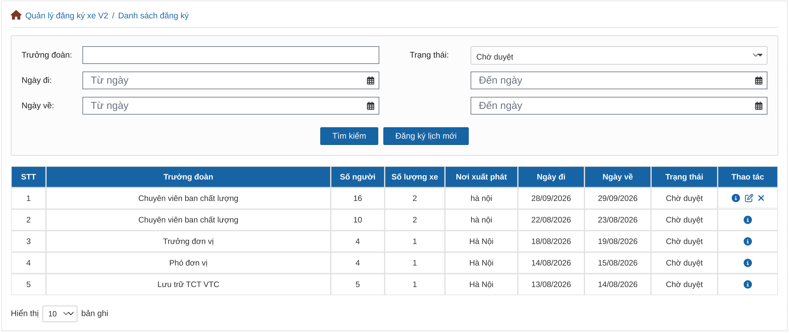
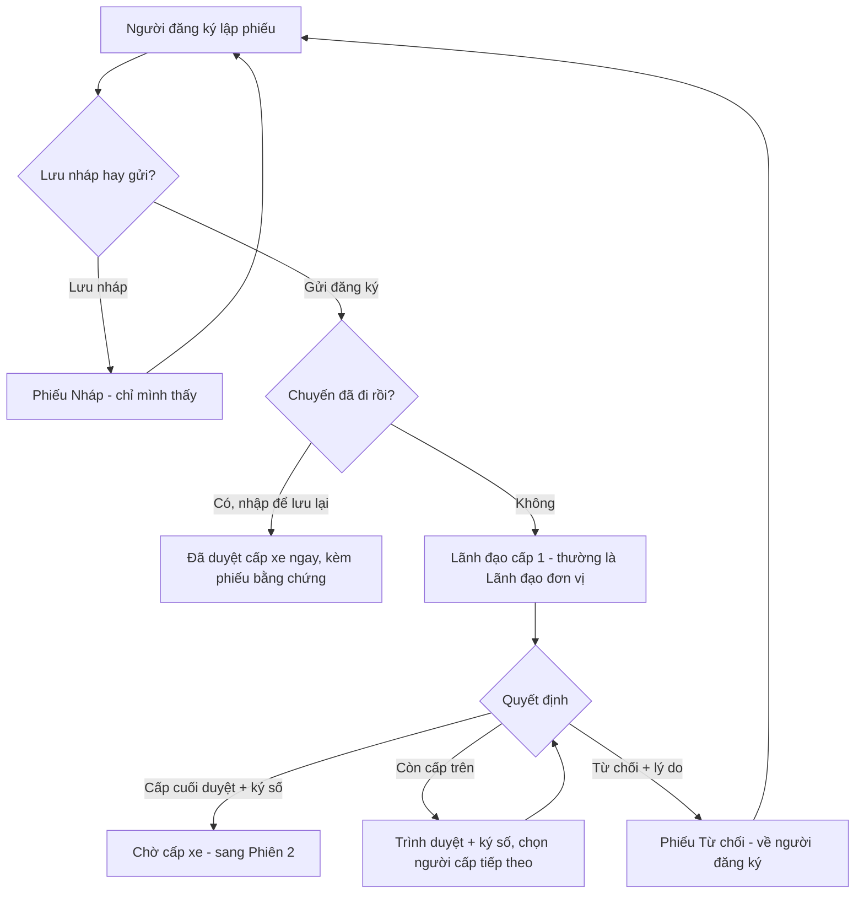
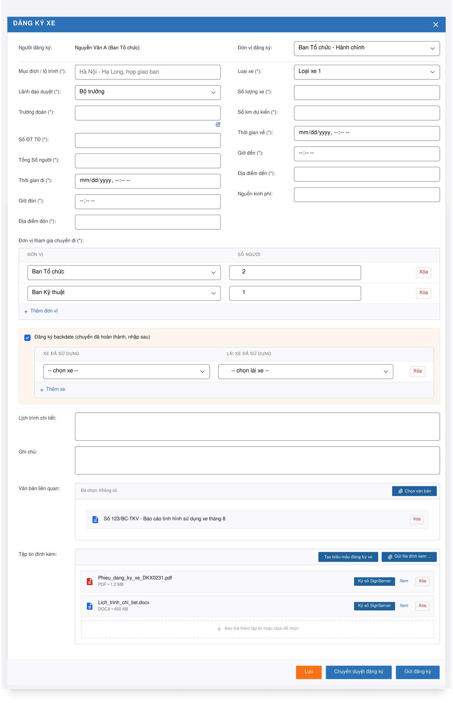
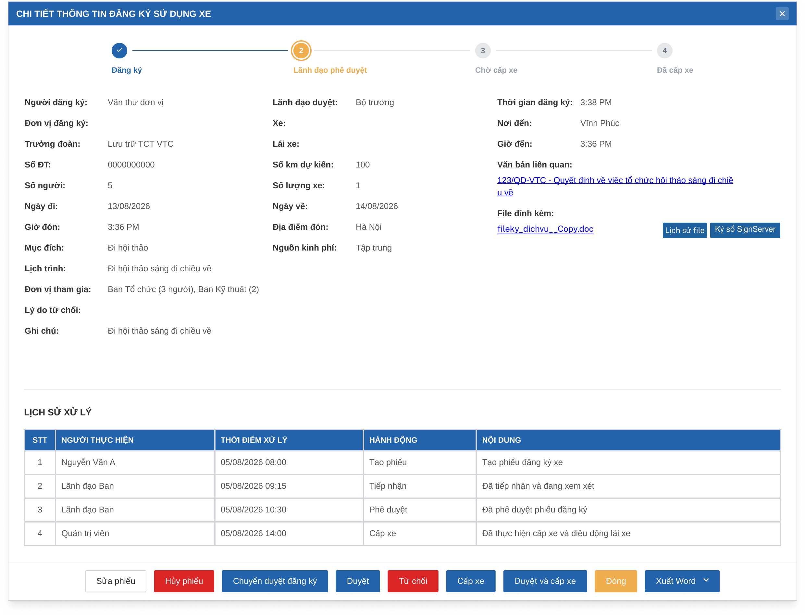
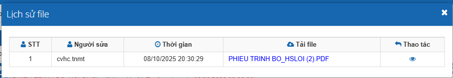
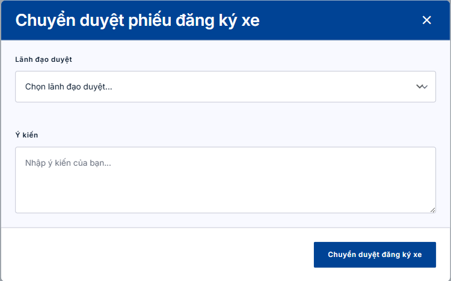
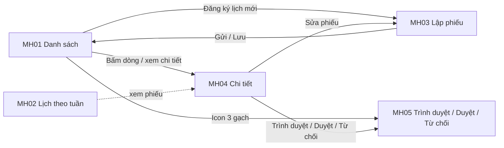

# TÀI LIỆU YÊU CẦU NGƯỜI DÙNG (URD)
## Module Quản lý đăng ký xe — Tập đoàn TKV

| Thông tin | Nội dung |
|---|---|
| Khách hàng | Tập đoàn Công nghiệp Than – Khoáng sản Việt Nam (TKV) |
| Phiên bản | v1.0 (viết lại từ URD v1.1 ngày 25/08/2026, bổ sung các CR phát sinh đến 09/2026; đã cập nhật theo phản hồi review ngày 16/10/2026) |
| Ngày | 16/10/2026 |
| Người soạn | BA VNPT-IT |
| Trạng thái | Dự thảo — chờ chốt |
| Phiên chốt | **Phiên 1/4 — Đăng ký & duyệt phiếu đăng ký xe** |

> **Ghi chú cho người đọc:** Tài liệu này mô tả **hệ thống sẽ hỗ trợ những công việc gì** và **giao diện thể hiện ở mức tổng quan**, để quý khách hàng cùng rà soát và xác nhận trước khi đội kỹ thuật xây dựng chi tiết. Tài liệu **không** đi vào chi tiết kỹ thuật (cấu trúc dữ liệu, kiểm tra từng ô nhập...) — phần đó nằm ở tài liệu đặc tả (SRS) dành cho đội phát triển.
>
> Module được chốt làm **4 phiên** cho dễ rà soát: Phiên 1 (tài liệu này) — Đăng ký & duyệt; Phiên 2 — Cấp xe & lái xe; Phiên 3 — Xác nhận xe về & đánh giá; Phiên 4 — Danh mục, định biên km, báo cáo.
>
> Những chỗ đánh dấu **[ĐỀ XUẤT]** là nội dung BA đề xuất để khách hàng cho ý kiến; **[CHỜ HÌNH]** là phần chờ khách hàng gửi hình thiết kế.
>
> **⚠️ Lưu ý khi gửi bản chính thức:** thay các sơ đồ dạng mã (đánh dấu 🖼️) bằng ảnh đã render.

---

## TÓM TẮT NHANH (đọc trong 3 phút)

| Mục | Nội dung |
|---|---|
| **Vấn đề đang gặp** | Đăng ký xe đang gắn với luồng văn bản; chưa có bước lãnh đạo đơn vị xác nhận ngay trong luồng; người đăng ký không biết phiếu đang chờ ai; phiếu xóa đi là mất hẳn. |
| **Mục tiêu hệ thống mới** | Một phiếu đi qua đúng chuỗi duyệt của từng đơn vị, có **ký số của lãnh đạo đơn vị và lãnh đạo văn phòng** ngay tại hai bước chuyển duyệt; người đăng ký luôn biết phiếu đang ở đâu. |
| **Phạm vi phiên 1** | Lập phiếu, duyệt nhiều cấp / từ chối, danh sách – chi tiết – lịch sử phiếu, hủy phiếu, xuất phiếu Word. |
| **Số màn hình** | 7 màn hình (MH01–MH07) |
| **Số yêu cầu cần chốt** | 14 yêu cầu (UR01–UR14) |
| **Đối tượng sử dụng** | Người đăng ký, Lãnh đạo duyệt (các cấp), Người cấp xe (chỉ theo dõi ở phiên này) |

🖼️ *Màn hình dùng nhiều nhất — Danh sách đăng ký xe:*

---

## MỤC LỤC

1. [Bối cảnh & Mục tiêu](#1-bối-cảnh--mục-tiêu)
2. [Đối tượng sử dụng](#2-đối-tượng-sử-dụng)
3. [Luồng nghiệp vụ tổng quan](#3-luồng-nghiệp-vụ-tổng-quan)
4. [Màn hình & thao tác](#4-màn-hình--thao-tác)
5. [Yêu cầu chức năng chi tiết](#5-yêu-cầu-chức-năng-chi-tiết)
6. [Ngoài phạm vi](#6-ngoài-phạm-vi)
7. [Tiêu chí nghiệm thu](#7-tiêu-chí-nghiệm-thu)
8. [Xác nhận chốt nghiệp vụ](#8-xác-nhận-chốt-nghiệp-vụ)
9. [Phụ lục — Câu hỏi cần làm rõ](#phụ-lục)

---

## 1. Bối cảnh & Mục tiêu

**Vấn đề hiện tại**
> Đội xe TKV phục vụ cả khối cơ quan Tập đoàn (trụ sở chính và Hạ Long) lẫn khối đảng, đoàn thể. Việc đăng ký xe hiện gắn với luồng văn bản; người đăng ký không biết phiếu đang chờ ai duyệt; khi cần tra lại ai đã xử lý, ý kiến thế nào thì khó tìm; phiếu xóa đi là mất hẳn.

**Mục tiêu khi có hệ thống mới**
> - Phiếu đăng ký xe đi qua đúng chuỗi duyệt của từng đơn vị (một hoặc nhiều cấp), lãnh đạo ký số ngay khi chuyển duyệt.
> - Người đăng ký nhìn vào là biết phiếu đang ở "Cấp mấy/tổng số cấp — ai đang xử lý".
> - Mọi bước xử lý (gửi, trình, duyệt, từ chối, hủy) được lưu lại để tra cứu; phiếu hủy vẫn xem lại được.

**Phạm vi phiên 1**
> - Lập, lưu nháp, gửi phiếu đăng ký xe; nhập lại chuyến đã đi (đăng ký muộn) kèm phiếu bằng chứng.
> - Duyệt nhiều cấp có ký số: trình lên cấp trên, duyệt, từ chối.
> - Danh sách phiếu, chi tiết phiếu, lịch sử xử lý, hủy phiếu, xuất phiếu Word, ký số file đính kèm.
> - Xem danh sách lịch đăng ký xe đã duyệt theo tuần.

---

## 2. Đối tượng sử dụng

### 👤 Người đăng ký (chuyên viên / văn thư ban)
- **Là ai:** Chuyên viên hành chính của một ban, thay trưởng đoàn lập phiếu khi có chuyến công tác.
- **Công việc hàng ngày liên quan hệ thống:** lập phiếu, đính kèm giấy tờ, theo dõi phiếu đã gửi, sửa lại phiếu bị từ chối; thỉnh thoảng nhập lại chuyến đã đi để lưu hồ sơ (đón khách đột xuất).
- **Điều họ cần:** biết phiếu đang ở đâu; không phải hỏi từng người; có sẵn phiếu Word đúng mẫu để lãnh đạo ký.

### 👤 Lãnh đạo duyệt (nhiều cấp)
- **Là ai:** Lãnh đạo đơn vị (trưởng/phó ban) và Lãnh đạo Văn phòng phụ trách quản trị (Chánh/Phó Chánh Văn phòng). **Lãnh đạo đơn vị xác nhận nội dung đăng ký ngay bằng chức năng "Trình duyệt"**, không có bước riêng. Số cấp duyệt khác nhau tùy đơn vị (tối đa 5 cấp), do đơn vị thiết lập.
- **Công việc hàng ngày liên quan hệ thống:** mở các phiếu đến lượt mình, ký số, trình tiếp lên cấp trên hoặc duyệt/từ chối.
- **Điều họ cần:** chỉ thấy phiếu đến lượt mình; từ chối phải ghi được lý do; tra lại phiếu mình đã trình đi.

### 👤 Người cấp xe (Đội trưởng/Đội phó đội xe)
- **Là ai:** Người điều vận của đội xe.
- **Ở phiên này:** chỉ nhận phiếu sau khi được duyệt xong và theo dõi được trên danh sách. Việc cấp xe chi tiết thuộc **Phiên 2**.

---

## 3. Luồng nghiệp vụ tổng quan

🖼️ *Sơ đồ luồng (render thành ảnh trước khi gửi khách):*

**Diễn giải bằng lời:**
1. **Lập phiếu** — Người đăng ký điền thông tin chuyến đi, chọn đơn vị cùng đi và số người mỗi đơn vị, chọn lãnh đạo duyệt cấp 1. Có thể **Lưu nháp** để làm tiếp sau.
2. **Gửi đăng ký** — Phiếu chuyển tới đúng lãnh đạo cấp 1 đã chọn, trạng thái "Chờ duyệt".
3. **Trình duyệt** — Lãnh đạo đơn vị xác nhận nội dung đúng thực tế, **ký số**, rồi chọn người duyệt cấp kế tiếp theo chuỗi duyệt của đơn vị mình; ghi thêm ý kiến nếu muốn. Phiếu **chỉ nằm ở danh sách việc cần làm của đúng một người** tại mỗi thời điểm.
4. **Duyệt** — Lãnh đạo cấp cuối (thường là Lãnh đạo Văn phòng) **ký số** và duyệt, phiếu chuyển sang "Chờ cấp xe".
5. **Từ chối** — Bất kỳ cấp nào cũng từ chối được, **bắt buộc ghi lý do**; phiếu về thẳng người đăng ký (không trả về cấp trước). Người đăng ký sửa và gửi lại từ cấp 1.
6. **Nhập lại chuyến đã đi (đăng ký muộn)** — Chuyến đã diễn ra nên **không cần duyệt**; phiếu chỉ để lưu lại số liệu. Người đăng ký chọn xe + lái xe đã dùng và **bắt buộc đính kèm phiếu bằng chứng**; phiếu vào thẳng "Đã duyệt cấp xe".

> **Ví dụ về số cấp:** Ban Vận tải dùng 3 cấp (chuyên viên → phó ban → trưởng ban); Phòng Hành chính chỉ dùng 1 cấp. Số cấp và người duyệt từng cấp lấy từ phân quyền theo đơn vị đã có sẵn.

### Các trạng thái của phiếu

| Trạng thái | Ý nghĩa |
|---|---|
| Nháp | Đã Lưu, chưa Gửi. Chỉ người tạo thấy. |
| Chờ duyệt | Đang chờ một lãnh đạo duyệt. Đơn vị nhiều cấp có thêm "Cấp X/N — người đang xử lý". |
| Đã trình cấp trên | Nhãn riêng cho người đã trình phiếu đi, chỉ hiện trong danh sách của họ; phiếu thật vẫn là "Chờ duyệt". |
| Chờ cấp xe | Đã duyệt xong, chờ đội xe gán xe và lái xe. |
| Đã duyệt cấp xe | Đã gán xe và lái xe (kể cả phiếu nhập lại chuyến đã đi). |
| Từ chối | Một cấp bất kỳ từ chối; người đăng ký sửa và gửi lại. |
| Đã hủy | Người đăng ký đã hủy; vẫn xem lại được, không sửa được nữa. |

---

## 4. Màn hình & thao tác

### 🖥️ Màn hình 1 (MH01) — Danh sách đăng ký xe
**Ai dùng:** Người đăng ký, Lãnh đạo duyệt, Người cấp xe · **Dùng để:** tra cứu và theo dõi các phiếu mà mình được phép xem.

| # | Khu vực | Diễn giải |
|---|---|---|
| ① | Ô tìm kiếm (Trưởng đoàn, Ngày đi, Ngày về, Trạng thái) | Lọc phiếu. Trạng thái có thêm **"Đã hủy"** và **"Đã trình cấp trên"** (giá trị sau chỉ hiện với đơn vị dùng nhiều cấp, và chỉ cho lãnh đạo xem lại phiếu mình đã trình đi). |
| ② | Nút "Đăng ký lịch mới" | Mở màn hình lập phiếu (MH03). |
| ③ | Bảng danh sách | Hiển thị trưởng đoàn, số người, số xe, nơi xuất phát, ngày đi/về, trạng thái. Với phiếu đang chờ duyệt ở đơn vị nhiều cấp có thêm "Cấp X/N — tên người đang xử lý". Bấm vào bất kỳ dòng nào để mở chi tiết (MH04). |
| ④ | Cột Thao tác | Biểu tượng xem chi tiết. Ngoài ra, mỗi dòng có thể có thêm biểu tượng "3 gạch" để Duyệt / Từ chối / Cấp xe nhanh ngay trên danh sách — **mặc định ẩn**, đơn vị nào cần thì bật (hình mẫu hiện chưa thể hiện biểu tượng này). |

> **Ai thấy phiếu nào:** theo nguyên tắc phân quyền hiện có của hệ thống — **[CHỜ XÁC NHẬN]** xem câu hỏi mở số 6.

### 🖥️ Màn hình 2 (MH02) — Danh sách lịch đăng ký xe (lịch đã duyệt theo tuần)
**Ai dùng:** Người đăng ký, đội xe · **Dùng để:** xem các lịch đăng ký xe đã được duyệt theo từng tuần.

🖼️ **[CHỜ HÌNH]** *Đây là màn hình danh sách lịch đăng ký xe hiện có của hệ thống; khách hàng sẽ gửi hình thiết kế sau.*

- Hiển thị các lịch đã duyệt (kể cả chuyến nhập lại sau khi đã đi), xem được theo từng tuần.
- Nội dung chi tiết sẽ bổ sung khi nhận được hình.

### 🖥️ Màn hình 3 (MH03) — Đăng ký xe (lập phiếu mới / sửa phiếu)
**Ai dùng:** Người đăng ký · **Dùng để:** lập, lưu nháp và gửi phiếu đăng ký xe.

| # | Khu vực | Diễn giải |
|---|---|---|
| ① | Thông tin chung | **Bắt buộc (theo hình mẫu có dấu \*):** mục đích/lộ trình, loại xe, lãnh đạo duyệt, trưởng đoàn, số ĐT trưởng đoàn, tổng số người, thời gian đi/về, giờ đón/đến, địa điểm đón/đến, số lượng xe, số km dự kiến. **Không bắt buộc:** nguồn kinh phí, lịch trình chi tiết, ghi chú. Người đăng ký và đơn vị tự điền theo tài khoản. Ô "Tổng số người" nhập tay, **độc lập** với số người từng đơn vị ở dưới. |
| ② | Bảng "Đơn vị tham gia chuyến đi" | Chọn từng đơn vị + số người. Không chọn trùng đơn vị. Luôn còn ít nhất 1 dòng (mặc định là đơn vị đăng ký). |
| ③ | Khối "Đăng ký backdate" (chuyến đã hoàn thành, nhập sau) | Tick khi chuyến **đã đi xong**, nhập để lưu lại. Hiện thêm bảng chọn **xe đã dùng + lái xe đã dùng**; không chọn được xe/lái xe đang trùng giờ với chuyến khác. **Bắt buộc đính kèm phiếu bằng chứng** ở khối Tệp tin đính kèm. |
| ④ | Lịch trình chi tiết, Ghi chú | Mô tả thêm. |
| ⑤ | Văn bản liên quan | Chọn 1 văn bản có sẵn từ hệ thống văn bản đi/đến; hiện thành thẻ gồm số hiệu + trích yếu; có nút gỡ (chỉ gỡ liên kết, không xóa văn bản). |
| ⑥ | Tệp tin đính kèm | Tải file lên; nút **"Tạo biểu mẫu đăng ký xe"** tự sinh phiếu Word từ mẫu của đơn vị; mỗi file có **Ký số / Xem / Xóa**. |
| ⑦ | Nút ở chân màn hình | **Lưu** (lưu nháp, không kiểm tra), **Gửi đăng ký**, hoặc **Trình duyệt đăng ký** (chỉ hiện khi lãnh đạo đang xử lý phiếu chưa phải cấp cuối). |

### 🖥️ Màn hình 4 (MH04) — Chi tiết đăng ký xe
**Ai dùng:** mọi người có quyền xem phiếu · **Dùng để:** xem đầy đủ nội dung, tiến độ, lịch sử và xử lý phiếu ngay tại đây.

| # | Khu vực | Diễn giải |
|---|---|---|
| ① | Thanh tiến trình 4 bước | Đăng ký → Lãnh đạo phê duyệt → Chờ cấp xe → Đã cấp xe. Bước đang xử lý được tô sáng; **Từ chối** dừng ở bước dở và đổi **đỏ**; **Đã hủy** đổi **xám**; **Nháp** làm mờ cả 4 bước. Đơn vị nhiều cấp có thêm "Cấp X/N — người đang xử lý" dưới bước 2. |
| ② | Thông tin chuyến | Hiển thị lại toàn bộ nội dung đã nhập (chỉ đọc), kèm đơn vị tham gia dạng "Ban A (3 người), Ban B (2)", lý do từ chối (chỉ khi bị từ chối). |
| ③ | Văn bản liên quan, File đính kèm | Bấm vào để xem văn bản/file. Mỗi file có nút **Lịch sử file** và **Ký số**. |
| ④ | Bảng "Lịch sử xử lý" | Ai làm gì, lúc nào, nội dung/ý kiến; xếp theo thời gian; nhiều dòng thì phân trang. |
| ⑤ | Nhóm nút ở chân màn hình | **Sửa phiếu, Hủy phiếu, Trình duyệt, Duyệt, Từ chối, Cấp xe, Duyệt và cấp xe, Xuất Word, Đóng** — mỗi người chỉ thấy các nút phù hợp với quyền và trạng thái phiếu (xem bảng dưới). |

**Ai thấy nút nào (tóm tắt):**

| Trạng thái phiếu | Người đăng ký | Lãnh đạo đang giữ phiếu | Người có quyền cấp xe |
|---|---|---|---|
| Nháp | Sửa, Hủy phiếu | — | — |
| Chờ duyệt, chưa tới cấp cuối | Sửa, Hủy phiếu | Trình duyệt, Từ chối | — |
| Chờ duyệt, ở cấp cuối | Sửa, Hủy phiếu | Duyệt, Từ chối (nếu đồng thời có quyền cấp xe: Duyệt và cấp xe, Từ chối) | — |
| Chờ cấp xe | **[ĐỀ XUẤT]** Hủy phiếu (nếu chuyến chưa khởi hành) | — | Cấp xe (hoặc Hủy duyệt nếu đơn vị bật) |
| Đã duyệt cấp xe | **[ĐỀ XUẤT]** Hủy phiếu (nếu chuyến chưa khởi hành) | — | Hủy cấp nếu đơn vị bật |
| Từ chối | Sửa (để gửi lại), Hủy phiếu | — | — |
| Đã hủy | chỉ Xuất Word, Đóng | — | — |

*Nút **Xuất Word** và **Đóng** luôn hiển thị.*

**Cửa sổ "Lịch sử file":** liệt kê các phiên bản của một file (tên, người sửa, thời gian, tải/xem), bản mới nhất ở trên.

### 🖥️ Màn hình 5 (MH05) — Trình duyệt phiếu đăng ký xe
**Ai dùng:** Lãnh đạo duyệt chưa phải cấp cuối (ví dụ Lãnh đạo đơn vị) · **Dùng để:** ký số và chuyển phiếu lên người duyệt cấp kế tiếp.

| # | Khu vực | Diễn giải |
|---|---|---|
| ① | Lãnh đạo duyệt | Chọn đích danh một người đang giữ quyền duyệt cấp kế tiếp của đơn vị (theo chuỗi duyệt đơn vị thiết lập). Bắt buộc chọn khi trình. Không chọn chính mình. |
| ② | Ý kiến | Tối đa 1.000 ký tự; không bắt buộc khi trình hoặc duyệt, **bắt buộc khi từ chối**. Được lưu vào lịch sử xử lý. |
| ③ | Ký số | Lãnh đạo ký số phiếu ngay tại bước này. **[GIẢ ĐỊNH]** ký trên file phiếu đăng ký đính kèm (Word/PDF); chờ xác nhận chi tiết ở câu hỏi mở số 1. |
| ④ | Nút | **Trình duyệt đăng ký xe** (khi còn cấp trên), **Duyệt** (khi ở cấp cuối), **Từ chối**. Mỗi lúc chỉ hiện nút phù hợp. |

> Hình thiết kế hiện chỉ có một nút và chưa thể hiện phần ký số; sẽ cập nhật hình.

### 🖥️ Màn hình 6 (MH06) — Duyệt chuyển cấp xe
**Ai dùng:** Lãnh đạo duyệt cấp cuối (thường là Lãnh đạo Văn phòng) · **Dùng để:** ký số và duyệt phiếu để chuyển sang đội xe cấp xe.

- Dùng chung khung cửa sổ ở MH05 (và nút Duyệt trên MH04); khi bấm **Duyệt**, lãnh đạo ký số, phiếu chuyển "Chờ cấp xe" và hiện trong danh sách việc của người cấp xe.
- Nếu người duyệt cuối đồng thời có quyền cấp xe thì có thêm nút **Duyệt và cấp xe**.
- Đơn vị chỉ dùng 1 cấp: lãnh đạo bấm thẳng **Duyệt**, không có bước trình.

### 🖥️ Màn hình 7 (MH07) — Từ chối đăng ký xe
**Ai dùng:** Lãnh đạo duyệt ở bất kỳ cấp nào · **Dùng để:** từ chối phiếu và ghi lý do.

- Bấm **Từ chối** trong cửa sổ ở MH05 (hoặc nút Từ chối ở MH04). Bắt buộc nhập **Ý kiến** (thiếu thì báo "Vui lòng nhập ý kiến trước khi từ chối").
- Phiếu về thẳng người đăng ký, trạng thái "Từ chối", hiển thị lý do ở MH04.

### Luồng chuyển giữa các màn hình

🖼️ *(render thành ảnh trước khi gửi khách)*

### Ví dụ tình huống thực tế

> **Tình huống 1 — đi nhiều đơn vị, 3 cấp duyệt:** Chị Hoa (văn thư Ban Vận tải) mở **MH01** → bấm "Đăng ký lịch mới" → ở **MH03** điền chuyến Hà Nội – Hạ Long, thêm "Ban Kỹ thuật (2 người)", chọn lãnh đạo cấp 1, bấm **Tạo biểu mẫu** → **Gửi đăng ký**. Phiếu hiện "Chờ duyệt — Cấp 1/3 — anh Minh (Lãnh đạo đơn vị)". Anh Minh mở phiếu ở **MH04** → thấy nội dung đúng thực tế → bấm **Trình duyệt**, ký số, chọn phó ban, ghi ý kiến "Đồng ý, đề nghị xếp xe 16 chỗ" (**MH05**). Chị Hoa thấy "Cấp 2/3 — chị Lan". Cấp 3 (Lãnh đạo Văn phòng) ký số và bấm **Duyệt** → "Chờ cấp xe".
>
> **Tình huống 2 — bị từ chối:** Ở cấp 2, chị Lan thấy ngày đi trùng lịch họp, bấm **Từ chối**, ghi lý do. Chị Hoa mở **MH04** thấy thanh tiến trình đỏ ở bước 2 và lý do; bấm **Sửa phiếu**, đổi ngày, **Gửi đăng ký** lại từ cấp 1.
>
> **Tình huống 3 — nhập lại chuyến đã đi:** Đoàn khách đột xuất đã đi xong hôm qua. Anh Tuấn tick "Đăng ký backdate", chọn xe + lái xe đã dùng, đính kèm phiếu bằng chứng, **Gửi đăng ký** → phiếu vào thẳng "Đã duyệt cấp xe" để lưu lại số liệu, không cần ai duyệt.
>
> **Tình huống 4 — hủy phiếu [ĐỀ XUẤT]:** Chuyến đã được cấp xe nhưng ngày mai đoàn hoãn đi. Chị Hoa mở **MH04**, bấm **Hủy phiếu**; xe và lái xe được trả lại lịch trống, lái xe và đội xe nhận thông báo, phiếu chuyển "Đã hủy" nhưng vẫn xem lại được.

---

## 5. Yêu cầu chức năng chi tiết

> **Về mã UR:** URD cũ bị trùng mã UR03 và UR15. Bản này đã đánh số lại không trùng, theo từng phiên. Cột "Mã cũ" sẽ được điền đối chiếu với URD v1.1 khi có file gốc.

### Nhóm A — Lập phiếu đăng ký xe

#### UR01 — Lập phiếu đăng ký xe
Người đăng ký cần lập một phiếu đăng ký xe đầy đủ thông tin chuyến đi để lãnh đạo có đủ căn cứ duyệt. Hệ thống tự điền người đăng ký và đơn vị theo tài khoản đăng nhập.

- **Lưu ý đặc biệt:** Ô "Tổng số người" và số người ghi cho từng đơn vị là hai con số riêng; hệ thống **không bắt phải bằng nhau** (đã được khách hàng xác nhận).
- **Màn hình liên quan:** MH03 · **Ưu tiên:** Cao

#### UR02 — Khai báo nhiều đơn vị cùng đi một chuyến
Khi chuyến có nhiều ban cùng đi, người đăng ký ghi rõ từng đơn vị và số người của đơn vị đó, để sau chuyến chia km đúng cho từng đơn vị (Phiên 3).

- **Lưu ý đặc biệt:** Ví dụ chọn "Ban Tổ chức" 2 người, "Ban Kỹ thuật" 1 người; chọn lại "Ban Tổ chức" lần nữa sẽ bị báo trùng. Luôn giữ ít nhất 1 đơn vị.
- **Màn hình liên quan:** MH03 · **Ưu tiên:** Cao

#### UR03 — Lưu nháp và gửi đăng ký
Người đăng ký muốn lưu dở phiếu để làm tiếp sau mà không bị bắt điền đủ, và chỉ khi sẵn sàng mới gửi đi duyệt.

- **Lưu ý đặc biệt:** Phiếu nháp **chỉ người tạo thấy**, lãnh đạo và đội xe không thấy. Khi **Gửi đăng ký** hệ thống mới kiểm tra đủ thông tin; thiếu ô nào báo ngay tại ô đó.
- **Màn hình liên quan:** MH03, MH01 · **Ưu tiên:** Cao

#### UR04 — Nhập lại chuyến đã đi (đăng ký muộn)
Khi chuyến đã đi xong mà chưa kịp đăng ký (ví dụ đón khách đột xuất), người đăng ký nhập lại để **lưu hồ sơ** và ghi nhận số liệu xe, km, không phải chờ duyệt.

- **Lưu ý đặc biệt:** Vì chuyến đã diễn ra nên phiếu **không qua duyệt**, vào thẳng "Đã duyệt cấp xe" với xe và lái xe đã chọn; lái xe và người đăng ký nhận tin nhắn. **Bắt buộc đính kèm phiếu bằng chứng** (hệ thống không cho gửi nếu thiếu). Không chọn được xe/lái xe đã bận cùng khung giờ. Bỏ tick thì các lựa chọn xe/lái xe đã nhập bị xóa.
- **Màn hình liên quan:** MH03 · **Ưu tiên:** Trung bình

#### UR05 — Văn bản liên quan, tệp đính kèm, biểu mẫu và ký số
Người đăng ký cần gắn văn bản căn cứ, đính kèm tài liệu, tự sinh phiếu Word đúng mẫu của đơn vị và ký số ngay trên hệ thống để khỏi in ra ký tay.

- **Lưu ý đặc biệt:** (1) Chỉ gắn được **1** văn bản; gỡ chỉ gỡ liên kết. (2) "Tạo biểu mẫu đăng ký xe" lấy mẫu của đơn vị (TKV đang dùng 2–3 mẫu cho các đơn vị khác nhau), sinh file Word tên dạng `Phieu_dang_ky_xe_<ngày>.docx` và thêm vào đính kèm, **chưa tự lưu/gửi**. (3) Ký số (bằng hệ thống ký số dùng chung của văn bản) áp dụng cho file PDF và Word: nếu tìm thấy tên người ký trên file thì tự ký vào đúng vị trí; không thấy thì mở màn hình ký nâng cao như bên văn bản.
- **Màn hình liên quan:** MH03, MH04 · **Ưu tiên:** Trung bình

### Nhóm B — Theo dõi phiếu

#### UR06 — Danh sách đăng ký xe
Người dùng cần một danh sách tập trung để lọc, tra cứu phiếu trong phạm vi được xem và mở nhanh phiếu cần xử lý.

- **Lưu ý đặc biệt:** Thêm trạng thái lọc **"Đã hủy"** và **"Đã trình cấp trên"**. Bấm vào dòng là mở chi tiết. Biểu tượng "3 gạch" (Duyệt/Từ chối/Cấp xe nhanh) ẩn mặc định, đơn vị nào cần thì bật.
- **Màn hình liên quan:** MH01 · **Ưu tiên:** Cao

#### UR07 — Xem danh sách lịch đăng ký xe đã duyệt theo tuần
Người đăng ký và đội xe cần xem nhanh các lịch đã duyệt theo từng tuần để nắm lịch sử dụng xe.

- **Lưu ý đặc biệt:** Đây là màn hình danh sách lịch đăng ký xe hiện có; **[CHỜ HÌNH]** để mô tả chi tiết và xác nhận có thay đổi gì so với hiện tại.
- **Màn hình liên quan:** MH02 · **Ưu tiên:** Trung bình

#### UR08 — Xem chi tiết phiếu, tiến độ và lịch sử xử lý
Ai có quyền xem phiếu cần thấy đầy đủ nội dung, phiếu đang ở bước nào, ai đã làm gì và ý kiến ra sao để tra soát không cần hỏi từng người.

- **Lưu ý đặc biệt:** Người không có quyền xem sẽ nhận thông báo "Bạn không có quyền xem phiếu này". Nếu phiếu vừa bị hủy trong lúc đang xem, mọi thao tác báo "Phiếu đã bị hủy, vui lòng tải lại danh sách".
- **Màn hình liên quan:** MH04 · **Ưu tiên:** Cao

### Nhóm C — Duyệt phiếu

#### UR09 — Duyệt nhiều cấp: Lãnh đạo đơn vị xác nhận, trình lên cấp kế tiếp
Mỗi đơn vị có chuỗi duyệt riêng gồm một hoặc nhiều cấp (tối đa 5). Thông thường cấp đầu là **Lãnh đạo đơn vị** xác nhận nội dung, cấp cuối là **Lãnh đạo Văn phòng** duyệt. Mỗi cấp bấm **"Trình duyệt"**, ký số, chọn đích danh người cấp kế tiếp theo chuỗi của đơn vị mình. Người đăng ký luôn thấy "Cấp X/N — tên người đang xử lý".

- **Lưu ý đặc biệt:**
  - Phiếu chỉ nằm ở danh sách "Chờ duyệt" của **một người** tại mỗi thời điểm. Người đã trình đi thấy nhãn "Đã trình cấp trên". Không được tự trình cho chính mình.
  - Số cấp và người từng cấp lấy từ phân quyền theo đơn vị đã có; thêm cấp hay đổi người chỉ cần đổi phân quyền. Đơn vị chưa thiết lập cấp nào thì vẫn duyệt 1 cấp như cũ.
  - **Ví dụ:** Chị Hoa làm việc ở Phòng Hành chính nhưng lập phiếu cho Ban Vận tải. Tùy thiết lập, chuỗi duyệt sẽ theo Ban Vận tải (đơn vị chị chọn trên phiếu) hoặc theo Phòng Hành chính (đơn vị của chị). Đơn vị đã được chốt khi tạo phiếu, không đổi dù sau đó sửa phiếu.
  - Tính năng nhiều cấp bật/tắt chung cho cả hệ thống. Tắt khi còn phiếu đang dở thì người đang giữ phiếu coi như cấp cuối và duyệt luôn.
- **Màn hình liên quan:** MH05, MH04, MH01 · **Ưu tiên:** Cao

#### UR10 — Duyệt và ký số, chuyển sang cấp xe
Lãnh đạo cấp cuối (thường là Lãnh đạo Văn phòng) cần ký số và duyệt để phiếu sang đội xe cấp xe; nếu kiêm quyền cấp xe thì làm một bước "Duyệt và cấp xe".

- **Lưu ý đặc biệt:** Phiếu "Chờ cấp xe" hiện trong danh sách việc của người cấp xe và nhận thông báo như cách hiện nay. Việc cấp xe chi tiết ở Phiên 2.
- **Màn hình liên quan:** MH05, MH06, MH04 · **Ưu tiên:** Cao

#### UR11 — Từ chối phiếu kèm lý do
Lãnh đạo ở bất kỳ cấp nào cần từ chối được phiếu không phù hợp và nói rõ lý do để người đăng ký sửa.

- **Lưu ý đặc biệt:** Bắt buộc nhập ý kiến. Phiếu về thẳng người đăng ký (không trả cấp trước). Người đăng ký sửa rồi gửi lại, tiến độ bắt đầu lại từ cấp 1 và mốc "Thời gian đăng ký" được cập nhật mới.
- **Màn hình liên quan:** MH07, MH04 · **Ưu tiên:** Cao

### Nhóm D — Các thao tác khác trên phiếu

#### UR12 — Hủy phiếu
Người tạo cần hủy phiếu không còn nhu cầu nhưng vẫn giữ được dấu vết để tra cứu về sau.

- **Lưu ý đặc biệt:** Hủy **không xóa hẳn** — phiếu chuyển sang "Đã hủy", lọc lại được ở danh sách, không sửa/hủy tiếp. Hiện áp dụng cho phiếu Nháp, Chờ duyệt và Từ chối. Lái xe và những người tham gia luồng nhận thông báo "Phiếu đăng ký đi từ [điểm đón] đến [điểm đến] đã bị hủy bởi [người tạo]".
- **[ĐỀ XUẤT] — hủy sau khi đã duyệt/cấp xe:** Người tạo phiếu được hủy cả khi phiếu đang "Chờ cấp xe" hoặc "Đã duyệt cấp xe", **miễn là chuyến chưa tới giờ khởi hành**. Khi đó xe và lái xe được trả lại lịch trống, đội xe và lái xe nhận thông báo. Chuyến đã tới giờ đi thì không hủy được (đội xe xử lý theo thực tế). Đội xe vẫn có nút "Hủy duyệt/Hủy cấp" (nếu đơn vị bật) để lùi phiếu một bước.
- **Màn hình liên quan:** MH04, MH01 · **Ưu tiên:** Trung bình

#### UR13 — Xuất phiếu đăng ký ra Word
Người dùng cần tải ngay phiếu đăng ký ra file Word theo mẫu để in hoặc gửi đi.

- **Lưu ý đặc biệt:** Dùng đúng mẫu như "Tạo biểu mẫu đăng ký xe" (UR05) nhưng tải thẳng về máy, không gắn vào đính kèm. Luôn có ở mọi trạng thái phiếu.
- **Màn hình liên quan:** MH04 · **Ưu tiên:** Thấp

#### UR14 — Xem lịch sử phiên bản của file đính kèm
Người dùng cần biết một file đã qua những lần cập nhật/ký số nào, ai làm, lúc nào, và tải lại được bản cũ để đối chiếu.

- **Lưu ý đặc biệt:** Mỗi lần tải lên hoặc ký số thành công sinh một phiên bản mới, **bản cũ không bị ghi đè**. Xóa file thì xóa luôn toàn bộ lịch sử phiên bản của file đó.
- **Màn hình liên quan:** MH04 · **Ưu tiên:** Thấp

---

## 6. Ngoài phạm vi

Ngoài phạm vi **toàn module** (theo trao đổi với khách hàng):
- Sổ theo dõi **bảo dưỡng**, **đăng kiểm** và **nhiên liệu** — chưa có màn hình trong đợt này.

Ngoài phạm vi **phiên 1** (thuộc phiên sau):
- Cấp xe, ghép xe, lái xe xác nhận / đổi lái xe → Phiên 2.
- Xác nhận xe về, chia km, đánh giá lái xe → Phiên 3.
- Danh mục xe/lái xe, định biên km, nhật ký xe ngoài chuyến, báo cáo → Phiên 4.
- Chức năng "Khai báo mẫu file đính kèm" (nơi khai báo các mẫu phiếu) — được dùng nhưng thuộc chức năng riêng, chưa mô tả ở tài liệu này (xem câu hỏi mở số 9).

---

## 7. Tiêu chí nghiệm thu

| # | Tiêu chí |
|---|---|
| 1 | **Khi** người đăng ký bấm Lưu, **thì** phiếu ở trạng thái Nháp, không bị kiểm tra thiếu thông tin và chỉ người tạo nhìn thấy. |
| 2 | **Khi** bấm Gửi đăng ký mà thiếu thông tin bắt buộc hoặc trùng đơn vị tham gia, **thì** hệ thống báo lỗi ngay tại ô tương ứng và không đổi trạng thái phiếu. |
| 3 | **Khi** chuyến có từ 2 đơn vị tham gia trở lên, **thì** hệ thống lưu đúng số người của từng đơn vị để dùng chia km ở Phiên 3. |
| 4 | **Khi** nhập lại chuyến đã đi với xe/lái xe hợp lệ và có phiếu bằng chứng đính kèm, **thì** phiếu vào thẳng "Đã duyệt cấp xe" mà không qua duyệt; thiếu phiếu bằng chứng hoặc chọn xe/lái xe trùng giờ thì bị chặn. |
| 5 | **Khi** lãnh đạo cấp k trình duyệt cho cấp k+1, **thì** phiếu rời danh sách "Chờ duyệt" của cấp k (hiện nhãn "Đã trình cấp trên"), chỉ xuất hiện ở danh sách của cấp k+1, và người đăng ký thấy "Cấp (k+1)/N — tên người". |
| 6 | **Khi** lãnh đạo ở bất kỳ cấp nào từ chối, **thì** hệ thống bắt nhập lý do, phiếu về thẳng người đăng ký và lý do hiển thị ở chi tiết phiếu. |
| 7 | **Khi** lãnh đạo cấp cuối ký số và duyệt, **thì** phiếu sang "Chờ cấp xe" và người cấp xe nhận thông báo. |
| 8 | **Khi** hủy phiếu, **thì** phiếu chuyển "Đã hủy", vẫn tra cứu lại được, các bên liên quan nhận thông báo, và không còn nút Sửa/Hủy. |
| 9 | **Khi** mở chi tiết phiếu, **thì** thanh tiến trình, lịch sử xử lý và bộ nút hiển thị đúng theo quyền và trạng thái của người xem. |
| 10 | **Khi** ký số một file đính kèm thành công, **thì** hệ thống sinh phiên bản mới đã ký và giữ nguyên bản cũ trong "Lịch sử file". |
| 11 | **Khi** Lãnh đạo đơn vị và Lãnh đạo Văn phòng lần lượt trình duyệt/duyệt, **thì** chữ ký số của từng người được ghi nhận tại đúng bước của họ và tra lại được trong lịch sử xử lý. |
| 12 | **[ĐỀ XUẤT]** **Khi** người tạo hủy phiếu đã cấp xe trước giờ khởi hành, **thì** xe và lái xe được trả lại lịch trống và đội xe, lái xe nhận thông báo. |

---

## 8. Xác nhận chốt nghiệp vụ

| Đại diện | Họ tên | Chữ ký | Ngày |
|---|---|---|---|
| Khách hàng (TKV) | | | |
| VNPT-IT (BA/PO) | | | |

---

## PHỤ LỤC

### Thuật ngữ
| Thuật ngữ | Ý nghĩa |
|---|---|
| Đăng ký muộn (backdate) | Nhập lại phiếu cho chuyến đã diễn ra thực tế để lưu hồ sơ; không qua duyệt |
| CVP / PCVP | Chánh Văn phòng / Phó Chánh Văn phòng |
| Cấp duyệt | Mỗi mức lãnh đạo trong chuỗi duyệt của đơn vị (tối đa 5) |
| Ký số | Ký điện tử trực tiếp trên file bằng hệ thống ký số dùng chung của văn bản |

### Câu hỏi cần làm rõ sau buổi chốt
1. **Ký số tại hai bước duyệt:** (a) Ký trên file nào — phiếu đăng ký Word/PDF đính kèm? (b) Có bắt buộc ký mới trình/duyệt được không? (c) Lãnh đạo chưa có chữ ký số thì xử lý thế nào?
2. **Hủy sau khi cấp xe:** đề xuất ở UR12 có phù hợp không (điều kiện "chưa tới giờ khởi hành", ai được hủy)?
3. **Đăng ký muộn:** ai được tạo? Có giới hạn lùi bao nhiêu ngày? Phiếu bằng chứng cần loại file nào, tối thiểu mấy file?
4. **Thông báo:** người đăng ký có được báo khi phiếu được trình, duyệt, từ chối không, và qua kênh nào (trên hệ thống hay thêm SMS)?
5. **Lãnh đạo vắng:** có cần duyệt thay/ủy quyền, nhắc việc khi phiếu nằm lâu, và "trả lại cấp trước" (ngoài từ chối)? Sửa phiếu khi đang chờ duyệt thì duyệt có quay lại cấp 1 không?
6. **Ai thấy phiếu nào (MH01):** mô tả cụ thể theo từng vai (chuyên viên, lãnh đạo đơn vị, lãnh đạo văn phòng, đội xe).
7. **Phiếu Nháp để lâu:** có nhắc, tự dọn sau X ngày, hay giữ vô thời hạn?
8. **File sau khi ký số:** có khóa không cho sửa/xóa hay vẫn xóa/thay thế bình thường?
9. **Phiếu Word mẫu:** khách cung cấp file mẫu (đang dùng 2–3 mẫu); ai khai báo mẫu trong chức năng "Khai báo mẫu file đính kèm"?
10. **Ô bắt buộc:** hình mẫu đánh dấu \* cho Số ĐT, Tổng số người, Số km dự kiến nhưng tài liệu đặc tả chưa nêu — xác nhận.
11. **Hình thiết kế cần cập nhật:** MH02 (chờ hình); MH05 (thêm ký số, nút Duyệt/Từ chối); tên nút "Chuyển duyệt/Phê duyệt/Tiếp nhận" → "Trình duyệt/Duyệt".
12. **Nền tảng và dữ liệu cũ:** chỉ dùng trên web hay cả điện thoại? Phiếu đang có ở hệ thống cũ có chuyển sang không?

---

## CÁCH DÙNG FILE NÀY (hướng dẫn nội bộ cho BA — xóa mục này trước khi gửi khách hàng)

1. Render 2 sơ đồ Mermaid thành ảnh, thay vào các chỗ 🖼️; ảnh màn hình nằm ở `docs/URD_KH_QLDKX_images/` (cần đi kèm file khi gửi).
2. MH02 chờ hình từ khách; MH06/MH07 dùng chung hình MH05 — hình MH05 cần cập nhật (thêm ký số).
3. Số liệu tóm tắt (7 màn hình, 14 UR) cập nhật lại nếu thêm/bớt nội dung.
4. **Lệch với SRS cần cập nhật (CR mới):** (a) Lãnh đạo ban xác nhận = cấp duyệt qua "Trình duyệt" (SRS_00 mô tả như bước riêng); (b) ký số tại 2 bước trình/duyệt (CR-0902 chưa mô tả ký số trong modal); (c) đăng ký muộn bắt buộc đính kèm phiếu bằng chứng (CR-0829 chưa có); (d) hủy phiếu sau khi cấp xe (đề xuất, CR-0909 chưa cho).
5. Sau khi chốt cả 4 phiên: gộp lại, chuẩn hóa mã UR về dãy UR01–UR22 không trùng, rồi chạy `urd-writer-vnpt` tạo bản BM_URD để lưu hồ sơ.
6. Nguồn đã dùng: SRS_00, MH01 (CR-0908), CR-0829, CR-0902, CR-0909 chi tiết đăng ký xe, và phản hồi review của khách ngày 16/10/2026.
