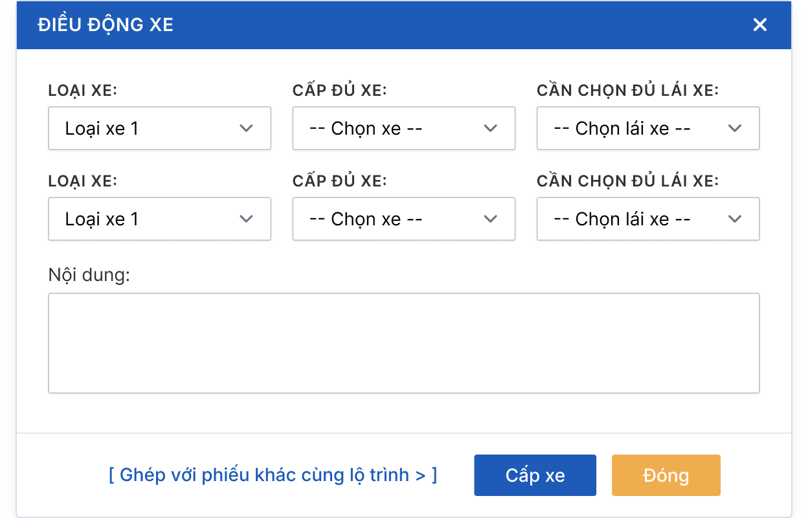
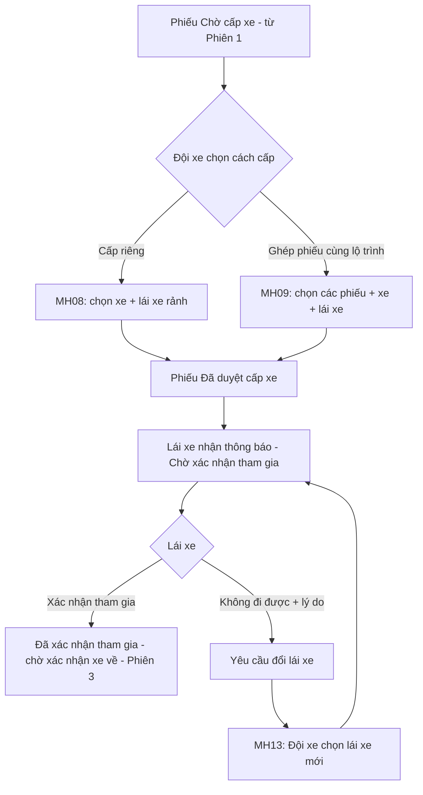
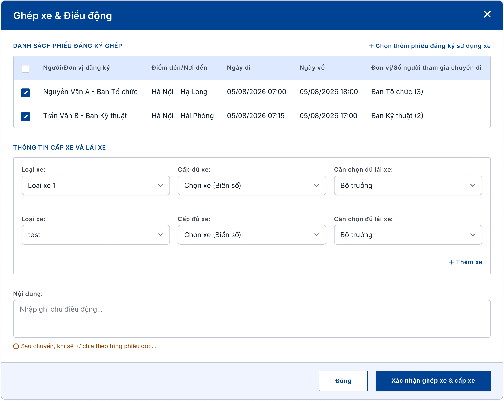
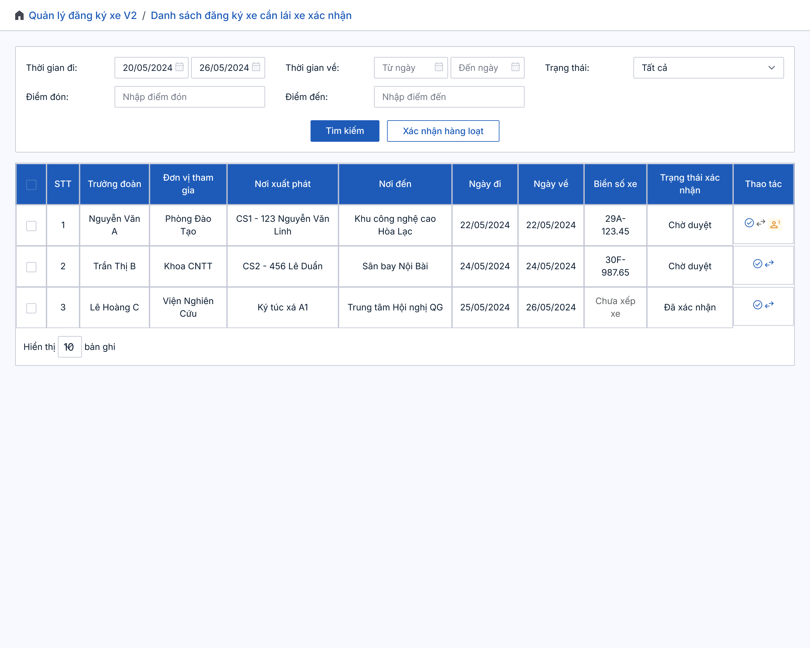
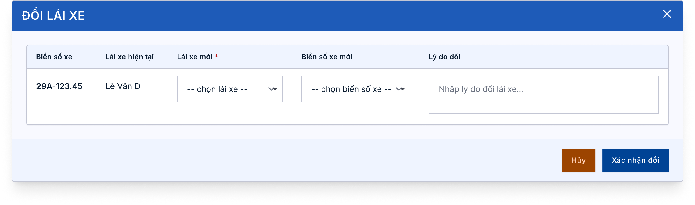
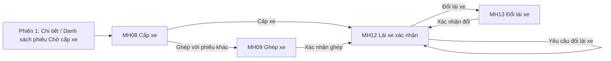

# TÀI LIỆU YÊU CẦU NGƯỜI DÙNG (URD)
## Module Quản lý đăng ký xe — Tập đoàn TKV

| Thông tin | Nội dung |
|---|---|
| Khách hàng | Tập đoàn Công nghiệp Than – Khoáng sản Việt Nam (TKV) |
| Phiên bản | v1.0 (viết lại từ URD v1.1 ngày 25/08/2026, bổ sung các CR phát sinh đến 09/2026) |
| Ngày | 16/10/2026 |
| Người soạn | BA VNPT-IT |
| Trạng thái | Dự thảo — chờ chốt |
| Phiên chốt | **Phiên 2/4 — Cấp xe & lái xe** |

> **Ghi chú cho người đọc:** Tài liệu này mô tả **hệ thống sẽ hỗ trợ những công việc gì** và **giao diện thể hiện ở mức tổng quan**, để quý khách hàng cùng rà soát và xác nhận trước khi đội kỹ thuật xây dựng chi tiết. Tài liệu **không** đi vào chi tiết kỹ thuật — phần đó nằm ở tài liệu đặc tả (SRS) dành cho đội phát triển.
>
> Module được chốt làm **4 phiên**: Phiên 1 — Đăng ký & duyệt (đã soạn); **Phiên 2 (tài liệu này) — Cấp xe & lái xe**; Phiên 3 — Xác nhận xe về & đánh giá; Phiên 4 — Danh mục, định biên km, báo cáo. Phiên 2 bắt đầu từ lúc phiếu đã được duyệt xong ("Chờ cấp xe") — xem Phiên 1.
>
> **[ĐỀ XUẤT]** là nội dung BA đề xuất để khách hàng cho ý kiến. **⚠️ Lưu ý khi gửi bản chính thức:** thay các sơ đồ dạng mã (đánh dấu 🖼️) bằng ảnh đã render.

---

## TÓM TẮT NHANH (đọc trong 3 phút)

| Mục | Nội dung |
|---|---|
| **Vấn đề đang gặp** | Hệ thống cũ không có việc ghép nhiều phiếu cùng lộ trình vào một xe, lái xe chỉ xác nhận sau chuyến (không có bước xác nhận trước khi đi), và khi lái xe có việc đột xuất thì không đổi được lái xe sau khi đã cấp. |
| **Mục tiêu hệ thống mới** | Đội xe cấp xe và lái xe không trùng lịch, ghép được các phiếu cùng tuyến để tiết kiệm xe; lái xe xác nhận tham gia trước chuyến; đổi lái xe nhanh mà không phải lập lại phiếu. |
| **Phạm vi phiên 2** | Cấp xe/điều động, ghép xe, lái xe xác nhận tham gia (từng chuyến hoặc hàng loạt), báo không đi được, đổi lái xe. |
| **Số màn hình** | 4 màn hình (MH08, MH09, MH12, MH13) |
| **Số yêu cầu cần chốt** | 6 yêu cầu (UR15–UR20, đánh số tiếp theo Phiên 1) |
| **Đối tượng sử dụng** | Đội trưởng/phó đội xe (người cấp xe), Lái xe, Người đăng ký (nhận thông báo) |

🖼️ *Màn hình tiêu biểu — Điều động xe (cấp xe):*

---

## MỤC LỤC

1. [Bối cảnh & Mục tiêu](#1-bối-cảnh--mục-tiêu)
2. [Đối tượng sử dụng](#2-đối-tượng-sử-dụng)
3. [Luồng nghiệp vụ tổng quan](#3-luồng-nghiệp-vụ-tổng-quan)
4. [Màn hình & thao tác](#4-màn-hình--thao-tác)
5. [Yêu cầu chức năng chi tiết](#5-yêu-cầu-chức-năng-chi-tiết)
6. [Ngoài phạm vi](#6-ngoài-phạm-vi)
7. [Tiêu chí nghiệm thu](#7-tiêu-chí-nghiệm-thu)
8. [Xác nhận chốt nghiệp vụ](#8-xác-nhận-chốt-nghiệp-vụ)
9. [Phụ lục — Câu hỏi cần làm rõ](#phụ-lục)

---

## 1. Bối cảnh & Mục tiêu

**Vấn đề hiện tại**
> - Khi nhiều đơn vị cùng đi một tuyến trong cùng buổi, đội xe phải cấp riêng từng xe cho từng phiếu, tốn xe; hệ thống cũ không có việc ghép phiếu.
> - Lái xe chỉ xác nhận sau khi đi về, không có bước xác nhận *trước* chuyến; đội xe không biết lái xe đã nhận lịch chưa.
> - Khi lái xe ốm hoặc bận đột xuất, hệ thống cũ không cho đổi lái xe sau khi đã cấp; phải làm lại từ đầu.

**Mục tiêu khi có hệ thống mới**
> - Cấp xe nhanh, chỉ hiện xe và lái xe đang rảnh nên không cấp trùng lịch.
> - Ghép được nhiều phiếu cùng lộ trình vào chung xe nhưng sau chuyến km vẫn chia riêng từng phiếu.
> - Lái xe xác nhận tham gia trước chuyến, báo được khi không đi được; đội xe đổi lái xe ngay trên hệ thống.

**Phạm vi phiên 2**
> - Cấp xe và phân lái xe cho phiếu đã duyệt (kể cả cấp nhiều xe cho một phiếu).
> - Ghép nhiều phiếu cùng lộ trình vào chung xe.
> - Lái xe xem chuyến được cấp, xác nhận tham gia (từng chuyến hoặc hàng loạt), báo không đi được.
> - Đổi lái xe (và đổi xe nếu cần) cho chuyến đã cấp.
> - Thông báo cho các bên liên quan.

---

## 2. Đối tượng sử dụng

### 👤 Đội trưởng/Đội phó đội xe (người cấp xe)
- **Là ai:** Người điều vận của đội xe, được phân quyền cấp xe.
- **Công việc hàng ngày liên quan hệ thống:** nhận các phiếu "Chờ cấp xe", chọn xe và lái xe, ghép các phiếu cùng tuyến, xử lý khi lái xe báo không đi được.
- **Điều họ cần:** chỉ thấy xe và lái xe đang rảnh; ghép phiếu nhanh; biết lái xe đã nhận lịch chưa.

### 👤 Lái xe
- **Là ai:** Người lái xe phục vụ chuyến đi, thường có xe biên chế cố định.
- **Công việc hàng ngày liên quan hệ thống:** xem chuyến được cấp cho mình, xác nhận sẽ đi, hoặc báo không đi được.
- **Điều họ cần:** chỉ thấy chuyến của mình; xác nhận nhanh nhiều chuyến một lúc; có lý do rõ ràng khi bị đổi.

### 👤 Người đăng ký
- **Là ai:** Chuyên viên/văn thư đã lập phiếu (xem Phiên 1).
- **Ở phiên này:** không thao tác; chỉ nhận thông báo khi phiếu được cấp xe, được ghép, lái xe xác nhận hoặc bị đổi lái xe.

### 👤 Người có quyền đổi lái xe
- **Là ai:** Người được phân quyền đổi lái xe (thường là Đội trưởng/phó đội xe) — xem câu hỏi mở số 1.

---

## 3. Luồng nghiệp vụ tổng quan

🖼️ *Sơ đồ luồng (render thành ảnh trước khi gửi khách):*

**Diễn giải bằng lời:**
1. **Cấp xe** — Đội xe mở phiếu "Chờ cấp xe", hệ thống gợi ý xe và lái xe đang rảnh trong đúng khung giờ chuyến. Đội xe chọn loại xe, biển số, lái xe (mặc định là lái xe biên chế của xe, sửa lại được). Phiếu cần nhiều xe thì cấp nhiều dòng.
2. **Hoặc ghép phiếu** — Nếu có nhiều phiếu cùng lộ trình, đội xe bấm "Ghép với phiếu khác cùng lộ trình", chọn các phiếu muốn ghép rồi chọn xe + lái xe chung. Tất cả phiếu trong nhóm cùng chuyển "Đã duyệt cấp xe" một lúc.
3. **Lái xe xác nhận tham gia** — Lái xe nhận thông báo, vào danh sách chuyến của mình, xác nhận từng chuyến hoặc nhiều chuyến cùng lúc. Chuyến có ghép nhiều phiếu thì hiện **một dòng cho mỗi xe** và xác nhận một lần là cho cả nhóm.
4. **Không đi được** — Lái xe bấm "Yêu cầu đổi lái xe", **bắt buộc ghi lý do**. Phiếu chuyển "Yêu cầu đổi lái xe".
5. **Đổi lái xe** — Người có quyền chọn lái xe khác đang rảnh (đổi cả xe nếu cần). Lái xe mới phải xác nhận tham gia; lái xe cũ không còn thấy chuyến; trạng thái phiếu không quay về "Chờ cấp xe".

> Ví dụ: Ngày 05/08 có hai phiếu — Ban Tổ chức đi Hà Nội – Hạ Long (3 người) và Ban Kỹ thuật đi Hà Nội – Hải Phòng (2 người). Đội xe ghép hai phiếu vào cùng một xe; sau chuyến, km chia riêng cho từng ban (Phiên 3).

### Các trạng thái của lái xe tại mỗi chuyến

| Trạng thái | Ý nghĩa |
|---|---|
| Chờ xác nhận tham gia | Đã được cấp xe, lái xe chưa xác nhận. |
| Yêu cầu đổi lái xe | Lái xe báo không đi được, chờ người có quyền đổi. |
| Đã xác nhận tham gia | Lái xe đã xác nhận; chuyến chờ xác nhận xe về sau khi đi (Phiên 3). |

*(Trạng thái của phiếu: xem bảng ở Phiên 1 — phiếu sau khi cấp xe ở "Đã duyệt cấp xe".)*

---

## 4. Màn hình & thao tác

### 🖥️ Màn hình 1 (MH08) — Điều động xe (cấp xe)
**Ai dùng:** Đội trưởng/phó đội xe · **Dùng để:** chọn xe và lái xe cho một phiếu đã duyệt.

| # | Khu vực | Diễn giải |
|---|---|---|
| ① | Các dòng cấp xe (Loại xe – Chọn xe – Chọn lái xe) | Mở ra sẵn số dòng bằng số xe đã đăng ký trên phiếu. Chọn loại xe → danh sách biển số chỉ gồm xe thuộc loại đó **và đang rảnh** trong khung giờ chuyến. Chọn biển số → tự điền lái xe biên chế của xe đó, sửa lại được. Có thể thêm dòng để cấp nhiều xe. |
| ② | Xem toàn bộ danh sách xe | Mở danh sách tất cả xe (không chỉ gợi ý) để chọn xe khác; vẫn chỉ hiện xe đang rảnh. |
| ③ | Nội dung | Ghi chú của đội xe, không bắt buộc. |
| ④ | Ghép với phiếu khác cùng lộ trình | Chuyển sang MH09 để ghép phiếu thay vì cấp riêng. Chỉ hiện khi phiếu còn "Chờ cấp xe". |
| ⑤ | Nút Cấp xe / Đóng | **Cấp xe** chỉ chạy khi đã chọn đủ xe + lái xe cho mọi dòng; phiếu chuyển "Đã duyệt cấp xe", lái xe và người đăng ký nhận thông báo. |

### 🖥️ Màn hình 2 (MH09) — Ghép xe & Điều động
**Ai dùng:** Đội trưởng/phó đội xe · **Dùng để:** gộp nhiều phiếu cùng lộ trình vào chung xe.

| # | Khu vực | Diễn giải |
|---|---|---|
| ① | Danh sách phiếu đăng ký ghép | Phiếu đang xử lý luôn được chọn sẵn. Hệ thống **gợi ý** các phiếu "Chờ cấp xe" khác cùng điểm đón/đến và cùng ngày, cùng buổi (sáng/chiều) với phiếu này; đội xe tick thêm ít nhất 1 phiếu. Có thể mở "toàn bộ danh sách phiếu Chờ cấp xe" để tự chọn phiếu khác. Hiện tổng số người của các phiếu đã chọn. |
| ② | Thông tin cấp xe và lái xe | Giống MH08: chọn loại xe, biển số, lái xe; xe/lái xe phải rảnh trong khung giờ chung của cả nhóm; thêm xe nếu nhóm đông. Nếu số xe không đủ chỗ cho tổng số người, hệ thống **chỉ cảnh báo, không chặn**. |
| ③ | Nội dung và lưu ý | Ghi chú cho cả nhóm. Dòng nhắc: "Sau chuyến, km sẽ tự chia theo từng phiếu gốc". |
| ④ | Nút | **Xác nhận ghép xe & cấp xe** (cần tối thiểu 2 phiếu và đủ xe/lái xe); **Đóng**. |

### 🖥️ Màn hình 3 (MH12) — Danh sách đăng ký xe cần lái xe xác nhận
**Ai dùng:** Lái xe · **Dùng để:** xem chuyến được cấp cho mình, xác nhận tham gia hoặc báo không đi được.

| # | Khu vực | Diễn giải |
|---|---|---|
| ① | Ô tìm kiếm | Lọc theo thời gian đi, thời gian về, điểm đón, điểm đến, trạng thái (mặc định "Chờ xác nhận tham gia"). Nút **Xác nhận hàng loạt**. |
| ② | Bảng danh sách | Chỉ hiện chuyến của **chính lái xe đang đăng nhập** (xếp theo ngày đi mới nhất trước). Gồm trưởng đoàn, đơn vị tham gia, nơi xuất phát/đến, ngày đi/về, biển số xe, lái xe, trạng thái. **Chuyến ghép nhiều phiếu hiện một dòng cho mỗi xe.** |
| ③ | Ô tick từng dòng | Chỉ chọn được dòng "Chờ xác nhận tham gia"; dùng cho xác nhận hàng loạt. |
| ④ | Cột Thao tác | **Xác nhận tham gia** (dòng chờ xác nhận); **Yêu cầu đổi lái xe** (dòng chờ xác nhận) — bấm ra ô nhập lý do bắt buộc; **Đổi lái xe** (dòng đã có yêu cầu đổi, chỉ người có quyền thấy) — mở MH13. Dòng đã xác nhận thì không còn các biểu tượng này. |

> Hình thiết kế hiện ghi trạng thái "Chờ duyệt / Đã xác nhận"; cần đổi theo bảng trạng thái ở Mục 3 (xem câu hỏi mở số 4).

### 🖥️ Màn hình 4 (MH13) — Đổi lái xe
**Ai dùng:** Người có quyền đổi lái xe · **Dùng để:** thay lái xe (và xe nếu cần) cho chuyến đã cấp.

| # | Khu vực | Diễn giải |
|---|---|---|
| ① | Biển số xe, Lái xe hiện tại | Chỉ xem. |
| ② | Lái xe mới | **Bắt buộc chọn.** Chỉ hiện lái xe đang hoạt động và rảnh trong khung giờ chuyến, không gồm lái xe hiện tại. |
| ③ | Biển số xe mới | Không bắt buộc; chỉ đổi khi cần đổi cả xe. Chỉ hiện xe đang rảnh, không gồm xe hiện tại. |
| ④ | Lý do đổi | Tối đa 1.000 ký tự; không bắt buộc. Được gửi kèm thông báo cho lái xe cũ. |
| ⑤ | Nút Xác nhận đổi / Hủy | Đổi xong, lái xe mới phải xác nhận tham gia; lái xe cũ không còn thấy chuyến. |

### Luồng chuyển giữa các màn hình

🖼️ *(render thành ảnh trước khi gửi khách)*

### Ví dụ tình huống thực tế

> **Tình huống 1 — cấp xe riêng:** Phiếu của chị Hoa (Ban Vận tải) đã duyệt xong. Anh Dũng (đội trưởng đội xe) mở **MH08**, hệ thống đã mở sẵn 2 dòng vì phiếu cần 2 xe. Chọn "Xe 16 chỗ" → hiện các biển số còn rảnh, lái xe biên chế tự điền. Anh Dũng bấm **Cấp xe**; chị Hoa và hai lái xe nhận thông báo, phiếu sang "Đã duyệt cấp xe".
>
> **Tình huống 2 — ghép phiếu:** Có thêm phiếu của Ban Kỹ thuật cùng buổi sáng đi cùng tuyến. Anh Dũng bấm **Ghép với phiếu khác cùng lộ trình** → ở **MH09** tick phiếu Ban Kỹ thuật, chọn 1 xe 16 chỗ và 1 lái xe, hệ thống nhắc "tổng 5 người, xe đủ chỗ", bấm **Xác nhận ghép xe & cấp xe**. Cả hai phiếu cùng sang "Đã duyệt cấp xe"; cả hai người đăng ký nhận thông báo.
>
> **Tình huống 3 — lái xe xác nhận hàng loạt:** Bác Lê Văn D mở **MH12**, thấy 3 chuyến tuần tới, tick cả 3, bấm **Xác nhận hàng loạt**. Người đăng ký và đội xe nhận thông báo.
>
> **Tình huống 4 — báo không đi được và đổi lái xe:** Sáng hôm sau bác D ốm, bấm **Yêu cầu đổi lái xe** ở chuyến chưa xác nhận, ghi "Ốm, không lái được". Anh Dũng thấy chuyến ở trạng thái "Yêu cầu đổi lái xe", bấm **Đổi lái xe** → ở **MH13** chọn anh Nam (đang rảnh), bấm **Xác nhận đổi**. Anh Nam nhận thông báo và phải xác nhận tham gia; bác D nhận thông báo đã được gỡ; chị Hoa nhận thông báo đổi lái xe.

---

## 5. Yêu cầu chức năng chi tiết

> Mã UR đánh số tiếp theo Phiên 1 (UR15 trở đi) để không trùng. Việc chuẩn hóa mã toàn bộ 4 phiên và đối chiếu với URD v1.1 sẽ làm khi gộp tài liệu ở cuối.

### Nhóm A — Cấp xe

#### UR15 — Cấp xe và phân lái xe cho phiếu đã duyệt
Đội xe cần chọn xe và lái xe cho phiếu "Chờ cấp xe" một cách nhanh chóng và không bị cấp trùng lịch. Hệ thống chỉ hiện xe và lái xe đang rảnh trong khung giờ chuyến và gợi ý sẵn lái xe biên chế của xe đã chọn.

- **Lưu ý đặc biệt:**
  - Số dòng cấp xe mở sẵn bằng số xe đã đăng ký trên phiếu; đội xe cấp nhiều xe cho một phiếu khi số người đông. Mỗi dòng là một cặp xe + lái xe độc lập.
  - "Xe/lái xe bận" gồm cả các chuyến đã ghép chung và các chuyến nhập lại sau khi đã đi (Phiên 1).
  - Nếu hai người cùng cấp trùng một xe cùng lúc, người bấm sau nhận thông báo "Xe/Lái xe vừa được cấp cho phiếu khác, vui lòng chọn lại". Không chọn cùng một xe cho hai dòng trong một lần cấp. Phiếu bị hủy hoặc bị đổi trạng thái trong lúc đang cấp thì báo lỗi và không cấp.
  - Cấp xong, phiếu sang "Đã duyệt cấp xe" và nút "Ghép với phiếu khác" biến mất; muốn ghép phải thực hiện từ trước khi cấp.
- **Màn hình liên quan:** MH08 · **Ưu tiên:** Cao

#### UR16 — Ghép nhiều phiếu cùng lộ trình vào chung xe
Khi nhiều đơn vị đi cùng tuyến trong cùng thời gian, đội xe cần ghép các phiếu vào chung xe để tiết kiệm xe, nhưng sau chuyến km và chi phí vẫn chia đúng cho từng phiếu.

- **Lưu ý đặc biệt:**
  - Hệ thống chỉ **gợi ý** phiếu cùng điểm đón/đến, cùng ngày, cùng buổi; không yêu cầu trùng giờ chính xác. Đội xe vẫn mở được toàn bộ danh sách phiếu "Chờ cấp xe" để tự chọn.
  - Phải ghép tối thiểu 2 phiếu. Không giới hạn số phiếu trong một nhóm; nếu xe không đủ chỗ cho tổng số người, chỉ cảnh báo, không chặn.
  - Ghép thành công thì **tất cả** phiếu trong nhóm cùng sang "Đã duyệt cấp xe" một lúc; nếu có sự cố thì hoặc cả nhóm thành công, hoặc cả nhóm không đổi. Nút "Ghép" của MH08 luôn dẫn sang MH09 và đội xe chọn lại xe/lái xe tại đó.
  - Sau chuyến, km và chi phí được chia riêng cho từng phiếu gốc (thực hiện ở Phiên 3).
- **Màn hình liên quan:** MH09, MH08 · **Ưu tiên:** Cao

### Nhóm B — Lái xe xác nhận tham gia

#### UR17 — Lái xe xem chuyến được cấp và xác nhận tham gia
Lái xe cần xem các chuyến được cấp cho mình và xác nhận sẽ đi (từng chuyến hoặc nhiều chuyến cùng lúc), để đội xe và người đăng ký biết lịch đã được nhận.

- **Lưu ý đặc biệt:**
  - Lái xe chỉ thấy chuyến của chính mình (dùng tài khoản được chuyển quyền thì theo tài khoản đó).
  - Xác nhận một chiều: đã xác nhận thì không quay lại "Chờ xác nhận". Xác nhận hàng loạt chỉ áp dụng dòng còn chờ; dòng đã đổi trạng thái giữa chừng bị bỏ qua và nêu rõ trong thông báo.
  - Chuyến ghép: hiện một dòng cho mỗi xe, xác nhận một lần là xác nhận cho tất cả phiếu trong nhóm.
  - Người đăng ký và đội xe nhận thông báo "Lái xe [tên] đã xác nhận tham gia chuyến [điểm đón] – [điểm đến] – [ngày đi]".
- **Màn hình liên quan:** MH12 · **Ưu tiên:** Cao

#### UR18 — Lái xe báo không đi được (yêu cầu đổi lái xe)
Khi có việc đột xuất, lái xe cần báo ngay trên hệ thống thay vì gọi điện, kèm lý do.

- **Lưu ý đặc biệt:** Chỉ báo được ở chuyến đang "Chờ xác nhận tham gia"; **bắt buộc nhập lý do**. Gửi xong, chuyến chuyển "Yêu cầu đổi lái xe", chờ người có quyền đổi lái xe xử lý. Chuyến đã xác nhận thì không còn nút này (xem câu hỏi mở số 2).
- **Màn hình liên quan:** MH12 · **Ưu tiên:** Cao

### Nhóm C — Đổi lái xe

#### UR19 — Đổi lái xe (và đổi xe nếu cần) cho chuyến đã cấp
Người có quyền cần chọn lái xe khác thay cho lái xe không đi được mà không phải lập lại phiếu hay cấp xe từ đầu.

- **Lưu ý đặc biệt:**
  - Lái xe mới phải đang hoạt động và rảnh trong khung giờ chuyến. Có thể đổi cả xe nếu cần; xe mới cũng phải rảnh.
  - Sau khi đổi: chuyến giữ nguyên là "Chờ xác nhận tham gia" nhưng **với lái xe mới**; lái xe cũ không còn thấy chuyến; phiếu không quay về "Chờ cấp xe"; thông tin xe/lái xe trên phiếu và các màn hình liên quan được cập nhật.
  - Chỉ người được phân quyền mới đổi được; người khác bị báo "Bạn không có quyền đổi lái xe cho chuyến này". Nếu chuyến vừa đổi trạng thái (lái xe cũ vừa xác nhận, vừa bị hủy cấp, hoặc người khác vừa đổi) thì báo "Chuyến đã thay đổi trạng thái, vui lòng tải lại".
  - Đổi sát giờ khởi hành vẫn được thực hiện, kể cả khi lái xe mới có thể không kịp xác nhận.
- **Màn hình liên quan:** MH13, MH12 · **Ưu tiên:** Cao

### Nhóm D — Thông báo

#### UR20 — Thông báo cho các bên khi cấp xe, xác nhận và đổi lái xe
Mỗi bên liên quan cần được báo đúng lúc để không phải hỏi nhau.

| Khi nào | Ai nhận | Nội dung chính |
|---|---|---|
| Cấp xe (MH08) | Lái xe được cấp; Người đăng ký | Lái xe: được cấp xe [biển số] cho chuyến ngày [..], vui lòng xác nhận. Người đăng ký: phiếu đã được cấp xe [danh sách biển số]. |
| Ghép xe (MH09) | Lái xe; người đăng ký của từng phiếu trong nhóm | Lái xe: chuyến ghép gồm [n] phiếu. Người đăng ký: phiếu được ghép cùng [n-1] phiếu khác và đã cấp xe [biển số]. |
| Lái xe xác nhận (MH12) | Người đăng ký; Đội trưởng/phó đội xe | Lái xe [tên] đã xác nhận tham gia chuyến [..]. |
| Đổi lái xe (MH13) | Lái xe mới; lái xe cũ; Người đăng ký | Mới: được cấp thay thế, vui lòng xác nhận. Cũ: đã được gỡ khỏi chuyến, kèm lý do. Người đăng ký: đổi lái xe từ [cũ] sang [mới]. |

- **Lưu ý đặc biệt:** Mọi thao tác cấp xe, ghép xe, xác nhận, đổi lái xe đều được ghi lại (ai làm, lúc nào, thay đổi gì) để tra cứu. Kênh thông báo (chỉ trên hệ thống hay thêm SMS) xem câu hỏi mở số 7.
- **Màn hình liên quan:** MH08, MH09, MH12, MH13 · **Ưu tiên:** Trung bình

---

## 6. Ngoài phạm vi

Ngoài phạm vi **toàn module** (theo trao đổi với khách hàng):
- Sổ theo dõi **bảo dưỡng**, **đăng kiểm** và **nhiên liệu** — chưa có màn hình trong đợt này.

Ngoài phạm vi **phiên 2** (thuộc phiên khác hoặc giữ nguyên như hiện có):
- Lập phiếu, duyệt nhiều cấp → Phiên 1.
- Lái xe xác nhận xe về, chia km, đánh giá lái xe → Phiên 3.
- Danh mục xe/lái xe (nguồn xe biên chế, số chỗ, trạng thái hoạt động), định biên km, nhật ký xe ngoài chuyến, báo cáo → Phiên 4.
- Các chức năng Hủy duyệt/Hủy cấp xe hiện có: giữ nguyên, không thay đổi ở phiên này (xem câu hỏi mở số 8).

---

## 7. Tiêu chí nghiệm thu

| # | Tiêu chí |
|---|---|
| 1 | **Khi** đội xe chọn xe/lái xe cho một phiếu, **thì** danh sách không có xe và lái xe đang bận cùng khung ngày–giờ với chuyến khác (kể cả chuyến ghép chung và chuyến nhập lại). |
| 2 | **Khi** đội xe chọn một biển số xe, **thì** lái xe biên chế của xe tự được điền và sửa lại được. |
| 3 | **Khi** phiếu cần nhiều xe, **thì** đội xe cấp được nhiều dòng xe + lái xe cho cùng một phiếu; còn dòng thiếu xe hoặc lái xe thì chặn cấp và báo lỗi tại đúng dòng. |
| 4 | **Khi** cấp xe thành công, **thì** phiếu sang "Đã duyệt cấp xe", lái xe và người đăng ký nhận thông báo, thao tác được ghi lại. |
| 5 | **Khi** hai người cùng chọn trùng một xe cùng lúc, **thì** người bấm sau nhận thông báo chọn lại và không có hai bản ghi cấp xe cho cùng phiếu. |
| 6 | **Khi** đội xe ghép từ 2 phiếu trở lên, **thì** tất cả phiếu trong nhóm cùng sang "Đã duyệt cấp xe" một lúc; thiếu phiếu thứ hai thì không cho ghép. |
| 7 | **Khi** xe được chọn không đủ chỗ cho tổng số người của nhóm ghép, **thì** hệ thống chỉ cảnh báo và vẫn cho ghép. |
| 8 | **Khi** lái xe mở danh sách, **thì** chỉ thấy chuyến của mình; chuyến ghép hiện một dòng cho mỗi xe. |
| 9 | **Khi** lái xe xác nhận tham gia (từng chuyến hoặc hàng loạt), **thì** chuyển đúng sang "Đã xác nhận tham gia", dòng đã đổi trạng thái bị bỏ qua và nêu rõ, thông báo gửi đủ, không xác nhận trùng một chuyến. |
| 10 | **Khi** lái xe báo không đi được, **thì** bắt buộc nhập lý do và chuyến chuyển "Yêu cầu đổi lái xe". |
| 11 | **Khi** đổi lái xe thành công, **thì** lái xe mới thấy chuyến ở "Chờ xác nhận tham gia", lái xe cũ không còn thấy, phiếu không quay về "Chờ cấp xe", ba bên nhận thông báo, thao tác được ghi lại. |
| 12 | **Khi** chọn lái xe mới, **thì** danh sách không có lái xe bận hoặc lái xe hiện tại; người không có quyền thì bị từ chối. |

---

## 8. Xác nhận chốt nghiệp vụ

| Đại diện | Họ tên | Chữ ký | Ngày |
|---|---|---|---|
| Khách hàng (TKV) | | | |
| VNPT-IT (BA/PO) | | | |

---

## PHỤ LỤC

### Thuật ngữ
| Thuật ngữ | Ý nghĩa |
|---|---|
| Ghép xe | Gộp nhiều phiếu cùng lộ trình, cùng thời gian vào chung một xe |
| Nhóm ghép | Các phiếu được ghép cùng nhau; sau chuyến km vẫn chia riêng từng phiếu |
| Xe biên chế | Xe được gán cố định cho một lái xe, lấy từ danh mục xe |
| Điều động | Việc đội xe phân xe và lái xe cho chuyến đi |

### Câu hỏi cần làm rõ sau buổi chốt
1. **Ai đổi lái xe?** Tài liệu MH13 lúc ghi "lái xe hoặc đội xe", lúc ghi "người được phân quyền". Đề xuất: lái xe chỉ *gửi yêu cầu* (MH12), người có quyền đổi lái xe thực hiện ở MH13. Đúng không? Người có quyền đổi gồm những ai (chỉ đội trưởng/phó hay thêm người khác)?
2. **Lái xe đã xác nhận rồi mới phát sinh không đi được:** hiện không còn nút yêu cầu đổi. Xử lý thế nào (đội xe tự đổi, hay lái xe vẫn được báo)?
3. **Đội xe có được báo khi lái xe gửi yêu cầu đổi không?** Tài liệu chưa có thông báo này. Chuyến sát giờ mà lái xe chưa xác nhận hoặc yêu cầu đổi chưa ai xử lý thì có nhắc/cảnh báo không?
4. **Tên trạng thái trên hình MH12:** hình ghi "Chờ duyệt/Đã xác nhận", cần đổi thành "Chờ xác nhận tham gia / Yêu cầu đổi lái xe / Đã xác nhận tham gia".
5. **Ghép khác tuyến:** hình mẫu MH09 ghép Hà Nội – Hạ Long với Hà Nội – Hải Phòng (khác điểm đến), trong khi quy tắc gợi ý là cùng điểm đón/đến. Đội xe vẫn tự chọn được qua "xem toàn bộ phiếu"; xác nhận có cho ghép khác tuyến không, hay có giới hạn.
6. **Hủy phiếu khi đã ghép / bỏ ghép:** nếu một phiếu trong nhóm bị hủy sau khi ghép (liên quan đề xuất hủy sau cấp xe ở Phiên 1) thì xe có tiếp tục đi cho các phiếu còn lại không? Có chức năng "tách/bỏ ghép" không?
7. **Kênh thông báo:** MH08, MH09 chỉ ghi thông báo trên hệ thống; MH12, MH13 ghi "tất cả các kênh". Thống nhất kênh nào (có SMS không)?
8. **Hủy duyệt / Hủy cấp xe:** hai chức năng hiện có (bật theo thiết lập của đơn vị) — giữ nguyên hay có điều chỉnh gì khi có ghép xe và lái xe xác nhận?
9. **Số xe được cấp:** số dòng cấp xe mở sẵn bằng số xe đăng ký, nhưng có nút "Thêm xe". Đội xe có được cấp nhiều hơn số xe đã đăng ký không?
10. **Phạm vi phiếu đội xe thấy để cấp/ghép:** theo quyền; xác nhận có phân theo đơn vị hay mọi đội xe thấy tất cả phiếu "Chờ cấp xe"?
11. **Danh mục xe/lái xe (Phiên 4):** số chỗ ngồi của xe, lái xe biên chế, trạng thái "đang hoạt động" lấy từ danh mục — cần đảm bảo các thông tin này có và đúng khi chốt Phiên 4.

---

## CÁCH DÙNG FILE NÀY (hướng dẫn nội bộ cho BA — xóa mục này trước khi gửi khách hàng)

1. Render 2 sơ đồ Mermaid thành ảnh, thay vào các chỗ 🖼️; ảnh màn hình nằm ở `docs/URD_KH_QLDKX_images/`.
2. Số liệu tóm tắt (4 màn hình, 6 UR) cập nhật lại nếu thêm/bớt nội dung. Mã UR tiếp tục từ UR15; **tổng số UR toàn module sẽ vượt 22**, cần chuẩn hóa khi gộp.
3. **Lệch/thiếu trong SRS cần xử lý:** (a) trạng thái sau cấp xe đang ghi "Đã duyệt" (MH08 BR-04) và "Đã cấp xe" (MH08/MH09) — thống nhất "Đã duyệt cấp xe" theo SRS_00; (b) MH13 mô tả lúc "lái xe hoặc đội xe" lúc "người được phân quyền"; (c) chưa có thông báo cho đội xe khi lái xe yêu cầu đổi; (d) mockup MH12 đang dùng tên trạng thái cũ; (e) kênh thông báo không thống nhất; (f) MH08 chưa có đặc tả "Hủy cấp xe"/"Hủy duyệt" trong tài liệu hiện có ngoài phần tham chiếu tới tài liệu gốc.
4. Nguồn đã dùng: SRS_00, MH08 (CR-cap-xe), MH09 (CR-ghep-xe-dieu-dong), MH12 (danh-sach-lai-xe-xac-nhan-tham-gia), MH13 (doi-lai-xe) và các hình trong thư mục `images/` tương ứng.
5. Phiên 3 sẽ gồm MH10, MH11 (xác nhận xe về, chia km, đánh giá lái xe); Phiên 4: MH14–MH18.
