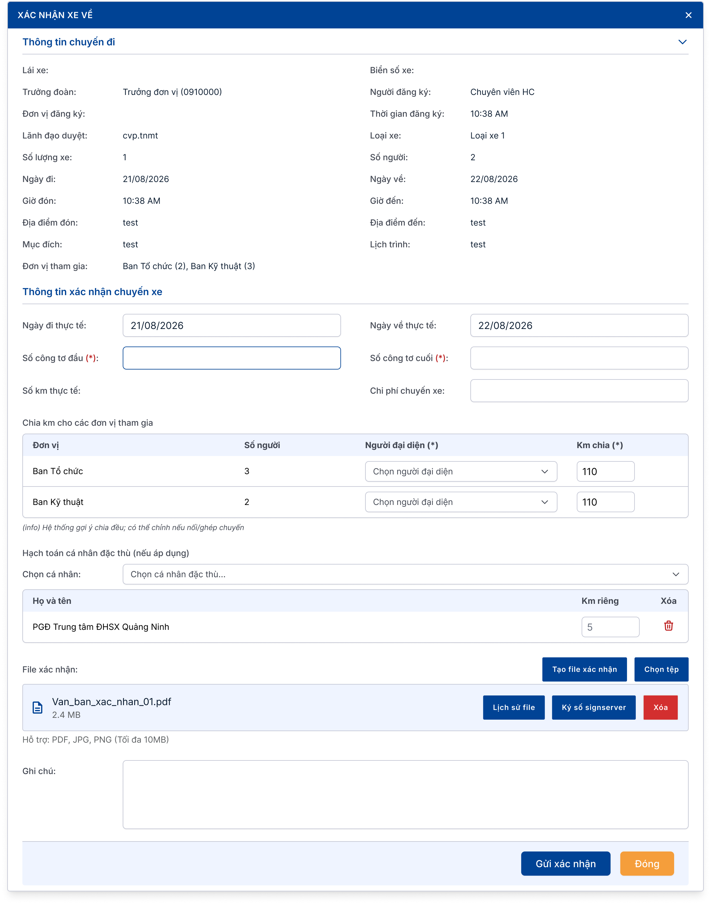
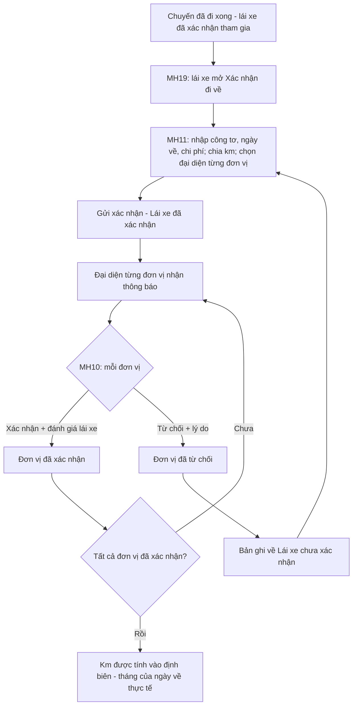
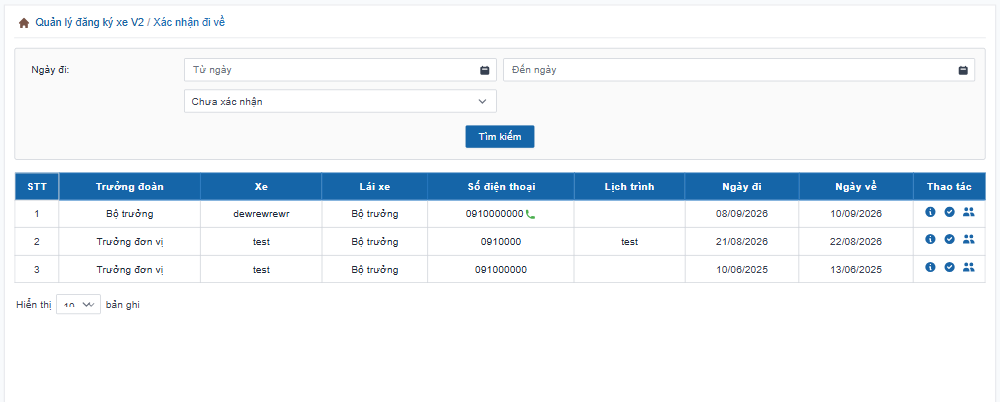
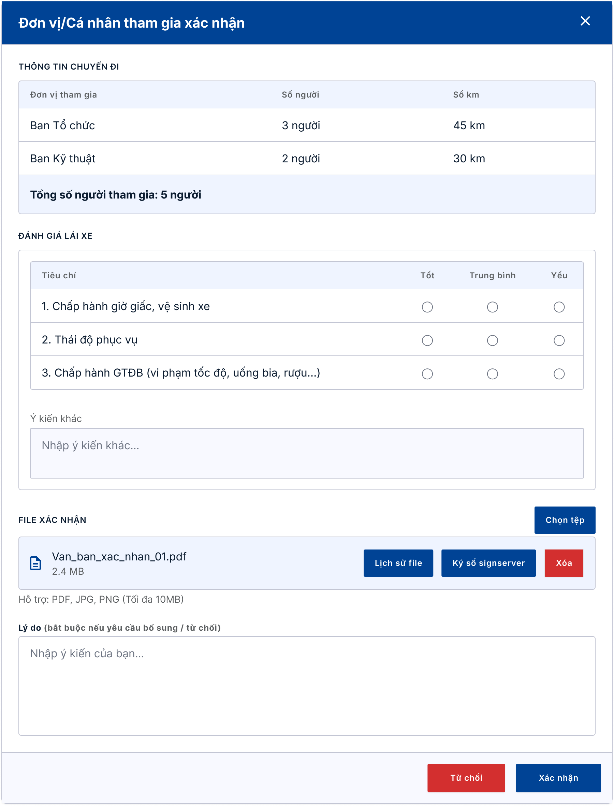
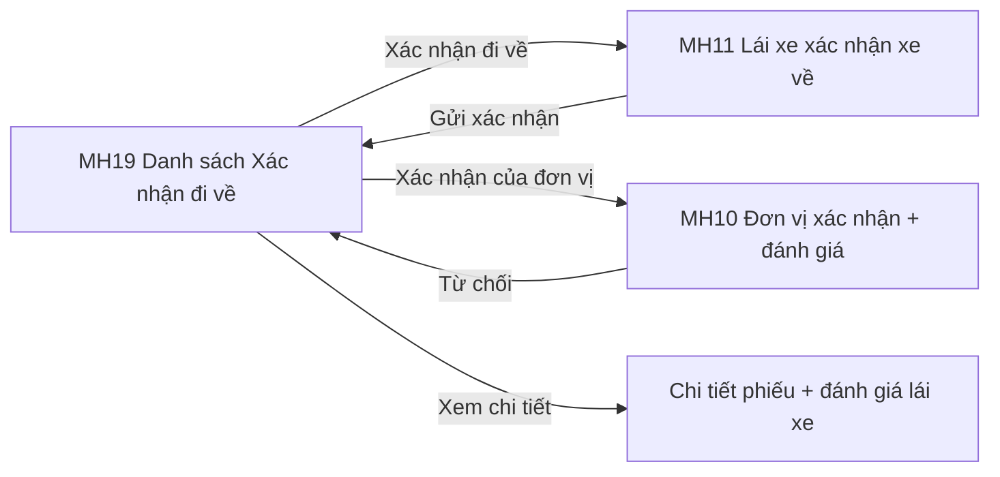

# TÀI LIỆU YÊU CẦU NGƯỜI DÙNG (URD)
## Module Quản lý đăng ký xe — Tập đoàn TKV

| Thông tin | Nội dung |
|---|---|
| Khách hàng | Tập đoàn Công nghiệp Than – Khoáng sản Việt Nam (TKV) |
| Phiên bản | v1.0 (viết lại từ URD v1.1 ngày 25/08/2026, bổ sung các CR phát sinh đến 09/2026) |
| Ngày | 16/10/2026 |
| Người soạn | BA VNPT-IT |
| Trạng thái | Dự thảo — chờ chốt |
| Phiên chốt | **Phiên 3/4 — Xác nhận xe về & đánh giá lái xe** |

> **Ghi chú cho người đọc:** Tài liệu này mô tả **hệ thống sẽ hỗ trợ những công việc gì** và **giao diện thể hiện ở mức tổng quan**, để quý khách hàng cùng rà soát và xác nhận trước khi đội kỹ thuật xây dựng chi tiết. Tài liệu **không** đi vào chi tiết kỹ thuật — phần đó nằm ở tài liệu đặc tả (SRS) dành cho đội phát triển.
>
> Module được chốt làm **4 phiên**: Phiên 1 — Đăng ký & duyệt; Phiên 2 — Cấp xe & lái xe; **Phiên 3 (tài liệu này) — Xác nhận xe về & đánh giá**; Phiên 4 — Danh mục, định biên km, báo cáo. Phiên 3 bắt đầu từ lúc lái xe đã xác nhận tham gia và chuyến đã đi xong (xem Phiên 2).
>
> **[ĐỀ XUẤT]** là nội dung BA đề xuất để khách hàng cho ý kiến. **[CHỜ HÌNH]** là phần chờ hình thiết kế. **⚠️ Lưu ý khi gửi bản chính thức:** thay các sơ đồ dạng mã (đánh dấu 🖼️) bằng ảnh đã render.

---

## TÓM TẮT NHANH (đọc trong 3 phút)

| Mục | Nội dung |
|---|---|
| **Vấn đề đang gặp** | Hệ thống cũ chỉ có một người xác nhận chung cho cả chuyến và không có đánh giá lái xe; khi chuyến có nhiều ban cùng đi thì không chia được km theo từng ban, nên khó kiểm soát định biên km. |
| **Mục tiêu hệ thống mới** | Lái xe nhập số liệu thực tế một lần, hệ thống gợi ý chia km theo từng đơn vị; **mỗi đơn vị tự xác nhận phần của mình và đánh giá lái xe**; km chỉ được tính vào định biên sau khi các đơn vị đã xác nhận. |
| **Phạm vi phiên 3** | Lái xe xác nhận xe về và chia km; hạch toán km cho cá nhân đặc thù; từng đơn vị xác nhận, đánh giá lái xe, ký số; xử lý khi đơn vị từ chối; danh sách xác nhận đi về. |
| **Số màn hình** | 4 màn hình (MH19, MH11, MH10 và màn hình chi tiết phiếu từ danh sách xác nhận đi về) |
| **Số yêu cầu cần chốt** | 10 yêu cầu (UR21–UR30, đánh số tiếp theo Phiên 2) |
| **Đối tượng sử dụng** | Lái xe, Đại diện đơn vị tham gia chuyến, Người đăng ký / Đội xe (nhận thông báo, xem kết quả) |

🖼️ *Màn hình tiêu biểu — Lái xe xác nhận xe về:*

---

## MỤC LỤC

1. [Bối cảnh & Mục tiêu](#1-bối-cảnh--mục-tiêu)
2. [Đối tượng sử dụng](#2-đối-tượng-sử-dụng)
3. [Luồng nghiệp vụ tổng quan](#3-luồng-nghiệp-vụ-tổng-quan)
4. [Màn hình & thao tác](#4-màn-hình--thao-tác)
5. [Yêu cầu chức năng chi tiết](#5-yêu-cầu-chức-năng-chi-tiết)
6. [Ngoài phạm vi](#6-ngoài-phạm-vi)
7. [Tiêu chí nghiệm thu](#7-tiêu-chí-nghiệm-thu)
8. [Xác nhận chốt nghiệp vụ](#8-xác-nhận-chốt-nghiệp-vụ)
9. [Phụ lục — Câu hỏi cần làm rõ](#phụ-lục)

---

## 1. Bối cảnh & Mục tiêu

**Vấn đề hiện tại**
> - Sau chuyến, chỉ có một người xác nhận chung cho cả chuyến; không có đánh giá lái xe ở bước này.
> - Chuyến nhiều ban cùng đi nhưng km không được chia theo từng ban, nên không kiểm soát được định biên km của từng ban/cá nhân.
> - Chuyến đi qua tháng (đi cuối tháng, về đầu tháng) dễ bị tính km sai tháng.

**Mục tiêu khi có hệ thống mới**
> - Lái xe nhập số công tơ, hệ thống tự tính km thực tế và gợi ý chia km cho từng đơn vị.
> - Mỗi đơn vị xác nhận số liệu phần mình, đánh giá lái xe theo 3 tiêu chí, có thể ký số.
> - Km được tính vào định biên **theo tháng của ngày về thực tế**; chuyến ghép nhiều phiếu vẫn tách km đúng từng phiếu.

**Phạm vi phiên 3**
> - Lái xe xác nhận xe về: số công tơ, ngày đi/về thực tế, chi phí, chia km theo đơn vị, km riêng cho cá nhân đặc thù, file xác nhận.
> - Đại diện đơn vị xác nhận / từ chối số liệu và đánh giá lái xe.
> - Lái xe xác nhận lại khi đơn vị từ chối.
> - Danh sách "Xác nhận đi về" và xem đánh giá lái xe trên chi tiết phiếu.

---

## 2. Đối tượng sử dụng

### 👤 Lái xe
- **Là ai:** Người đã lái chuyến xe (xem Phiên 2).
- **Công việc hàng ngày liên quan hệ thống:** sau chuyến, nhập công tơ đầu/cuối, chi phí; chia km cho từng đơn vị; chọn người đại diện từng đơn vị; đính kèm file xác nhận.
- **Điều họ cần:** nhập một lần, hệ thống tự tính và gợi ý; sửa lại nhanh khi đơn vị từ chối.

### 👤 Đại diện đơn vị tham gia chuyến
- **Là ai:** Người được lái xe chọn làm đại diện cho một ban cùng đi (ví dụ chị Lan đại diện Ban Tổ chức).
- **Công việc hàng ngày liên quan hệ thống:** nhận thông báo, xem số người/số km của mình, đánh giá lái xe, xác nhận hoặc từ chối.
- **Điều họ cần:** chỉ thấy và xử lý phần của ban mình, độc lập với ban khác.

### 👤 Người đăng ký và Đội xe
- **Ở phiên này:** không nhập số liệu; nhận thông báo khi lái xe gửi xác nhận, khi đơn vị xác nhận/từ chối, khi tất cả đơn vị đã xác nhận xong.

### 👤 Người quản lý định biên km (Phiên 4)
- **Ở phiên này:** chỉ là nơi nhận km sau khi các đơn vị xác nhận. Cách quản lý định biên ở Phiên 4.

---

## 3. Luồng nghiệp vụ tổng quan

🖼️ *Sơ đồ luồng (render thành ảnh trước khi gửi khách):*

**Diễn giải bằng lời:**
1. **Lái xe xác nhận xe về** — Từ danh sách "Xác nhận đi về", lái xe mở phiếu, nhập số công tơ đầu/cuối, ngày đi/về thực tế, chi phí. Hệ thống tự tính km thực tế và **gợi ý chia km đều theo số đơn vị** cùng đi; lái xe chỉnh lại khi có nối/ghép chuyến. Lái xe chọn người đại diện cho từng đơn vị, có thể hạch toán km riêng cho cá nhân đặc thù, tạo hoặc đính kèm file xác nhận rồi **Gửi xác nhận**.
2. **Mỗi đơn vị xác nhận độc lập** — Đại diện từng đơn vị nhận thông báo, xem số người/số km của chuyến, đánh giá lái xe theo 3 tiêu chí (Tốt / Trung bình / Yếu), có thể đính kèm và ký số file xác nhận, rồi **Xác nhận**.
3. **Đơn vị từ chối** — Đại diện chọn "Từ chối", **bắt buộc ghi lý do**. Bản ghi của lái xe quay về "Lái xe chưa xác nhận"; lái xe chỉnh số liệu và gửi lại. Khi đó **tất cả** đơn vị (kể cả đơn vị đã xác nhận) phải xác nhận lại.
4. **Tính định biên** — Khi **tất cả đơn vị đã xác nhận**, km mới được cộng vào định biên của từng đơn vị/cá nhân, theo **tháng của ngày về thực tế**.

> **Ví dụ:** Chuyến đi 30/8, về 02/9, tổng 220 km. Toàn bộ km tính vào định biên **tháng 9**, không phải tháng 8.

### Các trạng thái xác nhận đi về

| Trạng thái | Ý nghĩa |
|---|---|
| Lái xe chưa xác nhận | Lái xe chưa gửi số liệu, hoặc bị đơn vị từ chối nên phải gửi lại. (Tên cũ: "Chờ xác nhận") |
| Lái xe đã xác nhận | Lái xe đã gửi số liệu, chờ các đơn vị xác nhận. (Tên cũ: "Đã xác nhận") |
| Đơn vị đã xác nhận | Đại diện đơn vị đã xác nhận phần của đơn vị mình (lưu theo từng đơn vị). |
| Đơn vị đã từ chối xác nhận | Đại diện đơn vị từ chối phần của đơn vị mình (lưu theo từng đơn vị). |

*Hai tên trạng thái của đơn vị và cách đặt tên mới chỉ áp dụng cho đơn vị bật tính năng này (thiết lập của đơn vị) — xem câu hỏi mở số 10.*

---

## 4. Màn hình & thao tác

### 🖥️ Màn hình 1 (MH19) — Danh sách Xác nhận đi về
**Ai dùng:** Lái xe, Đại diện đơn vị, người quản lý, người tạo phiếu · **Dùng để:** theo dõi các chuyến cần xác nhận về và mở màn hình xác nhận.

| # | Khu vực | Diễn giải |
|---|---|---|
| ① | Ô tìm kiếm (Ngày đi, Trạng thái) | Lọc theo thời gian đi và trạng thái. **Trạng thái đổi tên** thành "Lái xe chưa xác nhận" / "Lái xe đã xác nhận" và **thêm** "Đơn vị đã xác nhận" / "Đơn vị đã từ chối xác nhận" (tìm ra các chuyến mà đơn vị tham gia đã xác nhận hoặc đã từ chối). |
| ② | Bảng danh sách | Hiển thị trưởng đoàn, xe, lái xe, số điện thoại, lịch trình, ngày đi/về. Mỗi dòng là một xe của phiếu. Ai thấy chuyến nào giữ nguyên cách hiện tại (lái xe, trưởng đoàn, người quản lý xe, người tạo phiếu). |
| ③ | Cột Thao tác | Xem chi tiết; **Xác nhận đi về** (lái xe, ở dòng "Lái xe chưa xác nhận"); **Xác nhận của đơn vị** (chỉ hiện ở dòng "Lái xe đã xác nhận" và chỉ cho đúng người được chọn làm đại diện đơn vị); biểu tượng "Đánh giá lái xe" cũ ẩn đi theo thiết lập của đơn vị. |

### 🖥️ Màn hình 2 (MH11) — Xác nhận xe về (của lái xe)
**Ai dùng:** Lái xe · **Dùng để:** nhập số liệu thực tế, chia km cho các đơn vị và gửi cho đơn vị xác nhận.

| # | Khu vực | Diễn giải |
|---|---|---|
| ① | Thông tin chuyến đi | Chỉ xem: lái xe, biển số, trưởng đoàn, người đăng ký, ngày đi/về, địa điểm, mục đích, đơn vị tham gia (số người)... Thu gọn/mở rộng được. |
| ② | Thông tin xác nhận chuyến xe | **Ngày đi thực tế**, **Ngày về thực tế** (mặc định bằng ngày đăng ký, sửa được; ngày về không nhỏ hơn ngày đi). **Số công tơ đầu/cuối** (bắt buộc, cuối phải lớn hơn đầu). **Số km thực tế** hệ thống tự tính. **Chi phí chuyến xe** không bắt buộc. |
| ③ | Chia km cho các đơn vị tham gia | Mỗi đơn vị một dòng: số người, **người đại diện (bắt buộc chọn)**, km chia (hệ thống gợi ý chia đều, lái xe sửa được). Chuyến ghép nhiều phiếu: km được tách theo từng phiếu gốc trước, rồi chia tiếp cho các đơn vị trong từng phiếu. |
| ④ | Hạch toán cá nhân đặc thù | Không bắt buộc. Chọn cá nhân và nhập **km riêng**; km riêng được tách khỏi phần chia chung, tổng vẫn bằng số km thực tế. |
| ⑤ | File xác nhận | **Tạo file xác nhận** (sinh file Word theo mẫu), **Chọn tệp** (Word, PDF), mỗi file có **Lịch sử file / Ký số / Xóa** (Xóa chỉ cho người tạo file). |
| ⑥ | Ghi chú, nút | Ghi chú tối đa 500 ký tự. **Gửi xác nhận** / **Đóng**. |

### 🖥️ Màn hình 3 (MH10) — Đơn vị/Cá nhân tham gia xác nhận
**Ai dùng:** Đại diện từng đơn vị · **Dùng để:** xác nhận hoặc từ chối số liệu của đơn vị mình và đánh giá lái xe.

| # | Khu vực | Diễn giải |
|---|---|---|
| ① | Thông tin chuyến đi | Bảng các đơn vị tham gia kèm số người và số km do lái xe gửi; **dòng của đơn vị mình được tô nổi**; tổng số người. |
| ② | Đánh giá lái xe | 3 tiêu chí, mỗi tiêu chí chọn **Tốt / Trung bình / Yếu**: (1) Chấp hành giờ giấc, vệ sinh xe; (2) Thái độ phục vụ; (3) Chấp hành giao thông (vi phạm tốc độ, uống bia, rượu...). **Bắt buộc chọn đủ 3** khi bấm Xác nhận. Có ô "Ý kiến khác" (tối đa 500 ký tự, không bắt buộc). |
| ③ | File xác nhận | Mặc định hiển thị file xác nhận lái xe đã gửi (đã có chữ ký lái xe). Có thể đính kèm thêm, xem lịch sử file, ký số (không bắt buộc ký mới được xác nhận). |
| ④ | Lý do | **Bắt buộc** khi từ chối (hoặc yêu cầu bổ sung). |
| ⑤ | Nút | **Xác nhận**, **Từ chối**, và **Yêu cầu bổ sung** (đặc tả có, hình mẫu hiện chưa thể hiện — xem câu hỏi mở số 4). |

### 🖥️ Màn hình 4 — Chi tiết phiếu (mở từ danh sách Xác nhận đi về)
**Ai dùng:** mọi người có quyền xem · **Dùng để:** xem kết quả xác nhận và đánh giá lái xe.

🖼️ **[CHỜ HÌNH]** *Hình thiết kế nằm trong tài liệu đặc tả nhưng chưa có file ảnh riêng; sẽ bổ sung khi nhận được.*

- **Đánh giá lái xe:** hiển thị cả 3 tiêu chí kèm kết quả **trung bình của các đơn vị**, dạng "Tiêu chí 1 (Tốt); Tiêu chí 2 (Tốt); Tiêu chí 3 (Trung bình)". Quy ước điểm: Tốt = 3, Trung bình = 2, Yếu = 1. Ví dụ ba đơn vị đánh giá Tốt, Trung bình, Trung bình → (3+2+2)/3 ≈ 2,3, làm tròn 2 → **Trung bình**.
- **Nội dung đánh giá:** các "Ý kiến khác" của từng đơn vị, mỗi ý kiến một dòng.
- Các thông tin khác giữ nguyên như hiện tại.

### Luồng chuyển giữa các màn hình

🖼️ *(render thành ảnh trước khi gửi khách)*

### Ví dụ tình huống thực tế

> **Tình huống 1 — lái xe xác nhận xe về:** Bác Lê Văn D chạy chuyến Hà Nội – Hạ Long cho Ban Tổ chức (3 người) và Ban Kỹ thuật (2 người). Về đến nơi, bác mở **MH19**, bấm **Xác nhận đi về** → ở **MH11** nhập công tơ đầu 12.000, cuối 12.220 → hệ thống tính 220 km. Có một phó giám đốc trung tâm được hạch toán riêng 20 km, nên phần còn lại 200 km chia đều 100/100 cho hai ban. Bác chọn chị Lan đại diện Ban Tổ chức, anh Quân đại diện Ban Kỹ thuật, bấm **Tạo file xác nhận**, ký số, rồi **Gửi xác nhận**. Chị Hoa (người đăng ký) và hai đại diện nhận thông báo.
>
> **Tình huống 2 — một đơn vị từ chối:** Chị Lan vào **MH10**, thấy 100 km đúng, đánh giá Tốt – Tốt – Tốt, bấm **Xác nhận**. Anh Quân thấy chuyến có ghé thêm điểm nên 100 km chưa đúng, bấm **Từ chối**, ghi lý do. Bản ghi về lại "Lái xe chưa xác nhận"; bác D sửa 90/110 và gửi lại. Cả chị Lan và anh Quân phải xác nhận lại.
>
> **Tình huống 3 — tính định biên:** Khi cả hai đơn vị đã xác nhận, km (chuyến đi 30/8, về 02/9) được cộng vào định biên **tháng 9** của Ban Tổ chức, Ban Kỹ thuật và cá nhân đặc thù. Chị Hoa và đội xe nhận thông báo "Chuyến đã được toàn bộ đơn vị tham gia xác nhận". Mở chi tiết phiếu, chị Hoa thấy đánh giá lái xe tổng hợp.

---

## 5. Yêu cầu chức năng chi tiết

> Mã UR đánh số tiếp theo Phiên 2 (UR21 trở đi) để không trùng. Việc chuẩn hóa mã toàn bộ 4 phiên và đối chiếu với URD v1.1 sẽ làm khi gộp tài liệu ở cuối.

### Nhóm A — Lái xe xác nhận xe về

#### UR21 — Nhập số liệu thực tế sau chuyến
Lái xe cần nhập số liệu thực tế của chuyến để làm căn cứ chia km và hạch toán.

- **Lưu ý đặc biệt:** Số công tơ đầu/cuối **bắt buộc** (cuối phải lớn hơn đầu, nếu không báo "Số công tơ cuối phải lớn hơn số công tơ đầu"); số km thực tế hệ thống tự tính. Ngày đi/về thực tế mặc định bằng ngày đăng ký, sửa được. Chi phí và ghi chú không bắt buộc. Mỗi xe của phiếu là một dòng xác nhận riêng.
- **Màn hình liên quan:** MH19, MH11 · **Ưu tiên:** Cao

#### UR22 — Chia km cho các đơn vị cùng đi
Khi chuyến có nhiều đơn vị, lái xe cần chia km cho từng đơn vị để mỗi đơn vị xác nhận đúng phần của mình.

- **Lưu ý đặc biệt:**
  - Hệ thống gợi ý **chia đều theo số đơn vị** (ví dụ 150 km, 2 đơn vị → 75 km mỗi đơn vị); lái xe sửa được khi có nối/ghép chuyến.
  - Chuyến ghép nhiều phiếu (Phiên 2): km được tách **theo từng phiếu gốc** trước, rồi mới chia cho các đơn vị trong từng phiếu, không cộng gộp giữa các phiếu.
  - Mỗi đơn vị phải chọn **một người đại diện** (trong số người của đơn vị) để xác nhận ở bước sau.
  - Tổng km chia phải khớp số km thực tế — xem câu hỏi mở số 2.
- **Màn hình liên quan:** MH11 · **Ưu tiên:** Cao

#### UR23 — Hạch toán km riêng cho cá nhân đặc thù
Một số cá nhân (ví dụ phó giám đốc một trung tâm) được tính định mức km riêng như một ban; lái xe cần ghi km riêng cho họ.

- **Lưu ý đặc biệt:** Không bắt buộc. Danh sách cá nhân lấy từ danh mục định biên (Phiên 4); không chọn trùng một cá nhân; km riêng bắt buộc nhập khi đã chọn. Km riêng được tách khỏi phần chia chung nên tổng vẫn bằng số km thực tế.
- **Màn hình liên quan:** MH11 · **Ưu tiên:** Trung bình

#### UR24 — Tính km vào định biên theo tháng của ngày về
Km của chuyến phải được tính vào đúng tháng để kiểm soát định biên chính xác.

- **Lưu ý đặc biệt:** Toàn bộ km của chuyến tính vào **tháng chứa ngày về thực tế**, không phải ngày đi; áp dụng chung toàn hệ thống, không cấu hình theo đơn vị. Km chỉ được cộng vào định biên **sau khi tất cả đơn vị của phiếu đã xác nhận**; nếu mới có một đơn vị xác nhận, hoặc có đơn vị chưa xác nhận/đã từ chối, thì chưa cộng (xem câu hỏi mở số 3).
- **Màn hình liên quan:** MH11, MH10 · **Ưu tiên:** Cao

#### UR25 — File xác nhận: tạo, đính kèm, ký số, xem lịch sử
Lái xe và đơn vị cần có file xác nhận có chữ ký để làm hồ sơ.

- **Lưu ý đặc biệt:** Lái xe bấm "Tạo file xác nhận" để sinh file Word theo mẫu (TKV có thể dùng 2–3 mẫu cho các đơn vị khác nhau), hoặc tự chọn tệp. Mỗi file có Ký số / Xem lịch sử / Xóa (Xóa chỉ cho người tạo file); ký xong lưu phiên bản mới, giữ bản cũ như ở Phiên 1. Ở MH10 file lái xe đã ký hiển thị sẵn cho đơn vị; ký số không bắt buộc mới được xác nhận. **Mẫu file xác nhận chưa có** — cần khách cung cấp (xem câu hỏi mở số 9).
- **Màn hình liên quan:** MH11, MH10 · **Ưu tiên:** Trung bình

### Nhóm B — Đơn vị xác nhận

#### UR26 — Từng đơn vị xác nhận số liệu và đánh giá lái xe
Mỗi đơn vị cùng đi cần tự xác nhận phần số người, số km của mình và đánh giá lái xe, độc lập với đơn vị khác.

- **Lưu ý đặc biệt:**
  - Chỉ đúng người được lái xe chọn làm đại diện mới thấy nút xác nhận của đơn vị mình (tài khoản được chuyển quyền thì theo tài khoản đó).
  - Đánh giá 3 tiêu chí Tốt / Trung bình / Yếu, bắt buộc chọn đủ khi xác nhận; kết quả lưu vào hồ sơ lái xe (Phiên 4) **gắn với đúng đơn vị đã đánh giá**, không gộp điểm các đơn vị thành một giá trị.
  - Một đơn vị đã xử lý rồi thì không xử lý lại cùng chuyến (chỉ xem lại kết quả); hai người cùng đại diện bấm cùng lúc thì chỉ ghi một lần.
  - Chưa ký số vẫn xác nhận được.
- **Màn hình liên quan:** MH10, MH19 · **Ưu tiên:** Cao

#### UR27 — Đơn vị từ chối và lái xe xác nhận lại
Khi số liệu chưa đúng, đơn vị cần từ chối kèm lý do để lái xe chỉnh và gửi lại.

- **Lưu ý đặc biệt:** Từ chối **bắt buộc ghi lý do**; đơn vị chuyển "Đơn vị đã từ chối xác nhận", bản ghi của lái xe quay về "Lái xe chưa xác nhận". Lái xe chỉnh và gửi lại thì bản ghi của **tất cả đơn vị (kể cả đã xác nhận hoặc đã từ chối)** chuyển lại "Lái xe đã xác nhận" để xác nhận lại. Mọi thao tác ghi vào lịch sử xử lý của phiếu. Nếu chuyến bị hủy hoặc chỉnh sửa sau khi một số đơn vị đã xác nhận thì cho phép hủy/sửa xác nhận đã lưu (xem câu hỏi mở số 12).
- **Màn hình liên quan:** MH10, MH11, MH19 · **Ưu tiên:** Cao

### Nhóm C — Theo dõi và thông báo

#### UR28 — Danh sách Xác nhận đi về với trạng thái mới
Người dùng cần theo dõi từng chuyến đang ở bước nào của việc xác nhận đi về.

- **Lưu ý đặc biệt:** Đổi tên trạng thái cũ và thêm hai trạng thái của đơn vị (xem bảng ở Mục 3). Biểu tượng xác nhận của đơn vị chỉ hiện đúng với người đại diện được chọn. Việc hiển thị các trạng thái/biểu tượng mới tùy **thiết lập của đơn vị** (mặc định không bật = giữ nguyên cách cũ).
- **Màn hình liên quan:** MH19 · **Ưu tiên:** Cao

#### UR29 — Xem đánh giá lái xe tổng hợp trên chi tiết phiếu
Người xem phiếu cần thấy đánh giá lái xe tổng hợp từ các đơn vị.

- **Lưu ý đặc biệt:** Hiển thị trung bình từng tiêu chí (Tốt = 3, Trung bình = 2, Yếu = 1, làm tròn) và các ý kiến khác mỗi ý một dòng. Cách làm tròn khi đúng giữa hai mức xem câu hỏi mở số 11.
- **Màn hình liên quan:** Chi tiết phiếu · **Ưu tiên:** Trung bình

#### UR30 — Thông báo và lưu vết xác nhận đi về

| Khi nào | Ai nhận | Nội dung chính |
|---|---|---|
| Lái xe gửi xác nhận (lần đầu hoặc gửi lại) | Đại diện từng đơn vị; Người đăng ký | Chuyến đã có số liệu xe về, vui lòng xác nhận và đánh giá lái xe / đang chờ các đơn vị xác nhận. |
| Đơn vị xác nhận | Lái xe; Đội xe | Đơn vị [tên] đã xác nhận số liệu chuyến [..]. |
| Đơn vị từ chối | Lái xe; Đội xe | Đơn vị [tên] từ chối xác nhận chuyến [..], lý do: [..]. |
| Tất cả đơn vị đã xác nhận | Người đăng ký; Đội xe | Chuyến [..] đã được toàn bộ đơn vị tham gia xác nhận. |

- **Lưu ý đặc biệt:** Gửi qua mọi kênh, tùy thiết lập nhận thông báo của từng người. Mọi lần lái xe gửi, đơn vị xác nhận/từ chối đều được ghi lại theo từng đơn vị (ai, lúc nào, nội dung, kết quả đánh giá, trạng thái ký số).
- **Màn hình liên quan:** MH11, MH10, MH19 · **Ưu tiên:** Trung bình

---

## 6. Ngoài phạm vi

Ngoài phạm vi **toàn module** (theo trao đổi với khách hàng):
- Sổ theo dõi **bảo dưỡng**, **đăng kiểm** và **nhiên liệu** — chưa có màn hình trong đợt này.

Ngoài phạm vi **phiên 3** (thuộc phiên khác):
- Lập phiếu, duyệt → Phiên 1; cấp xe, ghép xe, lái xe xác nhận tham gia → Phiên 2.
- Thiết lập định biên km, cảnh báo sắp hết định biên, danh mục cá nhân đặc thù, hồ sơ lái xe (tab lịch sử và đánh giá), báo cáo → Phiên 4.
- Ký số bằng các hình thức khác ngoài hệ thống ký số hiện TKV đang dùng.
- Danh sách mã thông tin cần điền vào mẫu file xác nhận: sẽ chốt riêng với TKV.

---

## 7. Tiêu chí nghiệm thu

| # | Tiêu chí |
|---|---|
| 1 | **Khi** lái xe nhập số công tơ cuối không lớn hơn số công tơ đầu, **thì** hệ thống báo lỗi và không tính số km thực tế. |
| 2 | **Khi** lái xe nhập đủ công tơ, **thì** hệ thống tự tính số km thực tế và gợi ý chia km đều cho các đơn vị; lái xe chỉnh lại được. |
| 3 | **Khi** phiếu ghép nhiều phiếu gốc rồi xác nhận xe về, **thì** km tách đúng theo từng phiếu gốc, không cộng gộp sai giữa các phiếu. |
| 4 | **Khi** lái xe chưa chọn người đại diện của một đơn vị, **thì** hệ thống không cho gửi xác nhận. |
| 5 | **Khi** lái xe gửi xác nhận, **thì** bản ghi chuyển "Lái xe đã xác nhận", đại diện từng đơn vị và người đăng ký nhận thông báo, thao tác được ghi lại. |
| 6 | **Khi** chuyến có nhiều đơn vị, **thì** mỗi đại diện chỉ thấy và xử lý phần của đơn vị mình, độc lập với đơn vị khác. |
| 7 | **Khi** đại diện đơn vị bấm Xác nhận mà chưa chọn đủ 3 tiêu chí đánh giá, **thì** hệ thống báo lỗi tại tiêu chí còn thiếu. |
| 8 | **Khi** đơn vị từ chối mà chưa ghi lý do, **thì** hệ thống chặn; ghi đủ lý do thì bản ghi lái xe quay về "Lái xe chưa xác nhận". |
| 9 | **Khi** lái xe gửi lại sau khi có đơn vị từ chối, **thì** tất cả đơn vị (kể cả đã xác nhận) phải xác nhận lại. |
| 10 | **Khi** một đơn vị đã xử lý chuyến, **thì** không xử lý lại được lần nữa, chỉ xem lại kết quả; hai người cùng đại diện bấm cùng lúc chỉ ghi một lần. |
| 11 | **Khi** chuyến đi và về khác tháng, **thì** toàn bộ km tính vào định biên tháng chứa ngày về thực tế. |
| 12 | **Khi** chưa đủ tất cả đơn vị xác nhận, **thì** km chưa được cộng vào định biên; đủ rồi mới cộng và người đăng ký, đội xe nhận thông báo. |
| 13 | **Khi** mở chi tiết phiếu, **thì** thấy đánh giá lái xe trung bình theo từng tiêu chí và các ý kiến khác của từng đơn vị. |
| 14 | **Khi** ký số file xác nhận thành công, **thì** hệ thống lưu phiên bản mới và giữ bản cũ trong lịch sử file. |

---

## 8. Xác nhận chốt nghiệp vụ

| Đại diện | Họ tên | Chữ ký | Ngày |
|---|---|---|---|
| Khách hàng (TKV) | | | |
| VNPT-IT (BA/PO) | | | |

---

## PHỤ LỤC

### Thuật ngữ
| Thuật ngữ | Ý nghĩa |
|---|---|
| Công tơ | Đồng hồ đo số km thực tế trên xe |
| Cá nhân đặc thù | Cá nhân được tính định mức km riêng như một ban, không tính chung vào km của đơn vị |
| Phiếu gốc | Từng phiếu đăng ký ban đầu trước khi được ghép chung xe |
| Định biên km | Hạn mức km được đi trong năm của đơn vị hoặc cá nhân đặc thù |

### Câu hỏi cần làm rõ sau buổi chốt
1. **Quy tắc gợi ý chia km:** đặc tả MH11 ghi chia đều **theo số đơn vị**, nhưng tiêu chí chung của module ghi dùng **số người** của từng đơn vị. Chọn cách nào? (Tài liệu này đang theo "chia đều theo số đơn vị".)
2. **Tổng km chia khác km thực tế:** đặc tả có ba cách nói khác nhau — "chỉ cảnh báo, vẫn cho gửi", "tổng luôn nhỏ hơn hoặc bằng", và tiêu chí nghiệm thu "chặn gửi". Chốt cách nào? Đề xuất: **chặn gửi** khi tổng khác km thực tế.
3. **Khi nào cộng km vào định biên:** tài liệu này theo bản mới nhất — sau khi **tất cả** đơn vị xác nhận. Tuy nhiên tiêu chí nghiệm thu MH10 và tiêu chí chung #5 còn viết "cộng km của đúng đơn vị đó ngay khi đơn vị xác nhận". Xác nhận cách nào.
4. **Nút "Yêu cầu bổ sung":** đặc tả MH10 có ba nút (Xác nhận / Yêu cầu bổ sung / Từ chối) nhưng hình mẫu chỉ có Xác nhận và Từ chối, và các quy tắc sau chỉ nhắc đến Từ chối. Có cần "Yêu cầu bổ sung" không; nếu có thì trạng thái là gì và ai xử lý?
5. **Đơn vị không phản hồi:** nếu một đơn vị mãi không xác nhận thì km các đơn vị khác chưa cộng. Có nhắc việc, thời hạn, hoặc tự động xác nhận sau X ngày không?
6. **Phiếu nhiều xe:** mỗi xe một dòng xác nhận — km chia cho đơn vị theo từng xe riêng hay gộp cả phiếu? (đặc tả đang ghi cần xác nhận).
7. **Cá nhân đặc thù:** có phải xác nhận và đánh giá như đơn vị không (tên MH10 là "Đơn vị/Cá nhân")? Và km riêng được trừ vào phần của đơn vị nào, khi danh sách chọn chỉ lấy cá nhân không thuộc đơn vị?
8. **Chi phí chuyến xe:** nhập để làm gì, có chia cho đơn vị/phiếu như km không (tiêu chí nghiệm thu nhắc "km và chi phí tách theo phiếu" nhưng màn hình chỉ chia km)?
9. **File xác nhận:** mẫu file và danh sách mã thông tin chưa có; loại file và dung lượng cho phép không thống nhất (MH11 hình mẫu: PDF/JPG/PNG tối đa 10MB; MH10: Word/PDF tối đa 50MB). Chốt lại.
10. **Thiết lập bật/tắt:** đơn vị không bật tính năng "đơn vị xác nhận" thì giữ cách xác nhận/đánh giá cũ như thế nào, và dùng tên trạng thái nào (cũ hay mới)?
11. **Làm tròn đánh giá trung bình:** ví dụ 2,3 → 2; còn đúng giữa hai mức (như 2,5) thì làm tròn lên hay xuống?
12. **Sửa lại sau khi đơn vị đã xác nhận:** khi lái xe sửa vì đơn vị khác từ chối, đơn vị đã xác nhận phải xác nhận **và đánh giá lại**; đánh giá cũ có ghi đè hay lưu cả hai?
13. **Đại diện vắng:** ai xác nhận thay nếu người đại diện nghỉ phép? Lái xe có chọn lại đại diện được không?
14. **Danh mục màn hình:** MH19 (Danh sách Xác nhận đi về) có trong thiết kế nhưng chưa có trong bảng 18 màn hình của SRS tổng quan — cần bổ sung vào danh mục.

---

## CÁCH DÙNG FILE NÀY (hướng dẫn nội bộ cho BA — xóa mục này trước khi gửi khách hàng)

1. Render 2 sơ đồ Mermaid thành ảnh, thay vào các chỗ 🖼️; ảnh màn hình nằm ở `docs/URD_KH_QLDKX_images/`.
2. Chi tiết phiếu từ danh sách xác nhận đi về chỉ có hình dán trong SRS (đường dẫn máy cá nhân) — cần xuất ảnh riêng. Số liệu tóm tắt (4 màn hình, 10 UR) cập nhật nếu thay đổi. Mã UR tiếp tục UR21–UR30; tổng toàn module sẽ khoảng 30+ UR, cần chuẩn hóa khi gộp.
3. **Lệch/thiếu trong SRS cần xử lý:** (a) quy tắc chia km (đơn vị vs người) giữa SRS_00 và MH11; (b) EX-02 / BR-02 / nghiệm thu MH11 mâu thuẫn về chặn hay cảnh báo; (c) thời điểm cộng định biên (BR-01 MH10 đã sửa nhưng luồng và nghiệm thu MH10 còn bản cũ); (d) nút "Yêu cầu bổ sung" có ở đặc tả, không có ở hình; (e) loại/dung lượng file; (f) chi phí không có cơ chế chia; (g) hai thiết lập `CONFIG_TKV_AN_ICON_DANHGIA_LAIXE` dùng đảo nghĩa ở hai chức năng (=1 ẩn icon đánh giá cũ, =1 hiện icon xác nhận của đơn vị) — cần làm rõ; (h) SRS_00 liệt kê 18 màn hình nhưng có MH19.
4. Nguồn đã dùng: SRS_00, MH10 (CR-20260923-don-vi-xac-nhan-di-ve), MH11 (CR-20260925-xac-nhan-xe-ve) và các hình MH10, MH11, MH19.
5. Phiên 4: MH14–MH18 (danh mục xe, danh mục lái xe, định biên km, nhật ký xe ngoài chuyến, báo cáo).
