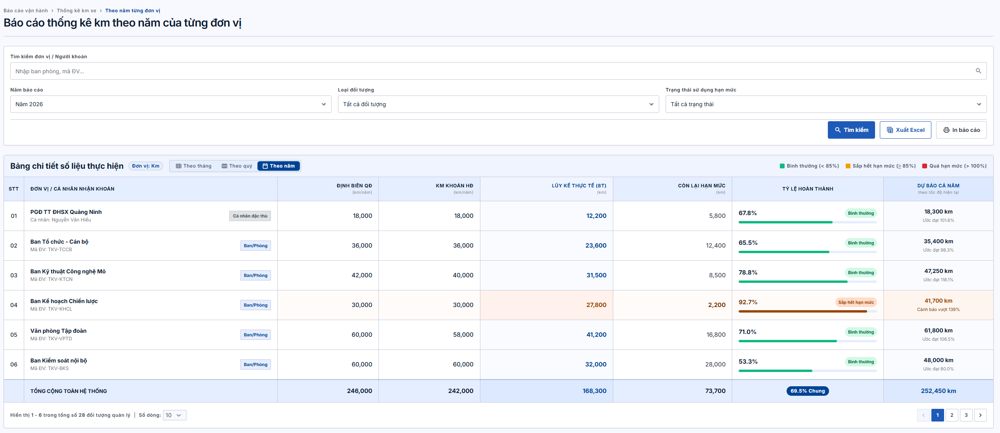
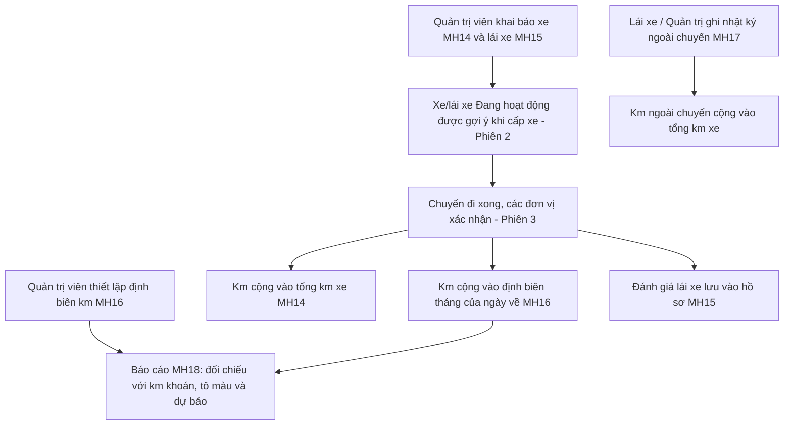
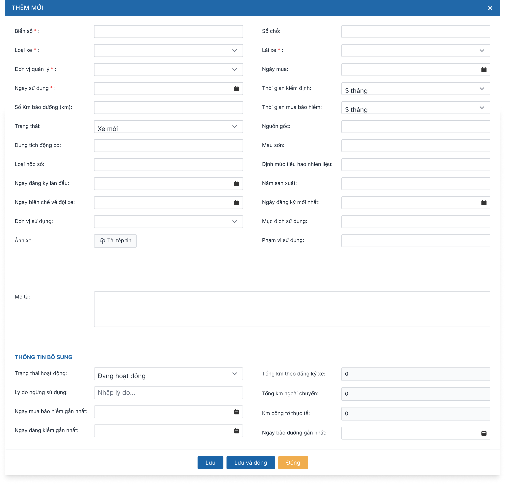
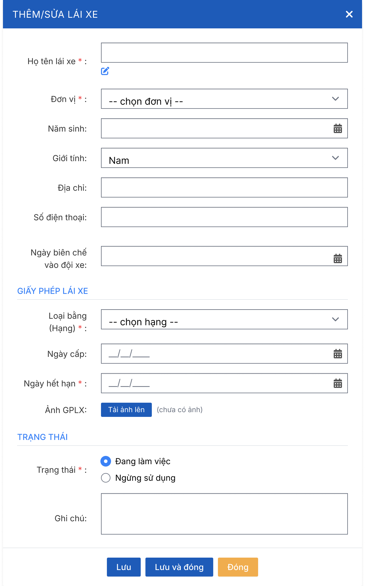
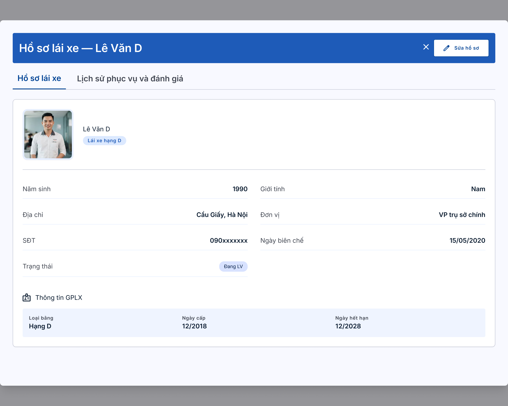
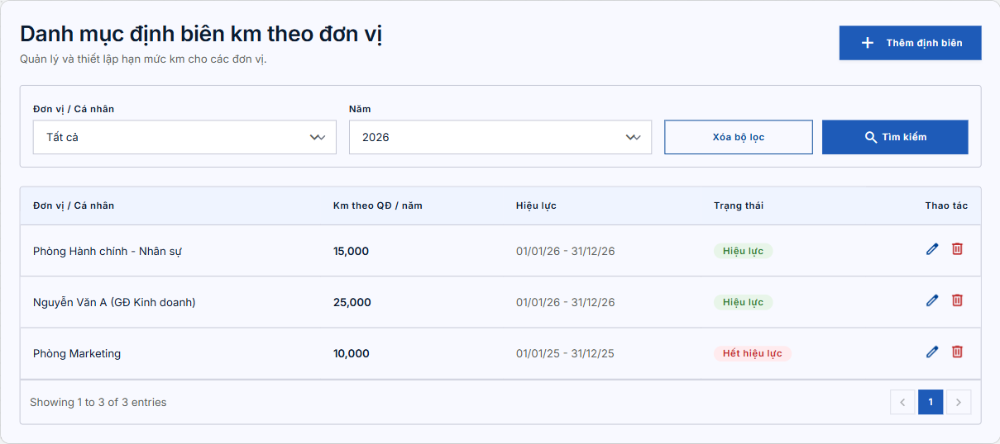
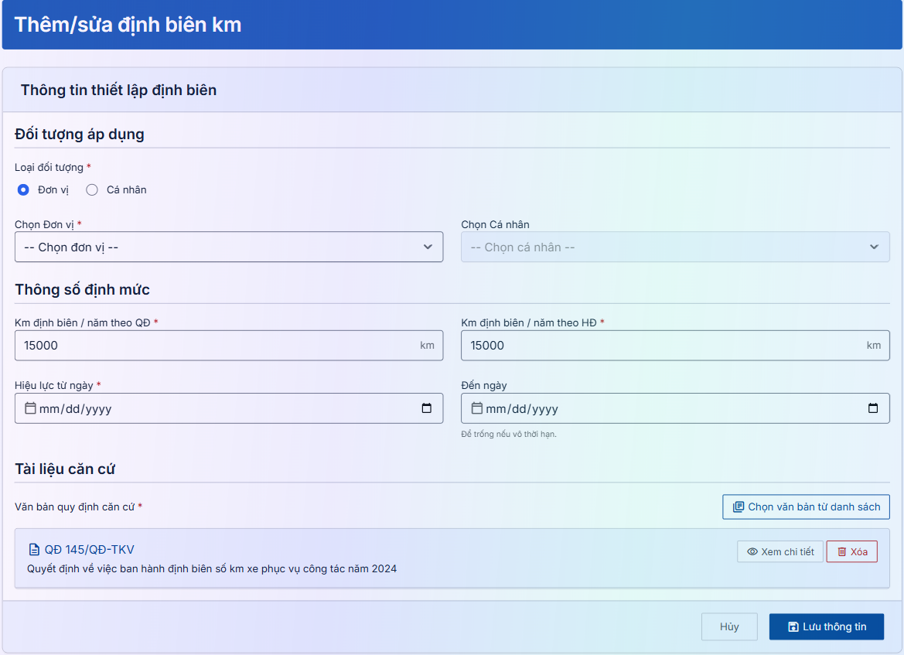
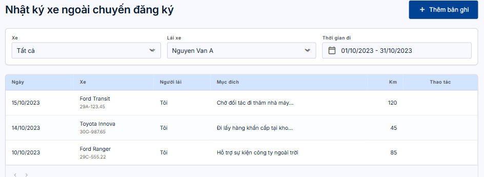
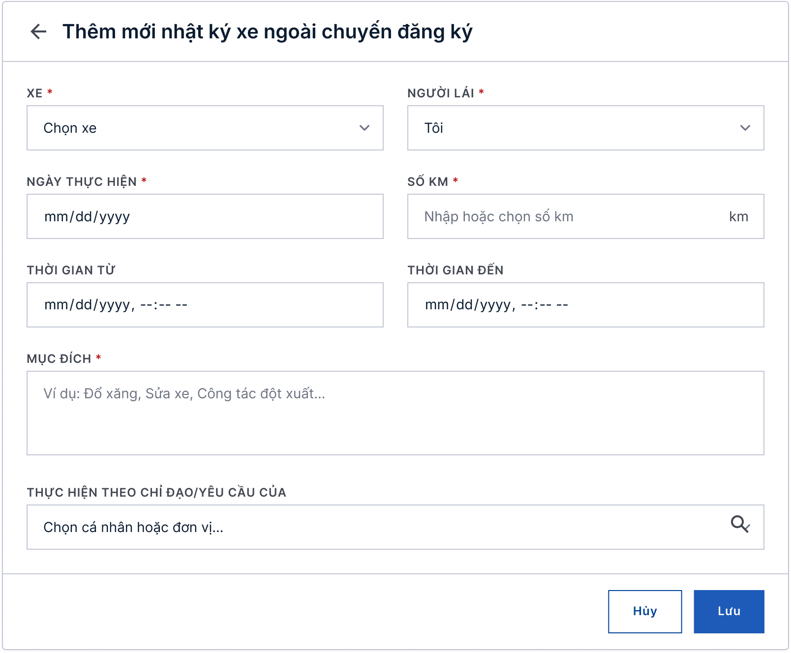
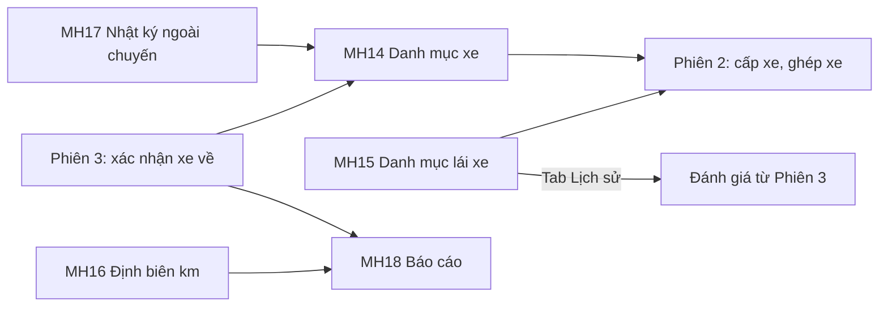

# TÀI LIỆU YÊU CẦU NGƯỜI DÙNG (URD)
## Module Quản lý đăng ký xe — Tập đoàn TKV

| Thông tin | Nội dung |
|---|---|
| Khách hàng | Tập đoàn Công nghiệp Than – Khoáng sản Việt Nam (TKV) |
| Phiên bản | v1.0 (viết lại từ URD v1.1 ngày 25/08/2026, bổ sung các CR phát sinh đến 09/2026) |
| Ngày | 16/10/2026 |
| Người soạn | BA VNPT-IT |
| Trạng thái | Dự thảo — chờ chốt |
| Phiên chốt | **Phiên 4/4 — Danh mục, định biên km, nhật ký ngoài chuyến, báo cáo** |

> **Ghi chú cho người đọc:** Tài liệu này mô tả **hệ thống sẽ hỗ trợ những công việc gì** và **giao diện thể hiện ở mức tổng quan**, để quý khách hàng cùng rà soát và xác nhận trước khi đội kỹ thuật xây dựng chi tiết. Tài liệu **không** đi vào chi tiết kỹ thuật — phần đó nằm ở tài liệu đặc tả (SRS) dành cho đội phát triển.
>
> Module được chốt làm **4 phiên**: Phiên 1 — Đăng ký & duyệt; Phiên 2 — Cấp xe & lái xe; Phiên 3 — Xác nhận xe về & đánh giá; **Phiên 4 (tài liệu này) — Danh mục xe, danh mục lái xe, định biên km, nhật ký xe ngoài chuyến, báo cáo**. Đây là nhóm dữ liệu nền cung cấp xe, lái xe, định biên cho các phiên trước và tổng hợp kết quả ở cuối.
>
> **[ĐỀ XUẤT]** là nội dung BA đề xuất để khách hàng cho ý kiến. **[CHỜ HÌNH]** là phần chờ hình thiết kế. **⚠️ Lưu ý khi gửi bản chính thức:** thay các sơ đồ dạng mã (đánh dấu 🖼️) bằng ảnh đã render.

---

## TÓM TẮT NHANH (đọc trong 3 phút)

| Mục | Nội dung |
|---|---|
| **Vấn đề đang gặp** | Chưa có nơi lưu hồ sơ xe và lái xe đầy đủ (mốc đăng kiểm, bảo hiểm, bảo dưỡng, giấy phép lái xe, lịch sử phục vụ, đánh giá); chưa kiểm soát được định biên km theo từng ban/cá nhân; km xe đi ngoài chuyến đăng ký bị thất thoát. |
| **Mục tiêu hệ thống mới** | Quản lý tập trung xe và lái xe; thiết lập định biên km theo đơn vị/cá nhân đặc thù; ghi nhận cả km ngoài chuyến; báo cáo theo tháng/quý/năm có **tô màu cảnh báo và dự báo cả năm**. |
| **Phạm vi phiên 4** | Danh mục xe, danh mục lái xe (kèm hồ sơ và lịch sử phục vụ), quản lý định biên km, nhật ký xe ngoài chuyến, báo cáo thống kê theo dõi km. |
| **Số màn hình** | 5 màn hình (MH14–MH18) |
| **Số yêu cầu cần chốt** | 11 yêu cầu (UR31–UR41, đánh số tiếp theo Phiên 3) |
| **Đối tượng sử dụng** | Quản trị viên, Đội trưởng/phó đội xe, Lái xe, Người xem báo cáo (theo quyền) |

🖼️ *Màn hình tiêu biểu — Báo cáo thống kê theo dõi km (tab Theo năm):*

---

## MỤC LỤC

1. [Bối cảnh & Mục tiêu](#1-bối-cảnh--mục-tiêu)
2. [Đối tượng sử dụng](#2-đối-tượng-sử-dụng)
3. [Luồng nghiệp vụ tổng quan](#3-luồng-nghiệp-vụ-tổng-quan)
4. [Màn hình & thao tác](#4-màn-hình--thao-tác)
5. [Yêu cầu chức năng chi tiết](#5-yêu-cầu-chức-năng-chi-tiết)
6. [Ngoài phạm vi](#6-ngoài-phạm-vi)
7. [Tiêu chí nghiệm thu](#7-tiêu-chí-nghiệm-thu)
8. [Xác nhận chốt nghiệp vụ](#8-xác-nhận-chốt-nghiệp-vụ)
9. [Phụ lục — Câu hỏi cần làm rõ](#phụ-lục)

---

## 1. Bối cảnh & Mục tiêu

**Vấn đề hiện tại**
> - Hệ thống cũ chỉ lưu thông tin cơ bản của xe và lái xe; chưa theo dõi mốc đăng kiểm, bảo hiểm, bảo dưỡng và chưa lưu lịch sử xe – lái xe để làm căn cứ điều hành.
> - Chưa có hạn mức km (định biên) cho từng ban hoặc cá nhân đặc thù nên không kiểm soát được việc dùng xe.
> - Các lượt xe đi ngoài chuyến đăng ký (đổ xăng, đưa xe đi sửa, đột xuất) không được ghi lại, số km bị thất thoát.

**Mục tiêu khi có hệ thống mới**
> - Khai báo và cập nhật xe, lái xe ở một nơi; xe/lái xe "ngừng sử dụng" không còn được gợi ý khi cấp xe.
> - Thiết lập định biên km theo từng đơn vị/cá nhân đặc thù, có thời hạn hiệu lực và văn bản căn cứ.
> - Ghi nhận mọi lượt xe ngoài chuyến để tổng km theo vòng đời xe đầy đủ.
> - Báo cáo đối chiếu km thực tế với định biên và mức khoán, tô màu cảnh báo và dự báo cả năm.

**Phạm vi phiên 4**
> - Danh mục xe: thông tin xe, mốc đăng kiểm/bảo hiểm/bảo dưỡng gần nhất, trạng thái, tổng km cộng dồn.
> - Danh mục lái xe: hồ sơ, giấy phép lái xe, trạng thái, lịch sử phục vụ và đánh giá.
> - Quản lý định biên km theo đơn vị / cá nhân đặc thù.
> - Nhật ký xe ngoài chuyến đăng ký.
> - Báo cáo thống kê theo dõi km (Tháng / Quý / Năm), xuất Excel và in.

---

## 2. Đối tượng sử dụng

### 👤 Quản trị viên hệ thống
- **Là ai:** Cán bộ hành chính/CNTT được giao quản trị danh mục xe, lái xe, định biên km.
- **Công việc hàng ngày liên quan hệ thống:** thêm/sửa xe và lái xe; cập nhật mốc đăng kiểm, bảo hiểm, bảo dưỡng; thiết lập định biên km hằng năm; ghi nhật ký xe ngoài chuyến khi cần.
- **Điều họ cần:** nhập một lần, dữ liệu dùng chung cho cấp xe và báo cáo; không để xe/lái xe không đủ điều kiện bị chọn nhầm.

### 👤 Đội trưởng/Đội phó đội xe
- **Là ai:** Người điều vận của đội xe (xem Phiên 2).
- **Ở phiên này:** xem hồ sơ lái xe và lịch sử phục vụ, đánh giá để cân nhắc khi phân công chuyến quan trọng; xem báo cáo theo quyền.

### 👤 Lái xe
- **Là ai:** Người lái xe phục vụ chuyến đi.
- **Ở phiên này:** tự ghi nhật ký xe đi ngoài chuyến (đổ xăng, sửa xe, đột xuất); chỉ xem các lượt do mình nhập.

### 👤 Người xem báo cáo
- **Là ai:** Ba nhóm theo quyền: (1) người dùng thông thường — chỉ thấy đơn vị trực tiếp của mình (ví dụ Trưởng ban); (2) người được gán quyền xem theo đơn vị — thấy các đơn vị được gán kèm đơn vị phụ thuộc bên dưới; (3) người được gán quyền xem toàn hệ thống (ví dụ bộ phận quản lý đội xe Tập đoàn) — thấy tất cả kèm dòng tổng cộng.

---

## 3. Luồng nghiệp vụ tổng quan

🖼️ *Sơ đồ luồng (render thành ảnh trước khi gửi khách):*

**Diễn giải bằng lời:**
1. **Khai báo nền** — Quản trị viên khai báo xe (kèm lái xe biên chế, mốc đăng kiểm/bảo hiểm/bảo dưỡng, trạng thái) và lái xe (kèm giấy phép lái xe, trạng thái).
2. **Thiết lập định biên** — Quản trị viên nhập hạn mức km theo năm cho từng đơn vị hoặc cá nhân đặc thù, có thời hạn hiệu lực và văn bản căn cứ.
3. **Dùng trong nghiệp vụ** — Chỉ xe và lái xe "đang hoạt động" mới được gợi ý khi cấp xe, ghép xe, đổi lái xe (Phiên 2). Sau chuyến, km và đánh giá lái xe được ghi nhận (Phiên 3).
4. **Ngoài chuyến** — Lái xe hoặc quản trị ghi các lượt xe đi không gắn với phiếu nào để không mất km.
5. **Báo cáo** — Người dùng xem báo cáo theo tháng/quý/năm: km đã dùng, còn lại bao nhiêu, tỷ lệ so với **km khoán**, tô màu và dự báo cả năm.

### Các trạng thái và mức cảnh báo

| Đối tượng | Giá trị | Ý nghĩa |
|---|---|---|
| Xe | Đang hoạt động / Ngừng sử dụng | Xe "Ngừng sử dụng" không còn được gợi ý khi cấp/ghép xe; vẫn ghi được nhật ký ngoài chuyến. |
| Lái xe | Đang làm việc / Ngừng sử dụng | Lái xe "Ngừng sử dụng" không còn được chọn khi cấp xe, ghép xe, đổi lái xe. |
| Định biên | Còn hiệu lực / Hết hiệu lực | Tính theo ngày hiện tại so với thời hạn hiệu lực. |
| Mức sử dụng hạn mức (báo cáo) | **Bình thường** (< 85%) / **Sắp hết hạn mức** (85% – 100%) / **Quá hạn mức** (> 100%) | Tô màu xanh / cam / đỏ; so với **Km khoán HĐ**. |

---

## 4. Màn hình & thao tác

### 🖥️ Màn hình 1 (MH14) — Danh mục xe (thêm mới / chỉnh sửa)
**Ai dùng:** Quản trị viên · **Dùng để:** khai báo và cập nhật thông tin từng xe.

| # | Khu vực | Diễn giải |
|---|---|---|
| ① | Thông tin chung của xe | Biển số, loại xe, đơn vị quản lý, ngày sử dụng, số chỗ, **lái xe biên chế cố định** (đổi tên từ "Lái xe"), chu kỳ kiểm định, chu kỳ mua bảo hiểm... Giữ nguyên như hiện tại. |
| ② | Thông tin bổ sung (mới) | **Ngày đăng kiểm gần nhất**, **Ngày mua bảo hiểm gần nhất**, **Ngày bảo dưỡng gần nhất** — không bắt buộc, sửa được. |
| ③ | Trạng thái sử dụng (mới) | **Đang hoạt động / Ngừng sử dụng** (mặc định Đang hoạt động; thay cho "Xe mới/Xe cũ"). Chọn "Ngừng sử dụng" thì nhập **lý do**; không đổi được nếu xe còn chuyến chưa hoàn thành. |
| ④ | Các ô km (chỉ xem, tự cộng dồn) | **Tổng km theo đăng ký xe** (từ các chuyến đã xác nhận xe về), **Tổng km ngoài chuyến** (từ nhật ký ngoài chuyến), **Km công tơ thực tế**. Không sửa tay. |
| ⑤ | Nút | **Lưu**, **Lưu và đóng**, **Đóng**. |

> Hình thiết kế hiện còn nhãn cũ "Trạng thái: Xe mới" và "Trạng thái hoạt động"; cần đồng bộ với tên mới (xem câu hỏi mở số 12).

### 🖥️ Màn hình 2 (MH15) — Danh mục lái xe (thêm/sửa, hồ sơ, lịch sử)
**Ai dùng:** Quản trị viên (thêm/sửa); Đội trưởng/phó đội xe (xem) · **Dùng để:** quản lý hồ sơ, giấy phép và theo dõi lịch sử phục vụ của lái xe.

| # | Khu vực | Diễn giải |
|---|---|---|
| ① | Thông tin cá nhân | Họ tên (chọn từ cây đơn vị, tự điền họ tên, năm sinh, số điện thoại, đơn vị), **Đơn vị bắt buộc**, địa chỉ, ngày biên chế vào đội xe (không ở tương lai). Mỗi tài khoản chỉ có **một** hồ sơ lái xe. |
| ② | Giấy phép lái xe (mới) | **Hạng** (B, C1, C, D1, D2, D, BE, C1E, CE, D1E, D2E, DE; bắt buộc), **Ngày cấp**, **Ngày hết hạn** (bắt buộc, phải sau ngày cấp), **Ảnh GPLX** (png/jpg, tối đa 10MB). |
| ③ | Trạng thái (mới) | **Đang làm việc / Ngừng sử dụng**. Không chuyển "Ngừng sử dụng" khi lái xe đang là lái xe biên chế của một xe hoặc còn chuyến chưa xong. |
| ④ | Nút | **Lưu**, **Lưu và đóng**, **Đóng**. |

**Hồ sơ lái xe (chỉ xem)** — có hai tab: *Hồ sơ lái xe* và *Lịch sử phục vụ và đánh giá*; nút **Sửa hồ sơ** chỉ hiện với người có quyền sửa.

**Tab "Lịch sử phục vụ và đánh giá":** 🖼️ **[CHỜ HÌNH]** *(hình nằm trong tài liệu đặc tả, chưa có file ảnh riêng).*
- Bộ lọc: Từ ngày – Đến ngày (mặc định **1 tháng gần nhất**, tối đa tra cứu **1 năm**), lộ trình (điểm đón/đến).
- Danh sách, mới nhất trước. **Mỗi dòng là đánh giá của một đơn vị** cho một chuyến: ngày đi, lộ trình, đơn vị đánh giá, kết quả 3 tiêu chí (Chấp hành giờ giấc/vệ sinh xe; Thái độ phục vụ; Chấp hành giao thông — Tốt/Trung bình/Yếu), nhận xét. Chuyến nhiều đơn vị hiện nhiều dòng, **không gộp**. Chưa có nhận xét thì ghi "Không có nhận xét chi tiết". Chỉ xem, không sửa/xóa.

### 🖥️ Màn hình 3 (MH16) — Quản lý định biên km theo đơn vị
**Ai dùng:** Quản trị viên · **Dùng để:** thiết lập hạn mức km theo năm cho đơn vị hoặc cá nhân đặc thù.

| # | Khu vực | Diễn giải |
|---|---|---|
| ① | Bộ lọc và danh sách | Lọc theo đơn vị/cá nhân (một hoặc nhiều, theo cây đơn vị) và **năm**. Mỗi dòng: đối tượng, km định biên theo quyết định, km khoán theo hợp đồng, thời hạn hiệu lực, trạng thái (Còn/Hết hiệu lực), lũy kế thực hiện; có Sửa, Xóa. |
| ② | Đối tượng áp dụng | Chọn **Đơn vị** hoặc **Cá nhân đặc thù** rồi chọn cụ thể một đối tượng (cá nhân phải có sẵn trong hệ thống). |
| ③ | Thông số định mức | **Km định biên/năm theo quyết định (Định biên QĐ)** — bắt buộc. **Km khoán theo hợp đồng (Km khoán HĐ)** — không được lớn hơn Định biên QĐ. **Hiệu lực từ ngày – đến ngày.** |
| ④ | Văn bản quy định căn cứ | Chọn văn bản có sẵn làm căn cứ. |
| ⑤ | Nút | **Lưu**, **Hủy**. |

> Hình thiết kế và đặc tả khác nhau về ô nào bắt buộc và cột nào hiển thị trong danh sách — xem câu hỏi mở số 5.

### 🖥️ Màn hình 4 (MH17) — Nhật ký xe ngoài chuyến đăng ký
**Ai dùng:** Lái xe, Quản trị viên · **Dùng để:** ghi lại các lượt xe đi không gắn với phiếu đăng ký (đổ xăng, đưa xe đi sửa, đột xuất).

| # | Khu vực | Diễn giải |
|---|---|---|
| ① | Danh sách | Lọc theo xe, lái xe, thời gian đi. **Lái xe chỉ thấy các lượt do mình nhập.** Quản trị có quyền "xem tất cả" thấy toàn bộ và lọc theo cá nhân, xe, thời gian. |
| ② | Thông tin lượt đi | **Xe** (bắt buộc), **Người lái** (bắt buộc; mặc định là chính lái xe đăng nhập), **Ngày thực hiện** (bắt buộc), **Số km** (bắt buộc, số dương), thời gian từ – đến (không bắt buộc, đến phải sau từ). |
| ③ | Mục đích | Bắt buộc, tối đa 2.000 ký tự. |
| ④ | Thực hiện theo chỉ đạo/yêu cầu của | Không bắt buộc (hình mẫu cho chọn cá nhân hoặc đơn vị). |
| ⑤ | Nút | **Lưu**, **Hủy**. Lưu xong, số km cộng vào tổng km của xe. |

### 🖥️ Màn hình 5 (MH18) — Báo cáo thống kê theo dõi km
**Ai dùng:** Người xem báo cáo theo quyền · **Dùng để:** đối chiếu km thực tế với định biên và km khoán.

| # | Khu vực | Diễn giải |
|---|---|---|
| ① | Bộ lọc | Từ khóa (tên ban/phòng, mã đơn vị, tên cá nhân), **Năm báo cáo** (mặc định năm hiện tại), **Loại đối tượng** (Tất cả / Ban/Phòng / Cá nhân đặc thù), **Trạng thái sử dụng hạn mức** (Tất cả / Bình thường / Sắp hết hạn mức / Quá hạn mức); nút **Xuất Excel**, **In báo cáo**. |
| ② | Ba tab | **Theo tháng** (T1–T12, mặc định), **Theo quý** (Quý I–IV), **Theo năm**; chuyển tab vẫn giữ bộ lọc. |
| ③ | Bảng số liệu | Đối tượng, Định biên QĐ, Km khoán HĐ, km từng tháng/quý, **Lũy kế thực hiện** (ghi rõ số tháng đã qua, ví dụ 8T), **Còn lại hạn mức**, **Tỷ lệ hoàn thành** (thanh tiến độ có màu), **Tổng cả năm** (tab tháng/quý) hoặc **Dự báo cả năm** (tab năm). |
| ④ | Dòng "Tổng cộng toàn hệ thống" | Chỉ hiện với người xem nhiều đơn vị; cộng các đối tượng đang hiển thị theo bộ lọc. |
| ⑤ | Phân trang | Mặc định 10 dòng/trang. |

### Luồng chuyển giữa các màn hình

🖼️ *(render thành ảnh trước khi gửi khách)*

### Ví dụ tình huống thực tế

> **Tình huống 1 — khai báo và ngừng sử dụng xe:** Quản trị viên thêm xe 29A-123.45 (loại 16 chỗ), chọn bác Lê Văn D làm lái xe biên chế, nhập ngày đăng kiểm gần nhất. Sau này xe đưa đi sửa lớn, quản trị đổi sang **Ngừng sử dụng**, ghi lý do. Hệ thống không cho đổi khi xe còn chuyến chưa xong; đổi được rồi thì xe không còn hiện khi đội xe cấp hoặc ghép xe, nhưng vẫn ghi được nhật ký ngoài chuyến.
>
> **Tình huống 2 — thiết lập định biên:** Quản trị viên thiết lập năm 2026 cho Ban Kỹ thuật Công nghệ Mỏ: định biên theo quyết định 42.000 km, km khoán 40.000 km, hiệu lực 01/01/2026 – 31/12/2026, căn cứ QĐ số 145/QĐ-TKV. Nếu nhập km khoán lớn hơn 42.000 hệ thống báo lỗi; tạo thêm một định biên chồng thời gian cho cùng ban cũng bị chặn.
>
> **Tình huống 3 — nhật ký ngoài chuyến:** Bác D đưa xe đi đổ xăng và rửa xe 45 km, mở **MH17** chọn xe, để mặc định người lái là mình, nhập ngày, 45 km, mục đích "Đổ xăng", Lưu. Km cộng vào tổng km của xe; chỉ bác D (và quản trị có quyền xem tất cả) thấy bản ghi này.
>
> **Tình huống 4 — xem báo cáo:** Cuối tháng 8, anh phụ trách đội xe mở **MH18**, tab *Theo năm*. Ban Kỹ thuật Công nghệ Mỏ đã dùng 31.500 km trên km khoán 40.000 km (còn lại 8.500 km, **78,8% — màu xanh Bình thường**). Nhưng dự báo cả năm = 31.500 ÷ 8 tháng × 12 = **47.250 km**, bằng 118,1% km khoán → nhãn "**Quá hạn mức — vượt 18%**". Ban Kế hoạch Chiến lược đã dùng 92,7% nên hiện **màu cam Sắp hết hạn mức**. Anh bấm **Xuất Excel** để gửi lãnh đạo.

---

## 5. Yêu cầu chức năng chi tiết

> Mã UR đánh số tiếp theo Phiên 3 (UR31 trở đi) để không trùng. Việc chuẩn hóa mã toàn bộ 4 phiên và đối chiếu với URD v1.1 sẽ làm khi gộp tài liệu ở cuối.

### Nhóm A — Danh mục xe

#### UR31 — Quản lý danh mục xe và trạng thái sử dụng
Quản trị viên cần khai báo xe, gán lái xe biên chế, và cho xe ngừng sử dụng khi không còn dùng để tránh bị cấp nhầm.

- **Lưu ý đặc biệt:** Biển số không được trùng ("Biển số xe đã tồn tại trong danh mục"). Trạng thái **Đang hoạt động / Ngừng sử dụng**; ngừng sử dụng phải ghi lý do và **không đổi được khi xe còn chuyến chưa hoàn thành**. Xe "Ngừng sử dụng" không xuất hiện trong gợi ý cấp/ghép xe (Phiên 2) kể cả khi đang rảnh, nhưng vẫn ghi được nhật ký ngoài chuyến. Một lái xe chỉ biên chế cho một xe: gán lái xe vừa bị gán cho xe khác thì báo "Lái xe đã được gán cho xe khác, vui lòng chọn lại".
- **Màn hình liên quan:** MH14 · **Ưu tiên:** Cao

#### UR32 — Ghi nhận mốc đăng kiểm, bảo hiểm, bảo dưỡng gần nhất
Quản trị viên cần lưu ngày đăng kiểm, mua bảo hiểm, bảo dưỡng gần nhất kèm chu kỳ để biết khi nào xe đến hạn.

- **Lưu ý đặc biệt:** Ba ngày đều không bắt buộc và sửa tay được (kể cả nhập ngày ở tương lai). Hệ thống tính **mốc đến hạn** = ngày gần nhất + chu kỳ đã nhập (chu kỳ kiểm định, thời gian mua bảo hiểm). **Sổ theo dõi lịch sử sửa chữa/kiểm định/bảo hiểm chưa làm trong đợt này**; việc cảnh báo xe sắp đến hạn xem câu hỏi mở số 1–2.
- **Màn hình liên quan:** MH14 · **Ưu tiên:** Trung bình

#### UR33 — Tổng km của xe tự cộng dồn theo vòng đời
Quản trị viên cần xem tổng km xe đã chạy mà không phải tự cộng.

- **Lưu ý đặc biệt:** Ba ô chỉ xem, không sửa tay, mặc định 0. **Tổng km theo đăng ký xe** = tổng km các chuyến đã xác nhận xe về (Phiên 3). **Tổng km ngoài chuyến** = tổng km các bản ghi nhật ký ngoài chuyến (MH17). **Km công tơ thực tế** = số công tơ cuối của lần xác nhận xe về mới nhất. Tính theo vòng đời xe, đổi đơn vị quản lý thì km cũ vẫn giữ. Cách tính ô "Km công tơ thực tế" xem câu hỏi mở số 3.
- **Màn hình liên quan:** MH14, MH17 · **Ưu tiên:** Trung bình

### Nhóm B — Danh mục lái xe

#### UR34 — Quản lý hồ sơ lái xe và giấy phép lái xe
Quản trị viên cần lưu hồ sơ lái xe cùng thông tin giấy phép để bảo đảm lái xe đủ điều kiện.

- **Lưu ý đặc biệt:** Mỗi tài khoản chỉ một hồ sơ (báo "Trùng tài khoản lái xe" khi tạo trùng). Hạng bằng và ngày hết hạn bắt buộc, ngày hết hạn phải sau ngày cấp. **Chỉ người tạo hồ sơ được sửa/xóa**; người khác không thấy nút sửa/xóa (xem câu hỏi mở số 7). Lái xe "Ngừng sử dụng" không còn được chọn ở cấp xe, ghép xe, đổi lái xe; không chuyển ngừng khi đang biên chế xe hoặc còn chuyến chưa xong.
- **Màn hình liên quan:** MH15 · **Ưu tiên:** Cao

#### UR35 — Xem lịch sử phục vụ và đánh giá của lái xe
Đội trưởng/phó đội xe và quản trị viên cần xem lại lái xe đã phục vụ những chuyến nào, được các đơn vị đánh giá ra sao.

- **Lưu ý đặc biệt:** Dữ liệu lấy từ đánh giá của các đơn vị ở Phiên 3, **mỗi đơn vị một dòng**, chỉ có sau khi đơn vị đã xác nhận. Mặc định 1 tháng gần nhất, tối đa tra cứu 1 năm; chỉ xem, không sửa/xóa. Phạm vi lái xe mà từng người được xem xem câu hỏi mở số 8.
- **Màn hình liên quan:** MH15 · **Ưu tiên:** Trung bình

### Nhóm C — Định biên km

#### UR36 — Thiết lập định biên km theo đơn vị / cá nhân đặc thù
Quản trị viên cần đặt hạn mức km theo năm cho từng ban hoặc cá nhân đặc thù, căn cứ văn bản quy định, để kiểm soát việc dùng xe.

- **Lưu ý đặc biệt:**
  - **Định biên QĐ** là mức tối đa theo quyết định; **Km khoán HĐ** là mức khoán thực tế, **không được lớn hơn Định biên QĐ**, và là mốc để tính tỷ lệ hoàn thành trên báo cáo.
  - Mỗi đối tượng tại một khoảng thời gian chỉ có **một** định biên; không cho hai định biên chồng thời gian.
  - Km được cộng vào định biên sau khi **tất cả đơn vị của phiếu đã xác nhận** (Phiên 3), tính theo năm của ngày về thực tế. Km của cá nhân đặc thù tính riêng cho cá nhân, không cộng trùng vào đơn vị.
  - Hết hiệu lực mà chưa có định biên mới: km vẫn được ghi nhận nhưng báo cáo ghi "Chưa thiết lập định biên".
- **Màn hình liên quan:** MH16 · **Ưu tiên:** Cao

### Nhóm D — Nhật ký ngoài chuyến

#### UR37 — Ghi nhận lượt xe đi ngoài chuyến đăng ký
Lái xe hoặc quản trị viên cần ghi lại các lượt xe đi không thuộc phiếu nào để số km không bị thất thoát.

- **Lưu ý đặc biệt:** Bắt buộc: xe, người lái, ngày thực hiện, số km (số dương), mục đích. Thời gian từ – đến không bắt buộc, nếu có thì đến phải sau từ. **Xe "Ngừng sử dụng" vẫn ghi được** (ví dụ đưa xe đi sửa/thanh lý) — xem câu hỏi mở số 4. Hệ thống **không chặn** nhập trùng giờ với chuyến khác và không giới hạn số km tối đa.
- **Màn hình liên quan:** MH17 · **Ưu tiên:** Trung bình

#### UR38 — Xem và tìm nhật ký xe ngoài chuyến theo quyền
Người dùng chỉ xem được dữ liệu mình được phép.

- **Lưu ý đặc biệt:** Người không có quyền "xem tất cả" chỉ thấy bản ghi **do chính mình nhập**; chặn cả khi mở trực tiếp bằng đường dẫn. Người có quyền xem tất cả (quản trị đơn vị) lọc theo cá nhân (người nhập hoặc người lái), xe, thời gian; **chỉ xem**, quyền sửa/xóa chỉ thuộc người tạo bản ghi (xem câu hỏi mở số 7).
- **Màn hình liên quan:** MH17 · **Ưu tiên:** Trung bình

### Nhóm E — Báo cáo

#### UR39 — Báo cáo thống kê theo dõi km (Tháng / Quý / Năm)
Người dùng cần một báo cáo đối chiếu km thực tế với định biên và km khoán của từng ban/cá nhân đặc thù.

- **Lưu ý đặc biệt:**
  - **Lũy kế thực hiện** chỉ tính km đã được đơn vị/cá nhân **xác nhận**, tính vào tháng/năm của ngày về thực tế; km cá nhân đặc thù tính riêng cho cá nhân.
  - **Còn lại** và **Tỷ lệ hoàn thành** luôn tính theo **Km khoán HĐ**, không theo Định biên QĐ (ví dụ định biên 42.000, khoán 40.000, lũy kế 31.500 → còn lại 8.500, tỷ lệ 78,8%). Chưa có km khoán thì ghi "Chưa khoán"; chưa có định biên thì ghi "Chưa thiết lập định biên".
  - Tab Theo tháng/Quý có "Tổng cả năm" (bằng lũy kế, chưa dự báo); tab Theo năm có "Dự báo cả năm".
  - Có dòng "Tổng cộng toàn hệ thống" cho người xem nhiều đơn vị; tỷ lệ chung = tổng lũy kế ÷ tổng km khoán.
- **Màn hình liên quan:** MH18 · **Ưu tiên:** Cao

#### UR40 — Cảnh báo mức sử dụng hạn mức và dự báo cả năm
Lãnh đạo và đội xe cần nhìn là biết ban nào sắp hoặc đã vượt hạn mức.

- **Lưu ý đặc biệt:**
  - Cảnh báo là **tô màu trên báo cáo**: Xanh dưới 85% "Bình thường"; Cam 85%–100% "Sắp hết hạn mức"; Đỏ trên 100% "Quá hạn mức". **Hệ thống không gửi thông báo (SMS/email/trên hệ thống) cho ai**; người xem tự theo dõi — xem câu hỏi mở số 1.
  - **Dự báo cả năm** = lũy kế ÷ số tháng đã qua × 12 (không tính tháng đang chạy). Nhãn dự báo tính riêng theo tỷ lệ dự báo so với km khoán: dưới 85% "Bình thường"; 85%–100% "Sắp vượt mức"; trên 100% "Quá hạn mức — vượt X%". Vì vậy một ban có thể đang xanh nhưng dự báo đã đỏ.
- **Màn hình liên quan:** MH18 · **Ưu tiên:** Cao

#### UR41 — Phân quyền xem báo cáo, xuất Excel và in
Mỗi người chỉ xem đúng phạm vi mình được giao; có thể xuất file hoặc in đúng như đang xem.

- **Lưu ý đặc biệt:** Người dùng thông thường chỉ thấy đúng **một dòng** đơn vị trực tiếp của mình, dù tìm tên đơn vị khác cũng không ra. Người được gán quyền xem theo đơn vị thấy các đơn vị được gán kèm đơn vị phụ thuộc, **không** gồm đơn vị độc lập nằm bên dưới. Người được gán quyền xem toàn hệ thống thấy tất cả kèm dòng tổng cộng. Xuất Excel/In khớp đúng dữ liệu đang hiển thị (bộ lọc, quyền, tab, dòng tổng cộng); danh sách rỗng thì file chỉ có tiêu đề cột.
- **Màn hình liên quan:** MH18 · **Ưu tiên:** Cao

---

## 6. Ngoài phạm vi

Ngoài phạm vi **toàn module** (theo trao đổi với khách hàng):
- Sổ theo dõi **bảo dưỡng**, **đăng kiểm** và **nhiên liệu** (lịch sử sửa chữa/kiểm định/bảo hiểm/đổ nhiên liệu) — chưa có màn hình trong đợt này. Ở phiên này chỉ **lưu ngày gần nhất và chu kỳ** trên danh mục xe.

Ngoài phạm vi **phiên 4**:
- Lập phiếu, duyệt (Phiên 1); cấp xe, ghép xe, lái xe xác nhận, đổi lái xe (Phiên 2); xác nhận xe về, chia km, đánh giá lái xe (Phiên 3).
- Gửi thông báo chủ động (SMS/email) khi sắp hết định biên (hiện chỉ tô màu trên báo cáo).
- Các chức năng hiện có của danh mục xe/lái xe giữ nguyên: danh sách, tìm kiếm, xóa, xuất Excel, theo dõi hành trình xe, chọn lái xe từ cây đơn vị.

---

## 7. Tiêu chí nghiệm thu

| # | Tiêu chí |
|---|---|
| 1 | **Khi** nhập biển số xe trùng, **thì** hệ thống báo lỗi và không lưu. |
| 2 | **Khi** lưu xe, **thì** hệ thống tính lại mốc đến hạn đăng kiểm/bảo hiểm/bảo dưỡng theo ngày gần nhất và chu kỳ. |
| 3 | **Khi** xe hoặc lái xe ở trạng thái "Ngừng sử dụng", **thì** không xuất hiện trong gợi ý chọn khi cấp xe, ghép xe, đổi lái xe; xe còn chuyến chưa xong thì không đổi sang "Ngừng sử dụng" được. |
| 4 | **Khi** các chuyến được xác nhận xe về và có nhật ký ngoài chuyến, **thì** các ô tổng km và km công tơ trên danh mục xe cộng đúng nguồn và không sửa tay được. |
| 5 | **Khi** tạo hồ sơ lái xe cho tài khoản đã có hồ sơ, **thì** báo "Trùng tài khoản lái xe"; ngày hết hạn GPLX không sau ngày cấp thì chặn lưu. |
| 6 | **Khi** mở tab lịch sử của lái xe, **thì** thấy đủ lượt đánh giá, mỗi đơn vị một dòng kèm 3 tiêu chí và nhận xét. |
| 7 | **Khi** nhập km khoán lớn hơn định biên theo quyết định, **thì** hệ thống báo lỗi và không lưu. |
| 8 | **Khi** tạo định biên có thời gian chồng lên định biên đã có của cùng đối tượng, **thì** hệ thống chặn. |
| 9 | **Khi** một phiếu được tất cả đơn vị xác nhận, **thì** km cộng đúng vào lũy kế của định biên tương ứng theo năm của ngày về thực tế. |
| 10 | **Khi** lưu nhật ký xe ngoài chuyến đủ thông tin bắt buộc, **thì** số km cộng đúng vào tổng km của xe; thiếu thông tin thì chặn và báo tại ô còn thiếu. |
| 11 | **Khi** người không có quyền "xem tất cả" mở nhật ký, **thì** chỉ thấy bản ghi do mình nhập. |
| 12 | **Khi** xem báo cáo, **thì** còn lại và tỷ lệ hoàn thành tính theo km khoán; tỷ lệ 85%–100% hiện màu cam, trên 100% màu đỏ và hệ thống không gửi thông báo chủ động. |
| 13 | **Khi** xem tab Theo năm, **thì** dự báo cả năm và nhãn dự báo tính đúng, kèm % vượt nếu quá hạn mức. |
| 14 | **Khi** người dùng thông thường xem báo cáo, **thì** chỉ thấy đúng một dòng đơn vị của mình, kể cả khi tìm tên đơn vị khác. |
| 15 | **Khi** xuất Excel hoặc in, **thì** nội dung khớp đúng dữ liệu đang hiển thị. |

---

## 8. Xác nhận chốt nghiệp vụ

| Đại diện | Họ tên | Chữ ký | Ngày |
|---|---|---|---|
| Khách hàng (TKV) | | | |
| VNPT-IT (BA/PO) | | | |

---

## PHỤ LỤC

### Thuật ngữ
| Thuật ngữ | Ý nghĩa |
|---|---|
| Định biên QĐ | Mức km/năm tối đa được phê duyệt theo quyết định cho đơn vị hoặc cá nhân đặc thù |
| Km khoán HĐ | Mức km/năm đã ký khoán thực tế, bằng hoặc thấp hơn Định biên QĐ; là mốc tính tỷ lệ hoàn thành |
| Lũy kế thực hiện | Tổng km thực tế đã xác nhận, cộng dồn từ đầu năm đến thời điểm xem |
| Dự báo cả năm | Ước tính km cả năm theo tốc độ sử dụng trung bình từ đầu năm |
| Cá nhân đặc thù | Cá nhân được tính định mức km riêng như một ban |
| GPLX | Giấy phép lái xe |
| Xe biên chế | Xe gán cố định cho một lái xe |

### Câu hỏi cần làm rõ sau buổi chốt
1. **Cảnh báo chủ động:** theo đặc tả, cảnh báo sắp hết định biên **chỉ là tô màu trên báo cáo**, không gửi thông báo (trong khi tiêu chí chung của module nhắc "cơ chế cảnh báo trước khi đạt ngưỡng"). Khách hàng có chấp nhận không, hay cần thông báo chủ động cho ai, qua kênh nào?
2. **Cảnh báo đến hạn đăng kiểm/bảo hiểm/bảo dưỡng và GPLX sắp hết hạn:** mục tiêu của module có nhắc cảnh báo xe sắp đến hạn, nhưng đặc tả chỉ nêu "tính mốc đến hạn" mà chưa có cách cảnh báo (ai nhận, trước bao nhiêu ngày, hiện ở đâu). GPLX hết hạn thì lái xe còn được cấp xe không?
3. **Km công tơ thực tế:** đặc tả MH14 ghi là số công tơ cuối của lần xác nhận xe về mới nhất, còn đặc tả MH17 ghi nhật ký ngoài chuyến cộng vào ô này. Đề xuất: nhật ký ngoài chuyến cộng vào "Tổng km ngoài chuyến"; còn "Km công tơ thực tế" tính thế nào khi xe vừa chạy ngoài chuyến sau lần xác nhận cuối?
4. **Xe ngừng sử dụng trong nhật ký ngoài chuyến:** bảng trường MH17 ghi "loại trừ xe Ngừng sử dụng" nhưng quy tắc lại cho phép. Đề xuất: cho phép (để ghi việc đưa xe đi sửa/thanh lý).
5. **Định biên (MH16):** hình mẫu có "Km khoán HĐ" và "Văn bản căn cứ" **bắt buộc**, "Hiệu lực đến" để trống nếu vô thời hạn; đặc tả lại ghi Km khoán và văn bản **không bắt buộc**, ngày đến **bắt buộc**. Danh sách trên hình chỉ có cột km theo quyết định, đặc tả thêm km khoán và lũy kế. Chốt theo bên nào?
6. **Định biên:** khi một đối tượng có hai định biên trong cùng năm (thay đổi giữa năm), báo cáo lấy giá trị nào? Xóa định biên đã có km cộng dồn thì xử lý ra sao? Giảm định biên xuống thấp hơn lũy kế đã dùng thì có cảnh báo ngay không?
7. **Quyền sửa/xóa:** hồ sơ lái xe và nhật ký ngoài chuyến chỉ cho **người tạo** sửa/xóa; nếu nhập nhầm mà người tạo không còn thì quản trị có sửa/xóa thay được không?
8. **Quyền xem hồ sơ lái xe:** Đội trưởng/phó đội xe được xem lái xe nào (cùng đơn vị hay toàn đội)?
9. **Lịch sử phục vụ:** mô tả "đánh giá chung" mỗi dòng đang lẫn với cách tính trung bình giữa các đơn vị ở màn hình chi tiết phiếu (Phiên 3), trong khi mỗi dòng ở đây là một đơn vị. Đơn vị xác nhận lại sau khi lái xe chỉnh số liệu thì giữ hay thay đánh giá cũ?
10. **Dự báo đầu năm:** tháng 1 chưa có tháng nào "đã qua" nên không chia được; hệ thống hiển thị thế nào? Dự báo theo bình quân có phù hợp với mùa vụ của TKV không?
11. **Cá nhân đặc thù:** danh sách lấy từ chính danh mục định biên; có khai báo cá nhân đặc thù trước khi lái xe chọn ở Phiên 3 không, và cá nhân phải có tài khoản không?
12. **Hình thiết kế cần cập nhật:** MH14 (nhãn "Xe mới/Xe cũ", "Trạng thái hoạt động" → "Trạng thái sử dụng"); tab Lịch sử lái xe (chờ hình); tên file xuất Excel ghi "theo_doi_km_tháng" cho cả tab quý/năm.

---

## CÁCH DÙNG FILE NÀY (hướng dẫn nội bộ cho BA — xóa mục này trước khi gửi khách hàng)

1. Render 2 sơ đồ Mermaid thành ảnh, thay vào các chỗ 🖼️; ảnh màn hình nằm ở `docs/URD_KH_QLDKX_images/`. MH18 chỉ đính kèm ảnh tab Theo năm (còn ảnh Theo tháng, Theo quý trong thư mục `bao-cao-thong-ke-theo-doi-km/images/` của SRS).
2. Số liệu tóm tắt (5 màn hình, 11 UR) cập nhật nếu thay đổi. **Tổng UR toàn module sau 4 phiên là 41** (14 + 6 + 10 + 11) — cần chuẩn hóa khi gộp.
3. **Lệch/thiếu trong SRS cần xử lý:** (a) MH17 ghi cộng km vào "Km công tơ thực tế" nhưng MH14 đã có ô "Tổng km ngoài chuyến" (BR-06) — MH17 BR-01 là bản cũ; (b) MH17 bảng trường loại trừ xe ngừng sử dụng, BR-04 cho phép; (c) MH16 hình mẫu và đặc tả khác về trường bắt buộc/cột danh sách; (d) MH16 BR-03/BR-04 đánh số thiếu (không có BR-03) và log ghi N/A; (e) MH14 BR-03 mô tả "ngày gần nhất" lấy từ lịch sử ở chức năng chưa làm, trong khi trường sửa tay được; (f) MH14 EX-02 câu "Chặn không cho phép đổi khi hết chuyến" chưa rõ; (g) MH15 BR-05 dán nguyên văn cách tính trung bình của màn hình chi tiết phiếu; (h) chưa có cơ chế cảnh báo đến hạn cho xe/GPLX; (i) mô tả quyền xem MH17 dùng role `ADMIN_DONVI` và MH18 dùng `TKV_VIEW_BC_THEODOI_KM` — cần thống nhất tên quyền; (j) hình MH14 còn nhãn cũ.
4. Nguồn đã dùng: SRS_00, MH14 (CR-20260925-danh-muc-xe), MH15 (CR-20260925-danh-muc-lai-xe), MH16 (CR-20260921-quan-ly-dinh-bien-km), MH17 (CR-20260911-quan-ly-nhat-ky-ngoai-dkxe), MH18 (bao-cao-thong-ke-theo-doi-km) và các hình tương ứng.
5. Sau khi khách chốt cả 4 phiên: gộp lại, chuẩn hóa mã UR, rồi chạy `urd-writer-vnpt` để tạo bản BM_URD lưu hồ sơ.
