# TÀI LIỆU YÊU CẦU NGƯỜI DÙNG (URD)
## Quản lý nhiên liệu tiêu hao

| Thông tin | Nội dung |
|---|---|
| Khách hàng | Tập đoàn CN Than - Khoáng sản Việt Nam (Đội xe văn phòng) |
| Phiên bản | v1.0 |
| Ngày | 21/10/2026 |
| Người soạn | mynguyen.cntt.px (BA VNPT-IT) |
| Trạng thái | Dự thảo — chờ chốt |
| Cấu trúc | Gộp từ 3 phiên chốt: **Phần A** — Định mức và hệ số (UR01–UR08, UR29–UR30) · **Phần B** — Nhập lĩnh/tồn theo xe (UR09–UR13; UR14–UR16, UR25, UR26 đã bỏ: không còn chốt tháng, số dư ban đầu gộp vào UR12) · **Phần C** — Báo cáo và biểu mẫu in (UR17–UR24, UR27–UR28) |

> **Ghi chú cho người đọc:** Tài liệu này mô tả **hệ thống sẽ hỗ trợ những công việc gì** và **giao diện thể hiện ở mức tổng quan**, để quý khách hàng cùng rà soát và xác nhận trước khi đội ngũ kỹ thuật xây dựng chi tiết. Tài liệu **không** đi vào chi tiết kỹ thuật; những nội dung đó sẽ được đặc tả riêng ở giai đoạn sau.
>
> **Ký hiệu:** 🖥️ = một màn hình · **[Giả thiết]** = nội dung do bên VNPT-IT đề xuất, **chưa được quý khách xác nhận** · mã màn hình có chữ cái đầu chỉ phần chứa nó (A1 = Màn hình 1 của Phần A) · mã yêu cầu giữ nguyên như các bản soạn trước nên dãy mã có khoảng trống (UR14, UR15, UR16, UR25, UR26 đã bỏ: không còn chức năng chốt tháng, mở khóa tháng; số dư ban đầu gộp vào UR12).
>
> **Hình thiết kế:** hầu hết màn hình đã có hình từ bản thiết kế. Một vài hộp thoại nhỏ (xác nhận kích hoạt lại hệ số, nhập số dư ban đầu) chưa có hình riêng và được mô tả bằng chữ.

---

## TÓM TẮT NHANH (đọc trong 3 phút)

| Mục | Nội dung |
|---|---|
| **Vấn đề đang gặp** | Định mức tiêu hao theo loại xe, hệ số điều chỉnh, phiếu lĩnh/hóa đơn, tồn đầu/cuối và ba biểu mẫu cuối tháng của Tập đoàn đang làm thủ công trên nhiều sổ rời; dễ sai hệ số, trùng số phiếu, tồn âm và lệch số giữa các biểu. |
| **Mục tiêu hệ thống mới** | Một nguồn số liệu duy nhất: khai báo định mức + hệ số theo thời kỳ → hệ thống tự tính định mức giao khoán → một màn hình nhập lĩnh/tồn theo xe và tháng, quản lý theo danh sách phiếu (chặn trùng số phiếu, tự điền tồn, có nhật ký chỉnh sửa) → báo cáo và 3 biểu mẫu (mẫu 2, 3, 4) tự tổng hợp, số khớp nhau. |
| **Phạm vi** | **A.** Danh mục loại xe, định mức, hệ số tuổi/khai trường, khai báo nhiên liệu trên xe · **B.** Một màn hình nhập lĩnh/tồn theo xe/tháng: danh sách phiếu lĩnh & hóa đơn, tồn đầu/cuối, nhật ký chỉnh sửa · **C.** Báo cáo quyết toán, báo cáo lĩnh–sử dụng–tồn, chi tiết theo xe, xuất mẫu 2/3/4 |
| **Số màn hình chính** | Phần A: 6 · Phần B: 3 · Phần C: 6 |
| **Số yêu cầu cần chốt** | 25 yêu cầu (UR01–UR13, UR17–UR24, UR27–UR30), trong đó 4 yêu cầu quy tắc bổ sung sau rà soát: UR27–UR30 |
| **Đối tượng sử dụng** | Quản trị danh mục, Quản lý xe/Đội trưởng, Lái xe, Lãnh đạo/Kế toán quyết toán |

Hình minh họa từng màn hình xem ở **Mục 4**.

---

## HƯỚNG DẪN ĐỌC THEO VAI TRÒ

| Vai trò của quý khách | Nên đọc | Mã yêu cầu chính |
|---|---|---|
| Lãnh đạo, kế toán quyết toán | Tóm tắt nhanh · **Việc khách cần quyết** · Phần C (báo cáo và biểu mẫu) | UR17–UR24, UR27–UR28 |
| Quản lý xe / Đội trưởng | Toàn bộ tài liệu, trọng tâm Phần B và C | UR09–UR13, UR17–UR28 |
| Quản trị danh mục (người cập nhật quy định) | Phần A | UR01–UR08, UR29–UR30 |
| Lái xe | Phần B (nhập lĩnh, tồn) và biểu mẫu 3 ở Phần C | UR09–UR13, UR23 |

---

## THUẬT NGỮ CHÍNH

| Thuật ngữ | Giải thích |
|---|---|
| **Định mức gốc** | Mức tiêu hao theo loại xe do Tập đoàn quy định (lít/100km), chưa nhân hệ số. |
| **Hệ số tuổi xe** | Hệ số tăng định mức theo nhóm tuổi xe: nhóm A (đến 7 năm) ×1,00; nhóm B (trên 7 đến 14 năm) ×1,05; nhóm C (trên 14 năm) ×1,10. |
| **Xe phục vụ khai trường** | Xe phục vụ Trung tâm Điều hành sản xuất tại Quảng Ninh, thường xuyên chạy đường khai trường; nhân thêm hệ số 1,05. |
| **Định mức giao khoán** | Định mức gốc × hệ số tuổi xe × hệ số khai trường — mức dùng để tính tiêu hao cho từng xe. Ví dụ Prado 2.7, trên 14 năm: 17,0 × 1,10 × 1,00 = 18,7 lít/100km. |
| **Phiếu lĩnh** | Chứng từ lĩnh nhiên liệu tại cây xăng được chỉ định. |
| **Mua ngoài (hóa đơn)** | Mua nhiên liệu ngoài cây xăng chỉ định, có hóa đơn. |
| **Tồn đầu / Tồn cuối** | Số lít còn trong thùng đầu tháng / cuối tháng. |
| **Sử dụng thực tế** | Tồn đầu + Lĩnh + Mua ngoài − Tồn cuối. |
| **Sử dụng / Tiêu hao theo định mức** | Số km chạy trong tháng × định mức giao khoán ÷ 100. |
| **Tăng (+) / Giảm (−)** | Tiêu hao thực tế trừ tiêu hao theo định mức. Tăng nghĩa là vượt định mức. |
| **Số ước tính** | Số hệ thống tự tính theo định mức khi lái xe chưa cập nhật số thực tế; hiện dấu * màu cam. Số này chỉ để theo dõi tồn, **không dùng để so sánh với định mức** (vì tự tính từ định mức). |
| **Mẫu 2, 3, 4** | Ba biểu in của Tập đoàn: Mẫu 2 — Tổng hợp lĩnh, sử dụng, tồn; Mẫu 3 — Theo dõi lĩnh nhiên liệu từng xe; Mẫu 4 — Tổng hợp quyết toán tiêu hao từng xe. |

---

## VIỆC KHÁCH CẦN QUYẾT

Dưới đây là **18 điểm cần quý khách chốt** trước khi đội ngũ xây dựng. Cột "VNPT-IT đề xuất" là phương án chúng tôi đã dùng để soạn tài liệu; nếu quý khách đồng ý, chỉ cần xác nhận. Các con số trong ví dụ chỉ để minh họa.

| # | Cần quyết | Các lựa chọn / ví dụ | VNPT-IT đề xuất | Liên quan |
|---|---|---|---|---|
| Q1 | **Tuổi xe tính từ mốc nào?** Và xe chuyển đơn vị giữa chừng thì tính tuổi thế nào? | Ngày sử dụng · Năm sản xuất · Ngày đăng ký lần đầu | Ngày sử dụng; xe chuyển đơn vị giữ nguyên ngày sử dụng ban đầu | UR04, UR29 |
| Q2 | **Định mức giao khoán đổi giữa tháng (xe chuyển nhóm tuổi, đổi định mức/hệ số, đổi loại xe hay khai trường) thì tính thế nào?** Bản thiết kế ghi "hệ số tuổi tính theo ngày của từng chuyến", gần phương án (1). *Ví dụ: Prado 2.7 (17,0) chạy 3.000 km trong tháng, đổi từ nhóm B (×1,05) sang nhóm C (×1,10) từ ngày 11, trong đó 1.000 km trước ngày 11, 2.000 km sau.* | (1) Tách theo ngày đổi: 1.000 × 17,85 + 2.000 × 18,7 = **553 lít** · (2) Áp hệ số đầu tháng (B): **536 lít** · (3) Áp hệ số cuối tháng (C): **561 lít** · (4) Bình quân gia quyền theo km: **553 lít** (kết quả giống phương án 1) | Phương án (1) vì sát thực tế nhất; chọn (2) nếu muốn đơn giản | UR29 |
| Q3 | **Những đơn vị nào dùng hệ thống?** Tên chính thức in trên tiêu đề biểu từng đơn vị? Định mức/hệ số dùng chung hay riêng? | Quý khách cung cấp danh sách đơn vị và tên chính thức | Mỗi xe thuộc một đơn vị; định mức/hệ số dùng chung toàn Tập đoàn; tiêu đề biểu 2 dòng: tên Tập đoàn + tên đơn vị quản lý | UR30, UR22, UR24 |
| Q4 | **Số liệu của tháng đã qua có được sửa không, ai được sửa?** Hệ thống không còn bước chốt tháng nên số lĩnh/tồn luôn sửa được. *Ví dụ: tháng 08 đã in biểu ký tay, đầu tháng 10 phát hiện sai số tồn cuối của một xe.* | (1) Cho sửa trực tiếp, mọi thay đổi ghi nhật ký, báo cáo hiện ngay số mới · (2) Lái xe chỉ sửa tháng hiện tại, tháng đã qua chỉ quản lý được sửa | Phương án (1). Biểu đã in ký tay không tự đổi; nếu số đổi thì in lại | UR12, UR13 |
| Q5 | **Ngày hiệu lực của định mức/hệ số có được chọn ngày trong quá khứ không?** | (1) Không, chỉ từ ngày hôm nay trở đi · (2) Có, khi đó báo cáo các tháng đã qua tự tính lại theo số mới | Phương án (1) để báo cáo các tháng đã qua không bị thay đổi | UR02, UR04, UR06 |
| Q6 | **Lái xe nào được xem là "phụ trách" một xe?** | Lái xe biên chế được gán cho xe trong danh mục xe | Như bên cạnh | UR09, UR20 |
| Q7 | **Số km để tính tiêu hao theo định mức lấy từ đâu?** *Ví dụ: xe chạy 1.615 km theo các chuyến đã xác nhận, đồng hồ công tơ ghi 1.640 km.* | (1) Km các chuyến đã xác nhận đi về · (2) Km công tơ · (3) Km chuyến để tính, km công tơ để đối chiếu và cảnh báo khi chênh quá ngưỡng | Phương án (1), hiển thị thêm km công tơ để đối chiếu; ngưỡng cảnh báo do quý khách cho số | UR27 |
| Q8 | **Mức chênh bao nhiêu thì coi là vượt định mức? Có cần ghi giải trình?** *Ví dụ: định mức 302 lít, thực tế 308 lít, chênh +6 lít (khoảng 2%).* | Ngưỡng 0%: luôn hiện (!) · Ngưỡng 3%: chênh 2% là chấp nhận được | Ngưỡng 0% cho tới khi quý khách cho số; giải trình chỉ lưu và hiển thị, không chặn việc xuất biểu | UR28 |
| Q9 | **Danh mục loại nhiên liệu cụ thể** (Xăng A95, Xăng 95, Dầu DO…) gom lên "Xăng/Dầu" thế nào để cộng tổng? | Quý khách cung cấp danh mục | Chờ quý khách | UR07, UR17 |
| Q10 | **Tệp văn bản căn cứ:** định dạng và dung lượng tối đa? | PDF, Word… | PDF/Word | UR03 |
| Q11 | **Có cho xóa loại xe khi đã có xe thuộc loại đó không?** | Chặn xóa · Cho xóa | Chặn xóa | UR01 |
| Q12 | **Có cần nhập phiếu lĩnh hàng loạt cho nhiều xe một lần không?** | Có · Không | Không làm đợt này | UR10 |
| Q13 | **Chữ ký, ghi chú, tiêu đề cố định của Mẫu 2, 3, 4 có thay đổi theo từng đơn vị không?** | Giữ đúng biểu giấy hiện hành · Cho đổi theo đơn vị | Giữ đúng biểu giấy hiện hành | UR22–UR24 |
| Q14 | **Thông tin của xe (loại xe, xe phục vụ khai trường, ngày sử dụng) thay đổi thì các tháng đã qua có bị tính lại không?** *Ví dụ: tháng 10 bỏ tích "khai trường" của một xe.* | (1) Có ngày hiệu lực, giữ lịch sử: các tháng trước ngày đó vẫn tính theo thông tin cũ · (2) Sửa là đổi toàn bộ, báo cáo các tháng đã qua tự tính lại | Phương án (1) | UR07, UR08 |
| Q15 | **Xe vào/ra đội, đổi lái xe, đổi đơn vị giữa chừng:** xe xuất hiện ở báo cáo tháng nào? Lái xe cũ còn xem được dữ liệu cũ không? | Xe hiện ở các tháng đang hoạt động (từ ngày sử dụng đến ngày ngừng) · Lái xe phụ trách hiện tại xem cả dữ liệu cũ của xe | Như bên cạnh | UR09, UR20, UR30 |
| Q16 | **Phạm vi kiểm trùng số phiếu lĩnh và số hóa đơn?** | Số phiếu: toàn hệ thống · trong cùng năm. Số hóa đơn: chặn · chỉ cảnh báo | Số phiếu toàn hệ thống (đã chốt 14/10); số hóa đơn chỉ cảnh báo vì hóa đơn của nhà cung cấp khác nhau có thể trùng số | UR11 |
| Q17 | **Phân quyền chéo:** quản lý có được sửa phiếu và tồn của lái xe không? Lãnh đạo/kế toán có xem được nhiều đơn vị không? | Có · Không | Quản lý sửa được mọi xe trong đơn vị; lãnh đạo/kế toán xem các đơn vị được cấp quyền | UR10, UR12, UR30 |
| Q18 | **Chi tiết nhỏ:** (a) ô "Kỳ" ở báo cáo chỉ có Tháng hay thêm Quý/Năm; (b) số lít là số nguyên hay có phần thập phân; (c) "trên 7 năm" tính theo ngày hay theo tháng; (d) Mẫu 3 có hơn 18 dòng thì sao | Quý khách chọn từng ý | (a) chỉ Tháng; (b) số nguyên (làm tròn); (c) theo ngày, tính khi quá 7 năm tròn; (d) biểu sang trang tiếp, dòng Cộng ở trang cuối | UR04, UR19, UR23 |

---

## MỤC LỤC

1. [Bối cảnh & Mục tiêu](#1-bối-cảnh--mục-tiêu)
2. [Đối tượng sử dụng](#2-đối-tượng-sử-dụng)
3. [Luồng nghiệp vụ tổng quan](#3-luồng-nghiệp-vụ-tổng-quan)
4. [Màn hình & thao tác](#4-màn-hình--thao-tác)
5. [Yêu cầu chức năng chi tiết](#5-yêu-cầu-chức-năng-chi-tiết)
6. [Ngoài phạm vi](#6-ngoài-phạm-vi)
7. [Tiêu chí nghiệm thu](#7-tiêu-chí-nghiệm-thu)
8. [Xác nhận chốt nghiệp vụ](#8-xác-nhận-chốt-nghiệp-vụ)

Phụ lục: Điều đã chốt với khách hàng. Thuật ngữ và việc cần quyết xem ở đầu tài liệu.

---

## 1. Bối cảnh & Mục tiêu

### Phần A — Định mức và hệ số

**Vấn đề hiện tại**
> Mỗi xe có một mức tiêu hao nhiên liệu quy định (lít/100km) theo loại xe. Mức này còn phải nhân thêm hệ số theo tuổi xe (xe trên 7 năm ×1,05; trên 14 năm ×1,10) và hệ số 1,05 cho xe phục vụ đường khai trường tại Quảng Ninh. Việc tra văn bản và tự nhân hệ số cho từng xe mỗi tháng dễ sai sót; khi Tập đoàn ban hành định mức mới cũng khó truy lại tháng nào đã tính theo mức nào.

**Mục tiêu khi có hệ thống mới**
> - Khai báo định mức và hệ số **một lần**, hệ thống tự tính định mức giao khoán cho từng xe.
> - Khi văn bản đổi, thêm mức mới **có ngày hiệu lực**, mức cũ vẫn được giữ lại để tra cứu; báo cáo các tháng trước ngày hiệu lực vẫn tính theo mức cũ.
> - Mọi lần thay đổi đều có nhật ký (ai, khi nào, từ giá trị nào sang giá trị nào) và có thể đính kèm văn bản căn cứ.

**Phạm vi phần này**
> - Danh mục loại xe và định mức nhiên liệu gốc (theo văn bản Tập đoàn)
> - Cấu hình hệ số tuổi xe và hệ số xe phục vụ khai trường
> - Ngừng hoạt động / kích hoạt lại hệ số khi quy định thay đổi
> - Khai báo loại nhiên liệu, dung tích thùng, xe khai trường trên từng xe và xem định mức đang áp dụng

### Phần B — Nhập lĩnh/tồn theo xe

**Vấn đề hiện tại**
> Lái xe lĩnh xăng dầu tại cây xăng được chỉ định bằng phiếu lĩnh, đôi khi phải mua ngoài bằng hóa đơn. Số liệu này, cùng tồn đầu và tồn cuối, được ghi theo từng xe trên biểu "Theo dõi lĩnh nhiên liệu" rồi tổng hợp thành biểu "Lĩnh, sử dụng, tồn" cuối tháng. Làm tay nên dễ nhập trùng số phiếu, tồn cuối âm hoặc lớn hơn dung tích thùng, và khó biết ai đã sửa số nào.

**Mục tiêu khi có hệ thống mới**
> - Một màn hình duy nhất để nhập và quản lý lĩnh/tồn của từng xe theo tháng, dạng danh sách phiếu; phiếu lĩnh và hóa đơn nhập **một lần**, báo cáo tự tổng hợp.
> - Tồn đầu, tồn cuối được **điền sẵn** theo định mức; lái xe chỉ sửa khi số thực tế khác.
> - Chặn ngay khi trùng số phiếu hoặc tồn sai quy tắc; không có bước chốt/mở khóa tháng — số liệu luôn sửa được.
> - Mọi thay đổi có nhật ký (ai, lúc nào, số cũ, số mới).

**Phạm vi phần này**
> - Một màn hình nhập lĩnh/tồn theo xe và tháng, quản lý theo danh sách phiếu
> - Thêm/sửa/xóa phiếu lĩnh và hóa đơn mua ngoài
> - Lái xe cập nhật tồn đầu, tồn cuối; đặt lại theo định mức
> - Nhật ký chỉnh sửa lĩnh và tồn

### Phần C — Báo cáo và biểu mẫu in

**Vấn đề hiện tại**
> Đơn vị lập ba biểu theo mẫu của Tập đoàn: (2) Biểu tổng hợp lĩnh, sử dụng, tồn nhiên liệu từng xe; (3) Theo dõi lĩnh nhiên liệu của từng xe; (4) Biểu tổng hợp quyết toán tiêu hao nhiên liệu từng xe. Ba biểu liên quan chặt (số "Sử dụng" ở biểu 2 chuyển sang cột "Thực tế" của biểu 4), nhưng đang lập riêng nên dễ lệch số và khó tra ngược khi một xe vượt định mức.

**Mục tiêu khi có hệ thống mới**
> - Một nguồn số liệu duy nhất: báo cáo tự tổng hợp từ số liệu lĩnh/tồn của từng xe và định mức giao khoán.
> - Xem trên màn hình theo tháng, đơn vị, xe; bấm vào số để xem chi tiết xe.
> - Xuất đúng khuôn 3 biểu giấy (PDF để in ký tay, Excel khi cần chỉnh) mà không phải dựng lại.
> - Nhìn thấy ngay xe nào vượt định mức hoặc còn là số ước tính.

**Phạm vi phần này**
> - Báo cáo quyết toán tiêu hao theo tháng
> - Báo cáo lĩnh, sử dụng, tồn theo tháng
> - Chi tiết tiêu hao từng xe theo tháng/năm/vòng đời
> - Xuất mẫu 2, mẫu 3, mẫu 4 (PDF theo đúng khuôn, Excel)

---

## 2. Đối tượng sử dụng

### 👤 Quản trị danh mục (người có quyền quản trị loại xe và hệ số)
- **Là ai:** Cán bộ phụ trách cập nhật quy định của Đội xe/Văn phòng.
- **Công việc liên quan hệ thống:** nhập định mức khi có văn bản mới; thêm, sửa, ngừng hoạt động hệ số; đính kèm văn bản quy định.
- **Điều cần hệ thống hỗ trợ:** đổi quy định mà không làm sai số liệu cũ; biết ai đã đổi gì, lúc nào.
- **Dùng ở:** Phần A.

### 👤 Quản lý xe / Đội trưởng
- **Là ai:** Người quản lý đội xe của đơn vị, ví dụ chị Lan (tài khoản ql.xe01).
- **Công việc liên quan hệ thống:** khai báo từng xe (loại xe, nhiên liệu, dung tích thùng, xe khai trường); xem lĩnh/tồn của mọi xe trong đơn vị, theo dõi xe nào lái xe chưa cập nhật tồn, kiểm tra nhật ký, sửa số liệu khi phát hiện sai; xem báo cáo cuối tháng, đối chiếu xe vượt định mức, in biểu để ký.
- **Điều cần hệ thống hỗ trợ:** thấy ngay định mức giao khoán của xe; biết xe nào còn dùng số ước tính; truy được ai đã sửa số nào; số khớp giữa ba biểu, xuất nhanh đúng mẫu.
- **Dùng ở:** Phần A, B, C.

### 👤 Lái xe
- **Là ai:** Lái xe biên chế phụ trách một hoặc vài xe, ví dụ anh An phụ trách xe 30M-51470.
- **Công việc liên quan hệ thống:** nhập phiếu lĩnh và hóa đơn mua ngoài của xe mình; cập nhật tồn đầu, tồn cuối theo số thực tế; xem định mức giao khoán của xe mình (không được sửa định mức/hệ số); xuất biểu "Theo dõi lĩnh nhiên liệu" của xe mình để ký.
- **Điều cần hệ thống hỗ trợ:** chỉ thấy xe mình phụ trách; số tồn điền sẵn để đỡ gõ; báo ngay khi số phiếu trùng; biểu in đúng khuôn, có chỗ ký "Lái xe".
- **Dùng ở:** Phần A (chỉ xem), B, C.

### 👤 Lãnh đạo đơn vị / Kế toán quyết toán
- **Là ai:** Người ký biểu và dùng số liệu để quyết toán chi phí nhiên liệu.
- **Công việc liên quan hệ thống:** xem tổng xăng, tổng dầu, chênh lệch tăng/giảm so với định mức.
- **Điều cần hệ thống hỗ trợ:** biểu in đúng mẫu Tập đoàn, đúng tiêu đề đơn vị, có khối chữ ký.
- **Dùng ở:** Phần C.

> Chỉ người có quyền quản trị mới thấy các nút Thêm/Sửa/Ngừng hoạt động của danh mục loại xe và hệ số; người không đủ quyền chỉ xem.

---

## 3. Luồng nghiệp vụ tổng quan

### Phần A — Định mức và hệ số

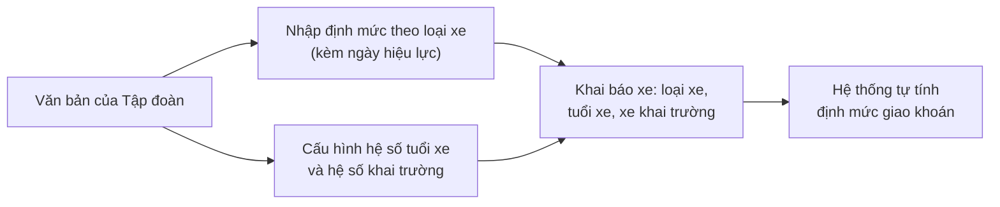

**Diễn giải luồng bằng lời:**
1. **Nhập quy định** — Quản trị danh mục nhập định mức theo loại xe và các hệ số theo văn bản Tập đoàn, kèm ngày hiệu lực và tệp văn bản căn cứ.
2. **Khai báo xe** — Quản lý xe chọn loại xe, loại nhiên liệu, dung tích thùng và đánh dấu "Xe phục vụ khai trường" nếu đúng.
3. **Hệ thống tự tính** — Định mức giao khoán = định mức loại xe × hệ số tuổi xe × hệ số khai trường.
   *Ví dụ: Prado 2.7 (17,0), xe trên 14 năm (×1,10), không khai trường (×1,00) → **18,7 lít/100km**.*
4. **Khi quy định đổi** — Thêm mức/hệ số mới có hiệu lực từ ngày chỉ định. Mức cũ giữ trong lịch sử. Ngày hiệu lực chỉ chọn được từ ngày hôm nay trở đi **[Giả thiết — Q5]**, nên báo cáo các tháng đã qua không bị tính lại.

### Phần B — Nhập lĩnh/tồn theo xe

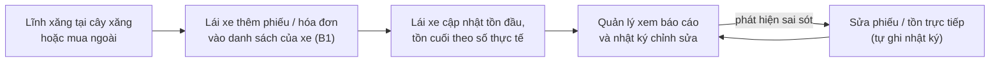

**Diễn giải luồng bằng lời:**
1. **Lĩnh nhiên liệu** — Lái xe lĩnh tại cây xăng được chỉ định (phiếu lĩnh) hoặc mua ngoài (hóa đơn).
2. **Ghi vào danh sách của xe** — Lái xe mở màn **Nhập lĩnh, tồn theo xe**, chọn tháng và xe, bấm Thêm phiếu lĩnh. Hệ thống kiểm trùng số phiếu rồi thêm một dòng vào danh sách.
3. **Cập nhật tồn** — Hệ thống gợi ý sẵn tồn đầu (= tồn cuối tháng trước) và tính sẵn tồn cuối ước tính theo định mức. Lái xe sửa nếu số thực tế khác, rồi bấm Lưu tồn.
4. **Theo dõi** — Quản lý xem báo cáo (Phần C); xe nào còn dấu * (lái xe chưa cập nhật tồn) thì nhắc lái xe.
5. **Sửa khi sai** — Phiếu và tồn có thể sửa bất kỳ lúc nào; mọi thay đổi tự ghi vào nhật ký. Hệ thống **không có bước chốt tháng**, nên báo cáo luôn hiện số mới nhất.

### Phần C — Báo cáo và biểu mẫu in

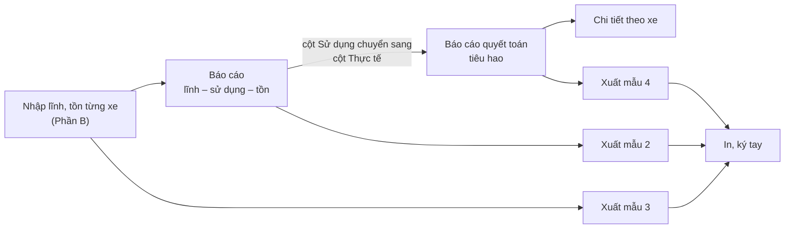

**Diễn giải luồng bằng lời:**
1. **Tổng hợp lĩnh–sử dụng–tồn** — Hệ thống cộng số liệu lĩnh/tồn của từng xe thành bảng: thùng, tồn đầu, lĩnh tại cây xăng, mua ngoài, tổng lĩnh, sử dụng, tồn cuối; kèm Tổng xăng, Tổng dầu, Tổng cộng.
2. **Quyết toán tiêu hao** — Với mỗi xe: km hoạt động trong tháng × định mức giao khoán / 100 ra tiêu hao theo định mức; so với tiêu hao thực tế (chính là cột Sử dụng ở bước 1) ra **Tăng (+)/Giảm (−)**. Xe mà lái xe chưa cập nhật tồn thì chưa có số thực tế: hệ thống ghi "Chưa cập nhật" và không tính Tăng/Giảm.
3. **Xem chi tiết** — Từ báo cáo quyết toán bấm biển số để xem từng tháng của xe đó; từ báo cáo lĩnh–sử dụng–tồn bấm số lĩnh để vào màn nhập lĩnh, tồn của xe (Phần B).
4. **Xuất biểu** — Xuất PDF theo đúng khuôn mẫu 2, 3, 4 để in ký tay, hoặc Excel. Nếu vượt định mức, biểu hiện dấu (!) để người ký chú ý.

---

**Luồng xuyên suốt:** Văn bản Tập đoàn → (A) định mức + hệ số + khai báo xe → định mức giao khoán → (B) phiếu lĩnh/hóa đơn, tồn đầu/cuối → (C) báo cáo lĩnh–sử dụng–tồn → quyết toán tiêu hao → xuất mẫu 2/3/4 → in, ký tay.

---

## 4. Màn hình & thao tác

### Phần A — Định mức và hệ số

#### 🖥️ Màn hình A1 — Danh mục loại xe và định mức
**Ai dùng:** Quản trị danh mục · **Dùng để:** xem và quản lý định mức nhiên liệu gốc của từng loại xe.

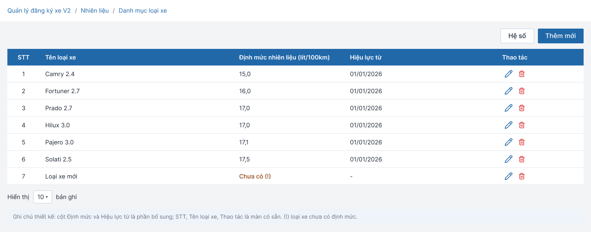

| # | Khu vực | Diễn giải |
|---|---|---|
| ① | Nút **Hệ số** và **+ Thêm mới** | Hệ số: sang màn cấu hình hệ số (Màn hình A3). Thêm mới: mở form thêm loại xe (Màn hình A2). |
| ② | Bảng loại xe | Liệt kê loại xe, định mức (lít/100km), ngày hiệu lực, thao tác Sửa/Xóa. Hiện 6 loại theo quy định: Camry 2.4 = 15,0; Fortuner 2.7 = 16,0; Prado 2.7 = 17,0; Hilux 3.0 = 17,0; Pajero 3.0 = 17,1; Solati 2.5 = 17,5. Loại xe chưa có định mức hiện cảnh báo **"Chưa có (!)"**. |
| ③ | Chọn số dòng mỗi trang | Mặc định 10 dòng. |

Lưu ý: định mức ở đây là định mức **gốc**, chưa nhân hệ số. Chỉ xóa được loại xe khi chưa xe nào thuộc loại đó **[Giả thiết]**.

#### 🖥️ Màn hình A2 — Thêm/sửa loại xe
**Ai dùng:** Quản trị danh mục · **Dùng để:** nhập hoặc đổi định mức của một loại xe.

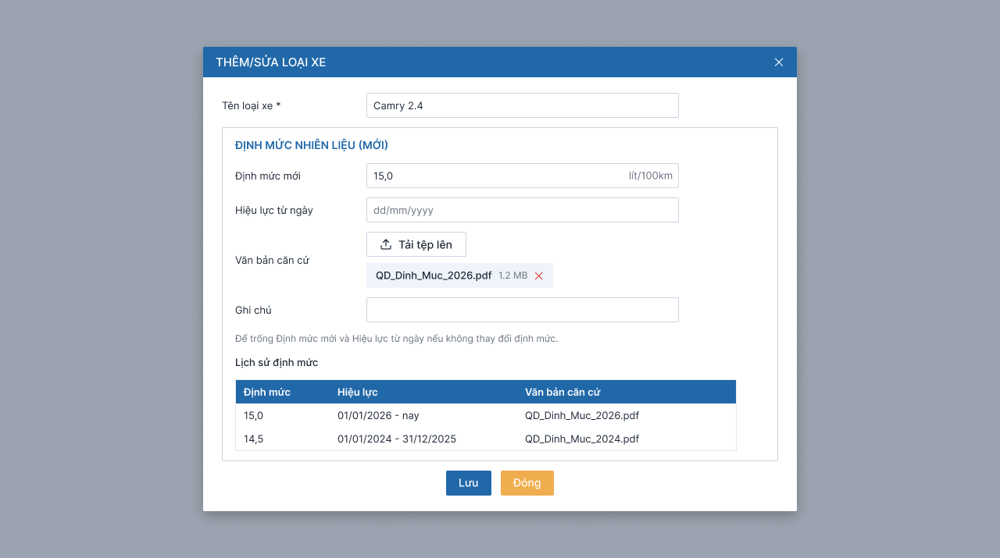

| # | Khu vực | Diễn giải |
|---|---|---|
| ① | Tên loại xe | Bắt buộc, không trùng loại đã có. |
| ② | Định mức mới, Hiệu lực từ, Văn bản căn cứ, Ghi chú | Nhập mức mới và ngày bắt đầu áp dụng. **Đổi định mức không ghi đè**: hệ thống tạo mức mới từ ngày chỉ định, mức cũ giữ lại. Văn bản căn cứ (tùy chọn) đính kèm bằng nút Tải tệp lên. |
| ③ | Lịch sử định mức | Bảng các mốc đã áp dụng: định mức, khoảng hiệu lực, văn bản căn cứ (mở xem được). |

#### 🖥️ Màn hình A3 — Cấu hình hệ số
**Ai dùng:** Quản trị danh mục · **Dùng để:** quản lý hệ số tuổi xe và hệ số xe phục vụ khai trường.

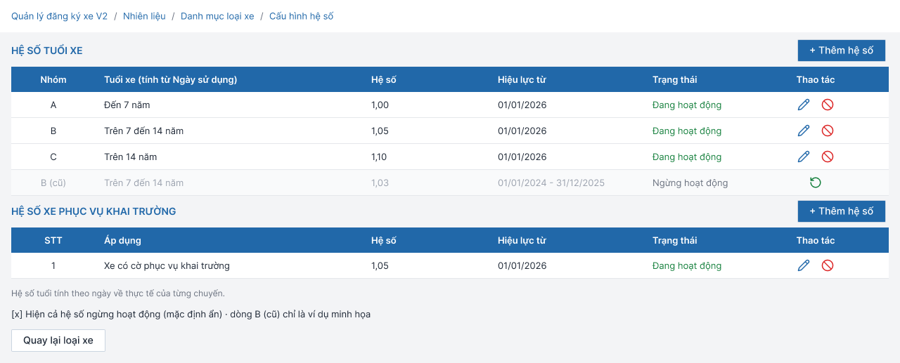

| # | Khu vực | Diễn giải |
|---|---|---|
| ① | Bảng **hệ số tuổi xe** | Nhóm A (đến 7 năm) 1,00; nhóm B (trên 7 đến 14 năm) 1,05; nhóm C (trên 14 năm) 1,10. Mỗi dòng có trạng thái Hoạt động/Không hoạt động và các biểu tượng Sửa (bút chì), Ngừng hoạt động (vòng cấm đỏ), Kích hoạt lại (mũi tên xanh). |
| ② | Bảng **hệ số xe phục vụ khai trường** | Hệ số 1,05 cho xe phục vụ Trung tâm Điều hành sản xuất tại Quảng Ninh, vận hành thường xuyên trên đường khai trường. Hệ số này **nhân thêm** ngoài hệ số tuổi. |
| ③ | Ô "Hiện cả hệ số không hoạt động" | Mặc định ẩn các dòng đã ngừng; bật lên để xem lịch sử. |
| ④ | Công thức định mức giao khoán | Hiển thị công thức và ví dụ: 17,0 × 1,10 × 1,00 = 18,7. |

Hệ số **không xóa cứng**, chỉ ngừng hoạt động, để giữ lịch sử và đối chiếu các tháng trước.

#### 🖥️ Màn hình A4 — Thêm/sửa hệ số
**Ai dùng:** Quản trị danh mục · **Dùng để:** thêm nhóm tuổi mới hoặc sửa hệ số.

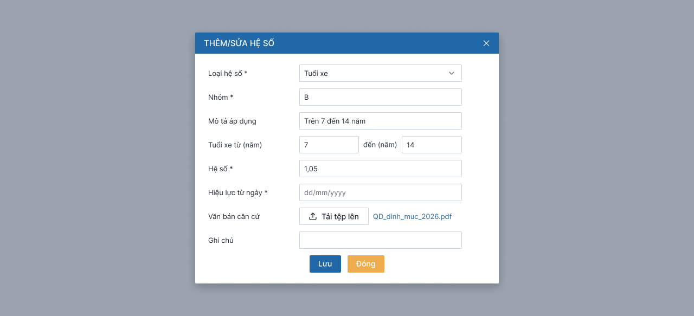

| # | Khu vực | Diễn giải |
|---|---|---|
| ① | Loại hệ số | Chọn Tuổi xe hoặc Xe phục vụ khai trường (khóa khi sửa). |
| ② | Nhóm, Mô tả áp dụng | Tên nhóm không trùng trong cùng loại. Với hệ số khai trường, mô tả đối tượng xe là bắt buộc. |
| ③ | Tuổi xe từ – đến | Chỉ hiện với loại Tuổi xe. Các nhóm phải liền nhau, **không chồng lấn, không để hở**; để trống ô "đến" nghĩa là không giới hạn trên (nhóm cao nhất). |
| ④ | Hệ số, Hiệu lực từ | Hệ số dương, tối đa 2 chữ số thập phân. Chỉ áp dụng từ ngày hiệu lực, **không áp ngược** vào các tháng đã qua (ngày hiệu lực chỉ chọn từ hôm nay trở đi **[Giả thiết — Q5]**). |
| ⑤ | Văn bản căn cứ, Ghi chú | Đính kèm quyết định quy định hệ số (tùy chọn). |

#### 🖥️ Màn hình A5 — Ngừng hoạt động hệ số
**Ai dùng:** Quản trị danh mục · **Dùng để:** ngừng áp dụng một hệ số khi quy định thay đổi.

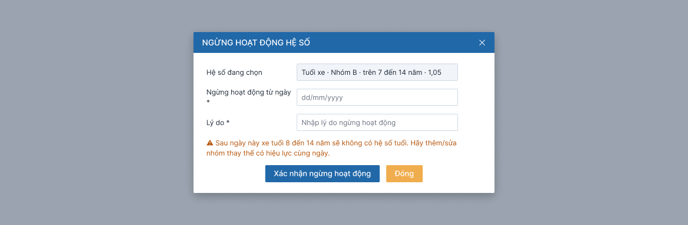

| # | Khu vực | Diễn giải |
|---|---|---|
| ① | Hệ số đang chọn | Hiển thị loại, nhóm, khoảng tuổi, hệ số của dòng được chọn. |
| ② | Ngừng từ ngày, Lý do | Cả hai bắt buộc. Ngày ngừng chỉ chọn được từ hôm nay trở đi **[Giả thiết — Q5]**. |
| ③ | Cảnh báo | Với hệ số tuổi: nếu ngừng làm **hở khoảng tuổi** (có xe không còn hệ số) thì chặn cho tới khi có nhóm thay thế cùng ngày hiệu lực. Với hệ số khai trường: xe khai trường sẽ tính hệ số 1,00 từ ngày ngừng, hệ thống báo số xe bị ảnh hưởng. |

#### 🖥️ Màn hình A6 — Thêm/sửa xe (phần Định mức nhiên liệu)
**Ai dùng:** Quản lý xe · **Dùng để:** khai báo nhiên liệu của xe và xem định mức đang áp dụng.

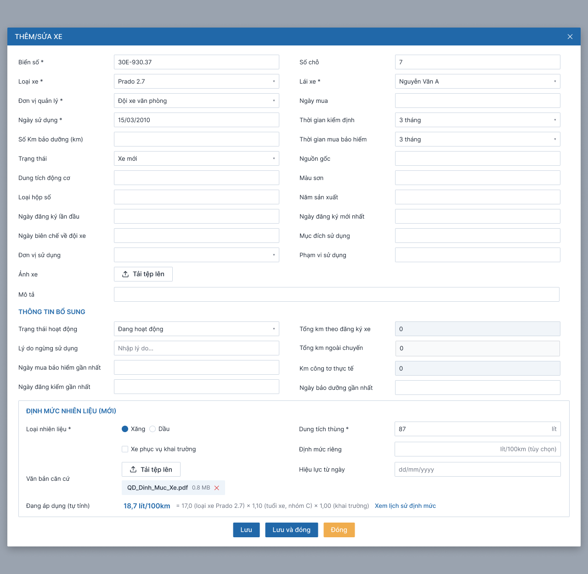

| # | Khu vực | Diễn giải |
|---|---|---|
| ① | Loại xe | Chọn từ danh mục loại xe; loại xe quyết định định mức gốc. |
| ② | Loại nhiên liệu, Dung tích thùng | Chọn Xăng hoặc Dầu và nhập dung tích thùng (lít). Loại nhiên liệu dùng để gom Tổng xăng/Tổng dầu ở báo cáo. |
| ③ | Ô "Xe phục vụ khai trường" | Tích chọn nếu xe thuộc diện hưởng hệ số khai trường. |
| ④ | Định mức đang áp dụng (tự tính) | Chỉ xem, hiển thị kết quả và diễn giải, ví dụ: 18,7 = 17,0 (loại xe) × 1,10 (nhóm C) × 1,00 (khai trường). Kèm liên kết "Xem lịch sử định mức". Khi sửa loại xe, ô khai trường hoặc ngày sử dụng, hệ thống hỏi "Áp dụng từ ngày" (Q14). |

#### Luồng chuyển giữa các màn hình

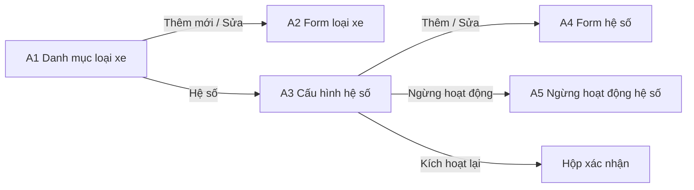

#### Ví dụ tình huống thực tế

> **Tình huống 1 — Tập đoàn đổi định mức Prado.** Anh Hùng (quản trị danh mục) nhận văn bản mới: Prado 2.7 tăng từ 17,0 lên 17,5 từ 01/11/2026. Anh mở màn *Danh mục loại xe*, bấm Sửa dòng Prado 2.7, nhập 17,5, chọn hiệu lực 01/11/2026, đính kèm file quyết định và Lưu. Hệ thống ghi mức mới, giữ mức 17,0 trong lịch sử. Báo cáo tháng 10 vẫn tính 17,0; từ tháng 11 tính 17,5. Nhật ký ghi "Đổi định mức Prado 2.7: 17,0 sang 17,5".
>
> **Tình huống 2 — Ngừng một nhóm tuổi.** Quy định mới bỏ nhóm B. Anh Hùng bấm biểu tượng Ngừng hoạt động ở dòng nhóm B, chọn ngày 31/12/2026. Hệ thống cảnh báo xe tuổi 8–14 năm sẽ không còn hệ số và chặn xác nhận. Anh thêm nhóm thay thế có hiệu lực cùng ngày rồi mới ngừng được nhóm B.

### Phần B — Nhập lĩnh/tồn theo xe

#### 🖥️ Màn hình B1 — Nhập lĩnh, tồn theo xe
**Ai dùng:** Lái xe, Quản lý xe · **Dùng để:** nhập phiếu lĩnh, hóa đơn và cập nhật tồn của một xe trong một tháng; đây là **màn hình duy nhất** để nhập và quản lý lĩnh/tồn theo danh sách.

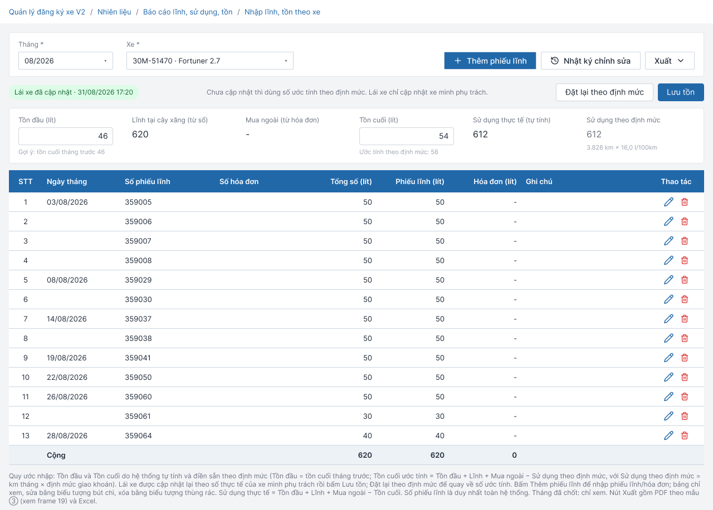

| # | Khu vực | Diễn giải |
|---|---|---|
| ① | Bộ lọc **Tháng**, **Xe** và các nút | Chọn tháng và xe (lái xe chỉ thấy xe mình phụ trách). Nút **+ Thêm phiếu lĩnh**, **Nhật ký chỉnh sửa**, **Xuất** (PDF mẫu "Theo dõi lĩnh nhiên liệu" hoặc Excel). Lái xe chỉ thêm/sửa được cho xe mình phụ trách. |
| ② | Khối **Tồn đầu / Lĩnh / Mua ngoài / Tồn cuối** | Tồn đầu (gợi ý: tồn cuối tháng trước) và tồn cuối **điền sẵn**; lái xe sửa theo số thực tế rồi bấm **Lưu tồn**, hoặc **Đặt lại theo định mức** để về số ước tính. Có nhãn "Ước tính theo định mức" hoặc "Lái xe đã cập nhật" kèm thời điểm. Bên dưới hiện **Sử dụng thực tế** và **Sử dụng theo định mức** (ví dụ 3.828 km × 16,0 / 100 = 612 lít). Nếu tồn đầu khác tồn cuối tháng trước thì hiện cảnh báo "Tồn đầu khác tồn cuối tháng trước X lít"; số ước tính âm hoặc vượt thùng thì đánh dấu "Cần rà soát" (chỉ cảnh báo, không chặn). |
| ③ | Bảng **phiếu lĩnh và hóa đơn** | Mỗi dòng: ngày, số phiếu, số hóa đơn, số lít phiếu, số lít hóa đơn, tổng, ghi chú; biểu tượng Sửa và Xóa. Cuối bảng có dòng **Cộng**. Bảng chỉ xem, thêm/sửa qua popup. |

#### 🖥️ Màn hình B2 — Thêm/sửa phiếu lĩnh (popup)
**Ai dùng:** Lái xe · **Dùng để:** ghi một dòng phiếu lĩnh và/hoặc hóa đơn mua ngoài.

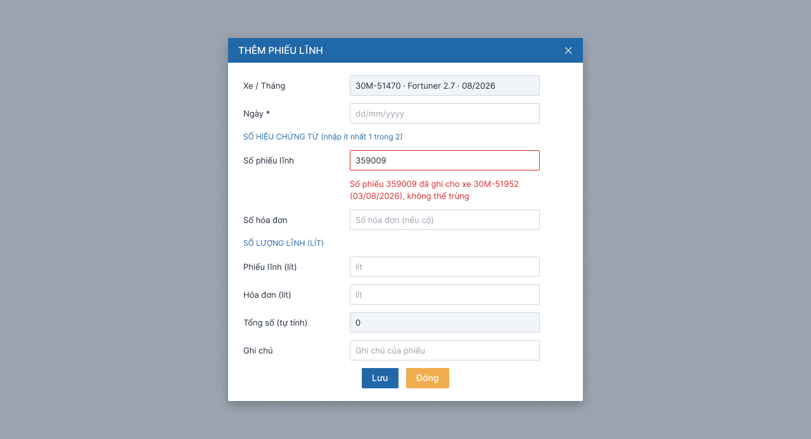

| # | Khu vực | Diễn giải |
|---|---|---|
| ① | Xe/Tháng, **Ngày** | Xe và tháng lấy từ màn nhập lĩnh/tồn đang mở (khóa). Ngày bắt buộc, thuộc tháng đang chọn. |
| ② | **Số phiếu lĩnh**, **Số hóa đơn** | Nhập **ít nhất một** trong hai. Số phiếu lĩnh bị kiểm trùng toàn hệ thống: trùng thì báo ngay dưới ô "Số phiếu … đã ghi cho xe … (ngày), không thể trùng" và chặn Lưu. |
| ③ | **Số lít**: phiếu lĩnh, hóa đơn, tổng | Số lít bắt buộc khi đã nhập số chứng từ tương ứng. **Tổng số** tự tính, không sửa. |
| ④ | Ghi chú, nút **Lưu** / **Đóng** | Ghi chú tùy chọn. Lưu hợp lệ thì đóng popup, bảng và khối tổng hợp cập nhật, ghi nhật ký. Sửa phiếu dùng cùng popup (tiêu đề "Sửa phiếu lĩnh"). |

#### 🖥️ Màn hình B3 — Nhật ký chỉnh sửa lĩnh và tồn
**Ai dùng:** Quản lý xe, Lái xe (chỉ xe mình) · **Dùng để:** tra lại ai đã sửa gì.

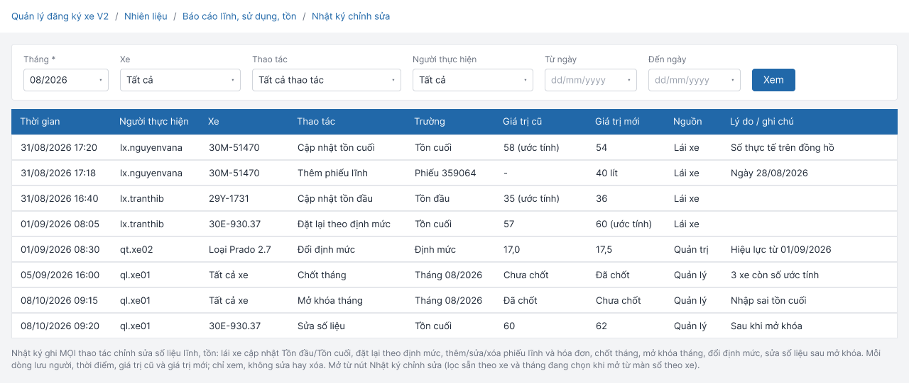

| # | Khu vực | Diễn giải |
|---|---|---|
| ① | Bộ lọc | Tháng, xe, thao tác, người thực hiện, khoảng ngày. Mở từ màn nhập lĩnh/tồn của xe thì lọc sẵn theo xe và tháng. |
| ② | Bảng nhật ký | Mỗi dòng: thời gian, người, xe, thao tác, trường thay đổi, giá trị cũ → mới, nguồn (Lái xe / Quản lý / Quản trị / Hệ thống), lý do. Chỉ xem, không sửa/xóa, giữ vĩnh viễn, mới nhất xếp trước. |
| ③ | Phân trang | 10/20/50 dòng mỗi trang; nút Quay lại. |

#### Luồng chuyển giữa các màn hình

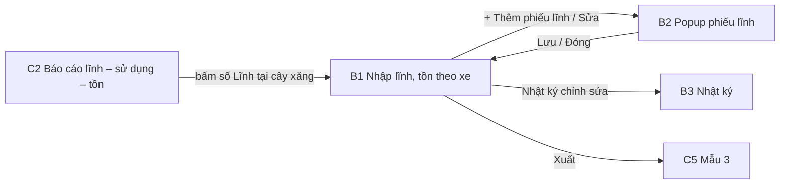

#### Ví dụ tình huống thực tế

> **Tình huống:** Anh An (lái xe 30M-51470) vừa đổ xăng tại cây xăng chỉ định ngày 03/08 với phiếu số 359005, 50 lít. Anh mở **Sổ theo dõi lĩnh**, chọn tháng 08/2026, xe 30M-51470, bấm **+ Thêm phiếu lĩnh**, chọn ngày 03/08, gõ số phiếu 359005, số lít 50 và Lưu. Dòng mới hiện trong bảng; nếu số phiếu đã được ghi cho xe khác, hệ thống báo ngay và không cho lưu.
> Ngày 31/08, anh xem đồng hồ rồi sửa ô Tồn cuối thành 54 lít và bấm **Lưu tồn**; nhãn đổi thành "Lái xe đã cập nhật 31/08/2026", Sử dụng thực tế hiện 612 lít, bằng mức theo định mức (3.828 km × 16,0 / 100). Đầu tháng sau, chị Lan (quản lý) phát hiện xe 30E-930.37 bị nhập sai tồn cuối (60 thay vì 62). Chị mở màn nhập lĩnh/tồn của xe đó, sửa thành 62 và bấm Lưu tồn — không cần mở khóa hay chốt lại. Nhật ký ghi "Tồn cuối: 60 sang 62" kèm tên chị Lan, và báo cáo hiện ngay số mới. Tồn đầu của tháng sau chỉ là số gợi ý nên không tự đổi; lái xe cập nhật nếu cần.

### Phần C — Báo cáo và biểu mẫu in

#### 🖥️ Màn hình C1 — Báo cáo quyết toán tiêu hao
**Ai dùng:** Quản lý xe, Lãnh đạo, Kế toán · **Dùng để:** so sánh tiêu hao thực tế với định mức của từng xe.

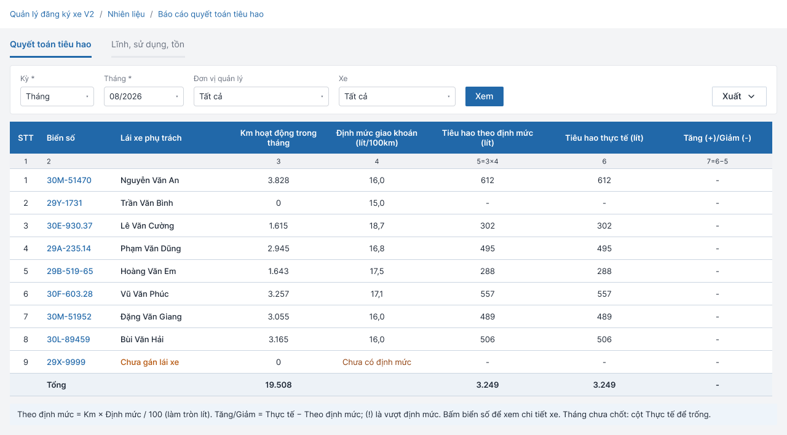

| # | Khu vực | Diễn giải |
|---|---|---|
| ① | Hai tab **Quyết toán tiêu hao** / **Lĩnh, sử dụng, tồn** | Chuyển giữa hai báo cáo cùng bộ lọc. |
| ② | Bộ lọc **Kỳ, Tháng, Đơn vị, Xe** + nút **Xem** | Kỳ hiện chỉ có Tháng; các kỳ khác (quý, năm) chờ chốt **[Giả thiết — Q18]**. Đơn vị quản lý quyết định tiêu đề biểu khi xuất. |
| ③ | Nút **Xuất** (menu) | Excel hoặc PDF theo đúng biểu mẫu 4 "Biểu tổng hợp quyết toán tiêu hao nhiên liệu từng xe ô tô". |
| ④ | Bảng quyết toán | Mỗi xe một dòng: biển số (bấm vào xem chi tiết), **lái xe phụ trách**, km tháng, định mức giao khoán (lít/100km), tiêu hao theo định mức, tiêu hao thực tế, tăng/giảm; dòng Tổng cuối bảng. Xe chưa có định mức hiện "Chưa có định mức"; xe chưa gán lái xe hiện "Chưa gán lái xe" (màu cam). Xe mà lái xe chưa cập nhật tồn: cột thực tế hiện "Chưa cập nhật" (màu cam), không tính Tăng/Giảm. |

#### 🖥️ Màn hình C2 — Báo cáo lĩnh, sử dụng, tồn
**Ai dùng:** Quản lý xe, Lãnh đạo · **Dùng để:** xem tổng lĩnh và tồn nhiên liệu của cả đội xe trong tháng.

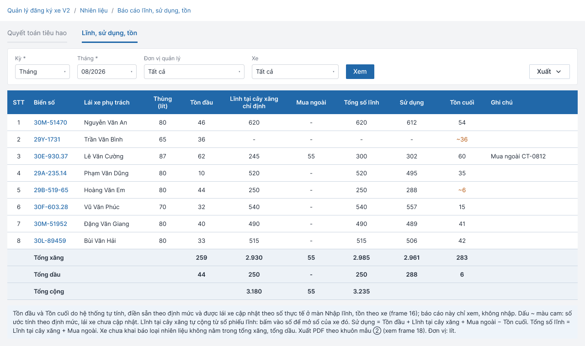

| # | Khu vực | Diễn giải |
|---|---|---|
| ① | Tab và bộ lọc | Như Màn hình C1. |
| ② | Nút **Xem**, **Xuất** | Xuất PDF theo đúng biểu mẫu 2 "Biểu tổng hợp lĩnh, sử dụng, tồn nhiên liệu từng xe ô tô" hoặc Excel. |
| ③ | Bảng lĩnh–sử dụng–tồn | Mỗi xe: biển số, lái xe phụ trách, thùng, tồn đầu, **lĩnh tại cây xăng** (bấm vào số để mở màn nhập lĩnh/tồn của xe), mua ngoài, tổng lĩnh, sử dụng, tồn cuối, ghi chú; có Tổng xăng, Tổng dầu, Tổng cộng. Dòng nào còn là số ước tính (lái xe chưa cập nhật) có dấu **\*** màu cam, chú thích cuối trang. Báo cáo chỉ xem, không có ô nhập. Dòng có tồn đầu lệch so với tồn cuối tháng trước hoặc số ước tính bất thường cũng được đánh dấu để rà soát. |

#### 🖥️ Màn hình C3 — Chi tiết tiêu hao theo xe
**Ai dùng:** Quản lý xe · **Dùng để:** theo dõi từng tháng của một xe để tìm tháng bị vượt.

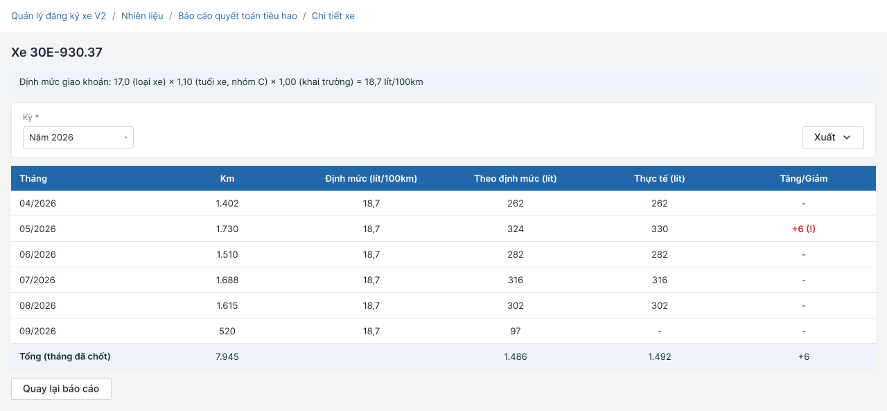

| # | Khu vực | Diễn giải |
|---|---|---|
| ① | Đầu trang xe | Biển số, loại xe, loại nhiên liệu, dung tích thùng, công thức định mức giao khoán (17,0 × 1,10 × 1,00 = 18,7). |
| ② | Bộ lọc **Kỳ** + nút **Xuất** | Mặc định Năm hiện tại; có kỳ **Vòng đời** (từ chuyến đầu tiên có km). Xuất Excel. |
| ③ | Bảng theo tháng | Mỗi tháng: km, định mức, theo định mức, thực tế, tăng/giảm; dấu (!) khi vượt. Tháng mà lái xe chưa cập nhật tồn: cột Thực tế ghi "Chưa cập nhật", không tính Tăng/Giảm; dòng Tổng chỉ cộng các tháng đã cập nhật. |

#### 🖥️ Màn hình C4 — Xuất mẫu 2: Lĩnh, sử dụng, tồn
**Ai dùng:** Quản lý xe, Lãnh đạo · **Dùng để:** in biểu tổng hợp lĩnh–sử dụng–tồn của cả đội.

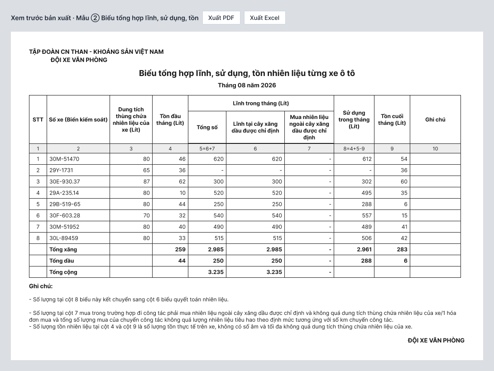

| # | Khu vực | Diễn giải |
|---|---|---|
| ① | Tiêu đề và bảng 10 cột | Tiêu đề hai dòng: "Tập đoàn CN Than - Khoáng sản Việt Nam" và tên đơn vị quản lý. Cột: STT, Số xe, Dung tích thùng, Tồn đầu tháng, Lĩnh trong tháng (Tổng = cây xăng + mua ngoài), Sử dụng, Tồn cuối, Ghi chú; có hàng đánh số cột và công thức. Dòng Tổng xăng, Tổng dầu, Tổng cộng. |
| ② | Ghi chú và chữ ký | 3 ghi chú theo biểu giấy; khối chữ ký "ĐỘI XE VĂN PHÒNG". |

#### 🖥️ Màn hình C5 — Xuất mẫu 3: Theo dõi lĩnh nhiên liệu
**Ai dùng:** Lái xe, Quản lý xe · **Dùng để:** in biểu theo dõi lĩnh của từng xe.

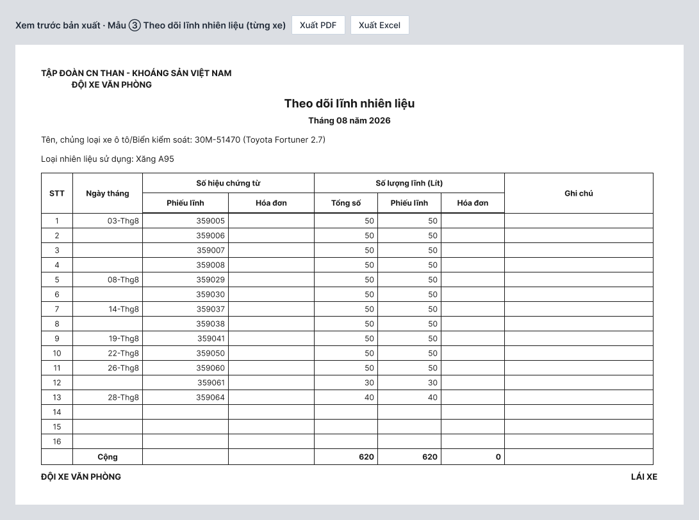

| # | Khu vực | Diễn giải |
|---|---|---|
| ① | Bảng theo dõi lĩnh | STT, Ngày tháng (dạng 03-Thg8, chỉ ghi ở dòng đầu của ngày), Số hiệu chứng từ (phiếu lĩnh, hóa đơn), Số lượng lĩnh theo lít (tổng, phiếu, hóa đơn), Ghi chú. Bảng có dòng trống đến STT 18 như biểu giấy và dòng Cộng. |
| ② | Thông tin xe và chữ ký | Tên, chủng loại xe/Biển kiểm soát, loại nhiên liệu sử dụng; chữ ký "ĐỘI XE VĂN PHÒNG" và "LÁI XE". |

#### 🖥️ Màn hình C6 — Xuất mẫu 4: Quyết toán tiêu hao
**Ai dùng:** Quản lý xe, Lãnh đạo, Kế toán · **Dùng để:** in biểu quyết toán tiêu hao.

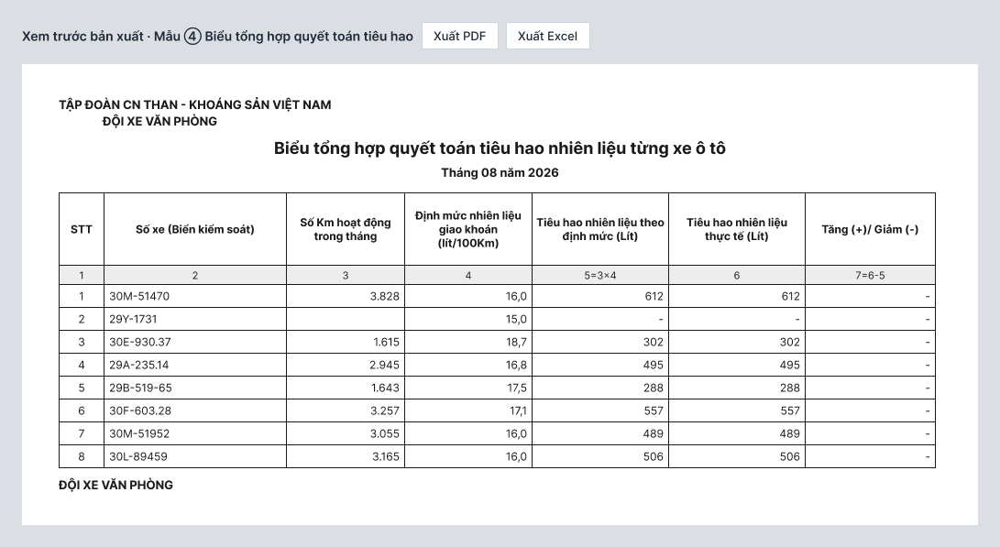

| # | Khu vực | Diễn giải |
|---|---|---|
| ① | Bảng quyết toán 7 cột | STT, Số xe, Số km hoạt động trong tháng, Định mức giao khoán (lít/100km), Tiêu hao theo định mức (5 = 3 × 4), Tiêu hao thực tế (6), Tăng (+)/Giảm (−) (7 = 6 − 5); có hàng đánh số cột và công thức. |
| ② | Chữ ký | Khối "ĐỘI XE VĂN PHÒNG"; tiêu đề lấy theo đơn vị quản lý. |

> Cả 3 biểu mẫu **in ký tay, không ký số**. Cột "Lái xe phụ trách" chỉ có trên màn hình để tra cứu/lọc, **không in** ra mẫu 4 vì mẫu giấy không có cột này.

#### Luồng chuyển giữa các màn hình

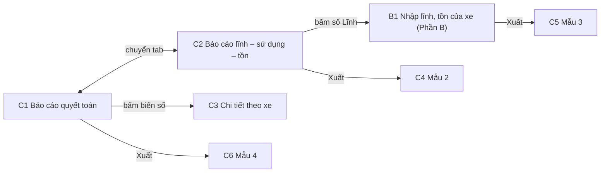

#### Ví dụ tình huống thực tế

> **Tình huống:** Đầu tháng 09/2026, chị Lan mở **Báo cáo lĩnh, sử dụng, tồn**, chọn tháng 08/2026, đơn vị Đội xe văn phòng, bấm Xem. Tổng xăng hiện lĩnh 2.985 lít, sử dụng 2.961 lít, tồn cuối 283 lít. Chị thấy xe 29B-519-65 có dấu * cam, nghĩa là lái xe chưa cập nhật tồn; chị bấm số lĩnh của xe để vào sổ, nhắc lái xe cập nhật.
> Chị chuyển sang tab **Quyết toán tiêu hao**: xe 30E-930.37 chạy 1.615 km × 18,7 / 100 ≈ 302 lít theo định mức, thực tế 302, không chênh. Xe 29X-9999 hiện "Chưa có định mức" nên không tính; xe 29B-519-65 (lái xe chưa cập nhật tồn) hiện "Chưa cập nhật", không tính Tăng/Giảm. Chị bấm biển số 30E-930.37 để xem từng tháng của xe, thấy tháng 05 vượt +6 lít có dấu (!). Cuối cùng chị bấm **Xuất → PDF** cho mẫu 2 và mẫu 4, in và trình lãnh đạo ký tay.

---

## 5. Yêu cầu chức năng chi tiết

### Phần A — Định mức và hệ số

#### Module: Định mức loại xe

##### UR01 — Quản lý danh mục loại xe và định mức gốc

Quản trị danh mục cần xem được toàn bộ loại xe cùng định mức gốc (lít/100km) và ngày hiệu lực, đồng thời thêm, sửa, xóa loại xe, để mọi xe trong đơn vị cùng dùng một nguồn định mức thống nhất theo văn bản Tập đoàn. Loại xe chưa có định mức cần được cảnh báo rõ để không bị bỏ sót khi tính tiêu hao.

- **Lưu ý đặc biệt:** Tên loại xe không được trùng. Loại xe chỉ xóa được khi chưa có xe nào thuộc loại đó **[Giả thiết]**. Xe thuộc loại chưa có định mức sẽ hiện "Chưa có định mức" ở báo cáo, không tính tiêu hao.
- **Màn hình liên quan:** Màn A1, Màn A2
- **Mức độ ưu tiên:** Cao

##### UR02 — Đổi định mức theo ngày hiệu lực, giữ lịch sử

Khi Tập đoàn ban hành mức mới, quản trị danh mục cần nhập mức mới kèm ngày bắt đầu áp dụng mà không làm mất mức cũ, để báo cáo từng tháng luôn dùng đúng mức có hiệu lực tại thời điểm đó và có thể truy lại về sau.

- **Lưu ý đặc biệt:** Ví dụ Prado 2.7 từ 17,0 lên 17,5 hiệu lực 01/11/2026: tháng 10 vẫn tính 17,0, từ tháng 11 tính 17,5. Mỗi lần đổi đều ghi nhật ký.
- **Màn hình liên quan:** Màn A2
- **Mức độ ưu tiên:** Cao

##### UR03 — Đính kèm văn bản căn cứ

Người cập nhật cần đính kèm quyết định/văn bản quy định cho từng mức định mức và từng hệ số, để khi kiểm tra có thể mở lại đúng văn bản làm căn cứ.

- **Lưu ý đặc biệt:** Tệp chọn bằng nút **Tải tệp lên**, không hỗ trợ kéo thả. Hệ thống hiện tên tệp, dung lượng và nút xóa. Định dạng và dung lượng tối đa chờ chốt **[Giả thiết: PDF/Word]**.
- **Màn hình liên quan:** Màn A2, Màn A4
- **Mức độ ưu tiên:** Trung bình

#### Module: Hệ số điều chỉnh

##### UR04 — Cấu hình hệ số theo tuổi xe

Quản trị danh mục cần cấu hình các nhóm tuổi xe và hệ số tương ứng (hiện: đến 7 năm 1,00; trên 7 đến 14 năm 1,05; trên 14 năm 1,10), nhằm tự động tăng định mức cho xe cũ hơn mà không phải tính tay.

- **Lưu ý đặc biệt:** Các nhóm tuổi phải liền nhau, không chồng lấn, không để hở; "trên 7 năm" nghĩa là quá 7 năm tròn tính theo ngày **[Giả thiết — Q18]**. Tuổi xe tính từ **Ngày sử dụng** của xe **[Giả thiết — chờ chốt Q1]**. Hệ số mới chỉ áp từ ngày hiệu lực, không áp ngược vào các tháng đã qua (ngày hiệu lực chỉ chọn từ hôm nay trở đi — Q5).
- **Màn hình liên quan:** Màn A3, Màn A4
- **Mức độ ưu tiên:** Cao

##### UR05 — Cấu hình hệ số xe phục vụ khai trường

Quản trị danh mục cần cấu hình hệ số 1,05 cho xe phục vụ Trung tâm Điều hành sản xuất tại Quảng Ninh, vận hành thường xuyên trên đường khai trường, vì các xe này tiêu hao nhiều hơn bình thường.

- **Lưu ý đặc biệt:** Hệ số này nhân **thêm** ngoài hệ số tuổi. Tại một thời điểm chỉ có một hệ số khai trường hoạt động; thêm hệ số mới thì bản cũ tự ngừng, kết thúc trước ngày hiệu lực mới 1 ngày **[Giả thiết]**.
- **Màn hình liên quan:** Màn A3, Màn A4
- **Mức độ ưu tiên:** Cao

##### UR06 — Ngừng hoạt động và kích hoạt lại hệ số

Khi quy định thay đổi, quản trị danh mục cần ngừng áp dụng một hệ số (kèm lý do) và có thể kích hoạt lại khi cần, thay vì xóa mất, để vẫn đối chiếu được các tháng trước.

- **Lưu ý đặc biệt:** Không cho ngừng nếu làm hở khoảng tuổi cho tới khi có nhóm thay thế cùng ngày. Ngày ngừng chỉ được chọn từ hôm nay trở đi **[Giả thiết — Q5]**. Kích hoạt lại chỉ được khi khoảng tuổi không chồng lấn với nhóm đang hoạt động; nếu chồng, hệ thống báo "Khoảng tuổi chồng lấn với nhóm X" **[Giả thiết]**.
- **Màn hình liên quan:** Màn A3, Màn A5
- **Mức độ ưu tiên:** Cao

#### Module: Khai báo xe và định mức giao khoán

##### UR07 — Khai báo nhiên liệu cho từng xe

Quản lý xe cần chọn loại xe, loại nhiên liệu (Xăng/Dầu), dung tích thùng và đánh dấu "Xe phục vụ khai trường" khi thêm hoặc sửa xe, để hệ thống biết áp định mức và hệ số nào cho xe đó, đồng thời gom đúng Tổng xăng/Tổng dầu ở báo cáo.

- **Lưu ý đặc biệt:** Dung tích thùng là giới hạn cho tồn đầu/tồn cuối và mỗi hóa đơn mua ngoài (Phần B). Xe chưa khai báo loại nhiên liệu sẽ không nằm trong tổng xăng, tổng dầu. Loại xe, "xe phục vụ khai trường" và ngày sử dụng của xe có **ngày hiệu lực**: khi sửa, hệ thống hỏi "áp dụng từ ngày" và giữ lịch sử; các tháng trước ngày đó vẫn tính theo thông tin cũ **[Giả thiết — Q14]**.
- **Màn hình liên quan:** Màn A6
- **Mức độ ưu tiên:** Cao

##### UR08 — Tự tính và hiển thị định mức giao khoán của xe

Quản lý xe cần thấy ngay định mức giao khoán đang áp dụng cho xe (lít/100km) cùng cách tính, và xem lại lịch sử các mốc định mức đã áp dụng, để biết xe được giao khoán bao nhiêu mà không phải tự nhân hệ số.

- **Lưu ý đặc biệt:** Định mức giao khoán = định mức loại xe × hệ số tuổi × hệ số khai trường. Ví dụ Prado 2.7, trên 14 năm, không khai trường: 17,0 × 1,10 × 1,00 = **18,7**. Không nhập tay. Nội dung màn "Xem lịch sử định mức" của xe chưa thiết kế riêng **[Giả thiết]**. Xe đổi nhóm tuổi giữa tháng thì tính thế nào: chờ chốt Q2.
- **Màn hình liên quan:** Màn A6, Màn A3 (công thức)
- **Mức độ ưu tiên:** Cao

#### Module: Quy tắc cần chốt (bổ sung sau rà soát — điểm chặn)

> UR29–UR30 được đánh số cuối để không đổi mã các yêu cầu đã nêu ở trên. Mỗi yêu cầu nêu các phương án; phương án ghi **[Giả thiết]** là đề xuất của BA, **chờ khách hàng chốt**.

##### UR29 — Quy tắc tính định mức khi định mức giao khoán đổi giữa tháng

Hệ thống cần có một quy tắc rõ ràng để tính định mức giao khoán trong tháng mà **bất kỳ thành phần nào của định mức đổi giữa tháng**: xe chuyển nhóm tuổi (A sang B, B sang C), định mức loại xe hoặc hệ số có hiệu lực từ giữa tháng, xe đổi loại hoặc bắt đầu/thôi thuộc diện khai trường. Vì hệ số khác nhau làm thay đổi con số quyết toán của tháng đó.

- **Các phương án:** (1) **Tách theo ngày đổi nhóm**: km của các chuyến trước ngày đổi tính theo định mức/hệ số cũ, từ ngày đổi tính theo mức mới (cách này khớp với ghi chú "tính theo ngày của từng chuyến" trên bản thiết kế, cần km theo từng chuyến); (2) **Áp hệ số đầu tháng** cho cả tháng; (3) **Áp hệ số cuối tháng** cho cả tháng; (4) **Bình quân gia quyền theo km** của từng nhóm.
- **Đề xuất:** phương án (1) vì sát thực tế nhất **[Giả thiết]**; phương án (2) nếu khách muốn đơn giản. Với (1), báo cáo quyết toán và chi tiết theo xe hiện một dòng tổng của tháng, định mức ghi là mức bình quân của tháng và có ghi chú "đổi nhóm ngày …".
- **Lưu ý đặc biệt:** Khi quy tắc này thay đổi, chỉ áp dụng từ ngày áp dụng mới trở đi, các tháng đã qua không bị tính lại **[Giả thiết]**. Tuổi xe tính theo mốc đã chốt ở Q1.
- **Màn hình liên quan:** Màn A3, Màn A6; báo cáo quyết toán (Phần C)
- **Mức độ ưu tiên:** Cao

##### UR30 — Phạm vi đơn vị sử dụng và tiêu đề biểu mẫu

Khách hàng cần xác định hệ thống dùng cho những đơn vị nào, mỗi xe thuộc đơn vị quản lý nào, và định mức/hệ số dùng chung hay riêng từng đơn vị, để dữ liệu, phân quyền và tiêu đề ba biểu mẫu luôn đúng đơn vị.

- **Đề xuất:** mỗi xe thuộc **một** đơn vị quản lý; danh mục loại xe, định mức và hệ số **dùng chung** toàn Tập đoàn **[Giả thiết]**; lái xe và quản lý chỉ xem dữ liệu của đơn vị mình; lãnh đạo/kế toán xem được các đơn vị được cấp quyền (có thể nhiều đơn vị) **[Giả thiết — Q17]**; tiêu đề biểu gồm hai dòng "Tập đoàn CN Than - Khoáng sản Việt Nam" và tên đơn vị quản lý **[Giả thiết]**.
- **Cần khách cung cấp:** danh sách đơn vị ngoài Đội xe văn phòng sẽ dùng, và tên chính thức hiển thị trên tiêu đề biểu từng đơn vị.
- **Màn hình liên quan:** Màn A1, Màn A6; ba biểu mẫu in (Phần C)
- **Mức độ ưu tiên:** Cao

> Lưu ý phân quyền áp dụng cho UR01–UR06: chỉ người có quyền quản trị loại xe và hệ số mới thấy nút Thêm/Sửa/Ngừng/Kích hoạt lại; người khác chỉ xem. Mọi thao tác thêm, sửa, ngừng, kích hoạt đều ghi nhật ký (người, thời điểm, giá trị cũ/mới).

### Phần B — Nhập lĩnh/tồn theo xe

#### Module: Nhập lĩnh, tồn theo xe

##### UR09 — Mỗi xe có một danh sách lĩnh theo tháng

Lái xe và quản lý cần mở màn nhập lĩnh, tồn của từng xe theo từng tháng và xem các phiếu dưới dạng danh sách, để có đúng biểu "Theo dõi lĩnh nhiên liệu" ngay trên hệ thống và xuất ra in khi cần. Lái xe chỉ thấy xe mình phụ trách, quản lý thấy mọi xe của đơn vị.

- **Lưu ý đặc biệt:** Loại nhiên liệu lấy theo khai báo của xe (Phần A), không nhập lại. Xe biên chế gán cho lái xe nào do danh mục xe quyết định **[Giả thiết]**. Xe xuất hiện ở báo cáo của những tháng xe đang hoạt động (từ ngày sử dụng đến ngày ngừng sử dụng); xe đổi lái xe giữa chừng thì lái xe phụ trách hiện tại xem được cả dữ liệu cũ của xe **[Giả thiết — Q15]**.
- **Màn hình liên quan:** Màn B1
- **Mức độ ưu tiên:** Cao

##### UR10 — Nhập phiếu lĩnh và hóa đơn mua ngoài

Lái xe cần ghi mỗi lần lĩnh nhiên liệu thành một dòng (ngày, số phiếu lĩnh, số hóa đơn, số lít, ghi chú), có thể sửa hoặc xóa khi nhập nhầm, để cuối tháng không phải cộng tay. Số lít phiếu lĩnh tự cộng vào "Lĩnh tại cây xăng chỉ định", số lít hóa đơn tự cộng vào "Mua ngoài" ở báo cáo.

- **Lưu ý đặc biệt:** Mỗi dòng phải có ít nhất một trong hai số chứng từ. Số phiếu lĩnh **chỉ nhập số** (hệ thống không quản lý kho phiếu). Mua ngoài vượt dung tích thùng chỉ **cảnh báo**, vẫn lưu và ghi nhật ký. Xóa dòng có hộp xác nhận.
- **Màn hình liên quan:** Màn B1, Màn B2
- **Mức độ ưu tiên:** Cao

##### UR11 — Chặn trùng số phiếu lĩnh, cảnh báo trùng số hóa đơn

Hệ thống cần kiểm trùng số phiếu lĩnh trên toàn hệ thống và báo rõ phiếu đó đã ghi cho xe nào, ngày nào, để tránh một phiếu bị dùng hai lần.

- **Lưu ý đặc biệt:** Ví dụ nhập 359009 đã ghi cho xe 30M-51952 ngày 03/08 thì hiện "Số phiếu 359009 đã ghi cho xe 30M-51952 (03/08/2026), không thể trùng" và không cho lưu. Khi sửa một phiếu, hệ thống không coi chính phiếu đó là trùng. Số hóa đơn trùng chỉ **cảnh báo**, không chặn, vì hóa đơn của các nhà cung cấp khác nhau có thể trùng số **[Giả thiết — Q16]**.
- **Màn hình liên quan:** Màn B2
- **Mức độ ưu tiên:** Cao

#### Module: Tồn đầu, tồn cuối

##### UR12 — Tự điền sẵn tồn và cho lái xe cập nhật số thực tế

Lái xe cần thấy tồn đầu và tồn cuối đã được điền sẵn, và sửa lại theo số thực tế của xe mình, để đỡ phải gõ lại và vẫn có số đúng.

- **Lưu ý đặc biệt:** Tồn đầu được gợi ý bằng tồn cuối tháng trước và lái xe sửa được; sửa tồn cuối của một tháng **không** tự đổi tồn đầu tháng sau. Tồn cuối ước tính = tồn đầu + lĩnh + mua ngoài − sử dụng theo định mức; ví dụ 46 + 620 + 0 − 612 = 54 lít. Tồn đầu và tồn cuối do người dùng nhập phải ≥ 0 và ≤ dung tích thùng, vi phạm thì viền đỏ và chặn **Lưu tồn**. Sử dụng thực tế = tồn đầu + lĩnh + mua ngoài − tồn cuối, không được âm.
- **Cảnh báo tồn đầu lệch:** nếu tồn đầu khác tồn cuối tháng trước, màn B1 và báo cáo C2 hiện cảnh báo "Tồn đầu khác tồn cuối tháng trước X lít". Chỉ cảnh báo, không chặn, không tự sửa **[Giả thiết]**.
- **Số ước tính bất thường:** nếu số ước tính tự tính ra âm hoặc lớn hơn dung tích thùng, hệ thống vẫn hiển thị nhưng đánh dấu "Cần rà soát" ở B1 và C2, không chặn **[Giả thiết]**.
- **Đặt lại theo định mức:** đưa tồn đầu về số gợi ý và tồn cuối về số ước tính, xóa số lái xe đã nhập **[Giả thiết]**.
- **Tháng đầu tiên dùng hệ thống:** chưa có tồn cuối tháng trước để gợi ý, nên quản lý hoặc lái xe nhập tồn đầu bằng tay (nhãn "Số dư ban đầu", ghi nhật ký). Xe mới đưa vào đội giữa chừng làm tương tự **[Giả thiết]**.
- **Ai được nhập:** lái xe nhập và sửa phiếu, tồn của xe mình phụ trách; quản lý xe làm được cho mọi xe trong đơn vị, nhật ký ghi nguồn "Lái xe" hoặc "Quản lý" **[Giả thiết — Q17]**.
- **Màn hình liên quan:** Màn B1
- **Mức độ ưu tiên:** Cao

#### Module: Nhật ký

##### UR13 — Nhật ký mọi thay đổi lĩnh và tồn

Quản lý cần tra lại ai đã thêm/sửa/xóa phiếu, cập nhật hoặc đặt lại tồn, đổi định mức, kèm số cũ và số mới, để giải trình khi kiểm tra.

- **Lưu ý đặc biệt:** Chỉ ghi khi người dùng chủ động thay đổi; số ước tính hệ thống tự tính lại thì không ghi. Không ghi nếu số không đổi. Nhật ký không sửa, không xóa. Sửa số liệu của tháng đã qua cũng được ghi. Lái xe chỉ xem nhật ký xe mình.
- **Màn hình liên quan:** Màn B3
- **Mức độ ưu tiên:** Cao

> **Đã bỏ khỏi phạm vi:** UR14 (chốt tháng), UR15 (mở khóa tháng), UR16 (xử lý tồn đầu bị lệch), UR25 (nhập số dư ban đầu, đã gộp vào UR12) và UR26 (chốt tháng khi còn số ước tính). Hệ thống không còn bước chốt tháng: số liệu lĩnh/tồn luôn sửa được trực tiếp trên màn B1 và mọi thay đổi đều ghi nhật ký.

### Phần C — Báo cáo và biểu mẫu in

#### Module: Báo cáo lĩnh, sử dụng, tồn

##### UR17 — Báo cáo lĩnh, sử dụng, tồn theo tháng

Quản lý và lãnh đạo cần xem bảng tổng hợp lĩnh, sử dụng, tồn của từng xe theo tháng và đơn vị, kèm Tổng xăng, Tổng dầu, Tổng cộng, để nắm tình hình nhiên liệu cả đội mà không phải cộng tay từng sổ xe.

- **Lưu ý đặc biệt:** Sử dụng = tồn đầu + lĩnh tại cây xăng + mua ngoài − tồn cuối. Báo cáo luôn hiện số mới nhất đang có trong hệ thống, kể cả khi số liệu của tháng đã qua vừa được sửa. Xe chưa khai báo loại nhiên liệu không nằm trong Tổng xăng/Tổng dầu. Báo cáo chỉ xem, mọi số do hệ thống tổng hợp từ sổ xe.
- **Màn hình liên quan:** Màn C2
- **Mức độ ưu tiên:** Cao

##### UR18 — Nhận biết số ước tính và đi tới màn nhập lĩnh/tồn của xe

Quản lý cần thấy ngay dòng nào còn là số ước tính (lái xe chưa cập nhật tồn) và bấm vào số lĩnh để vào màn nhập lĩnh/tồn của xe đó, để nhắc lái xe cập nhật trước khi in biểu.

- **Lưu ý đặc biệt:** Dòng ước tính có dấu * màu cam sau số và chú thích cuối trang; số ước tính chỉ để theo dõi tồn, không dùng để so với định mức. Xe chưa có số lĩnh (hiện "-") vẫn bấm được để vào màn nhập phiếu. Mẫu 2 xuất ra ghi chú rõ xe nào còn dùng số ước tính **[Giả thiết]**.
- **Màn hình liên quan:** Màn C2
- **Mức độ ưu tiên:** Trung bình

#### Module: Báo cáo quyết toán

##### UR19 — Báo cáo quyết toán tiêu hao theo định mức

Quản lý, lãnh đạo và kế toán cần so sánh tiêu hao thực tế với tiêu hao theo định mức của từng xe và thấy xe nào tăng hoặc giảm, để quyết toán chi phí nhiên liệu đúng quy định.

- **Lưu ý đặc biệt:** Tiêu hao theo định mức = km hoạt động trong tháng × định mức giao khoán / 100, làm tròn lít (số lít nhập và hiển thị là số nguyên **[Giả thiết — Q18]**). Tiêu hao thực tế = số Sử dụng ở báo cáo lĩnh–sử dụng–tồn. Tăng/Giảm = thực tế − theo định mức; hiện (!) khi vượt. Km tính từ các chuyến đã xác nhận đi về **[Giả thiết — nguồn km chờ chốt]**. Xe chưa có định mức hiện "Chưa có định mức" và không tính tiêu hao. Xe mà lái xe chưa cập nhật tồn: cột Thực tế ghi "Chưa cập nhật" (đánh dấu *), không tính Tăng/Giảm, vì số ước tính được tính ngược từ định mức nên luôn bằng định mức và không phản ánh thực tế; xe này không được cộng vào dòng Tổng thực tế và Tổng Tăng/Giảm, dòng Tổng ghi chú số xe chưa cập nhật **[Giả thiết]**.
- **Màn hình liên quan:** Màn C1
- **Mức độ ưu tiên:** Cao

##### UR20 — Hiển thị lái xe phụ trách trên báo cáo

Quản lý cần thấy lái xe đang phụ trách từng xe ngay trên hai báo cáo, để biết hỏi ai khi số liệu bất thường.

- **Lưu ý đặc biệt:** Lấy từ lái xe biên chế gán cho xe trong danh mục xe **[Giả thiết]**; xe chưa gán hiện "Chưa gán lái xe" màu cam. Cột này chỉ để tra cứu/lọc, **không in** ra mẫu 4.
- **Màn hình liên quan:** Màn C1, Màn C2
- **Mức độ ưu tiên:** Trung bình

##### UR21 — Chi tiết tiêu hao theo xe

Quản lý cần xem tiêu hao của một xe theo từng tháng trong năm (hoặc cả vòng đời), để tìm tháng bị vượt định mức và đánh giá xe hoạt động bất thường.

- **Lưu ý đặc biệt:** Tháng mà lái xe chưa cập nhật tồn: cột Thực tế ghi "Chưa cập nhật", không tính Tăng/Giảm; dòng Tổng chỉ cộng các tháng đã cập nhật. Kỳ Vòng đời tính từ chuyến đầu tiên có km trong hệ thống. Chi tiết mở từ biển số ở báo cáo quyết toán.
- **Màn hình liên quan:** Màn C3
- **Mức độ ưu tiên:** Trung bình

#### Module: Xuất biểu mẫu

##### UR22 — Xuất mẫu 2 "Lĩnh, sử dụng, tồn"

Quản lý cần xuất báo cáo lĩnh–sử dụng–tồn đúng khuôn biểu giấy của Tập đoàn (PDF để in, Excel để chỉnh), để dùng thay biểu lập tay hiện nay.

- **Lưu ý đặc biệt:** Đủ 10 cột, hàng đánh số cột và công thức, dòng Tổng xăng/dầu/cộng, 3 ghi chú, khối chữ ký "ĐỘI XE VĂN PHÒNG". Tiêu đề hai dòng, dòng hai lấy theo đơn vị quản lý **[chờ chốt Q3]**. In ký tay, không ký số.
- **Màn hình liên quan:** Màn C2, Màn C4
- **Mức độ ưu tiên:** Cao

##### UR23 — Xuất mẫu 3 "Theo dõi lĩnh nhiên liệu" của từng xe

Lái xe và quản lý cần xuất biểu theo dõi lĩnh của một xe trong tháng đúng khuôn biểu giấy, để lái xe và đội xe ký xác nhận.

- **Lưu ý đặc biệt:** Ngày chỉ ghi ở dòng đầu của ngày, dạng 03-Thg8; bảng có dòng trống đến STT 18 như biểu giấy; dòng Cộng cuối bảng; xe có hơn 18 dòng thì biểu sang trang tiếp, dòng Cộng ở trang cuối **[Giả thiết — Q18]**. Tên/chủng loại xe, biển kiểm soát và loại nhiên liệu lấy từ khai báo xe. Chữ ký "ĐỘI XE VĂN PHÒNG" và "LÁI XE".
- **Màn hình liên quan:** Màn B1 (Phần B), Màn C5
- **Mức độ ưu tiên:** Cao

##### UR24 — Xuất mẫu 4 "Quyết toán tiêu hao"

Kế toán và quản lý cần xuất báo cáo quyết toán đúng khuôn biểu giấy 7 cột, để trình ký và quyết toán chi phí.

- **Lưu ý đặc biệt:** Cột 5 = 3 × 4 và cột 7 = 6 − 5 ghi rõ trên hàng công thức. Không có cột lái xe phụ trách. Tiêu đề theo đơn vị quản lý **[chờ chốt Q3]**. In ký tay, không ký số.
- **Màn hình liên quan:** Màn C1, Màn C6
- **Mức độ ưu tiên:** Cao

#### Module: Quy tắc cần chốt (bổ sung sau rà soát — điểm chặn)

> UR27–UR28 được đánh số cuối để không đổi mã các yêu cầu đã nêu ở trên. Phương án ghi **[Giả thiết]** là đề xuất của BA, **chờ khách hàng chốt**.

##### UR27 — Nguồn km dùng để tính tiêu hao theo định mức

Quản lý và kế toán cần một nguồn km duy nhất, rõ ràng, để tính "Tiêu hao theo định mức" ở báo cáo quyết toán (UR19) và "Sử dụng theo định mức" ở màn nhập lĩnh/tồn (Phần B); nếu nguồn km không thống nhất thì con số tăng/giảm không đáng tin.

- **Các phương án:** (1) **Km các chuyến đã xác nhận đi về** của xe trong tháng; (2) **Km công tơ thực tế** (chênh lệch đầu/cuối tháng); (3) Km chuyến làm nguồn tính, **km công tơ để đối chiếu** và cảnh báo khi chênh quá ngưỡng.
- **Đề xuất:** phương án (1) làm nguồn tính; hiển thị thêm km công tơ để đối chiếu nếu có **[Giả thiết]**. Ngưỡng cảnh báo chênh lệch chờ khách cho số.
- **Xe có tiêu hao nhưng không có km:** báo cáo hiện "Không có km", không tính Tăng/Giảm và đánh dấu để quản lý rà soát, không tự hiểu là 0 km **[Giả thiết]**.
- **Lưu ý đặc biệt:** Km được tính theo các chuyến hiện có trong hệ thống; nếu chuyến bị điều chỉnh sau thì báo cáo hiện số mới **[Giả thiết]**.
- **Màn hình liên quan:** Màn C1, Màn C3, Màn C6; màn nhập lĩnh/tồn (Phần B)
- **Mức độ ưu tiên:** Cao

##### UR28 — Ngưỡng vượt định mức và giải trình

Quản lý và lãnh đạo cần phân biệt chênh lệch nhỏ chấp nhận được với vượt định mức đáng kể, và có chỗ ghi giải trình cho xe vượt, để biểu quyết toán không chỉ báo "vượt" mà còn có lời giải thích đi kèm.

- **Nội dung cần có:** (a) **Ngưỡng sai số cho phép** (phần trăm so với tiêu hao theo định mức), cấu hình được theo đơn vị; (b) báo cáo phân biệt "trong ngưỡng" và "vượt ngưỡng (!)"; (c) với xe vượt ngưỡng, người có quyền ghi **giải trình** (nội dung, người ghi, thời điểm) hiển thị trên báo cáo và Chi tiết theo xe.
- **Đề xuất:** ngưỡng mặc định 0% (mọi chênh vượt đều hiện (!), đúng như hiện tại) cho tới khi khách cung cấp số; giải trình chỉ lưu và hiển thị, **không chặn** chốt hoặc xuất biểu; việc xử lý trách nhiệm hoặc tài chính nằm ngoài hệ thống **[Giả thiết]**.
- **Lưu ý đặc biệt:** Nếu khách chưa cần ở đợt này thì chuyển sang "Ngoài phạm vi" và giữ nguyên dấu (!) như hiện tại.
- **Màn hình liên quan:** Màn C1, Màn C3
- **Mức độ ưu tiên:** Trung bình

---

## 6. Ngoài phạm vi

- Ký số trên bất kỳ biểu mẫu nào (cả 3 biểu in ký tay).
- Quản lý kho phiếu lĩnh (hệ thống chỉ kiểm trùng số, không theo dõi phát hành/thu hồi).
- Tự động nhập văn bản của Tập đoàn từ file: văn bản chỉ đính kèm để tra cứu, con số do người dùng nhập.
- Biểu mẫu khác ngoài mẫu 2, 3, 4 hoặc đổi khuôn biểu của Tập đoàn.
- Tự động gửi báo cáo qua email hoặc nộp lên hệ thống của Tập đoàn.
- Báo cáo nhiều tháng gộp trên cùng một biểu (ngoài màn Chi tiết theo xe).
- Phân tích biểu đồ/dashboard tiêu hao.
- Nhập phiếu lĩnh hàng loạt cho nhiều xe một lần — chưa làm đợt này **[Giả thiết]**, nếu cần sẽ chốt riêng (Q12).
- Cảnh báo mua ngoài theo km chuyến công tác (đã bỏ vì không còn gắn chuyến).
- Chốt tháng, mở khóa tháng, xử lý tồn đầu các tháng sau bị lệch — đã bỏ khỏi phạm vi; số liệu luôn sửa được và có nhật ký.

---

## 7. Tiêu chí nghiệm thu

### Phần A — Định mức và hệ số

| # | Tiêu chí |
|---|---|
| 1 | **Khi** xem danh mục loại xe, **thì** hệ thống hiện đủ 6 loại và định mức gốc theo quy định (Camry 15,0; Fortuner 16,0; Prado 17,0; Hilux 17,0; Pajero 17,1; Solati 17,5). |
| 2 | **Khi** đổi định mức một loại xe với ngày hiệu lực mới, **thì** mức cũ vẫn xem được trong lịch sử và tháng trước ngày hiệu lực vẫn tính theo mức cũ; nếu ngày hiệu lực rơi giữa tháng thì áp dụng quy tắc UR29. |
| 3 | **Khi** thêm nhóm tuổi có khoảng chồng lấn hoặc để hở với nhóm đang hoạt động, **thì** hệ thống báo lỗi và không lưu. |
| 4 | **Khi** ngừng hoạt động một hệ số làm hở khoảng tuổi, **thì** hệ thống cảnh báo và chặn cho tới khi có nhóm thay thế cùng ngày. |
| 5 | **Khi** chọn ngày hiệu lực hoặc ngày ngừng trong quá khứ, **thì** hệ thống báo lỗi và không lưu (nếu khách chọn phương án 1 ở Q5). |
| 6 | **Khi** khai báo xe Prado 2.7 thuộc nhóm trên 14 năm, không khai trường, **thì** định mức giao khoán hiển thị 18,7 lít/100km kèm diễn giải. |
| 7 | **Khi** người dùng không có quyền quản trị, **thì** không thấy nút Thêm/Sửa/Ngừng/Kích hoạt lại ở danh mục loại xe và hệ số. |
| 8 | **Khi** thêm, sửa, ngừng, kích hoạt lại bất kỳ định mức/hệ số nào, **thì** nhật ký ghi người, thời điểm, giá trị cũ và mới. |
| 9 | **Khi** định mức giao khoán của một xe đổi giữa tháng (đổi nhóm tuổi, đổi định mức/hệ số, đổi loại xe hoặc khai trường), **thì** hệ thống tính định mức tháng đó đúng theo phương án khách đã chốt ở UR29 và kết quả khớp ví dụ do khách duyệt. |
| 10 | **Khi** sửa loại xe, ô khai trường hoặc ngày sử dụng của một xe kèm ngày áp dụng X, **thì** các tháng trước X vẫn tính theo thông tin cũ (Q14). |
| 11 | **Khi** người dùng thuộc đơn vị A đăng nhập, **thì** chỉ thấy xe, báo cáo và biểu mẫu của đơn vị A; tiêu đề biểu mang đúng tên đơn vị quản lý (UR30). |

### Phần B — Nhập lĩnh/tồn theo xe

| # | Tiêu chí |
|---|---|
| 1 | **Khi** lái xe mở màn nhập lĩnh/tồn, **thì** chỉ chọn được các xe mình phụ trách; quản lý chọn được mọi xe của đơn vị. |
| 2 | **Khi** nhập số phiếu lĩnh đã ghi cho xe khác, **thì** hệ thống báo rõ xe và ngày đã dùng và không cho lưu. |
| 3 | **Khi** không nhập số phiếu lĩnh lẫn số hóa đơn, **thì** hệ thống không cho lưu dòng. |
| 4 | **Khi** hóa đơn mua ngoài vượt dung tích thùng, **thì** hệ thống chỉ cảnh báo, vẫn lưu được và ghi nhật ký. |
| 5 | **Khi** thêm một phiếu lĩnh, **thì** dòng Cộng của danh sách phiếu và số "Lĩnh tại cây xăng" của xe đó tăng đúng số lít. |
| 6 | **Khi** lái xe nhập tồn cuối âm hoặc lớn hơn dung tích thùng, **thì** ô viền đỏ và không cho Lưu tồn. |
| 7 | **Khi** bấm Đặt lại theo định mức, **thì** tồn về số ước tính và nhật ký ghi dòng "Đặt lại theo định mức". |
| 8 | **Khi** có bất kỳ thao tác thêm/sửa/xóa phiếu hoặc cập nhật/đặt lại tồn, **thì** nhật ký ghi người, thời điểm, giá trị cũ và mới, và không ai xóa được dòng nhật ký. |
| 9 | **Khi** xe ở tháng đầu tiên dùng hệ thống chưa có tồn cuối tháng trước, **thì** tồn đầu để trống cho nhập tay, có nhãn "Số dư ban đầu" và nhật ký ghi người nhập (UR12). |
| 10 | **Khi** sửa phiếu lĩnh hoặc tồn cuối của một tháng đã qua, **thì** hệ thống lưu ngay (không cần mở khóa), báo cáo hiện số mới và nhật ký ghi số cũ, số mới. |
| 11 | **Khi** sửa tồn cuối của một tháng, **thì** tồn đầu của tháng sau không tự đổi (chỉ là số gợi ý). |
| 12 | **Khi** tồn đầu khác tồn cuối tháng trước, **thì** màn nhập lĩnh/tồn và báo cáo lĩnh–sử dụng–tồn hiện cảnh báo "Tồn đầu khác tồn cuối tháng trước X lít" nhưng vẫn lưu được. |
| 13 | **Khi** tồn cuối ước tính âm hoặc vượt dung tích thùng, **thì** hiện "Cần rà soát", không chặn. |
| 14 | **Khi** nhập số hóa đơn đã tồn tại, **thì** hệ thống chỉ cảnh báo và vẫn lưu được (UR11). |

### Phần C — Báo cáo và biểu mẫu in

| # | Tiêu chí |
|---|---|
| 1 | **Khi** chọn tháng và đơn vị, **thì** báo cáo lĩnh–sử dụng–tồn liệt kê đủ các xe của đơn vị kèm Tổng xăng, Tổng dầu, Tổng cộng. |
| 2 | **Khi** số liệu một xe là ước tính (lái xe chưa cập nhật), **thì** dòng đó có dấu * cam và có chú thích cuối trang. |
| 3 | **Khi** bấm số "Lĩnh tại cây xăng" của một xe, **thì** hệ thống mở màn nhập lĩnh, tồn của đúng xe và tháng đó. |
| 4 | **Khi** xem báo cáo quyết toán, **thì** cột "Thực tế" của mỗi xe đã được lái xe cập nhật tồn bằng cột "Sử dụng" của xe đó ở báo cáo lĩnh–sử dụng–tồn. |
| 5 | **Khi** thực tế lớn hơn theo định mức, **thì** cột Tăng/Giảm là số dương và hiện dấu (!). |
| 6 | **Khi** xe chưa có định mức, **thì** báo cáo hiện "Chưa có định mức" và không tính tiêu hao. |
| 7 | **Khi** lái xe chưa cập nhật tồn của xe, **thì** báo cáo quyết toán ghi "Chưa cập nhật" ở cột Thực tế, không tính Tăng/Giảm và không cộng xe đó vào dòng Tổng thực tế. |
| 8 | **Khi** bấm biển số ở báo cáo quyết toán, **thì** mở màn Chi tiết theo xe; dòng Tổng chỉ cộng các tháng đã được lái xe cập nhật tồn. |
| 9 | **Khi** xuất PDF mẫu 2, 3, 4, **thì** biểu có đúng các cột, hàng đánh số cột và công thức, ghi chú và khối chữ ký như biểu giấy. |
| 10 | **Khi** xuất mẫu 4, **thì** không có cột "Lái xe phụ trách". |
| 11 | **Khi** xuất cho đơn vị quản lý khác, **thì** dòng tiêu đề thứ hai đổi theo tên đơn vị đó. |
| 12 | **Khi** số liệu ở ba biểu cùng tháng và cùng đơn vị, **thì** tổng các số liên quan (lĩnh, sử dụng, tồn) khớp nhau giữa các biểu. |
| 13 | **Khi** xe có tiêu hao nhưng không có km trong tháng, **thì** báo cáo hiện "Không có km", không tính Tăng/Giảm và đánh dấu xe cần rà soát (UR27). |
| 14 | **Khi** chênh lệch của xe vượt ngưỡng đã cấu hình, **thì** báo cáo hiện (!) vượt ngưỡng và cho ghi giải trình; giải trình hiển thị ở báo cáo và Chi tiết theo xe, kèm người ghi và thời điểm (UR28). |

---

## 8. Xác nhận chốt nghiệp vụ

| Đại diện | Họ tên | Chữ ký | Ngày |
|---|---|---|---|
| Khách hàng | | | |
| VNPT-IT (BA/PO) | | | |

---

## PHỤ LỤC

### Điều đã chốt với khách hàng (ghi chú review 14/10/2026)

- Số phiếu lĩnh chỉ nhập số và kiểm trùng toàn hệ thống, không quản lý kho phiếu.
- Mua ngoài vượt hạn mức chỉ cảnh báo, vẫn lưu được, ghi nhật ký.
- Ba biểu mẫu 2, 3, 4 in ký tay, không ký số; các màn xem trước xuất mẫu đã làm đúng khuôn biểu (tiêu đề đơn vị, hàng số cột và công thức, tổng xăng/dầu/cộng, ghi chú, chữ ký).
- Danh mục loại xe đã bổ sung Hilux 3.0 (17,0) và Pajero 3.0 (17,1); ô "Xe phục vụ khai trường" là ô tích chọn.
- Màn nhập lĩnh/tồn tháng riêng đã gỡ vì trùng với báo cáo lĩnh, sử dụng, tồn; thay bằng một màn hình nhập lĩnh/tồn theo xe/tháng (B1).
- Không còn chức năng chốt tháng, mở khóa tháng, xử lý tồn đầu bị lệch; lĩnh/tồn được quản lý theo danh sách trên màn B1 và mọi chỉnh sửa ghi nhật ký.
- Dữ liệu mẫu cần lưu ý: xe 30M-51952 tồn cuối 41 (40 + 490 − 489), bản giấy ghi 42 có thể là lỗi in tay; tổng xăng tồn cuối 283 khớp 41. Xe 30E-930.37 trong dữ liệu minh họa có mua ngoài 55 lít (245 + 55 = 300 lít lĩnh) để khớp Sử dụng 302.
