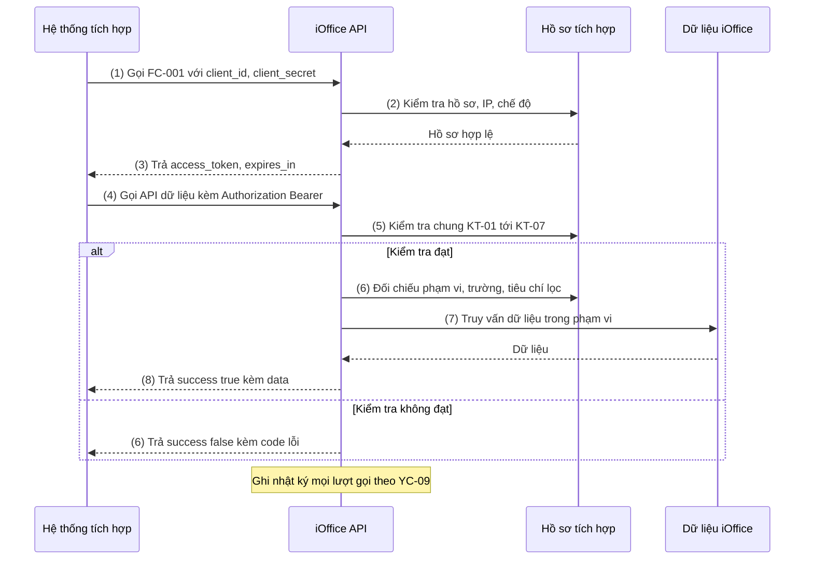

# NỘI DUNG

## ĐẶC TẢ YÊU CẦU CHỨC NĂNG HỆ THỐNG

### PHÂN HỆ 1: BỘ API CHUẨN CUNG CẤP DỮ LIỆU VĂN BẢN CHO HỆ THỐNG TÍCH HỢP

VNPT iOffice cung cấp 1 bộ API chỉ đọc, dùng chung cho mọi đơn vị tích hợp, để hệ thống bên ngoài lấy dữ liệu văn bản đến, văn bản đi và các danh mục dùng chung (agent, đơn vị, người dùng, chức vụ, danh mục nghiệp vụ). Phần khác nhau giữa các đơn vị tích hợp (phạm vi dữ liệu, trường thông tin, tiêu chí lọc, giới hạn truy cập) được khai báo trong **Hồ sơ tích hợp** của từng đơn vị, không viết API riêng cho từng đơn vị.

Tài liệu nguồn: [api-tich-hop-van-ban-catalog.md](api-tich-hop-van-ban-catalog.md) (catalog nghiệp vụ v0.6.0).

#### Bảng thuật ngữ & Actor tham gia (dùng chung cho Module 1 → 3)

**Từ viết tắt & thuật ngữ**

| Từ viết tắt / Thuật ngữ | Giải thích |
|---|---|
| Agent | 1 cơ quan / đơn vị sử dụng iOffice, có dữ liệu riêng. Định danh bằng `agent_id` (số) hoặc `ma_schema` (tên schema, vd `qlvb_hni_schema`) — 2 mã tương đương |
| Hồ sơ tích hợp | Bản khai báo cho 1 đơn vị tích hợp: được gọi API nào, lấy dữ liệu agent / nhánh đơn vị nào, được lấy trường và lọc theo tiêu chí nào, giới hạn truy cập ra sao (YC-01) |
| Đơn vị độc lập | Đơn vị con có văn thư và sổ văn bản riêng (`loai_don_vi = DOC_LAP`) |
| Phòng ban | Đơn vị con không có sổ văn bản riêng, dùng sổ của đơn vị cấp trên: độc lập phụ thuộc (`DOC_LAP_PHU_THUOC`) hoặc phụ thuộc (`PHU_THUOC`) |
| Token | Chuỗi truy cập có thời hạn do FC-001 cấp, gửi kèm mọi lần gọi API dữ liệu |
| Nhóm trường CB / MR / NC | Cơ bản / Mở rộng / Nhạy cảm — dùng để phân quyền trường dữ liệu trong hồ sơ (YC-04) |
| Hàng đợi xử lý | Văn bản đang chờ 1 người dùng xử lý, tương ứng các menu chờ xử lý trên iOffice |

**Actor tham gia**

| Actor | Vai trò / Mô tả trong phạm vi phân hệ |
|---|---|
| Hệ thống tích hợp — chế độ Đơn vị | Hệ thống bên ngoài dùng tài khoản hệ thống (`client_id`, `client_secret`) cấp theo hồ sơ. Lấy dữ liệu ở mức toàn agent hoặc 1 nhánh đơn vị, không gắn với 1 người dùng. Vd hệ thống lưu trữ, cổng thông tin, báo cáo |
| Hệ thống tích hợp — chế độ Cá nhân | Hệ thống bên ngoài đăng nhập thêm bằng tài khoản người dùng iOffice. Chỉ lấy dữ liệu người dùng đó được phép xem hoặc đang phải xử lý. Vd không gian làm việc số, ứng dụng của lãnh đạo, chuyên viên, văn thư |
| Quản trị hệ thống iOffice | Lập, duyệt, cấp, tạm dừng, thu hồi hồ sơ tích hợp. Chức năng quản trị hồ sơ **ngoài phạm vi** tài liệu này; tài liệu chỉ đặc tả cách các API đọc và áp dụng hồ sơ |

#### Yêu cầu tính năng chung của phân hệ

##### YC-01. Hồ sơ tích hợp

Mỗi đơn vị tích hợp có đúng 1 hồ sơ. Mọi API đọc hồ sơ để quyết định có cho gọi không và trả dữ liệu gì.

| Nhóm | Thông tin trong hồ sơ |
|---|---|
| Định danh | Mã hồ sơ, tên đơn vị tích hợp, đầu mối liên hệ, văn bản đề nghị (số, ngày) |
| Xác thực | `client_id`, `client_secret`, chế độ được dùng (`DON_VI` / `CA_NHAN` / cả hai), danh sách IP được phép (trống = không giới hạn) |
| Phạm vi dữ liệu | Danh sách agent được cấp; với mỗi agent: cấp toàn agent hoặc chỉ 1 nhánh (đơn vị gốc của nhánh); loại văn bản được lấy (`DEN` / `DI`); trạng thái văn bản cố định (nếu có, vd chỉ `DA_PHAT_HANH`) |
| API được dùng | Danh sách mã chức năng FC-002 → FC-012 được gọi |
| Trường được lấy | Danh sách trường và khối con được trả (Phụ lục A) |
| Tiêu chí được lọc | Danh sách tiêu chí lọc được dùng (FC-007) + giá trị lọc cố định (nếu có) |
| Cách trả file | Chỉ thông tin file (mặc định) / bật trả kèm nội dung Base64 ở FC-008, FC-010 |
| Giới hạn | Khoảng ngày tối đa mỗi lần tìm, số bản ghi tối đa mỗi trang, khung giờ được gọi, số lượt gọi tối đa, thời hạn token |
| Hiệu lực | Từ ngày – đến ngày; trạng thái hồ sơ: `DANG_DUNG` / `TAM_DUNG` / `THU_HOI` |

##### YC-02. Hai chế độ truy cập

| Chế độ | Cách lấy token (FC-001) | Phạm vi dữ liệu trả về |
|---|---|---|
| `DON_VI` | `client_id` + `client_secret` | Toàn bộ phạm vi agent / nhánh đơn vị trong hồ sơ |
| `CA_NHAN` | `client_id` + `client_secret` + `ten_dang_nhap` + `mat_khau` | Giao của phạm vi hồ sơ và phân quyền của người dùng đó trên iOffice |

Chế độ được xác định từ token. Hệ thống tích hợp không tự chọn được phạm vi rộng hơn token cho phép.

##### YC-03. Phạm vi toàn agent / 1 đơn vị con

**Cách chọn phạm vi ở chế độ `DON_VI`:**

| Trường hợp | Truyền vào | Kết quả |
|---|---|---|
| Toàn agent | Chỉ `agent_id` hoặc `ma_schema` | Dữ liệu của mọi đơn vị, phòng ban trong agent |
| 1 đơn vị con | Thêm `id_don_vi` | Dữ liệu của riêng đơn vị / phòng ban đó |
| 1 đơn vị con kèm cấp dưới | Thêm `id_don_vi` + `bao_gom_cap_duoi = true` | Dữ liệu của đơn vị đó và mọi đơn vị con cháu |

**Quy tắc định danh agent:**
- Token được cấp 1 agent: không bắt buộc truyền agent, mặc định là agent đó.
- Token được cấp nhiều agent: bắt buộc truyền `agent_id` hoặc `ma_schema`.
- Truyền cả 2 mã mà không cùng 1 agent → `INVALID_PARAM`.
- Agent ngoài hồ sơ → `FORBIDDEN_SCOPE`.

**Quy tắc đơn vị:**
- `id_don_vi` phải thuộc agent đã chọn; không thuộc → `INVALID_PARAM`.
- Hồ sơ chỉ cấp 1 nhánh: chỉ truyền agent thì nhận dữ liệu của nhánh được cấp, không phải toàn agent. Truyền `id_don_vi` ngoài nhánh → `FORBIDDEN_SCOPE`.

**Văn bản của đơn vị X** (loại đơn vị lấy từ trường `loai_don_vi` của FC-003):

| Loại đơn vị | Văn bản đến của X | Văn bản đi của X |
|---|---|---|
| `DOC_LAP` | Văn bản trong sổ văn bản đến của X | Văn bản trong sổ văn bản đi của X |
| `DOC_LAP_PHU_THUOC`, `PHU_THUOC` | Văn bản được chuyển tới X hoặc tới người dùng thuộc X | Theo tham số `cach_tinh_van_ban_di`: `DON_VI_SOAN_THAO` (mặc định) — X là phòng ban soạn thảo; `NGUOI_TAO` — người tạo văn bản thuộc X |

**Văn bản đến chuyển xuống đơn vị độc lập:** văn bản đến của agent được chuyển xuống 1 đơn vị độc lập và vào sổ ở đơn vị đó thì thành 2 bản ghi (ID và số đến khác nhau): 1 ở sổ agent, 1 ở sổ đơn vị độc lập. Lấy toàn agent (hoặc 1 đơn vị kèm cấp dưới có đơn vị độc lập) trả **cả 2 bản ghi**. Trường `id_don_vi_so_huu` / `ten_don_vi_so_huu` cho biết bản ghi thuộc sổ của đơn vị nào.

##### YC-04. Quy ước dữ liệu

| Hạng mục | Quy ước |
|---|---|
| Định dạng ngày | `dd/mm/yyyy`; ngày giờ `dd/mm/yyyy HH:mm:ss`. Áp cho cả tham số gửi lên và dữ liệu trả về |
| Tên trường nghiệp vụ | Tiếng Việt không dấu, chữ thường, nối bằng gạch dưới (`so_ky_hieu`) |
| Tên kỹ thuật theo thông lệ | Giữ tiếng Anh: `success`, `code`, `message`, `data`, `pagination`, `page`, `page_size`, `access_token`, `token_type`, `expires_in`, `refresh_token`, `client_id`, `client_secret` |
| Bộ mã giá trị | Chữ in hoa không dấu, không dùng số (Phụ lục B) |
| Giá trị trống | Trường không có dữ liệu trả `null`; danh sách không có phần tử trả `[]` |
| Nhóm trường | **CB** — Cơ bản, nằm trong bộ trường mặc định; **MR** — Mở rộng, cấp theo nhu cầu; **NC** — Nhạy cảm, chỉ cấp khi đơn vị chủ quản đồng ý bằng văn bản |
| Mở rộng về sau | Chỉ được thêm trường / tiêu chí mới; không đổi tên hay xóa trường đã công bố |
| Cột "Mapping với hệ thống" | Ghi nguồn dữ liệu nghiệp vụ trên iOffice (đối tượng, ô trên form, danh mục). Tên bảng / cột CSDL tương ứng: **[CẦN XÁC NHẬN — nhóm phát triển bổ sung khi thiết kế]** |

##### YC-05. Tham số chọn trường trả về (FC-007, FC-008)

| Tham số | Ý nghĩa | Mặc định |
|---|---|---|
| `goi_truong` | Bộ trường dựng sẵn: `CO_BAN` (các trường nhóm CB ở Phụ lục A.1 → A.3) hoặc `DAY_DU` (toàn bộ trường hồ sơ cho phép) | `CO_BAN` |
| `truong` | Danh sách trường cụ thể muốn lấy, dùng thay cho `goi_truong` | — |
| `kem_theo` | Khối con lấy kèm: `files`, `van_ban_lien_quan`, `nguoi_xem`; riêng FC-008 thêm `log_xu_ly` | Không kèm |

Yêu cầu có trường, khối con hoặc tiêu chí lọc ngoài hồ sơ → từ chối **cả yêu cầu** (`FIELD_NOT_ALLOWED` / `FILTER_NOT_ALLOWED`), liệt kê tên trường bị từ chối trong `message`; không trả kết quả một phần.

##### YC-06. Phân trang (FC-003, FC-004, FC-005, FC-007)

| Tham số | Vị trí | Ý nghĩa | Mặc định | Ràng buộc |
|---|---|---|---|---|
| `page` | Query (FC-003 → 005) / Body (FC-007) | Số thứ tự trang, bắt đầu từ 1 | 1 | Số nguyên ≥ 1 |
| `page_size` | Như trên | Số bản ghi mỗi trang | 20 | Số nguyên từ 1 tới mức tối đa của hồ sơ (mặc định 100). Vượt mức → `INVALID_PARAM` [GIẢ ĐỊNH] |

- Response có khối `pagination`: `page`, `page_size`, `total_records`, `total_pages`.
- Không có bản ghi phù hợp → `success = true`, `data = []`, `total_records = 0`, `total_pages = 0`; không trả lỗi `NOT_FOUND`.
- `page` lớn hơn `total_pages` → `data = []`, `pagination` vẫn trả đúng tổng số.

##### YC-07. Kiểm tra chung, vỏ phản hồi và mã lỗi

**Kiểm tra chung** — mọi API FC-002 → FC-012 thực hiện theo thứ tự trước khi xử lý nghiệp vụ; dừng ở kiểm tra đầu tiên không đạt:

| Mã | Kiểm tra | Không đạt → |
|---|---|---|
| KT-01 | Header `Authorization: Bearer {access_token}` có, token đúng và chưa hết hạn | `UNAUTHORIZED` / `TOKEN_EXPIRED` |
| KT-02 | Hồ sơ gắn với token đang ở trạng thái `DANG_DUNG` và còn trong thời gian hiệu lực | `FORBIDDEN_SCOPE` |
| KT-03 | IP gọi thuộc danh sách IP của hồ sơ (nếu hồ sơ có khai báo) | `IP_NOT_ALLOWED` |
| KT-04 | Thời điểm gọi nằm trong khung giờ của hồ sơ (nếu hồ sơ có khai báo) | `OUTSIDE_TIME_WINDOW` |
| KT-05 | Số lượt gọi chưa vượt ngưỡng của hồ sơ | `RATE_LIMITED` |
| KT-06 | API đang gọi thuộc danh sách API của hồ sơ, và chế độ của token được phép gọi API này | `FORBIDDEN_SCOPE` |
| KT-07 | Chế độ `CA_NHAN`: tài khoản người dùng trong token đang `HOAT_DONG` | `UNAUTHORIZED` |

Hồ sơ bị tạm dừng / thu hồi, hoặc tài khoản người dùng bị khóa sau khi đã cấp token → token đó bị từ chối ngay từ lần gọi tiếp theo (KT-02, KT-07), không đợi hết hạn.

**Vỏ phản hồi chung** — áp cho mọi API, kể cả khi lỗi. Riêng FC-011 trả thẳng nội dung file khi thành công.

| Trường | Kiểu dữ liệu | Mô tả |
|---|---|---|
| `success` | Boolean | Kết quả xử lý |
| `code` | String | `OK` khi thành công; mã lỗi bảng dưới khi thất bại |
| `message` | String | Mô tả kết quả / lỗi bằng tiếng Việt |
| `data` | Object / Array | Dữ liệu trả về; `null` khi lỗi |
| `pagination` | Object | Chỉ có ở API danh sách (YC-06) |

**Danh mục mã lỗi:**

| HTTP Status | Mã lỗi nội bộ (`code`) | Tình huống | `message` mẫu |
|---|---|---|---|
| 200 | `OK` | Thành công | "Thành công" |
| 400 | `INVALID_PARAM` | Thiếu tham số bắt buộc, sai kiểu / định dạng, giá trị ngoài bộ mã, đơn vị không thuộc agent | "Tham số {tên} không hợp lệ: {lý do}" |
| 400 | `INVALID_DATE_RANGE` | `tu_ngay` > `den_ngay`, `tu_ngay` sau ngày hiện tại, vượt khoảng ngày tối đa | "Khoảng ngày tìm kiếm vượt quá {n} ngày" |
| 401 | `UNAUTHORIZED` | Thiếu token, token sai, sai thông tin đăng nhập, tài khoản người dùng bị khóa | "Thông tin xác thực không hợp lệ" |
| 401 | `TOKEN_EXPIRED` | Token hết hạn | "Token đã hết hạn, vui lòng lấy token mới" |
| 403 | `FORBIDDEN_SCOPE` | Agent / đơn vị / văn bản / file ngoài phạm vi hồ sơ hoặc ngoài quyền xem của người dùng; API hoặc chế độ không được phép; hồ sơ hết hiệu lực | "Không có quyền truy cập {đối tượng}" |
| 403 | `FIELD_NOT_ALLOWED` | Yêu cầu trường / khối con ngoài hồ sơ | "Không được phép lấy trường: {danh sách}" |
| 403 | `FILTER_NOT_ALLOWED` | Dùng tiêu chí lọc ngoài hồ sơ hoặc không áp dụng cho chế độ hiện tại | "Không được phép lọc theo: {danh sách}" |
| 403 | `USER_MISMATCH` | Người dùng trong yêu cầu khác người dùng trong token | "Người dùng không khớp với token" |
| 403 | `IP_NOT_ALLOWED` | IP không thuộc danh sách cho phép | "Địa chỉ IP không được phép truy cập" |
| 403 | `OUTSIDE_TIME_WINDOW` | Gọi ngoài khung giờ hồ sơ cho phép | "Chỉ được gọi API trong khung giờ {từ} – {đến}" |
| 404 | `NOT_FOUND` | Không có văn bản / file theo ID | "Không tìm thấy {đối tượng} với ID: {id}" |
| 429 | `RATE_LIMITED` | Vượt số lượt gọi cho phép | "Vượt quá số lượt gọi cho phép, thử lại sau {n} giây" |
| 500 | `INTERNAL_ERROR` | Lỗi hệ thống chưa xác định | "Lỗi hệ thống, vui lòng thử lại sau" |
| 503 | `SERVICE_UNAVAILABLE` | Kho file hoặc dịch vụ phụ thuộc không sẵn sàng | "Dịch vụ tạm thời không sẵn sàng" |

**Luồng ngoại lệ chung** — áp cho mọi chức năng FC-002 → FC-012; mỗi chức năng chỉ liệt kê thêm ngoại lệ riêng:

| Mã | Tình huống | Xử lý |
|----|-----------|-------|
| EX-C01 | Không đạt KT-01 | Trả 401 `UNAUTHORIZED` hoặc `TOKEN_EXPIRED`; không xử lý tiếp; ghi nhật ký |
| EX-C02 | Không đạt KT-02 hoặc KT-06 | Trả 403 `FORBIDDEN_SCOPE`; ghi nhật ký |
| EX-C03 | Không đạt KT-03 | Trả 403 `IP_NOT_ALLOWED`; ghi nhật ký kèm IP gọi |
| EX-C04 | Không đạt KT-04 | Trả 403 `OUTSIDE_TIME_WINDOW`; ghi nhật ký |
| EX-C05 | Không đạt KT-05 | Trả 429 `RATE_LIMITED`; ghi nhật ký |
| EX-C06 | Không đạt KT-07 | Trả 401 `UNAUTHORIZED`; ghi nhật ký |
| EX-C07 | Lỗi hệ thống khi xử lý | Trả 500 `INTERNAL_ERROR`, không trả chi tiết kỹ thuật ra ngoài; ghi nhật ký lỗi đầy đủ |
| EX-C08 | Kho file hoặc dịch vụ phụ thuộc không phản hồi | Trả 503 `SERVICE_UNAVAILABLE`; ghi nhật ký |

##### YC-08. An toàn và giới hạn truy cập

| Mã | Yêu cầu | Giá trị mặc định | Cấu hình theo hồ sơ |
|---|---|---|---|
| NFR-01 | Toàn bộ kết nối qua HTTPS | Bắt buộc | Không |
| NFR-02 | Thời hạn token | 30 phút (`expires_in` = 1800) | Có |
| NFR-03 | Số bản ghi tối đa mỗi trang | 100 (mặc định 20) | Có |
| NFR-04 | Khoảng ngày tối đa mỗi lần tìm văn bản | 30 ngày | Có |
| NFR-05 | Khung giờ được gọi API lấy dữ liệu | Không giới hạn | Có (vd chỉ 23h – 5h) |
| NFR-06 | Số lượt gọi tối đa theo thời gian | **[CẦN XÁC NHẬN — nhóm phát triển đề xuất sau khi đo tải]** | Có |
| NFR-07 | Danh sách IP được phép gọi | Không giới hạn | Có |
| NFR-08 | Ghi nhật ký mọi lượt cấp token và gọi API (YC-09) | Bắt buộc | Không |
| NFR-09 | Token chỉ truyền ở header `Authorization`, không truyền trong đường dẫn hoặc thân yêu cầu | Bắt buộc | Không |
| NFR-10 | Trường nhóm NC chỉ cấp khi đơn vị chủ quản đồng ý bằng văn bản | Bắt buộc | Không |
| NFR-11 | Thời gian phản hồi | **[CẦN XÁC NHẬN]** — đề xuất ≤ 3 giây cho 1 trang 100 bản ghi không kèm nội dung file | Không |

**Căn cứ pháp lý:** Nghị định 47/2020/NĐ-CP về quản lý, kết nối và chia sẻ dữ liệu số của cơ quan nhà nước; Nghị định 278/2025/NĐ-CP; Khung Kiến trúc Chính phủ điện tử Việt Nam phiên bản 3.0.

##### YC-09. Nhật ký gọi API

Mỗi lượt cấp token và mỗi lượt gọi API (thành công hay lỗi) ghi 1 dòng nhật ký gồm:
- Mã hồ sơ, `client_id`; tên đăng nhập người dùng (chế độ `CA_NHAN`)
- Thời điểm nhận yêu cầu, thời gian xử lý (mili giây)
- Mã chức năng / đường dẫn API, IP gọi
- Tham số yêu cầu — **không** ghi `client_secret`, `mat_khau`, `access_token`, `refresh_token`
- Kết quả: HTTP status, `code`, số bản ghi trả về; với FC-011 ghi thêm `id_file`, dung lượng file trả

Bộ API chỉ đọc nên không phát sinh dữ liệu trước / sau thay đổi.

##### YC-10. Luồng gọi API chuẩn



---

#### Module 1: Xác thực

##### Mô tả tóm tắt

Hệ thống tích hợp dùng thông tin định danh do iOffice cấp theo hồ sơ để lấy token có thời hạn. Token là điều kiện bắt buộc để gọi mọi API dữ liệu ở Module 2 và Module 3.

##### Phạm vi chỉnh sửa

- Không có — chức năng mới. Bộ API chạy song song, không thay đổi các API riêng lẻ đã cấp trước đây.

##### Yêu cầu giao diện

- Không áp dụng — chức năng dạng API, không có màn hình. Thông tin vào / ra đặc tả ở mục Đặc tả API.

##### Chức năng 1 (FC-001): Cung cấp API cấp token truy cập cho hệ thống tích hợp

###### Đặc tả API

**Thông tin chung**

| Thông tin | Giá trị |
|---|---|
| Endpoint | `POST /auth/token` — tiền tố đường dẫn **[CẦN XÁC NHẬN]**, không trùng các API riêng lẻ đang chạy |
| Loại API | Xác thực |
| Mục đích | Cấp token có thời hạn cho hệ thống tích hợp theo hồ sơ, ở chế độ `DON_VI` hoặc `CA_NHAN` |
| Cơ chế xác thực | `client_id` + `client_secret` (kèm `ten_dang_nhap` + `mat_khau` ở chế độ `CA_NHAN`) trong thân yêu cầu |
| Hệ thống được phép gọi | Mọi hệ thống có hồ sơ tích hợp ở trạng thái `DANG_DUNG` |
| Rate limit | Theo NFR-06 |

**Bảng Request**

| Tên field | Vị trí | Kiểu dữ liệu | Bắt buộc | Mô tả / Ràng buộc | Mapping với hệ thống |
|---|---|---|---|---|---|
| `Content-Type` | Header | String | ✅ | Cố định `application/json` | — |
| `client_id` | Body | String | ✅ | Mã định danh hệ thống tích hợp | Hồ sơ tích hợp — `client_id` |
| `client_secret` | Body | String | ✅ | Khóa bí mật tương ứng `client_id` | Hồ sơ tích hợp — `client_secret` (lưu dạng băm) |
| `ten_dang_nhap` | Body | String | ⚪ | Bắt buộc khi muốn lấy token chế độ `CA_NHAN`; phải đi kèm `mat_khau` | Tài khoản người dùng iOffice — Tên đăng nhập |
| `mat_khau` | Body | String | ⚪ | Bắt buộc khi có `ten_dang_nhap` | Tài khoản người dùng iOffice — Mật khẩu |

**Bảng Response**

Response thành công (`data`):

| Tên field | Kiểu dữ liệu | Mô tả / Ràng buộc | Mapping với hệ thống |
|---|---|---|---|
| `access_token` | String | Token dùng cho các lần gọi API | Sinh khi cấp, gắn với hồ sơ (và người dùng nếu `CA_NHAN`) |
| `token_type` | String | Cố định `Bearer` | — |
| `expires_in` | Number | Số giây hiệu lực | Hồ sơ tích hợp — thời hạn token (mặc định 1800) |
| `refresh_token` | String | Chỉ có khi hồ sơ bật. Cách dùng để xin lại token: **[CẦN XÁC NHẬN]** | Sinh khi cấp |

Mẫu:

```json
{
  "success": true,
  "code": "OK",
  "message": "Cấp token thành công",
  "data": {
    "access_token": "eyJhbGciOiJIUzI1NiIsInR5cCI6IkpXVCJ9.xxxxx.yyyyy",
    "token_type": "Bearer",
    "expires_in": 1800
  }
}
```

Response lỗi:

| HTTP Status | Mã lỗi nội bộ | Tình huống | Nội dung trả về |
|---|---|---|---|
| 400 | `INVALID_PARAM` | Thiếu `client_id` / `client_secret`; có `ten_dang_nhap` mà thiếu `mat_khau` hoặc ngược lại | `{"success": false, "code": "INVALID_PARAM", "message": "Tham số mat_khau không hợp lệ: bắt buộc khi có ten_dang_nhap", "data": null}` |
| 401 | `UNAUTHORIZED` | Sai `client_id` / `client_secret`; sai `ten_dang_nhap` / `mat_khau`; tài khoản người dùng bị khóa | `{"success": false, "code": "UNAUTHORIZED", "message": "Thông tin xác thực không hợp lệ", "data": null}` |
| 403 | `FORBIDDEN_SCOPE` | Hồ sơ `TAM_DUNG` / `THU_HOI` / hết hiệu lực; chế độ yêu cầu không được hồ sơ cho phép | `{"success": false, "code": "FORBIDDEN_SCOPE", "message": "Hồ sơ tích hợp không cho phép chế độ CA_NHAN", "data": null}` |
| 403 | `IP_NOT_ALLOWED` | IP không thuộc danh sách của hồ sơ | `{"success": false, "code": "IP_NOT_ALLOWED", "message": "Địa chỉ IP không được phép truy cập", "data": null}` |
| 500 | `INTERNAL_ERROR` | Lỗi hệ thống | `{"success": false, "code": "INTERNAL_ERROR", "message": "Lỗi hệ thống, vui lòng thử lại sau", "data": null}` |

###### Chức năng nghiệp vụ

**① Luồng xử lý thành công**

Hệ thống tích hợp gửi yêu cầu cấp token, hệ thống thực hiện:
- Kiểm tra đủ tham số bắt buộc (→ EX-01)
- Tìm hồ sơ theo `client_id`, so khớp `client_secret` (→ EX-02)
- Kiểm tra hồ sơ `DANG_DUNG` và còn hiệu lực (→ EX-03)
- Kiểm tra IP gọi theo hồ sơ (→ EX-04)
- Xác định chế độ theo BR-01; kiểm tra chế độ được hồ sơ cho phép (→ EX-03)
- Chế độ `CA_NHAN`: xác thực `ten_dang_nhap` / `mat_khau`, kiểm tra tài khoản `HOAT_DONG` (→ EX-02)
- Sinh token theo BR-02, BR-03
- Ghi nhật ký (YC-09)
- Trả response thành công

**② Luồng xử lý ngoại lệ**

| Mã | Tình huống | Xử lý |
|----|-----------|-------|
| EX-01 | Thiếu tham số bắt buộc, hoặc chỉ có 1 trong 2 `ten_dang_nhap` / `mat_khau` | Trả 400 `INVALID_PARAM`, nêu tên tham số; không cấp token; ghi nhật ký |
| EX-02 | Sai `client_id` / `client_secret`, sai tài khoản người dùng, hoặc tài khoản bị khóa | Trả 401 `UNAUTHORIZED` với message chung, không nói rõ sai trường nào; ghi nhật ký |
| EX-03 | Hồ sơ không ở trạng thái `DANG_DUNG`, hết hiệu lực, hoặc không cho phép chế độ yêu cầu | Trả 403 `FORBIDDEN_SCOPE`; ghi nhật ký |
| EX-04 | IP không thuộc danh sách của hồ sơ | Trả 403 `IP_NOT_ALLOWED`; ghi nhật ký kèm IP |
| EX-05 | Lỗi hệ thống khi xác thực hoặc sinh token | Trả 500 `INTERNAL_ERROR`; ghi nhật ký lỗi |

**③ Quy tắc nghiệp vụ**

- BR-01: Yêu cầu có `ten_dang_nhap` → chế độ `CA_NHAN`; không có → chế độ `DON_VI`.
- BR-02: Token sinh ra mang theo: mã hồ sơ, chế độ, danh sách agent / nhánh đơn vị được cấp, và người dùng (chế độ `CA_NHAN`). Mọi API dữ liệu dùng các thông tin này để xác định phạm vi.
- BR-03: Thời hạn token = thời hạn khai báo trong hồ sơ; hồ sơ không khai báo → 1800 giây.
- BR-04: Lấy token mới không làm token cũ còn hạn mất hiệu lực; token cũ dùng được tới khi hết hạn, trừ trường hợp ở YC-07 (hồ sơ tạm dừng / thu hồi, tài khoản bị khóa). [GIẢ ĐỊNH]

###### Thông báo và thông tin lưu vết log

**Thông báo hệ thống:** Không có.

**Log hệ thống (Audit Trail):** theo YC-09. Ghi cả lượt cấp token thất bại để phát hiện dò mật khẩu.

###### Edge cases

- Gọi sai thông tin xác thực liên tục nhiều lần từ cùng 1 `client_id` hoặc IP: có khóa tạm hay không, khóa bao lâu — **[CẦN XÁC NHẬN]**.
- Tài khoản người dùng đổi mật khẩu khi token `CA_NHAN` còn hạn: token cũ vẫn dùng được tới khi hết hạn (BR-04).
- Hồ sơ được cấp lại `client_secret` mới: token đã cấp bằng secret cũ có còn hiệu lực không — **[CẦN XÁC NHẬN]**.
- Nhiều tiến trình của cùng 1 hệ thống tích hợp xin token đồng thời: mỗi yêu cầu nhận 1 token riêng, đều hợp lệ.

---

#### Module 2: Danh mục dùng chung

##### Mô tả tóm tắt

Hệ thống tích hợp ở chế độ `DON_VI` lấy các danh mục dùng chung của agent: danh sách agent được cấp, cây đơn vị / phòng ban, chức vụ, người dùng, danh mục nghiệp vụ (lĩnh vực, hình thức, độ khẩn). Dùng để đồng bộ tổ chức, ánh xạ người dùng và lấy đúng mã khi lọc văn bản ở Module 3.

##### Phạm vi chỉnh sửa

- Không có — chức năng mới.

##### Yêu cầu giao diện

- Không áp dụng — chức năng dạng API, không có màn hình.

##### Chức năng 2 (FC-002): Cung cấp API danh sách agent được cấp

###### Đặc tả API

**Thông tin chung**

| Thông tin | Giá trị |
|---|---|
| Endpoint | `GET /schema` |
| Loại API | List — không phân trang (số agent của 1 hồ sơ nhỏ) |
| Mục đích | Hệ thống tích hợp tự lấy danh sách agent token được truy cập và mã định danh, thay vì nhận thủ công qua công văn |
| Cơ chế xác thực | `Authorization: Bearer {access_token}` |
| Hệ thống được phép gọi | Token chế độ `DON_VI`, hồ sơ có FC-002 |

**Bảng Request**

| Tên field | Vị trí | Kiểu dữ liệu | Bắt buộc | Mô tả / Ràng buộc | Mapping với hệ thống |
|---|---|---|---|---|---|
| `Authorization` | Header | String | ✅ | `Bearer {access_token}` | Token do FC-001 cấp |

**Bảng Response**

Response thành công — mỗi phần tử trong `data`:

| Tên field | Kiểu dữ liệu | Mô tả / Ràng buộc | Mapping với hệ thống |
|---|---|---|---|
| `agent_id` | Number | ID agent; dùng được ở mọi API như `ma_schema` | Danh mục agent — ID agent |
| `ma_schema` | String | Tên schema, vd `qlvb_hni_schema` | Danh mục agent — tên schema |
| `ten_schema` | String | Tên cơ quan / đơn vị dùng agent | Danh mục agent — tên cơ quan |
| `id_don_vi_goc` | String | ID đơn vị bắt đầu khi gọi FC-003 (BR-02) | Cây đơn vị của agent — đơn vị gốc |
| `trang_thai` | String | `HOAT_DONG` / `NGUNG_HOAT_DONG` | Danh mục agent — trạng thái |

Response lỗi: chỉ có lỗi chung (YC-07).

###### Chức năng nghiệp vụ

**① Luồng xử lý thành công**

Hệ thống tích hợp gọi API, hệ thống thực hiện:
- Kiểm tra chung KT-01 → KT-07 (YC-07)
- Lấy danh sách agent thuộc hồ sơ (BR-01)
- Xác định `id_don_vi_goc` cho từng agent (BR-02)
- Ghi nhật ký (YC-09)
- Trả danh sách

**② Luồng xử lý ngoại lệ**

| Mã | Tình huống | Xử lý |
|----|-----------|-------|
| EX-01 | Token chế độ `CA_NHAN` gọi API | Trả 403 `FORBIDDEN_SCOPE` (theo EX-C02) |
| EX-02 | Agent trong hồ sơ đã ngừng hoạt động trên iOffice | Vẫn trả agent đó với `trang_thai = NGUNG_HOAT_DONG`; không trả lỗi |

Lỗi chung: EX-C01 → EX-C08 (YC-07).

**③ Quy tắc nghiệp vụ**

- BR-01: Chỉ trả agent có trong hồ sơ; sắp xếp theo `ten_schema` tăng dần (A → Z). [GIẢ ĐỊNH về thứ tự]
- BR-02: Hồ sơ cấp toàn agent → `id_don_vi_goc` là đơn vị gốc của cây đơn vị agent. Hồ sơ chỉ cấp 1 nhánh → `id_don_vi_goc` là đơn vị gốc của nhánh được cấp.

###### Thông báo và thông tin lưu vết log

**Thông báo hệ thống:** Không có. **Log hệ thống:** theo YC-09.

###### Edge cases

- Agent bị gỡ khỏi hồ sơ trong lúc hệ thống tích hợp đang dùng mã agent đó: các lần gọi sau với agent này nhận `FORBIDDEN_SCOPE`.

---

##### Chức năng 3 (FC-003): Cung cấp API cây đơn vị / phòng ban

###### Đặc tả API

**Thông tin chung**

| Thông tin | Giá trị |
|---|---|
| Endpoint | `GET /don-vi` |
| Loại API | List — có phân trang, hỗ trợ đồng bộ gia tăng |
| Mục đích | Đồng bộ cây tổ chức (đơn vị và phòng ban chung 1 cây) kèm quan hệ cha – con và loại đơn vị |
| Cơ chế xác thực | `Authorization: Bearer {access_token}` |
| Hệ thống được phép gọi | Token chế độ `DON_VI`, hồ sơ có FC-003 |

**Bảng Request**

| Tên field | Vị trí | Kiểu dữ liệu | Bắt buộc | Mô tả / Ràng buộc | Mapping với hệ thống |
|---|---|---|---|---|---|
| `agent_id` hoặc `ma_schema` | Query | Number / String | ⚪ | Agent cần lấy, theo YC-03. So khớp tuyệt đối | Danh mục agent |
| `id_don_vi` | Query | String | ⚪ | Chỉ trả các đơn vị con cháu của đơn vị này (không gồm chính nó). Không truyền = cả cây của agent / nhánh hồ sơ. So khớp tuyệt đối | Cây đơn vị — ID đơn vị |
| `cap_nhat_tu` | Query | DateTime | ⚪ | Chỉ trả đơn vị có `ngay_cap_nhat_cuoi` ≥ giá trị này. So khớp khoảng | Cây đơn vị — thời điểm cập nhật bản ghi |
| `page`, `page_size` | Query | Number | ⚪ | Theo YC-06 | — |

**Bảng Response**

Response thành công — mỗi phần tử trong `data`:

| Tên field | Kiểu dữ liệu | Mô tả / Ràng buộc | Mapping với hệ thống |
|---|---|---|---|
| `id_don_vi` | String | ID đơn vị | Cây đơn vị — ID |
| `ma_don_vi_nghiep_vu` | String | Mã định danh đơn vị; `null` nếu chưa có mã | Cây đơn vị — mã định danh |
| `ten_don_vi` | String | Tên đầy đủ | Cây đơn vị — tên đơn vị |
| `ten_viet_tat` | String | Ký hiệu đơn vị | Cây đơn vị — ký hiệu |
| `id_don_vi_cha` | String | ID đơn vị cha; `null` = cấp gốc | Cây đơn vị — đơn vị cha |
| `loai_don_vi` | String | `DOC_LAP` / `DOC_LAP_PHU_THUOC` / `PHU_THUOC` (Phụ lục B.10) | Cây đơn vị — loại đơn vị |
| `cap_don_vi` | Number | Cấp trong cây, gốc là 1 | Tính từ vị trí trong cây |
| `thu_tu_hien_thi` | Number | Thứ tự trong quản trị | Cây đơn vị — thứ tự |
| `trang_thai` | String | `HOAT_DONG` / `NGUNG_HOAT_DONG` / `DA_XOA` | Cây đơn vị — trạng thái |
| `ngay_cap_nhat_cuoi` | DateTime | Thời điểm cập nhật bản ghi; chưa từng cập nhật thì lấy ngày tạo | Cây đơn vị — ngày cập nhật / ngày tạo |

Response lỗi:

| HTTP Status | Mã lỗi nội bộ | Tình huống | Nội dung trả về |
|---|---|---|---|
| 400 | `INVALID_PARAM` | Sai định dạng `cap_nhat_tu`; `id_don_vi` không thuộc agent; cả 2 mã agent không cùng 1 agent; tham số phân trang sai | Vỏ lỗi YC-07, `message` nêu tham số sai |
| 403 | `FORBIDDEN_SCOPE` | Agent ngoài hồ sơ; `id_don_vi` ngoài nhánh được cấp | Vỏ lỗi YC-07 |

###### Chức năng nghiệp vụ

**① Luồng xử lý thành công**

Hệ thống tích hợp gọi API, hệ thống thực hiện:
- Kiểm tra chung KT-01 → KT-07 (YC-07)
- Xác định agent và nhánh theo YC-03 (→ EX-01, EX-02)
- Kiểm tra định dạng tham số (→ EX-01)
- Lấy đơn vị trong phạm vi, lọc theo `cap_nhat_tu` nếu có
- Sắp xếp theo BR-01, phân trang theo YC-06
- Ghi nhật ký (YC-09)
- Trả danh sách kèm `pagination`

**② Luồng xử lý ngoại lệ**

| Mã | Tình huống | Xử lý |
|----|-----------|-------|
| EX-01 | Tham số sai định dạng, `id_don_vi` không thuộc agent, 2 mã agent không khớp | Trả 400 `INVALID_PARAM`; ghi nhật ký |
| EX-02 | Agent ngoài hồ sơ hoặc `id_don_vi` ngoài nhánh được cấp | Trả 403 `FORBIDDEN_SCOPE`; ghi nhật ký |
| EX-03 | Token chế độ `CA_NHAN` | Trả 403 `FORBIDDEN_SCOPE` (theo EX-C02) |

Lỗi chung: EX-C01 → EX-C08 (YC-07).

**③ Quy tắc nghiệp vụ**

- BR-01: Thứ tự trả về theo cây đơn vị trong quản trị iOffice: duyệt từ gốc xuống, cùng cấp sắp theo `thu_tu_hien_thi` tăng dần.
- BR-02: Trả cả đơn vị `NGUNG_HOAT_DONG` và `DA_XOA` (đơn vị không còn trên cây) để hệ thống ngoài đồng bộ được việc khóa / xóa.
- BR-03: Lần đồng bộ đầu lấy toàn bộ; các lần sau truyền `cap_nhat_tu` = thời điểm đồng bộ lần trước để chỉ lấy đơn vị thay đổi.

###### Thông báo và thông tin lưu vết log

**Thông báo hệ thống:** Không có. **Log hệ thống:** theo YC-09.

###### Edge cases

- Cây đơn vị thay đổi giữa 2 lần gọi trang khi đang phân trang: bản ghi có thể lệch trang; hệ thống ngoài nên chạy lại đồng bộ gia tăng với `cap_nhat_tu`.
- Đơn vị bị chuyển sang đơn vị cha khác: trả về với `id_don_vi_cha` mới và `ngay_cap_nhat_cuoi` mới.
- Đơn vị con của 1 đơn vị đã xóa: trả theo trạng thái thực tế của từng đơn vị.

---

##### Chức năng 4 (FC-004): Cung cấp API danh mục chức vụ

###### Đặc tả API

**Thông tin chung**

| Thông tin | Giá trị |
|---|---|
| Endpoint | `GET /chuc-vu` |
| Loại API | List — có phân trang, hỗ trợ đồng bộ gia tăng |
| Mục đích | Đồng bộ danh mục chức vụ, chức danh, vị trí công tác của agent để ánh xạ với thông tin người dùng |
| Cơ chế xác thực | `Authorization: Bearer {access_token}` |
| Hệ thống được phép gọi | Token chế độ `DON_VI`, hồ sơ có FC-004 |

**Bảng Request**

| Tên field | Vị trí | Kiểu dữ liệu | Bắt buộc | Mô tả / Ràng buộc | Mapping với hệ thống |
|---|---|---|---|---|---|
| `agent_id` hoặc `ma_schema` | Query | Number / String | ⚪ | Agent cần lấy, theo YC-03 | Danh mục agent |
| `cap_nhat_tu` | Query | DateTime | ⚪ | Chỉ trả chức vụ có `ngay_cap_nhat_cuoi` ≥ giá trị này | Danh mục chức vụ — thời điểm cập nhật |
| `page`, `page_size` | Query | Number | ⚪ | Theo YC-06 | — |

**Bảng Response**

Response thành công — mỗi phần tử trong `data`:

| Tên field | Kiểu dữ liệu | Mô tả / Ràng buộc | Mapping với hệ thống |
|---|---|---|---|
| `id_chuc_vu` | String | ID chức vụ | Danh mục chức vụ — ID |
| `ma_chuc_vu_nghiep_vu` | String | Mã chức vụ | Danh mục chức vụ — mã |
| `ten_chuc_vu` | String | Vd Giám đốc, Trưởng phòng, Chuyên viên | Danh mục chức vụ — tên |
| `loai_vi_tri` | String | Vd lãnh đạo, văn thư, chuyên viên | Danh mục chức vụ — loại vị trí |
| `cap_bac_uu_tien` | Number | Thứ tự hiển thị trong quản trị | Danh mục chức vụ — thứ tự |
| `trang_thai` | String | `HOAT_DONG` / `NGUNG_HOAT_DONG` | Danh mục chức vụ — trạng thái |
| `ngay_cap_nhat_cuoi` | DateTime | Chưa từng cập nhật thì lấy ngày tạo | Danh mục chức vụ — ngày cập nhật / ngày tạo |

Response lỗi:

| HTTP Status | Mã lỗi nội bộ | Tình huống | Nội dung trả về |
|---|---|---|---|
| 400 | `INVALID_PARAM` | Sai định dạng `cap_nhat_tu`, 2 mã agent không khớp, tham số phân trang sai | Vỏ lỗi YC-07 |
| 403 | `FORBIDDEN_SCOPE` | Agent ngoài hồ sơ | Vỏ lỗi YC-07 |

###### Chức năng nghiệp vụ

**① Luồng xử lý thành công**

Hệ thống tích hợp gọi API, hệ thống thực hiện:
- Kiểm tra chung KT-01 → KT-07 (YC-07)
- Xác định agent theo YC-03 (→ EX-01, EX-02)
- Lấy chức vụ của agent, lọc theo `cap_nhat_tu` nếu có
- Sắp xếp theo BR-01, phân trang theo YC-06
- Ghi nhật ký (YC-09)
- Trả danh sách kèm `pagination`

**② Luồng xử lý ngoại lệ**

| Mã | Tình huống | Xử lý |
|----|-----------|-------|
| EX-01 | Tham số sai định dạng hoặc 2 mã agent không khớp | Trả 400 `INVALID_PARAM`; ghi nhật ký |
| EX-02 | Agent ngoài hồ sơ | Trả 403 `FORBIDDEN_SCOPE`; ghi nhật ký |

Lỗi chung: EX-C01 → EX-C08 (YC-07).

**③ Quy tắc nghiệp vụ**

- BR-01: Sắp xếp theo `ten_chuc_vu` tăng dần (A → Z).
- BR-02: Chức vụ trên iOffice dùng chung cho cả agent, không gắn riêng đơn vị / phòng ban → không có tham số lọc theo đơn vị.
- BR-03: Trả cả chức vụ `NGUNG_HOAT_DONG` để hệ thống ngoài đồng bộ được việc ngừng dùng.

###### Thông báo và thông tin lưu vết log

**Thông báo hệ thống:** Không có. **Log hệ thống:** theo YC-09.

###### Edge cases

- 2 chức vụ trùng tên trong cùng agent: phân biệt bằng `id_chuc_vu`; thứ tự giữa 2 chức vụ trùng tên không cố định.

---

##### Chức năng 5 (FC-005): Cung cấp API danh sách người dùng

###### Đặc tả API

**Thông tin chung**

| Thông tin | Giá trị |
|---|---|
| Endpoint | `GET /nguoi-dung` |
| Loại API | List — có phân trang, hỗ trợ đồng bộ gia tăng |
| Mục đích | Đồng bộ người dùng kèm quan hệ người dùng – đơn vị – phòng ban – chức vụ |
| Cơ chế xác thực | `Authorization: Bearer {access_token}` |
| Hệ thống được phép gọi | Token chế độ `DON_VI`, hồ sơ có FC-005 |

**Bảng Request**

| Tên field | Vị trí | Kiểu dữ liệu | Bắt buộc | Mô tả / Ràng buộc | Mapping với hệ thống |
|---|---|---|---|---|---|
| `agent_id` hoặc `ma_schema` | Query | Number / String | ⚪ | Agent cần lấy, theo YC-03 | Danh mục agent |
| `id_don_vi` | Query | String | ⚪ | Chỉ trả người dùng trực thuộc trực tiếp đơn vị / phòng ban này. Không truyền = toàn bộ người dùng của agent / nhánh hồ sơ. So khớp tuyệt đối | Tài khoản người dùng — đơn vị trực thuộc |
| `bao_gom_cap_duoi` | Query | Boolean | ⚪ | `true` = lấy cả người dùng của đơn vị con cháu. Mặc định `false`. Chỉ có tác dụng khi có `id_don_vi` | — |
| `cap_nhat_tu` | Query | DateTime | ⚪ | Chỉ trả người dùng có `ngay_cap_nhat_cuoi` ≥ giá trị này | Tài khoản người dùng — thời điểm cập nhật |
| `page`, `page_size` | Query | Number | ⚪ | Theo YC-06 | — |

**Bảng Response**

Response thành công — mỗi phần tử trong `data`:

| Tên field | Kiểu dữ liệu | Nhóm | Mô tả / Ràng buộc | Mapping với hệ thống |
|---|---|---|---|---|
| `id_nguoi_dung` | String | CB | ID người dùng | Tài khoản người dùng — ID |
| `ten_dang_nhap` | String | CB | Tên đăng nhập | Tài khoản người dùng — tên đăng nhập |
| `ho_ten` | String | CB | Họ tên | Thông tin cá nhân — họ tên |
| `email` | String | NC | Email công vụ, dùng cho đăng nhập 1 lần | Thông tin cá nhân — email |
| `so_dien_thoai` | String | NC | Có thể `null` | Thông tin cá nhân — số điện thoại |
| `id_don_vi`, `ten_don_vi` | String | CB | Đơn vị cha của phòng ban người dùng trực thuộc | Cây đơn vị |
| `id_phong_ban`, `ten_phong_ban` | String | CB | Đơn vị trực tiếp người dùng trực thuộc | Tài khoản người dùng — đơn vị trực thuộc |
| `id_chuc_vu`, `ten_chuc_vu` | String | CB | Chức vụ | Tài khoản người dùng — chức vụ |
| `vai_tro_nghiep_vu` | String | MR | Trưởng đơn vị, Lãnh đạo đơn vị, Văn thư, Chuyên viên | Tài khoản người dùng — vai trò gán trên iOffice |
| `trang_thai_tai_khoan` | String | CB | `HOAT_DONG` / `KHOA` | Tài khoản người dùng — trạng thái |
| `ngay_cap_nhat_cuoi` | DateTime | CB | Chưa từng cập nhật thì lấy ngày tạo | Tài khoản người dùng — ngày cập nhật / ngày tạo |

> Cột "Nhóm" (Cơ bản / Mở rộng / Nhạy cảm) quyết định trường có được trả cho hồ sơ hay không (BR-03). Bảng Response này có 5 cột thay vì 4 như các bảng khác vì thêm cột này.

Response lỗi:

| HTTP Status | Mã lỗi nội bộ | Tình huống | Nội dung trả về |
|---|---|---|---|
| 400 | `INVALID_PARAM` | Sai định dạng tham số; `id_don_vi` không thuộc agent; 2 mã agent không khớp | Vỏ lỗi YC-07 |
| 403 | `FORBIDDEN_SCOPE` | Agent ngoài hồ sơ; `id_don_vi` ngoài nhánh được cấp | Vỏ lỗi YC-07 |

###### Chức năng nghiệp vụ

**① Luồng xử lý thành công**

Hệ thống tích hợp gọi API, hệ thống thực hiện:
- Kiểm tra chung KT-01 → KT-07 (YC-07)
- Xác định agent, đơn vị theo YC-03 (→ EX-01, EX-02)
- Lấy người dùng trong phạm vi, lọc theo `cap_nhat_tu` nếu có
- Bỏ các trường hồ sơ không cấp (BR-03)
- Sắp xếp theo BR-01, phân trang theo YC-06
- Ghi nhật ký (YC-09)
- Trả danh sách kèm `pagination`

**② Luồng xử lý ngoại lệ**

| Mã | Tình huống | Xử lý |
|----|-----------|-------|
| EX-01 | Tham số sai định dạng, `id_don_vi` không thuộc agent, 2 mã agent không khớp | Trả 400 `INVALID_PARAM`; ghi nhật ký |
| EX-02 | Agent ngoài hồ sơ hoặc `id_don_vi` ngoài nhánh được cấp | Trả 403 `FORBIDDEN_SCOPE`; ghi nhật ký |

Lỗi chung: EX-C01 → EX-C08 (YC-07).

**③ Quy tắc nghiệp vụ**

- BR-01: Sắp xếp theo cây đơn vị (thứ tự như FC-003 BR-01), trong cùng phòng ban sắp theo `ho_ten` tăng dần. [GIẢ ĐỊNH]
- BR-02: Trả cả tài khoản `KHOA` để hệ thống ngoài đồng bộ được việc khóa tài khoản.
- BR-03: Trường nhóm NC (`email`, `so_dien_thoai`) chỉ trả khi hồ sơ cấp; không cấp thì trường không xuất hiện trong phần tử kết quả (API này không có tham số chọn trường nên không áp `FIELD_NOT_ALLOWED`).

###### Thông báo và thông tin lưu vết log

**Thông báo hệ thống:** Không có. **Log hệ thống:** theo YC-09.

###### Edge cases

- Người dùng chuyển phòng ban: trả với `id_phong_ban` mới và `ngay_cap_nhat_cuoi` mới; hệ thống ngoài tự cập nhật quan hệ.
- Người dùng kiêm nhiệm nhiều phòng ban: cách trả (1 dòng hay nhiều dòng) — **[CẦN XÁC NHẬN]**.

---

##### Chức năng 6 (FC-006): Cung cấp API danh mục nghiệp vụ

###### Đặc tả API

**Thông tin chung**

| Thông tin | Giá trị |
|---|---|
| Endpoint | `GET /danh-muc/{loai_danh_muc}` |
| Loại API | List — không phân trang (danh mục nhỏ) |
| Mục đích | Lấy đúng mã lĩnh vực, hình thức văn bản, độ khẩn để truyền vào tiêu chí lọc của FC-007, FC-012 |
| Cơ chế xác thực | `Authorization: Bearer {access_token}` |
| Hệ thống được phép gọi | Token chế độ `DON_VI`, hồ sơ có FC-006 |

**Bảng Request**

| Tên field | Vị trí | Kiểu dữ liệu | Bắt buộc | Mô tả / Ràng buộc | Mapping với hệ thống |
|---|---|---|---|---|---|
| `loai_danh_muc` | Path | String | ✅ | 1 trong `LINH_VUC`, `HINH_THUC_VAN_BAN`, `DO_KHAN` | — |
| `agent_id` hoặc `ma_schema` | Query | Number / String | ⚪ | Agent cần lấy, theo YC-03 | Danh mục agent |

**Bảng Response**

Response thành công — mỗi phần tử trong `data`:

| Tên field | Kiểu dữ liệu | Mô tả / Ràng buộc | Mapping với hệ thống |
|---|---|---|---|
| `ma` | String | Mã dùng để lọc | Danh mục lĩnh vực / hình thức văn bản / độ khẩn của agent — mã |
| `ten` | String | Tên hiển thị | Danh mục tương ứng — tên |
| `trang_thai` | String | `HOAT_DONG` / `NGUNG_HOAT_DONG` | Danh mục tương ứng — trạng thái |

Response lỗi:

| HTTP Status | Mã lỗi nội bộ | Tình huống | Nội dung trả về |
|---|---|---|---|
| 400 | `INVALID_PARAM` | `loai_danh_muc` ngoài 3 giá trị; 2 mã agent không khớp | Vỏ lỗi YC-07 |
| 403 | `FORBIDDEN_SCOPE` | Agent ngoài hồ sơ | Vỏ lỗi YC-07 |

###### Chức năng nghiệp vụ

**① Luồng xử lý thành công**

Hệ thống tích hợp gọi API với loại danh mục, hệ thống thực hiện:
- Kiểm tra chung KT-01 → KT-07 (YC-07)
- Kiểm tra `loai_danh_muc` hợp lệ (→ EX-01)
- Xác định agent theo YC-03 (→ EX-02)
- Lấy danh mục tương ứng của agent, sắp xếp theo BR-01
- Ghi nhật ký (YC-09)
- Trả danh sách

**② Luồng xử lý ngoại lệ**

| Mã | Tình huống | Xử lý |
|----|-----------|-------|
| EX-01 | `loai_danh_muc` không hợp lệ hoặc 2 mã agent không khớp | Trả 400 `INVALID_PARAM`; ghi nhật ký |
| EX-02 | Agent ngoài hồ sơ | Trả 403 `FORBIDDEN_SCOPE`; ghi nhật ký |

Lỗi chung: EX-C01 → EX-C08 (YC-07).

**③ Quy tắc nghiệp vụ**

- BR-01: Sắp xếp theo thứ tự hiển thị của danh mục trong quản trị iOffice; danh mục không có thứ tự thì theo `ten` tăng dần.
- BR-02: Trả cả mục `NGUNG_HOAT_DONG` vì văn bản cũ vẫn có thể mang mã đó.
- BR-03: Bộ mã độ khẩn đầy đủ lấy theo danh mục độ khẩn của iOffice — **[CẦN XÁC NHẬN]** có mức "Thượng khẩn" không (Phụ lục B.6).

###### Thông báo và thông tin lưu vết log

**Thông báo hệ thống:** Không có. **Log hệ thống:** theo YC-09.

###### Edge cases

- Danh mục của agent rỗng: trả `data = []`, `success = true`.

---

#### Module 3: Văn bản

##### Mô tả tóm tắt

Hệ thống tích hợp lấy dữ liệu văn bản đến, văn bản đi của agent: tìm kiếm danh sách, xem chi tiết, log xử lý, file đính kèm và thống kê số lượng. Ở chế độ `DON_VI` dùng cho đồng bộ, lưu trữ, báo cáo; ở chế độ `CA_NHAN` dùng cho hàng đợi xử lý và tra cứu của 1 người dùng.

##### Phạm vi chỉnh sửa

- Không có — chức năng mới.

##### Yêu cầu giao diện

- Không áp dụng — chức năng dạng API, không có màn hình. Danh mục trường văn bản trả về ở Phụ lục A.

##### Chức năng 7 (FC-007): Cung cấp API tìm kiếm danh sách văn bản

###### Đặc tả API

**Thông tin chung**

| Thông tin | Giá trị |
|---|---|
| Endpoint | `POST /van-ban/tim-kiem` |
| Loại API | List — có phân trang, nhiều tiêu chí lọc |
| Mục đích | 1 API danh sách cho mọi nhu cầu: đến hoặc đi, toàn agent hoặc 1 đơn vị con, theo người dùng, theo trạng thái, theo hàng đợi xử lý |
| Cơ chế xác thực | `Authorization: Bearer {access_token}` |
| Hệ thống được phép gọi | Token chế độ `DON_VI` hoặc `CA_NHAN`, hồ sơ có FC-007 |

**Bảng Request** — mọi tham số nằm trong Body (JSON). Tiêu chí lọc kết hợp với nhau theo **AND**; tiêu chí nhận danh sách thì các giá trị trong danh sách kết hợp theo **OR**.

| Tên field | Vị trí | Kiểu dữ liệu | Bắt buộc | Mô tả / Ràng buộc | Mapping với hệ thống |
|---|---|---|---|---|---|
| **Phạm vi** | | | | | |
| `agent_id` hoặc `ma_schema` | Body | Number / String | ⚪ | Agent cần lấy, theo YC-03. Tuyệt đối | Danh mục agent |
| `id_don_vi` | Body | Array String | ⚪ | Đơn vị con cần lấy văn bản (YC-03). Không truyền = toàn agent / nhánh hồ sơ. Trong danh sách (IN) | Cây đơn vị — ID |
| `bao_gom_cap_duoi` | Body | Boolean | ⚪ | Lấy cả đơn vị con cháu của `id_don_vi`. Mặc định `false` | — |
| `cach_tinh_van_ban_di` | Body | String | ⚪ | `DON_VI_SOAN_THAO` (mặc định) / `NGUOI_TAO`. Chỉ tác dụng khi lọc văn bản đi theo đơn vị là phòng ban (YC-03) | — |
| **Loại và trạng thái** | | | | | |
| `loai_van_ban` | Body | Array String | ⚪ | `DEN` / `DI`. Không truyền = cả hai (trong phạm vi hồ sơ). IN | Văn bản — văn bản đến / văn bản đi |
| `trang_thai_van_ban` | Body | Array String | ⚪ | Trạng thái tầng đơn vị (Phụ lục B.2). IN | Văn bản — trạng thái xử lý của đơn vị |
| `trang_thai_ca_nhan` | Body | Array String | ⚪ | Chỉ chế độ `CA_NHAN` (Phụ lục B.3). Không truyền = toàn bộ văn bản người dùng được xem. IN | Danh sách xử lý của người dùng (các menu chờ xử lý / đã xử lý) |
| `ten_dang_nhap` | Body | String | ⚪ | Chỉ chế độ `CA_NHAN`; phải trùng người dùng trong token. Tuyệt đối | Tài khoản người dùng |
| `vai_tro_xu_ly` | Body | Array String | ⚪ | Phụ lục B.4. IN | Log xử lý — vai trò |
| **Nội dung văn bản** | | | | | |
| `tu_khoa` | Body | String | ⚪ | Tìm trên trích yếu và số ký hiệu. Tương đối (chứa chuỗi, không phân biệt hoa thường) | Văn bản — trích yếu, số ký hiệu |
| `trich_yeu` | Body | String | ⚪ | Tương đối | Văn bản — trích yếu |
| `so_ky_hieu` | Body | String | ⚪ | Tương đối | Văn bản — số ký hiệu |
| `so_den_di` | Body | String | ⚪ | Tương đối | Văn bản — số đến / số đi |
| `id_don_vi_ban_hanh` | Body | Array String | ⚪ | IN | Văn bản — đơn vị ban hành |
| `nguoi_ky` | Body | String | ⚪ | Tên đăng nhập người ký. Tuyệt đối | Văn bản đi — người ký |
| `id_linh_vuc` | Body | Array String | ⚪ | Mã lấy từ FC-006. IN | Văn bản — lĩnh vực |
| `ma_hinh_thuc_van_ban` | Body | Array String | ⚪ | Mã lấy từ FC-006. IN | Văn bản — hình thức |
| `do_khan` | Body | Array String | ⚪ | Mã lấy từ FC-006. IN | Văn bản — độ khẩn |
| **Khoảng ngày** | | | | | |
| `tu_ngay`, `den_ngay` | Body | Date | ⚪ | Khoảng (BETWEEN, gồm 2 đầu). BR-04, BR-05 | Theo `loai_ngay` |
| `loai_ngay` | Body | String | ⚪ | `NGAY_VAN_BAN` / `NGAY_BAN_HANH` (chỉ văn bản đi) / `NGAY_DEN` (chỉ văn bản đến) / `NGAY_TAO`. Mặc định theo BR-04 | Văn bản — ngày văn bản / ngày ban hành / ngày đến / ngày tạo |
| **Điều khiển kết quả** | | | | | |
| `goi_truong`, `truong`, `kem_theo` | Body | String / Array String | ⚪ | Theo YC-05; `kem_theo` nhận `files`, `van_ban_lien_quan`, `nguoi_xem` | — |
| `sap_xep` | Body | String | ⚪ | Dạng `{tên trường}:{tang|giam}`, vd `ngay_den:giam`. Chỉ nhận trường có trong kết quả. Mặc định `ngay_tao:giam` | — |
| `page`, `page_size` | Body | Number | ⚪ | Theo YC-06 | — |

Mẫu yêu cầu — hàng đợi văn bản đến cần xử lý của 1 người dùng:

```json
{
  "loai_van_ban": ["DEN"],
  "trang_thai_ca_nhan": ["CHO_XU_LY"],
  "tu_ngay": "01/10/2026",
  "den_ngay": "26/10/2026",
  "truong": ["id_van_ban", "so_ky_hieu", "trich_yeu", "ten_don_vi_ban_hanh", "ngay_den", "han_xu_ly", "do_khan"],
  "page": 1,
  "page_size": 20
}
```

**Bảng Response**

Response thành công:

| Tên field | Kiểu dữ liệu | Mô tả / Ràng buộc | Mapping với hệ thống |
|---|---|---|---|
| `data[]` | Array Object | Mỗi phần tử là 1 văn bản; gồm các trường chọn theo YC-05 trong Phụ lục A.1 → A.3 | Phụ lục A |
| `data[].files[]` | Array Object | Có khi `kem_theo` gồm `files`; chỉ thông tin file, không có nội dung (BR-08) | Phụ lục A.4 |
| `data[].van_ban_lien_quan[]` | Array Object | Có khi `kem_theo` gồm `van_ban_lien_quan` | Phụ lục A.5 |
| `data[].nguoi_xem[]` | Array String | Có khi `kem_theo` gồm `nguoi_xem` | Phụ lục A.6 |
| `pagination` | Object | Theo YC-06 | — |

Response lỗi:

| HTTP Status | Mã lỗi nội bộ | Tình huống | Nội dung trả về |
|---|---|---|---|
| 400 | `INVALID_PARAM` | Sai kiểu / định dạng; mã ngoài bộ mã; `id_don_vi` không thuộc agent; `sap_xep` sai; `loai_ngay` không hợp với `loai_van_ban` | Vỏ lỗi YC-07, nêu tham số sai |
| 400 | `INVALID_DATE_RANGE` | Vi phạm BR-05 | Vỏ lỗi YC-07 |
| 403 | `FIELD_NOT_ALLOWED` | `truong` / `kem_theo` ngoài hồ sơ | Vỏ lỗi YC-07, liệt kê trường bị từ chối |
| 403 | `FILTER_NOT_ALLOWED` | Tiêu chí lọc ngoài hồ sơ; `trang_thai_ca_nhan` / `ten_dang_nhap` dùng ở chế độ `DON_VI` | Vỏ lỗi YC-07, liệt kê tiêu chí bị từ chối |
| 403 | `FORBIDDEN_SCOPE` | Agent / `id_don_vi` ngoài phạm vi hồ sơ; loại văn bản hoặc trạng thái nằm ngoài giá trị cố định của hồ sơ | Vỏ lỗi YC-07 |
| 403 | `USER_MISMATCH` | `ten_dang_nhap` khác người dùng trong token | Vỏ lỗi YC-07 |

###### Chức năng nghiệp vụ

**① Luồng xử lý thành công**

Hệ thống tích hợp gửi yêu cầu tìm kiếm, hệ thống thực hiện:
- Kiểm tra chung KT-01 → KT-07 (YC-07)
- Kiểm tra kiểu, định dạng, bộ mã của tham số (→ EX-01)
- Kiểm tra trường, khối con, tiêu chí lọc theo hồ sơ và chế độ (→ EX-03, EX-04, EX-06)
- Xác định phạm vi agent / đơn vị theo YC-03 (→ EX-05)
- Áp khoảng ngày theo BR-04, kiểm tra BR-05 (→ EX-02)
- Áp giá trị lọc cố định của hồ sơ (BR-02)
- Lấy văn bản thỏa mọi điều kiện (BR-01, BR-03)
- Sắp xếp theo BR-06, phân trang theo YC-06
- Dựng kết quả theo trường và khối con đã chọn (BR-07, BR-08)
- Ghi nhật ký (YC-09)
- Trả danh sách kèm `pagination`

**② Luồng xử lý ngoại lệ**

| Mã | Tình huống | Xử lý |
|----|-----------|-------|
| EX-01 | Tham số sai kiểu / định dạng, mã ngoài bộ mã, `sap_xep` sai, `loai_ngay` không hợp với `loai_van_ban` | Trả 400 `INVALID_PARAM`; ghi nhật ký |
| EX-02 | Khoảng ngày vi phạm BR-05 | Trả 400 `INVALID_DATE_RANGE`; ghi nhật ký |
| EX-03 | `truong` / `kem_theo` ngoài hồ sơ | Trả 403 `FIELD_NOT_ALLOWED`, không trả kết quả một phần; ghi nhật ký |
| EX-04 | Tiêu chí lọc ngoài hồ sơ, hoặc dùng `trang_thai_ca_nhan` / `ten_dang_nhap` ở chế độ `DON_VI` | Trả 403 `FILTER_NOT_ALLOWED`; ghi nhật ký |
| EX-05 | Agent / `id_don_vi` / loại văn bản / trạng thái ngoài phạm vi hoặc giá trị cố định của hồ sơ; `id_don_vi` không thuộc agent | Ngoài phạm vi → 403 `FORBIDDEN_SCOPE`; không thuộc agent → 400 `INVALID_PARAM`; ghi nhật ký |
| EX-06 | `ten_dang_nhap` khác người dùng trong token | Trả 403 `USER_MISMATCH`; ghi nhật ký |

Lỗi chung: EX-C01 → EX-C08 (YC-07).

**③ Quy tắc nghiệp vụ**

**Phạm vi dữ liệu**
- BR-01: Chế độ `DON_VI` → văn bản trong phạm vi agent / đơn vị theo YC-03 (gồm quy tắc văn bản của đơn vị theo loại đơn vị và quy tắc 2 bản ghi khi chuyển xuống đơn vị độc lập). Chế độ `CA_NHAN` → văn bản người dùng trong token được phép xem trên iOffice (danh sách **Tra cứu văn bản** của người dùng đó), giao với phạm vi hồ sơ.
- BR-02: Hồ sơ có giá trị lọc cố định (vd chỉ `loai_van_ban = DI`, `trang_thai_van_ban = DA_PHAT_HANH`) → luôn áp, kết hợp AND với tiêu chí gửi lên. Tiêu chí gửi lên có giá trị nằm ngoài giá trị cố định (vd hồ sơ chỉ cho `DI` mà gửi `DEN`) → từ chối 403 `FORBIDDEN_SCOPE` (EX-05), không trả danh sách rỗng.
- BR-03: `trang_thai_ca_nhan` lọc theo hàng đợi của người dùng trong token: `CHO_XU_LY` = văn bản người dùng chưa chuyển, chưa kết thúc hoặc chưa cho ý kiến, gồm văn bản chuyển tới cá nhân hoặc tới đơn vị mà người dùng có quyền tiếp nhận; các mã khác theo Phụ lục B.3.

**Khoảng ngày**
- BR-04: Không truyền `loai_ngay` → văn bản đi lọc theo `ngay_ban_hanh`, văn bản đến lọc theo `ngay_den`; tìm cả 2 loại thì mỗi loại áp ngày mặc định của mình. Không truyền `tu_ngay` / `den_ngay` → `den_ngay` = ngày hiện tại, `tu_ngay` = `den_ngay` lùi (khoảng tối đa của hồ sơ − 1) ngày. [GIẢ ĐỊNH]
- BR-05: `tu_ngay` ≤ `den_ngay`; `tu_ngay` không sau ngày hiện tại; số ngày từ `tu_ngay` tới `den_ngay` (gồm 2 đầu) ≤ khoảng tối đa của hồ sơ (mặc định 30).

**Sắp xếp và dựng kết quả**
- BR-06: Mặc định sắp xếp `ngay_tao` giảm dần; cùng `ngay_tao` thì `id_van_ban` giảm dần để thứ tự ổn định giữa các trang.
- BR-07: Không truyền `truong` và `goi_truong` → trả nhóm CB trong phạm vi hồ sơ. `goi_truong = DAY_DU` → trả mọi trường hồ sơ cấp. Trường chỉ có ở 1 loại văn bản (Phụ lục A.2, A.3) trả `null` ở loại còn lại.
- BR-08: Khối `files` ở danh sách chỉ có thông tin file, không có `noi_dung_base64`, kể cả khi hồ sơ bật trả nội dung file. Khối `log_xu_ly` không lấy kèm được ở API này (dùng FC-008 hoặc FC-009).

###### Thông báo và thông tin lưu vết log

**Thông báo hệ thống:** Không có. **Log hệ thống:** theo YC-09.

###### Edge cases

- Văn bản thay đổi trạng thái giữa 2 lần gọi trang: văn bản có thể bị lặp hoặc lọt trang; hệ thống ngoài nên đối chiếu theo `id_van_ban`.
- Văn bản cũ được sửa (thêm file, đổi trạng thái) nhưng ngày của văn bản nằm ngoài khoảng đang quét: không xuất hiện trong lần đồng bộ theo khoảng ngày — giới hạn đã biết vì văn bản không có thời điểm cập nhật cuối.
- Lấy toàn agent có đơn vị độc lập: cùng 1 văn bản đến xuất hiện 2 bản ghi (YC-03); hệ thống ngoài gộp theo số ký hiệu, ngày văn bản và đơn vị ban hành nếu cần.
- `tu_khoa` chứa ký tự đặc biệt (`%`, `_`, `'`): xử lý như ký tự thường, không làm thay đổi cách so khớp.
- Người dùng mất quyền xem 1 văn bản giữa 2 lần gọi (chế độ `CA_NHAN`): văn bản không còn trong kết quả các lần sau.

---

##### Chức năng 8 (FC-008): Cung cấp API chi tiết văn bản

###### Đặc tả API

**Thông tin chung**

| Thông tin | Giá trị |
|---|---|
| Endpoint | `GET /van-ban/{id_van_ban}` |
| Loại API | Detail |
| Mục đích | Lấy thông tin 1 văn bản theo ID, kèm các khối con theo yêu cầu |
| Cơ chế xác thực | `Authorization: Bearer {access_token}` |
| Hệ thống được phép gọi | Token chế độ `DON_VI` hoặc `CA_NHAN`, hồ sơ có FC-008 |

**Bảng Request**

| Tên field | Vị trí | Kiểu dữ liệu | Bắt buộc | Mô tả / Ràng buộc | Mapping với hệ thống |
|---|---|---|---|---|---|
| `id_van_ban` | Path | String | ✅ | ID văn bản | Văn bản — ID |
| `agent_id` hoặc `ma_schema` | Query | Number / String | ⚪ | Agent chứa văn bản, theo YC-03 | Danh mục agent |
| `goi_truong`, `truong` | Query | String / danh sách phân cách dấu phẩy | ⚪ | Theo YC-05 | — |
| `kem_theo` | Query | Danh sách phân cách dấu phẩy | ⚪ | `files`, `van_ban_lien_quan`, `nguoi_xem`, `log_xu_ly` | — |

**Bảng Response**

Response thành công — `data` là 1 đối tượng:

| Tên field | Kiểu dữ liệu | Mô tả / Ràng buộc | Mapping với hệ thống |
|---|---|---|---|
| Các trường văn bản | — | Chọn theo YC-05 trong Phụ lục A.1 → A.3 | Phụ lục A |
| `files[]` | Array Object | Có khi `kem_theo` gồm `files`; có thêm `noi_dung_base64` khi hồ sơ bật (BR-02) | Phụ lục A.4 |
| `van_ban_lien_quan[]` | Array Object | Có khi `kem_theo` gồm `van_ban_lien_quan` | Phụ lục A.5 |
| `nguoi_xem[]` | Array String | Có khi `kem_theo` gồm `nguoi_xem` | Phụ lục A.6 |
| `log_xu_ly[]` | Array Object | Có khi `kem_theo` gồm `log_xu_ly`; cùng quy tắc FC-009 | Phụ lục A.7 |

Không có khối `pagination`.

Mẫu:

```json
{
  "success": true,
  "code": "OK",
  "message": "Thành công",
  "data": {
    "id_van_ban": "100245",
    "loai_van_ban": "DI",
    "so_ky_hieu": "125/SNV-VP",
    "trich_yeu": "V/v triển khai kết nối, chia sẻ dữ liệu văn bản",
    "ngay_van_ban": "05/10/2026",
    "ngay_ban_hanh": "06/10/2026",
    "hinh_thuc_van_ban": "Công văn",
    "ten_don_vi_ban_hanh": "Sở Nội vụ",
    "id_don_vi_so_huu": "DV001",
    "ten_don_vi_so_huu": "Sở Nội vụ",
    "nguoi_ky": "Nguyễn Văn A",
    "files": [
      { "id_file": "5501", "ten_file": "125-SNV-VP.pdf", "dinh_dang": "pdf", "dung_luong": 305000, "is_ky_so": 1 }
    ],
    "van_ban_lien_quan": [
      {
        "id_van_ban_lien_quan": "100388",
        "so_ky_hieu": "45/UBND-VP",
        "trich_yeu": "V/v phản hồi triển khai kết nối, chia sẻ dữ liệu",
        "loai_quan_he": "PHAN_HOI",
        "ten_don_vi_ban_hanh": "UBND phường A",
        "ngay_ban_hanh": "12/10/2026",
        "trang_thai_phan_hoi": "DA_PHAN_HOI"
      }
    ]
  }
}
```

Response lỗi:

| HTTP Status | Mã lỗi nội bộ | Tình huống | Nội dung trả về |
|---|---|---|---|
| 400 | `INVALID_PARAM` | Tham số sai; 2 mã agent không khớp | Vỏ lỗi YC-07 |
| 403 | `FIELD_NOT_ALLOWED` | `truong` / `kem_theo` ngoài hồ sơ | Vỏ lỗi YC-07, liệt kê trường bị từ chối |
| 403 | `FORBIDDEN_SCOPE` | Văn bản ngoài phạm vi token (BR-01) | Vỏ lỗi YC-07 |
| 404 | `NOT_FOUND` | Không có văn bản với `id_van_ban` trong agent | `{"success": false, "code": "NOT_FOUND", "message": "Không tìm thấy văn bản với ID: 100245", "data": null}` |

###### Chức năng nghiệp vụ

**① Luồng xử lý thành công**

Hệ thống tích hợp gọi API với ID văn bản, hệ thống thực hiện:
- Kiểm tra chung KT-01 → KT-07 (YC-07)
- Kiểm tra tham số, trường, khối con theo hồ sơ (→ EX-01, EX-02)
- Xác định agent theo YC-03; tìm văn bản theo ID (→ EX-04)
- Kiểm tra văn bản trong phạm vi token (BR-01, → EX-03)
- Dựng kết quả theo trường và khối con đã chọn (BR-02, BR-03)
- Ghi nhật ký (YC-09)
- Trả văn bản

**② Luồng xử lý ngoại lệ**

| Mã | Tình huống | Xử lý |
|----|-----------|-------|
| EX-01 | Tham số sai hoặc 2 mã agent không khớp | Trả 400 `INVALID_PARAM`; ghi nhật ký |
| EX-02 | `truong` / `kem_theo` ngoài hồ sơ | Trả 403 `FIELD_NOT_ALLOWED`; ghi nhật ký |
| EX-03 | Văn bản tồn tại nhưng ngoài phạm vi token | Trả 403 `FORBIDDEN_SCOPE`; ghi nhật ký |
| EX-04 | Không có văn bản với ID trong agent | Trả 404 `NOT_FOUND`; ghi nhật ký |

Lỗi chung: EX-C01 → EX-C08 (YC-07).

**③ Quy tắc nghiệp vụ**

- BR-01: Văn bản trong phạm vi khi thỏa cùng quy tắc BR-01, BR-02 của FC-007 (phạm vi hồ sơ, loại và trạng thái cố định; chế độ `CA_NHAN` thêm quyền xem của người dùng). Không áp giới hạn khoảng ngày khi xem chi tiết.
- BR-02: `noi_dung_base64` chỉ có khi hồ sơ bật trả nội dung file VÀ `kem_theo` gồm `files`. Hồ sơ không bật → khối `files` chỉ có thông tin file.
- BR-03: Khối `log_xu_ly` áp đúng quy tắc của FC-009 (phạm vi đơn vị nhận, thứ tự, dạng cây).

###### Thông báo và thông tin lưu vết log

**Thông báo hệ thống:** Không có. **Log hệ thống:** theo YC-09.

###### Edge cases

- Văn bản kèm nhiều file lớn khi bật Base64: response rất nặng; giới hạn tổng dung lượng 1 response — **[CẦN XÁC NHẬN]**.
- Văn bản liên quan thuộc agent khác hoặc ngoài phạm vi token: vẫn trả thông tin định danh ở khối `van_ban_lien_quan` (số ký hiệu, trích yếu, đơn vị); gọi chi tiết văn bản đó sẽ nhận `FORBIDDEN_SCOPE`.
- Văn bản bị xóa trên iOffice sau khi hệ thống ngoài đã đồng bộ: trả `NOT_FOUND`.

---

##### Chức năng 9 (FC-009): Cung cấp API log xử lý văn bản

###### Đặc tả API

**Thông tin chung**

| Thông tin | Giá trị |
|---|---|
| Endpoint | `GET /van-ban/{id_van_ban}/log-xu-ly` |
| Loại API | Detail — trả danh sách / cây xử lý của 1 văn bản |
| Mục đích | Theo dõi tiến độ, giám sát chỉ đạo điều hành: ai / đơn vị nào tham gia xử lý văn bản, vai trò gì, nhận và xử lý lúc nào |
| Cơ chế xác thực | `Authorization: Bearer {access_token}` |
| Hệ thống được phép gọi | Token chế độ `DON_VI` hoặc `CA_NHAN`, hồ sơ có FC-009 |

**Bảng Request**

| Tên field | Vị trí | Kiểu dữ liệu | Bắt buộc | Mô tả / Ràng buộc | Mapping với hệ thống |
|---|---|---|---|---|---|
| `id_van_ban` | Path | String | ✅ | ID văn bản | Văn bản — ID |
| `agent_id` hoặc `ma_schema` | Query | Number / String | ⚪ | Theo YC-03 | Danh mục agent |
| `vai_tro_xu_ly` | Query | Danh sách phân cách dấu phẩy | ⚪ | Phụ lục B.4. IN. Không truyền = mọi vai trò | Log xử lý — vai trò |

**Bảng Response**

Response thành công — `data`:

| Tên field | Kiểu dữ liệu | Mô tả / Ràng buộc | Mapping với hệ thống |
|---|---|---|---|
| `id_van_ban` | String | ID văn bản | Văn bản — ID |
| `so_ky_hieu` | String | Số ký hiệu | Văn bản — số ký hiệu |
| `log_xu_ly[]` | Array Object | Mỗi phần tử là 1 người dùng hoặc 1 đơn vị nhận văn bản | Phụ lục A.7 |

Response lỗi:

| HTTP Status | Mã lỗi nội bộ | Tình huống | Nội dung trả về |
|---|---|---|---|
| 400 | `INVALID_PARAM` | `vai_tro_xu_ly` ngoài bộ mã; 2 mã agent không khớp | Vỏ lỗi YC-07 |
| 403 | `FORBIDDEN_SCOPE` | Văn bản ngoài phạm vi token | Vỏ lỗi YC-07 |
| 404 | `NOT_FOUND` | Không có văn bản với ID | Vỏ lỗi YC-07 |

###### Chức năng nghiệp vụ

**① Luồng xử lý thành công**

Hệ thống tích hợp gọi API với ID văn bản, hệ thống thực hiện:
- Kiểm tra chung KT-01 → KT-07 (YC-07)
- Kiểm tra tham số (→ EX-01)
- Tìm văn bản, kiểm tra trong phạm vi token theo BR-01 của FC-008 (→ EX-02, EX-03)
- Lấy nhật ký xử lý trong phạm vi đơn vị nhận (BR-01), lọc theo `vai_tro_xu_ly` nếu có
- Xác định vai trò, quan hệ chuyển tiếp, sắp xếp (BR-02 → BR-04)
- Ghi nhật ký (YC-09)
- Trả log xử lý

**② Luồng xử lý ngoại lệ**

| Mã | Tình huống | Xử lý |
|----|-----------|-------|
| EX-01 | Tham số sai | Trả 400 `INVALID_PARAM`; ghi nhật ký |
| EX-02 | Văn bản ngoài phạm vi token | Trả 403 `FORBIDDEN_SCOPE`; ghi nhật ký |
| EX-03 | Không có văn bản với ID | Trả 404 `NOT_FOUND`; ghi nhật ký |
| EX-04 | Văn bản chưa có ai xử lý | Trả `success = true`, `log_xu_ly = []` |

Lỗi chung: EX-C01 → EX-C08 (YC-07).

**③ Quy tắc nghiệp vụ**

- BR-01: Chỉ lấy người dùng / đơn vị nhận văn bản trong phạm vi đơn vị của bản ghi văn bản. Văn bản đã chuyển sang 1 đơn vị nhận độc lập khác thì **không** lấy log xử lý ở đơn vị đó (đơn vị đó có bản ghi văn bản riêng — YC-03).
- BR-02: Vai trò `CHI_DAO` / `XU_LY_CHINH` / `PHOI_HOP` / `XEM_DE_BIET` xác định từ toàn bộ nhật ký xử lý của văn bản (Phụ lục B.4).
- BR-03: Quan hệ chuyển tiếp: `id_nguoi_dung_cha` = người đã chuyển văn bản cho dòng này; người nhận đầu tiên có `id_nguoi_dung_cha = null`.
- BR-04: Thứ tự: `thoi_gian_nhan` tăng dần.
- BR-05: Dòng giao cho đơn vị (không phải cá nhân) có `id_don_vi_nhan`, `ten_don_vi_nhan`; các trường người dùng (`id_nguoi_dung`, `ten_dang_nhap`, `ho_ten`) là `null`.

###### Thông báo và thông tin lưu vết log

**Thông báo hệ thống:** Không có. **Log hệ thống:** theo YC-09.

###### Edge cases

- 1 người dùng nhận cùng văn bản nhiều lần (được chuyển lại): mỗi lần nhận là 1 dòng riêng.
- Người dùng đã bị khóa tài khoản: vẫn hiện trong log với thông tin tại thời điểm xử lý.
- Văn bản đang xử lý dở: dòng chưa kết thúc có `thoi_gian_xu_ly = null`.

---

##### Chức năng 10 (FC-010): Cung cấp API danh sách file của văn bản

###### Đặc tả API

**Thông tin chung**

| Thông tin | Giá trị |
|---|---|
| Endpoint | `GET /van-ban/{id_van_ban}/files` |
| Loại API | Detail — trả danh sách file của 1 văn bản |
| Mục đích | Lấy thông tin các file của văn bản; kèm nội dung file khi hồ sơ bật |
| Cơ chế xác thực | `Authorization: Bearer {access_token}` |
| Hệ thống được phép gọi | Token chế độ `DON_VI` hoặc `CA_NHAN`, hồ sơ có FC-010 |

**Bảng Request**

| Tên field | Vị trí | Kiểu dữ liệu | Bắt buộc | Mô tả / Ràng buộc | Mapping với hệ thống |
|---|---|---|---|---|---|
| `id_van_ban` | Path | String | ✅ | ID văn bản | Văn bản — ID |
| `agent_id` hoặc `ma_schema` | Query | Number / String | ⚪ | Theo YC-03 | Danh mục agent |

**Bảng Response**

Response thành công — mỗi phần tử trong `data`: các trường ở Phụ lục A.4. Có `noi_dung_base64` khi hồ sơ bật trả nội dung file.

Response lỗi:

| HTTP Status | Mã lỗi nội bộ | Tình huống | Nội dung trả về |
|---|---|---|---|
| 400 | `INVALID_PARAM` | 2 mã agent không khớp | Vỏ lỗi YC-07 |
| 403 | `FORBIDDEN_SCOPE` | Văn bản ngoài phạm vi token | Vỏ lỗi YC-07 |
| 404 | `NOT_FOUND` | Không có văn bản với ID | Vỏ lỗi YC-07 |

###### Chức năng nghiệp vụ

**① Luồng xử lý thành công**

Hệ thống tích hợp gọi API với ID văn bản, hệ thống thực hiện:
- Kiểm tra chung KT-01 → KT-07 (YC-07)
- Tìm văn bản, kiểm tra trong phạm vi token theo BR-01 của FC-008 (→ EX-01, EX-02)
- Lấy file theo BR-01, sắp xếp theo BR-02
- Hồ sơ bật trả nội dung file: đọc nội dung từng file từ kho file, mã hóa Base64 (→ EX-C08 nếu kho file không sẵn sàng)
- Ghi nhật ký (YC-09)
- Trả danh sách file

**② Luồng xử lý ngoại lệ**

| Mã | Tình huống | Xử lý |
|----|-----------|-------|
| EX-01 | Văn bản ngoài phạm vi token | Trả 403 `FORBIDDEN_SCOPE`; ghi nhật ký |
| EX-02 | Không có văn bản với ID | Trả 404 `NOT_FOUND`; ghi nhật ký |
| EX-03 | Văn bản không có file | Trả `success = true`, `data = []` |

Lỗi chung: EX-C01 → EX-C08 (YC-07).

**③ Quy tắc nghiệp vụ**

- BR-01: Lấy file ở các mục **File đính kèm**, **File phát hành** và **File tờ trình / Trình ký** của văn bản; **không** lấy file của văn bản liên quan.
- BR-02: Thứ tự: thời gian cập nhật file giảm dần.
- BR-03: `is_ky_so = 1` khi file có ít nhất 1 chữ ký số, ngược lại `0`.
- BR-04: Không cung cấp đường dẫn tải trực tiếp; mọi lượt lấy nội dung file đi qua FC-010 (khi bật Base64), FC-008 hoặc FC-011 để kiểm quyền và ghi nhật ký.

###### Thông báo và thông tin lưu vết log

**Thông báo hệ thống:** Không có. **Log hệ thống:** theo YC-09.

###### Edge cases

- File có trong danh sách nhưng nội dung đã mất khỏi kho file: khi bật Base64, trả file với `noi_dung_base64 = null` hay báo lỗi cả yêu cầu — **[CẦN XÁC NHẬN]**.
- Văn bản có nhiều phiên bản file cùng tên: mỗi phiên bản là 1 phần tử riêng theo `id_file`.

---

##### Chức năng 11 (FC-011): Cung cấp API tải file

###### Đặc tả API

**Thông tin chung**

| Thông tin | Giá trị |
|---|---|
| Endpoint | `GET /files/{id_file}` |
| Loại API | Detail — trả nội dung 1 file |
| Mục đích | Tải nội dung 1 file đính kèm; cách lấy nội dung file mặc định |
| Cơ chế xác thực | `Authorization: Bearer {access_token}` |
| Hệ thống được phép gọi | Token chế độ `DON_VI` hoặc `CA_NHAN`, hồ sơ có FC-011 |

**Bảng Request**

| Tên field | Vị trí | Kiểu dữ liệu | Bắt buộc | Mô tả / Ràng buộc | Mapping với hệ thống |
|---|---|---|---|---|---|
| `id_file` | Path | String | ✅ | ID file, lấy từ khối `files` | File đính kèm — ID |
| `agent_id` hoặc `ma_schema` | Query | Number / String | ⚪ | Theo YC-03 | Danh mục agent |

**Bảng Response**

Response thành công: nội dung file dạng nhị phân, **không** bọc vỏ phản hồi chung.

| Tên field | Kiểu dữ liệu | Mô tả / Ràng buộc | Mapping với hệ thống |
|---|---|---|---|
| Header `Content-Type` | String | Theo định dạng file, vd `application/pdf` | File đính kèm — định dạng |
| Header `Content-Disposition` | String | `attachment; filename="{ten_file}"`, tên file mã hóa UTF-8 | File đính kèm — tên file |
| Header `Content-Length` | Number | Dung lượng (byte) | File đính kèm — dung lượng |
| Body | Binary | Nội dung file | Kho file iOffice |

Response lỗi (vỏ phản hồi chung, `Content-Type: application/json`):

| HTTP Status | Mã lỗi nội bộ | Tình huống | Nội dung trả về |
|---|---|---|---|
| 400 | `INVALID_PARAM` | 2 mã agent không khớp | Vỏ lỗi YC-07 |
| 403 | `FORBIDDEN_SCOPE` | File thuộc văn bản ngoài phạm vi token | Vỏ lỗi YC-07 |
| 404 | `NOT_FOUND` | Không có file với ID | `{"success": false, "code": "NOT_FOUND", "message": "Không tìm thấy file với ID: 5501", "data": null}` |
| 503 | `SERVICE_UNAVAILABLE` | Kho file không sẵn sàng hoặc nội dung file không đọc được | Vỏ lỗi YC-07 |

###### Chức năng nghiệp vụ

**① Luồng xử lý thành công**

Hệ thống tích hợp gọi API với ID file, hệ thống thực hiện:
- Kiểm tra chung KT-01 → KT-07 (YC-07)
- Tìm file theo ID (→ EX-02)
- Xác định văn bản chứa file, kiểm tra văn bản trong phạm vi token theo BR-01 của FC-008 (→ EX-01)
- Đọc nội dung file từ kho file (→ EX-03)
- Ghi nhật ký kèm `id_file`, dung lượng (YC-09)
- Trả nội dung file

**② Luồng xử lý ngoại lệ**

| Mã | Tình huống | Xử lý |
|----|-----------|-------|
| EX-01 | File thuộc văn bản ngoài phạm vi token | Trả 403 `FORBIDDEN_SCOPE`; ghi nhật ký |
| EX-02 | Không có file với ID | Trả 404 `NOT_FOUND`; ghi nhật ký |
| EX-03 | Kho file không sẵn sàng hoặc không đọc được nội dung | Trả 503 `SERVICE_UNAVAILABLE`; ghi nhật ký lỗi |

Lỗi chung: EX-C01 → EX-C08 (YC-07).

**③ Quy tắc nghiệp vụ**

- BR-01: File được tải khi văn bản chứa file nằm trong phạm vi token. File thuộc văn bản liên quan được kiểm theo phạm vi của chính văn bản liên quan đó, không theo văn bản đang xem.
- BR-02: Trả đúng nội dung gốc đang lưu, không chuyển đổi định dạng, không thêm hay bỏ chữ ký số.

###### Thông báo và thông tin lưu vết log

**Thông báo hệ thống:** Không có. **Log hệ thống:** theo YC-09.

###### Edge cases

- File rất lớn: giới hạn dung lượng tải 1 lần và hỗ trợ tải tiếp khi đứt kết nối (Range) — **[CẦN XÁC NHẬN]**.
- Mất kết nối giữa chừng: hệ thống ngoài gọi lại từ đầu; mỗi lượt gọi ghi 1 dòng nhật ký.

---

##### Chức năng 12 (FC-012): Cung cấp API thống kê số lượng văn bản

###### Đặc tả API

**Thông tin chung**

| Thông tin | Giá trị |
|---|---|
| Endpoint | `POST /van-ban/thong-ke` |
| Loại API | Report |
| Mục đích | Đếm số văn bản đến / đi của toàn agent hoặc 1 đơn vị con, tách theo trạng thái, vai trò nhận, đơn vị |
| Cơ chế xác thực | `Authorization: Bearer {access_token}` |
| Hệ thống được phép gọi | Token chế độ `DON_VI`, hồ sơ có FC-012 |
| Kỳ báo cáo | Theo khoảng ngày `tu_ngay` – `den_ngay` (BR-03) |
| Cơ chế cập nhật | Tính trực tiếp trên dữ liệu tại thời điểm gọi [GIẢ ĐỊNH] |

**Bảng Request** — mọi tham số nằm trong Body (JSON).

| Tên field | Vị trí | Kiểu dữ liệu | Bắt buộc | Mô tả / Ràng buộc | Mapping với hệ thống |
|---|---|---|---|---|---|
| `agent_id` hoặc `ma_schema` | Body | Number / String | ⚪ | Agent cần thống kê, theo YC-03 | Danh mục agent |
| `id_don_vi` | Body | String | ⚪ | Đơn vị con cần thống kê. Không truyền = toàn agent / nhánh hồ sơ | Cây đơn vị — ID |
| `bao_gom_cap_duoi` | Body | Boolean | ⚪ | Cộng dồn đơn vị con cháu của `id_don_vi`. Mặc định `false` | — |
| `cach_tinh_van_ban_di` | Body | String | ⚪ | Như FC-007; chỉ tác dụng khi `id_don_vi` là phòng ban | — |
| `loai_van_ban` | Body | Array String | ⚪ | `DEN` / `DI`. Không truyền = cả hai. IN | Văn bản — đến / đi |
| `id_linh_vuc` | Body | Array String | ⚪ | IN | Văn bản — lĩnh vực |
| `ma_hinh_thuc_van_ban` | Body | Array String | ⚪ | IN | Văn bản — hình thức |
| `trang_thai_van_ban` | Body | Array String | ⚪ | Chỉ áp cho văn bản đến (Phụ lục B.2). Không truyền = mọi trạng thái. IN | Văn bản đến — trạng thái xử lý của đơn vị |
| `vai_tro_xu_ly` | Body | Array String | ⚪ | Vai trò nhận, chỉ áp cho văn bản đến (Phụ lục B.4). Không truyền = tổng mọi vai trò. IN | Văn bản đến — vai trò đơn vị được giao |
| `tu_ngay`, `den_ngay` | Body | Date | ⚪ | Khoảng (BETWEEN). Văn bản đi theo ngày ban hành, văn bản đến theo ngày đến. BR-03 | Văn bản — ngày ban hành / ngày đến |
| `nhom_theo` | Body | Array String | ⚪ | Tách kết quả theo `DON_VI` / `TRANG_THAI` / `VAI_TRO` [GIẢ ĐỊNH] | — |

**Bảng Response**

Response thành công — mỗi phần tử trong `data` là 1 dòng số liệu:

| Tên field | Kiểu dữ liệu | Mô tả / Ràng buộc | Mapping với hệ thống |
|---|---|---|---|
| `id_don_vi`, `ten_don_vi` | String | Đơn vị được thống kê; khi `nhom_theo` gồm `DON_VI` là đơn vị sở hữu sổ (agent hoặc đơn vị độc lập) hoặc phòng ban | Cây đơn vị |
| `loai_van_ban` | String | `DEN` / `DI` | — |
| `trang_thai_van_ban` | String | `null` với văn bản đi hoặc khi không tách theo trạng thái | — |
| `vai_tro_xu_ly` | String | `null` khi không tách theo vai trò | — |
| `so_luong` | Number | Chỉ tiêu bảng dưới | — |

**Chỉ tiêu số liệu:**

| Tên chỉ tiêu | Công thức tính | Điều kiện lọc dữ liệu | Đơn vị tính |
|---|---|---|---|
| `so_luong` — văn bản đi | Đếm số bản ghi văn bản đi | Văn bản đi của đơn vị theo YC-03 (đơn vị độc lập: sổ văn bản đi; phòng ban: theo `cach_tinh_van_ban_di`); `ngay_ban_hanh` trong khoảng; lĩnh vực, hình thức nếu có | Văn bản |
| `so_luong` — văn bản đến | Đếm số bản ghi văn bản đến | Văn bản đến của đơn vị theo YC-03; `ngay_den` trong khoảng; trạng thái, vai trò nhận, lĩnh vực, hình thức nếu có | Văn bản |

Response lỗi:

| HTTP Status | Mã lỗi nội bộ | Tình huống | Nội dung trả về |
|---|---|---|---|
| 400 | `INVALID_PARAM` | Tham số sai; `id_don_vi` không thuộc agent; `trang_thai_van_ban` / `vai_tro_xu_ly` dùng khi chỉ lọc văn bản đi | Vỏ lỗi YC-07 |
| 400 | `INVALID_DATE_RANGE` | Vi phạm BR-03 | Vỏ lỗi YC-07 |
| 403 | `FORBIDDEN_SCOPE` | Agent / đơn vị ngoài phạm vi hồ sơ | Vỏ lỗi YC-07 |

###### Chức năng nghiệp vụ

**① Luồng xử lý thành công**

Hệ thống tích hợp gửi yêu cầu thống kê, hệ thống thực hiện:
- Kiểm tra chung KT-01 → KT-07 (YC-07)
- Kiểm tra tham số (→ EX-01)
- Xác định phạm vi agent / đơn vị theo YC-03 (→ EX-03)
- Áp khoảng ngày theo BR-03 (→ EX-02)
- Đếm văn bản theo bảng chỉ tiêu, tách dòng theo `nhom_theo` (BR-01, BR-02)
- Ghi nhật ký (YC-09)
- Trả số liệu

**② Luồng xử lý ngoại lệ**

| Mã | Tình huống | Xử lý |
|----|-----------|-------|
| EX-01 | Tham số sai, `id_don_vi` không thuộc agent, tiêu chí chỉ dành cho văn bản đến dùng khi chỉ lọc văn bản đi | Trả 400 `INVALID_PARAM`; ghi nhật ký |
| EX-02 | Khoảng ngày vi phạm BR-03 | Trả 400 `INVALID_DATE_RANGE`; ghi nhật ký |
| EX-03 | Agent / đơn vị ngoài phạm vi hồ sơ | Trả 403 `FORBIDDEN_SCOPE`; ghi nhật ký |
| EX-04 | Không có văn bản thỏa điều kiện | Trả `success = true`, mỗi tổ hợp yêu cầu có `so_luong = 0` |

Lỗi chung: EX-C01 → EX-C08 (YC-07).

**③ Quy tắc nghiệp vụ**

- BR-01: Không truyền `nhom_theo` → trả 1 dòng cho mỗi `loai_van_ban` được yêu cầu. Có `nhom_theo` → mỗi tổ hợp giá trị là 1 dòng; tổ hợp không có văn bản trả `so_luong = 0`.
- BR-02: Thống kê toàn agent, hoặc 1 đơn vị kèm cấp dưới có đơn vị độc lập → 1 văn bản đến chuyển xuống đơn vị độc lập được đếm ở cả sổ agent và sổ đơn vị độc lập (YC-03). Dùng `nhom_theo = DON_VI` để tách số theo từng sổ.
- BR-03: Khoảng ngày áp cùng quy tắc FC-007 BR-04 (mặc định khi không truyền) và BR-05 (ràng buộc, khoảng tối đa của hồ sơ).
- BR-04: Trạng thái văn bản đến khớp số liệu **Báo cáo văn bản đến** trên iOffice: `CHO_VAO_SO`, `CHUA_XU_LY`, `DANG_XU_LY`, `DA_HOAN_TAT`.

###### Thông báo và thông tin lưu vết log

**Thông báo hệ thống:** Không có. **Log hệ thống:** theo YC-09.

###### Edge cases

- Số liệu thay đổi giữa 2 lần gọi liên tiếp vì dữ liệu được tính trực tiếp: hệ thống ngoài không nên cộng số của nhiều lần gọi với khoảng ngày chồng lấn.
- Thống kê theo 30 ngày tối đa mỗi lần: muốn số liệu cả năm thì gọi nhiều lần theo từng khoảng không chồng lấn rồi cộng lại.

---

## ĐIỀU KIỆN NGHIỆM THU HỆ THỐNG

Hệ thống được nghiệm thu khi thỏa các điều kiện sau **[CẦN XÁC NHẬN]**:

- 12 API (FC-001 → FC-012) vận hành đúng đặc tả: đúng request / response, đúng toàn bộ luồng ngoại lệ, đúng mã lỗi YC-07.
- Kiểm thử được 11 mẫu cấu hình hồ sơ thường gặp (Phụ lục C) chỉ bằng cấu hình, không sửa code.
- Kiểm thử phạm vi dữ liệu: toàn agent, 1 đơn vị con, 1 đơn vị kèm cấp dưới, hồ sơ chỉ cấp 1 nhánh; chế độ `DON_VI` và `CA_NHAN`; dữ liệu ngoài phạm vi đều bị từ chối.
- Nhật ký gọi API ghi đủ thông tin YC-09, không chứa mật khẩu, khóa bí mật, token.
- Đạt các chỉ tiêu NFR-01 → NFR-11 đã chốt con số.
- Hệ thống được hiệu chỉnh sau khi triển khai thử nghiệm với ít nhất 1 đơn vị tích hợp.
- Bàn giao tài liệu hướng dẫn kết nối cho đơn vị tích hợp và tài liệu, mã nguồn cho đơn vị vận hành.

---

# PHỤ LỤC

## Phụ lục A. Danh mục trường dữ liệu văn bản

Cột "Nhóm": CB / MR / NC (YC-04). Cột "Mapping với hệ thống": nguồn nghiệp vụ trên iOffice; tên bảng / cột CSDL **[CẦN XÁC NHẬN]**.

### A.1. Văn bản — thông tin chung (đến và đi)

| Tên field | Kiểu dữ liệu | Nhóm | Mô tả / Ràng buộc | Mapping với hệ thống |
|---|---|---|---|---|
| `id_van_ban` | String | CB | ID duy nhất của văn bản trong agent | Văn bản — ID |
| `loai_van_ban` | String | CB | `DEN` / `DI` | Văn bản đến / văn bản đi |
| `so_ky_hieu` | String | CB | Số, ký hiệu | Form thông tin văn bản — Số ký hiệu |
| `trich_yeu` | String | CB | Trích yếu; tên văn bản chính là trích yếu | Form thông tin văn bản — Trích yếu |
| `so_den_di` | String | CB | Văn bản đến: số đến trong sổ; văn bản đi: số đi | Sổ văn bản — Số đến / Số đi |
| `ngay_van_ban` | Date | CB | Ngày ghi trên văn bản | Form thông tin văn bản — Ngày văn bản |
| `ma_hinh_thuc_van_ban` | String | CB | Mã lấy từ FC-006 | Form thông tin văn bản — Hình thức |
| `hinh_thuc_van_ban` | String | CB | Công văn, Quyết định, Tờ trình… | Danh mục hình thức — tên |
| `id_linh_vuc` | String | MR | Mã lấy từ FC-006 | Form thông tin văn bản — Lĩnh vực |
| `linh_vuc` | String | MR | Có thể `null` | Danh mục lĩnh vực — tên |
| `do_khan` | String | CB | Phụ lục B.6 | Form thông tin văn bản — Độ khẩn |
| `id_don_vi_ban_hanh` | String | CB | Có giá trị khi đơn vị ban hành nằm trong hệ thống; `null` khi văn bản đến từ trục liên thông hoặc nhập tay từ văn bản giấy | Form thông tin văn bản — Đơn vị ban hành |
| `ten_don_vi_ban_hanh` | String | CB | Tên đơn vị / cơ quan ban hành | Form thông tin văn bản — Cơ quan ban hành |
| `trang_thai_van_ban` | String | CB | Trạng thái tầng đơn vị (Phụ lục B.2) | Văn bản — trạng thái xử lý của đơn vị |
| `id_don_vi_so_huu` | String | CB | Đơn vị có sổ văn bản chứa bản ghi — agent hoặc 1 đơn vị độc lập (YC-03) | Sổ văn bản — đơn vị sở hữu sổ |
| `ten_don_vi_so_huu` | String | CB | Tên đơn vị sở hữu | Cây đơn vị — tên |
| `ngay_tao` | DateTime | MR | Thời điểm tạo bản ghi; dùng làm sắp xếp mặc định | Văn bản — ngày tạo |

### A.2. Văn bản — chỉ có ở văn bản đến

| Tên field | Kiểu dữ liệu | Nhóm | Mô tả / Ràng buộc | Mapping với hệ thống |
|---|---|---|---|---|
| `ngay_den` | Date | CB | Ngày đơn vị tiếp nhận văn bản | Sổ văn bản đến — Ngày đến |
| `han_xu_ly` | Date | MR | Hạn xử lý | Văn bản đến — Hạn xử lý |
| `trang_thai_ca_nhan` | String | MR | Chỉ có ở chế độ `CA_NHAN` (Phụ lục B.3) | Danh sách xử lý của người dùng |
| `vai_tro_cua_toi` | String | MR | Vai trò của người dùng trong token với văn bản; chỉ có ở chế độ `CA_NHAN` (Phụ lục B.4) | Log xử lý — vai trò của người dùng |

### A.3. Văn bản — chỉ có ở văn bản đi

| Tên field | Kiểu dữ liệu | Nhóm | Mô tả / Ràng buộc | Mapping với hệ thống |
|---|---|---|---|---|
| `ngay_ban_hanh` | Date | CB | Ngày văn bản đi được ban hành / phát hành | Văn bản đi — Ngày ban hành |
| `nguoi_soan` | String | MR | Người soạn thảo | Văn bản đi — Người soạn thảo |
| `id_nguoi_tao`, `ten_nguoi_tao` | String | MR | Người tạo văn bản trên hệ thống; căn cứ của cách tính `NGUOI_TAO` | Văn bản đi — người tạo |
| `id_don_vi_soan_thao` | String | MR | ID phòng ban soạn thảo | Văn bản đi — Đơn vị soạn thảo |
| `ten_don_vi_soan_thao` | String | MR | Tên phòng ban / đơn vị soạn thảo | Cây đơn vị — tên |
| `ngay_soan_thao` | Date | MR | Ngày soạn thảo | Văn bản đi — Ngày soạn thảo |
| `ngay_trinh` | Date | MR | Ngày văn bản được chuyển tới người dùng trong token | Log xử lý — thời gian nhận của người dùng |
| `nguoi_ky` | String | CB | Mặc định lấy người ký văn thư nhập ở ô **Người ký** trên form thông tin văn bản; văn bản lãnh đạo mới chuyển xuống thì lấy lãnh đạo gần nhất ký chuyển xuống | Form thông tin văn bản — Người ký; Log xử lý |
| `ngay_ky` | Date | MR | Ngày lãnh đạo ký số; văn bản không ký số thì lấy ngày chuyển | Chữ ký số trên file / Log xử lý |
| `don_vi_nhan` | Array String | MR | Danh sách cá nhân / đơn vị nhận | Văn bản đi — Nơi nhận |

### A.4. Khối `files[]` — file đính kèm

| Tên field | Kiểu dữ liệu | Nhóm | Mô tả / Ràng buộc | Mapping với hệ thống |
|---|---|---|---|---|
| `id_file` | String | CB | Dùng để tải nội dung qua FC-011 | File đính kèm — ID |
| `ten_file` | String | CB | `{tên}.{đuôi}` | File đính kèm — tên |
| `dinh_dang` | String | CB | pdf, docx, png… | File đính kèm — định dạng |
| `dung_luong` | Number | CB | Byte | File đính kèm — dung lượng |
| `is_ky_so` | Number | CB | 1 = có ít nhất 1 chữ ký số, 0 = không | Kiểm tra chữ ký số trên file |
| `nguoi_ky` | String | MR | Người được chọn ở ô **Người ký** trên form thông tin văn bản; `null` nếu chưa ký | Form thông tin văn bản — Người ký |
| `email_nguoi_ky` | String | NC | Từ thông tin cá nhân của người ký; `null` nếu chưa ký | Thông tin cá nhân — email |
| `noi_dung_base64` | String | NC | Chỉ ở FC-008, FC-010 khi hồ sơ bật | Kho file |

### A.5. Khối `van_ban_lien_quan[]`

Phục vụ theo dõi 1 văn bản đã ban hành có bao nhiêu đơn vị (vd xã, phường) đã phản hồi.

| Tên field | Kiểu dữ liệu | Nhóm | Mô tả / Ràng buộc | Mapping với hệ thống |
|---|---|---|---|---|
| `id_van_ban_lien_quan` | String | MR | Văn bản gắn ở mục **Văn bản liên quan**; `null` khi đơn vị chưa phản hồi | Văn bản liên quan — ID |
| `so_ky_hieu` | String | MR | | Văn bản liên quan — số ký hiệu |
| `trich_yeu` | String | MR | | Văn bản liên quan — trích yếu |
| `loai_quan_he` | String | MR | Phụ lục B.7 | Văn bản liên quan — loại quan hệ |
| `id_don_vi_ban_hanh` | String | MR | `null` nếu đơn vị ngoài hệ thống | Văn bản liên quan — đơn vị ban hành |
| `ten_don_vi_ban_hanh` | String | MR | | Văn bản liên quan — tên đơn vị |
| `ngay_ban_hanh` | Date | MR | Ngày ban hành / phản hồi | Văn bản liên quan — ngày |
| `trang_thai_phan_hoi` | String | MR | Phụ lục B.8 | Văn bản liên quan — trạng thái phản hồi |

### A.6. Khối `nguoi_xem[]`

| Tên field | Kiểu dữ liệu | Nhóm | Mô tả / Ràng buộc | Mapping với hệ thống |
|---|---|---|---|---|
| `nguoi_xem[]` | Array String | NC | Tên đăng nhập các tài khoản đã mở xem văn bản | Lịch sử xem văn bản |

### A.7. Khối `log_xu_ly[]`

| Tên field | Kiểu dữ liệu | Nhóm | Mô tả / Ràng buộc | Mapping với hệ thống |
|---|---|---|---|---|
| `id_nguoi_dung` | String | MR | `null` ở dòng giao cho đơn vị | Log xử lý — người nhận |
| `ten_dang_nhap` | String | MR | | Tài khoản người dùng |
| `ho_ten` | String | MR | | Thông tin cá nhân |
| `vai_tro_xu_ly` | String | MR | Phụ lục B.4 | Log xử lý — vai trò |
| `id_don_vi`, `ten_don_vi` | String | MR | Đơn vị cha của phòng ban người xử lý | Cây đơn vị |
| `id_phong_ban`, `ten_phong_ban` | String | MR | Đơn vị trực tiếp người xử lý trực thuộc | Cây đơn vị |
| `id_don_vi_nhan`, `ten_don_vi_nhan` | String | MR | Chỉ có ở dòng giao cho đơn vị | Log xử lý — đơn vị nhận |
| `id_nguoi_dung_cha` | String | MR | Người đã chuyển văn bản cho dòng này; `null` = cấp gốc | Log xử lý — người chuyển |
| `thu_tu_hien_thi` | Number | MR | | Log xử lý — thứ tự |
| `thoi_gian_nhan` | DateTime | MR | Thời điểm văn bản được chuyển tới | Log xử lý — thời gian nhận |
| `thoi_gian_xu_ly` | DateTime | MR | Thời điểm kết thúc hoặc chuyển tiếp; `null` nếu đang xử lý | Log xử lý — thời gian xử lý |

## Phụ lục B. Bộ mã giá trị

### B.1. `loai_van_ban`

| Mã | Ý nghĩa |
|---|---|
| `DEN` | Văn bản đến |
| `DI` | Văn bản đi |

### B.2. `trang_thai_van_ban` — tầng đơn vị

| Loại | Mã | Ý nghĩa |
|---|---|---|
| Đến | `CHO_VAO_SO` | Văn thư chưa vào sổ |
| Đến | `CHUA_XU_LY` | Đã giao, chưa xử lý |
| Đến | `DANG_XU_LY` | Đang xử lý |
| Đến | `DA_HOAN_TAT` | Đã hoàn tất |
| Đi | `CHUA_PHAT_HANH` | Mọi văn bản đi chưa phát hành, gồm cả đang dự thảo, trình ký, chờ văn thư phát hành. Hồ sơ được thấy mã này sẽ thấy cả văn bản dự thảo — chỉ cấp khi đơn vị chủ quản đồng ý |
| Đi | `DA_PHAT_HANH` | Đã phát hành |

### B.3. `trang_thai_ca_nhan` — tầng người dùng

| Mã | Ý nghĩa — tương ứng menu trên iOffice |
|---|---|
| `CHO_XU_LY` | Văn bản đến / đi người dùng chưa chuyển, chưa kết thúc hoặc chưa cho ý kiến; gồm văn bản chuyển tới cá nhân hoặc tới đơn vị mà cá nhân có quyền tiếp nhận |
| `DA_XU_LY` | Văn bản đến / đi người dùng đã xử lý |
| `DA_BAN_HANH` | Văn bản người dùng có tham gia và đã ban hành |
| `CHO_VAO_SO` | Văn bản đến chờ văn thư vào sổ (tài khoản văn thư) |

### B.4. `vai_tro_xu_ly`

| Mã | Ý nghĩa |
|---|---|
| `CHI_DAO` | Chỉ đạo |
| `XU_LY_CHINH` | Xử lý chính (chủ trì) |
| `PHOI_HOP` | Phối hợp |
| `XEM_DE_BIET` | Xem để biết |

### B.5. Chế độ truy cập

`DON_VI`, `CA_NHAN` — YC-02.

### B.6. `do_khan`

`THUONG`, `KHAN`, `THUONG_KHAN`, `HOA_TOC` — **[CẦN XÁC NHẬN]** bộ mã đầy đủ theo danh mục độ khẩn của iOffice; mức "Thượng khẩn" là [GIẢ ĐỊNH].

### B.7. `loai_quan_he`

| Mã | Ý nghĩa |
|---|---|
| `PHAN_HOI` | Văn bản phản hồi của đơn vị nhận |
| `KHAC` | Văn bản liên quan khác |

### B.8. `trang_thai_phan_hoi`

| Mã | Ý nghĩa |
|---|---|
| `DA_PHAN_HOI` | Đơn vị đã gửi văn bản phản hồi |
| `CHUA_PHAN_HOI` | Đơn vị chưa phản hồi |

### B.9. Trạng thái danh mục và hồ sơ

| Đối tượng | Mã |
|---|---|
| Agent | `HOAT_DONG`, `NGUNG_HOAT_DONG` |
| Đơn vị | `HOAT_DONG`, `NGUNG_HOAT_DONG` (đã khóa), `DA_XOA` (không còn trên cây đơn vị) |
| Tài khoản người dùng | `HOAT_DONG` (được phép sử dụng), `KHOA` (không được phép sử dụng) |
| Chức vụ, danh mục nghiệp vụ | `HOAT_DONG`, `NGUNG_HOAT_DONG` |
| Hồ sơ tích hợp | `DANG_DUNG`, `TAM_DUNG`, `THU_HOI` |

### B.10. `loai_don_vi`

| Mã | Ý nghĩa | Sổ văn bản |
|---|---|---|
| `DOC_LAP` | Đơn vị độc lập | Có văn thư, sổ văn bản riêng |
| `DOC_LAP_PHU_THUOC` | Đơn vị độc lập phụ thuộc | Dùng sổ của đơn vị cấp trên |
| `PHU_THUOC` | Đơn vị phụ thuộc (phòng ban) | Dùng sổ của đơn vị cấp trên |

### B.11. `cach_tinh_van_ban_di`

| Mã | Ý nghĩa |
|---|---|
| `DON_VI_SOAN_THAO` | Văn bản đi có phòng ban soạn thảo là đơn vị được lọc (mặc định) |
| `NGUOI_TAO` | Văn bản đi có người tạo thuộc đơn vị được lọc |

## Phụ lục C. Mẫu cấu hình hồ sơ cho các nhu cầu thường gặp

| # | Nhu cầu | API | Hồ sơ / tham số |
|---|---|---|---|
| 1 | Đồng bộ văn bản đi đã phát hành sang hệ thống khác | FC-007 → FC-008 → FC-011 | `DON_VI`, loại `DI`, trạng thái cố định `DA_PHAT_HANH`, kèm `files` + `van_ban_lien_quan`; lọc `trich_yeu`, `so_ky_hieu`, `id_don_vi_ban_hanh`, `id_linh_vuc`, `ma_hinh_thuc_van_ban`, khoảng ngày theo `NGAY_BAN_HANH` |
| 2 | Đồng bộ văn bản đến của 1 phòng ban | FC-007 | `DON_VI`, loại `DEN`, `id_don_vi` = phòng ban, khoảng ngày |
| 3 | Theo dõi phản hồi của các đơn vị cho 1 văn bản đã ban hành | FC-008 | `kem_theo=van_ban_lien_quan` |
| 4 | Theo dõi tiến độ, giám sát chỉ đạo điều hành 1 văn bản | FC-009 | Lọc `vai_tro_xu_ly` khi cần |
| 5 | Thống kê số lượng văn bản đến / đi theo trạng thái — toàn agent hoặc 1 đơn vị con | FC-012 | Định danh agent; thêm `id_don_vi` (+ `bao_gom_cap_duoi`) khi thống kê 1 đơn vị con |
| 6 | Lãnh đạo / chuyên viên — văn bản đến cần xử lý | FC-007 + FC-009 | Token `CA_NHAN`, loại `DEN`, `trang_thai_ca_nhan = CHO_XU_LY`; trường thêm `han_xu_ly`, `do_khan` |
| 7 | Lãnh đạo / chuyên viên — văn bản đi cần xử lý | FC-007 | Token `CA_NHAN`, loại `DI`, `trang_thai_ca_nhan = CHO_XU_LY`; trường thêm `nguoi_soan`, `ten_don_vi_soan_thao`, `ngay_trinh`, `ngay_soan_thao` |
| 8 | Văn thư — văn bản đến cần vào sổ | FC-007 | `DON_VI` (tài khoản văn thư), loại `DEN`, `trang_thai_van_ban = CHO_VAO_SO` |
| 9 | Văn thư — văn bản đi cần xử lý | FC-007 | Token `CA_NHAN` của tài khoản văn thư, loại `DI`, `trang_thai_ca_nhan = CHO_XU_LY`; trường `nguoi_ky`, `ngay_ky`, `hinh_thuc_van_ban` |
| 10 | Tra cứu toàn bộ văn bản 1 người dùng được xem | FC-007 | Token `CA_NHAN`, không truyền `trang_thai_ca_nhan`; khoảng ngày theo `NGAY_VAN_BAN`; kèm `files`, `nguoi_xem` |
| 11 | Đồng bộ danh mục tổ chức, người dùng | FC-002 → FC-003 → FC-004 → FC-005 | `DON_VI`; lần đầu lấy toàn bộ, các lần sau truyền `cap_nhat_tu` |

## Phụ lục D. Điểm cần xác nhận

| # | Nội dung | Vị trí |
|---|---|---|
| 1 | Con số mặc định của ngưỡng số lượt gọi | YC-08 NFR-06 |
| 2 | Chỉ tiêu thời gian phản hồi | YC-08 NFR-11 |
| 3 | Bộ mã độ khẩn đầy đủ, có mức "Thượng khẩn" không | Phụ lục B.6, FC-006 BR-03 |
| 4 | Có cung cấp `refresh_token` không; nếu có, cách dùng để xin lại token | FC-001 |
| 5 | Khóa tạm khi sai thông tin xác thực nhiều lần; token cũ còn hiệu lực khi cấp lại `client_secret` | FC-001 Edge cases |
| 6 | Mặc định khoảng ngày khi không truyền `tu_ngay` / `den_ngay` | FC-007 BR-04, FC-012 BR-03 |
| 7 | Tiền tố đường dẫn API | FC-001 Thông tin chung |
| 8 | Tên bảng / cột CSDL cho cột "Mapping với hệ thống" | YC-04, Phụ lục A |
| 9 | Người dùng kiêm nhiệm nhiều phòng ban trả 1 dòng hay nhiều dòng | FC-005 Edge cases |
| 10 | Giới hạn dung lượng response khi bật Base64; file mất nội dung trong kho | FC-008, FC-010 Edge cases |
| 11 | Giới hạn dung lượng tải file và hỗ trợ tải tiếp | FC-011 Edge cases |
| 12 | Điều kiện nghiệm thu | Mục Điều kiện nghiệm thu |
