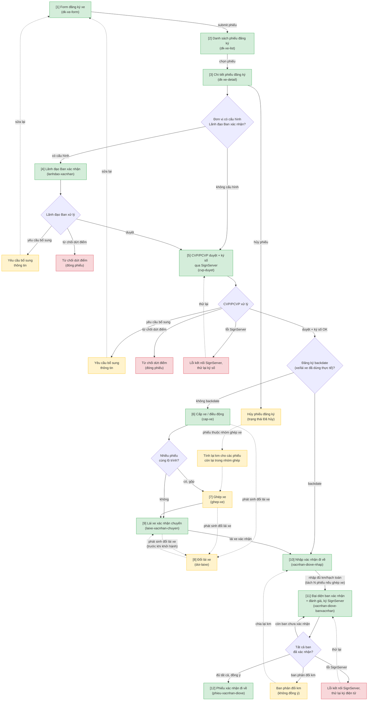
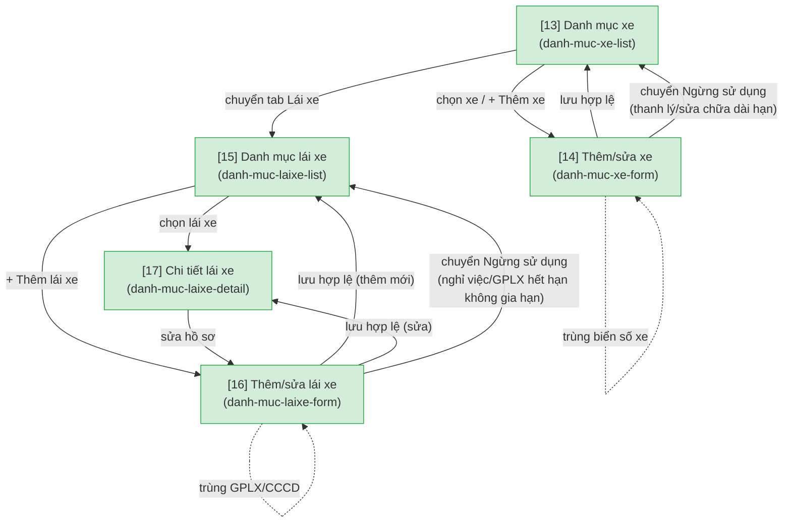
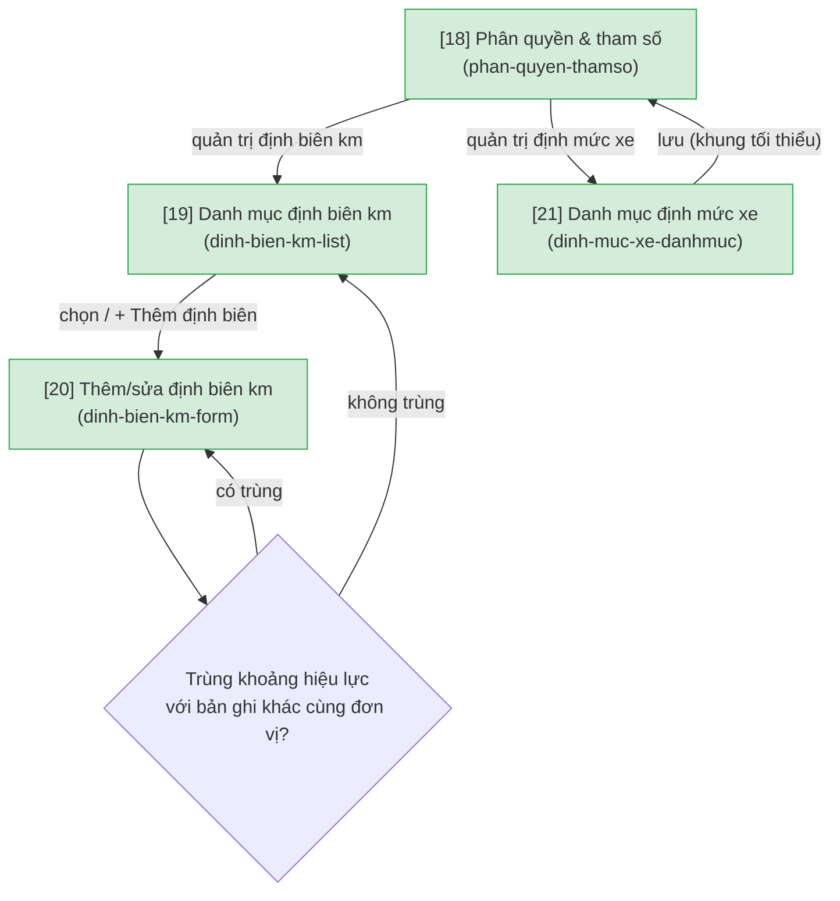
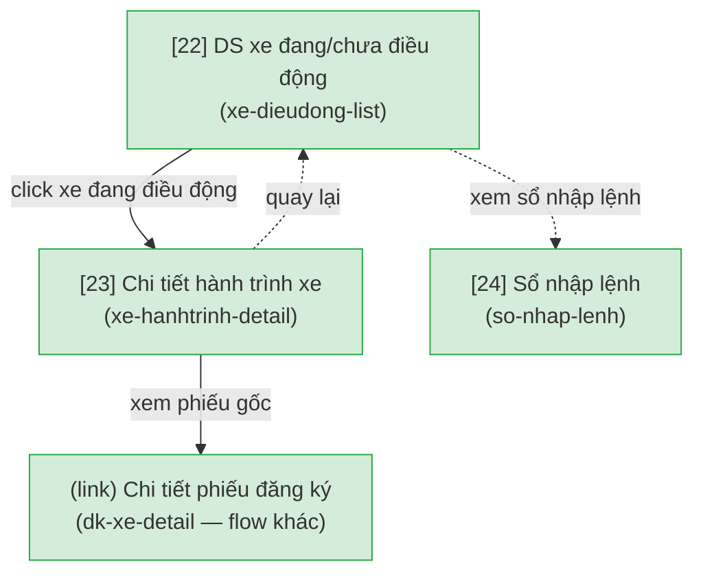
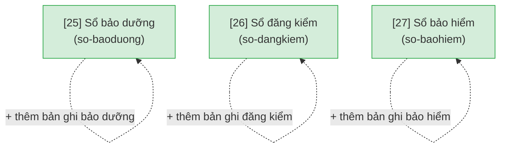
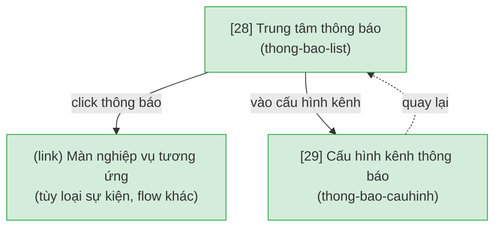
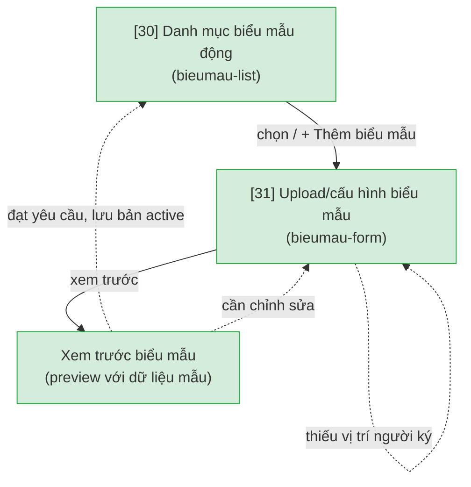
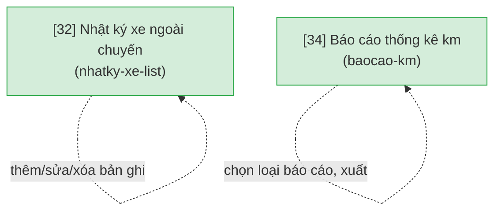
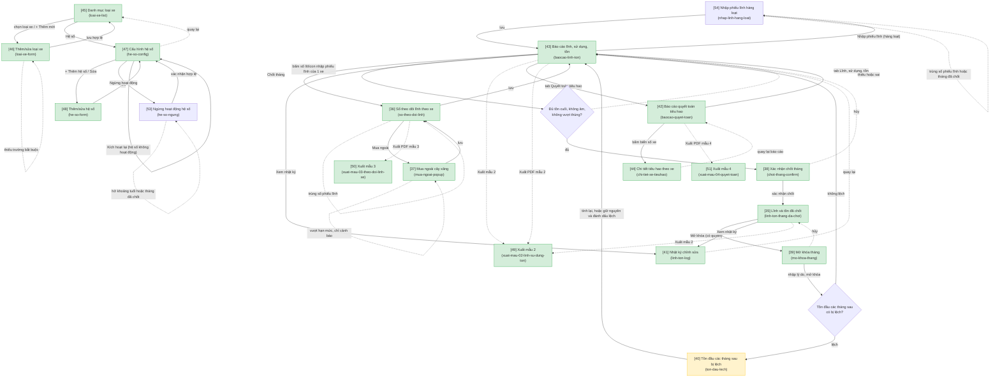

# Đăng ký xe TKV — User Flow

> Nguồn chia flow DUY NHẤT cho feature này. `/wireframe-ascii` và `/wireframe-html` đọc file này để biết flow nào gồm những màn nào — KHÔNG tự chia flow riêng.

> Phạm vi: luồng lõi theo GAP Analysis mục A3 (Form đăng ký), A4 (Luồng duyệt 5 bước), A5 (Cấp xe/Điều động), A6 (Xác nhận đi về), B3 (Ghép xe) — duyệt 2026-08-04; bổ sung 2026-08-13 (đợt 1) nhóm danh mục/tham số nền A1 (Danh mục xe), A2 (Danh mục lái xe), A10 (Phân quyền & tham số), B1 (Định biên km theo đơn vị), B9 (Định mức xe); bổ sung 2026-08-13 (đợt 2) nhóm sổ theo dõi xe A7 (Sửa chữa/kiểm định/bảo hiểm), A9 (DS xe điều động), B5 (Sổ nhập lệnh + 3 sổ theo dõi); bổ sung 2026-08-13 (đợt 3, nhóm cuối phạm vi Desktop) A8 (Thông báo đa kênh), B2 (Biểu mẫu động), B4 (Nhật ký xe ngoài chuyến), B6 (Nhiên liệu), B7 (Báo cáo km). Nguồn: `GAP_Analysis_QLDKXe_TKV.md`. Toàn bộ phạm vi Desktop đã phủ hết — chỉ còn B8+B10 (App Mobile) để lại đợt sau, khác thiết bị.

## 1. User Flow (tổng)

> Phủ happy / error / edge cases. `[n]` = số màn hình đối chiếu Mục 2.

> Bổ sung 2026-08-13: nhóm màn hình danh mục/tham số nền (A1, A2, A10, B1, B9) — 2 flow dưới đây là màn quản trị dữ liệu, KHÔNG sửa nội dung 3 flow giao dịch phía trên. `cap-xe` (flow `cap-xe-dieudong`) đọc dữ liệu "lái xe biên chế" + trạng thái xe từ `danh-muc-xe-form`; `xacnhan-diove-nhap` (flow `xac-nhan-di-ve`) nên đối chiếu định biên từ `dinh-bien-km-list` khi tính năng cảnh báo định biên (A8/B7) được làm ở đợt sau — đợt này định biên km chỉ phục vụ nhập liệu, chưa đối chiếu real-time.

### Flow: Danh mục xe & lái xe

### Flow: Tham số & định mức

> Bổ sung 2026-08-13 (đợt 2): nhóm "sổ theo dõi xe" (A7, A9, B5). `xe-dieudong-list` kế thừa màn hiện có QLDKX004/005 (GAP mục A) — chỉ bổ sung điều hướng chi tiết hành trình, không phải màn hoàn toàn mới. 3 sổ chu kỳ (`so-baoduong`/`so-dangkiem`/`so-baohiem`) đọc chu kỳ đăng kiểm/bảo hiểm/bảo dưỡng từ `danh-muc-xe-form` để tính cảnh báo đến hạn (ngưỡng số ngày cụ thể: xem OQ-8). `so-nhap-lenh` là view tự động lưu lại tại thời điểm cấp xe ở màn `cap-xe` (flow `cap-xe-dieudong`, đã duyệt) — không có thao tác ký nhận thủ công.

### Flow: Xe điều động & sổ lệnh

### Flow: Sổ theo dõi định kỳ

> Bổ sung 2026-08-13 (đợt 3, nhóm cuối phạm vi Desktop): A8 (Thông báo đa kênh), B2 (Biểu mẫu động), B4 (Nhật ký xe ngoài chuyến), B6 (Nhiên liệu — đã tách thành flow `quan-ly-nhien-lieu`, bổ sung 2026-10-16, OQ-11 đã đóng), B7 (Báo cáo km — chờ TKV, OQ-12). `bieumau-form` là màn quản trị template mà `dk-xe-form`/`xacnhan-diove-nhap` (đã duyệt) đang dùng để "Gen biểu mẫu" — bắt buộc qua bước xem trước trước khi lưu bản active vì template ảnh hưởng văn bản có ký số SignServer; phiếu đang xử lý dùng snapshot template tại thời điểm gen, không đổi giữa chừng khi template được cập nhật. `thong-bao-list` KHÔNG có sự kiện "sắp hết định biên km" (chưa có cơ chế tính đã dùng/còn lại); mỗi thông báo click điều hướng tới đúng màn nghiệp vụ liên quan (flow khác).

### Flow: Thông báo

### Flow: Biểu mẫu động

### Flow: Nghiệp vụ độc lập

> Bổ sung 2026-10-16: phân hệ Quản lý nhiên liệu (B6) theo biểu mẫu đơn vị đang dùng + quy định định mức của Tập đoàn + thiết kế Figma. Thay màn khung tạm [33] cũ. 3 biểu mẫu xuất (mẫu 2, 3, 4) in ký tay, không ký số; số phiếu lĩnh chỉ nhập số + kiểm trùng; mua ngoài vượt hạn mức chỉ cảnh báo. Lĩnh tại cây xăng ở [33] tự cộng từ sổ theo dõi lĩnh [36]; Mua ngoài tự cộng từ hóa đơn [37].

> Điều chỉnh 2026-10-19: bỏ màn [33] Lĩnh và tồn tháng vì trùng với [43] Báo cáo lĩnh, sử dụng, tồn. [43] là màn tổng hợp theo tháng (Chốt tháng, Xem nhật ký, Nhập phiếu lĩnh hàng loạt [54]); nhập phiếu lĩnh theo từng xe ở [36]; chỉ Tồn đầu và Tồn cuối được nhập tay trực tiếp trên [43]. Số thứ tự [33] giữ trống, không dùng lại.

### Flow: Quản lý nhiên liệu

## 2. Danh sách màn hình

| [#] | Slug | Màn hình | Mục đích | Thuộc flow |
|-----|------|----------|----------|------------|
| 1 | dk-xe-form | Form đăng ký xe | Chuyên viên Ban tạo phiếu đăng ký: chọn nhiều đơn vị tham gia + số người mỗi đơn vị, link văn bản liên quan, chọn hạch toán (chung/ban/cá nhân đặc thù), nhập backdate, gen biểu mẫu đăng ký | dang-ky-va-duyet-xe |
| 2 | dk-xe-list | Danh sách phiếu đăng ký | Theo dõi trạng thái, tìm phiếu | dang-ky-va-duyet-xe |
| 3 | dk-xe-detail | Chi tiết phiếu đăng ký | Xem toàn bộ thông tin + trạng thái luồng duyệt + lịch sử + hành động theo role (kể cả hủy phiếu). Dùng chung xuyên suốt cả 3 flow (mọi role tra cứu 1 phiếu tại đây trong bất kỳ giai đoạn nào) | dang-ky-va-duyet-xe (chung với cap-xe-dieudong, xac-nhan-di-ve) |
| 4 | lanhdao-xacnhan | Lãnh đạo Ban xác nhận | Bước duyệt mới (cấu hình bật/tắt theo đơn vị): duyệt / yêu cầu bổ sung / từ chối dứt điểm | dang-ky-va-duyet-xe |
| 5 | cvp-duyet | CVP/PCVP duyệt + ký số | Duyệt + ký số trên biểu mẫu đăng ký qua SignServer; xử lý lỗi kết nối ký số | dang-ky-va-duyet-xe |
| 6 | cap-xe | Cấp xe / điều động | Đội trưởng/phó phân xe: gợi ý kế hoạch điều vận (xe trống + lái xe biên chế cố định theo xe, cho phép chọn khác) | cap-xe-dieudong |
| 7 | ghep-xe | Ghép xe | Gộp nhiều phiếu đăng ký (có thể khác đơn vị) cùng lộ trình vào 1 xe | cap-xe-dieudong |
| 8 | doi-laixe | Đổi lái xe | Đổi lái xe khi phát sinh — trigger được từ cấp xe, ghép xe, hoặc sau khi lái xe đã xác nhận chuyến (trước khi khởi hành) | cap-xe-dieudong |
| 9 | laixe-xacnhan-chuyen | Lái xe xác nhận chuyến | Lái xe + người đăng ký tiếp nhận; lái xe xác nhận chuyến (trạng thái "Lái xe đã xác nhận") | cap-xe-dieudong |
| 10 | xacnhan-diove-nhap | Nhập xác nhận đi về | Lái xe nhập km thực tế; hệ thống suggest chia km cho các đơn vị tham gia (chia đều, điều chỉnh nếu ghép/nối chuyến); chọn hạch toán cá nhân đặc thù; tính tháng theo ngày về | xac-nhan-di-ve |
| 11 | xacnhan-diove-banxacnhan | Đại diện ban xác nhận + đánh giá | Đại diện từng đơn vị tham gia xác nhận + đánh giá chuyến đi, ký điện tử qua SignServer. Bắt buộc đủ TẤT CẢ các ban mới hoàn tất; có thể phản đối km (không đồng ý) | xac-nhan-di-ve |
| 12 | phieu-xacnhan-diove | Phiếu xác nhận đi về | Xem/tải phiếu xác nhận đi về đã gen theo biểu mẫu chuẩn (ghép xe → mỗi đơn vị gốc có 1 phiếu riêng) | xac-nhan-di-ve |
| 13 | danh-muc-xe-list | Danh mục xe | Danh sách xe, tìm kiếm, thêm mới | danh-muc-xe-laixe |
| 14 | danh-muc-xe-form | Thêm/sửa xe | Biển số, loại xe, đơn vị quản lý (VP trụ sở chính/VP Hạ Long — không đăng ký chéo trừ khi cấu hình mượn chéo cho phép), ngày sử dụng (căn cứ tính tuổi xe), lái xe biên chế cố định theo xe, chu kỳ kiểm định/bảo hiểm + số km bảo dưỡng, tổng km theo đăng ký xe + km công tơ thực tế (readonly, cộng dồn theo vòng đời xe), trạng thái hoạt động (Đang hoạt động/Ngừng sử dụng + lý do), khối định mức nhiên liệu (loại nhiên liệu, dung tích thùng, xe phục vụ khai trường, định mức riêng, định mức đang áp dụng tự tính) | danh-muc-xe-laixe |
| 15 | danh-muc-laixe-list | Danh mục lái xe | Danh sách lái xe, tìm kiếm | danh-muc-xe-laixe |
| 16 | danh-muc-laixe-form | Thêm/sửa lái xe | Thông tin cá nhân + nhóm trường GPLX (hạng, ngày cấp, ngày hết hạn, ảnh đính kèm), trạng thái (Đang làm việc/Ngừng sử dụng + lý do) | danh-muc-xe-laixe |
| 17 | danh-muc-laixe-detail | Chi tiết lái xe | Hồ sơ + tab lịch sử phục vụ (từ dữ liệu chuyến đã lái, readonly) + tab đánh giá (tổng hợp từ `xacnhan-diove-banxacnhan`, readonly) | danh-muc-xe-laixe |
| 18 | phan-quyen-thamso | Phân quyền & tham số | Ma trận quyền theo role, phạm vi đơn vị (2 văn phòng; xe/lái xe dùng chung khối cơ quan tập đoàn và đảng, đoàn thể), cấu hình mượn xe chéo đơn vị (đơn vị nào được phép đăng ký mượn xe của đơn vị nào), bật/tắt cấu hình "Lãnh đạo Ban xác nhận" theo đơn vị, link audit log hệ thống | tham-so-dinh-muc |
| 19 | dinh-bien-km-list | Danh mục định biên km theo đơn vị | Danh sách bản ghi (đơn vị/cá nhân đặc thù, km/năm, hiệu lực từ-đến) | tham-so-dinh-muc |
| 20 | dinh-bien-km-form | Thêm/sửa định biên km | Nhập/điều chỉnh định biên, validate không chồng lấn hiệu lực cùng đơn vị | tham-so-dinh-muc |
| 21 | dinh-muc-xe-danhmuc | Danh mục định mức xe | Khung tối thiểu (tên định mức, mô tả, hiệu lực, file đính kèm quy định) — chờ TKV cung cấp quy định cụ thể (OQ-4) | tham-so-dinh-muc |
| 22 | xe-dieudong-list | DS xe đang/chưa điều động | Kế thừa QLDKX004/005: danh sách xe kèm trạng thái điều động hiện tại (đang điều động cho phiếu nào / trống / ngừng sử dụng, tách nhóm rõ) | xe-dieudong |
| 23 | xe-hanhtrinh-detail | Chi tiết hành trình xe | Chi tiết chuyến hành trình gắn với xe đang điều động; link sang chi tiết phiếu đăng ký gốc | xe-dieudong |
| 24 | so-nhap-lenh | Sổ nhập lệnh | View tự động: mỗi lần cấp xe (`cap-xe`) sinh 1 lệnh giao cho lái xe, dùng tra cứu/in lịch sử đăng ký xe | xe-dieudong |
| 25 | so-baoduong | Sổ bảo dưỡng | Lịch sử bảo dưỡng theo xe (thời gian, cấp bảo dưỡng, file đính kèm), filter Chọn xe, cảnh báo đến hạn theo chu kỳ ở `danh-muc-xe-form` | so-theo-doi-dinh-ky |
| 26 | so-dangkiem | Sổ đăng kiểm | Lịch sử đăng kiểm theo xe (ngày, kỳ, ngày tiếp theo tính từ chu kỳ, file đính kèm), filter Chọn xe, cảnh báo đến hạn | so-theo-doi-dinh-ky |
| 27 | so-baohiem | Sổ bảo hiểm | Lịch sử mua bảo hiểm theo xe (ngày mua, hết hạn, ngày mua tiếp theo), filter Chọn xe, cảnh báo đến hạn | so-theo-doi-dinh-ky |
| 28 | thong-bao-list | Trung tâm thông báo | Danh sách thông báo (đọc/chưa đọc); click điều hướng tới màn nghiệp vụ liên quan tùy sự kiện (đăng ký mới, cấp xe, sắp đến hạn 3 sổ định kỳ) | thong-bao |
| 29 | thong-bao-cauhinh | Cấu hình kênh thông báo | Bật/tắt kênh (app/chuông/SMS/email) theo loại sự kiện; ngưỡng "sắp đến hạn" phụ thuộc OQ-8 | thong-bao |
| 30 | bieumau-list | Danh mục biểu mẫu động | Danh sách biểu mẫu theo đơn vị/khối (đăng ký xe, phiếu xác nhận đi về) | bieu-mau-dong |
| 31 | bieumau-form | Upload/cấu hình biểu mẫu | Upload file, cấu hình vị trí/tên người duyệt-ký, mapping trường dữ liệu; bắt buộc qua bước xem trước trước khi lưu bản active — nguồn template cho `dk-xe-form`/`xacnhan-diove-nhap` (đã duyệt) | bieu-mau-dong |
| 32 | nhatky-xe-list | Nhật ký xe ngoài chuyến đăng ký | Danh sách + thêm/sửa/xóa bản ghi (km, thời gian từ-đến, mục đích, xe, người lái); người nhập thấy bản ghi của mình, quyền xem tất cả chưa chốt (OQ-10) | nghiep-vu-doc-lap |
| 34 | baocao-km | Báo cáo thống kê km | 6 loại báo cáo theo tháng/quý/năm, khung generic tối thiểu, chờ TKV cung cấp biểu mẫu (OQ-12) | nghiep-vu-doc-lap |
| 35 | linh-ton-thang-da-chot | Lĩnh và tồn - tháng đã chốt | Xem số liệu tháng đã chốt (chỉ xem); nút Mở khóa cho người có quyền | quan-ly-nhien-lieu |
| 36 | so-theo-doi-linh | Nhập phiếu lĩnh theo xe/tháng | Sổ theo dõi lĩnh theo xe/tháng: số phiếu lĩnh, ngày, số lít (kiểm trùng số phiếu), ghi chú; xem Tồn đầu, Tồn cuối, Sử dụng; nguồn của mẫu 3 | quan-ly-nhien-lieu |
| 37 | mua-ngoai-popup | Mua ngoài cây xăng | Nhập hóa đơn mua nhiên liệu ngoài cây xăng chỉ định gắn chuyến công tác; cảnh báo vượt hạn mức | quan-ly-nhien-lieu |
| 38 | chot-thang-confirm | Xác nhận chốt tháng | Xác nhận chốt số liệu tháng (đủ tồn cuối, không sai quy tắc tồn) | quan-ly-nhien-lieu |
| 39 | mo-khoa-thang | Mở khóa tháng đã chốt | Mở khóa tháng đã chốt, bắt buộc nhập lý do, ghi nhật ký | quan-ly-nhien-lieu |
| 40 | ton-dau-lech | Tồn đầu các tháng sau bị lệch | Xử lý tồn đầu các tháng sau bị lệch sau khi sửa tháng cũ: tính lại hoặc giữ nguyên đánh dấu lệch | quan-ly-nhien-lieu |
| 41 | linh-ton-log | Nhật ký chỉnh sửa lĩnh và tồn | Nhật ký chốt, mở khóa, sửa số liệu, đổi định mức (chỉ xem) | quan-ly-nhien-lieu |
| 42 | baocao-quyet-toan | Báo cáo quyết toán tiêu hao | Báo cáo quyết toán tiêu hao theo xe: km, định mức giao khoán, theo định mức, thực tế, tăng/giảm; xuất mẫu 4 | quan-ly-nhien-lieu |
| 43 | baocao-linh-ton | Báo cáo lĩnh, sử dụng, tồn | Tổng hợp lĩnh, sử dụng, tồn theo xe và theo tháng (thay màn Lĩnh và tồn [33] đã gỡ); chỉ Tồn đầu và Tồn cuối cho nhập tay, các cột khác tự tổng hợp; nút Lưu, Nhập phiếu lĩnh, Chốt tháng, Xem nhật ký; xuất mẫu 2 | quan-ly-nhien-lieu |
| 44 | chi-tiet-xe-tieuhao | Chi tiết tiêu hao theo xe | Chi tiết tiêu hao từng xe theo tháng trong năm/vòng đời | quan-ly-nhien-lieu |
| 45 | loai-xe-list | Danh mục loại xe và định mức | Danh mục loại xe và định mức gốc (lít/100km), lối vào cấu hình hệ số | quan-ly-nhien-lieu |
| 46 | loai-xe-form | Thêm/sửa loại xe | Thêm/sửa loại xe, đổi định mức có hiệu lực từ ngày, văn bản căn cứ, lịch sử định mức | quan-ly-nhien-lieu |
| 47 | he-so-config | Cấu hình hệ số | Cấu hình hệ số tuổi xe (A 1,00; B 1,05; C 1,10) và hệ số xe phục vụ khai trường (1,05) | quan-ly-nhien-lieu |
| 48 | he-so-form | Thêm/sửa hệ số | Thêm mới/sửa hệ số tuổi xe hoặc khai trường có hiệu lực từ ngày | quan-ly-nhien-lieu |
| 53 | he-so-ngung | Ngừng hoạt động hệ số | Ngừng hoạt động một hệ số từ ngày chọn, bắt buộc lý do, không xóa cứng | quan-ly-nhien-lieu |
| 54 | nhap-linh-hang-loat | Nhập phiếu lĩnh hàng loạt | Nhập phiếu lĩnh (ngày, xe, số phiếu, số lít) cho nhiều xe trong tháng, kiểm trùng số phiếu, dùng chung dữ liệu với sổ theo dõi lĩnh | quan-ly-nhien-lieu |
| 49 | xuat-mau-02-linh-su-dung-ton | Xuất mẫu 2 - Lĩnh, sử dụng, tồn | Bản xuất PDF/Excel biểu tổng hợp lĩnh, sử dụng, tồn nhiên liệu từng xe ô tô (in ký tay) | quan-ly-nhien-lieu |
| 50 | xuat-mau-03-theo-doi-linh-xe | Xuất mẫu 3 - Theo dõi lĩnh nhiên liệu | Bản xuất PDF/Excel biểu Theo dõi lĩnh nhiên liệu từng xe (in ký tay) | quan-ly-nhien-lieu |
| 51 | xuat-mau-04-quyet-toan | Xuất mẫu 4 - Quyết toán tiêu hao | Bản xuất PDF/Excel biểu tổng hợp quyết toán tiêu hao nhiên liệu từng xe ô tô (in ký tay) | quan-ly-nhien-lieu |

## 3. Danh sách flow

| Flow-slug | Tên flow | Màn hình gồm | Cases phủ |
|-----------|----------|--------------|-----------|
| dang-ky-va-duyet-xe | Đăng ký & duyệt xe | dk-xe-form → dk-xe-list → dk-xe-detail → lanhdao-xacnhan → cvp-duyet | happy (duyệt qua 2 cấp); error (yêu cầu bổ sung, từ chối dứt điểm, lỗi SignServer, hủy phiếu); edge (cấu hình Lãnh đạo Ban tắt, backdate) |
| cap-xe-dieudong | Cấp xe & điều động | cap-xe → ghep-xe → doi-laixe → laixe-xacnhan-chuyen | happy (cấp xe đơn); edge (ghép nhiều phiếu cùng lộ trình, đổi lái xe phát sinh đa điểm) |
| xac-nhan-di-ve | Xác nhận đi về | xacnhan-diove-nhap → xacnhan-diove-banxacnhan → phieu-xacnhan-diove | happy (đủ tất cả ban đồng ý); error (lỗi SignServer); edge (phản đối km, tách N phiếu khi ghép xe, tính lại km khi hủy phiếu trong nhóm ghép) |
| danh-muc-xe-laixe | Danh mục xe & lái xe | danh-muc-xe-list → danh-muc-xe-form, danh-muc-laixe-list → danh-muc-laixe-form / danh-muc-laixe-detail | happy (thêm/sửa thành công); error (thiếu trường bắt buộc, GPLX hết hạn, trùng biển số, trùng GPLX/CCCD); edge (chuyển trạng thái Ngừng sử dụng) |
| tham-so-dinh-muc | Tham số & định mức | phan-quyen-thamso → dinh-bien-km-list → dinh-bien-km-form, phan-quyen-thamso → dinh-muc-xe-danhmuc | happy (thêm/sửa định biên thành công); error (trùng khoảng hiệu lực cùng đơn vị) |
| xe-dieudong | Xe điều động & sổ lệnh | xe-dieudong-list → xe-hanhtrinh-detail (→ link dk-xe-detail), xe-dieudong-list → so-nhap-lenh | happy (xem hành trình, tra cứu lệnh); edge (xe chưa điều động không click được, tách nhóm xe ngừng sử dụng) |
| so-theo-doi-dinh-ky | Sổ theo dõi định kỳ | so-baoduong, so-dangkiem, so-baohiem (3 màn độc lập, filter theo xe) | happy (thêm bản ghi mới); edge (cảnh báo sắp đến hạn — ngưỡng ngày chưa chốt, OQ-8); empty state khi xe mới chưa có lịch sử |
| thong-bao | Thông báo | thong-bao-list → thong-bao-cauhinh | happy (xem/đánh dấu đã đọc, cấu hình kênh, điều hướng theo sự kiện); edge (chưa cấu hình kênh nào → mặc định app; danh sách rỗng) |
| bieu-mau-dong | Biểu mẫu động | bieumau-list → bieumau-form → xem trước → lưu bản active | happy (upload/cấu hình/xem trước thành công); error (thiếu vị trí người ký) |
| nghiep-vu-doc-lap | Nghiệp vụ độc lập | nhatky-xe-list, baocao-km (2 màn độc lập, không có luồng chuyển tiếp cho nhau) | happy (thêm/sửa/xóa nhật ký, xem báo cáo); edge (khung generic B7 chờ TKV cung cấp biểu mẫu) |
| quan-ly-nhien-lieu | Quản lý nhiên liệu | loai-xe-list → loai-xe-form, loai-xe-list → he-so-config → he-so-form / he-so-ngung; baocao-linh-ton ↔ linh-ton-thang-da-chot (chốt/mở khóa), baocao-linh-ton → so-theo-doi-linh, nhap-linh-hang-loat, mua-ngoai-popup, chot-thang-confirm, mo-khoa-thang, ton-dau-lech, linh-ton-log; baocao-quyet-toan ↔ baocao-linh-ton → chi-tiet-xe-tieuhao; xuat-mau-02, xuat-mau-03, xuat-mau-04 | happy (nhập lĩnh/tồn, chốt tháng, xem báo cáo, xuất 3 biểu mẫu); error (trùng số phiếu lĩnh, tồn âm hoặc vượt thùng, thiếu lý do mở khóa); edge (mua ngoài vượt hạn mức chỉ cảnh báo, tồn đầu các tháng sau bị lệch, xe chưa có định mức/chưa khai báo nhiên liệu) |

## 3.5. Chuyển màn (transitions)

| Từ màn [#] | Đến màn [#] | Trigger | Điều kiện |
|-----------|------------|---------|-----------|
| Form đăng ký xe [1] | Danh sách phiếu đăng ký [2] | Submit phiếu | - |
| Danh sách phiếu đăng ký [2] | Chi tiết phiếu đăng ký [3] | Chọn phiếu | - |
| Chi tiết phiếu đăng ký [3] | (giữ nguyên) [3] | Hủy phiếu | Trạng thái chuyển "Đã hủy"; nếu thuộc nhóm ghép xe → tính lại km cho các phiếu còn lại theo phần còn tham gia |
| Chi tiết phiếu đăng ký [3] | Lãnh đạo Ban xác nhận [4] | Điều hướng duyệt | Đơn vị có cấu hình Lãnh đạo Ban xác nhận |
| Chi tiết phiếu đăng ký [3] | CVP/PCVP duyệt [5] | Điều hướng duyệt | Đơn vị KHÔNG cấu hình Lãnh đạo Ban xác nhận |
| Lãnh đạo Ban xác nhận [4] | CVP/PCVP duyệt [5] | Duyệt | - |
| Lãnh đạo Ban xác nhận [4] | Form đăng ký xe [1] | Yêu cầu bổ sung / Từ chối dứt điểm | Chuyên viên sửa lại và submit lại |
| CVP/PCVP duyệt [5] | Cấp xe/điều động [6] | Duyệt + ký số OK | Không backdate |
| CVP/PCVP duyệt [5] | Nhập xác nhận đi về [10] | Duyệt + ký số OK | Backdate (xe/lái xe đã dùng thực tế, bỏ qua cấp xe/điều động) |
| CVP/PCVP duyệt [5] | Form đăng ký xe [1] | Yêu cầu bổ sung / Từ chối dứt điểm | Chuyên viên sửa lại và submit lại |
| CVP/PCVP duyệt [5] | (giữ nguyên) [5] | Lỗi kết nối SignServer | Thử lại ký số |
| Cấp xe/điều động [6] | Ghép xe [7] | Điều hướng | Nhiều phiếu cùng lộ trình |
| Cấp xe/điều động [6] | Lái xe xác nhận chuyến [9] | Điều hướng | Không ghép xe |
| Ghép xe [7] | Lái xe xác nhận chuyến [9] | Gán xe/lái xe chung | - |
| Cấp xe/điều động [6] | Đổi lái xe [8] | Phát sinh đổi lái xe | - |
| Ghép xe [7] | Đổi lái xe [8] | Phát sinh đổi lái xe | - |
| Lái xe xác nhận chuyến [9] | Đổi lái xe [8] | Phát sinh đổi lái xe | Trước khi khởi hành |
| Đổi lái xe [8] | Lái xe xác nhận chuyến [9] | Xác nhận đổi lái xe | - |
| Lái xe xác nhận chuyến [9] | Nhập xác nhận đi về [10] | Lái xe xác nhận | - |
| Nhập xác nhận đi về [10] | Đại diện ban xác nhận [11] | Nhập đủ km/hạch toán | Ghép xe → tách N phiếu xác nhận tương ứng N phiếu đăng ký gốc |
| Đại diện ban xác nhận [11] | Phiếu xác nhận đi về [12] | Tất cả ban đồng ý | - |
| Đại diện ban xác nhận [11] | Nhập xác nhận đi về [10] | Ban phản đối km | Chia lại km |
| Đại diện ban xác nhận [11] | (giữ nguyên) [11] | Lỗi kết nối SignServer | Thử lại ký điện tử |
| Danh mục xe [13] | Thêm/sửa xe [14] | Chọn xe / + Thêm xe | - |
| Thêm/sửa xe [14] | Danh mục xe [13] | Lưu hợp lệ / Chuyển Ngừng sử dụng | - |
| Thêm/sửa xe [14] | (giữ nguyên) [14] | Lưu | Thiếu trường bắt buộc, hoặc trùng biển số xe |
| Danh mục xe [13] | Danh mục lái xe [15] | Chuyển tab Lái xe | - |
| Danh mục lái xe [15] | Chi tiết lái xe [17] | Chọn lái xe | - |
| Danh mục lái xe [15] | Thêm/sửa lái xe [16] | + Thêm lái xe | - |
| Chi tiết lái xe [17] | Thêm/sửa lái xe [16] | Sửa hồ sơ | - |
| Thêm/sửa lái xe [16] | Danh mục lái xe [15] | Lưu hợp lệ (thêm mới) / Chuyển Ngừng sử dụng | - |
| Thêm/sửa lái xe [16] | Chi tiết lái xe [17] | Lưu hợp lệ (sửa) | - |
| Thêm/sửa lái xe [16] | (giữ nguyên) [16] | Lưu | Thiếu trường bắt buộc, GPLX hết hạn, hoặc trùng GPLX/CCCD |
| Phân quyền & tham số [18] | Danh mục định biên km [19] | Quản trị định biên km | - |
| Danh mục định biên km [19] | Thêm/sửa định biên km [20] | Chọn / + Thêm định biên | - |
| Thêm/sửa định biên km [20] | Danh mục định biên km [19] | Lưu | Không trùng khoảng hiệu lực cùng đơn vị |
| Thêm/sửa định biên km [20] | (giữ nguyên) [20] | Lưu | Trùng khoảng hiệu lực với bản ghi khác cùng đơn vị |
| Phân quyền & tham số [18] | Danh mục định mức xe [21] | Quản trị định mức xe | - |
| Danh mục định mức xe [21] | Phân quyền & tham số [18] | Lưu (khung tối thiểu) | - |
| DS xe đang/chưa điều động [22] | Chi tiết hành trình xe [23] | Click xe đang điều động | Xe có trạng thái "đang điều động"; xe "chưa điều động" không click được |
| Chi tiết hành trình xe [23] | Chi tiết phiếu đăng ký [3] (flow khác) | Xem phiếu gốc | - |
| Chi tiết hành trình xe [23] | DS xe đang/chưa điều động [22] | Quay lại | - |
| DS xe đang/chưa điều động [22] | Sổ nhập lệnh [24] | Xem sổ nhập lệnh | - |
| Sổ nhập lệnh [24] | (giữ nguyên) [24] | Cấp xe hoàn tất (tại `cap-xe`, flow khác) | Tự động sinh 1 lệnh mới, không thao tác thủ công |
| Sổ bảo dưỡng [25] | (giữ nguyên) [25] | + Thêm bản ghi bảo dưỡng | - |
| Sổ đăng kiểm [26] | (giữ nguyên) [26] | + Thêm bản ghi đăng kiểm | - |
| Sổ bảo hiểm [27] | (giữ nguyên) [27] | + Thêm bản ghi bảo hiểm | - |
| Trung tâm thông báo [28] | (link) Màn nghiệp vụ tương ứng | Click thông báo | Điều hướng tùy loại sự kiện (đăng ký mới, cấp xe, sắp đến hạn) |
| Trung tâm thông báo [28] | Cấu hình kênh thông báo [29] | Vào cấu hình kênh | - |
| Cấu hình kênh thông báo [29] | Trung tâm thông báo [28] | Quay lại | - |
| Danh mục biểu mẫu động [30] | Upload/cấu hình biểu mẫu [31] | Chọn / + Thêm biểu mẫu | - |
| Upload/cấu hình biểu mẫu [31] | Xem trước biểu mẫu | Xem trước | - |
| Xem trước biểu mẫu | Danh mục biểu mẫu động [30] | Đạt yêu cầu | Lưu bản active |
| Xem trước biểu mẫu | Upload/cấu hình biểu mẫu [31] | Cần chỉnh sửa | - |
| Upload/cấu hình biểu mẫu [31] | (giữ nguyên) [31] | Lưu | Thiếu vị trí người ký |
| Nhật ký xe ngoài chuyến [32] | (giữ nguyên) [32] | Thêm/sửa/xóa bản ghi | - |
| Danh mục loại xe [45] | Thêm/sửa loại xe [46] | Chọn loại xe / + Thêm mới | - |
| Thêm/sửa loại xe [46] | Danh mục loại xe [45] | Lưu | Có định mức mới thì phải có hiệu lực từ ngày |
| Thêm/sửa loại xe [46] | (giữ nguyên) [46] | Lưu | Thiếu tên loại xe/định mức, hoặc trùng tên loại xe |
| Danh mục loại xe [45] | Cấu hình hệ số [47] | Hệ số | - |
| Cấu hình hệ số [47] | Thêm/sửa hệ số [48] | + Thêm hệ số / Sửa | Người có quyền quản trị hệ số |
| Thêm/sửa hệ số [48] | Cấu hình hệ số [47] | Lưu | Hiệu lực từ ngày hợp lệ, khoảng tuổi không chồng lấn/hở, không áp ngược tháng đã chốt |
| Thêm/sửa hệ số [48] | (giữ nguyên) [48] | Lưu | Thiếu trường bắt buộc, trùng nhóm, khoảng tuổi chồng lấn/hở |
| Cấu hình hệ số [47] | Ngừng hoạt động hệ số [53] | Ngừng hoạt động | Hệ số đang hoạt động |
| Ngừng hoạt động hệ số [53] | Cấu hình hệ số [47] | Xác nhận | Có lý do, không làm hở khoảng tuổi, ngày không rơi vào tháng đã chốt |
| Ngừng hoạt động hệ số [53] | (giữ nguyên) [53] | Xác nhận | Hở khoảng tuổi hoặc tháng đã chốt: chặn |
| Cấu hình hệ số [47] | (giữ nguyên) [47] | Kích hoạt lại | Hệ số Không hoạt động; khoảng tuổi không chồng lấn với nhóm đang hoạt động, hệ số về Hoạt động và ghi nhật ký |
| Báo cáo lĩnh, sử dụng, tồn [43] | Sổ theo dõi lĩnh theo xe [36] | Bấm số lít hoặc icon nhập phiếu lĩnh của 1 xe | - |
| Báo cáo lĩnh, sử dụng, tồn [43] | Nhập phiếu lĩnh hàng loạt [54] | Nhập phiếu lĩnh | Tháng chưa chốt, có quyền nhập |
| Nhập phiếu lĩnh hàng loạt [54] | Báo cáo lĩnh, sử dụng, tồn [43] | Lưu | Không trùng số phiếu lĩnh trong toàn hệ thống |
| Nhập phiếu lĩnh hàng loạt [54] | (giữ nguyên) [54] | Lưu | Trùng số phiếu hoặc xe chưa khai báo nhiên liệu: chặn lưu dòng đó |
| Sổ theo dõi lĩnh theo xe [36] | Báo cáo lĩnh, sử dụng, tồn [43] | Lưu | Không trùng số phiếu lĩnh trong toàn hệ thống |
| Báo cáo lĩnh, sử dụng, tồn [43] | (giữ nguyên) [43] | Lưu | Tồn đầu/Tồn cuối ≥ 0 và ≤ dung tích thùng; vi phạm: viền đỏ, chặn lưu |
| Sổ theo dõi lĩnh theo xe [36] | Mua ngoài cây xăng [37] | Mua ngoài | - |
| Sổ theo dõi lĩnh theo xe [36] | (giữ nguyên) [36] | Lưu | Trùng số phiếu lĩnh: báo xe và ngày đã dùng, chặn lưu dòng đó |
| Báo cáo lĩnh, sử dụng, tồn [43] | Xác nhận chốt tháng [38] | Chốt tháng | Đủ tồn cuối; tồn không âm và không vượt thùng; Sử dụng không âm |
| Báo cáo lĩnh, sử dụng, tồn [43] | (giữ nguyên) [43] | Chốt tháng | Thiếu tồn cuối hoặc vi phạm quy tắc tồn: báo xe còn thiếu/sai |
| Xác nhận chốt tháng [38] | Lĩnh và tồn đã chốt [35] | Xác nhận chốt | Ghi nhật ký (người, thời điểm) |
| Xác nhận chốt tháng [38] | Báo cáo lĩnh, sử dụng, tồn [43] | Hủy | - |
| Lĩnh và tồn đã chốt [35] | Mở khóa tháng [39] | Mở khóa | Chỉ người có quyền mở khóa (OQ-17) |
| Mở khóa tháng [39] | Tồn đầu các tháng sau bị lệch [40] | Mở khóa | Tồn đầu các tháng sau bị lệch sau khi sửa |
| Mở khóa tháng [39] | Báo cáo lĩnh, sử dụng, tồn [43] | Mở khóa | Tồn đầu các tháng sau không lệch; bắt buộc nhập lý do (tối đa 500 ký tự) |
| Mở khóa tháng [39] | Lĩnh và tồn đã chốt [35] | Hủy | - |
| Tồn đầu các tháng sau bị lệch [40] | Báo cáo lĩnh, sử dụng, tồn [43] | Tính lại / Giữ nguyên, đánh dấu lệch | Tính lại chỉ cho tháng chưa chốt; ghi nhật ký |
| Báo cáo lĩnh, sử dụng, tồn [43] / đã chốt [35] | Nhật ký chỉnh sửa [41] | Xem nhật ký | - |
| Nhật ký chỉnh sửa [41] | Báo cáo lĩnh, sử dụng, tồn [43] | Quay lại | - |
| Báo cáo lĩnh, sử dụng, tồn [43] / đã chốt [35] | Xuất mẫu 2 [49] | Xuất mẫu 2 (PDF/Excel) | In ký tay, không ký số |
| Sổ theo dõi lĩnh theo xe [36] | Xuất mẫu 3 [50] | Xuất PDF mẫu 3 | In ký tay, không ký số |
| Báo cáo quyết toán tiêu hao [42] | Báo cáo lĩnh, sử dụng, tồn [43] | Chuyển tab | - |
| Báo cáo lĩnh, sử dụng, tồn [43] | Báo cáo quyết toán tiêu hao [42] | Chuyển tab | - |
| Báo cáo quyết toán tiêu hao [42] | Chi tiết tiêu hao theo xe [44] | Bấm biển số xe | - |
| Chi tiết tiêu hao theo xe [44] | Báo cáo quyết toán tiêu hao [42] | Quay lại báo cáo | - |
| Báo cáo quyết toán tiêu hao [42] | Xuất mẫu 4 [51] | Xuất PDF mẫu 4 | Tháng chưa chốt: cột Thực tế để trống |
| Báo cáo lĩnh, sử dụng, tồn [43] | Xuất mẫu 2 [49] | Xuất PDF mẫu 2 | In ký tay, không ký số |
| Báo cáo thống kê km [34] | (giữ nguyên) [34] | Chọn loại báo cáo, xuất | Khung tối thiểu, chờ TKV |

## 4. Open Questions

- [ ] OQ-4: B9 Danh mục định mức xe — cần TKV cung cấp quy định nội bộ cụ thể (văn bản chị Len gửi) để hoàn thiện trường dữ liệu; hiện vẽ khung tối thiểu.
- [ ] OQ-8: Ngưỡng "sắp đến hạn" để cảnh báo ở 3 sổ theo dõi định kỳ — bao nhiêu ngày trước hạn đăng kiểm/bảo hiểm/bảo dưỡng thì bắt đầu cảnh báo?
- [ ] OQ-9: "Danh mục cấp bảo dưỡng" (nguồn dropdown "cấp bảo dưỡng" ở Sổ bảo dưỡng) — có cần tách thành màn quản trị riêng (thêm/sửa/xóa cấp bảo dưỡng) hay dropdown nhập tay là đủ?
- [ ] OQ-10: Nhật ký xe ngoài chuyến — "quyền xem tất cả" là quyền riêng trong ma trận `phan-quyen-thamso`, hay mặc định cấp cho Đội trưởng/phó + QTHT?
- [x] OQ-11: B6 Quản lý nhiên liệu — Resolved 2026-10-16: đã có biểu mẫu đơn vị đang dùng (3 biểu: lĩnh-sử dụng-tồn, theo dõi lĩnh, quyết toán tiêu hao) + quy định định mức; thay bằng flow `quan-ly-nhien-lieu` (màn [33], [35]–[51]).
- [ ] OQ-12: B7 Báo cáo thống kê km — cần TKV cung cấp biểu mẫu báo cáo cụ thể (sheet "KM năm 2026", "TH HN - HL theo xe") để hoàn thiện; hiện vẽ khung tối thiểu.
- [ ] OQ-13: Tuổi xe (nhóm A/B/C) tính từ mốc nào: Ngày sử dụng, năm sản xuất hay ngày đăng ký lần đầu? Hiện giả định Ngày sử dụng.
- [ ] OQ-14: Xe đổi nhóm tuổi giữa tháng (vd từ B sang C): tách dòng theo chuyến hay lấy định mức bình quân gia quyền cho báo cáo quyết toán tháng?
- [ ] OQ-15: Đơn vị nào ngoài Đội xe văn phòng dùng chung 3 biểu mẫu; tiêu đề biểu mẫu có lấy theo Đơn vị quản lý của xe không?
- [ ] OQ-16: Biểu giấy tháng 08/2026, xe 30M-51952 ghi tồn cuối 42 nhưng 40 + 490 − 489 = 41 và tổng xăng tồn cuối 283 khớp 41 — đơn vị xác nhận 42 có phải lỗi in tay không?
- [ ] OQ-17: Quyền Chốt tháng, Mở khóa tháng, Nhập lĩnh/tồn, Quản trị loại xe và hệ số nằm trong ma trận quyền nào của `phan-quyen-thamso` (hiện ma trận chưa có các quyền này)?
- [ ] OQ-18: Danh mục loại nhiên liệu cụ thể (Xăng A95 / Xăng 95 / Dầu DO...) và cách nhóm lên Xăng/Dầu để cộng tổng; biểu giấy đang ghi không thống nhất ("Xăng A95", "Xăng 95").
- [ ] OQ-19: Nguồn "Số Km hoạt động trong tháng" của biểu quyết toán: chỉ km chuyến đã xác nhận đi về, hay cộng cả nhật ký xe ngoài chuyến? Hiện giả định chỉ chuyến đã xác nhận đi về.
- [ ] OQ-20: Màn thêm/sửa xe theo Figma mới lệch bản trước ở 3 điểm cần xác nhận: (a) Lái xe biên chế có BẮT BUỘC không (Figma ghi bắt buộc, bản trước ghi không bắt buộc); (b) chu kỳ bảo dưỡng tính theo km (Figma chỉ có "Số Km bảo dưỡng") hay theo thời gian như 3 sổ định kỳ đang mô tả; (c) danh mục giá trị của ô "Tình trạng xe" (Figma mới có "Xe mới").
- [ ] OQ-21: Định mức riêng của xe (nhập ở màn thêm/sửa xe) thay thế định mức gốc của loại xe, và có còn nhân thêm hệ số tuổi xe/khai trường không?

(OQ-1, OQ-2, OQ-3 đã chốt ở đợt trước — bắt buộc tất cả ban xác nhận, ký qua SignServer, tính lại km khi hủy phiếu trong nhóm ghép. OQ-5 đã chốt thành business rule "cấu hình mượn xe chéo đơn vị" tại màn `phan-quyen-thamso` — Mục 2 dòng 18. OQ-6, OQ-7 đã được khách hàng quyết định bỏ qua ở đợt này.)
