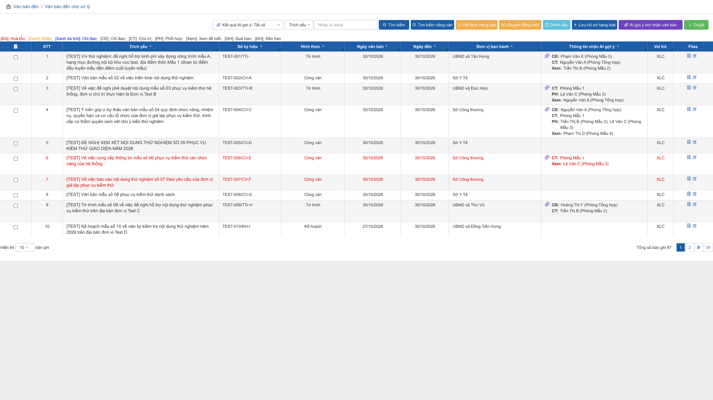
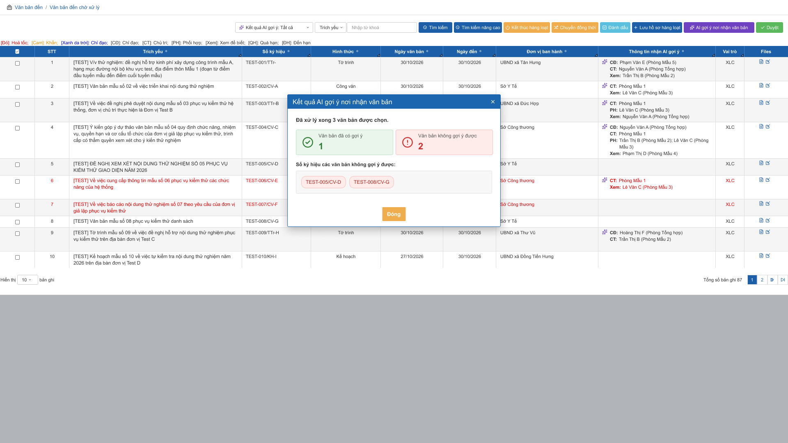
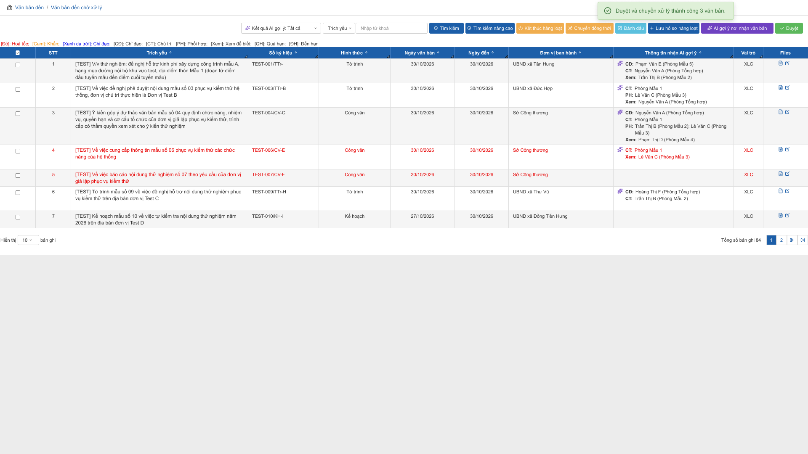
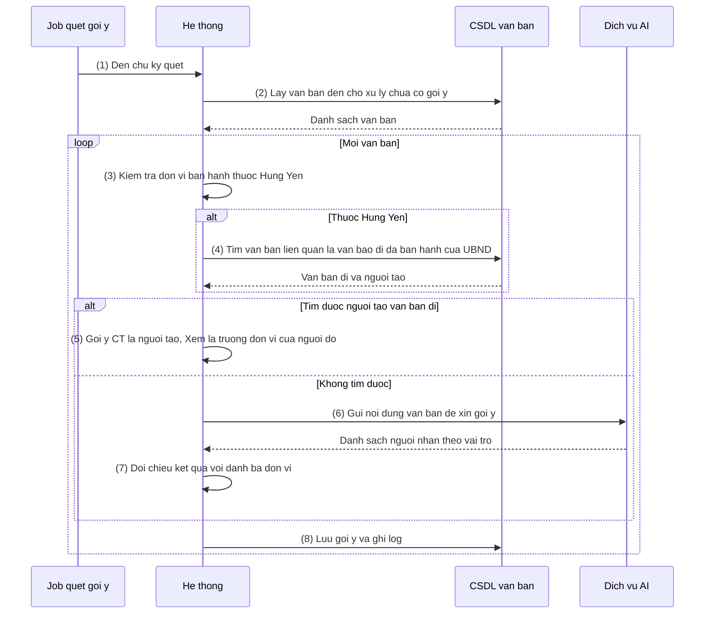

# NỘI DUNG

## ĐẶC TẢ YÊU CẦU CHỨC NĂNG HỆ THỐNG

### PHÂN HỆ: Quản lý văn bản đến

#### Module 1: Gợi ý nơi nhận cho văn bản đến

##### Mô tả tóm tắt

Module giúp người dùng xử lý văn bản đến (Văn thư, Chuyên viên, Lãnh đạo có quyền) giảm thao tác chọn nơi nhận tại danh sách "Văn bản đến chờ xử lý". Hệ thống tự gợi ý người/đơn vị nhận theo vai trò CĐ / CT / PH / Xem; người dùng kiểm tra gợi ý rồi nhấn **Duyệt** để chuyển văn bản. Hệ thống không tự chuyển văn bản khi chưa có thao tác Duyệt.

---

##### Bảng thuật ngữ & Actor tham gia

**Từ viết tắt & thuật ngữ**

| Từ viết tắt / Thuật ngữ | Giải thích |
|---|---|
| CĐ / CT / PH / Xem | Vai trò nhận văn bản: Chỉ đạo / Chủ trì / Phối hợp / Xem để biết |
| XLC | Xử lý chính (cột "Vai trò" của danh sách — vai trò của người đăng nhập với văn bản) |
| Gợi ý nơi nhận | Danh sách người/đơn vị nhận theo vai trò do hệ thống đề xuất cho 1 văn bản đến |
| Nguồn gợi ý | Cách tạo ra gợi ý: "Văn bản liên quan" (theo quy tắc) hoặc "AI" |
| Văn bản liên quan | Văn bản trong mục "Văn bản liên quan / Văn bản gốc" của văn bản đến |
| Đơn vị ban hành Hưng Yên | Đơn vị ban hành thuộc tỉnh Hưng Yên, xác định theo cấu hình (BR-03, FC-001) |

**Actor tham gia**

| Actor | Vai trò / Mô tả trong phạm vi module này |
|---|---|
| Người dùng xử lý văn bản đến | Người có quyền xem gợi ý, kích hoạt gợi ý thủ công và Duyệt (quyền ở BR-01 FC-003, BR-01 FC-004) |
| Job quét gợi ý | Tiến trình nền của hệ thống, chạy theo chu kỳ để tạo gợi ý cho văn bản đến mới |
| Dịch vụ AI | Hệ thống bên ngoài, đọc nội dung văn bản và trả về gợi ý nơi nhận khi quy tắc không xác định được |
| Người/đơn vị được gợi ý | Đối tượng nhận văn bản sau khi người dùng Duyệt |

---

##### Phạm vi chỉnh sửa

- Menu **Văn bản đến > Văn bản đến chờ xử lý** (`qlvb/van_ban_den/dsvb_den/index`, tham số `bootstrap=2&kho=VAN_BAN_DEN_CA_NHAN&nop=20`, kể cả các tham số bổ sung của menu): thêm cột "Thông tin nhận AI gợi ý", nút "AI gợi ý nơi nhận văn bản", nút "Duyệt".
- Mục "Văn bản liên quan / Văn bản gốc" của văn bản đến và dữ liệu văn bản đi: chỉ đọc, dùng làm căn cứ gợi ý.
- Ngoài phạm vi tài liệu này: bộ lọc "Kết quả AI gợi ý" và cài đặt "Quyền riêng tư > Tùy chọn sử dụng tính năng thông minh" có trên Figma, sẽ đặc tả riêng.

---

##### Yêu cầu giao diện

- Hình ảnh giao diện / mockup (nguồn Figma `ioffice_v5`, section "AI Phân luồng xử lý văn bản đến"):

  Danh sách "Văn bản đến chờ xử lý" có cột gợi ý:

  

  Popup kết quả sau khi nhấn "AI gợi ý nơi nhận văn bản":

  

  Danh sách sau khi Duyệt (thông báo thành công, văn bản đã chuyển biến mất, Tổng số bản ghi giảm 87 → 84):

  

  Hành vi UI đặc biệt: ô "Thông tin nhận AI gợi ý" có biểu tượng ✨ (màu tím) ở góc trên bên trái khi văn bản có gợi ý; nút "AI gợi ý nơi nhận văn bản" màu tím, nút "Duyệt" màu xanh lá.

- Bảng mô tả các trường thông tin trên giao diện (chỉ các thành phần mới; các cột/nút có sẵn của danh sách giữ nguyên):

| Tên trường thông tin | Kiểu điều khiển | Độ dài | Ràng buộc / Điều kiện | Kiểu dữ liệu |
|---|---|---|---|---|
| **Box thanh công cụ danh sách** | | | | |
| AI gợi ý nơi nhận văn bản | Button (biểu tượng ✨, màu tím) | - | Hiển thị khi người dùng có quyền `AI_GOI_Y_NOI_NHAN_VB_DEN` [GIẢ ĐỊNH — tên quyền mới]. Click → xử lý theo FC-002. Đặt cạnh nút Lưu hồ sơ hàng loạt | Button |
| Duyệt | Button (biểu tượng ✓, màu xanh lá) | - | Hiển thị khi người dùng có quyền `DUYET_VB_DEN_HANG_LOAT` [GIẢ ĐỊNH — dùng lại quyền sẵn có của chức năng Duyệt hàng loạt]. Click → xử lý theo FC-004. Là nút ngoài cùng bên phải thanh công cụ | Button |
| **Box lưới danh sách văn bản đến chờ xử lý** | | | | |
| Chọn dòng | Checkbox | - | Có sẵn. Tích chọn 1 hoặc nhiều dòng để thao tác hàng loạt; checkbox đầu cột chọn/bỏ chọn toàn bộ dòng của trang hiện tại | Boolean |
| Thông tin nhận AI gợi ý | Label nhiều dòng | - | Hiển thị khi người dùng có quyền `AI_GOI_Y_NOI_NHAN_VB_DEN`; không có quyền thì ẩn cả cột. Nằm giữa cột "Đơn vị ban hành" và cột "Vai trò". Nội dung và cách hiển thị theo FC-003. Văn bản chưa có gợi ý → ô để trống. Cột không sắp xếp, không là tiêu chí tìm kiếm | String |
| **Popup Đang xử lý AI gợi ý** | | | | |
| Nội dung chờ | Label + biểu tượng loading | - | Hiển thị trong lúc FC-002 đang xử lý; không có nút đóng; chặn thao tác trên danh sách. Câu chữ: "Đang xử lý AI gợi ý nơi nhận văn bản..." [GIẢ ĐỊNH — Figma chỉ có nhãn "Loading text"] | String |
| **Popup Kết quả AI gợi ý nơi nhận văn bản** | | | | |
| Tiêu đề popup | Label | - | Cố định "Kết quả AI gợi ý nơi nhận văn bản" | String |
| Biểu tượng đóng (×) | Icon button | - | Click → đóng popup | Button |
| Dòng tổng kết | Label | - | Định dạng "Đã xử lý xong {n} văn bản được chọn." với n = số văn bản đã chọn | String |
| Ô "Văn bản đã có gợi ý" | Thẻ số (nền xanh lá nhạt, biểu tượng ✓) | - | Hiển thị số văn bản có kết quả gợi ý. Giá trị ≥ 0 | Number |
| Ô "Văn bản không gợi ý được" | Thẻ số (nền đỏ nhạt, biểu tượng !) | - | Hiển thị số văn bản không có kết quả gợi ý. Giá trị ≥ 0 | Number |
| Số ký hiệu các văn bản không gợi ý được | Danh sách chip | - | Chỉ hiển thị khi số văn bản không gợi ý được > 0; mỗi văn bản 1 chip chứa Số ký hiệu | String |
| Đóng | Button (màu cam) | - | Click → đóng popup, tải lại danh sách để hiển thị gợi ý mới | Button |
| **Thông báo sau khi Duyệt** | | | | |
| Thông báo thành công | Toast (góc trên bên phải, nền xanh nhạt, biểu tượng ✓) | - | Hiển thị khi mọi văn bản đã chọn đều chuyển thành công, nội dung "Duyệt và chuyển xử lý thành công {n} văn bản." Tự ẩn sau 5 giây [GIẢ ĐỊNH] | String |
| Popup Kết quả Duyệt | Popup | - | Hiển thị khi có ít nhất 1 văn bản lỗi: số văn bản thành công, số văn bản lỗi và Số ký hiệu từng văn bản lỗi kèm lý do (bố cục tương tự popup kết quả gợi ý) [GIẢ ĐỊNH — Figma chưa có màn này, theo cách làm của chức năng Duyệt hàng loạt hiện có] | String |

---

##### Chức năng 1: Quét và tạo gợi ý nơi nhận tự động cho văn bản đến

###### Quy trình

###### Chức năng nghiệp vụ

**① Luồng xử lý thành công**

Bước 1: Job quét chạy theo chu kỳ, hệ thống thực hiện:
- Lấy các văn bản đến chờ xử lý cần quét (→ BR-01, BR-02)
- Xử lý lần lượt từng văn bản, tối đa 50 văn bản mỗi lượt (→ BR-09)

Bước 2: Với từng văn bản, hệ thống xác định nguồn gợi ý:
- Kiểm tra đơn vị ban hành có thuộc Hưng Yên (→ BR-03)
- Thuộc Hưng Yên: tìm văn bản đi căn cứ qua Văn bản liên quan (→ BR-04, EX-04)
- Không thuộc Hưng Yên, hoặc không tìm được căn cứ: chuyển sang Bước 4

Bước 3: Khi tìm được văn bản đi căn cứ, hệ thống thực hiện:
- Gợi ý người tạo văn bản đi vào vai trò CT, trưởng đơn vị trực tiếp của người đó vào vai trò Xem (→ BR-05, BR-06)
- Chuyển sang Bước 5

Bước 4: Khi không có căn cứ từ quy tắc, hệ thống thực hiện:
- Gọi API dịch vụ AI (chi tiết xem mục Đặc tả tích hợp API)
- Đối chiếu kết quả AI với danh bạ đơn vị (→ BR-07, BR-08)

Bước 5: Hệ thống ghi nhận kết quả, hệ thống thực hiện:
- Lưu gợi ý theo vai trò và nguồn gợi ý, trạng thái "Đã gợi ý"; nếu không có kết quả hợp lệ thì lưu trạng thái "Không gợi ý được" (→ BR-02)
- Ghi log (→ mục Log hệ thống)

**Đặc tả tích hợp API — Dịch vụ AI gợi ý nơi nhận**

*Thông tin chung (API bên ngoài)*

| Thông tin | Giá trị |
|---|---|
| Hệ thống đối tác | Dịch vụ AI gợi ý nơi nhận văn bản `[CẦN XÁC NHẬN — chờ tài liệu API]` |
| Endpoint được gọi | `[CẦN XÁC NHẬN]` |
| Method | `[CẦN XÁC NHẬN]` |
| Cơ chế xác thực | `[CẦN XÁC NHẬN]` |
| Thời điểm gọi (trigger) | Bước 4 của Luồng thành công, mỗi văn bản 1 lần gọi (FC-001 hoặc FC-002) |
| Timeout / Retry | Timeout 30 giây, không retry trong cùng lượt; lần thử lại tính ở lượt quét sau (→ BR-02) [GIẢ ĐỊNH] |

*Mapping Request — hệ thống mình → API AI*

Tên field của API AI chưa có tài liệu nên ghi `[CẦN XÁC NHẬN]`; cột "Lấy từ đâu" là yêu cầu nghiệp vụ.

| Field gửi đi (API AI) | Kiểu dữ liệu | Bắt buộc | Lấy từ đâu trong hệ thống mình | Transform / Format |
|---|---|---|---|---|
| `[CẦN XÁC NHẬN]` — trích yếu | String | ✅ | Trường "Trích yếu" của văn bản đến | Không |
| `[CẦN XÁC NHẬN]` — nội dung văn bản | String / File | ✅ | Nội dung file văn bản đến (file chính) | Trích văn bản từ file; định dạng theo yêu cầu API |
| `[CẦN XÁC NHẬN]` — hình thức, đơn vị ban hành | String | ⚪ | Trường "Hình thức", "Đơn vị ban hành" của văn bản đến | Không |
| `[CẦN XÁC NHẬN]` — danh sách người/đơn vị cho phép gợi ý | Array | ⚪ | Danh bạ người dùng, đơn vị đang hoạt động của đơn vị nhận văn bản | `[CẦN XÁC NHẬN]` — AI có tự tra danh bạ hay hệ thống phải gửi sang |

*Mapping Response — API AI → hệ thống mình*

| Field nhận về (API AI) | Kiểu dữ liệu | Map vào đâu trong hệ thống mình | Transform / Format | Xử lý khi null/thiếu |
|---|---|---|---|---|
| `[CẦN XÁC NHẬN]` — danh sách người/đơn vị nhận kèm vai trò | Array | Bản ghi gợi ý: vai trò nhận, đối tượng nhận (Phụ lục) | Quy đổi vai trò AI về CĐ/CT/PH/Xem; tên/mã đối tượng về ID người dùng/đơn vị trong danh bạ (→ BR-08) | Mảng rỗng hoặc null → lưu "Không gợi ý được" |
| `[CẦN XÁC NHẬN]` — mã/trạng thái xử lý | String | Log gọi AI | Không | Thiếu → coi là phản hồi sai định dạng (→ EX-03) |

**② Luồng xử lý ngoại lệ**

| Mã | Tình huống | Xử lý |
|----|-----------|-------|
| EX-01 | API AI timeout (quá 30 giây) hoặc không phản hồi | Ghi log lỗi; văn bản lưu "Không gợi ý được", tăng số lần thử (→ BR-02); tiếp tục văn bản kế tiếp |
| EX-02 | API AI trả lỗi xác thực (401/403) | Ghi log lỗi; dừng gọi AI trong phần còn lại của lượt quét; các văn bản cần AI giữ nguyên chưa gợi ý, không tăng số lần thử; gửi cảnh báo cho quản trị hệ thống [GIẢ ĐỊNH] |
| EX-03 | API AI trả dữ liệu sai định dạng hoặc lỗi 5xx | Ghi log kèm nội dung phản hồi thô; văn bản lưu "Không gợi ý được", tăng số lần thử |
| EX-04 | Không có Văn bản liên quan, hoặc không tìm thấy văn bản đi ban hành của UBND, hoặc người tạo không hợp lệ (BR-06) | Không coi là lỗi; chuyển sang gọi AI (Bước 4) |
| EX-05 | Chu kỳ trước chưa chạy xong khi đến chu kỳ mới | Bỏ qua chu kỳ mới, ghi log "Bỏ qua do lượt trước chưa kết thúc" |

**③ Quy tắc nghiệp vụ**

**Chọn văn bản cần quét**

- BR-01: Đến chu kỳ quét → hệ thống chọn văn bản đến thuộc kho "chờ xử lý" của đơn vị có bật tính năng gợi ý (tham số `AI_GOI_Y_NOI_NHAN_BAT` = 1, Phụ lục) và chưa có bản ghi gợi ý → xử lý theo Ngày đến tăng dần.
- BR-02: Văn bản đã có bản ghi trạng thái "Không gợi ý được" và số lần thử < 3 → được quét lại ở lượt sau; đạt 3 lần → dừng quét tự động, chỉ gợi ý lại bằng FC-002. Mọi lần xử lý không ra gợi ý (EX-01, EX-03, không còn đối tượng hợp lệ) đều tính 1 lần thử, trừ EX-02.

**Nhận diện đơn vị ban hành thuộc Hưng Yên**

- BR-03: Đơn vị ban hành thuộc Hưng Yên khi mã đơn vị nằm trong danh mục cấu hình "Đơn vị thuộc tỉnh Hưng Yên" hoặc được ban hành cùng schema với UBND tỉnh `[CẦN XÁC NHẬN — theo cơ chế phân loại văn bản theo đơn vị ban hành đã làm cho UBND TP Hà Nội]` → thuộc: xét Văn bản liên quan (BR-04); không thuộc: gọi AI luôn (Bước 4).

**Gợi ý theo Văn bản liên quan**

- BR-04: Văn bản đến thuộc Hưng Yên và mục "Văn bản liên quan / Văn bản gốc" có văn bản → hệ thống tìm trong dữ liệu của UBND văn bản **đi đã ban hành** trùng khớp (khớp theo liên kết văn bản gốc `[CẦN XÁC NHẬN — khớp theo ID liên kết hay Số ký hiệu]`) → có nhiều văn bản đi thì lấy văn bản có Ngày ban hành mới nhất [GIẢ ĐỊNH]. Văn bản đi ở trạng thái dự thảo không dùng làm căn cứ.
- BR-05: Tìm được văn bản đi → người tạo văn bản đi được gợi ý vào vai trò **CT**; trưởng đơn vị của đơn vị trực tiếp của người đó được gợi ý vào vai trò **Xem**; nguồn gợi ý ghi "Văn bản liên quan"; vai trò CĐ và PH để trống.
- BR-06: Người tạo không còn hoạt động / bị khóa / không còn đơn vị → coi như không tìm được căn cứ (→ EX-04). Đơn vị trực tiếp không xác định được trưởng đơn vị, hoặc trưởng đơn vị chính là người tạo → chỉ gợi ý CT, không thêm vai trò Xem. Trưởng đơn vị xác định theo chức vụ trưởng đơn vị đang áp dụng trong danh bạ `[CẦN XÁC NHẬN — theo chức vụ nào]`, lấy đơn vị hiện tại của người tạo [GIẢ ĐỊNH].

**Gợi ý bằng AI**

- BR-07: Văn bản có độ mật khác "Thường" không được gửi sang AI → lưu "Không gợi ý được" [GIẢ ĐỊNH — `CẦN XÁC NHẬN` với đơn vị về quy định văn bản mật].
- BR-08: Kết quả AI chỉ được nhận khi đối tượng nhận khớp người dùng/đơn vị đang hoạt động trong danh bạ của UBND; đối tượng không khớp bị loại. Văn bản đã gợi ý phải có tối thiểu 1 đối tượng ở vai trò CT; không đạt → "Không gợi ý được" [GIẢ ĐỊNH].

**Giới hạn hiệu năng**

- BR-09: Mỗi lượt quét xử lý tối đa 50 văn bản (tham số `AI_GOI_Y_SO_VB_MOI_LUOT`); chu kỳ quét 5 phút (tham số `AI_GOI_Y_CHU_KY_PHUT`) [GIẢ ĐỊNH]; văn bản còn lại xử lý ở lượt sau.

###### Thông báo và thông tin lưu vết log

**Thông báo hệ thống**

Không gửi thông báo cho người dùng ở chức năng này. Riêng EX-02 gửi cảnh báo cho quản trị hệ thống [GIẢ ĐỊNH — kênh và người nhận `CẦN XÁC NHẬN`].

**Log hệ thống (Audit Trail)**

Lưu lại log vào cơ sở dữ liệu:
- Người thao tác: "Job quét gợi ý" (tác nhân hệ thống)
- Thời gian (timestamp)
- Hành động: tạo gợi ý / không gợi ý được / gọi AI lỗi
- Dữ liệu: ID văn bản, nguồn gợi ý, trạng thái, số lần thử, mã lỗi (không lưu nội dung văn bản trong log)

###### Edge cases

- Văn bản được người dùng xử lý/chuyển trong lúc job đang tính gợi ý → bỏ qua kết quả, không ghi bản ghi gợi ý.
- Hai tiến trình (job và FC-002) cùng xử lý 1 văn bản → chỉ 1 tiến trình ghi kết quả, tiến trình kia bỏ qua văn bản đó.
- Đơn vị ban hành đổi tên hoặc sáp nhập sau khi cấu hình danh mục Hưng Yên → văn bản mới có thể bị xếp ngoài Hưng Yên và đi thẳng sang AI.
- Người tạo văn bản đi đã chuyển đơn vị sau khi tạo văn bản → dùng đơn vị hiện tại của người đó (BR-06).
- Nhiều văn bản đến liên quan cùng 1 văn bản đi → mỗi văn bản được gợi ý độc lập, cho cùng kết quả.

---

##### Chức năng 2: Kích hoạt gợi ý nơi nhận thủ công cho văn bản đã chọn

###### Chức năng nghiệp vụ

**① Luồng xử lý thành công**

Bước 1: Người dùng tích chọn 1 hoặc nhiều văn bản và nhấn nút "AI gợi ý nơi nhận văn bản", hệ thống thực hiện:
- Kiểm tra số văn bản đã chọn (→ EX-01, EX-02)
- Hiển thị popup "Đang xử lý AI gợi ý nơi nhận văn bản..." và khóa thao tác trên danh sách

Bước 2: Hệ thống xử lý lần lượt từng văn bản đã chọn:
- Xác định gợi ý theo đúng quy tắc của FC-001 (Bước 2 đến Bước 4, BR-03 đến BR-08)
- Ghi đè gợi ý cũ nếu văn bản đã có (→ BR-01)
- Lưu kết quả và ghi log

Bước 3: Hệ thống xử lý xong, hệ thống thực hiện:
- Đóng popup đang xử lý, hiển thị popup "Kết quả AI gợi ý nơi nhận văn bản" gồm số văn bản đã có gợi ý, số văn bản không gợi ý được và Số ký hiệu từng văn bản không gợi ý được
- Khi người dùng nhấn Đóng (hoặc ×), đóng popup và tải lại danh sách, cột "Thông tin nhận AI gợi ý" hiển thị gợi ý mới

**② Luồng xử lý ngoại lệ**

| Mã | Tình huống | Xử lý |
|----|-----------|-------|
| EX-01 | Người dùng nhấn nút khi chưa chọn văn bản nào | Hiển thị cảnh báo "Vui lòng chọn ít nhất 1 văn bản" [GIẢ ĐỊNH], không xử lý |
| EX-02 | Người dùng chọn quá 20 văn bản | Hiển thị cảnh báo "Mỗi lần gợi ý tối đa 20 văn bản" ở góc dưới bên trái màn hình, tự ẩn; không xử lý [GIẢ ĐỊNH — theo giới hạn của Duyệt hàng loạt] |
| EX-03 | Lỗi gọi AI cho 1 văn bản (timeout, 401/403, sai định dạng — xem EX-01 đến EX-03 FC-001) | Văn bản đó tính vào "Không gợi ý được", không dừng cả lượt; ghi log; không tăng số lần thử |
| EX-04 | Tổng thời gian xử lý vượt 120 giây [GIẢ ĐỊNH] | Dừng xử lý, đóng popup đang xử lý; các văn bản chưa xử lý tính vào "Không gợi ý được"; kết quả đã xử lý được giữ |

**③ Quy tắc nghiệp vụ**

- BR-01: Văn bản được chọn đã có gợi ý → hệ thống tính lại và ghi đè gợi ý cũ [GIẢ ĐỊNH — `CẦN XÁC NHẬN`: ghi đè hay bỏ qua]; văn bản không còn nằm trong danh sách chờ xử lý của người dùng thì bỏ qua và tính vào "Không gợi ý được".
- BR-02: Chức năng này không bị giới hạn số lần thử của job (BR-02 FC-001) và không thay đổi số lần thử đã ghi.
- BR-03: Quyền thực hiện: người có quyền `AI_GOI_Y_NOI_NHAN_VB_DEN` (BR-01 FC-003).

###### Thông báo và thông tin lưu vết log

**Thông báo hệ thống**

Không gửi thông báo. Kết quả hiển thị bằng popup.

**Log hệ thống (Audit Trail)**

Lưu lại log vào cơ sở dữ liệu:
- Người thao tác (user ID + tên)
- Thời gian (timestamp)
- Hành động: kích hoạt gợi ý thủ công
- Dữ liệu trước và sau: gợi ý cũ và gợi ý mới của từng văn bản, nguồn gợi ý

###### Edge cases

- Người dùng đóng trình duyệt hoặc mất kết nối khi đang xử lý → hệ thống vẫn hoàn tất xử lý phía máy chủ; kết quả xem được ở cột gợi ý khi mở lại danh sách.
- Người dùng nhấn nút liên tiếp nhiều lần → popup đang xử lý khóa thao tác, chỉ nhận 1 lần.
- Một văn bản được chọn đồng thời bởi 2 người dùng → mỗi lần chạy ghi đè theo thứ tự hoàn tất, bản ghi sau cùng có hiệu lực.

---

##### Chức năng 3: Xem thông tin nhận AI gợi ý trên danh sách văn bản đến chờ xử lý

###### Chức năng nghiệp vụ

**① Luồng xử lý thành công**

Người dùng mở menu Văn bản đến > Văn bản đến chờ xử lý, hệ thống thực hiện:
- Hiển thị danh sách theo nghiệp vụ hiện có (phân trang, sắp xếp mặc định giữ nguyên)
- Kiểm tra quyền xem cột (→ BR-01)
- Với mỗi văn bản có gợi ý, hiển thị nội dung gợi ý ở cột "Thông tin nhận AI gợi ý" (→ BR-02, BR-03)

**② Luồng xử lý ngoại lệ**

| Mã | Tình huống | Xử lý |
|----|-----------|-------|
| EX-01 | Đối tượng được gợi ý đã bị khóa, ngừng hoạt động hoặc không còn trong danh bạ tại thời điểm hiển thị | Vẫn hiển thị tên theo dữ liệu hiện có kèm đánh dấu gạch ngang, không chặn tải danh sách; chặn lúc Duyệt (EX-04 FC-004) [GIẢ ĐỊNH] |
| EX-02 | Không đọc được dữ liệu gợi ý của 1 văn bản (lỗi dữ liệu) | Để trống ô gợi ý của văn bản đó, các cột khác hiển thị bình thường, ghi log lỗi |

**③ Quy tắc nghiệp vụ**

**Quyền hiển thị**

- BR-01: Người dùng có quyền `AI_GOI_Y_NOI_NHAN_VB_DEN` [GIẢ ĐỊNH — quyền mới] → thấy cột "Thông tin nhận AI gợi ý" và nút "AI gợi ý nơi nhận văn bản"; không có quyền → ẩn cả cột và nút.

**Nội dung và cách hiển thị**

- BR-02: Mỗi văn bản hiển thị các dòng theo thứ tự cố định CĐ, CT, PH, Xem; dòng vai trò không có đối tượng nhận thì ẩn; văn bản chưa có gợi ý hoặc "Không gợi ý được" thì ô để trống, không hiển thị biểu tượng ✨.
- BR-03: Mỗi dòng có dạng "<Vai trò>: <đối tượng 1>; <đối tượng 2>" — cá nhân hiển thị "Họ tên (Đơn vị)", đơn vị hiển thị tên đơn vị; cá nhân xếp trước đơn vị; nhãn vai trò in đậm. Ví dụ: "PH: Trần Thị B (Phòng Mẫu 2); Lê Văn C (Phòng Mẫu 3)". Hiển thị tối đa 10 dòng, dài hơn thì hiển thị link "Chi tiết" mở toàn bộ [GIẢ ĐỊNH — theo cột Nội dung tham mưu của HNI].
- BR-04: Nội dung gợi ý của 1 văn bản là như nhau với mọi người dùng có quyền xem; không phụ thuộc người đăng nhập [GIẢ ĐỊNH].
- BR-05: Văn bản hỏa tốc/khẩn/quá hạn giữ nguyên quy tắc tô màu dòng hiện có của danh sách.

###### Thông báo và thông tin lưu vết log

**Thông báo hệ thống**

Không có.

**Log hệ thống (Audit Trail)**

Chỉ ghi log khi lỗi (EX-02). Không ghi log thao tác xem.

###### Edge cases

- Người được gợi ý đổi tên hoặc đổi đơn vị sau khi gợi ý → hiển thị theo dữ liệu hiện tại của danh bạ, không theo dữ liệu lúc gợi ý.
- Văn bản vừa được người khác chuyển đi trong lúc danh sách đang mở → vẫn hiển thị đến khi tải lại; thao tác Duyệt báo lỗi theo EX-02 FC-004.

---

##### Chức năng 4: Duyệt hàng loạt theo AI gợi ý

###### Chức năng nghiệp vụ

**① Luồng xử lý thành công**

Bước 1: Người dùng tích chọn 1 hoặc nhiều văn bản đã có gợi ý và nhấn nút "Duyệt", hệ thống thực hiện:
- Kiểm tra số văn bản đã chọn (→ EX-01, EX-05)
- Kiểm tra từng văn bản (→ BR-02, EX-02, EX-03, EX-04)

Bước 2: Hệ thống chuyển từng văn bản hợp lệ, hệ thống thực hiện:
- Chuyển văn bản tới người/đơn vị nhận theo gợi ý và vai trò (→ BR-03)
- Ghi nhận nội dung xử lý vào log xử lý văn bản (→ BR-04)
- Gửi thông báo cho người nhận

Bước 3: Hệ thống xử lý xong danh sách, hệ thống thực hiện:
- Tất cả thành công: hiển thị toast "Duyệt và chuyển xử lý thành công {n} văn bản."
- Có văn bản lỗi: hiển thị popup Kết quả Duyệt (số thành công, số lỗi, Số ký hiệu và lý do của từng văn bản lỗi)
- Tải lại danh sách: văn bản đã chuyển biến mất, văn bản lỗi vẫn còn để người dùng kiểm tra và Duyệt lại

**② Luồng xử lý ngoại lệ**

| Mã | Tình huống | Xử lý |
|----|-----------|-------|
| EX-01 | Người dùng chọn quá 20 văn bản | Hiển thị cảnh báo "Mỗi lần xử lý tối đa 20 văn bản" ở góc dưới bên trái màn hình, tự ẩn; không xử lý [GIẢ ĐỊNH — theo Duyệt hàng loạt hiện có] |
| EX-02 | Văn bản không còn ở vị trí của người đăng nhập hoặc đã được xử lý (kể cả do người khác Duyệt trước) | Không chuyển; liệt kê vào danh sách lỗi, lý do "Văn bản đã được xử lý hoặc không còn ở vị trí của bạn" |
| EX-03 | Văn bản chưa có gợi ý, hoặc có trạng thái "Không gợi ý được" | Không chuyển; liệt kê vào danh sách lỗi, lý do "Văn bản chưa có AI gợi ý" |
| EX-04 | Có đối tượng nhận bị khóa / ngừng hoạt động / không còn trong danh bạ, hoặc luồng xử lý không cho phép chuyển tới đối tượng đó | Không chuyển văn bản đó (không chuyển một phần); liệt kê vào danh sách lỗi, lý do "Người nhận gợi ý không hợp lệ" |
| EX-05 | Người dùng nhấn Duyệt khi chưa chọn văn bản nào | Hiển thị cảnh báo "Vui lòng chọn ít nhất 1 văn bản" [GIẢ ĐỊNH], không xử lý |

**③ Quy tắc nghiệp vụ**

**Điều kiện Duyệt**

- BR-01: Nút "Duyệt" chỉ hiển thị với người dùng có quyền `DUYET_VB_DEN_HANG_LOAT` [GIẢ ĐỊNH — dùng lại quyền sẵn có; quyền không cần gắn theo đơn vị].
- BR-02: Văn bản được Duyệt khi đồng thời: đang ở vị trí người đăng nhập, chưa xử lý, có gợi ý hợp lệ (trạng thái "Đã gợi ý"). Văn bản không đạt được bỏ qua và báo lỗi, không ảnh hưởng văn bản khác (→ EX-02, EX-03).

**Chuyển văn bản**

- BR-03: Duyệt → hệ thống chuyển văn bản trong 1 lần tới toàn bộ đối tượng của gợi ý: CT là người xử lý chính, PH phối hợp, CĐ chỉ đạo, Xem xem để biết [GIẢ ĐỊNH — giống nghiệp vụ "Chuyển đồng thời"; `CẦN XÁC NHẬN` nếu phải đi theo từng bước của luồng]. Hệ thống dùng đúng gợi ý lưu tại thời điểm xử lý văn bản đó.
- BR-04: Nội dung xử lý trong log xử lý văn bản ghi "Duyệt theo AI gợi ý" kèm nguồn gợi ý [GIẢ ĐỊNH].
- BR-05: Hệ thống không cho sửa gợi ý ngay tại thao tác Duyệt; người dùng muốn đổi người nhận thì không Duyệt văn bản đó và xử lý bằng chức năng chuyển xử lý hiện có.

###### Thông báo và thông tin lưu vết log

**Thông báo hệ thống**

| Sự kiện kích hoạt | Người nhận | Kênh | Nội dung thông báo |
|------------------|-----------|------|-------------------|
| Văn bản đến được chuyển sau khi Duyệt | Người/đơn vị nhận theo gợi ý (mọi vai trò) | Notify (in-app) [GIẢ ĐỊNH — theo thông báo chuyển xử lý hiện có] | "Bạn có văn bản đến mới: {Số ký hiệu} - {Trích yếu}" |

**Log hệ thống (Audit Trail)**

Lưu lại log thao tác vào cơ sở dữ liệu:
- Người thao tác (user ID + tên)
- Thời gian (timestamp)
- Hành động: Duyệt theo AI gợi ý, chuyển xử lý
- Dữ liệu trước và sau: vị trí xử lý trước, danh sách người/đơn vị nhận theo vai trò sau khi chuyển, nguồn gợi ý

###### Edge cases

- Mất kết nối giữa chừng khi đang xử lý nhiều văn bản → văn bản đã chuyển giữ nguyên kết quả; người dùng tải lại danh sách để thấy văn bản còn lại và Duyệt lại, hệ thống không tự thử lại.
- Gợi ý bị ghi đè (FC-002) khi người dùng đã xem gợi ý cũ trên màn hình → Duyệt chuyển theo gợi ý mới nhất, có thể khác nội dung người dùng đã thấy [CẦN XÁC NHẬN: có cần so khớp phiên bản gợi ý trước khi chuyển].
- Văn bản có gợi ý nhưng không phù hợp luồng của đơn vị (vai trò nhận không có trong luồng) → báo lỗi EX-04, không chuyển.
- Hai người cùng có quyền Duyệt 1 văn bản → người đến sau nhận EX-02.

---

## ĐIỀU KIỆN NGHIỆM THU HỆ THỐNG

Hệ thống được nghiệm thu khi thỏa các điều kiện sau:

- Hệ thống vận hành đúng theo mô tả trong tài liệu này, đáp ứng toàn bộ yêu cầu chức năng FC-001 đến FC-004
- Job quét tạo gợi ý cho văn bản đến mới trong chu kỳ cấu hình; văn bản thuộc đơn vị Hưng Yên có văn bản liên quan là văn bản đi của UBND cho kết quả CT = người tạo, Xem = trưởng đơn vị đúng quy tắc
- Tích hợp dịch vụ AI chạy ổn định với tài liệu API đã chốt `[CẦN XÁC NHẬN]`, xử lý đúng các lỗi EX-01 đến EX-03 (FC-001)
- Chức năng Duyệt chuyển đúng văn bản theo gợi ý, văn bản lỗi còn lại trong danh sách, không chuyển văn bản ngoài vùng chọn
- Hệ thống được hiệu chỉnh sau khi triển khai thử nghiệm
- Tổ chức hướng dẫn sử dụng cho người dùng; người sử dụng thao tác tốt trên hệ thống sau khóa đào tạo
- Tất cả tài liệu và source chương trình được bàn giao đầy đủ

---

# PHỤ LỤC

**Danh mục trường thông tin cần lưu trữ**

| Tên trường thông tin | Thuộc chức năng | Kiểu dữ liệu | Ý nghĩa / Ghi chú |
|---|---|---|---|
| Văn bản đến | FC-001, FC-002 | ID văn bản | Văn bản được gợi ý |
| Vai trò nhận | FC-001, FC-002 | Data list: CĐ / CT / PH / Xem | Vai trò của đối tượng nhận |
| Loại đối tượng nhận | FC-001, FC-002 | Data list: Cá nhân / Đơn vị | Phân biệt người dùng và đơn vị |
| Đối tượng nhận | FC-001, FC-002 | ID người dùng / ID đơn vị | Người/đơn vị được gợi ý |
| Nguồn gợi ý | FC-001, FC-002 | Data list: Văn bản liên quan / AI | Cách tạo gợi ý |
| Văn bản đi căn cứ | FC-001 | ID văn bản | Chỉ có khi nguồn là Văn bản liên quan |
| Trạng thái gợi ý | FC-001, FC-002 | Data list: Đã gợi ý / Không gợi ý được | Quyết định hiển thị và điều kiện Duyệt |
| Số lần thử | FC-001 | Number | Số lần quét tự động không ra gợi ý (BR-02 FC-001) |
| Thời điểm gợi ý | FC-001, FC-002 | Date time | Thời điểm ghi kết quả gần nhất |
| Người kích hoạt | FC-001, FC-002 | String | "Job quét gợi ý" hoặc người dùng bấm nút |

**Danh mục tham số cấu hình** (tên tham số là đề xuất, `[CẦN XÁC NHẬN]` với đội phát triển)

| Tham số | Loại | Giá trị mặc định | Ý nghĩa |
|---|---|---|---|
| `AI_GOI_Y_NOI_NHAN_BAT` | Đơn vị, 0/1 | 0 | Bật tính năng gợi ý cho đơn vị |
| Danh mục "Đơn vị thuộc tỉnh Hưng Yên" | Danh mục | Rỗng | Danh sách mã đơn vị thuộc Hưng Yên (BR-03 FC-001) |
| `AI_GOI_Y_CHU_KY_PHUT` | Hệ thống, số | 5 | Chu kỳ quét của job (phút) |
| `AI_GOI_Y_SO_VB_MOI_LUOT` | Hệ thống, số | 50 | Số văn bản tối đa mỗi lượt quét |
