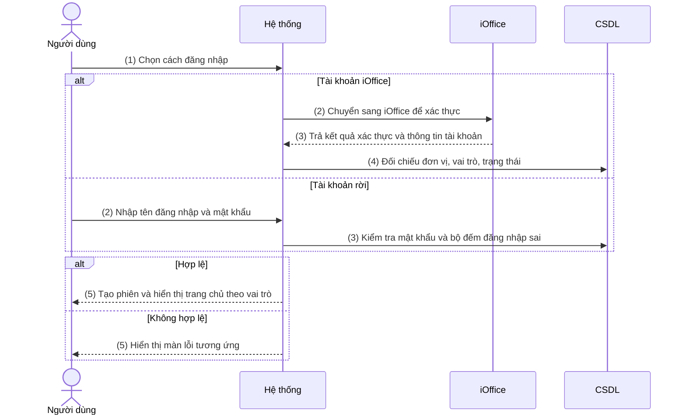
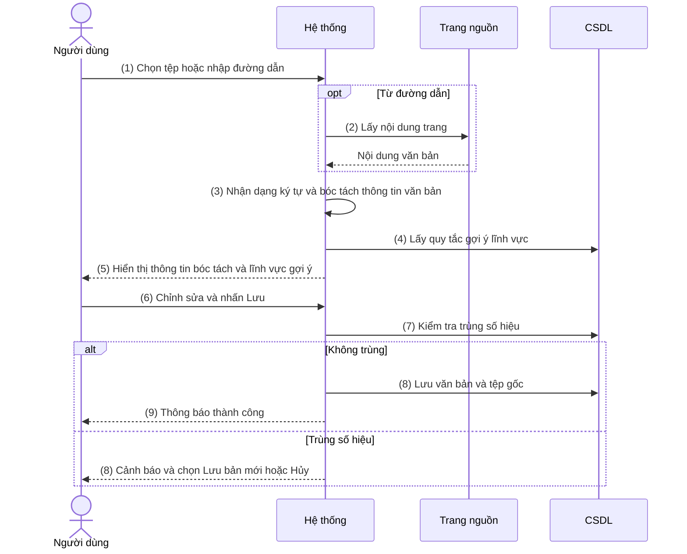
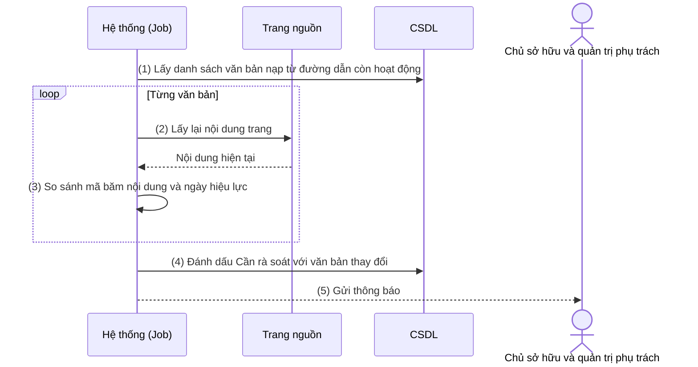
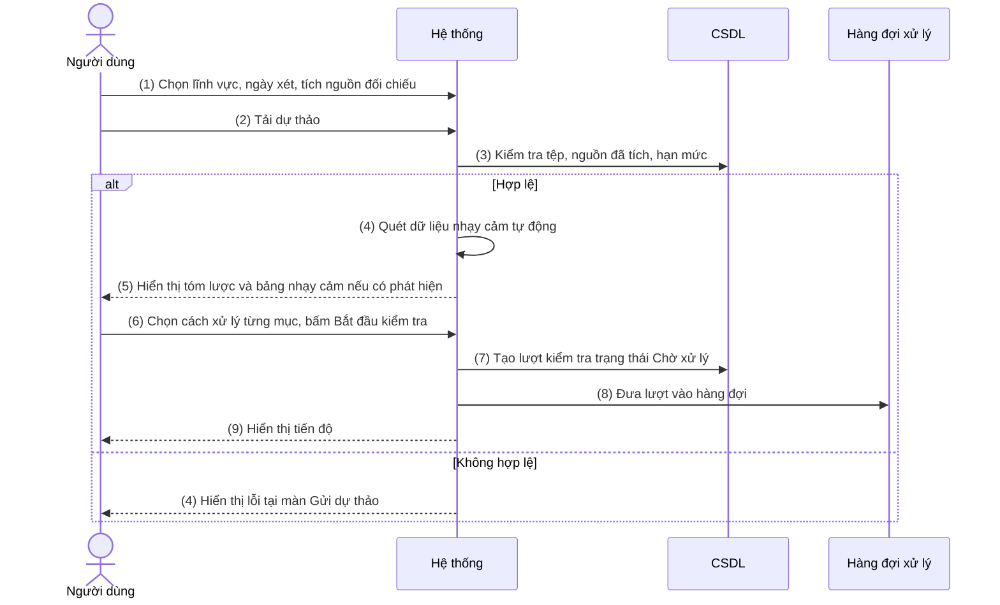
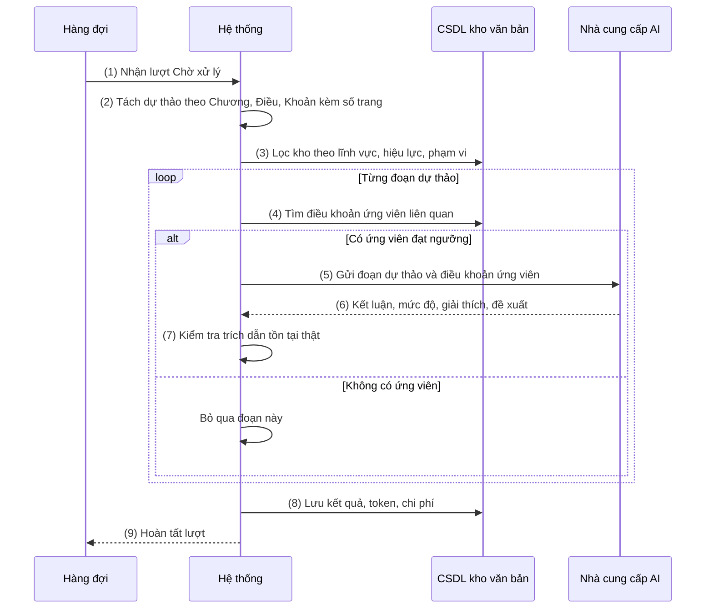
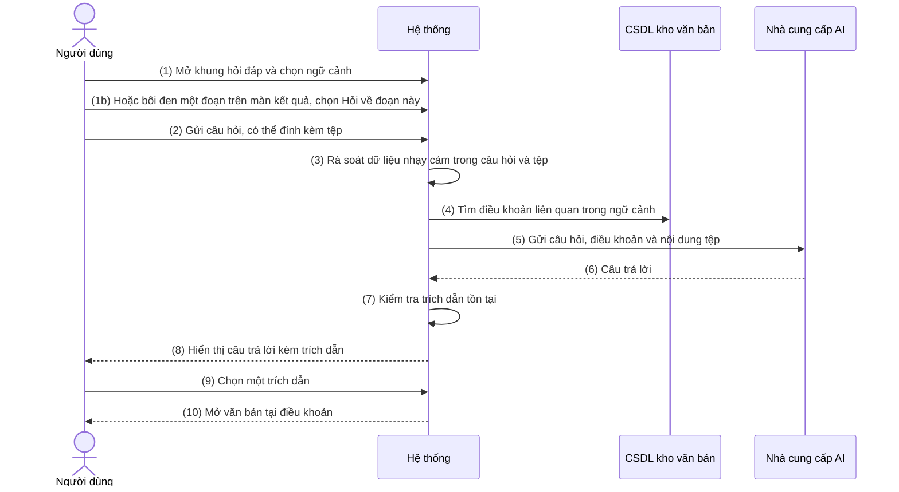
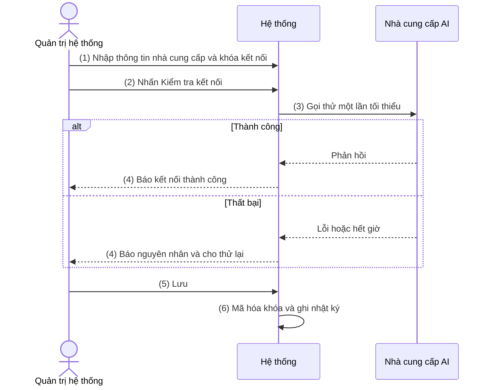
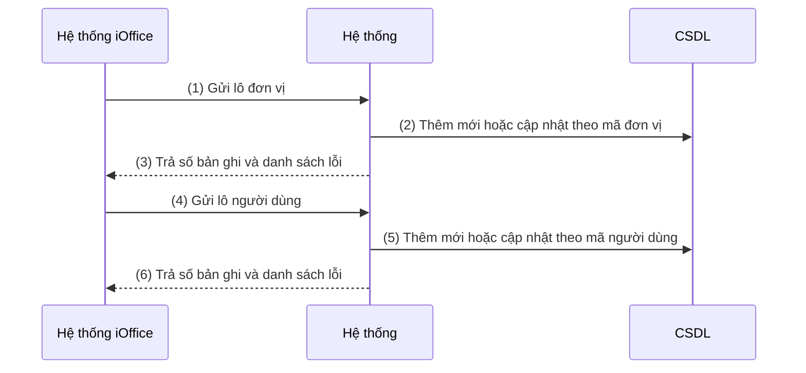

# NỘI DUNG

## ĐẶC TẢ YÊU CẦU CHỨC NĂNG HỆ THỐNG

### PHÂN HỆ 1 / KIỂM TRA PHÁP LÝ VĂN BẢN DỰ THẢO

Hệ thống ứng dụng độc lập, phục vụ toàn bộ khách hàng đang dùng iOffice, cho phép người soạn thảo kiểm tra một văn bản dự thảo có vi phạm quy định pháp luật hay không bằng cách đối chiếu với kho văn bản pháp lý do khách hàng tự quản lý. Kết quả là báo cáo nêu rõ điểm vi phạm theo mức độ, vị trí trong dự thảo, căn cứ trong kho văn bản và đề xuất chỉnh sửa. Nội dung kết quả chỉ để người dùng tham khảo và tự điều chỉnh, không có bước ký hay xác nhận.

Yêu cầu tính năng chung của phân hệ:

- Kho văn bản pháp lý: thêm từ tệp hoặc đường dẫn, tự bóc tách thông tin bằng nhận dạng ký tự và quy tắc nhận dạng mẫu (không dùng AI), phân nhóm theo lĩnh vực, phân quyền theo phạm vi sử dụng.
- Kiểm tra pháp lý: đối chiếu dự thảo với kho theo từng đoạn, AI chỉ nhận các đoạn dự thảo cùng điều khoản ứng viên liên quan, không nhận nguyên tệp.
- Kiểm soát dữ liệu nhạy cảm trước khi gửi nhà cung cấp AI, có thể tắt khi dùng nhà cung cấp trong nước.
- Quản lý lịch sử và chi phí từng lần kiểm tra theo tài khoản và đơn vị.
- Đa đơn vị: một hệ thống dùng chung cho nhiều khách hàng, với 3 vai trò Quản trị hệ thống, Quản trị đơn vị (một tài khoản có thể phụ trách nhiều đơn vị) và Người dùng.
- Tích hợp iOffice: đăng nhập bằng tài khoản iOffice, nhận tệp dự thảo qua API, hiển thị cửa sổ popup nhúng trong giao diện iOffice.

**Từ viết tắt & thuật ngữ**

| Từ viết tắt / Thuật ngữ | Giải thích |
|---|---|
| Kho văn bản | Tập hợp các văn bản pháp lý đã nạp vào hệ thống, dùng làm căn cứ đối chiếu |
| Phạm vi sử dụng | Phạm vi được dùng một văn bản trong kho: Cá nhân (chỉ chủ sở hữu), Đơn vị, Một số đơn vị (do quản trị chọn), Toàn hệ thống |
| Lượt kiểm tra | Một lần gửi dự thảo để kiểm tra pháp lý, có trạng thái, kết quả, chi phí riêng |
| Điểm vi phạm | Một vị trí trong dự thảo được xác định là chưa phù hợp với quy định, kèm căn cứ và đề xuất sửa |
| Mức vi phạm | Nghiêm trọng (trái quy định bắt buộc hoặc vi phạm điều cấm, cần sửa trước khi ban hành), Cần chỉnh sửa (chưa phù hợp, thiếu hoặc mâu thuẫn một phần với quy định), Lưu ý (có thể ảnh hưởng hoặc diễn đạt chưa rõ, cũng dùng khi căn cứ đã thay đổi từ lúc kiểm tra) |
| Căn cứ | Điều khoản trong văn bản của kho dùng làm cơ sở xác định điểm vi phạm |
| Rà soát nhạy cảm | Bước quét dự thảo tìm dữ liệu nhạy cảm trước khi gửi nhà cung cấp AI |
| Che ẩn | Thay giá trị nhạy cảm bằng mã tạm trước khi gửi AI, khôi phục lại giá trị gốc khi hiển thị kết quả cho người dùng |
| Nhà cung cấp AI | Dịch vụ AI do hệ thống gọi qua API, phân loại Trong nước hoặc Nước ngoài |
| Cần rà soát | Nhãn báo văn bản nạp từ đường dẫn có nội dung nguồn đã thay đổi so với lần nạp |
| Hạn mức | Giới hạn ngân sách tháng (đồng) và số lượt kiểm tra tối đa mỗi tháng của đơn vị hoặc tài khoản |
| Popup iOffice | Cửa sổ nhúng trong giao diện iOffice để gửi tệp kiểm tra và hỏi đáp, rộng khoảng 480px |
| Nguồn đối chiếu | Các văn bản trong kho được tích chọn ở cột trái màn Gửi dự thảo để làm căn cứ cho một lượt kiểm tra |
| Thêm nguồn | Thêm nhanh một văn bản vào kho từ màn Gửi dự thảo, bằng một tệp hoặc một liên kết công khai (xem FC-005) |

**Actor tham gia**

| Actor | Vai trò / Mô tả trong phạm vi phân hệ |
|---|---|
| Người dùng | Tài khoản iOffice hoặc tài khoản rời. Nạp văn bản vào kho cá nhân, gửi dự thảo, xử lý dữ liệu nhạy cảm, xem kết quả và lịch sử của mình. Không được đổi phạm vi sử dụng văn bản |
| Quản trị đơn vị | Phụ trách một hoặc nhiều đơn vị khách hàng: tài khoản, kho văn bản của đơn vị, quy tắc nhạy cảm của đơn vị, hạn mức cho tài khoản, báo cáo của đơn vị |
| Quản trị hệ thống | Quản trị toàn hệ thống: đơn vị, danh mục, kho dùng chung toàn hệ thống, nhà cung cấp AI, đơn giá, hạn mức, phân quyền |
| Hệ thống iOffice | Hệ thống bên ngoài gọi API vào hệ thống để đẩy tệp dự thảo và đồng bộ đơn vị, người dùng |
| Hệ thống (Job) | Tiến trình chạy nền: kiểm tra nguồn văn bản, cảnh báo ngân sách, dọn dữ liệu hết hạn lưu giữ |

**Quy ước chung của tài liệu**

- Mã lỗi hiển thị cho người dùng có dạng `E-kiem-tra-phap-ly-NNN`, đánh số liên tục toàn tài liệu. Mỗi mã chỉ xuất hiện một lần ở bảng Luồng xử lý ngoại lệ của chức năng sở hữu nó.
- Nội dung đánh dấu `[CẦN XÁC NHẬN]` là thông tin chưa có nguồn, không được tự giả định khi triển khai. Nội dung đánh dấu `[GIẢ ĐỊNH]` là đề xuất của BA, cần khách hàng xác nhận.
- Hình ảnh giao diện: mỗi module dẫn tới wireframe trong thư mục `ascii-wireframe/` của feature và các khung thiết kế Figma tương ứng (trang "Kiểm tra pháp lý", file "Kiểm tra pháp lý iOffice").
- Kích thước khung: giao diện web theo desktop 1440px, bố cục tràn khung, nội dung dàn đều theo chiều ngang (các màn kiểm tra pháp lý dùng hai cột: nguồn bên trái, thông tin bên phải); popup iOffice khoảng 480px.

---

#### Module 1: Đăng nhập và tài khoản cá nhân

##### Mô tả tóm tắt

Người dùng, Quản trị đơn vị và Quản trị hệ thống đăng nhập hệ thống bằng tài khoản iOffice hoặc tài khoản rời, khôi phục và đổi mật khẩu, cập nhật thông tin cá nhân để sử dụng các chức năng theo vai trò.

---

##### Phạm vi chỉnh sửa

- Không có (hệ thống mới hoàn toàn).

---

##### Yêu cầu giao diện

- Hình ảnh giao diện / mockup: wireframe `ascii-wireframe/dang-nhap-tai-khoan-flow.md`; thiết kế Figma (trang "Kiểm tra pháp lý", file "Kiểm tra pháp lý iOffice"): Đăng nhập [node 29-2747](https://www.figma.com/design/hpcME8W2TcBrL8PnKXdgNR?node-id=29-2747), Sai thông tin [29-2808](https://www.figma.com/design/hpcME8W2TcBrL8PnKXdgNR?node-id=29-2808), Quên mật khẩu [29-2839](https://www.figma.com/design/hpcME8W2TcBrL8PnKXdgNR?node-id=29-2839), Đặt lại mật khẩu [29-2857](https://www.figma.com/design/hpcME8W2TcBrL8PnKXdgNR?node-id=29-2857), Đặt lại thành công [29-2876](https://www.figma.com/design/hpcME8W2TcBrL8PnKXdgNR?node-id=29-2876), Liên kết hết hạn [29-2887](https://www.figma.com/design/hpcME8W2TcBrL8PnKXdgNR?node-id=29-2887), Tài khoản bị khóa [29-2898](https://www.figma.com/design/hpcME8W2TcBrL8PnKXdgNR?node-id=29-2898), Truy cập bị từ chối [29-2911](https://www.figma.com/design/hpcME8W2TcBrL8PnKXdgNR?node-id=29-2911), Trang chủ [29-2922](https://www.figma.com/design/hpcME8W2TcBrL8PnKXdgNR?node-id=29-2922), Ngăn thông báo [29-3149](https://www.figma.com/design/hpcME8W2TcBrL8PnKXdgNR?node-id=29-3149), Đổi mật khẩu [29-3005](https://www.figma.com/design/hpcME8W2TcBrL8PnKXdgNR?node-id=29-3005), Thông tin cá nhân [29-3049](https://www.figma.com/design/hpcME8W2TcBrL8PnKXdgNR?node-id=29-3049).

- Bảng mô tả các trường thông tin trên giao diện:

| Tên trường thông tin | Kiểu điều khiển | Độ dài | Ràng buộc / Điều kiện | Kiểu dữ liệu |
|---|---|---|---|---|
| **Màn Đăng nhập (dang-nhap)** | | | | |
| Cách đăng nhập | Radio | - | Hai giá trị: "Tài khoản iOffice" / "Tài khoản rời". Mặc định "Tài khoản iOffice" `[GIẢ ĐỊNH]`. Chọn "Tài khoản iOffice" thì ẩn Tên đăng nhập, Mật khẩu, link Quên mật khẩu và hiện nút "Đăng nhập bằng iOffice" | Data list |
| Tên đăng nhập | Textbox | 100 | Chỉ hiển thị khi chọn "Tài khoản rời". Bắt buộc. Không phân biệt chữ hoa thường. Không validate chính sách đặt tên khi đăng nhập, chỉ so khớp | String |
| Mật khẩu | Password | 64 | Chỉ hiển thị khi chọn "Tài khoản rời". Bắt buộc. Có nút ẩn/hiện ký tự. Không validate chính sách mật khẩu khi đăng nhập, chỉ so khớp | String |
| Nút Đăng nhập | Button | - | Enable khi Tên đăng nhập và Mật khẩu đã nhập (tài khoản rời). Khi đang xử lý thì disable để tránh gửi hai lần | - |
| Quên mật khẩu | Link | - | Chỉ hiển thị khi chọn "Tài khoản rời". Click → màn Quên mật khẩu | - |
| **Màn Quên mật khẩu (quen-mat-khau)** | | | | |
| Tên đăng nhập hoặc Email | Textbox | 150 | Bắt buộc. Chấp nhận tên đăng nhập hoặc email đã đăng ký | String |
| Nút Gửi yêu cầu | Button | - | Click → gửi liên kết đặt lại, hiển thị thông báo chung không tiết lộ tài khoản có tồn tại hay không | - |
| **Màn Đặt lại mật khẩu (dat-lai-mat-khau)** | | | | |
| Mật khẩu mới | Password | 64 | Bắt buộc. Tối thiểu 8 ký tự, có chữ hoa, chữ thường, chữ số `[CẦN XÁC NHẬN chính sách mật khẩu]`. Không được trùng 3 mật khẩu gần nhất `[GIẢ ĐỊNH]` | String |
| Xác nhận mật khẩu | Password | 64 | Bắt buộc. Phải trùng Mật khẩu mới | String |
| Nút Đặt lại mật khẩu | Button | - | Click → lưu mật khẩu mới. Chỉ enable khi cả hai ô hợp lệ | - |
| **Màn Trang chủ (trang-chu)** | | | | |
| Menu chức năng | Menu | - | Chỉ hiện mục thuộc quyền của vai trò (FC-041). Người dùng: Gửi dự thảo, Lịch sử kiểm tra, Kho văn bản, Thêm văn bản, Quy tắc nhạy cảm cá nhân, Thông tin cá nhân, Đổi mật khẩu (chỉ tài khoản rời). Quản trị đơn vị: thêm Quản lý tài khoản, Hạn mức tài khoản, Báo cáo theo tài khoản, Nhật ký gửi dữ liệu ra AI, Quy tắc nhạy cảm đơn vị. Quản trị hệ thống: thêm Đơn vị, Tài khoản quản trị, Phân quyền, Danh mục, Quy tắc gợi ý lĩnh vực, Nhà cung cấp AI, Nhà cung cấp mặc định, Đơn giá, Hạn mức đơn vị, Lưu giữ dữ liệu, Báo cáo theo đơn vị | Data list |
| Ô chọn đơn vị thao tác | Combobox | - | Chỉ hiện với Quản trị đơn vị phụ trách từ 2 đơn vị trở lên (mô tả ở Module 10) | Data list |
| Biểu tượng thông báo | Icon + Badge | - | Hiển thị số thông báo chưa đọc, tối đa hiển thị "99+". Click → mở danh sách thông báo | Number |
| Danh sách thông báo | Panel | - | Mới nhất ở trên, 20 thông báo mỗi lần tải, cuộn để tải thêm. Mỗi dòng: Nội dung, Thời gian (dd/MM/yyyy HH:mm), Trạng thái (Chưa đọc in đậm). Click dòng → đánh dấu đã đọc và mở màn liên quan (lượt kiểm tra, văn bản, báo cáo...). Danh sách trống → "Chưa có thông báo" | Data list |
| Nút Đánh dấu đã đọc tất cả | Button | - | Chỉ enable khi có thông báo chưa đọc | - |
| Thẻ lối tắt | Button | - | "Gửi dự thảo" và "Lịch sử gần đây" (5 lượt gần nhất của người dùng, kèm trạng thái) | - |
| **Các màn thông báo (dat-lai-thanh-cong, lien-ket-het-han, tai-khoan-bi-khoa, truy-cap-bi-tu-choi)** | | | | |
| Nội dung thông báo | Label | - | Chỉ đọc. Nội dung theo từng màn, lấy từ mã lỗi hoặc thông báo ở các chức năng bên dưới | String |
| Nút điều hướng | Button | - | dat-lai-thanh-cong: "Về đăng nhập". lien-ket-het-han: "Gửi lại liên kết". tai-khoan-bi-khoa: "Quên mật khẩu". truy-cap-bi-tu-choi: "Đăng nhập lại" (chưa đăng nhập) hoặc "Về trang chủ" (đã đăng nhập) | - |
| **Màn Đổi mật khẩu (doi-mat-khau)** | | | | |
| Mật khẩu hiện tại | Password | 64 | Bắt buộc. Chỉ dành cho tài khoản rời. Tài khoản iOffice không thấy menu này | String |
| Mật khẩu mới | Password | 64 | Bắt buộc. Cùng chính sách với màn Đặt lại mật khẩu. Không được trùng Mật khẩu hiện tại | String |
| Xác nhận mật khẩu mới | Password | 64 | Bắt buộc. Phải trùng Mật khẩu mới | String |
| **Màn Thông tin cá nhân (thong-tin-ca-nhan)** | | | | |
| Tên đăng nhập | Label | - | Chỉ đọc | String |
| Họ tên | Textbox | 150 | Bắt buộc. Tài khoản iOffice: chỉ đọc (lấy từ iOffice). Tài khoản rời: cho sửa | String |
| Email | Textbox | 150 | Bắt buộc. Đúng định dạng email. Không trùng email của tài khoản khác. Tài khoản iOffice: chỉ đọc | String |
| Số điện thoại | Textbox | 15 | Không bắt buộc. Chỉ chữ số, dấu + ở đầu | String |
| Nhận thông báo qua email | Checkbox | - | Mặc định không chọn. Chọn → các thông báo của FC-012 và FC-033 gửi thêm qua email đã đăng ký. Cần có Email hợp lệ | Boolean |
| Đơn vị | Label | - | Chỉ đọc. Quản trị đơn vị phụ trách nhiều đơn vị: hiển thị danh sách các đơn vị | String |
| Vai trò | Label | - | Chỉ đọc: Người dùng / Quản trị đơn vị / Quản trị hệ thống | Data list |

---

##### Chức năng 1: Đăng nhập (FC-001)

###### Quy trình

###### Chức năng nghiệp vụ

**① Luồng xử lý thành công**

Bước 1: Người dùng chọn cách đăng nhập "Tài khoản iOffice", hệ thống thực hiện:
- Chuyển sang iOffice để xác thực (xem mục Đặc tả tích hợp API)
- Nhận kết quả, đối chiếu đơn vị và vai trò của tài khoản trong hệ thống
- Tạo phiên, hiển thị trang chủ theo vai trò

Bước 2: Người dùng chọn "Tài khoản rời", nhập tên đăng nhập và mật khẩu rồi nhấn "Đăng nhập", hệ thống thực hiện:
- Kiểm tra tên đăng nhập, mật khẩu, trạng thái tài khoản và trạng thái đơn vị (→ EX-01, EX-02, EX-03)
- Đặt lại bộ đếm đăng nhập sai về 0
- Tạo phiên, hiển thị trang chủ theo vai trò

Bước 3: Người dùng ở Trang chủ, hệ thống thực hiện:
- Hiển thị menu theo quyền, số thông báo chưa đọc và 5 lượt kiểm tra gần nhất
- Người dùng nhấn biểu tượng thông báo → hiển thị danh sách; nhấn một thông báo → đánh dấu đã đọc và mở màn liên quan

**Đặc tả tích hợp API — xác thực iOffice (hướng gọi/nhận kết quả từ iOffice)**

| Thông tin | Giá trị |
|---|---|
| Hệ thống đối tác | iOffice |
| Cơ chế xác thực liên thông (OAuth2 / SAML / token một lần) | `[CẦN XÁC NHẬN — chờ tài liệu từ iOffice]` |
| Thời điểm gọi | Khi người dùng chọn "Tài khoản iOffice" ở Bước 1 |
| Timeout | 30 giây `[GIẢ ĐỊNH]`, không tự thử lại |

| Field nhận về từ iOffice | Kiểu dữ liệu | Map vào đâu trong hệ thống | Xử lý khi null/thiếu |
|---|---|---|---|
| Mã người dùng iOffice | String | Khóa liên kết tài khoản | Thiếu → EX-04 |
| Mã đơn vị iOffice | String | Đơn vị của tài khoản (đối chiếu bảng đơn vị đã đồng bộ ở FC-042) | Không có đơn vị tương ứng → EX-05 |
| Họ tên, Email | String | Thông tin cá nhân (chỉ đọc) | Thiếu Email → vẫn đăng nhập, để trống |
| Cờ quản trị | Boolean `[CẦN XÁC NHẬN]` | Gợi ý vai trò, vai trò thật do FC-040 và FC-041 quyết định | Thiếu → coi là Người dùng |

**② Luồng xử lý ngoại lệ**

| Mã | Tình huống | Xử lý |
|----|-----------|-------|
| EX-01 | Sai tên đăng nhập hoặc mật khẩu, bộ đếm sai chưa đạt 5 | Hiển thị `E-kiem-tra-phap-ly-001`: "Tên đăng nhập hoặc mật khẩu không đúng." (cùng một thông báo cho cả hai trường hợp). Tăng bộ đếm sai +1 theo tên đăng nhập, giữ nguyên màn đăng nhập |
| EX-02 | Sai mật khẩu lần thứ 5 liên tiếp (hoặc tài khoản đang trong thời gian khóa) | Khóa tạm 15 phút kể từ lần sai thứ 5. Chuyển màn tai-khoan-bi-khoa, hiển thị `E-kiem-tra-phap-ly-002`: "Tài khoản tạm khóa 15 phút do nhập sai mật khẩu nhiều lần. Bạn có thể đặt lại mật khẩu để mở khóa." Trong thời gian khóa, nhập đúng mật khẩu cũng không đăng nhập được |
| EX-03 | Tài khoản bị vô hiệu hóa, hoặc đơn vị của tài khoản bị vô hiệu hóa | Chuyển màn truy-cap-bi-tu-choi, hiển thị `E-kiem-tra-phap-ly-003`: "Tài khoản hoặc đơn vị của bạn đã ngừng hoạt động. Vui lòng liên hệ quản trị." Không tăng bộ đếm sai |
| EX-04 | iOffice xác thực thất bại, hết thời gian chờ hoặc không trả mã người dùng | Chuyển màn truy-cap-bi-tu-choi, hiển thị `E-kiem-tra-phap-ly-004`: "Không xác thực được với iOffice. Vui lòng thử lại hoặc liên hệ quản trị." Ghi log lỗi kỹ thuật, không hiển thị chi tiết |
| EX-05 | Tài khoản iOffice hợp lệ nhưng đơn vị chưa có trong hệ thống hoặc chưa được cấp quyền dùng | Chuyển màn truy-cap-bi-tu-choi, hiển thị `E-kiem-tra-phap-ly-005`: "Đơn vị của bạn chưa được cấp quyền sử dụng hệ thống. Vui lòng liên hệ quản trị." |

**③ Quy tắc nghiệp vụ**

**Khóa tài khoản rời**
- BR-01: Sai mật khẩu → tăng bộ đếm theo tên đăng nhập → đạt 5 lần liên tiếp thì khóa 15 phút. Đăng nhập thành công hoặc đặt lại mật khẩu thành công thì đặt lại bộ đếm và mở khóa
- BR-02: Hết 15 phút khóa → tự mở khóa, bộ đếm đặt lại về 0

**Phiên đăng nhập**
- BR-03: Phiên hết hạn sau thời gian không hoạt động `[CẦN XÁC NHẬN, đề xuất 30 phút]`. Hết hạn → chuyển về màn Đăng nhập
- BR-04: Mỗi tài khoản có thể đăng nhập đồng thời trên nhiều thiết bị `[GIẢ ĐỊNH]`

**Phân định vai trò sau đăng nhập**
- BR-05: Người dùng sau đăng nhập → vai trò lấy theo gán trong hệ thống (FC-040, FC-041) → trang chủ chỉ hiện menu thuộc quyền của vai trò
- BR-06: Quản trị đơn vị phụ trách nhiều đơn vị → sau đăng nhập hiển thị ô chọn đơn vị thao tác ở đầu trang (màn chon-don-vi-thao-tac, dùng chung các module 3, 7, 8, 9, 10)

**Tài khoản iOffice đăng nhập lần đầu**
- BR-07: Tài khoản iOffice xác thực thành công mà chưa có tài khoản trong hệ thống, và đơn vị đã đồng bộ (FC-042) → tự tạo tài khoản vai trò "Người dùng" gắn đơn vị đó; đơn vị chưa đồng bộ → từ chối theo EX-05. Cách này dùng chung cho FC-023 và FC-024

**Thông báo trong ứng dụng**
- BR-08: Mọi thông báo "Notify" của hệ thống → lưu theo người nhận, hiển thị ở Trang chủ, trạng thái Chưa đọc cho tới khi người nhận mở. Giữ 90 ngày kể từ khi tạo rồi xóa `[GIẢ ĐỊNH]`
- BR-09: Thông báo chỉ chứa thông tin tóm tắt (tên lượt, số hiệu, số lượng), không chứa trích đoạn dự thảo hoặc dữ liệu nhạy cảm

###### Thông báo và thông tin lưu vết log

**Thông báo hệ thống**

Không phát sinh thông báo gửi ra ngoài.

**Log hệ thống (Audit Trail)**

Lưu log vào cơ sở dữ liệu với: người thao tác, thời gian, hành động, dữ liệu trước và sau (nếu có). Ghi log cho: đăng nhập thành công, đăng nhập thất bại (kèm tên đăng nhập, địa chỉ mạng, lý do, không ghi mật khẩu), khóa và mở khóa tài khoản.

###### Edge cases

- Hai người cùng đăng nhập sai trên một tên đăng nhập, bộ đếm tăng đồng thời: đếm theo từng lượt sai, không bỏ sót.
- Người dùng mở nhiều tab đăng nhập: chỉ giữ một phiên mới nhất cho mỗi tab, không ghi đè phiên của tab khác.
- iOffice xác thực thành công nhưng tài khoản đã bị vô hiệu hóa trong hệ thống: chặn theo EX-03, không tự mở lại.

---

##### Chức năng 2: Đặt lại mật khẩu (FC-002)

###### Quy trình

Không cần vẽ sơ đồ (luồng gửi liên kết qua email đơn giản).

###### Chức năng nghiệp vụ

**① Luồng xử lý thành công**

Bước 1: Người dùng tài khoản rời nhấn "Quên mật khẩu" ở màn Đăng nhập, nhập tên đăng nhập hoặc email rồi nhấn "Gửi yêu cầu", hệ thống thực hiện:
- Tìm tài khoản rời theo tên đăng nhập hoặc email
- Sinh liên kết đặt lại có hiệu lực 30 phút, dùng một lần
- Gửi email chứa liên kết đến email đã đăng ký
- Hiển thị thông báo chung: "Nếu tài khoản tồn tại, hướng dẫn đặt lại mật khẩu đã được gửi đến email đăng ký."

Bước 2: Người dùng mở liên kết trong email, nhập mật khẩu mới và xác nhận rồi nhấn "Đặt lại mật khẩu", hệ thống thực hiện:
- Kiểm tra liên kết còn hiệu lực và chưa dùng (→ EX-01)
- Kiểm tra mật khẩu mới theo chính sách (→ EX-02)
- Lưu mật khẩu mới, vô hiệu hóa liên kết, đóng toàn bộ phiên đang mở của tài khoản
- Đặt lại bộ đếm đăng nhập sai và mở khóa nếu đang khóa
- Hiển thị màn dat-lai-thanh-cong

Ngoại lệ phát sinh theo điều kiện, không gắn một bước riêng: EX-03 (Tài khoản iOffice nhấn đặt lại mật khẩu).

**② Luồng xử lý ngoại lệ**

| Mã | Tình huống | Xử lý |
|----|-----------|-------|
| EX-01 | Liên kết hết hạn (quá 30 phút) hoặc đã được dùng | Chuyển màn lien-ket-het-han, hiển thị `E-kiem-tra-phap-ly-006`: "Liên kết đặt lại mật khẩu đã hết hạn hoặc đã được sử dụng. Vui lòng gửi lại yêu cầu." |
| EX-02 | Mật khẩu mới không đạt chính sách hoặc hai ô không trùng nhau | Hiển thị `E-kiem-tra-phap-ly-007` tại ô: "Mật khẩu phải có tối thiểu 8 ký tự, gồm chữ hoa, chữ thường và chữ số." hoặc "Mật khẩu xác nhận không trùng khớp." Giữ nguyên màn |
| EX-03 | Tài khoản iOffice nhấn đặt lại mật khẩu | Không hiển thị link Quên mật khẩu cho tài khoản iOffice. Nếu gọi trực tiếp: hiển thị `E-kiem-tra-phap-ly-008`: "Tài khoản iOffice đổi mật khẩu trên iOffice." |

**③ Quy tắc nghiệp vụ**

- BR-01: Yêu cầu đặt lại với tên đăng nhập hoặc email không tồn tại → vẫn hiển thị thông báo chung như trường hợp tồn tại, không gửi email → không lộ sự tồn tại của tài khoản
- BR-02: Cùng một tài khoản gửi yêu cầu mới khi còn liên kết cũ → liên kết cũ bị vô hiệu hóa, chỉ liên kết mới nhất có hiệu lực
- BR-03: Tối đa 5 yêu cầu gửi liên kết trong 1 giờ cho mỗi tài khoản `[GIẢ ĐỊNH]`, vượt quá thì vẫn trả thông báo chung nhưng không gửi thêm email

###### Thông báo và thông tin lưu vết log

**Thông báo hệ thống**

| Sự kiện kích hoạt | Người nhận | Kênh | Nội dung thông báo |
|------------------|-----------|------|-------------------|
| Yêu cầu đặt lại mật khẩu hợp lệ | Chủ tài khoản rời | Email | Tiêu đề: "Đặt lại mật khẩu hệ thống Kiểm tra pháp lý". Nội dung: "Bạn vừa yêu cầu đặt lại mật khẩu. Nhấn vào liên kết sau trong vòng 30 phút: <liên kết>. Nếu không phải bạn, hãy bỏ qua email này." |
| Đặt lại mật khẩu thành công | Chủ tài khoản rời | Email | "Mật khẩu của bạn đã được thay đổi lúc <thời gian>. Nếu không phải bạn, liên hệ quản trị ngay." |

**Log hệ thống (Audit Trail)**

Ghi log: yêu cầu đặt lại, đặt lại thành công, liên kết hết hạn. Không ghi mật khẩu.

###### Edge cases

- Email của tài khoản bị trùng với tài khoản khác (dữ liệu cũ): gửi liên kết cho tài khoản khớp tên đăng nhập, không gửi theo email trùng.
- Hộp thư người nhận đầy hoặc email lỗi: ghi log gửi thất bại, người dùng vẫn nhận thông báo chung.

---

##### Chức năng 3: Đổi mật khẩu (FC-003)

###### Quy trình

Không cần vẽ sơ đồ.

###### Chức năng nghiệp vụ

**① Luồng xử lý thành công**

Người dùng tài khoản rời nhập mật khẩu hiện tại, mật khẩu mới, xác nhận rồi nhấn "Đổi mật khẩu", hệ thống thực hiện:
- Kiểm tra mật khẩu hiện tại (→ EX-01)
- Kiểm tra mật khẩu mới theo chính sách và khác mật khẩu hiện tại (→ EX-02)
- Lưu mật khẩu mới, đóng các phiên khác của tài khoản (giữ phiên hiện tại)
- Hiển thị thông báo thành công

**② Luồng xử lý ngoại lệ**

| Mã | Tình huống | Xử lý |
|----|-----------|-------|
| EX-01 | Mật khẩu hiện tại sai | Hiển thị `E-kiem-tra-phap-ly-009` tại ô: "Mật khẩu hiện tại không đúng." Tăng bộ đếm sai như đăng nhập (BR-01 của FC-001) |
| EX-02 | Mật khẩu mới không đạt chính sách, trùng mật khẩu hiện tại hoặc hai ô không trùng nhau | Hiển thị `E-kiem-tra-phap-ly-010` tại ô: "Mật khẩu mới không đạt yêu cầu hoặc trùng mật khẩu hiện tại." Giữ nguyên màn |

**③ Quy tắc nghiệp vụ**

- BR-01: Tài khoản iOffice → không có chức năng này → mật khẩu quản lý trên iOffice
- BR-02: Đổi mật khẩu thành công → đóng toàn bộ phiên khác → yêu cầu đăng nhập lại trên thiết bị khác

###### Thông báo và thông tin lưu vết log

**Thông báo hệ thống**

| Sự kiện kích hoạt | Người nhận | Kênh | Nội dung thông báo |
|------------------|-----------|------|-------------------|
| Đổi mật khẩu thành công | Chủ tài khoản | Email | "Mật khẩu của bạn đã được thay đổi lúc <thời gian>. Nếu không phải bạn, liên hệ quản trị ngay." |

**Log hệ thống (Audit Trail)**

Ghi log đổi mật khẩu thành công và thất bại (không ghi giá trị mật khẩu).

###### Edge cases

- Hai phiên cùng đổi mật khẩu một lúc: lần lưu sau cùng thắng, phiên còn lại bị đóng.
- Mất kết nối khi bấm Đổi mật khẩu: người dùng đăng nhập lại bằng mật khẩu mới hoặc cũ tùy lần lưu đã hoàn tất chưa, không để trạng thái nửa chừng.

---

##### Chức năng 4: Cập nhật thông tin cá nhân (FC-004)

###### Quy trình

Không cần vẽ sơ đồ.

###### Chức năng nghiệp vụ

**① Luồng xử lý thành công**

Người dùng mở màn Thông tin cá nhân, sửa các trường được phép rồi nhấn "Lưu", hệ thống thực hiện:
- Hiển thị thông tin hiện tại, tô chỉ đọc các trường không được sửa
- Kiểm tra họ tên, email, số điện thoại (→ EX-01, EX-02)
- Lưu thay đổi
- Hiển thị thông báo thành công

**② Luồng xử lý ngoại lệ**

| Mã | Tình huống | Xử lý |
|----|-----------|-------|
| EX-01 | Email sai định dạng hoặc số điện thoại có ký tự không hợp lệ | Hiển thị `E-kiem-tra-phap-ly-011` tại ô: "Email hoặc số điện thoại không hợp lệ." |
| EX-02 | Email trùng với tài khoản khác | Hiển thị `E-kiem-tra-phap-ly-012`: "Email đã được sử dụng bởi tài khoản khác." Không lưu |

**③ Quy tắc nghiệp vụ**

- BR-01: Tài khoản iOffice → họ tên và email lấy từ iOffice, chỉ đọc → đồng bộ lại ở lần đăng nhập sau
- BR-02: Người dùng không được sửa đơn vị và vai trò của chính mình → hai trường chỉ đọc
- BR-03: Chọn "Nhận thông báo qua email" mà Email trống → không cho lưu (→ EX-01); thông báo trong ứng dụng luôn gửi bất kể lựa chọn này

###### Thông báo và thông tin lưu vết log

**Thông báo hệ thống**

Không phát sinh thông báo.

**Log hệ thống (Audit Trail)**

Ghi log sửa thông tin cá nhân kèm giá trị trước và sau của từng trường thay đổi.

###### Edge cases

- Hai phiên cùng sửa thông tin: lần lưu sau ghi đè, hệ thống hiển thị giá trị mới nhất khi tải lại.

---

#### Module 2: Nạp văn bản vào kho

##### Mô tả tóm tắt

Người dùng, Quản trị đơn vị và Quản trị hệ thống thêm văn bản pháp lý vào kho từ tệp hoặc từ đường dẫn trang thông tin pháp luật, từ màn Nạp văn bản hoặc nhanh từ hộp thoại Thêm nguồn ở màn Gửi dự thảo. Hệ thống tự bóc tách thông tin văn bản và gợi ý lĩnh vực để người dùng kiểm tra trước khi lưu.

---

##### Phạm vi chỉnh sửa

- Không có (hệ thống mới hoàn toàn).

---

##### Yêu cầu giao diện

- Hình ảnh giao diện / mockup: wireframe `ascii-wireframe/nap-van-ban-flow.md`; thiết kế Figma (trang "Kiểm tra pháp lý", file "Kiểm tra pháp lý iOffice"): Nạp văn bản [node 26-3098](https://www.figma.com/design/hpcME8W2TcBrL8PnKXdgNR?node-id=26-3098), Xem trước thông tin [26-3153](https://www.figma.com/design/hpcME8W2TcBrL8PnKXdgNR?node-id=26-3153), Nhập tay thông tin [26-3248](https://www.figma.com/design/hpcME8W2TcBrL8PnKXdgNR?node-id=26-3248), Thành công [26-3346](https://www.figma.com/design/hpcME8W2TcBrL8PnKXdgNR?node-id=26-3346), Lỗi [26-3391](https://www.figma.com/design/hpcME8W2TcBrL8PnKXdgNR?node-id=26-3391).

- Bảng mô tả các trường thông tin trên giao diện:

| Tên trường thông tin | Kiểu điều khiển | Độ dài | Ràng buộc / Điều kiện | Kiểu dữ liệu |
|---|---|---|---|---|
| **Điểm vào từ màn Gửi dự thảo — hộp thoại Thêm nguồn (them-nguon)** | | | | |
| Tệp văn bản | Upload | - | Cùng ràng buộc tệp của màn Nạp văn bản. Một tệp mỗi lần | File |
| Liên kết web | Textbox | 2000 | Bắt đầu bằng http:// hoặc https://. Chỉ nhận trang văn bản công khai (không cần đăng nhập). Nhập liên kết hoặc chọn tệp, không cần cả hai | String |
| Nút Lấy nội dung | Button | - | Đọc nội dung từ liên kết, bóc tách thông tin | - |
| Thông tin bóc tách | Textbox, Combobox, DatePicker | - | Hiện ngay trong hộp thoại sau khi chọn nguồn, các trường như màn Xem trước thông tin bóc tách bên dưới, người dùng kiểm tra và chỉnh | Data list |
| Phạm vi sử dụng | Radio | - | Theo vai trò (BR-04, BR-05): Người dùng chỉ "Cá nhân"; Quản trị đơn vị: "Cá nhân", "Đơn vị", "Một số đơn vị" trong đơn vị phụ trách; Quản trị hệ thống thêm "Toàn hệ thống" (dùng chung). Mặc định "Cá nhân". Lựa chọn ngoài quyền hiển thị mờ, không chọn được | Data list |
| Chọn đơn vị | Combobox nhiều giá trị | - | Hiện khi Phạm vi = "Đơn vị" hoặc "Một số đơn vị". Bắt buộc chọn ít nhất 1, chỉ trong đơn vị đang phụ trách | Data list |
| Nút Lưu vào kho / Hủy | Button | - | Lưu vào kho: kiểm tra trường bắt buộc, quyền phạm vi, trùng số hiệu rồi lưu, đóng hộp thoại, quay về màn Gửi dự thảo. Hủy: bỏ dữ liệu bóc tách | - |
| **Màn Nạp văn bản (nap-van-ban)** | | | | |
| Nguồn nạp | Tab | - | Hai tab: "Từ tệp" / "Từ đường dẫn". Mặc định "Từ tệp" | Data list |
| Tệp văn bản | Upload | - | Chỉ hiển thị ở tab "Từ tệp". Bắt buộc. Một tệp mỗi lần `[GIẢ ĐỊNH]`. Định dạng PDF, DOC, DOCX. Tối đa 50MB. Hỗ trợ kéo thả | File |
| Đường dẫn | Textbox | 2000 | Chỉ hiển thị ở tab "Từ đường dẫn". Bắt buộc. Phải bắt đầu bằng http:// hoặc https://. Chỉ chấp nhận trang thuộc danh sách nguồn được phép `[CẦN XÁC NHẬN danh sách nguồn]` | String |
| Nút Tiếp tục | Button | - | Enable khi đã chọn tệp hoặc nhập đường dẫn hợp lệ. Click → bóc tách thông tin | - |
| **Màn Xem trước thông tin bóc tách (xem-truoc-thong-tin) và Nhập tay thông tin (nhap-tay-thong-tin)** | | | | |
| Số hiệu | Textbox | 100 | Bắt buộc. Màn Nhập tay: để trống. Màn Xem trước: điền từ kết quả bóc tách | String |
| Loại văn bản | Combobox | - | Bắt buộc. Danh sách lấy từ danh mục loại văn bản đang dùng (FC-025). Điền sẵn từ kết quả bóc tách nếu khớp | Data list |
| Cơ quan ban hành | Combobox | - | Bắt buộc. Danh sách lấy từ danh mục cơ quan ban hành đang dùng. Điền sẵn nếu khớp | Data list |
| Trích yếu | Textbox nhiều dòng | 1000 | Bắt buộc | String |
| Ngày văn bản | DatePicker | - | Bắt buộc. Định dạng dd/MM/yyyy. Không được lớn hơn ngày hiện tại | Date |
| Ngày hiệu lực | DatePicker | - | Bắt buộc. Định dạng dd/MM/yyyy. Không được nhỏ hơn Ngày văn bản `[GIẢ ĐỊNH]` | Date |
| Ngày hết hiệu lực | DatePicker | - | Không bắt buộc. Để trống = chưa có ngày hết hiệu lực. Phải lớn hơn Ngày hiệu lực. Tự điền nếu bóc tách được từ nội dung văn bản | Date |
| Lĩnh vực | Combobox nhiều giá trị | - | Bắt buộc, chọn ít nhất 1. Danh sách lấy từ danh mục lĩnh vực đang dùng. Hiển thị tối đa 3 lĩnh vực gợi ý ở đầu danh sách kèm nhãn "Gợi ý". Mặc định chọn sẵn lĩnh vực gợi ý đầu tiên | Data list |
| Phạm vi sử dụng | Radio | - | Giá trị theo quyền người đăng nhập. Người dùng: chỉ "Cá nhân". Quản trị đơn vị: "Cá nhân", "Đơn vị", "Một số đơn vị" (trong các đơn vị đang phụ trách). Quản trị hệ thống: "Cá nhân", "Đơn vị", "Một số đơn vị", "Toàn hệ thống". Mặc định "Cá nhân" | Data list |
| Chọn đơn vị | Combobox nhiều giá trị | - | Chỉ hiển thị khi Phạm vi = "Một số đơn vị" hoặc "Đơn vị" (Quản trị đơn vị phụ trách nhiều đơn vị). Bắt buộc chọn ít nhất 1 | Data list |
| Đường dẫn nguồn | Label | - | Chỉ hiển thị khi nạp từ đường dẫn. Chỉ đọc | String |
| Nút Lưu | Button | - | Click → kiểm tra trùng số hiệu và lưu | - |
| Nút Quay lại | Button | - | Click → về màn Nạp văn bản, giữ dữ liệu bóc tách trong phiên | - |
| Nút Hủy | Button | - | Click → hủy toàn bộ, bỏ dữ liệu bóc tách | - |
| **Màn Nạp văn bản lỗi (nap-van-ban-loi) và Nạp văn bản thành công (nap-van-ban-thanh-cong)** | | | | |
| Nội dung thông báo | Label | - | Chỉ đọc. Màn lỗi nêu đúng nguyên nhân (xem EX của FC-005) | String |
| Nút điều hướng | Button | - | Màn lỗi: "Chọn lại", "Nhập tay thông tin" (chỉ khi lỗi đọc nội dung). Màn thành công: "Thêm văn bản khác", "Xem kho văn bản" | - |

---

##### Chức năng 5: Nạp văn bản từ tệp hoặc đường dẫn (FC-005)

###### Quy trình

###### Chức năng nghiệp vụ

**① Luồng xử lý thành công**

Bước 1: Người dùng chọn tệp (hoặc nhập đường dẫn) rồi nhấn "Tiếp tục", hệ thống thực hiện:
- Kiểm tra định dạng và dung lượng tệp (→ EX-01), hoặc kiểm tra đường dẫn thuộc nguồn được phép (→ EX-02)
- Từ đường dẫn: lấy nội dung trang (→ EX-03)
- Nhận dạng ký tự và bóc tách số hiệu, loại văn bản, cơ quan ban hành, trích yếu, ngày văn bản, ngày hiệu lực, ngày hết hiệu lực (nếu văn bản ghi) bằng quy tắc nhận dạng mẫu, không dùng AI
- Gợi ý lĩnh vực theo quy tắc ở FC-026
- Hiển thị màn Xem trước thông tin bóc tách (trường nào không bóc tách được thì để trống, chuyển sang EX-04 nếu thiếu quá nhiều)

Bước 2: Người dùng kiểm tra, chỉnh sửa thông tin, lĩnh vực, phạm vi sử dụng rồi nhấn "Lưu", hệ thống thực hiện:
- Kiểm tra các trường bắt buộc và quyền chọn phạm vi (→ EX-05)
- Kiểm tra trùng số hiệu (→ EX-06)
- Lưu văn bản, tệp gốc (nạp từ tệp), đường dẫn nguồn (nạp từ link) và chủ sở hữu
- Đặt trạng thái "Đang chuẩn bị", chạy nền tách nội dung theo Chương, Điều, Khoản kèm số trang để dùng đối chiếu
- Hiển thị màn nap-van-ban-thanh-cong

**Đặc tả tích hợp API — lấy nội dung từ đường dẫn (Hướng B)**

| Thông tin | Giá trị |
|---|---|
| Hệ thống đối tác | Các trang thông tin pháp luật được phép (ví dụ thư viện pháp luật) `[CẦN XÁC NHẬN danh sách và điều khoản sử dụng]` |
| Endpoint được gọi | Chính đường dẫn người dùng nhập |
| Method | GET |
| Cơ chế xác thực | Không (trang công khai) `[CẦN XÁC NHẬN nếu nguồn yêu cầu đăng nhập]` |
| Thời điểm gọi | Bước 1 khi nạp từ đường dẫn, và theo lịch ở FC-011 |
| Timeout / Retry | 30 giây, thử lại 1 lần `[GIẢ ĐỊNH]` |

| Field nhận về | Kiểu dữ liệu | Map vào đâu | Xử lý khi null/thiếu |
|---|---|---|---|
| Nội dung văn bản (HTML hoặc tệp đính kèm) | Text / File | Nội dung văn bản trong kho | Không đọc được → EX-03 |
| Số hiệu, loại, cơ quan, ngày ban hành, ngày hiệu lực, ngày hết hiệu lực, trích yếu (thuộc tính trên trang) | String / Date | Các trường thông tin văn bản | Thiếu → để trống để người dùng nhập |

Ngoại lệ phát sinh theo điều kiện, không gắn một bước riêng: EX-04 (Tệp đọc được nhưng không bóc tách được đủ số hiệu, loại văn bản và ngày văn bản (nhận dạng ký...); EX-07 (Tệp bị lỗi giữa chừng khi tải lên (mất kết nối)).

**② Luồng xử lý ngoại lệ**

| Mã | Tình huống | Xử lý |
|----|-----------|-------|
| EX-01 | Tệp sai định dạng (khác PDF, DOC, DOCX) hoặc vượt 50MB | Chuyển màn nap-van-ban-loi, hiển thị `E-kiem-tra-phap-ly-013`: "Chỉ nhận tệp PDF hoặc Word, tối đa 50MB." Lối ra: "Chọn lại" |
| EX-02 | Đường dẫn sai định dạng, không thuộc nguồn được phép hoặc không phải trang công khai (cần đăng nhập) | Hiển thị `E-kiem-tra-phap-ly-014` tại ô: "Đường dẫn không hợp lệ hoặc chưa được hỗ trợ." |
| EX-03 | Không đọc được nội dung từ đường dẫn (không truy cập được, hết thời gian chờ, trang không có nội dung văn bản) | Chuyển màn nap-van-ban-loi, hiển thị `E-kiem-tra-phap-ly-015`: "Không đọc được nội dung từ đường dẫn. Bạn có thể chọn lại hoặc nhập tay thông tin." Lối ra: "Chọn lại", "Nhập tay thông tin" |
| EX-04 | Tệp đọc được nhưng không bóc tách được đủ số hiệu, loại văn bản và ngày văn bản (nhận dạng ký tự lỗi hoặc tệp là ảnh mờ) | Chuyển màn nhap-tay-thong-tin, hiển thị `E-kiem-tra-phap-ly-016`: "Không tự nhận dạng được thông tin văn bản. Vui lòng nhập tay." Trường nào bóc tách được thì điền sẵn |
| EX-05 | Thiếu trường bắt buộc, ngày không hợp lệ hoặc chọn phạm vi ngoài quyền | Hiển thị `E-kiem-tra-phap-ly-017` tại ô: "Vui lòng nhập đầy đủ và đúng thông tin bắt buộc." hoặc "Bạn không có quyền chọn phạm vi này." Giữ nguyên màn |
| EX-06 | Trùng số hiệu | Hiển thị cảnh báo tại màn Xem trước `E-kiem-tra-phap-ly-018`: "Đã có văn bản trùng số hiệu và cơ quan ban hành." Cho chọn "Lưu bản mới" hoặc "Hủy". Không ghi đè |
| EX-07 | Tệp bị lỗi giữa chừng khi tải lên (mất kết nối) | Hiển thị `E-kiem-tra-phap-ly-019`: "Tải tệp bị gián đoạn. Vui lòng thử lại." Không lưu dữ liệu nửa chừng |

**③ Quy tắc nghiệp vụ**

**Bóc tách thông tin**
- BR-01: Có tệp hoặc nội dung đã đọc → bóc tách bằng nhận dạng ký tự và quy tắc nhận dạng mẫu (không dùng AI) → điền trường nào nhận dạng được, các trường còn lại để trống
- BR-02: Dữ liệu bóc tách tạm giữ trong phiên khi người dùng quay lại bước trước → mất khi đóng trình duyệt hoặc nhấn Hủy

**Gợi ý lĩnh vực**
- BR-03: Có kết quả bóc tách → áp quy tắc gợi ý (FC-026) → gợi ý tối đa 3 lĩnh vực xếp theo tổng điểm quy tắc khớp giảm dần → người dùng chấp nhận hoặc đổi

**Phạm vi sử dụng**
- BR-04: Người dùng thường nạp → phạm vi cố định "Cá nhân" → không có quyền đổi lên đơn vị hoặc toàn hệ thống
- BR-05: Quản trị đơn vị chọn "Đơn vị" hoặc "Một số đơn vị" → chỉ chọn trong các đơn vị đang phụ trách. Quản trị hệ thống mới được chọn "Toàn hệ thống"

**Trùng số hiệu**
- BR-06: Hai văn bản được coi là trùng khi cùng số hiệu và cùng cơ quan ban hành trong phạm vi người nạp nhìn thấy `[GIẢ ĐỊNH]` → hiển thị cảnh báo → chọn "Lưu bản mới" thì lưu thêm một văn bản, văn bản cũ giữ nguyên trạng thái

**Chuẩn bị đối chiếu**
- BR-07: Văn bản vừa lưu → trạng thái "Đang chuẩn bị" cho đến khi tách xong Điều/Khoản → chưa được dùng trong lượt kiểm tra. Tách lỗi → trạng thái "Chuẩn bị lỗi", cho Quản trị hoặc chủ sở hữu thử lại ở màn chi tiết

**Hiệu lực và đơn vị tạo**
- BR-08: Tình trạng hiệu lực không nhập tay mà hệ thống tính từ Ngày hiệu lực và Ngày hết hiệu lực (xem FC-008 BR-03)
- BR-09: Lưu văn bản phạm vi Đơn vị hoặc Một số đơn vị do Quản trị đơn vị nạp → ghi "Đơn vị tạo" là đơn vị đang thao tác. Do Quản trị hệ thống nạp → "Đơn vị tạo" để trống (văn bản thuộc hệ thống). Trường này dùng cho quyền sửa ở FC-008 BR-01

**Điểm vào Thêm nguồn từ màn Gửi dự thảo**
- BR-10: Điểm vào "+ Thêm nguồn" ở màn Gửi dự thảo → mở hộp thoại một màn: chọn tệp hoặc dán liên kết, thông tin bóc tách và phạm vi sử dụng hiện ngay bên dưới để kiểm tra, chỉnh rồi "Lưu vào kho"; mọi quy tắc FC-005 (bóc tách, gợi ý lĩnh vực, trùng số hiệu BR-06, phạm vi BR-04 và BR-05, chuẩn bị đối chiếu BR-07) giữ nguyên. Mặc định phạm vi "Cá nhân"
- BR-11: Trong hộp thoại Thêm nguồn, lỗi EX-01 đến EX-04 hiển thị ngay trong hộp thoại (không chuyển màn nap-van-ban-loi hoặc nhap-tay-thong-tin); trường không bóc tách được để trống cho người dùng nhập tại chỗ. Sau khi lưu, văn bản ở trạng thái "Đang chuẩn bị" xuất hiện trong danh sách nguồn nhưng chưa tích chọn được (FC-012 BR-10)

###### Thông báo và thông tin lưu vết log

**Thông báo hệ thống**

| Sự kiện kích hoạt | Người nhận | Kênh | Nội dung thông báo |
|------------------|-----------|------|-------------------|
| Văn bản chuyển sang "Chuẩn bị lỗi" | Người nạp | Notify | "Văn bản <số hiệu> chưa chuẩn bị xong để đối chiếu. Vui lòng mở chi tiết và thử lại." |

**Log hệ thống (Audit Trail)**

Ghi log: nạp văn bản (người nạp, nguồn tệp hoặc đường dẫn, phạm vi, thời gian), lưu bản mới khi trùng số hiệu, chuẩn bị đối chiếu thành công hoặc lỗi.

###### Edge cases

- Cùng một người nạp hai tệp giống nhau liên tiếp trước khi lưu xong: cảnh báo trùng cho lần lưu thứ hai.
- Đường dẫn trỏ tới tệp đính kèm (PDF) thay vì trang HTML: hệ thống tải tệp và xử lý như nạp từ tệp, vẫn lưu đường dẫn nguồn.
- Tệp PDF chỉ là ảnh quét chất lượng thấp: nhận dạng ký tự sai số hiệu — người dùng phải kiểm tra ở màn Xem trước.
- Tệp có mật khẩu: không đọc được, xử lý theo EX-04.

---

#### Module 3: Quản lý kho văn bản

##### Mô tả tóm tắt

Người dùng, Quản trị đơn vị và Quản trị hệ thống xem, tìm kiếm, cập nhật, đổi phạm vi và hủy các văn bản pháp lý trong kho theo quyền; hệ thống tự phát hiện văn bản nạp từ đường dẫn có nguồn thay đổi.

---

##### Phạm vi chỉnh sửa

- Không có (hệ thống mới hoàn toàn).

---

##### Yêu cầu giao diện

- Hình ảnh giao diện / mockup: wireframe `ascii-wireframe/kho-van-ban-flow.md`; thiết kế Figma (cùng file): Danh sách văn bản [node 26-3436](https://www.figma.com/design/hpcME8W2TcBrL8PnKXdgNR?node-id=26-3436), Chi tiết [26-3614](https://www.figma.com/design/hpcME8W2TcBrL8PnKXdgNR?node-id=26-3614), Nội dung [26-3704](https://www.figma.com/design/hpcME8W2TcBrL8PnKXdgNR?node-id=26-3704), Sửa thông tin [26-3755](https://www.figma.com/design/hpcME8W2TcBrL8PnKXdgNR?node-id=26-3755), Đổi phạm vi [26-3847](https://www.figma.com/design/hpcME8W2TcBrL8PnKXdgNR?node-id=26-3847), Hủy văn bản [26-3972](https://www.figma.com/design/hpcME8W2TcBrL8PnKXdgNR?node-id=26-3972).

- Bảng mô tả các trường thông tin trên giao diện:

| Tên trường thông tin | Kiểu điều khiển | Độ dài | Ràng buộc / Điều kiện | Kiểu dữ liệu |
|---|---|---|---|---|
| **Màn Danh sách văn bản pháp lý (danh-sach-van-ban) — Box tiêu chí tìm kiếm** | | | | |
| Từ khóa | Textbox | 200 | Tìm theo số hiệu và trích yếu, tìm tương đối không phân biệt dấu và hoa thường. Mặc định trống | String |
| Lĩnh vực | Combobox nhiều giá trị | - | Danh sách từ danh mục lĩnh vực (gồm cả giá trị "Ngừng sử dụng" nếu còn văn bản). Mặc định không chọn (tất cả) | Data list |
| Loại văn bản | Combobox | - | Chỉ chọn 1 giá trị. Mặc định "-- Tất cả --" | Data list |
| Cơ quan ban hành | Combobox | - | Chỉ chọn 1 giá trị. Mặc định "-- Tất cả --" | Data list |
| Tình trạng | Combobox | - | Chỉ chọn 1 giá trị: -- Tất cả -- / Chưa hiệu lực / Còn hiệu lực / Hết hiệu lực / Đã hủy. Mặc định "Còn hiệu lực" | Data list |
| Phạm vi | Combobox | - | Chỉ chọn 1 giá trị: -- Tất cả -- / Cá nhân / Đơn vị / Một số đơn vị / Toàn hệ thống. Mặc định "-- Tất cả --" | Data list |
| Chỉ hiện văn bản cần rà soát | Checkbox | - | Mặc định không chọn | Boolean |
| Nút Tìm kiếm | Button | - | Click → lọc theo tất cả tiêu chí (điều kiện AND) | - |
| **Box kết quả danh sách** | | | | |
| Số hiệu | Label (link) | - | Click → màn Chi tiết văn bản | String |
| Trích yếu | Label | - | Hiển thị tối đa 2 dòng, cắt có dấu "..." | String |
| Loại văn bản, Cơ quan ban hành | Label | - | Chỉ đọc | String |
| Ngày hiệu lực | Label | - | Định dạng dd/MM/yyyy | Date |
| Lĩnh vực | Label | - | Nhiều giá trị cách nhau dấu phẩy | String |
| Phạm vi | Label | - | Cá nhân / Đơn vị / Một số đơn vị / Toàn hệ thống | String |
| Tình trạng | Label | - | Chưa hiệu lực / Còn hiệu lực / Hết hiệu lực / Đã hủy. Kèm nhãn "Cần rà soát" khi có cờ, nhãn "Đang chuẩn bị" hoặc "Chuẩn bị lỗi" khi chưa sẵn sàng | String |
| Phân trang | Pager | - | 20 bản ghi mỗi trang `[GIẢ ĐỊNH]`. Không có kết quả → hiển thị trạng thái rỗng "Chưa có văn bản phù hợp" kèm nút "Thêm văn bản" | - |
| **Màn Chi tiết văn bản (chi-tiet-van-ban)** | | | | |
| Thông tin văn bản | Label | - | Số hiệu, loại, cơ quan, trích yếu, ngày văn bản, ngày hiệu lực, ngày hết hiệu lực, lĩnh vực, phạm vi, chủ sở hữu, ngày nạp, nguồn (tệp hoặc đường dẫn) | String |
| Văn bản liên quan | Label (link) | - | Danh sách: sửa đổi, bổ sung, thay thế, bị thay thế bởi. Click → chi tiết văn bản đó (nếu người xem có quyền xem) | String |
| Nhãn trạng thái | Label | - | Đã hủy (kèm lý do, người hủy, ngày hủy) / Chưa hiệu lực / Hết hiệu lực / Cần rà soát / Chuẩn bị lỗi | String |
| Nút Xem nội dung | Button | - | Click → màn Nội dung văn bản | - |
| Nút Tải tệp gốc | Button | - | Chỉ hiện với văn bản nạp từ tệp. Không hiện với văn bản nạp từ đường dẫn (thay bằng link "Mở nguồn") | - |
| Nút Sửa thông tin | Button | - | Chỉ hiện với người có quyền sửa (FC-008) và văn bản chưa hủy | - |
| Nút Đổi phạm vi | Button | - | Chỉ hiện với Quản trị đơn vị và Quản trị hệ thống; văn bản chưa hủy | - |
| Nút Hủy văn bản | Button | - | Chỉ hiện với người có quyền hủy; văn bản chưa hủy | - |
| Nút Thử chuẩn bị lại | Button | - | Chỉ hiện khi văn bản "Chuẩn bị lỗi" | - |
| **Màn Nội dung văn bản (noi-dung-van-ban)** | | | | |
| Mục lục Chương, Điều | Tree | - | Click mục → cuộn đến đúng Điều. Hỗ trợ khi mở từ kết quả kiểm tra: tự cuộn đến Điều/Khoản căn cứ và tô nổi | String |
| Nội dung văn bản | Label | - | Hiển thị theo Điều, Khoản, Điểm, kèm số trang bản gốc. Chỉ đọc | String |
| **Màn Sửa thông tin văn bản (sua-thong-tin-van-ban)** | | | | |
| Số hiệu, Loại văn bản, Cơ quan ban hành, Trích yếu, Ngày văn bản, Ngày hiệu lực, Ngày hết hiệu lực, Lĩnh vực | Như màn Xem trước thông tin bóc tách (FC-005) | | Cùng ràng buộc như FC-005. Điền sẵn giá trị hiện tại | |
| Tình trạng hiệu lực | Label | - | Chỉ đọc. Hệ thống tự tính theo FC-008 BR-03. Muốn chuyển sang "Hết hiệu lực" thì nhập Ngày hết hiệu lực | String |
| Văn bản liên quan | Combobox nhiều giá trị + Combobox quan hệ | - | Chọn văn bản trong kho mà người sửa có quyền xem; quan hệ: Sửa đổi / Bổ sung / Thay thế / Bị thay thế bởi. Không tự liên kết với chính nó | Data list |
| **Màn Đổi phạm vi sử dụng (doi-pham-vi-van-ban)** | | | | |
| Phạm vi hiện tại | Label | - | Chỉ đọc | String |
| Phạm vi mới | Radio | - | Quản trị đơn vị: "Đơn vị", "Một số đơn vị" (trong đơn vị phụ trách), kể cả khi nâng văn bản Cá nhân do chính mình nạp. Quản trị hệ thống: thêm "Toàn hệ thống". Không có lựa chọn "Cá nhân" khi đổi `[GIẢ ĐỊNH]` | Data list |
| Đơn vị áp dụng | Combobox nhiều giá trị | - | Hiện khi chọn "Đơn vị" hoặc "Một số đơn vị". Bắt buộc ≥ 1 | Data list |
| Đơn vị bị ảnh hưởng | Label | - | Hiển thị danh sách đơn vị sẽ được thêm và bị bớt quyền dùng trước khi xác nhận | String |
| **Màn Hủy văn bản (huy-van-ban)** | | | | |
| Số lượt kiểm tra đã dùng văn bản | Label | - | Chỉ đọc | Number |
| Lý do hủy | Textbox nhiều dòng | 500 | Bắt buộc | String |

---

##### Chức năng 6: Xem danh sách và tìm kiếm văn bản (FC-006)

###### Quy trình

Không cần vẽ sơ đồ.

###### Chức năng nghiệp vụ

**① Luồng xử lý thành công**

Người dùng mở menu "Kho văn bản" (hoặc nhấn "Tìm kiếm" sau khi chọn tiêu chí), hệ thống thực hiện:
- Áp phạm vi dữ liệu theo quyền người xem (BR-01)
- Áp các tiêu chí người dùng chọn theo điều kiện AND (BR-04)
- Sắp xếp và phân trang, hiển thị danh sách
- Danh sách rỗng → hiển thị trạng thái rỗng (→ EX-01)

Ngoại lệ phát sinh theo điều kiện, không gắn một bước riêng: EX-02 (Lỗi tải danh sách (mất kết nối, lỗi máy chủ)).

**② Luồng xử lý ngoại lệ**

| Mã | Tình huống | Xử lý |
|----|-----------|-------|
| EX-01 | Không có văn bản nào khớp | Hiển thị trạng thái rỗng "Chưa có văn bản phù hợp" kèm nút "Thêm văn bản" và nút "Xóa bộ lọc". Không báo lỗi |
| EX-02 | Lỗi tải danh sách (mất kết nối, lỗi máy chủ) | Hiển thị `E-kiem-tra-phap-ly-020`: "Không tải được danh sách văn bản. Vui lòng thử lại." Giữ nguyên bộ lọc |

**③ Quy tắc nghiệp vụ**

**Phân quyền dữ liệu**
- BR-01: Người dùng mở danh sách → chỉ thấy: văn bản Cá nhân của mình, văn bản Đơn vị của đơn vị mình, văn bản "Một số đơn vị" có chứa đơn vị mình, văn bản Toàn hệ thống. Quản trị đơn vị thấy thêm văn bản Đơn vị và "Một số đơn vị" của các đơn vị đang phụ trách. Quản trị hệ thống thấy mọi văn bản trừ văn bản Cá nhân của người khác `[CẦN XÁC NHẬN quyền xem văn bản cá nhân của quản trị hệ thống]`

**Sắp xếp và phân trang**
- BR-02: Mặc định sắp xếp theo Ngày văn bản giảm dần, người dùng nhấn tiêu đề cột để đổi thứ tự sắp xếp `[GIẢ ĐỊNH]`
- BR-03: Mỗi trang 20 bản ghi `[GIẢ ĐỊNH]`

**Tiêu chí tìm kiếm**
- BR-04: Từ khóa → so khớp tương đối (chứa chuỗi, không phân biệt dấu và hoa thường) trên Số hiệu và Trích yếu. Lĩnh vực → khớp nếu văn bản thuộc ít nhất 1 lĩnh vực đã chọn. Loại, Cơ quan, Tình trạng, Phạm vi → khớp tuyệt đối. Nhiều tiêu chí → điều kiện AND
- BR-05: Tình trạng mặc định "Còn hiệu lực" → văn bản đã hủy hoặc hết hiệu lực chỉ hiện khi người dùng đổi tiêu chí

###### Thông báo và thông tin lưu vết log

**Thông báo hệ thống**

Không phát sinh thông báo.

**Log hệ thống (Audit Trail)**

Không ghi log thao tác xem danh sách.

###### Edge cases

- Văn bản vừa bị hủy bởi người khác trong lúc người dùng đang xem danh sách: hiển thị trạng thái mới khi tải lại, thao tác trên bản ghi đó báo EX của FC tương ứng.
- Từ khóa chứa ký tự đặc biệt: xử lý như chuỗi thường, không báo lỗi.

---

##### Chức năng 7: Xem chi tiết văn bản (FC-007)

###### Quy trình

Không cần vẽ sơ đồ.

###### Chức năng nghiệp vụ

**① Luồng xử lý thành công**

Bước 1: Người dùng nhấn số hiệu trong danh sách, hệ thống thực hiện:
- Kiểm tra quyền xem (→ EX-01)
- Hiển thị thông tin văn bản, văn bản liên quan, nhãn trạng thái và các nút hành động theo quyền

Bước 2: Người dùng nhấn "Xem nội dung", hệ thống thực hiện:
- Hiển thị nội dung theo Chương, Điều, Khoản kèm số trang
- Văn bản chưa chuẩn bị xong → hiển thị nội dung gốc dạng văn bản liền mạch, không có mục lục (→ EX-02)

Bước 3: Người dùng nhấn "Tải tệp gốc", hệ thống thực hiện:
- Kiểm tra quyền tải
- Trả tệp gốc đã nạp
- Ghi log tải

Ngoại lệ phát sinh theo điều kiện, không gắn một bước riêng: EX-03 (Tệp gốc không còn trên máy chủ).

**② Luồng xử lý ngoại lệ**

| Mã | Tình huống | Xử lý |
|----|-----------|-------|
| EX-01 | Người dùng không có quyền xem văn bản (hoặc văn bản không tồn tại) | Hiển thị `E-kiem-tra-phap-ly-021`: "Văn bản không tồn tại hoặc bạn không có quyền xem." Quay về danh sách |
| EX-02 | Văn bản "Đang chuẩn bị" hoặc "Chuẩn bị lỗi" | Hiển thị `E-kiem-tra-phap-ly-022`: "Văn bản chưa sẵn sàng để đối chiếu." Vẫn cho xem thông tin; với "Chuẩn bị lỗi" hiện nút "Thử chuẩn bị lại" cho người có quyền sửa |
| EX-03 | Tệp gốc không còn trên máy chủ | Hiển thị `E-kiem-tra-phap-ly-023`: "Không tìm thấy tệp gốc. Vui lòng liên hệ quản trị." Ghi log |

**③ Quy tắc nghiệp vụ**

**Hiển thị theo trạng thái và quyền**
- BR-01: Văn bản "Đã hủy" → hiển thị đủ thông tin và nhãn kèm lý do, người hủy, ngày hủy; ẩn các nút Sửa, Đổi phạm vi, Hủy
- BR-02: Văn bản có cờ "Cần rà soát" → hiển thị nhãn nổi bật và nút "Sửa thông tin" để người có quyền cập nhật (FC-008)
- BR-03: Văn bản nạp từ đường dẫn → hiển thị link "Mở nguồn" thay cho nút "Tải tệp gốc"
- BR-04: Tình trạng hiệu lực do hệ thống tính từ Ngày hiệu lực và Ngày hết hiệu lực tại ngày hiện tại (công thức ở FC-008 BR-03), không đặt tay

###### Thông báo và thông tin lưu vết log

**Thông báo hệ thống**

Không phát sinh thông báo.

**Log hệ thống (Audit Trail)**

Ghi log: tải tệp gốc (người tải, văn bản, thời gian). Không ghi log xem chi tiết.

###### Edge cases

- Văn bản được chia sẻ cho đơn vị của người xem rồi thu hẹp ngay khi họ đang xem: lần tải kế tiếp báo EX-01.
- Văn bản có rất nhiều Điều (hàng nghìn): mục lục cần tải theo cụm khi cuộn, không chặn giao diện `[CẦN XÁC NHẬN chỉ tiêu hiệu năng]`.

---

##### Chức năng 8: Cập nhật thông tin văn bản (FC-008)

###### Quy trình

Không cần vẽ sơ đồ.

###### Chức năng nghiệp vụ

**① Luồng xử lý thành công**

Bước 1: Người có quyền nhấn "Sửa thông tin" ở chi tiết văn bản, hệ thống thực hiện:
- Kiểm tra quyền sửa (→ EX-01) và văn bản chưa bị hủy (→ EX-02)
- Hiển thị biểu mẫu điền sẵn giá trị hiện tại

Bước 2: Người dùng sửa thông tin, lĩnh vực, tình trạng hiệu lực hoặc văn bản liên quan rồi nhấn "Lưu", hệ thống thực hiện:
- Kiểm tra hợp lệ các trường (→ EX-03)
- Lưu thay đổi, xóa cờ "Cần rà soát" nếu có
- Ghi log trước và sau
- Hiển thị thông báo thành công, quay về chi tiết

Ngoại lệ phát sinh theo điều kiện, không gắn một bước riêng: EX-04 (Văn bản được người khác sửa trước khi lưu (phiên bản không còn khớp)).

**② Luồng xử lý ngoại lệ**

| Mã | Tình huống | Xử lý |
|----|-----------|-------|
| EX-01 | Người dùng không có quyền sửa văn bản này | Hiển thị `E-kiem-tra-phap-ly-024`: "Bạn không có quyền sửa văn bản này." |
| EX-02 | Văn bản đã bị hủy | Hiển thị `E-kiem-tra-phap-ly-025`: "Văn bản đã hủy, không thể sửa." |
| EX-03 | Thông tin chưa hợp lệ (thiếu trường bắt buộc, ngày sai gồm Ngày hết hiệu lực nhỏ hơn hoặc bằng Ngày hiệu lực, tự liên kết với chính mình) | Hiển thị `E-kiem-tra-phap-ly-026` tại ô: "Vui lòng nhập đúng thông tin bắt buộc." Không lưu |
| EX-04 | Văn bản được người khác sửa trước khi lưu (phiên bản không còn khớp) | Hiển thị `E-kiem-tra-phap-ly-027`: "Văn bản vừa được người khác cập nhật. Vui lòng tải lại và sửa lại." Không ghi đè |

**③ Quy tắc nghiệp vụ**

**Quyền sửa**
- BR-01: Người sửa văn bản → được phép khi: là chủ sở hữu (văn bản Cá nhân); hoặc Quản trị đơn vị, với điều kiện văn bản có "Đơn vị tạo" thuộc các đơn vị đang phụ trách và phạm vi hiện tại nằm trọn trong các đơn vị đó; hoặc Quản trị hệ thống (mọi văn bản không phải Cá nhân của người khác). Văn bản do Quản trị hệ thống tạo (kể cả "Một số đơn vị" và "Toàn hệ thống") chỉ Quản trị hệ thống sửa
- BR-02: Biểu mẫu sửa → không cho sửa Phạm vi sử dụng, Chủ sở hữu, Nguồn, nội dung văn bản (phạm vi đổi ở FC-009)

**Ảnh hưởng của thay đổi**
- BR-03: Tình trạng hiệu lực do hệ thống tính tại ngày hiện tại: "Chưa hiệu lực" khi hôm nay < Ngày hiệu lực; "Còn hiệu lực" khi Ngày hiệu lực ≤ hôm nay và (Ngày hết hiệu lực trống hoặc hôm nay < Ngày hết hiệu lực); "Hết hiệu lực" khi hôm nay ≥ Ngày hết hiệu lực. Chọn quan hệ "Bị thay thế bởi" mà chưa có Ngày hết hiệu lực → gợi ý Ngày hết hiệu lực = Ngày hiệu lực của văn bản thay thế
- BR-05: Khi lọc đối chiếu cho lượt kiểm tra (FC-012 BR-01), hiệu lực được xét tại "Ngày xét hiệu lực" của lượt, không phải hôm nay, theo cùng công thức
- BR-06: Đổi Ngày hiệu lực hoặc Ngày hết hiệu lực → chỉ ảnh hưởng các lượt kiểm tra sau; lượt kiểm tra cũ giữ kết quả cũ, kết quả tham chiếu văn bản này hiện cảnh báo (FC-018)
- BR-04: Lưu sau khi sửa → xóa cờ "Cần rà soát" (nếu có), không phụ thuộc người sửa có thay đổi nội dung nào hay không `[GIẢ ĐỊNH]`

###### Thông báo và thông tin lưu vết log

**Thông báo hệ thống**

Không phát sinh thông báo.

**Log hệ thống (Audit Trail)**

Ghi log sửa văn bản kèm giá trị trước và sau của từng trường thay đổi, và việc xóa cờ "Cần rà soát".

###### Edge cases

- Hai quản trị cùng sửa một văn bản: xử lý theo EX-04.
- Đổi lĩnh vực khi có lượt kiểm tra đang chạy dùng văn bản này: lượt đang chạy dùng dữ liệu lúc bắt đầu, không bị ảnh hưởng.

---

##### Chức năng 9: Thay đổi phạm vi sử dụng văn bản (FC-009)

###### Quy trình

Không cần vẽ sơ đồ.

###### Chức năng nghiệp vụ

**① Luồng xử lý thành công**

Bước 1: Quản trị đơn vị hoặc Quản trị hệ thống nhấn "Đổi phạm vi" ở chi tiết văn bản, hệ thống thực hiện:
- Kiểm tra vai trò (→ EX-01) và văn bản chưa bị hủy (→ EX-02)
- Hiển thị phạm vi hiện tại và các phạm vi được phép chọn theo vai trò

Bước 2: Người quản trị chọn phạm vi mới và đơn vị áp dụng, hệ thống thực hiện:
- Tính danh sách đơn vị được thêm và bị bớt quyền dùng, hiển thị trước khi xác nhận

Bước 3: Người quản trị nhấn "Xác nhận", hệ thống thực hiện:
- Cập nhật phạm vi và danh sách đơn vị
- Ghi log trước và sau
- Hiển thị thông báo thành công

Ngoại lệ phát sinh theo điều kiện, không gắn một bước riêng: EX-03 (Chọn đơn vị ngoài các đơn vị đang phụ trách (Quản trị đơn vị), hoặc chưa chọn đơn vị khi cần); EX-04 (Văn bản Cá nhân của người khác); EX-05 (Quản trị đơn vị đổi phạm vi văn bản do Quản trị hệ thống tạo, hoặc phạm vi hiện tại gồm đơn vị...).

**② Luồng xử lý ngoại lệ**

| Mã | Tình huống | Xử lý |
|----|-----------|-------|
| EX-01 | Người dùng thường (hoặc không đủ quyền) mở chức năng đổi phạm vi | Chuyển màn truy-cap-bi-tu-choi, hiển thị `E-kiem-tra-phap-ly-028`: "Bạn không có quyền đổi phạm vi sử dụng văn bản." |
| EX-02 | Văn bản đã hủy | Hiển thị `E-kiem-tra-phap-ly-029`: "Văn bản đã hủy, không thể đổi phạm vi." |
| EX-03 | Chọn đơn vị ngoài các đơn vị đang phụ trách (Quản trị đơn vị), hoặc chưa chọn đơn vị khi cần | Hiển thị `E-kiem-tra-phap-ly-030` tại ô: "Vui lòng chọn đơn vị thuộc phạm vi bạn quản lý." |
| EX-04 | Văn bản Cá nhân của người khác | Không hiện nút Đổi phạm vi. Gọi trực tiếp: hiển thị `E-kiem-tra-phap-ly-031`: "Không thể đổi phạm vi văn bản cá nhân của người khác." |
| EX-05 | Quản trị đơn vị đổi phạm vi văn bản do Quản trị hệ thống tạo, hoặc phạm vi hiện tại gồm đơn vị ngoài các đơn vị đang phụ trách | Hiển thị `E-kiem-tra-phap-ly-032`: "Văn bản này không thuộc quyền quản lý của bạn." |

**③ Quy tắc nghiệp vụ**

- BR-01: Quản trị đơn vị đổi phạm vi → chỉ khi văn bản thỏa điều kiện quyền ở FC-008 BR-01 (do đơn vị mình tạo, phạm vi nằm trọn trong đơn vị phụ trách) hoặc là văn bản Cá nhân do chính mình nạp; kết quả chỉ là "Đơn vị" hoặc "Một số đơn vị" trong các đơn vị đang phụ trách. Quản trị hệ thống → đổi sang mọi phạm vi, thêm được "Toàn hệ thống"
- BR-02: Thu hẹp phạm vi → các lượt kiểm tra đã chạy giữ nguyên kết quả, chỉ lượt sau không còn thấy văn bản với đơn vị bị bớt
- BR-03: Người dùng thường → không có quyền đổi phạm vi dù là chủ sở hữu văn bản Cá nhân
- BR-04: Văn bản Cá nhân của người dùng thường muốn dùng chung → Quản trị nạp lại hoặc yêu cầu chủ sở hữu liên hệ quản trị `[GIẢ ĐỊNH]`; hệ thống không có chức năng "đẩy lên đơn vị" từ văn bản cá nhân

###### Thông báo và thông tin lưu vết log

**Thông báo hệ thống**

| Sự kiện kích hoạt | Người nhận | Kênh | Nội dung thông báo |
|------------------|-----------|------|-------------------|
| Phạm vi văn bản thu hẹp, một số đơn vị không còn dùng | Quản trị đơn vị của các đơn vị bị bớt | Notify | "Văn bản <số hiệu> không còn khả dụng cho đơn vị <tên đơn vị>." |

**Log hệ thống (Audit Trail)**

Ghi log đổi phạm vi kèm phạm vi và danh sách đơn vị trước và sau.

###### Edge cases

- Hai quản trị đổi phạm vi đồng thời: lần xác nhận sau báo văn bản đã thay đổi, yêu cầu tải lại (như EX-04 của FC-008).

---

##### Chức năng 10: Hủy văn bản khỏi kho (FC-010)

###### Quy trình

Không cần vẽ sơ đồ.

###### Chức năng nghiệp vụ

**① Luồng xử lý thành công**

Bước 1: Người có quyền nhấn "Hủy văn bản" ở chi tiết văn bản, hệ thống thực hiện:
- Kiểm tra quyền (→ EX-01)
- Hiển thị số lượt kiểm tra đã dùng văn bản và ô nhập lý do

Bước 2: Người dùng nhập lý do và nhấn "Xác nhận hủy", hệ thống thực hiện:
- Kiểm tra lý do (→ EX-02)
- Đánh dấu văn bản "Đã hủy" kèm lý do, người hủy, ngày hủy
- Loại văn bản khỏi mọi lượt đối chiếu mới
- Ghi log, hiển thị thông báo thành công, quay về danh sách

Ngoại lệ phát sinh theo điều kiện, không gắn một bước riêng: EX-03 (Văn bản đang là căn cứ trong lượt kiểm tra đang chạy).

**② Luồng xử lý ngoại lệ**

| Mã | Tình huống | Xử lý |
|----|-----------|-------|
| EX-01 | Không có quyền hủy văn bản này | Hiển thị `E-kiem-tra-phap-ly-033`: "Bạn không có quyền hủy văn bản này." |
| EX-02 | Chưa nhập lý do hoặc vượt 500 ký tự | Hiển thị `E-kiem-tra-phap-ly-034` tại ô: "Vui lòng nhập lý do hủy (tối đa 500 ký tự)." |
| EX-03 | Văn bản đang là căn cứ trong lượt kiểm tra đang chạy | Vẫn cho hủy; lượt đang chạy dùng dữ liệu lúc bắt đầu. Hiển thị cảnh báo tại bước xác nhận: "Có <N> lượt đang chạy đang dùng văn bản này, chúng không bị ảnh hưởng." |

**③ Quy tắc nghiệp vụ**

- BR-01: Hủy → trạng thái "Đã hủy", dữ liệu giữ nguyên để bảo toàn lịch sử và truy vết kết quả; hệ thống không có chức năng xóa vĩnh viễn văn bản
- BR-02: Quyền hủy giống quyền sửa (BR-01 của FC-008)
- BR-03: Lượt kiểm tra cũ có căn cứ là văn bản đã hủy → vẫn xem được kết quả, hiển thị dải cảnh báo "Căn cứ đã hủy" (FC-018)
- BR-04: Khôi phục văn bản đã hủy → xử lý thủ công do tần suất thấp, không có chức năng trên giao diện `[GIẢ ĐỊNH]`

###### Thông báo và thông tin lưu vết log

**Thông báo hệ thống**

Không phát sinh thông báo.

**Log hệ thống (Audit Trail)**

Ghi log hủy văn bản kèm lý do, người hủy, thời gian, số lượt kiểm tra đã dùng.

###### Edge cases

- Hủy văn bản đang là văn bản thay thế/ bị thay thế của văn bản khác: quan hệ giữ nguyên, hiển thị nhãn "Đã hủy" trên văn bản liên quan.

---

##### Chức năng 11: Phát hiện văn bản nguồn thay đổi (FC-011)

###### Quy trình

###### Chức năng nghiệp vụ

**① Luồng xử lý thành công**

Hệ thống (Job) chạy theo lịch hằng ngày lúc 02:00 `[GIẢ ĐỊNH]`, hệ thống thực hiện:
- Lấy danh sách văn bản nạp từ đường dẫn, chưa hủy
- Gọi từng đường dẫn nguồn và so sánh mã băm nội dung và ngày hiệu lực với lần lưu gần nhất (→ EX-01)
- Văn bản thay đổi → đặt cờ "Cần rà soát"
- Gửi thông báo cho chủ sở hữu và quản trị phụ trách (gộp một thông báo mỗi người mỗi lần chạy)

Ngoại lệ phát sinh theo điều kiện, không gắn một bước riêng: EX-02 (Trang nguồn bị chặn tốc độ hoặc trả mã lỗi tạm thời).

**② Luồng xử lý ngoại lệ**

| Mã | Tình huống | Xử lý |
|----|-----------|-------|
| EX-01 | Đường dẫn không truy cập được 3 lần chạy liên tiếp | Đặt cờ "Nguồn không truy cập được" và gửi thông báo `E-kiem-tra-phap-ly-035`: "Không truy cập được nguồn của văn bản <số hiệu>." Không đổi nội dung đã lưu |
| EX-02 | Trang nguồn bị chặn tốc độ hoặc trả mã lỗi tạm thời | Bỏ qua văn bản trong lần chạy, thử lại lần sau. Không tính vào EX-01 |

**③ Quy tắc nghiệp vụ**

- BR-01: Nội dung hoặc ngày hiệu lực trên nguồn khác với lần lưu → chỉ gắn cờ và thông báo, không tự sửa văn bản trong kho (người dùng cập nhật ở FC-008)
- BR-02: Văn bản chưa được cập nhật sau khi gắn cờ → vẫn dùng bình thường trong đối chiếu, nhưng kết quả hiển thị cảnh báo "Căn cứ có thể đã thay đổi" `[GIẢ ĐỊNH]`
- BR-03: Giới hạn tốc độ gọi tới một trang nguồn `[CẦN XÁC NHẬN theo điều khoản của nguồn]`

###### Thông báo và thông tin lưu vết log

**Thông báo hệ thống**

| Sự kiện kích hoạt | Người nhận | Kênh | Nội dung thông báo |
|------------------|-----------|------|-------------------|
| Phát hiện nguồn thay đổi | Chủ sở hữu văn bản và Quản trị đơn vị phụ trách | Notify | "Có <N> văn bản trong kho có nguồn thay đổi: <số hiệu 1>, <số hiệu 2>... Vui lòng rà soát." |

**Log hệ thống (Audit Trail)**

Ghi log mỗi lần chạy: số văn bản kiểm tra, số thay đổi phát hiện, số lỗi truy cập.

###### Edge cases

- Nguồn đổi cấu trúc trang khiến không đọc được nội dung: xử lý theo EX-01, không ghi đè nội dung đã lưu.
- Lịch chạy trùng khi lần chạy trước chưa xong: bỏ qua lần mới, không chạy song song.

---

#### Module 4: Gửi dự thảo kiểm tra pháp lý

##### Mô tả tóm tắt

Người dùng gửi văn bản dự thảo trong một không gian làm việc hai cột: cột trái chọn nguồn đối chiếu từ kho (có thể thêm nguồn ngay tại chỗ), cột phải tải dự thảo, xem tóm lược và xử lý dữ liệu nhạy cảm; hệ thống đối chiếu với kho bằng AI và tạo lượt kiểm tra có kết quả; người dùng theo dõi tiến độ, hủy hoặc chạy lại khi lỗi.

---

##### Phạm vi chỉnh sửa

- Không có (hệ thống mới hoàn toàn).

---

##### Yêu cầu giao diện

- Hình ảnh giao diện / mockup: wireframe `ascii-wireframe/kiem-tra-phap-ly-flow.md`; thiết kế Figma (trang "Kiểm tra pháp lý", file "Kiểm tra pháp lý iOffice"): Gửi dự thảo [node 17-3419](https://www.figma.com/design/hpcME8W2TcBrL8PnKXdgNR?node-id=17-3419), Thêm nguồn [19-1567](https://www.figma.com/design/hpcME8W2TcBrL8PnKXdgNR?node-id=19-1567), Đang xử lý [17-4278](https://www.figma.com/design/hpcME8W2TcBrL8PnKXdgNR?node-id=17-4278).

- Bảng mô tả các trường thông tin trên giao diện:

| Tên trường thông tin | Kiểu điều khiển | Độ dài | Ràng buộc / Điều kiện | Kiểu dữ liệu |
|---|---|---|---|---|
| **Màn Gửi dự thảo (gui-du-thao): cột Nguồn đối chiếu bên trái** | | | | |
| Tab kho | Tab | - | Bốn tab: "Tất cả" (mặc định), "Kho cá nhân", "Kho đơn vị", "Kho dùng chung". Tab nào người dùng không có quyền thì ẩn. Mỗi tab nêu "<đã chọn>/<tổng>" | Data list |
| Tìm văn bản nguồn | Textbox | 200 | Tìm tương đối theo tên, số hiệu, trích yếu trong tab đang xem | String |
| Lĩnh vực cần đối chiếu | Combobox nhiều giá trị | - | Bắt buộc, chọn ít nhất 1. Danh sách từ danh mục lĩnh vực đang dùng. Áp cho mọi tab | Data list |
| Ngày xét hiệu lực | DatePicker | - | Mặc định ngày hiện tại. Cho phép sửa. Đổi ngày hoặc lĩnh vực thì danh sách nguồn lọc lại ngay theo BR-01 | Date |
| Danh sách văn bản nguồn | Checkbox mỗi dòng | - | Mỗi dòng: tên, số hiệu, tình trạng hiệu lực, nhãn kho. Mặc định tích hết văn bản đủ điều kiện (BR-01), cho bỏ tích từng văn bản (BR-08). Văn bản "Đang chuẩn bị" hoặc "Chuẩn bị lỗi" hiển thị mờ, không tích được (BR-10). Phải còn ít nhất 1 văn bản được tích | Data list |
| Chọn tất cả / Bỏ chọn | Checkbox | - | Áp cho tab đang xem; số đã chọn ở chân cột là tổng của mọi tab | Boolean |
| Nút + Thêm nguồn | Button | - | Mở hộp thoại Thêm nguồn (FC-005 BR-10) | - |
| **Màn Gửi dự thảo (gui-du-thao): cột thông tin bên phải** | | | | |
| Tệp dự thảo | Upload | - | Bắt buộc. Một tệp mỗi lần. Định dạng PDF, DOC, DOCX, tối đa 50MB. Hỗ trợ kéo thả. Tải xong hệ thống kiểm tra, quét nhạy cảm tự động (BR-09) và hiện tóm lược ngay bên dưới, không chuyển màn | File |
| Tên lượt kiểm tra | Textbox | 200 | Không bắt buộc. Mặc định lấy tên tệp bỏ phần mở rộng | String |
| Đơn vị tính chi phí | Combobox | - | Chỉ hiện với Quản trị hệ thống. Bắt buộc, chọn 1 đơn vị đang hoạt động. Người dùng khác không thấy trường này, đơn vị lấy theo BR-07 | Data list |
| Tóm lược dự thảo | Label | - | Chỉ đọc: số trang, loại văn bản nhận dạng bằng quy tắc nhận dạng mẫu (có thể "Chưa xác định"), lĩnh vực, số văn bản nguồn đã chọn, chế độ rà soát nhạy cảm "Bật" hoặc "Tắt" theo nhà cung cấp AI mặc định của đơn vị (người dùng không chọn) | String |
| Cảnh báo hạn mức | Label | - | Hiện khi mức dùng của tài khoản hoặc đơn vị đạt 80% hoặc vượt 100%. Nêu phần trăm đã dùng, không hiện số tiền cho người dùng thường (xem BR-04). Không chặn gửi | String |
| Bảng dữ liệu nhạy cảm | Table | - | Chỉ hiện khi rà soát bật và có phát hiện. Cột: Loại, Giá trị (che một phần, ví dụ 012*****789), Số lần xuất hiện, Trang, Cách xử lý. Sắp xếp theo vị trí | Data list |
| Cách xử lý | Radio mỗi dòng | - | Ba giá trị: "Cho phép gửi" / "Che ẩn" / "Xóa". Mặc định theo cách xử lý mặc định của quy tắc. Mọi dòng phải có giá trị trước khi bắt đầu | Data list |
| Nút Che ẩn tất cả / Cho phép tất cả | Button | - | Đặt cùng một cách xử lý cho mọi dòng | - |
| Nút Xem bản sẽ gửi | Button | - | Tùy chọn. Mở ngăn xem trước bên phải | - |
| Thanh hành động | Label | - | Nêu số văn bản nguồn, số mục nhạy cảm đã xử lý, nhà cung cấp AI nhận dữ liệu và số mục che ẩn | String |
| Nút Bắt đầu kiểm tra | Button | - | Enable khi có tệp đọc được, ít nhất 1 nguồn được tích và mọi dòng nhạy cảm có cách xử lý. Click → tạo lượt (FC-012 Bước 3) | - |
| **Ngăn Xem bản sẽ gửi (xem-truoc-ban-gui)** | | | | |
| Nội dung sẽ gửi | Label | - | Chỉ đọc. Nội dung dự thảo sau xử lý: mục che ẩn thay bằng mã dạng `[CCCD_1]` và tô nổi, mục xóa bị loại bỏ, mục cho phép giữ nguyên | String |
| Số trang, tóm tắt | Pager, Label | - | Duyệt từng trang của bản gửi; tóm tắt số mục theo từng cách xử lý | String |
| Nút Quay lại chỉnh | Button | - | Đóng ngăn, giữ lựa chọn nhạy cảm | - |
| **Hộp thoại Thêm nguồn (them-nguon)** | | | | |
| Các trường chọn nguồn, thông tin bóc tách, phạm vi sử dụng | Như bảng FC-005 mục "hộp thoại Thêm nguồn" | | Cùng ràng buộc | |
| **Màn Đang xử lý (dang-xu-ly): cột nguồn bên trái và thông tin bên phải** | | | | |
| Văn bản đã được tham chiếu | Label | - | Chỉ đọc. Danh sách văn bản nguồn của lượt, mỗi dòng nêu số đoạn dự thảo đã đối chiếu với văn bản đó và số điểm vi phạm tìm thấy đến nay; số tăng dần theo tiến độ. Văn bản chưa được tham chiếu hiển thị mờ. Không có trạng thái "Đang đối chiếu" hoặc "Xong" theo từng văn bản vì việc đối chiếu chạy theo từng đoạn dự thảo (FC-014) `[CẦN XÁC NHẬN khả thi kỹ thuật]` | Data list |
| Tiến độ | Progress | - | Phần trăm và giai đoạn hiện tại: Đọc nội dung / Tìm căn cứ / Đối chiếu / Tổng hợp. Cập nhật tự động | String |
| Số đoạn đã xử lý | Label | - | Dạng "<đã xử lý>/<tổng số đoạn>" | String |
| Điểm vi phạm phát hiện đến nay | Label | - | Danh sách mức độ, vị trí, căn cứ của các điểm đã tìm thấy, thêm dần khi xử lý. Chỉ hiện nếu thử nghiệm xác nhận lưu được kết quả từng phần; nếu không, ẩn khối này và chỉ hiển thị số điểm khi lượt hoàn tất `[CẦN XÁC NHẬN khả thi kỹ thuật]` | Data list |
| Đoạn dự thảo đang đối chiếu | Label | - | Trích đoạn đang được so, kèm văn bản đang dùng | String |
| Trạng thái lỗi | Label | - | Chỉ hiện khi lượt "Lỗi": nguyên nhân (từ mã lỗi), phần đã hoàn thành, số lần chạy lại còn lại. Người dùng thường không thấy chi phí | String |
| Nút Hủy yêu cầu | Button | - | Chỉ hiện khi trạng thái Chờ xử lý hoặc Đang xử lý. Mở hộp thoại Hủy yêu cầu | - |
| Nút Rời trang, chạy nền | Button | - | Về danh sách lượt kiểm tra, lượt vẫn chạy nền | - |
| Nút Chạy lại / Đổi tệp | Button | - | Chỉ hiện ở trạng thái lỗi. Chạy lại → FC-016. Đổi tệp → màn Gửi dự thảo | - |
| **Hộp thoại Hủy yêu cầu (huy-yeu-cau)** | | | | |
| Đã xử lý, chi phí đã phát sinh | Label | - | Chi phí chỉ hiện khi người gửi là Quản trị | String |
| Nút Xác nhận hủy / Không hủy | Button | - | Xác nhận hủy → FC-015. Không hủy → đóng hộp thoại | - |

---

##### Chức năng 12: Gửi dự thảo kiểm tra (FC-012)

###### Quy trình

###### Chức năng nghiệp vụ

**① Luồng xử lý thành công**

Bước 1: Người dùng chọn lĩnh vực, ngày xét hiệu lực và các tab kho, hệ thống thực hiện:
- Xác định nguồn đối chiếu theo quyền, lĩnh vực, ngày xét hiệu lực và loại bỏ văn bản chưa sẵn sàng hoặc đã hủy (BR-01); hiển thị danh sách, mặc định tích hết
- Người dùng có thể bỏ tích từng văn bản (BR-08) hoặc nhấn "+ Thêm nguồn" để thêm văn bản vào kho (FC-005 BR-10)

Bước 2: Người dùng tải tệp dự thảo, hệ thống thực hiện:
- Kiểm tra định dạng, dung lượng, tệp đọc được (→ EX-01, EX-02)
- Kiểm tra nguồn đã tích có ít nhất 1 văn bản (→ EX-03 nếu rỗng)
- Tính mức dùng hạn mức của tài khoản và đơn vị (cảnh báo nếu đạt ngưỡng, không chặn)
- Nếu rà soát nhạy cảm đang bật: tự quét dự thảo theo quy tắc nhạy cảm đang áp dụng (BR-09); có phát hiện → hiện bảng xử lý ngay trên màn (FC-013); không có phát hiện → đi tiếp
- Hiển thị tóm lược dự thảo ngay bên dưới, không chuyển màn

Bước 3: Người dùng nhấn "Bắt đầu kiểm tra", hệ thống thực hiện:
- Đọc cấu hình nhà cung cấp AI mặc định của đơn vị (→ EX-04 nếu chưa cấu hình)
- Kiểm tra mọi dòng nhạy cảm đã có cách xử lý (FC-013 EX-01)
- Tạo lượt kiểm tra trạng thái "Chờ xử lý", lưu tệp dự thảo, bản đã xử lý nhạy cảm, các nguồn được tích và lựa chọn
- Đưa lượt vào hàng đợi, FC-014 xử lý nền
- Hiển thị màn Đang xử lý (người dùng được rời trang, lượt vẫn chạy nền)

Bước 4: Khi lượt hoàn tất, hệ thống thực hiện:
- Cập nhật trạng thái "Hoàn tất", gửi thông báo trong ứng dụng
- Nếu người dùng đang ở màn Đang xử lý: tự chuyển sang màn Kết quả kiểm tra (FC-018)

Ngoại lệ phát sinh theo điều kiện, không gắn một bước riêng: EX-05 (Tài khoản hoặc đơn vị bị chặn do hạn mức đặt chế độ "Chặn khi vượt" và đã vượt); EX-06 (Mất kết nối khi tải tệp hoặc khi nhấn bắt đầu); EX-07 (Rời hoặc đóng trình duyệt sau khi tải tệp và trước khi bấm Bắt đầu kiểm tra).

**② Luồng xử lý ngoại lệ**

| Mã | Tình huống | Xử lý |
|----|-----------|-------|
| EX-01 | Tệp sai định dạng hoặc vượt 50MB | Hiển thị `E-kiem-tra-phap-ly-036` tại màn Gửi dự thảo: "Chỉ nhận tệp PDF hoặc Word, tối đa 50MB." Giữ lựa chọn khác |
| EX-02 | Tệp không đọc được nội dung (hỏng, có mật khẩu, ảnh không nhận dạng được) | Hiển thị `E-kiem-tra-phap-ly-037` tại màn Gửi dự thảo: "Không đọc được nội dung dự thảo. Vui lòng đổi tệp khác." Lối ra: chọn lại tệp |
| EX-03 | Nguồn đối chiếu chưa có văn bản đủ điều kiện cho lĩnh vực và phạm vi đã chọn, hoặc người dùng bỏ tích hết | Chặn gửi, hiển thị `E-kiem-tra-phap-ly-038`: "Kho văn bản chưa có văn bản phù hợp với lĩnh vực đã chọn. Vui lòng chọn lĩnh vực hoặc kho khác, hoặc thêm văn bản vào kho." Lối ra: đổi lĩnh vực, tích nguồn khác hoặc nhấn "+ Thêm nguồn" |
| EX-04 | Đơn vị chưa có nhà cung cấp AI mặc định đang hoạt động | Chặn gửi, hiển thị `E-kiem-tra-phap-ly-039`: "Đơn vị chưa được cấu hình nhà cung cấp AI. Vui lòng liên hệ quản trị." |
| EX-05 | Tài khoản hoặc đơn vị bị chặn do hạn mức đặt chế độ "Chặn khi vượt" và đã vượt | Chặn gửi, hiển thị `E-kiem-tra-phap-ly-040`: "Đã vượt hạn mức sử dụng của <đơn vị/tài khoản>. Vui lòng liên hệ quản trị." (Chỉ xảy ra khi quản trị chọn chế độ Chặn ở FC-031. Mặc định vẫn cho gửi.) |
| EX-06 | Mất kết nối khi tải tệp hoặc khi nhấn bắt đầu | Hiển thị `E-kiem-tra-phap-ly-041`: "Mất kết nối. Dữ liệu chưa được gửi, vui lòng thử lại." Không tạo lượt kiểm tra |
| EX-07 | Rời hoặc đóng trình duyệt sau khi tải tệp và trước khi bấm Bắt đầu kiểm tra | Chưa tạo lượt, tệp tải lên bị xóa sau 24 giờ `[GIẢ ĐỊNH]`. Quay lại phải gửi lại |

**③ Quy tắc nghiệp vụ**

**Xác định kho đối chiếu**
- BR-01: Văn bản đưa vào đối chiếu → phải thỏa đồng thời: nằm trong phạm vi người gửi được dùng và đang được tích ở danh sách nguồn (mặc định tích hết văn bản đủ điều kiện, các tab kho chỉ là cách xem và lọc), thuộc ít nhất 1 lĩnh vực đã chọn, có Ngày hiệu lực ≤ Ngày xét và (Ngày hết hiệu lực trống hoặc Ngày xét < Ngày hết hiệu lực), chưa "Đã hủy", trạng thái chuẩn bị xong
- BR-02: Ngày xét hiệu lực mặc định ngày hiện tại → người dùng có thể đổi → mọi văn bản được lọc theo ngày này suốt lượt kiểm tra

**Hạn mức và chi phí**
- BR-03: Mức dùng đạt 80% hạn mức → hiển thị cảnh báo; vượt 100% → hiển thị cảnh báo đỏ; cả hai trường hợp vẫn cho gửi (mặc định) trừ khi hạn mức đặt chế độ Chặn
- BR-04: Cảnh báo hạn mức cho người dùng thường → chỉ nêu phần trăm đã dùng; chi phí bằng tiền chỉ hiển thị cho Quản trị đơn vị và Quản trị hệ thống

**Lượt kiểm tra**
- BR-05: Mỗi lần gửi tạo đúng 1 lượt. Hai lần nhấn "Bắt đầu kiểm tra" liên tiếp chỉ tạo 1 lượt
- BR-06: Trạng thái lượt kiểm tra gồm: Chờ xử lý, Đang xử lý, Hoàn tất, Lỗi, Đã hủy, Hết hạn lưu giữ. Chỉ chuyển theo thứ tự hợp lệ (Chờ xử lý → Đang xử lý → Hoàn tất hoặc Lỗi, và Chờ xử lý hoặc Đang xử lý → Đã hủy)

**Đơn vị tính chi phí**
- BR-07: Lượt kiểm tra → tính chi phí, hạn mức và nhà cung cấp mặc định theo "đơn vị tính chi phí": đơn vị của tài khoản; Quản trị đơn vị phụ trách nhiều đơn vị dùng đơn vị đang thao tác; Quản trị hệ thống (không thuộc đơn vị) chọn đơn vị trên màn Gửi dự thảo `[CẦN XÁC NHẬN cách xử lý cho Quản trị hệ thống]`. Quản trị hệ thống không có hạn mức tài khoản riêng, chi phí tính vào đơn vị đã chọn. Quy tắc này áp dụng cho FC-022 và FC-024

**Nguồn đối chiếu**
- BR-08: Người dùng được bỏ tích từng văn bản nguồn trước khi bắt đầu; danh sách nguồn đã tích (mã văn bản và phiên bản tại thời điểm gửi) được lưu cùng lượt và dùng cho FC-014, FC-016, FC-018. Bỏ tích không đổi nội dung kho
- BR-09: Rà soát nhạy cảm bật → hệ thống tự quét dự thảo ngay sau khi tải tệp, quét nội bộ, chưa gửi gì ra ngoài. Quét lỗi xử lý theo EX-02 của FC-013
- BR-10: Văn bản vừa thêm bằng "+ Thêm nguồn" ở trạng thái "Đang chuẩn bị" hoặc "Chuẩn bị lỗi" hiện trong danh sách nhưng mờ, không tích được, cho tới khi chuẩn bị xong (FC-005 BR-07); chuẩn bị xong → tự dùng được và gửi thông báo cho người thêm
- BR-11: Tệp dự thảo tải lên trước khi bấm "Bắt đầu kiểm tra" (và bản quét nhạy cảm tạm) → lưu tạm dạng mã hóa, chỉ người tải xem được, xóa ngay khi người dùng hủy hoặc rời trang, và tối đa sau 24 giờ `[GIẢ ĐỊNH]` (EX-07). Khi lượt được tạo, tệp chuyển sang thời hạn lưu giữ của FC-032

###### Thông báo và thông tin lưu vết log

**Thông báo hệ thống**

| Sự kiện kích hoạt | Người nhận | Kênh | Nội dung thông báo |
|------------------|-----------|------|-------------------|
| Lượt kiểm tra hoàn tất | Người gửi | Notify (trong ứng dụng), Email (tùy chọn theo cấu hình cá nhân) | "Lượt kiểm tra <tên lượt> đã hoàn tất: <N> điểm vi phạm (Nghiêm trọng <a>, Cần chỉnh sửa <b>, Lưu ý <c>)." |
| Lượt kiểm tra lỗi | Người gửi | Notify | "Lượt kiểm tra <tên lượt> bị lỗi. Bạn có thể chạy lại ở danh sách lượt kiểm tra." |

**Log hệ thống (Audit Trail)**

Ghi log: tạo lượt (người gửi, đơn vị, lĩnh vực, kho, ngày xét hiệu lực, tên tệp), chuyển trạng thái. Không ghi nội dung dự thảo vào log.

###### Edge cases

- Người dùng gửi cùng một tệp nhiều lần: mỗi lần là một lượt, mỗi lượt tính chi phí riêng.
- Dự thảo rất dài (hàng trăm trang): thời gian xử lý lâu, người dùng được rời trang; chỉ tiêu thời gian tối đa `[CẦN XÁC NHẬN]`.
- Hàng đợi quá tải (nhiều đơn vị cùng gửi): lượt ở trạng thái Chờ xử lý lâu hơn; hiển thị vị trí trong hàng đợi `[GIẢ ĐỊNH]`.
- Nhà cung cấp AI mặc định bị ngừng sử dụng giữa lúc người dùng ở màn Gửi dự thảo sau khi tải tệp: xử lý theo EX-04 khi bắt đầu.

---

##### Chức năng 13: Xử lý dữ liệu nhạy cảm (FC-013)

###### Quy trình

Không cần vẽ sơ đồ (luồng đã nằm trong FC-012).

###### Chức năng nghiệp vụ

**① Luồng xử lý thành công**

Bước 1: Hệ thống quét dự thảo ngay sau khi tải tệp (BR-01, FC-012 BR-09); có phát hiện thì hiển thị bảng xử lý ngay trên màn Gửi dự thảo, hệ thống thực hiện:
- Hiển thị từng mục kèm loại, giá trị che một phần, số lần xuất hiện, vị trí và cách xử lý mặc định theo quy tắc

Bước 2: Người dùng chọn "Cho phép gửi", "Che ẩn" hoặc "Xóa" cho từng dòng (hoặc dùng nút áp dụng cho tất cả), hệ thống thực hiện:
- Cập nhật tổng số mục theo từng cách xử lý trên thanh hành động
- Nếu người dùng nhấn "Xem bản sẽ gửi" (tùy chọn): tạo bản xem trước trong ngăn bên phải, thay giá trị che ẩn bằng mã tạm, bỏ giá trị bị xóa, giữ giá trị cho phép

Bước 3: Người dùng nhấn "Bắt đầu kiểm tra", hệ thống thực hiện:
- Kiểm tra mọi dòng đã có cách xử lý (→ EX-01)
- Lưu bản đã xử lý, bảng ánh xạ mã tạm với giá trị gốc (mã hóa) và lựa chọn của người dùng
- Tạo lượt kiểm tra và đưa vào hàng đợi (tiếp tục Bước 3 của FC-012)
- Ghi nhật ký gửi dữ liệu ra AI (chỉ loại và số lượng, không ghi giá trị)

Ngoại lệ phát sinh theo điều kiện, không gắn một bước riêng: EX-02 (Quét nhạy cảm gặp lỗi (hỏng tệp, quá thời gian)); EX-03 (Người dùng thoát giữa chừng).

**② Luồng xử lý ngoại lệ**

| Mã | Tình huống | Xử lý |
|----|-----------|-------|
| EX-01 | Còn dòng chưa chọn cách xử lý khi nhấn Bắt đầu kiểm tra | Hiển thị `E-kiem-tra-phap-ly-042`: "Vui lòng chọn cách xử lý cho tất cả dữ liệu nhạy cảm." Tô nổi các dòng còn thiếu |
| EX-02 | Quét nhạy cảm gặp lỗi (hỏng tệp, quá thời gian) | Dừng, không gửi AI, hiển thị `E-kiem-tra-phap-ly-043`: "Không rà soát được dữ liệu nhạy cảm nên chưa thể gửi. Vui lòng thử lại." Chỉ khi rà soát bật; không tự bỏ qua |
| EX-03 | Người dùng thoát giữa chừng | Không tạo lượt, không gửi gì ra ngoài. Lựa chọn tạm giữ trong phiên (quay lại thì còn) |

**③ Quy tắc nghiệp vụ**

**Phạm vi áp dụng**
- BR-01: Nhà cung cấp AI mặc định của đơn vị có rà soát bật → bắt buộc chạy bước này trước khi gửi; rà soát tắt (chỉ khi cấu hình ở FC-028 cho phép) → bỏ qua toàn bộ FC-013
- BR-02: Không phát hiện mục nhạy cảm nào → không hiện bảng xử lý, "Bắt đầu kiểm tra" đi thẳng vào hàng đợi. Xem bản sẽ gửi là tùy chọn, không bắt buộc ở mọi trường hợp

**Nhận dạng**
- BR-03: Quy tắc áp dụng = hợp của quy tắc mặc định hệ thống đang bật, quy tắc của đơn vị và quy tắc cá nhân của người gửi (FC-027). Cùng một đoạn khớp nhiều quy tắc → lấy cách xử lý hạn chế nhất (Xóa > Che ẩn > Cho phép) `[GIẢ ĐỊNH]`

**Che ẩn và khôi phục**
- BR-04: Mục "Che ẩn" → thay bằng mã tạm dạng `[LOẠI_n]`, cùng giá trị gốc dùng cùng một mã trong toàn bộ dự thảo. Nhà cung cấp AI chỉ nhận mã tạm
- BR-05: Khi hiển thị kết quả và báo cáo cho người dùng → hệ thống thay lại mã tạm bằng giá trị gốc
- BR-06: Mục "Xóa" → loại khỏi nội dung gửi, không khôi phục trong kết quả

**Lưu vết**
- BR-07: Nhật ký chỉ lưu loại dữ liệu và số lượng mỗi cách xử lý. Giá trị gốc không được ghi vào nhật ký, báo cáo quản trị hay thông báo

###### Thông báo và thông tin lưu vết log

**Thông báo hệ thống**

Không phát sinh thông báo.

**Log hệ thống (Audit Trail)**

Ghi nhật ký gửi dữ liệu ra AI cho mỗi lượt: người gửi, thời gian, nhà cung cấp, loại nhà cung cấp, rà soát bật hay tắt, số mục phát hiện theo loại, số mục theo từng cách xử lý.

###### Edge cases

- Một giá trị xuất hiện ở nhiều trang: chỉ hiện một dòng với số lần xuất hiện, cách xử lý áp dụng cho mọi lần.
- Quy tắc nhận dạng sai (nhận nhầm số hiệu văn bản thành số tài khoản): người dùng chọn "Cho phép gửi"; gợi ý chỉnh quy tắc ở FC-027.
- Giá trị nhạy cảm nằm trong bảng/ảnh nhúng, nhận dạng ký tự không đọc được: không phát hiện được `[CẦN XÁC NHẬN chấp nhận rủi ro này]`.

---

##### Chức năng 14: Đối chiếu dự thảo với kho bằng AI (FC-014)

###### Quy trình

###### Chức năng nghiệp vụ

**① Luồng xử lý thành công**

Hệ thống (xử lý nền) nhận một lượt "Chờ xử lý" từ hàng đợi, hệ thống thực hiện:
- Chuyển lượt sang "Đang xử lý", cập nhật tiến độ theo từng giai đoạn; sau mỗi đoạn ghi tạm số đoạn đã đối chiếu và số điểm theo từng văn bản nguồn, các điểm vi phạm đã tìm thấy và đoạn đang xét để màn Đang xử lý hiển thị `[CẦN XÁC NHẬN khả thi kỹ thuật]`
- Tách dự thảo (bản đã xử lý nhạy cảm) theo Chương, Điều, Khoản, Điểm, giữ số trang
- Dùng danh sách nguồn đã tích của lượt (FC-012 BR-01, BR-08) và lấy các điều khoản của văn bản đủ điều kiện
- Với mỗi đoạn dự thảo: tìm tối đa N điều khoản ứng viên liên quan nhất (từ khóa kết hợp tìm theo ngữ nghĩa); đoạn không có ứng viên đạt ngưỡng liên quan thì bỏ qua, không gọi AI
- Gửi AI từng cặp gồm đoạn dự thảo và các điều khoản ứng viên (→ EX-01, EX-02)
- Kiểm tra từng điểm AI trả về: điều khoản, văn bản và số trang phải tồn tại trong kho; trích đoạn phải xuất hiện trong dự thảo; điểm không hợp lệ bị loại (→ BR-05)
- Lưu điểm vi phạm với mức độ, vị trí, căn cứ, đề xuất; tạo tóm tắt nội dung dự thảo và tổng hợp số điểm theo mức
- Ghi số token vào/ra và tính chi phí theo đơn giá hiệu lực (BR-07)
- Chuyển lượt sang "Hoàn tất" và gửi thông báo (xem FC-012 Bước 4)

**Đặc tả tích hợp API — gọi nhà cung cấp AI (Hướng B)**

| Thông tin | Giá trị |
|---|---|
| Hệ thống đối tác | Nhà cung cấp AI mặc định của đơn vị (cấu hình ở FC-028): OpenAI, Anthropic, Gemini, DeepSeek, Groq hoặc dịch vụ "Khác (tương thích OpenAI)" |
| Endpoint, Method, cơ chế xác thực | Theo Hãng AI chọn ở FC-028 (địa chỉ dịch vụ và khóa kết nối do Quản trị hệ thống nhập). Chi tiết định dạng gọi của từng hãng lấy từ tài liệu API chính thức của hãng `[CẦN XÁC NHẬN — kiểm tra lại với tài liệu hiện hành trước khi xây dựng]` |
| Thời điểm gọi | Mỗi cặp đoạn dự thảo + điều khoản ứng viên, và khi tạo tóm tắt |
| Timeout / Retry | Hết giờ theo cấu hình của nhà cung cấp (mặc định 90 giây) mỗi lần gọi. Thử lại tối đa 3 lần (chờ 2s, 4s, 8s) khi gặp lỗi 429, 5xx hoặc mất kết nối. Không thử lại khi 400, 401, 403, 404 `[GIẢ ĐỊNH theo cấu hình sẵn có của hệ thống CSKH]` |

Mapping Request (hệ thống → nhà cung cấp AI):

| Field gửi đi | Kiểu | Bắt buộc | Lấy từ đâu trong hệ thống | Transform |
|---|---|---|---|---|
| Hướng dẫn nhiệm vụ | String | ✅ | Mẫu hướng dẫn cố định của hệ thống | Mẫu đã duyệt, yêu cầu chỉ kết luận dựa trên điều khoản được cung cấp |
| Đoạn dự thảo | String | ✅ | Đoạn tách từ bản đã xử lý nhạy cảm | Giá trị che ẩn đã thay bằng mã tạm |
| Điều khoản ứng viên | Array String | ✅ | Điều khoản ứng viên (kèm tên, số hiệu văn bản và số điều) | Tối đa N điều khoản mỗi cặp |
| Yêu cầu định dạng trả về | String | ✅ | Mẫu cố định | Yêu cầu trả: kết luận, mức độ, giải thích, đề xuất, điều khoản căn cứ |

Mapping Response (nhà cung cấp AI → hệ thống):

| Field nhận về | Kiểu | Map vào đâu | Transform | Xử lý khi null/thiếu |
|---|---|---|---|---|
| Kết luận (vi phạm / không vi phạm / không đủ căn cứ) | Enum | Quyết định tạo điểm vi phạm | Chỉ tạo điểm khi "vi phạm" | Thiếu → coi là lỗi cặp này (EX-02) |
| Mức độ | Enum | Mức vi phạm của điểm | Chuẩn hóa về Nghiêm trọng / Cần chỉnh sửa / Lưu ý | Thiếu → mặc định "Cần chỉnh sửa" `[GIẢ ĐỊNH]` |
| Giải thích, Đề xuất chỉnh sửa | String | Nội dung điểm vi phạm | Không | Thiếu đề xuất → để trống, không loại điểm |
| Điều khoản căn cứ | String | Tham chiếu căn cứ | Phải khớp một trong các điều khoản đã gửi | Không khớp → loại điểm (BR-05) |
| Số token vào, token ra | Number | Số liệu chi phí của lượt | Cộng dồn | Thiếu → chi phí để trống, không coi bằng 0 |

Ngoại lệ phát sinh theo điều kiện, không gắn một bước riêng: EX-03 (Văn bản trong kho dùng cho lượt bị hủy hoặc đổi trong lúc chạy); EX-04 (Dự thảo sau tách không có đoạn nào có ứng viên liên quan); EX-05 (Lượt bị người dùng hủy khi đang chạy).

**② Luồng xử lý ngoại lệ**

| Mã | Tình huống | Xử lý |
|----|-----------|-------|
| EX-01 | Nhà cung cấp AI hết giờ, trả 429/5xx hoặc mất kết nối | Thử lại tối đa 3 lần theo lịch lùi 2s/4s/8s |
| EX-02 | Hết lần thử lại, hoặc nhà cung cấp trả 400/401/403/404, hoặc dữ liệu trả về sai định dạng | Chuyển lượt sang "Lỗi", ghi nguyên nhân kỹ thuật vào log (không hiển thị chi tiết cho người dùng), gửi thông báo lỗi. Hiển thị `E-kiem-tra-phap-ly-044` ở trạng thái lỗi của màn Đang xử lý: "Chưa xử lý xong do lỗi từ nhà cung cấp AI. Bạn có thể chạy lại." Giữ phần đã xử lý để chạy lại tiếp (FC-016) |
| EX-03 | Văn bản trong kho dùng cho lượt bị hủy hoặc đổi trong lúc chạy | Lượt dùng ảnh chụp dữ liệu kho tại thời điểm bắt đầu, không bị ảnh hưởng |
| EX-04 | Dự thảo sau tách không có đoạn nào có ứng viên liên quan | Lượt vẫn "Hoàn tất" với 0 điểm vi phạm, hiển thị `E-kiem-tra-phap-ly-045` dạng thông tin: "Không tìm thấy nội dung dự thảo liên quan đến các văn bản trong kho đã chọn." |
| EX-05 | Lượt bị người dùng hủy khi đang chạy | Dừng ngay sau cặp đang xử lý, chuyển "Đã hủy" (FC-015) |

**③ Quy tắc nghiệp vụ**

**Chọn dữ liệu gửi AI**
- BR-01: Mỗi đoạn dự thảo → tìm tối đa N điều khoản liên quan nhất `[CẦN XÁC NHẬN N, đề xuất 5]` → chỉ gửi AI khi điểm liên quan đạt ngưỡng `[CẦN XÁC NHẬN ngưỡng; đo bằng bộ dự thảo mẫu có đáp án]`
- BR-02: Hệ thống không gửi nguyên tệp dự thảo hoặc toàn bộ kho cho AI, chỉ gửi đoạn và điều khoản ứng viên

**Kết luận**
- BR-03: AI chỉ được kết luận dựa trên điều khoản được cung cấp trong yêu cầu; hướng dẫn nhiệm vụ yêu cầu trả "không đủ căn cứ" khi điều khoản không đủ → hệ thống không tạo điểm vi phạm cho trường hợp "không đủ căn cứ"
- BR-04: Một điểm vi phạm → phải có: vị trí (trang, mục), trích đoạn dự thảo, căn cứ (văn bản, điều khoản, trang trong kho), mức độ, đề xuất chỉnh sửa

**Kiểm tra trích dẫn**
- BR-05: Điểm vi phạm có điều khoản/ số trang căn cứ không tồn tại trong kho, hoặc trích đoạn dự thảo không xuất hiện trong dự thảo → loại điểm, ghi số điểm bị loại vào log lượt `[GIẢ ĐỊNH]`

**Mức vi phạm**
- BR-06: Mức độ theo 3 giá trị: Nghiêm trọng (trái quy định bắt buộc hoặc vi phạm điều cấm), Cần chỉnh sửa (chưa phù hợp, thiếu hoặc mâu thuẫn một phần), Lưu ý (có thể ảnh hưởng hoặc diễn đạt chưa rõ)

**Chi phí**
- BR-07: Chi phí = token vào × đơn giá vào + token ra × đơn giá ra (đơn giá theo nhà cung cấp, hiệu lực tại thời điểm ghi, không đổi khi đơn giá đổi sau). Thiếu token hoặc thiếu đơn giá → chi phí để trống, không ghi bằng 0. Lượt không gọi AI → không có chi phí

###### Thông báo và thông tin lưu vết log

**Thông báo hệ thống**

Thông báo hoàn tất và lỗi: xem FC-012. Không có thông báo bổ sung.

**Log hệ thống (Audit Trail)**

Ghi log lượt: thời gian bắt đầu và kết thúc, số đoạn, số đoạn gọi AI, số điểm tạo ra, số điểm bị loại, số lần thử lại, token vào/ra, chi phí, mã lỗi (nếu lỗi). Không ghi nội dung dự thảo hay giá trị nhạy cảm.

###### Edge cases

- Một điều khoản căn cứ chứa tham chiếu tới điều khoản của văn bản khác không nằm trong kho: AI chỉ được dựa vào phần đã cung cấp; điểm vi phạm nếu có chỉ nêu trong phạm vi đó.
- Dự thảo chứa nhiều ngôn ngữ hoặc bảng biểu phức tạp: chất lượng tách đoạn có thể giảm; hiển thị `Lưu ý` thay vì kết luận mạnh `[CẦN XÁC NHẬN]`.
- Hai văn bản trong kho mâu thuẫn nhau (một sửa đổi một): đối chiếu theo Tình trạng hiệu lực và quan hệ sửa đổi đã khai ở FC-008.
- Nhà cung cấp AI đổi model giữa chừng: kết quả không đồng nhất giữa các lượt, ghi model đã dùng vào log lượt.

---

##### Chức năng 15: Hủy yêu cầu kiểm tra (FC-015)

###### Quy trình

Không cần vẽ sơ đồ.

###### Chức năng nghiệp vụ

**① Luồng xử lý thành công**

Bước 1: Người dùng nhấn "Hủy yêu cầu" ở màn Đang xử lý hoặc danh sách lượt, hệ thống thực hiện:
- Kiểm tra trạng thái lượt (→ EX-01)
- Hiển thị hộp thoại xác nhận: số đoạn đã xử lý; người gửi là Quản trị thấy thêm chi phí đã phát sinh

Bước 2: Người dùng nhấn "Xác nhận hủy", hệ thống thực hiện:
- Dừng xử lý sau cặp đang chạy
- Chuyển lượt sang "Đã hủy", giữ lại phần đã xử lý và chi phí phát sinh
- Hiển thị thông báo, về danh sách lượt kiểm tra

Ngoại lệ phát sinh theo điều kiện, không gắn một bước riêng: EX-02 (Người dùng không phải người gửi lượt).

**② Luồng xử lý ngoại lệ**

| Mã | Tình huống | Xử lý |
|----|-----------|-------|
| EX-01 | Lượt đã Hoàn tất, Lỗi hoặc Đã hủy | Hiển thị `E-kiem-tra-phap-ly-046`: "Lượt kiểm tra này không còn ở trạng thái có thể hủy." Làm mới trạng thái |
| EX-02 | Người dùng không phải người gửi lượt | Hiển thị `E-kiem-tra-phap-ly-047`: "Bạn không có quyền hủy lượt kiểm tra này." |

**③ Quy tắc nghiệp vụ**

- BR-01: Hủy lượt → vẫn ghi nhận chi phí token đã phát sinh trước thời điểm dừng → lượt "Đã hủy" xuất hiện trong báo cáo chi phí
- BR-02: Lượt "Đã hủy" → không còn chạy lại bằng FC-016, người dùng gửi lại dự thảo ở FC-012

###### Thông báo và thông tin lưu vết log

**Thông báo hệ thống**

Không phát sinh thông báo.

**Log hệ thống (Audit Trail)**

Ghi log hủy lượt: người hủy, thời gian, trạng thái trước khi hủy, tiến độ.

###### Edge cases

- Lượt vừa hoàn tất đúng lúc người dùng xác nhận hủy: xử lý theo EX-01, giữ kết quả hoàn tất.

---

##### Chức năng 16: Chạy lại lượt kiểm tra lỗi (FC-016)

###### Quy trình

Không cần vẽ sơ đồ.

###### Chức năng nghiệp vụ

**① Luồng xử lý thành công**

Bước 1: Người dùng mở lượt "Lỗi" (trạng thái lỗi của màn Đang xử lý) và nhấn "Chạy lại", hệ thống thực hiện:
- Kiểm tra trạng thái và quyền (→ EX-01)
- Hiển thị nguyên nhân lỗi và số đoạn đã xử lý

Bước 2: Người dùng xác nhận chạy lại, hệ thống thực hiện:
- Kiểm tra hạn mức (cảnh báo theo BR-03 của FC-012) và nhà cung cấp AI còn hoạt động (→ EX-02)
- Chuyển lượt về "Chờ xử lý", đưa vào hàng đợi
- FC-014 chỉ xử lý các đoạn chưa hoàn thành, dùng lại lựa chọn nhạy cảm đã chọn
- Hiển thị màn Đang xử lý

Ngoại lệ phát sinh theo điều kiện, không gắn một bước riêng: EX-03 (Văn bản trong kho đã bị hủy kể từ lượt gốc).

**② Luồng xử lý ngoại lệ**

| Mã | Tình huống | Xử lý |
|----|-----------|-------|
| EX-01 | Lượt không ở trạng thái "Lỗi" hoặc người dùng không phải người gửi | Hiển thị `E-kiem-tra-phap-ly-048`: "Chỉ chạy lại được lượt bị lỗi của chính bạn." |
| EX-02 | Nhà cung cấp AI mặc định của đơn vị đã bị ngừng hoặc không còn cấu hình | Chặn chạy lại, hiển thị `E-kiem-tra-phap-ly-049`: "Nhà cung cấp AI của đơn vị hiện không khả dụng. Vui lòng liên hệ quản trị." |
| EX-03 | Văn bản trong kho đã bị hủy kể từ lượt gốc | Vẫn chạy lại với danh sách nguồn đã tích lúc bắt đầu, hiển thị cảnh báo trong kết quả nếu căn cứ đã hủy |

**③ Quy tắc nghiệp vụ**

- BR-01: Chạy lại → chỉ tính thêm chi phí cho phần xử lý lại, cộng dồn vào chi phí của cùng lượt
- BR-02: Số lần chạy lại tối đa cho 1 lượt `[CẦN XÁC NHẬN, đề xuất 3]`; vượt quá → yêu cầu gửi lại dự thảo

###### Thông báo và thông tin lưu vết log

**Thông báo hệ thống**

Thông báo hoàn tất hoặc lỗi: xem FC-012.

**Log hệ thống (Audit Trail)**

Ghi log chạy lại: người thực hiện, lần chạy lại thứ mấy, số đoạn còn lại.

###### Edge cases

- Hai phiên cùng nhấn chạy lại: chỉ một yêu cầu được nhận, phiên còn lại báo trạng thái đã đổi.

---

#### Module 5: Kết quả kiểm tra

##### Mô tả tóm tắt

Người dùng xem lịch sử các lượt kiểm tra của mình, xem kết quả chi tiết (điểm vi phạm theo mức, vị trí, căn cứ, đề xuất sửa), đánh giá, xuất báo cáo, xóa lượt và hỏi đáp thêm về kết quả hoặc văn bản trong kho.

---

##### Phạm vi chỉnh sửa

- Không có (hệ thống mới hoàn toàn).

---

##### Yêu cầu giao diện

- Hình ảnh giao diện / mockup: wireframe `ascii-wireframe/ket-qua-kiem-tra-flow.md`; thiết kế Figma (cùng file): Lịch sử kiểm tra [node 17-4607](https://www.figma.com/design/hpcME8W2TcBrL8PnKXdgNR?node-id=17-4607), Kết quả kiểm tra [17-4431](https://www.figma.com/design/hpcME8W2TcBrL8PnKXdgNR?node-id=17-4431), Hỏi đáp [17-4771](https://www.figma.com/design/hpcME8W2TcBrL8PnKXdgNR?node-id=17-4771), Bôi đen đoạn kết quả [27-4104](https://www.figma.com/design/hpcME8W2TcBrL8PnKXdgNR?node-id=27-4104), Hỏi đáp kèm trích dẫn đoạn [27-4286](https://www.figma.com/design/hpcME8W2TcBrL8PnKXdgNR?node-id=27-4286), Bôi đen vượt 2000 ký tự [29-1616](https://www.figma.com/design/hpcME8W2TcBrL8PnKXdgNR?node-id=29-1616), Lưu đánh giá thất bại E-102 [32-6933](https://www.figma.com/design/hpcME8W2TcBrL8PnKXdgNR?node-id=32-6933), Không có đoạn liên quan E-045 [32-7112](https://www.figma.com/design/hpcME8W2TcBrL8PnKXdgNR?node-id=32-7112).

- Bảng mô tả các trường thông tin trên giao diện:

| Tên trường thông tin | Kiểu điều khiển | Độ dài | Ràng buộc / Điều kiện | Kiểu dữ liệu |
|---|---|---|---|---|
| **Màn Danh sách lượt kiểm tra (danh-sach-luot-kiem-tra) — Box tiêu chí tìm kiếm** | | | | |
| Từ khóa | Textbox | 200 | Tìm theo tên lượt, tên tệp. Tìm tương đối | String |
| Khoảng thời gian gửi | DatePicker khoảng | - | Từ ngày – Đến ngày. Mặc định 30 ngày gần nhất `[GIẢ ĐỊNH]`. Từ ngày ≤ Đến ngày | Date |
| Trạng thái | Combobox | - | Chỉ chọn 1 giá trị: -- Tất cả -- / Chờ xử lý / Đang xử lý / Hoàn tất / Lỗi / Đã hủy / Hết hạn lưu giữ. Mặc định "-- Tất cả --" | Data list |
| Lĩnh vực | Combobox nhiều giá trị | - | Danh sách từ danh mục lĩnh vực | Data list |
| Thẻ thống kê | Label | - | Bốn thẻ, chỉ đếm lượt người dùng được thấy (BR-01), theo Từ khóa, Khoảng thời gian gửi và Lĩnh vực đang lọc nhưng không đổi khi chọn bộ lọc Trạng thái: Tổng số lượt (mọi trạng thái); Hoàn tất; Đang xử lý (gồm Chờ xử lý và Đang xử lý); Lỗi hoặc đã hủy (gồm Lỗi và Đã hủy, không tính Hết hạn lưu giữ). Bấm thẻ → đặt bộ lọc Trạng thái tương ứng `[GIẢ ĐỊNH]` | Number |
| **Box kết quả danh sách** | | | | |
| Tên lượt kiểm tra | Label (link) | - | Click → màn Kết quả kiểm tra nếu Hoàn tất; màn Đang xử lý nếu đang chạy hoặc Lỗi (hiện trạng thái lỗi). Lượt của người khác (Quản trị xem) hiển thị chữ thường, không có link vì không mở được nội dung (FC-018 BR-01) | String |
| Thời gian gửi | Label | - | dd/MM/yyyy HH:mm | Date |
| Lĩnh vực | Label | - | Nhiều giá trị cách nhau dấu phẩy | String |
| Trạng thái | Label | - | Theo 6 trạng thái. Lượt đang chạy hiển thị "Đang xử lý" kèm phần trăm | String |
| Số điểm vi phạm | Label | - | Dạng "Nghiêm trọng <a> / Cần chỉnh sửa <b> / Lưu ý <c>". Chỉ hiện khi Hoàn tất | String |
| Chi phí | Label | - | Chỉ hiển thị cho Quản trị đơn vị và Quản trị hệ thống. Người dùng thường không thấy cột này. Trống nếu thiếu token hoặc thiếu đơn giá | Number |
| Nút Xóa | Button | - | Chỉ hiện cho người gửi lượt. Click → hộp thoại Xóa lượt kiểm tra | - |
| **Màn Kết quả kiểm tra (ket-qua-kiem-tra): cột Căn cứ bên trái** | | | | |
| Danh sách căn cứ đã dùng | Label (chọn để lọc) | - | Mỗi dòng: tên văn bản, số hiệu, kho, số điểm vi phạm tham chiếu văn bản đó. Dòng đầu "Tất cả căn cứ". Bấm một văn bản → lọc các thẻ điểm vi phạm theo căn cứ đó. Căn cứ đã hủy hoặc hết hiệu lực hiện nhãn cảnh báo | Data list |
| **Màn Kết quả kiểm tra (ket-qua-kiem-tra): cột bên phải** | | | | |
| Thông tin lượt | Label | - | Tên lượt, người gửi, thời gian, lĩnh vực, kho đối chiếu, ngày xét hiệu lực, trạng thái | String |
| Tóm tắt nội dung dự thảo | Label | - | Đoạn tóm tắt do AI tạo, chỉ đọc | String |
| Lọc theo mức độ | Chip | - | "Tất cả", "Nghiêm trọng", "Cần chỉnh sửa", "Lưu ý", mỗi chip kèm số điểm. Mặc định "Tất cả" | Data list |
| Dải cảnh báo | Label | - | Hiện khi có căn cứ đã hủy/hết hiệu lực/cần rà soát (xem BR-05 FC-018) | String |
| Thẻ điểm vi phạm | Card | - | Mỗi điểm một thẻ, hiện đầy đủ không cần mở màn khác: số thứ tự, mức độ, vị trí (trang, mục), trích đoạn dự thảo (đã khôi phục giá trị che ẩn), căn cứ (tên văn bản, số hiệu, điều/khoản, số trang; click mở màn Nội dung văn bản tại đúng điều khoản), nội dung điều khoản căn cứ, giải thích, đề xuất chỉnh sửa, dải cảnh báo căn cứ. Sắp xếp mặc định theo mức giảm dần rồi theo trang tăng dần. Không có điểm nào → trạng thái rỗng "Không phát hiện điểm vi phạm" | Data list |
| Đánh giá từng điểm | Radio trên thẻ | - | Ba giá trị: Đúng / Sai / Bỏ qua. Mặc định "Bỏ qua". Lưu tự động khi chọn (FC-019) | Data list |
| Ghi chú đánh giá | Textbox nhiều dòng | 500 | Không bắt buộc, mở trên từng thẻ. Lưu tự động khi rời ô | String |
| Nút Gửi lại để kiểm tra lại | Button | - | Chỉ hiện khi có dải cảnh báo căn cứ; mở màn Gửi dự thảo (FC-012) điền sẵn lĩnh vực và nguồn, Ngày xét hiệu lực = ngày hiện tại, người dùng chọn lại tệp dự thảo | - |
| Nút Xuất báo cáo | Button | - | Mở hộp thoại Xuất báo cáo (FC-020) | - |
| Nút Hỏi đáp về kết quả | Button | - | Mở ngăn hỏi đáp bên phải (FC-022) | - |
| Bôi đen đoạn kết quả | Vùng chữ | - | Chọn bằng chuột hoặc phím trong vùng chữ của thẻ điểm vi phạm; đoạn 5 đến 2000 ký tự hiện thanh công cụ nổi ngay trên đoạn, vùng chọn giữ nền nhấn. Bấm ra ngoài hoặc Esc thì ẩn thanh (FC-022 BR-09) | String |
| Thanh Hỏi về đoạn này / Sao chép | Button nhóm | - | "Hỏi về đoạn này" → mở ngăn hỏi đáp kèm trích dẫn đoạn; "Sao chép" → chép đoạn vào bộ nhớ tạm. Vượt 2000 ký tự → hiện `E-kiem-tra-phap-ly-103` | - |
| **Hộp thoại Xuất báo cáo (xuat-bao-cao)** | | | | |
| Định dạng | Radio | - | Word / PDF. Mặc định Word | Data list |
| Mức độ đưa vào | Checkbox nhóm | - | Nghiêm trọng, Cần chỉnh sửa, Lưu ý. Mặc định chọn cả ba | Data list |
| Kèm đề xuất chỉnh sửa | Checkbox | - | Mặc định chọn | Boolean |
| Nút Xuất | Button | - | Click → tạo và tải tệp | - |
| **Hộp thoại Xóa lượt kiểm tra (xoa-luot-kiem-tra)** | | | | |
| Cảnh báo | Label | - | Nêu rõ: tệp dự thảo, kết quả và hội thoại hỏi đáp bị xóa, không khôi phục; bản ghi chi phí vẫn giữ | String |
| Nút Xác nhận xóa / Hủy | Button | - | - | - |
| **Ngăn Hỏi đáp (hoi-dap-web)** | | | | |
| Ngữ cảnh hỏi đáp | Combobox | - | Giá trị: "Lượt kiểm tra này" (mặc định khi mở từ kết quả) / "Lĩnh vực" / "Văn bản trong kho". Chọn "Lĩnh vực": hiện ô chọn lĩnh vực. Chọn "Văn bản trong kho": hiện ô chọn văn bản (chỉ văn bản người dùng có quyền xem) | Data list |
| Câu hỏi | Textbox nhiều dòng | 2000 | Bắt buộc. Gửi bằng nút hoặc Ctrl+Enter | String |
| Đính kèm tệp | Upload | - | Không bắt buộc. PDF, DOC, DOCX, tối đa 50MB, một tệp mỗi câu hỏi `[GIẢ ĐỊNH]`. AI đọc trực tiếp nội dung tệp | File |
| Hội thoại | Label | - | Danh sách câu hỏi/ trả lời theo thứ tự. Mỗi câu trả lời kèm danh sách trích dẫn (văn bản, điều, trang) bấm mở được | String |
| Nút Xóa hội thoại | Button | - | Xóa toàn bộ hội thoại của ngữ cảnh hiện tại | - |
| Thẻ trích dẫn đoạn đã chọn | Card | - | Hiện trong hội thoại: điểm vi phạm nguồn, nơi bôi đen và đoạn chữ (tối đa 2000 ký tự). Chỉ đọc | String |
| Chip Đang hỏi về | Chip | - | Phía trên ô câu hỏi, rút gọn đoạn đã chọn; nút "Bỏ" xóa chip và câu hỏi thành câu hỏi thường (FC-022 BR-10) | String |

---

##### Chức năng 17: Xem danh sách lượt kiểm tra (FC-017)

###### Quy trình

Không cần vẽ sơ đồ.

###### Chức năng nghiệp vụ

**① Luồng xử lý thành công**

Người dùng mở menu "Lịch sử kiểm tra" hoặc nhấn "Tìm kiếm", hệ thống thực hiện:
- Áp phạm vi dữ liệu theo vai trò (BR-01)
- Áp tiêu chí lọc, sắp xếp và phân trang
- Lượt đang chạy tự cập nhật trạng thái trên danh sách (làm mới định kỳ)
- Không có lượt nào → hiển thị trạng thái rỗng (→ EX-01)

Ngoại lệ phát sinh theo điều kiện, không gắn một bước riêng: EX-02 (Lỗi tải danh sách).

**② Luồng xử lý ngoại lệ**

| Mã | Tình huống | Xử lý |
|----|-----------|-------|
| EX-01 | Chưa có lượt kiểm tra phù hợp | Hiển thị trạng thái rỗng "Chưa có lượt kiểm tra nào" kèm nút "Gửi dự thảo" |
| EX-02 | Lỗi tải danh sách | Hiển thị `E-kiem-tra-phap-ly-050`: "Không tải được lịch sử kiểm tra. Vui lòng thử lại." |

**③ Quy tắc nghiệp vụ**

- BR-01: Người dùng thường → chỉ thấy lượt do mình gửi. Quản trị đơn vị → thấy danh sách lượt (tên, thời gian, trạng thái, số điểm, chi phí) của người dùng thuộc đơn vị phụ trách nhưng không mở được nội dung dự thảo và kết quả của người khác `[GIẢ ĐỊNH, bảo vệ nội dung dự thảo]`. Quản trị hệ thống → như Quản trị đơn vị trên toàn hệ thống
- BR-02: Sắp xếp mặc định theo Thời gian gửi giảm dần; 20 bản ghi mỗi trang `[GIẢ ĐỊNH]`
- BR-03: Cột Chi phí → chỉ hiển thị cho Quản trị đơn vị và Quản trị hệ thống (QĐ về hiển thị chi phí)
- BR-04: Lượt "Hết hạn lưu giữ" → hiển thị trong danh sách nhưng không mở được kết quả (đã xóa theo FC-034), chỉ xem được thông tin cơ bản

###### Thông báo và thông tin lưu vết log

**Thông báo hệ thống**

Không phát sinh thông báo.

**Log hệ thống (Audit Trail)**

Không ghi log xem danh sách.

###### Edge cases

- Tài khoản bị chuyển sang đơn vị khác: lượt cũ vẫn thuộc người gửi, hiển thị theo đơn vị tại thời điểm gửi.

---

##### Chức năng 18: Xem chi tiết kết quả kiểm tra (FC-018)

###### Quy trình

Không cần vẽ sơ đồ.

###### Chức năng nghiệp vụ

**① Luồng xử lý thành công**

Bước 1: Người dùng chọn một lượt "Hoàn tất", hệ thống thực hiện:
- Kiểm tra quyền xem (→ EX-01)
- Hiển thị trên cùng một màn: cột căn cứ đã dùng bên trái; bên phải tóm tắt nội dung dự thảo, số điểm vi phạm theo từng mức (chip lọc) và dải cảnh báo nếu có (BR-05), rồi toàn bộ thẻ điểm vi phạm đầy đủ vị trí, trích đoạn dự thảo (đã khôi phục giá trị che ẩn), căn cứ, nội dung điều khoản, giải thích và đề xuất chỉnh sửa
- Không có điểm vi phạm → hiển thị trạng thái rỗng (→ EX-02)

Bước 2: Người dùng bấm một chip mức độ hoặc một văn bản căn cứ ở cột trái, hệ thống thực hiện:
- Lọc các thẻ điểm vi phạm theo mức độ hoặc theo căn cứ; có thể kết hợp cả hai

Bước 3: Người dùng nhấn vào căn cứ trên một thẻ, hệ thống thực hiện:
- Kiểm tra văn bản căn cứ còn truy cập được (→ EX-03)
- Mở màn Nội dung văn bản tại đúng điều khoản và trang; căn cứ đã hủy hoặc hết hiệu lực vẫn mở được kèm dải cảnh báo

**② Luồng xử lý ngoại lệ**

| Mã | Tình huống | Xử lý |
|----|-----------|-------|
| EX-01 | Người dùng không phải người gửi (và không đủ quyền) hoặc lượt đã hết hạn lưu giữ | Hiển thị `E-kiem-tra-phap-ly-051`: "Bạn không có quyền xem kết quả này hoặc kết quả đã hết thời hạn lưu giữ." |
| EX-02 | Lượt hoàn tất nhưng 0 điểm vi phạm | Hiển thị trạng thái rỗng "Không phát hiện điểm vi phạm với các văn bản đã đối chiếu" kèm số văn bản đã đối chiếu. Cho xuất báo cáo |
| EX-03 | Văn bản căn cứ người xem không còn quyền truy cập (phạm vi thu hẹp) | Vẫn hiển thị trích điều khoản đã lưu trong kết quả, ẩn nút mở văn bản, ghi chú: "Bạn không còn quyền xem văn bản căn cứ." |

**③ Quy tắc nghiệp vụ**

**Quyền xem**
- BR-01: Chỉ người gửi lượt được mở nội dung dự thảo và kết quả chi tiết. Quản trị không mở được (trừ khi có chức năng hỗ trợ riêng `[CẦN XÁC NHẬN]`)

**Hiển thị điểm vi phạm**
- BR-02: Danh sách điểm sắp xếp theo mức giảm dần (Nghiêm trọng, Cần chỉnh sửa, Lưu ý) rồi theo trang tăng dần
- BR-03: Trích đoạn dự thảo có mã tạm của giá trị che ẩn → hiển thị giá trị gốc cho người gửi (khôi phục theo FC-013 BR-05); giá trị đã bị xóa → hiển thị "[đã xóa trước khi gửi]"
- BR-04: Vị trí = số trang của dự thảo gốc và mục/Điều gần nhất; căn cứ = tên văn bản + số hiệu + Điều/Khoản + số trang của văn bản trong kho (do FC-014 BR-04 bảo đảm tồn tại)

**Cảnh báo căn cứ**
- BR-05: Văn bản căn cứ hiện đang "Đã hủy" hoặc "Hết hiệu lực" hoặc có cờ "Cần rà soát" (so với lúc kiểm tra) → hiển thị dải cảnh báo "Căn cứ đã thay đổi từ lúc kiểm tra, kết quả có thể không còn đúng" ở đầu màn Kết quả kiểm tra và trên thẻ điểm vi phạm tương ứng; điểm đó vẫn hiển thị, mức không tự đổi, cho phép gợi ý "Gửi lại để kiểm tra lại"

**Mức vi phạm**
- BR-06: Ba mức hiển thị bằng tên đầy đủ; màu và biểu tượng thống nhất toàn hệ thống `[CẦN XÁC NHẬN thiết kế]`

###### Thông báo và thông tin lưu vết log

**Thông báo hệ thống**

Không phát sinh thông báo.

**Log hệ thống (Audit Trail)**

Ghi log mở kết quả của lượt (người mở, thời gian) để truy vết truy cập nội dung dự thảo.

###### Edge cases

- Trích đoạn dài nhiều trang: hiển thị tối đa 2000 ký tự, có nút "Xem thêm".
- Điều khoản căn cứ đã bị tách lại sau khi văn bản được cập nhật: kết quả vẫn hiển thị bản trích tại thời điểm kiểm tra, không đổi theo nội dung mới.

---

##### Chức năng 19: Đánh giá kết quả kiểm tra (FC-019)

###### Quy trình

Không cần vẽ sơ đồ.

###### Chức năng nghiệp vụ

**① Luồng xử lý thành công**

Người dùng chọn Đúng, Sai hoặc Bỏ qua ngay trên thẻ điểm vi phạm (và nhập ghi chú nếu muốn), hệ thống thực hiện:
- Kiểm tra lượt thuộc về người dùng và còn dữ liệu (→ EX-01)
- Lưu tự động đánh giá của điểm đó, ghi đè đánh giá cũ của cùng điểm
- Hiển thị dấu "Đã lưu" trên thẻ, không rời màn kết quả

Ngoại lệ phát sinh theo điều kiện, không gắn một bước riêng: EX-02 (Ghi chú vượt 500 ký tự); EX-03 (Lưu đánh giá tự động thất bại).

**② Luồng xử lý ngoại lệ**

| Mã | Tình huống | Xử lý |
|----|-----------|-------|
| EX-01 | Lượt đã hết hạn lưu giữ hoặc đã bị xóa | Hiển thị `E-kiem-tra-phap-ly-052`: "Không thể đánh giá do kết quả không còn." |
| EX-02 | Ghi chú vượt 500 ký tự | Hiển thị `E-kiem-tra-phap-ly-053` tại ô: "Ghi chú tối đa 500 ký tự." |
| EX-03 | Lưu đánh giá tự động thất bại (mất kết nối, lỗi hệ thống) | Hiển thị `E-kiem-tra-phap-ly-102` ngay trên thẻ điểm vi phạm: "Chưa lưu được đánh giá. Vui lòng thử lại." Giữ lựa chọn người dùng vừa chọn trên thẻ, có nút "Thử lại"; các thẻ khác vẫn dùng bình thường |

**③ Quy tắc nghiệp vụ**

- BR-01: Đánh giá của người dùng → dùng để thống kê chất lượng gợi ý (tỷ lệ Đúng / Sai theo mức và lĩnh vực) phục vụ cải tiến, không làm thay đổi kết quả đã lưu
- BR-02: Đánh giá có thể sửa lại bất kỳ lúc nào khi kết quả còn tồn tại

###### Thông báo và thông tin lưu vết log

**Thông báo hệ thống**

Không phát sinh thông báo.

**Log hệ thống (Audit Trail)**

Ghi log lưu và sửa đánh giá kèm giá trị trước và sau.

###### Edge cases

- Điểm vi phạm bị đánh giá nhưng sau đó lượt bị xóa: xóa cả đánh giá; số liệu thống kê tổng hợp đã tính trước đó giữ nguyên dạng ẩn danh `[CẦN XÁC NHẬN]`.

---

##### Chức năng 20: Xuất báo cáo kết quả kiểm tra (FC-020)

###### Quy trình

Không cần vẽ sơ đồ.

###### Chức năng nghiệp vụ

**① Luồng xử lý thành công**

Bước 1: Người dùng nhấn "Xuất báo cáo" ở màn Kết quả kiểm tra, hộp thoại hiện ra để chọn định dạng, mức độ, tùy chọn kèm đề xuất rồi nhấn "Xuất", hệ thống thực hiện:
- Kiểm tra quyền và lượt còn dữ liệu (→ EX-01)
- Tạo báo cáo theo cấu trúc BR-01
- Khôi phục giá trị che ẩn về giá trị gốc trong báo cáo

Bước 2: Người dùng nhấn tải về, hệ thống thực hiện:
- Trả tệp báo cáo, ghi nhận lượt tải

Ngoại lệ phát sinh theo điều kiện, không gắn một bước riêng: EX-02 (Không chọn mức độ nào); EX-03 (Lỗi tạo báo cáo).

**② Luồng xử lý ngoại lệ**

| Mã | Tình huống | Xử lý |
|----|-----------|-------|
| EX-01 | Lượt đã hết hạn lưu giữ hoặc người dùng không có quyền | Hiển thị `E-kiem-tra-phap-ly-054`: "Không thể xuất báo cáo do không có quyền hoặc kết quả đã hết thời hạn lưu giữ." |
| EX-02 | Không chọn mức độ nào | Hiển thị `E-kiem-tra-phap-ly-055`: "Vui lòng chọn ít nhất một mức độ." |
| EX-03 | Lỗi tạo báo cáo | Hiển thị `E-kiem-tra-phap-ly-056`: "Không tạo được báo cáo. Vui lòng thử lại." Cho phép thử lại |

**③ Quy tắc nghiệp vụ**

**Nội dung báo cáo**
- BR-01: Báo cáo gồm theo thứ tự: thông tin lượt (tên, người gửi, thời gian, lĩnh vực, ngày xét hiệu lực, kho đối chiếu); tóm tắt nội dung dự thảo; bảng tổng hợp số điểm theo mức; chi tiết từng điểm theo mức giảm dần (vị trí, trích đoạn, căn cứ, giải thích, đề xuất chỉnh sửa nếu chọn); ghi chú pháp lý "Nội dung chỉ để tham khảo, không thay thế tư vấn pháp lý"
- BR-02: Báo cáo không in chi phí và không in thông tin nhà cung cấp AI `[GIẢ ĐỊNH]`
- BR-03: Phạm vi xuất → các mức đã chọn; không có điểm ở mức đã chọn thì ghi "Không có"
- BR-04: Tên tệp = `BaoCaoKiemTraPhapLy_<tên lượt đã làm sạch>_<yyyyMMdd_HHmm>.<docx hoặc pdf>`

###### Thông báo và thông tin lưu vết log

**Thông báo hệ thống**

Không phát sinh thông báo.

**Log hệ thống (Audit Trail)**

Ghi log xuất báo cáo: người xuất, lượt, định dạng, mức độ đã chọn, thời gian.

###### Edge cases

- Báo cáo rất dài (hàng trăm điểm): tạo bất đồng bộ nếu vượt thời gian xử lý trực tiếp `[CẦN XÁC NHẬN]`, báo khi sẵn sàng tải.
- Báo cáo chứa dữ liệu nhạy cảm đã khôi phục: người dùng chịu trách nhiệm lưu hành tệp; hiển thị nhắc nhở khi tải `[GIẢ ĐỊNH]`.

---

##### Chức năng 21: Xóa lượt kiểm tra (FC-021)

###### Quy trình

Không cần vẽ sơ đồ.

###### Chức năng nghiệp vụ

**① Luồng xử lý thành công**

Bước 1: Người dùng nhấn "Xóa" ở một lượt, hệ thống thực hiện:
- Kiểm tra lượt thuộc người dùng và không đang chạy (→ EX-01, EX-02)
- Hiển thị cảnh báo: dữ liệu bị xóa không khôi phục; bản ghi chi phí vẫn giữ

Bước 2: Người dùng nhấn "Xác nhận xóa", hệ thống thực hiện:
- Xóa tệp dự thảo, bản đã xử lý nhạy cảm, bảng ánh xạ giá trị gốc, nội dung bóc tách, kết quả chi tiết, đánh giá và hội thoại hỏi đáp gắn lượt
- Giữ bản ghi lượt dạng rút gọn: thời gian, trạng thái "Đã xóa", chi phí, token, nhật ký gửi ra AI
- Ghi log, hiển thị thông báo thành công

**② Luồng xử lý ngoại lệ**

| Mã | Tình huống | Xử lý |
|----|-----------|-------|
| EX-01 | Người dùng không phải người gửi lượt | Hiển thị `E-kiem-tra-phap-ly-057`: "Bạn không có quyền xóa lượt kiểm tra này." |
| EX-02 | Lượt đang Chờ xử lý hoặc Đang xử lý | Hiển thị `E-kiem-tra-phap-ly-058`: "Vui lòng hủy yêu cầu trước khi xóa lượt kiểm tra đang xử lý." |

**③ Quy tắc nghiệp vụ**

- BR-01: Xóa lượt → xóa thật nội dung dự thảo và kết quả (ngoại lệ với nguyên tắc "hủy thay vì xóa") vì dự thảo có thể chứa dữ liệu nhạy cảm; bản ghi chi phí và nhật ký gửi dữ liệu ra AI giữ để đối soát
- BR-02: Lượt đã xóa không còn trong danh sách của người dùng; vẫn hiện trong báo cáo chi phí của quản trị dưới dạng tổng số

###### Thông báo và thông tin lưu vết log

**Thông báo hệ thống**

Không phát sinh thông báo.

**Log hệ thống (Audit Trail)**

Ghi log xóa: người xóa, lượt, thời gian, loại dữ liệu đã xóa.

###### Edge cases

- Xóa lượt đúng lúc Job dọn dữ liệu hết hạn đang xử lý cùng lượt (FC-034): chỉ một bên thực hiện, bên còn lại bỏ qua.

---

##### Chức năng 22: Hỏi đáp về kết quả và kho văn bản (FC-022)

###### Quy trình

###### Chức năng nghiệp vụ

**① Luồng xử lý thành công**

Bước 1: Người dùng mở khung hỏi đáp (ngăn bên phải trang kết quả hoặc popup iOffice) và chọn ngữ cảnh, hệ thống thực hiện:
- Hiển thị khung trò chuyện và lịch sử của ngữ cảnh đang chọn
- Hiển thị cảnh báo hạn mức nếu đạt ngưỡng (không chặn)

Bước 1b (tùy chọn, chỉ trên màn kết quả): Người dùng bôi đen một đoạn chữ trong thẻ điểm vi phạm rồi chọn "Hỏi về đoạn này", hệ thống thực hiện (→ EX-07):
- Mở ngăn hỏi đáp với ngữ cảnh "Lượt kiểm tra này", ghi rõ điểm vi phạm chứa đoạn đã chọn
- Đưa đoạn đã chọn vào hội thoại dạng thẻ trích dẫn và chip "Đang hỏi về" phía trên ô câu hỏi; người dùng bỏ được chip trước khi gửi

Bước 2: Người dùng nhập câu hỏi, có thể đính kèm tệp, rồi gửi, hệ thống thực hiện:
- Kiểm tra câu hỏi, tệp đính kèm và ngữ cảnh (→ EX-01, EX-02)
- Rà soát dữ liệu nhạy cảm trong câu hỏi và nội dung tệp theo nhà cung cấp AI mặc định của đơn vị; có phát hiện → hiển thị hộp xử lý tương tự FC-013 trong khung hỏi đáp (chọn Cho phép / Che ẩn / Xóa) rồi mới gửi
- Tìm điều khoản liên quan trong ngữ cảnh đã chọn, ưu tiên điểm vi phạm chứa đoạn đã bôi đen (nếu có), đọc trực tiếp nội dung tệp đính kèm nếu có
- Gọi AI (→ EX-03), kiểm tra trích dẫn, ghi token và chi phí
- Hiển thị câu trả lời kèm danh sách trích dẫn

Bước 3: Người dùng chọn một trích dẫn, hệ thống thực hiện:
- Mở văn bản tại đúng điều khoản và trang (web: màn Nội dung văn bản; popup: hiển thị trong popup, hoặc mở cửa sổ mới nếu người dùng chọn)

Ngoại lệ phát sinh theo điều kiện, không gắn một bước riêng: EX-04 (Không tìm thấy điều khoản đủ liên quan trong ngữ cảnh); EX-05 (Đơn vị chưa có nhà cung cấp AI mặc định, hoặc hạn mức đặt chế độ Chặn đã vượt); EX-06 (Ngữ cảnh "Lượt kiểm tra" nhưng lượt đã hết hạn lưu giữ hoặc bị xóa).

**② Luồng xử lý ngoại lệ**

| Mã | Tình huống | Xử lý |
|----|-----------|-------|
| EX-01 | Câu hỏi trống hoặc vượt 2000 ký tự | Hiển thị `E-kiem-tra-phap-ly-059` tại ô: "Vui lòng nhập câu hỏi (tối đa 2000 ký tự)." |
| EX-02 | Tệp đính kèm sai định dạng, vượt 50MB hoặc không đọc được | Hiển thị `E-kiem-tra-phap-ly-060`: "Tệp đính kèm phải là PDF hoặc Word, tối đa 50MB, và đọc được nội dung." Không gửi câu hỏi |
| EX-03 | Nhà cung cấp AI lỗi hoặc hết giờ sau các lần thử lại | Hiển thị `E-kiem-tra-phap-ly-061` trong hội thoại: "Chưa trả lời được do lỗi từ nhà cung cấp AI. Vui lòng thử lại." Không tính chi phí câu không có token |
| EX-04 | Không tìm thấy điều khoản đủ liên quan trong ngữ cảnh | Trả lời cố định: "Chưa đủ căn cứ trong kho văn bản đã chọn để trả lời câu hỏi này." Không gọi AI nếu chưa có ứng viên (không tốn chi phí) |
| EX-05 | Đơn vị chưa có nhà cung cấp AI mặc định, hoặc hạn mức đặt chế độ Chặn đã vượt | Chặn gửi, hiển thị thông báo giống EX-04 và EX-05 của FC-012 |
| EX-06 | Ngữ cảnh "Lượt kiểm tra" nhưng lượt đã hết hạn lưu giữ hoặc bị xóa | Hiển thị `E-kiem-tra-phap-ly-062`: "Kết quả của lượt kiểm tra này không còn, vui lòng chọn ngữ cảnh khác." |
| EX-07 | Đoạn bôi đen vượt 2000 ký tự | Hiển thị `E-kiem-tra-phap-ly-103` ngay trên thanh công cụ nổi: "Đoạn đã chọn tối đa 2000 ký tự. Vui lòng chọn đoạn ngắn hơn." Không mở ngăn hỏi đáp, giữ nguyên vùng bôi đen |

**③ Quy tắc nghiệp vụ**

**Ngữ cảnh và nguồn trả lời**
- BR-01: Hệ thống chỉ trả lời dựa trên điều khoản trong ngữ cảnh đã chọn và nội dung tệp đính kèm lúc hỏi; không dùng kiến thức ngoài. Không đủ căn cứ → trả theo EX-04
- BR-02: Ngữ cảnh "Lượt kiểm tra" → dùng kết quả của lượt kèm các văn bản căn cứ. "Lĩnh vực" → tìm trong các văn bản còn hiệu lực của lĩnh vực trong phạm vi người dùng được dùng. "Văn bản trong kho" → chỉ văn bản người dùng có quyền xem
- BR-03: Tệp đính kèm lúc hỏi → AI đọc trực tiếp nội dung tệp; tệp không được thêm vào kho, bị xóa khi xóa hội thoại hoặc khi hết thời hạn lưu giữ

**Dữ liệu nhạy cảm**
- BR-04: Câu hỏi và nội dung tệp đính kèm → phải qua rà soát nhạy cảm như dự thảo (FC-013 BR-01 đến BR-07); nhà cung cấp tắt rà soát → bỏ qua

**Trích dẫn**
- BR-05: Trích dẫn trong câu trả lời → phải tồn tại trong kho hoặc trong tệp đính kèm; trích dẫn không kiểm tra được bị loại khỏi danh sách

**Lưu hội thoại và chi phí**
- BR-06: Hội thoại gắn với lượt kiểm tra được lưu cùng lượt; hội thoại theo lĩnh vực hoặc văn bản được lưu theo người dùng và ngữ cảnh. Thời hạn lưu giữ như dự thảo (FC-032)
- BR-07: Mỗi lượt hỏi đáp có gọi AI → ghi token vào/ra và chi phí như FC-014 BR-07; tính vào hạn mức; chi phí chỉ Quản trị thấy

**Kênh popup**
- BR-08: Trong popup iOffice → hỏi đáp và mở trích dẫn ở lại trong popup. Người dùng chủ động chọn "Mở trang riêng" thì chuyển sang hệ thống và không quay lại popup (FC-024)

**Hỏi theo đoạn bôi đen (trên màn kết quả)**
- BR-09: Chỉ bôi đen trong vùng chữ của thẻ điểm vi phạm (trích đoạn dự thảo, nội dung căn cứ, giải thích, đề xuất); đoạn từ 5 đến 2000 ký tự mới hiện thanh "Hỏi về đoạn này" và "Sao chép". Dưới 5 ký tự không hiện thanh; vượt 2000 → EX-07. Bôi đen không đổi mức độ, đánh giá hay kết quả của điểm vi phạm. Bấm vào link căn cứ vẫn mở văn bản như cũ; chỉ khi kéo chọn chữ mới hiện thanh. Đoạn chứa "[đã xóa trước khi gửi]" → gửi AI đúng chữ đó, không khôi phục giá trị đã xóa
- BR-10: Đoạn bôi đen chỉ làm ngữ cảnh bổ sung cho câu hỏi: ngữ cảnh luôn là "Lượt kiểm tra này" và trả lời vẫn theo BR-01 (chỉ dựa điều khoản trong ngữ cảnh), không phải câu trả lời tách riêng khỏi lượt. Mỗi câu hỏi gắn tối đa một đoạn; bôi đoạn khác thì thay đoạn cũ. Người dùng bỏ chip thì câu hỏi trở thành câu hỏi thường; sau khi gửi, chip tự xóa (thẻ trích dẫn vẫn nằm trong hội thoại), muốn hỏi tiếp về đoạn đó thì bôi đen lại `[GIẢ ĐỊNH]`. Đổi ngữ cảnh khác "Lượt kiểm tra này" khi chip còn → chip bị bỏ `[GIẢ ĐỊNH]`
- BR-11: Đoạn bôi đen đã khôi phục giá trị gốc (đoạn trích dự thảo che ẩn) → trước khi gửi AI phải che ẩn lại hoặc loại bỏ theo lựa chọn nhạy cảm đã chọn lúc gửi dự thảo (FC-013 BR-04, BR-05); không gửi giá trị gốc ra ngoài. Nhà cung cấp tắt rà soát thì bỏ qua (BR-04)
- BR-12: Thẻ trích dẫn của đoạn đã chọn được lưu trong hội thoại cùng câu hỏi, hiển thị lại khi mở lại hội thoại; ghi nhận điểm vi phạm nguồn của đoạn. Chi phí, hạn mức tính như BR-07
- BR-13: Bôi đen hỗ trợ cả trên web và trong popup iOffice (popup-ket-qua-tom-tat sang popup-hoi-dap), cùng quy tắc BR-09 đến BR-12; thanh "Hỏi về đoạn này" thu gọn vừa khung popup `[GIẢ ĐỊNH]`

###### Thông báo và thông tin lưu vết log

**Thông báo hệ thống**

Không phát sinh thông báo.

**Log hệ thống (Audit Trail)**

Ghi nhật ký gửi dữ liệu ra AI cho mỗi câu hỏi (loại và số lượng dữ liệu nhạy cảm, nhà cung cấp, cách xử lý). Không ghi nội dung câu hỏi vào log hệ thống; nội dung câu hỏi chỉ nằm trong hội thoại của người dùng.

###### Edge cases

- Người dùng đính kèm tệp chứa dữ liệu nhạy cảm nhưng nhận dạng ký tự không đọc được: không phát hiện được `[CẦN XÁC NHẬN chấp nhận rủi ro]`.
- Nhiều tab cùng hỏi trong một hội thoại: câu trả lời hiển thị theo thứ tự nhận được, không ghi đè.
- Mất kết nối sau khi gửi câu hỏi: câu hỏi vẫn được lưu, người dùng tải lại để xem câu trả lời hoặc hỏi lại.

---

#### Module 6: Popup nhúng trong iOffice

##### Mô tả tóm tắt

Hệ thống iOffice đẩy tệp dự thảo sang hệ thống qua API; người dùng iOffice mở cửa sổ popup nhúng ngay trên giao diện iOffice để chọn tệp, gửi kiểm tra, xem kết quả đầy đủ, đánh giá, xuất báo cáo và hỏi đáp (có đủ thông tin như trên hệ thống), hoặc mở sang hệ thống kiểm tra pháp lý ở cửa sổ khác.

---

##### Phạm vi chỉnh sửa

- Giao diện iOffice (hệ thống bên ngoài): thêm điểm mở popup và gọi API đẩy tệp đính kèm. Nội dung thay đổi phía iOffice `[CẦN XÁC NHẬN với đội iOffice]`.

---

##### Yêu cầu giao diện

- Hình ảnh giao diện / mockup: wireframe `ascii-wireframe/popup-ioffice-flow.md`; thiết kế Figma (cùng file, khung 480x680): Chọn tệp [node 24-2819](https://www.figma.com/design/hpcME8W2TcBrL8PnKXdgNR?node-id=24-2819), Xử lý nhạy cảm [26-2864](https://www.figma.com/design/hpcME8W2TcBrL8PnKXdgNR?node-id=26-2864), Đang xử lý [26-2923](https://www.figma.com/design/hpcME8W2TcBrL8PnKXdgNR?node-id=26-2923), Kết quả kiểm tra đầy đủ [26-2947](https://www.figma.com/design/hpcME8W2TcBrL8PnKXdgNR?node-id=26-2947), Xem trước bản gửi [43-8030](https://www.figma.com/design/hpcME8W2TcBrL8PnKXdgNR?node-id=43-8030), Xuất báo cáo [43-8114](https://www.figma.com/design/hpcME8W2TcBrL8PnKXdgNR?node-id=43-8114), Nội dung văn bản [43-8209](https://www.figma.com/design/hpcME8W2TcBrL8PnKXdgNR?node-id=43-8209), Hỏi đáp [26-3007](https://www.figma.com/design/hpcME8W2TcBrL8PnKXdgNR?node-id=26-3007), Phiên hết hạn [26-3038](https://www.figma.com/design/hpcME8W2TcBrL8PnKXdgNR?node-id=26-3038), Mở trang riêng [26-3052](https://www.figma.com/design/hpcME8W2TcBrL8PnKXdgNR?node-id=26-3052), Lỗi kết nối [26-3066](https://www.figma.com/design/hpcME8W2TcBrL8PnKXdgNR?node-id=26-3066).
- Hành vi UI/UX đặc biệt: popup rộng khoảng 480px; người dùng kéo mép để thu nhỏ hoặc mở rộng (tối thiểu 320px, tối đa theo màn hình `[GIẢ ĐỊNH]`); nút "Mở trang riêng" mở hệ thống ở cửa sổ khác của trình duyệt.

- Bảng mô tả các trường thông tin trên giao diện:

| Tên trường thông tin | Kiểu điều khiển | Độ dài | Ràng buộc / Điều kiện | Kiểu dữ liệu |
|---|---|---|---|---|
| **Popup chọn tệp (popup-chon-tep)** | | | | |
| Danh sách tệp đã đẩy từ iOffice | Checklist | - | Hiển thị tệp ở trạng thái "Chờ xác nhận" của người dùng đang đăng nhập iOffice: tên tệp, dung lượng, thời gian đẩy. Chọn 1 tệp để gửi (một tệp mỗi lần) `[GIẢ ĐỊNH]` | Data list |
| Tên lượt | Textbox | 200 | Mặc định theo tên tệp, sửa được (như màn Gửi dự thảo, FC-012) | String |
| Tóm lược tệp | Label | - | Số trang, loại văn bản nhận dạng, trạng thái rà soát nhạy cảm (Bật / Tắt theo nhà cung cấp mặc định của đơn vị) | String |
| Lĩnh vực cần đối chiếu | Combobox nhiều giá trị | - | Bắt buộc, chọn ít nhất 1. Mặc định lĩnh vực đã dùng gần nhất của người dùng `[GIẢ ĐỊNH]` | Data list |
| Ngày xét hiệu lực | DatePicker | - | Mặc định ngày hiện tại, không lớn hơn ngày hiện tại (FC-012) | Date |
| Kho đối chiếu | Checkbox nhóm | - | Ba lựa chọn kho (Kho cá nhân, Kho đơn vị, Kho dùng chung) theo quyền, kèm số văn bản đủ điều kiện mỗi kho, mặc định chọn hết. Văn bản đủ điều kiện của các kho đã chọn được tích hết (FC-012 BR-01). Popup không chọn từng văn bản và không có "+ Thêm nguồn" `[GIẢ ĐỊNH]` | Data list |
| Số văn bản nguồn | Label | - | Tổng số văn bản được dùng, kèm cảnh báo số văn bản bị loại (Đang chuẩn bị, hết hiệu lực tại ngày xét, nguồn không truy cập được) | String |
| Cảnh báo hạn mức | Label | - | Như màn Gửi dự thảo (FC-012 BR-03), không chặn gửi | String |
| Nút Gửi kiểm tra | Button | - | Click → bắt đầu luồng kiểm tra như FC-012 trong khung popup | - |
| **Popup xử lý nhạy cảm (popup-xu-ly-nhay-cam)** | | | | |
| Tổng quan phát hiện, Nhà cung cấp nhận dữ liệu | Label | - | Số loại và số mục nhạy cảm; tên và loại (trong nước / nước ngoài) nhà cung cấp AI mặc định của đơn vị | String |
| Danh sách dữ liệu nhạy cảm, cách xử lý, Che ẩn tất cả, Cho phép tất cả, nút xác nhận | Như bảng xử lý dữ liệu nhạy cảm (FC-013) | | Bố cục một cột phù hợp khung hẹp. Cùng ràng buộc FC-013 | |
| Link Xem bản sẽ gửi | Link | - | Mở popup-xem-truoc-ban-gui, không bắt buộc | - |
| **Popup xem trước bản gửi (popup-xem-truoc-ban-gui)** | | | | |
| Nội dung đã xử lý | Vùng chữ | - | Chỉ đọc. Mục Che ẩn hiện mã tạm `[LOẠI_n]`, mục Xóa bỏ trống, mục Cho phép giữ nguyên chữ | String |
| Mục đang xem, Mục trước, Mục sau | Label, Link | - | Duyệt từng mục nhạy cảm theo thứ tự trang, cuộn tới vị trí tương ứng | - |
| Nút Đóng | Button | - | Về popup-xu-ly-nhay-cam, giữ lựa chọn | - |
| **Popup đang xử lý (popup-dang-xu-ly)** | | | | |
| Tiến độ, Số đoạn đã xử lý, Nút Hủy yêu cầu | Như màn Đang xử lý (FC-012, FC-014) | | Cùng ràng buộc | |
| Văn bản đã được tham chiếu | List | - | Văn bản nguồn đã dùng, mỗi dòng nêu số đoạn đã đối chiếu và số điểm vi phạm (như màn Đang xử lý, không hiện trạng thái Xong / Đang đối chiếu từng văn bản) | Data list |
| Điểm vi phạm phát hiện đến nay, Đoạn đang đối chiếu | List, Label | - | Số điểm và danh sách rút gọn cập nhật dần `[CẦN XÁC NHẬN khả thi kỹ thuật]`; số trang và trích đoạn đang xét | Data list |
| **Popup kết quả kiểm tra (popup-ket-qua-tom-tat)** | | | | |
| Thông tin lượt, Tóm tắt nội dung dự thảo | Label | - | Tên lượt, trạng thái, thời gian gửi, lĩnh vực, ngày xét hiệu lực, số trang; tóm tắt do AI tạo (như FC-018) | String |
| Lọc theo mức độ | Chip | - | Tất cả / Nghiêm trọng / Cần chỉnh sửa / Lưu ý kèm số điểm | Data list |
| Dải cảnh báo căn cứ, Gửi lại kiểm tra | Label, Link | - | Như FC-018 BR-05; "Gửi lại kiểm tra" chỉ hiện khi có cảnh báo, về popup-chon-tep điền sẵn lĩnh vực và nguồn | - |
| Căn cứ đã dùng | Accordion | - | Danh sách văn bản căn cứ kèm số điểm, thu gọn mặc định, chọn một văn bản để lọc thẻ điểm | Data list |
| Thẻ điểm vi phạm | Card | - | Mỗi điểm một thẻ đầy đủ như web: số thứ tự, mức độ, vị trí, trích đoạn dự thảo, căn cứ và nội dung điều khoản, giải thích, đề xuất, dải cảnh báo căn cứ. Không giới hạn 5 điểm. Không có điểm nào → trạng thái rỗng như FC-018 | Data list |
| Đánh giá từng điểm, Ghi chú đánh giá | Radio, Textbox nhiều dòng | 500 | Như FC-019 (Đúng / Sai / Bỏ qua, lưu tự động, ghi chú tối đa 500 ký tự) | Data list |
| Bôi đen đoạn kết quả | Vùng chữ | - | Như màn Kết quả (FC-022 BR-09 đến BR-13); "Hỏi về đoạn này" mở popup-hoi-dap kèm trích dẫn đoạn | String |
| Căn cứ trên thẻ | Link | - | Mở popup-noi-dung-van-ban tại đúng điều khoản | - |
| Nút Hỏi đáp | Button | - | Mở khung hỏi đáp trong popup (popup-hoi-dap) | - |
| Nút Xuất báo cáo | Button | - | Mở popup-xuat-bao-cao (FC-020) | - |
| Nút Mở trang riêng | Button | - | Mở hệ thống kiểm tra pháp lý ở cửa sổ khác tại màn Kết quả kiểm tra của lượt đó (popup-mo-trang-rieng) | - |
| **Popup xuất báo cáo (popup-xuat-bao-cao)** | | | | |
| Định dạng, Mức độ đưa vào, Kèm đề xuất chỉnh sửa, Nút Xuất | Như Hộp thoại Xuất báo cáo (FC-020) | | Cùng ràng buộc; xong về popup-ket-qua-tom-tat | |
| **Popup nội dung văn bản (popup-noi-dung-van-ban)** | | | | |
| Thông tin văn bản, Nội dung theo Chương, Điều, Khoản | Label, Vùng chữ | - | Như màn Nội dung văn bản (FC-007): cuộn tới và tô nền điều khoản và trang được trích dẫn, chỉ đọc. Không còn quyền xem văn bản → hiện điều khoản đã lưu và ghi chú như web | String |
| Nút Quay lại, Mở trang riêng | Button | - | Quay lại màn đã mở (kết quả hoặc hỏi đáp); Mở trang riêng mở văn bản đầy đủ ở hệ thống | - |
| **Popup hỏi đáp (popup-hoi-dap)** | | | | |
| Ngữ cảnh, Câu hỏi, Đính kèm tệp, Hội thoại, Xóa hội thoại | Như Khung hỏi đáp (FC-022) | | Cùng ràng buộc. Ngữ cảnh mặc định "Lượt kiểm tra này" | |
| Thẻ trích dẫn đoạn đã chọn, Chip Đang hỏi về | Card, Chip | - | Như FC-022 BR-10, BR-12 khi mở từ "Hỏi về đoạn này" | - |
| **Popup phiên hết hạn (popup-phien-het-han) và Popup lỗi kết nối (popup-loi-ket-noi)** | | | | |
| Nội dung thông báo | Label | - | Chỉ đọc, lấy từ mã lỗi EX tương ứng | String |
| Nút | Button | - | Phiên hết hạn: "Đăng nhập lại iOffice" (đóng popup). Lỗi kết nối: "Thử lại", "Đóng" | - |

---

##### Chức năng 23: Cung cấp API tiếp nhận tệp dự thảo từ iOffice (FC-023)

###### Đặc tả API

**Thông tin chung**

| Thông tin | Giá trị |
|---|---|
| Endpoint tạo yêu cầu | `POST /api/v1/ioffice/draft-requests` `[CẦN XÁC NHẬN đường dẫn cuối cùng]` |
| Endpoint tra cứu | `GET /api/v1/ioffice/draft-requests/{requestId}` |
| Loại API | Detail (tra cứu theo mã yêu cầu) và tạo mới |
| Mục đích | Cho phép iOffice đẩy tệp đính kèm của người dùng sang hệ thống để người đó kiểm tra pháp lý trong popup, và tra cứu trạng thái, đường dẫn xem kết quả |
| Cơ chế xác thực | Khóa API cấp riêng cho iOffice (header) `[CẦN XÁC NHẬN: API Key / OAuth2 / token]`, kèm định danh người dùng đã được iOffice xác thực |
| Hệ thống được phép gọi | Hệ thống iOffice |
| Rate limit | 60 yêu cầu mỗi phút mỗi khóa `[GIẢ ĐỊNH]` |

**Bảng Request — tạo yêu cầu**

| Tên field | Vị trí | Kiểu dữ liệu | Bắt buộc | Mô tả / Ràng buộc | Mapping với hệ thống |
|---|---|---|---|---|---|
| `X-Api-Key` | Header | String | ✅ | Khóa API của iOffice | Bảng khóa tích hợp, xác định hệ thống gọi |
| `userId` | Body | String | ✅ | Mã người dùng iOffice. Chưa có tài khoản thì tự tạo theo FC-001 BR-07 (đơn vị phải đã đồng bộ ở FC-042) | Tài khoản người dùng (khóa liên kết iOffice) |
| `unitCode` | Body | String | ✅ | Mã đơn vị iOffice của người dùng | Đơn vị (mã iOffice) |
| `file` | Body (multipart) | File | ✅ | PDF, DOC, DOCX, tối đa 50MB | Tệp dự thảo tạm, trạng thái "Chờ xác nhận" |
| `fileName` | Body | String | ⚪ | Tên hiển thị của tệp, tối đa 255 ký tự. Mặc định tên tệp tải lên | Tên tệp |
| `externalRef` | Body | String | ⚪ | Mã tham chiếu bên iOffice (ví dụ mã văn bản đính kèm), tối đa 100 ký tự | Mã tham chiếu ngoài |

**Bảng Request — tra cứu**

| Tên field | Vị trí | Kiểu dữ liệu | Bắt buộc | Mô tả / Ràng buộc | Mapping với hệ thống |
|---|---|---|---|---|---|
| `X-Api-Key` | Header | String | ✅ | Như trên | Như trên |
| `requestId` | Path | String | ✅ | Mã yêu cầu hệ thống trả khi tạo | Yêu cầu tiếp nhận |

**Bảng Response thành công**

| Tên field | Kiểu dữ liệu | Mô tả / Ràng buộc | Mapping với hệ thống |
|---|---|---|---|
| `requestId` | String | Mã yêu cầu | Yêu cầu tiếp nhận |
| `status` | String | `PENDING_CONFIRM` (chờ người dùng xác nhận trong popup) / `PROCESSING` / `DONE` / `FAILED` / `CANCELLED` / `EXPIRED` | Trạng thái yêu cầu tiếp nhận hoặc lượt kiểm tra liên quan |
| `checkId` | String | Mã lượt kiểm tra, chỉ có sau khi người dùng xác nhận gửi | Lượt kiểm tra |
| `resultUrl` | String | Đường dẫn mở trang kết quả trong hệ thống, chỉ có khi `status = DONE` | Địa chỉ trang Kết quả kiểm tra |
| `summary` | Object | Số điểm theo mức (`critical`, `needFix`, `note`), chỉ có khi `DONE` | Tổng hợp điểm vi phạm của lượt |

**Bảng Response lỗi**

| HTTP Status | Mã lỗi nội bộ | Tình huống | Nội dung trả về |
|---|---|---|---|
| 400 | `INVALID_PARAM` | Thiếu hoặc sai field bắt buộc | `{"error":"INVALID_PARAM","message":"..."}` |
| 401 | `UNAUTHORIZED` | Khóa API sai hoặc hết hiệu lực | `{"error":"UNAUTHORIZED"}` |
| 403 | `USER_NOT_ALLOWED` | Đơn vị chưa đồng bộ, đơn vị hoặc người dùng bị vô hiệu hóa, hoặc chưa được cấp quyền dùng | `{"error":"USER_NOT_ALLOWED"}` |
| 404 | `NOT_FOUND` | Không có yêu cầu theo `requestId` | `{"error":"NOT_FOUND"}` |
| 413 | `FILE_TOO_LARGE` | Tệp vượt 50MB | `{"error":"FILE_TOO_LARGE"}` |
| 415 | `UNSUPPORTED_FILE` | Định dạng không phải PDF, DOC, DOCX | `{"error":"UNSUPPORTED_FILE"}` |
| 429 | `RATE_LIMITED` | Vượt giới hạn yêu cầu | `{"error":"RATE_LIMITED"}` |
| 500 | `INTERNAL_ERROR` | Lỗi hệ thống | `{"error":"INTERNAL_ERROR"}` |

###### Chức năng nghiệp vụ

**① Luồng xử lý thành công**

Bước 1: Hệ thống iOffice gọi tạo yêu cầu kèm tệp và thông tin người dùng, hệ thống thực hiện:
- Xác thực khóa API và kiểm tra giới hạn tốc độ (→ EX-01, EX-07)
- Kiểm tra đơn vị đã đồng bộ, đơn vị và người dùng đang hoạt động; người dùng chưa có thì tự tạo (→ EX-02)
- Kiểm tra định dạng và dung lượng tệp (→ EX-03, EX-04)
- Lưu tệp tạm, tạo yêu cầu trạng thái "Chờ xác nhận", trả `requestId`

Bước 2: Hệ thống iOffice gọi tra cứu theo `requestId`, hệ thống thực hiện:
- Kiểm tra yêu cầu thuộc về hệ thống gọi (→ EX-05)
- Trả trạng thái hiện tại; khi lượt hoàn tất trả thêm `resultUrl` và `summary`

Ngoại lệ phát sinh theo điều kiện, không gắn một bước riêng: EX-06 (Thiếu hoặc sai field bắt buộc (400)); EX-08 (Lỗi hệ thống khi lưu tệp (500)).

**② Luồng xử lý ngoại lệ**

| Mã | Tình huống | Xử lý |
|----|-----------|-------|
| EX-01 | Khóa API sai hoặc hết hiệu lực (401) | Trả `UNAUTHORIZED`, ghi log lỗi xác thực, không lưu tệp |
| EX-02 | Đơn vị chưa đồng bộ, đơn vị hoặc người dùng bị vô hiệu hóa (403) | Trả `USER_NOT_ALLOWED`, không lưu tệp |
| EX-03 | Tệp vượt 50MB (413) | Trả `FILE_TOO_LARGE`, không lưu tệp |
| EX-04 | Định dạng không hỗ trợ (415) | Trả `UNSUPPORTED_FILE`, không lưu tệp |
| EX-05 | `requestId` không tồn tại hoặc không thuộc khóa gọi (404) | Trả `NOT_FOUND` |
| EX-06 | Thiếu hoặc sai field bắt buộc (400) | Trả `INVALID_PARAM` kèm tên field lỗi |
| EX-07 | Vượt giới hạn tốc độ (429) | Trả `RATE_LIMITED`, ghi log |
| EX-08 | Lỗi hệ thống khi lưu tệp (500) | Trả `INTERNAL_ERROR`, không để lại yêu cầu nửa chừng, ghi log kỹ thuật |

**③ Quy tắc nghiệp vụ**

- BR-01: Yêu cầu tiếp nhận ở trạng thái "Chờ xác nhận" quá 24 giờ mà người dùng chưa xác nhận gửi trong popup → chuyển "Hết hạn" và xóa tệp tạm `[GIẢ ĐỊNH]`
- BR-02: Tệp đẩy sang chưa được đưa vào đối chiếu hay gửi AI cho đến khi người dùng xác nhận trong popup (FC-024)
- BR-03: Mỗi người dùng iOffice chỉ thấy các yêu cầu do chính mình đẩy sang
- BR-04: `status` trả cho iOffice ánh xạ từ trạng thái lượt kiểm tra: Chờ xử lý, Đang xử lý → `PROCESSING`; Hoàn tất → `DONE`; Lỗi → `FAILED`; Đã hủy → `CANCELLED`; Hết hạn lưu giữ hoặc yêu cầu quá 24 giờ → `EXPIRED`

###### Thông báo và thông tin lưu vết log

**Thông báo hệ thống**

Không phát sinh thông báo cho người dùng cuối từ API này.

**Log hệ thống (Audit Trail)**

Ghi log mỗi lần gọi API: thời gian, khóa gọi, người dùng, endpoint, mã kết quả, kích thước tệp. Không ghi nội dung tệp.

###### Edge cases

- iOffice gọi lại cùng `externalRef` nhiều lần: mỗi lần tạo yêu cầu riêng `[CẦN XÁC NHẬN có cần chống trùng theo externalRef]`.
- iOffice đẩy tệp nhưng người dùng không bao giờ mở popup: yêu cầu hết hạn theo BR-01.

---

##### Chức năng 24: Mở cửa sổ kiểm tra nhúng trong iOffice (FC-024)

###### Quy trình

Không cần vẽ sơ đồ (luồng gửi kiểm tra đã nằm trong FC-012 và FC-014).

###### Chức năng nghiệp vụ

**① Luồng xử lý thành công**

Bước 1: Người dùng mở popup trong iOffice, hệ thống thực hiện:
- Xác thực qua tài khoản iOffice của người dùng đang đăng nhập (→ EX-01)
- Kiểm tra người dùng và đơn vị đang hoạt động (→ EX-02)
- Hiển thị danh sách tệp "Chờ xác nhận" do iOffice đã đẩy sang

Bước 2: Người dùng chọn tệp, xem tóm lược, đặt tên lượt, lĩnh vực, ngày xét hiệu lực, kho đối chiếu rồi nhấn "Gửi kiểm tra", hệ thống thực hiện:
- Chạy luồng như FC-012 trong khung popup: kiểm tra kho, hạn mức, rà soát nhạy cảm (nếu bật, hiển thị popup-xu-ly-nhay-cam; người dùng có thể mở popup-xem-truoc-ban-gui để xem bản sẽ gửi), tạo lượt, đưa vào hàng đợi. Khác web: tệp do iOffice đẩy sang chỉ được quét nhạy cảm và gửi AI sau khi người dùng bấm "Gửi kiểm tra" trong popup (FC-023 BR-02)
- Hiển thị popup-dang-xu-ly với tiến độ, văn bản đã được tham chiếu, điểm vi phạm phát hiện dần và đoạn đang đối chiếu (như màn Đang xử lý, FC-014)

Bước 3: Khi lượt hoàn tất, hệ thống thực hiện:
- Hiển thị popup-ket-qua-tom-tat với đủ thông tin như màn Kết quả kiểm tra (FC-018): thông tin lượt, tóm tắt, lọc mức độ, căn cứ đã dùng, toàn bộ thẻ điểm vi phạm với căn cứ, giải thích, đề xuất
- Người dùng đánh giá từng điểm (FC-019), bôi đen đoạn để hỏi sâu (FC-022), nhấn căn cứ để xem điều khoản trong popup-noi-dung-van-ban, hoặc nhấn "Xuất báo cáo" để mở popup-xuat-bao-cao (FC-020); có cảnh báo căn cứ thay đổi thì cho "Gửi lại kiểm tra"

Bước 4: Người dùng nhấn "Hỏi đáp", hệ thống thực hiện:
- Mở popup-hoi-dap với ngữ cảnh lượt kiểm tra (FC-022); mọi thao tác ở lại trong popup

Bước 5: Người dùng nhấn "Mở trang riêng", hệ thống thực hiện:
- Mở hệ thống kiểm tra pháp lý ở cửa sổ mới của trình duyệt, dùng phiên iOffice, tại màn Kết quả kiểm tra của lượt
- Từ đây thao tác tiếp ở hệ thống, không có đường quay lại popup

Ngoại lệ phát sinh theo điều kiện, không gắn một bước riêng: EX-03 (Không có tệp "Chờ xác nhận"); EX-04 (Mất kết nối hoặc lỗi xử lý khi đang xử lý); EX-05 (Tệp không hỗ trợ khi người dùng chọn).

**② Luồng xử lý ngoại lệ**

| Mã | Tình huống | Xử lý |
|----|-----------|-------|
| EX-01 | Phiên iOffice hết hạn hoặc không hợp lệ | Hiển thị popup-phien-het-han với `E-kiem-tra-phap-ly-063`: "Phiên iOffice đã hết hạn. Vui lòng đăng nhập lại iOffice rồi mở lại cửa sổ này." Nút "Đăng nhập lại iOffice" đóng popup |
| EX-02 | Đơn vị chưa đồng bộ, đơn vị hoặc người dùng bị vô hiệu hóa, hoặc chưa được cấp quyền | Hiển thị `E-kiem-tra-phap-ly-064`: "Tài khoản hoặc đơn vị của bạn chưa được cấp quyền sử dụng chức năng kiểm tra pháp lý. Vui lòng liên hệ quản trị." |
| EX-03 | Không có tệp "Chờ xác nhận" | Hiển thị `E-kiem-tra-phap-ly-065`: "Chưa có tệp nào được gửi sang. Vui lòng chọn chức năng kiểm tra pháp lý từ tệp đính kèm trong iOffice." |
| EX-04 | Mất kết nối hoặc lỗi xử lý khi đang xử lý | Hiển thị popup-loi-ket-noi với `E-kiem-tra-phap-ly-066`: "Mất kết nối hoặc có lỗi. Bạn có thể thử lại." Nút "Thử lại" kiểm tra lại trạng thái lượt (không tạo lượt mới); nút "Đóng" đóng popup, lượt vẫn chạy nền |
| EX-05 | Tệp không hỗ trợ khi người dùng chọn | Hiển thị `E-kiem-tra-phap-ly-067` tại danh sách: "Tệp không được hỗ trợ (chỉ PDF hoặc Word, tối đa 50MB)." |

**③ Quy tắc nghiệp vụ**

**Kích thước và hiển thị**
- BR-01: Popup mặc định rộng khoảng 480px; người dùng kéo để thu nhỏ hoặc mở rộng (tối thiểu 320px). Nội dung bố trí một cột để phù hợp mọi chiều rộng
- BR-02: Phiên trong popup lấy từ phiên iOffice của người dùng đang đăng nhập; không yêu cầu đăng nhập lại riêng `[CẦN XÁC NHẬN cơ chế nhúng (iframe hay script) và truyền phiên]`

**Giữ nguyên ngữ cảnh**
- BR-03: Đang thao tác trong popup → kết quả, hỏi đáp mở trích dẫn đều ở lại popup. Chỉ khi người dùng chủ động nhấn "Mở trang riêng" mới chuyển sang hệ thống (cửa sổ khác) và từ đó ở lại hệ thống

**Chức năng dùng chung**
- BR-04: Quy tắc về kho đối chiếu, hạn mức, rà soát nhạy cảm, chi phí → như FC-012 đến FC-014, trừ hai điểm riêng của popup: nguồn đối chiếu là toàn bộ văn bản đủ điều kiện của các kho đã chọn (không bỏ tích từng văn bản, không "+ Thêm nguồn"), và thời điểm quét nhạy cảm là sau khi bấm "Gửi kiểm tra". Popup không cho các thao tác quản trị (đổi phạm vi, cấu hình...) và không có danh sách Lịch sử kiểm tra, Xóa lượt
- BR-05: Mỗi màn popup có đủ thông tin như màn web tương ứng (Gửi dự thảo, Đang xử lý, Kết quả kiểm tra, Hỏi đáp, Nội dung văn bản, Xuất báo cáo) và cùng ràng buộc, mã lỗi; chỉ khác cách bố trí một cột, cuộn dọc, và hai điểm nêu ở BR-04. Kết quả không còn giới hạn "5 điểm tiêu biểu"
- BR-06: Quyền đánh giá, xuất báo cáo, bôi đen hỏi sâu trong popup như trên web: chỉ người gửi lượt, kết quả còn lưu giữ (FC-018 đến FC-020, FC-022)

###### Thông báo và thông tin lưu vết log

**Thông báo hệ thống**

Thông báo hoàn tất hiển thị trong popup nếu popup đang mở; ngoài ra như FC-012.

**Log hệ thống (Audit Trail)**

Ghi log mở popup (người dùng, thời gian), xác nhận gửi từ popup (yêu cầu tiếp nhận, lượt tạo), và việc chuyển sang trang riêng.

###### Edge cases

- Người dùng đóng popup khi lượt đang chạy rồi mở lại: hiển thị lượt đang chạy hoặc kết quả mới nhất, không tạo lượt mới.
- Hai tab iOffice cùng mở popup: mỗi tab chọn tệp độc lập, tệp đã gửi ở một tab biến mất khỏi danh sách ở tab kia khi làm mới.
- Màn hình nhỏ hơn 320px (điện thoại): `[CẦN XÁC NHẬN có hỗ trợ không]`.

---

#### Module 7: Danh mục và quy tắc

##### Mô tả tóm tắt

Quản trị hệ thống quản lý các danh mục dùng chung (lĩnh vực, loại văn bản, cơ quan ban hành) và quy tắc gợi ý lĩnh vực; Người dùng, Quản trị đơn vị và Quản trị hệ thống quản lý quy tắc nhận dạng dữ liệu nhạy cảm theo phạm vi của mình.

---

##### Phạm vi chỉnh sửa

- Không có (hệ thống mới hoàn toàn).

---

##### Yêu cầu giao diện

- Hình ảnh giao diện / mockup: wireframe `ascii-wireframe/danh-muc-flow.md`; thiết kế Figma (trang "Kiểm tra pháp lý", file "Kiểm tra pháp lý iOffice"): Danh mục (tab Lĩnh vực) [node 30-3315](https://www.figma.com/design/hpcME8W2TcBrL8PnKXdgNR?node-id=30-3315), Tab Quy tắc gợi ý [30-3418](https://www.figma.com/design/hpcME8W2TcBrL8PnKXdgNR?node-id=30-3418), Thêm giá trị danh mục [30-3575](https://www.figma.com/design/hpcME8W2TcBrL8PnKXdgNR?node-id=30-3575), Thêm quy tắc gợi ý [30-3715](https://www.figma.com/design/hpcME8W2TcBrL8PnKXdgNR?node-id=30-3715), Xác nhận xóa [30-3852](https://www.figma.com/design/hpcME8W2TcBrL8PnKXdgNR?node-id=30-3852), Quy tắc nhạy cảm [30-3968](https://www.figma.com/design/hpcME8W2TcBrL8PnKXdgNR?node-id=30-3968), Thêm quy tắc nhạy cảm [30-4069](https://www.figma.com/design/hpcME8W2TcBrL8PnKXdgNR?node-id=30-4069), Thử quy tắc [30-4218](https://www.figma.com/design/hpcME8W2TcBrL8PnKXdgNR?node-id=30-4218).

- Bảng mô tả các trường thông tin trên giao diện:

| Tên trường thông tin | Kiểu điều khiển | Độ dài | Ràng buộc / Điều kiện | Kiểu dữ liệu |
|---|---|---|---|---|
| **Màn Danh mục (danh-muc-danh-sach)** | | | | |
| Chọn danh mục | Tab | - | Bốn tab: Lĩnh vực / Loại văn bản / Cơ quan ban hành / Quy tắc gợi ý lĩnh vực. Mặc định "Lĩnh vực" | Data list |
| Bảng giá trị | Table | - | Cột: Mã, Tên, Mô tả, Thứ tự, Trạng thái (Đang dùng / Ngừng sử dụng), Số văn bản đang dùng. Sắp xếp mặc định theo Thứ tự tăng dần. Danh sách trống → hiện nút "Thêm" | Data list |
| **Màn Thêm hoặc sửa giá trị danh mục (danh-muc-them-sua)** | | | | |
| Mã | Textbox | 30 | Bắt buộc. Không trùng trong cùng danh mục. Không sửa được sau khi lưu. Chỉ chữ, số, gạch ngang, gạch dưới | String |
| Tên | Textbox | 200 | Bắt buộc. Không trùng trong cùng danh mục (không phân biệt hoa thường) | String |
| Mô tả | Textbox nhiều dòng | 500 | Không bắt buộc | String |
| Thứ tự | Textbox số | 4 | Số nguyên ≥ 0. Mặc định giá trị lớn nhất hiện có + 1 | Number |
| Trạng thái | Combobox | - | Đang dùng / Ngừng sử dụng. Mặc định "Đang dùng" | Data list |
| **Màn Quy tắc gợi ý lĩnh vực (tab thứ 4 và màn thêm/sửa tương ứng)** | | | | |
| Tên quy tắc | Textbox | 200 | Bắt buộc | String |
| Loại văn bản áp dụng | Combobox nhiều giá trị | - | Không bắt buộc. Danh sách từ danh mục loại văn bản | Data list |
| Cơ quan ban hành áp dụng | Combobox nhiều giá trị | - | Không bắt buộc | Data list |
| Từ khóa trong trích yếu | Textbox nhiều dòng | 1000 | Không bắt buộc. Mỗi dòng một từ khóa hoặc cụm từ, tối đa 50 dòng. Khớp khi trích yếu chứa bất kỳ từ khóa nào | String |
| Lĩnh vực gợi ý | Combobox | - | Bắt buộc. Chỉ chọn 1 giá trị từ danh mục lĩnh vực đang dùng | Data list |
| Điểm ưu tiên | Textbox số | 3 | Số nguyên 1 đến 100. Mặc định 50 | Number |
| Trạng thái | Combobox | - | Đang dùng / Ngừng sử dụng | Data list |
| Ràng buộc chung | | | | |
| Điều kiện | Label | - | Phải có ít nhất một trong ba điều kiện (loại văn bản, cơ quan, từ khóa) | - |
| **Màn Xác nhận xóa (danh-muc-xoa-xac-nhan)** | | | | |
| Nội dung xác nhận | Label | - | Nêu tên giá trị. Nút "Xác nhận xóa" và "Hủy" | String |
| **Màn Quy tắc dữ liệu nhạy cảm (quy-tac-nhay-cam-danh-sach)** | | | | |
| Bảng quy tắc | Table | - | Cột: Tên loại, Phạm vi quy tắc (Mặc định hệ thống / Đơn vị / Cá nhân), Cách nhận dạng, Cách xử lý mặc định, Trạng thái (Bật / Tắt). Hiển thị quy tắc người xem được áp dụng | Data list |
| **Màn Thêm hoặc sửa quy tắc nhạy cảm (quy-tac-nhay-cam-form) và Thử quy tắc (thu-quy-tac)** | | | | |
| Tên loại | Textbox | 100 | Bắt buộc. Không trùng trong cùng phạm vi | String |
| Phạm vi quy tắc | Label | - | Chỉ đọc, theo người tạo: Người dùng → Cá nhân; Quản trị đơn vị → Đơn vị (chọn đơn vị phụ trách nếu nhiều đơn vị); Quản trị hệ thống → Mặc định hệ thống | String |
| Cách nhận dạng | Combobox + Textbox | 1000 | Hai kiểu: "Danh sách từ khóa" (mỗi dòng một từ khóa hoặc cụm, tối đa 100 dòng) hoặc "Mẫu nhận dạng" (biểu thức chính quy). Kiểu "Mẫu nhận dạng" chỉ Quản trị hệ thống và Quản trị đơn vị được chọn. Mẫu không biên dịch được → báo lỗi | String |
| Cách xử lý mặc định | Combobox | - | Cho phép gửi / Che ẩn / Xóa. Mặc định "Che ẩn" | Data list |
| Trạng thái | Combobox | - | Bật / Tắt. Mặc định "Bật" | Data list |
| Đoạn văn bản mẫu (Thử quy tắc) | Textbox nhiều dòng | 5000 | Bắt buộc khi thử. Không lưu sau khi đóng | String |
| Kết quả thử | Label | - | Hiển thị các phần được nhận diện (tô nổi) và số lượng | String |

---

##### Chức năng 25: Quản lý danh mục dùng chung (FC-025)

###### Quy trình

Không cần vẽ sơ đồ.

###### Chức năng nghiệp vụ

**① Luồng xử lý thành công**

Bước 1: Quản trị hệ thống mở danh mục, hệ thống thực hiện:
- Hiển thị danh sách giá trị của danh mục đang chọn kèm số văn bản đang dùng (→ EX-01 nếu lỗi tải)

Bước 2: Quản trị hệ thống nhấn "Thêm" hoặc chọn giá trị để sửa, nhập thông tin rồi lưu, hệ thống thực hiện:
- Kiểm tra mã và tên không trùng, trường bắt buộc (→ EX-02)
- Lưu giá trị, ghi log, cập nhật danh sách

Bước 3: Quản trị hệ thống nhấn "Xóa" một giá trị, hệ thống thực hiện:
- Giá trị chưa được dùng: hiển thị xác nhận rồi xóa
- Giá trị đã được dùng (→ EX-03): đề nghị chuyển sang "Ngừng sử dụng" thay cho xóa và thực hiện khi xác nhận

Ngoại lệ phát sinh theo điều kiện, không gắn một bước riêng: EX-04 (Người dùng không phải Quản trị hệ thống).

**② Luồng xử lý ngoại lệ**

| Mã | Tình huống | Xử lý |
|----|-----------|-------|
| EX-01 | Lỗi tải danh mục | Hiển thị `E-kiem-tra-phap-ly-068`: "Không tải được danh mục. Vui lòng thử lại." |
| EX-02 | Mã hoặc tên trùng, thiếu trường bắt buộc, mã có ký tự không hợp lệ | Hiển thị `E-kiem-tra-phap-ly-069` tại ô: "Mã hoặc tên đã tồn tại, hoặc thông tin chưa hợp lệ." Không lưu |
| EX-03 | Xóa giá trị đang được sử dụng | Không xóa, hiển thị `E-kiem-tra-phap-ly-070`: "Giá trị đang được dùng bởi <N> bản ghi, chỉ có thể chuyển sang Ngừng sử dụng." Đề nghị chuyển trạng thái |
| EX-04 | Người dùng không phải Quản trị hệ thống | Chuyển màn truy-cap-bi-tu-choi |

**③ Quy tắc nghiệp vụ**

- BR-01: Giá trị "Ngừng sử dụng" → không xuất hiện khi chọn giá trị mới (nạp văn bản, gửi dự thảo), nhưng vẫn hiển thị với bản ghi đã dùng và trong bộ lọc
- BR-02: Danh mục lĩnh vực khởi tạo sẵn các giá trị ban đầu: Thuế, Đất đai, Quy hoạch, Môi trường, Xây dựng `[GIẢ ĐỊNH, khách hàng bổ sung]`; loại văn bản: Luật, Pháp lệnh, Nghị định, Nghị quyết, Quyết định, Thông tư, Công văn `[GIẢ ĐỊNH]`
- BR-03: Mã không đổi sau khi tạo để bảo đảm tham chiếu ổn định
- BR-04: Danh mục dùng chung toàn hệ thống cho mọi đơn vị; đơn vị không tự thêm giá trị `[GIẢ ĐỊNH]`

###### Thông báo và thông tin lưu vết log

**Thông báo hệ thống**

Không phát sinh thông báo.

**Log hệ thống (Audit Trail)**

Ghi log thêm, sửa, xóa, đổi trạng thái giá trị kèm giá trị trước và sau.

###### Edge cases

- Hai quản trị cùng sửa một giá trị: lần lưu sau báo giá trị đã đổi, tải lại.
- Đổi tên lĩnh vực: văn bản đã gắn tự hiển thị tên mới, kết quả kiểm tra cũ giữ tên tại thời điểm kiểm tra.

---

##### Chức năng 26: Quản lý quy tắc gợi ý lĩnh vực (FC-026)

###### Quy trình

Không cần vẽ sơ đồ.

###### Chức năng nghiệp vụ

**① Luồng xử lý thành công**

Bước 1: Quản trị hệ thống mở tab "Quy tắc gợi ý lĩnh vực", hệ thống thực hiện:
- Hiển thị danh sách quy tắc: tên, điều kiện, lĩnh vực đích, điểm ưu tiên, trạng thái

Bước 2: Quản trị hệ thống thêm, sửa hoặc xóa quy tắc, hệ thống thực hiện:
- Kiểm tra có ít nhất một điều kiện, lĩnh vực đích còn dùng (→ EX-01), không trùng hoàn toàn quy tắc khác (→ EX-02)
- Lưu, ghi log. Xóa quy tắc không ảnh hưởng văn bản đã nạp

**② Luồng xử lý ngoại lệ**

| Mã | Tình huống | Xử lý |
|----|-----------|-------|
| EX-01 | Quy tắc không có điều kiện nào hoặc lĩnh vực đích không còn dùng | Hiển thị `E-kiem-tra-phap-ly-071`: "Quy tắc cần ít nhất một điều kiện và một lĩnh vực đang dùng." |
| EX-02 | Trùng hoàn toàn điều kiện và lĩnh vực với quy tắc khác | Hiển thị `E-kiem-tra-phap-ly-072`: "Quy tắc này trùng với một quy tắc đã có." |

**③ Quy tắc nghiệp vụ**

- BR-01: Gợi ý lĩnh vực cho văn bản → với mỗi quy tắc đang dùng khớp (loại văn bản thuộc danh sách, hoặc cơ quan thuộc danh sách, hoặc trích yếu chứa từ khóa) cộng điểm ưu tiên cho lĩnh vực đích → gợi ý tối đa 3 lĩnh vực có tổng điểm cao nhất, xếp giảm dần
- BR-02: Không có quy tắc nào khớp → không gợi ý, người dùng tự chọn lĩnh vực
- BR-03: Khi lĩnh vực đích chuyển "Ngừng sử dụng" → quy tắc bị bỏ qua khi gợi ý, giữ trong danh sách

###### Thông báo và thông tin lưu vết log

**Thông báo hệ thống**

Không phát sinh thông báo.

**Log hệ thống (Audit Trail)**

Ghi log thêm, sửa, xóa quy tắc kèm giá trị trước và sau.

###### Edge cases

- Hai quy tắc cho hai lĩnh vực khác nhau cùng khớp một văn bản với điểm bằng nhau: xếp theo thứ tự của lĩnh vực trong danh mục.

---

##### Chức năng 27: Quản lý quy tắc dữ liệu nhạy cảm (FC-027)

###### Quy trình

Không cần vẽ sơ đồ.

###### Chức năng nghiệp vụ

**① Luồng xử lý thành công**

Bước 1: Người dùng, Quản trị đơn vị hoặc Quản trị hệ thống mở "Quy tắc dữ liệu nhạy cảm", hệ thống thực hiện:
- Hiển thị quy tắc mặc định hệ thống, quy tắc của đơn vị và quy tắc cá nhân mà người xem áp dụng

Bước 2: Người dùng thêm quy tắc (tên loại, cách nhận dạng, cách xử lý mặc định), hệ thống thực hiện:
- Kiểm tra hợp lệ (→ EX-01, EX-02) và lưu theo phạm vi của người thêm

Bước 3: Người dùng nhấn "Thử quy tắc" và dán đoạn văn bản mẫu, hệ thống thực hiện:
- Nhận dạng đoạn mẫu theo quy tắc đang soạn, hiển thị các phần được nhận diện; không lưu đoạn mẫu

Bước 4: Người dùng sửa hoặc xóa quy tắc thuộc phạm vi của mình, hệ thống thực hiện:
- Kiểm tra quyền (→ EX-03), lưu hoặc xóa, ghi log

**② Luồng xử lý ngoại lệ**

| Mã | Tình huống | Xử lý |
|----|-----------|-------|
| EX-01 | Tên loại trống hoặc trùng trong cùng phạm vi, danh sách từ khóa trống | Hiển thị `E-kiem-tra-phap-ly-073` tại ô: "Tên loại đã tồn tại hoặc chưa nhập cách nhận dạng." |
| EX-02 | Mẫu nhận dạng không biên dịch được hoặc quá chậm (mất hơn 2 giây trên đoạn thử) | Hiển thị `E-kiem-tra-phap-ly-074`: "Mẫu nhận dạng không hợp lệ hoặc quá phức tạp." Không lưu |
| EX-03 | Sửa hoặc xóa quy tắc không thuộc phạm vi của mình, hoặc xóa quy tắc mặc định hệ thống | Hiển thị `E-kiem-tra-phap-ly-075`: "Bạn không có quyền sửa hoặc xóa quy tắc này." Quy tắc mặc định hệ thống chỉ Quản trị hệ thống được bật/tắt, không xóa |

**③ Quy tắc nghiệp vụ**

**Phạm vi và quyền**
- BR-01: Người dùng thường → chỉ thêm quy tắc kiểu "Danh sách từ khóa" cho Cá nhân; Quản trị đơn vị → thêm cho Đơn vị (đơn vị phụ trách), cả hai kiểu; Quản trị hệ thống → thêm quy tắc mặc định hệ thống, cả hai kiểu
- BR-02: Quy tắc mặc định hệ thống → Quản trị hệ thống bật/tắt, đơn vị và cá nhân không tắt được. Bộ mặc định đề xuất: Số CCCD/CMND, Mã số thuế, Số tài khoản ngân hàng, Số điện thoại, Địa chỉ email, Số tiền cụ thể, Họ tên cá nhân, Địa chỉ cụ thể `[GIẢ ĐỊNH — khách hàng xác nhận danh sách; cách nhận dạng họ tên và địa chỉ [CẦN XÁC NHẬN kỹ thuật]]`

**Áp dụng**
- BR-03: Khi rà soát (FC-013) → áp dụng hợp của quy tắc mặc định đang bật, quy tắc của đơn vị người gửi và quy tắc cá nhân của người gửi
- BR-04: Quy tắc mới/sửa/tắt có hiệu lực cho lượt gửi sau, không ảnh hưởng lượt đã gửi

###### Thông báo và thông tin lưu vết log

**Thông báo hệ thống**

Không phát sinh thông báo.

**Log hệ thống (Audit Trail)**

Ghi log thêm, sửa, xóa, bật/tắt quy tắc kèm giá trị trước và sau. Không ghi đoạn văn bản mẫu.

###### Edge cases

- Từ khóa quá ngắn (một ký tự) khớp quá rộng: hiển thị cảnh báo khi lưu nhưng cho lưu `[GIẢ ĐỊNH]`.
- Người dùng rời đơn vị: quy tắc cá nhân giữ theo tài khoản, quy tắc đơn vị không còn áp dụng cho họ.

---

#### Module 8: Cấu hình AI, đơn giá, hạn mức

##### Mô tả tóm tắt

Quản trị hệ thống cấu hình nhà cung cấp AI, đơn giá, hạn mức và thời hạn lưu giữ dữ liệu; Quản trị đơn vị chia hạn mức cho tài khoản trong đơn vị; hệ thống tự cảnh báo khi dùng gần hoặc vượt hạn mức và tự dọn dữ liệu hết hạn lưu giữ.

---

##### Phạm vi chỉnh sửa

- Không có (hệ thống mới hoàn toàn).

---

##### Yêu cầu giao diện

- Hình ảnh giao diện / mockup: wireframe `ascii-wireframe/cau-hinh-ai-chi-phi-flow.md`; thiết kế Figma (trang "Kiểm tra pháp lý", file "Kiểm tra pháp lý iOffice"): Nhà cung cấp AI [node 30-4380](https://www.figma.com/design/hpcME8W2TcBrL8PnKXdgNR?node-id=30-4380), Thêm nhà cung cấp [30-4465](https://www.figma.com/design/hpcME8W2TcBrL8PnKXdgNR?node-id=30-4465), Cảnh báo tắt rà soát [30-4615](https://www.figma.com/design/hpcME8W2TcBrL8PnKXdgNR?node-id=30-4615), Xác nhận xóa [30-4778](https://www.figma.com/design/hpcME8W2TcBrL8PnKXdgNR?node-id=30-4778), Mặc định đơn vị [30-4876](https://www.figma.com/design/hpcME8W2TcBrL8PnKXdgNR?node-id=30-4876), Đơn giá [30-4932](https://www.figma.com/design/hpcME8W2TcBrL8PnKXdgNR?node-id=30-4932), Hạn mức [30-5014](https://www.figma.com/design/hpcME8W2TcBrL8PnKXdgNR?node-id=30-5014), Lưu giữ dữ liệu [30-5084](https://www.figma.com/design/hpcME8W2TcBrL8PnKXdgNR?node-id=30-5084).

- Bảng mô tả các trường thông tin trên giao diện:

| Tên trường thông tin | Kiểu điều khiển | Độ dài | Ràng buộc / Điều kiện | Kiểu dữ liệu |
|---|---|---|---|---|
| **Màn Nhà cung cấp AI (nha-cung-cap-danh-sach)** | | | | |
| Bảng nhà cung cấp | Table | - | Cột: Tên, Loại (Trong nước / Nước ngoài), Model, Rà soát nhạy cảm (Bật / Tắt), Trạng thái (Đang dùng / Ngừng sử dụng), Số đơn vị đang dùng làm mặc định. Danh sách trống → hiện nút "Thêm" | Data list |
| **Màn Thêm hoặc sửa nhà cung cấp AI (nha-cung-cap-form)** | | | | |
| Tên nhà cung cấp | Textbox | 100 | Bắt buộc. Không trùng | String |
| Hãng AI | Combobox | - | Bắt buộc. Chọn một trong: OpenAI, Anthropic, Gemini, DeepSeek, Groq, "Khác (tương thích OpenAI)". Không đổi được nếu đã có lượt dùng. Chọn hãng → tự điền sẵn Địa chỉ dịch vụ, Loại và Model gợi ý (BR-05); người dùng sửa lại được | Data list |
| Loại | Radio | - | Trong nước / Nước ngoài. Bắt buộc. Mặc định "Nước ngoài" với 5 hãng trên `[GIẢ ĐỊNH]`; hãng "Khác" không có mặc định. Không đổi được nếu đã có lượt dùng | Data list |
| Địa chỉ dịch vụ | Textbox | 500 | Bắt buộc. Bắt đầu bằng https://. Tự điền theo Hãng AI, sửa được (dùng cho máy chủ trung gian hoặc máy chủ riêng) | String |
| Model | Textbox | 100 | Bắt buộc. Gợi ý tên model theo Hãng AI, nhập tay được | String |
| Khóa kết nối | Password | 500 | Bắt buộc khi thêm. Khi sửa để trống = giữ nguyên. Lưu mã hóa, không hiển thị lại | String |
| Nhiệt độ (mức sáng tạo) | Textbox số | - | 0 đến 1, tối đa 2 chữ số thập phân. Mặc định 0 `[GIẢ ĐỊNH]` (ưu tiên kết quả ổn định cho kiểm tra pháp lý). Để trống = dùng mặc định của hệ thống | Number |
| Số token đầu ra tối đa | Textbox số | - | Số nguyên > 0. Bắt buộc. Không vượt giới hạn của model | Number |
| Giới hạn token đầu vào | Textbox số | - | Số nguyên > 0. Bắt buộc. Dùng để tự chia nhỏ văn bản dài và danh sách quy định trước khi gửi (BR-06) | Number |
| Thời gian chờ mỗi lần gọi (giây) | Textbox số | - | Số nguyên 10 đến 600. Mặc định 90 (BR-04) | Number |
| Rà soát dữ liệu nhạy cảm | Radio | - | Bật / Tắt. Mặc định "Bật". Chọn "Tắt" cho loại "Nước ngoài" → hiện hộp cảnh báo (FC-028) | Data list |
| Nút Kiểm tra kết nối | Button | - | Gọi thử 1 lần tối thiểu, hết giờ 15 giây, không thử lại. Hiển thị kết quả thành công hoặc nguyên nhân thất bại | - |
| Trạng thái | Combobox | - | Đang dùng / Ngừng sử dụng. Mặc định "Đang dùng" | Data list |
| **Hộp cảnh báo tắt rà soát (canh-bao-tat-ra-soat) và Xác nhận xóa nhà cung cấp (nha-cung-cap-xoa-xac-nhan)** | | | | |
| Nội dung cảnh báo | Label | - | Nêu rõ: dữ liệu dự thảo sẽ gửi ra nhà cung cấp nước ngoài mà không rà soát nhạy cảm; thao tác được ghi nhật ký. Nút "Xác nhận tắt" và "Hủy" | String |
| **Màn Chọn nhà cung cấp mặc định cho đơn vị (chon-ncc-mac-dinh-don-vi)** | | | | |
| Đơn vị | Combobox | - | Bắt buộc. Danh sách đơn vị đang hoạt động | Data list |
| Nhà cung cấp mặc định hiện tại | Label | - | Chỉ đọc | String |
| Nhà cung cấp mặc định mới | Combobox | - | Bắt buộc. Chỉ nhà cung cấp "Đang dùng". Hiển thị kèm chế độ rà soát nhạy cảm áp dụng | Data list |
| **Màn Thiết lập đơn giá (thiet-lap-don-gia)** | | | | |
| Nhà cung cấp | Combobox | - | Bắt buộc | Data list |
| Đơn giá token vào | Textbox số | - | Đồng / 1 triệu token, ≥ 0, tối đa 4 chữ số thập phân. Đơn giá 0 hợp lệ (mô hình nội bộ) | Number |
| Đơn giá token ra | Textbox số | - | Như trên | Number |
| Ngày hiệu lực | DatePicker | - | Bắt buộc. Mặc định ngày hiện tại. Không được trước ngày đơn giá hiệu lực gần nhất | Date |
| Lịch sử đơn giá | Table | - | Cột: Ngày hiệu lực, Đơn giá vào, Đơn giá ra, Người đặt. Chỉ đọc | Data list |
| **Màn Thiết lập hạn mức (thiet-lap-han-muc)** | | | | |
| Đối tượng | Combobox | - | Quản trị hệ thống: chọn đơn vị. Quản trị đơn vị: chọn tài khoản trong đơn vị đang thao tác | Data list |
| Mức đã dùng trong tháng | Label | - | Chỉ đọc: chi phí và số lượt, phần trăm so với hạn mức | String |
| Ngân sách tháng (đồng) | Textbox số | - | ≥ 0, tối đa 2 chữ số thập phân. Để trống = không đặt ngân sách. Hạn mức tài khoản không vượt hạn mức đơn vị | Number |
| Số lượt tối đa mỗi tháng | Textbox số | - | Số nguyên ≥ 0. Để trống = không giới hạn | Number |
| Cách xử lý khi vượt | Radio | - | "Cảnh báo, vẫn cho gửi" (mặc định) / "Chặn gửi". Chỉ Quản trị hệ thống được chọn "Chặn gửi" | Data list |
| **Màn Cấu hình lưu giữ dữ liệu (cau-hinh-luu-giu)** | | | | |
| Thời hạn lưu giữ mặc định (ngày) | Textbox số | - | Số nguyên 7 đến 365. Mặc định 90 | Number |
| Thời hạn theo đơn vị (ghi đè) | Table | - | Cột: Đơn vị, Thời hạn (ngày, 7 đến 365, để trống = dùng mặc định) | Data list |

---

##### Chức năng 28: Quản lý nhà cung cấp AI (FC-028)

###### Quy trình

###### Chức năng nghiệp vụ

**① Luồng xử lý thành công**

Bước 1: Quản trị hệ thống mở danh sách nhà cung cấp và nhấn "Thêm" (hoặc chọn một nhà cung cấp để sửa), hệ thống thực hiện:
- Hiển thị biểu mẫu; khóa kết nối đã lưu không hiển thị lại

Bước 2: Quản trị hệ thống nhập thông tin và nhấn "Kiểm tra kết nối", hệ thống thực hiện:
- Gọi thử nhà cung cấp một lần với yêu cầu tối thiểu (hết giờ 15 giây, không thử lại) (→ EX-01)
- Hiển thị kết quả, không lưu

Bước 3: Quản trị hệ thống nhấn "Lưu", hệ thống thực hiện:
- Kiểm tra hợp lệ (→ EX-02)
- Cờ "Rà soát nhạy cảm" chuyển sang "Tắt" cho nhà cung cấp "Nước ngoài" → hiển thị hộp cảnh báo, chỉ lưu khi xác nhận (→ EX-03)
- Mã hóa và lưu khóa kết nối; lưu thông tin
- Ghi nhật ký thay đổi (đặc biệt khi đổi cờ rà soát nhạy cảm)

Bước 4: Quản trị hệ thống nhấn "Xóa", hệ thống thực hiện:
- Nhà cung cấp chưa có lượt dùng: hiển thị xác nhận rồi xóa
- Nhà cung cấp đã có lượt dùng hoặc đang là mặc định của đơn vị: chuyển sang "Ngừng sử dụng" thay cho xóa (→ EX-04)

Ngoại lệ phát sinh theo điều kiện, không gắn một bước riêng: EX-05 (Người dùng không phải Quản trị hệ thống).

**② Luồng xử lý ngoại lệ**

| Mã | Tình huống | Xử lý |
|----|-----------|-------|
| EX-01 | Kiểm tra kết nối thất bại (sai khóa, hết giờ, không truy cập được) | Hiển thị `E-kiem-tra-phap-ly-076`: "Kết nối thất bại: <nguyên nhân rút gọn>. Kiểm tra lại địa chỉ, khóa kết nối rồi thử lại." Cho thử lại hoặc sửa. Không hiển thị khóa trong thông báo |
| EX-02 | Thiếu trường bắt buộc, địa chỉ không phải https, tên trùng, nhiệt độ ngoài 0–1, token tối đa hoặc giới hạn đầu vào không hợp lệ, thời gian chờ ngoài 10–600 giây | Hiển thị `E-kiem-tra-phap-ly-077` tại ô: "Vui lòng nhập đầy đủ và đúng thông tin nhà cung cấp." |
| EX-03 | Tắt rà soát nhạy cảm cho nhà cung cấp "Nước ngoài" | Hiển thị hộp cảnh báo `E-kiem-tra-phap-ly-078`: "Dữ liệu dự thảo sẽ được gửi ra nhà cung cấp nước ngoài mà không rà soát dữ liệu nhạy cảm. Thao tác này được ghi nhật ký. Bạn chắc chắn tắt?" Chỉ lưu khi xác nhận |
| EX-04 | Xóa nhà cung cấp đã có lượt dùng hoặc đang là mặc định của đơn vị | Không xóa, hiển thị `E-kiem-tra-phap-ly-079`: "Nhà cung cấp đã được sử dụng, chỉ có thể chuyển sang Ngừng sử dụng." Nếu còn đơn vị dùng làm mặc định, yêu cầu đổi mặc định cho các đơn vị đó trước |
| EX-05 | Người dùng không phải Quản trị hệ thống | Chuyển màn truy-cap-bi-tu-choi |

**③ Quy tắc nghiệp vụ**

**Cấu hình**
- BR-01: Khóa kết nối → lưu mã hóa, không hiển thị lại, không ghi vào log hay thông báo. Khi sửa để trống → giữ khóa cũ
- BR-02: Cờ "Rà soát nhạy cảm" mặc định "Bật" cho mọi nhà cung cấp; nhà cung cấp "Trong nước" được tắt không cần cảnh báo; nhà cung cấp "Nước ngoài" tắt phải qua hộp cảnh báo và ghi nhật ký `[CẦN XÁC NHẬN chính sách có cho tắt với nhà cung cấp nước ngoài hay không]`. Cả 5 hãng đã hỗ trợ sẵn đều là dịch vụ nước ngoài nên mặc định bật rà soát; riêng DeepSeek và Groq cần khách hàng xác nhận chấp nhận chính sách lưu dữ liệu và nơi đặt máy chủ trước khi dùng `[CẦN XÁC NHẬN]`
- BR-03: Nhà cung cấp "Ngừng sử dụng" → không chọn được làm mặc định mới, không tiếp nhận lượt mới; các lượt đã chạy giữ nguyên

**Gọi nhà cung cấp**
- BR-04: Mỗi lần gọi hết giờ sau thời gian chờ đã cấu hình cho nhà cung cấp (mặc định 90 giây). Thử lại tối đa 3 lần (chờ 2, 4, 8 giây) khi gặp lỗi 429, 5xx hoặc mất kết nối; không thử lại với 400, 401, 403, 404 `[GIẢ ĐỊNH theo cấu hình sẵn có của hệ thống CSKH]`
- BR-05: Hệ thống hỗ trợ sẵn 5 hãng AI: OpenAI, Anthropic, Gemini, DeepSeek, Groq, và loại "Khác (tương thích OpenAI)" cho dịch vụ nội bộ hoặc trong nước. Người dùng và các chức năng kiểm tra pháp lý không phải quan tâm khác biệt giữa các hãng: cùng một yêu cầu, cùng một dạng kết quả. Hãng AI chỉ quyết định giá trị điền sẵn của biểu mẫu
- BR-06: Văn bản dự thảo hoặc danh sách quy định vượt "Giới hạn token đầu vào" → hệ thống tự chia thành nhiều phần gửi lần lượt rồi gộp kết quả; mọi phần cộng dồn vào cùng một lượt kiểm tra và một khoản chi phí. Không chia được (một phần đơn lẻ vẫn vượt giới hạn) → lượt chuyển trạng thái lỗi `[CẦN XÁC NHẬN mã lỗi hiển thị cho người dùng]`
- BR-07: Kết quả AI trả về phải đúng cấu trúc hệ thống yêu cầu (nhóm lĩnh vực, điều luật, mức đỏ/vàng/xanh, trích dẫn, lý do). Sai cấu trúc → thử lại tối đa 2 lần; vẫn sai → lượt lỗi, không hiển thị kết quả sai, không tính chi phí các lần sai `[GIẢ ĐỊNH]`
- BR-08: Số token vào/ra của mỗi lần gọi lấy từ số liệu nhà cung cấp trả về để tính chi phí (FC-030). Nhà cung cấp không trả số liệu này → chi phí lượt để trống, không coi bằng 0 (thống nhất với mapping Response ở FC-012 và BR-02 của FC-030)
- BR-09: Sửa tham số (nhiệt độ, token tối đa, thời gian chờ) hoặc đổi model → chỉ áp dụng cho lượt gửi sau; lượt đang chạy giữ cấu hình lúc bắt đầu (như cấu hình địa chỉ dịch vụ ở Edge cases)

###### Thông báo và thông tin lưu vết log

**Thông báo hệ thống**

| Sự kiện kích hoạt | Người nhận | Kênh | Nội dung thông báo |
|------------------|-----------|------|-------------------|
| Tắt rà soát nhạy cảm cho nhà cung cấp nước ngoài | Mọi Quản trị hệ thống đang hoạt động | Notify | "Rà soát dữ liệu nhạy cảm của nhà cung cấp <tên> (nước ngoài) đã bị tắt bởi <người thực hiện>." |

**Log hệ thống (Audit Trail)**

Ghi log: thêm, sửa, ngừng sử dụng, xóa nhà cung cấp; đổi cờ rà soát nhạy cảm (giá trị trước và sau); kiểm tra kết nối (kết quả). Không ghi khóa kết nối.

###### Edge cases

- Hai quản trị cùng sửa một nhà cung cấp: lần lưu sau báo đã thay đổi, tải lại.
- Nhà cung cấp đổi địa chỉ dịch vụ khi lượt đang chạy: lượt đang chạy tiếp tục theo cấu hình lúc bắt đầu `[GIẢ ĐỊNH]`.

---

##### Chức năng 29: Chọn nhà cung cấp mặc định cho đơn vị (FC-029)

###### Quy trình

Không cần vẽ sơ đồ.

###### Chức năng nghiệp vụ

**① Luồng xử lý thành công**

Bước 1: Quản trị hệ thống chọn một đơn vị, hệ thống thực hiện:
- Hiển thị nhà cung cấp mặc định hiện tại

Bước 2: Quản trị hệ thống chọn nhà cung cấp mới và nhấn "Lưu", hệ thống thực hiện:
- Hiển thị chế độ rà soát nhạy cảm sẽ áp dụng cho đơn vị
- Kiểm tra nhà cung cấp "Đang dùng" (→ EX-01)
- Lưu, ghi log; áp dụng cho các lượt gửi sau

Ngoại lệ phát sinh theo điều kiện, không gắn một bước riêng: EX-02 (Đơn vị bị vô hiệu hóa).

**② Luồng xử lý ngoại lệ**

| Mã | Tình huống | Xử lý |
|----|-----------|-------|
| EX-01 | Chọn nhà cung cấp "Ngừng sử dụng" hoặc đã bị xóa | Hiển thị `E-kiem-tra-phap-ly-080`: "Nhà cung cấp không còn khả dụng, vui lòng chọn nhà cung cấp khác." |
| EX-02 | Đơn vị bị vô hiệu hóa | Hiển thị `E-kiem-tra-phap-ly-081`: "Đơn vị đã ngừng hoạt động, không thể thay đổi cấu hình." |

**③ Quy tắc nghiệp vụ**

- BR-01: Đơn vị chưa có nhà cung cấp mặc định → không gửi kiểm tra được (EX-04 của FC-012)
- BR-02: Đổi nhà cung cấp mặc định → các lượt đang chạy giữ nhà cung cấp lúc bắt đầu; lượt chạy lại (FC-016) dùng nhà cung cấp mặc định hiện tại của đơn vị

###### Thông báo và thông tin lưu vết log

**Thông báo hệ thống**

Không phát sinh thông báo.

**Log hệ thống (Audit Trail)**

Ghi log đổi nhà cung cấp mặc định kèm giá trị trước và sau.

###### Edge cases

- Chuyển từ nhà cung cấp rà soát bật sang tắt: hiển thị rõ chế độ mới ở bước xác nhận để quản trị không bỏ sót.

---

##### Chức năng 30: Thiết lập đơn giá AI (FC-030)

###### Quy trình

Không cần vẽ sơ đồ.

###### Chức năng nghiệp vụ

**① Luồng xử lý thành công**

Bước 1: Quản trị hệ thống chọn nhà cung cấp, hệ thống thực hiện:
- Hiển thị đơn giá hiện tại và lịch sử

Bước 2: Quản trị hệ thống nhập đơn giá token vào, token ra, ngày hiệu lực rồi nhấn "Lưu", hệ thống thực hiện:
- Kiểm tra hợp lệ (→ EX-01)
- Lưu bản đơn giá mới, giữ nguyên các bản cũ
- Ghi log

**② Luồng xử lý ngoại lệ**

| Mã | Tình huống | Xử lý |
|----|-----------|-------|
| EX-01 | Đơn giá âm, quá 4 chữ số thập phân, hoặc ngày hiệu lực trước bản gần nhất | Hiển thị `E-kiem-tra-phap-ly-082` tại ô: "Đơn giá phải ≥ 0, tối đa 4 chữ số thập phân; ngày hiệu lực không được trước bản đơn giá gần nhất." |

**③ Quy tắc nghiệp vụ**

- BR-01: Chi phí một lượt → tính bằng đơn giá có hiệu lực tại thời điểm ghi nhận → đơn giá đổi sau đó không làm đổi chi phí các lượt đã ghi
- BR-02: Nhà cung cấp chưa có đơn giá → chi phí lượt để trống (không ghi 0), báo cáo hiển thị "N lượt chưa có chi phí"
- BR-03: Đơn giá = 0 hợp lệ (mô hình chạy nội bộ) và khác "chưa có đơn giá"
- BR-04: Các lượt đã ghi khi chưa có đơn giá giữ chi phí trống sau khi bổ sung đơn giá; có cần chức năng tính lại chi phí cho các lượt cũ hay không `[CẦN XÁC NHẬN — hiện ngoài phạm vi, nếu cần phải bổ sung chức năng riêng]`

###### Thông báo và thông tin lưu vết log

**Thông báo hệ thống**

Không phát sinh thông báo.

**Log hệ thống (Audit Trail)**

Ghi log đặt đơn giá: nhà cung cấp, đơn giá trước và sau, ngày hiệu lực, người đặt.

###### Edge cases

- Hai bản đơn giá cùng ngày hiệu lực: bản đặt sau thay thế bản trước trong cùng ngày, ghi cả hai vào log.

---

##### Chức năng 31: Thiết lập hạn mức và ngân sách sử dụng (FC-031)

###### Quy trình

Không cần vẽ sơ đồ.

###### Chức năng nghiệp vụ

**① Luồng xử lý thành công**

Bước 1: Quản trị hệ thống (chọn đơn vị) hoặc Quản trị đơn vị (chọn tài khoản trong đơn vị đang thao tác) mở màn hạn mức, hệ thống thực hiện:
- Hiển thị hạn mức, ngân sách và mức đã dùng trong tháng

Bước 2: Người quản trị nhập ngân sách tháng, số lượt tối đa, cách xử lý khi vượt rồi nhấn "Lưu", hệ thống thực hiện:
- Kiểm tra hợp lệ (→ EX-01, EX-02)
- Lưu, ghi log, áp dụng ngay cho lượt gửi sau

**② Luồng xử lý ngoại lệ**

| Mã | Tình huống | Xử lý |
|----|-----------|-------|
| EX-01 | Giá trị âm hoặc sai định dạng | Hiển thị `E-kiem-tra-phap-ly-083` tại ô: "Giá trị hạn mức phải là số không âm." |
| EX-02 | Quản trị đơn vị đặt hạn mức tài khoản vượt hạn mức đơn vị, hoặc chọn "Chặn gửi" | Hiển thị `E-kiem-tra-phap-ly-084`: "Hạn mức tài khoản không được vượt hạn mức đơn vị" hoặc "Chỉ Quản trị hệ thống được chọn Chặn gửi." |

**③ Quy tắc nghiệp vụ**

**Tính mức dùng**
- BR-01: Mức dùng trong tháng = tổng chi phí và số lượt của các lượt có gọi nhà cung cấp trong tháng theo giờ Việt Nam. Lượt không gọi nhà cung cấp không tính vào số lượt
- BR-02: Ngân sách và số lượt tính độc lập; vượt bất kỳ giới hạn nào đã đặt đều coi là vượt hạn mức. Không đặt giá trị (để trống) → không giới hạn tương ứng

**Xử lý khi vượt**
- BR-03: Mặc định "Cảnh báo, vẫn cho gửi" → vượt 100% vẫn gửi được, hiển thị cảnh báo và gửi thông báo (FC-033). Chọn "Chặn gửi" → lượt mới bị chặn theo EX-05 của FC-012
- BR-04: Đơn vị và tài khoản cùng đặt hạn mức → áp dụng giới hạn chặt hơn

###### Thông báo và thông tin lưu vết log

**Thông báo hệ thống**

Xem FC-033.

**Log hệ thống (Audit Trail)**

Ghi log đặt hạn mức kèm giá trị trước và sau, người đặt, đối tượng.

###### Edge cases

- Đổi hạn mức giữa tháng: tính lại phần trăm theo hạn mức mới ngay lập tức.
- Quản trị đơn vị phụ trách nhiều đơn vị: chỉ đặt hạn mức cho đơn vị đang thao tác.

---

##### Chức năng 32: Cấu hình thời hạn lưu giữ dữ liệu dự thảo (FC-032)

###### Quy trình

Không cần vẽ sơ đồ.

###### Chức năng nghiệp vụ

**① Luồng xử lý thành công**

Quản trị hệ thống mở cấu hình lưu giữ, nhập thời hạn mặc định hoặc thời hạn theo đơn vị rồi nhấn "Lưu", hệ thống thực hiện:
- Kiểm tra giá trị (→ EX-01)
- Lưu, ghi log
- Áp dụng cho các lần dọn dữ liệu của FC-034 sau đó

**② Luồng xử lý ngoại lệ**

| Mã | Tình huống | Xử lý |
|----|-----------|-------|
| EX-01 | Thời hạn ngoài khoảng 7 đến 365 ngày hoặc không phải số nguyên | Hiển thị `E-kiem-tra-phap-ly-085` tại ô: "Thời hạn lưu giữ phải là số nguyên từ 7 đến 365 ngày." |

**③ Quy tắc nghiệp vụ**

- BR-01: Thời hạn tính từ thời điểm gửi lượt kiểm tra (hoặc từ câu hỏi cuối với hội thoại không gắn lượt); đơn vị có thời hạn riêng → dùng thời hạn riêng, nếu không → dùng mặc định toàn hệ thống
- BR-02: Rút ngắn thời hạn → có hiệu lực cho lần dọn kế tiếp, các lượt quá hạn mới sẽ bị xóa; hiển thị cảnh báo số lượt sẽ bị xóa trước khi lưu `[GIẢ ĐỊNH]`

###### Thông báo và thông tin lưu vết log

**Thông báo hệ thống**

Không phát sinh thông báo.

**Log hệ thống (Audit Trail)**

Ghi log đổi thời hạn lưu giữ kèm giá trị trước và sau.

###### Edge cases

- Đặt thời hạn ngắn hơn số ngày một lượt đã tồn tại: lượt bị xóa ở lần dọn tiếp theo, không xóa ngay lúc lưu cấu hình.

---

##### Chức năng 33: Cảnh báo vượt ngưỡng ngân sách và hạn mức (FC-033)

###### Quy trình

Không cần vẽ sơ đồ.

###### Chức năng nghiệp vụ

**① Luồng xử lý thành công**

Hệ thống (Job) chạy sau khi có lượt phát sinh chi phí (gộp một việc chờ mỗi đối tượng mỗi tháng), hệ thống thực hiện:
- Cộng chi phí và số lượt trong tháng của đơn vị và tài khoản so với hạn mức
- Đạt 80%: gửi thông báo cảnh báo
- Đạt 100%: gửi thêm một đợt thông báo "đã vượt hạn mức"
- Nhảy thẳng từ dưới 80% lên từ 100% trở lên: chỉ gửi một đợt (mức cao nhất) và đánh dấu luôn đã gửi mức 80%

Ngoại lệ phát sinh theo điều kiện, không gắn một bước riêng: EX-01 (Không gửi được email cảnh báo); EX-02 (Đối tượng không đặt hạn mức).

**② Luồng xử lý ngoại lệ**

| Mã | Tình huống | Xử lý |
|----|-----------|-------|
| EX-01 | Không gửi được email cảnh báo | Vẫn gửi thông báo trong ứng dụng, ghi log thất bại email, thử lại ở lần chạy sau. Hiển thị `E-kiem-tra-phap-ly-086` nội bộ trong log: "Gửi email cảnh báo hạn mức thất bại." |
| EX-02 | Đối tượng không đặt hạn mức | Không gửi cảnh báo |

**③ Quy tắc nghiệp vụ**

- BR-01: Cảnh báo gửi tối đa một lần mỗi mức (80%, 100%) cho mỗi đối tượng mỗi tháng; sang tháng mới đặt lại
- BR-02: Hạn mức đơn vị → người nhận là Quản trị đơn vị phụ trách và Quản trị hệ thống đang hoạt động. Hạn mức tài khoản → người nhận là chính tài khoản và Quản trị đơn vị. Không gửi cho tài khoản đã bị vô hiệu hóa
- BR-03: Nội dung thông báo không chứa dữ liệu nghiệp vụ của người dùng (không nêu tên dự thảo, trích đoạn)
- BR-04: Cảnh báo chỉ để thông tin, không chặn việc gửi trừ khi hạn mức đặt "Chặn gửi" (FC-031)

###### Thông báo và thông tin lưu vết log

**Thông báo hệ thống**

| Sự kiện kích hoạt | Người nhận | Kênh | Nội dung thông báo |
|------------------|-----------|------|-------------------|
| Đạt 80% hạn mức | Theo BR-02 | Notify, Email | "<Đơn vị/Tài khoản> đã dùng 80% hạn mức tháng <MM/yyyy>." |
| Đạt hoặc vượt 100% | Theo BR-02 | Notify, Email | "<Đơn vị/Tài khoản> đã vượt hạn mức tháng <MM/yyyy>." |

**Log hệ thống (Audit Trail)**

Ghi log mỗi lần gửi cảnh báo: đối tượng, mức, thời gian, kênh, kết quả.

###### Edge cases

- Tháng mới bắt đầu khi việc chờ của tháng cũ chưa chạy: xử lý theo tháng của lượt phát sinh, không dồn sang tháng mới.
- Hạn mức bị hạ thấp giữa tháng khiến mức dùng vượt ngay: gửi cảnh báo theo mức mới ở lần chạy kế.

---

##### Chức năng 34: Xóa dữ liệu dự thảo hết thời hạn lưu giữ (FC-034)

###### Quy trình

Không cần vẽ sơ đồ.

###### Chức năng nghiệp vụ

**① Luồng xử lý thành công**

Hệ thống (Job) chạy hằng ngày lúc 01:00 `[GIẢ ĐỊNH]`, hệ thống thực hiện:
- Quét các lượt kiểm tra và hội thoại hỏi đáp quá thời hạn lưu giữ (theo FC-032)
- Xóa tệp dự thảo, bản đã xử lý nhạy cảm, bảng ánh xạ giá trị gốc, nội dung bóc tách, kết quả chi tiết, đánh giá và hội thoại
- Chuyển lượt sang "Hết hạn lưu giữ", giữ bản ghi chi phí, token và nhật ký gửi ra AI
- Ghi log tổng hợp

Ngoại lệ phát sinh theo điều kiện, không gắn một bước riêng: EX-01 (Lỗi xóa một lượt (tệp bị khóa hoặc lỗi lưu trữ)).

**② Luồng xử lý ngoại lệ**

| Mã | Tình huống | Xử lý |
|----|-----------|-------|
| EX-01 | Lỗi xóa một lượt (tệp bị khóa hoặc lỗi lưu trữ) | Bỏ qua lượt đó, ghi log và thử lại lần chạy sau. Không chặn các lượt khác. Hiển thị `E-kiem-tra-phap-ly-087` trong log: "Không xóa được dữ liệu của lượt <mã>." |

**③ Quy tắc nghiệp vụ**

- BR-01: Lượt đang Chờ xử lý hoặc Đang xử lý → không xóa dù quá hạn
- BR-02: Sau khi xóa, người dùng vẫn thấy lượt trong danh sách với trạng thái "Hết hạn lưu giữ" nhưng không mở được kết quả
- BR-03: Xóa là xóa thật, không có thùng rác hay khôi phục

###### Thông báo và thông tin lưu vết log

**Thông báo hệ thống**

Không phát sinh thông báo.

**Log hệ thống (Audit Trail)**

Ghi log mỗi lần chạy: số lượt đã xóa, số lượt lỗi, loại dữ liệu đã xóa. Không ghi nội dung dữ liệu.

###### Edge cases

- Người dùng đang xem kết quả của một lượt đúng lúc lượt bị xóa: lần thao tác tiếp theo báo EX-01 của FC-018.
- Chạy lại Job sau thời gian gián đoạn dài: xóa cả các lượt quá hạn đã tích lũy, giới hạn số lượt mỗi lần chạy để không quá tải `[CẦN XÁC NHẬN]`.

---

#### Module 9: Báo cáo và nhật ký

##### Mô tả tóm tắt

Quản trị hệ thống xem chi phí và số lượt kiểm tra theo đơn vị để điều chỉnh hạn mức, đơn giá và nhà cung cấp; Quản trị đơn vị xem theo tài khoản để phân bổ hạn mức; cả hai xem nhật ký gửi dữ liệu ra AI để kiểm soát rò rỉ dữ liệu và tuân thủ.

---

##### Phạm vi chỉnh sửa

- Không có (hệ thống mới hoàn toàn).

---

##### Yêu cầu giao diện

- Hình ảnh giao diện / mockup: wireframe `ascii-wireframe/bao-cao-flow.md`; thiết kế Figma (trang "Kiểm tra pháp lý", file "Kiểm tra pháp lý iOffice"): Báo cáo theo đơn vị [node 31-5186](https://www.figma.com/design/hpcME8W2TcBrL8PnKXdgNR?node-id=31-5186), Chi tiết đơn vị [31-5293](https://www.figma.com/design/hpcME8W2TcBrL8PnKXdgNR?node-id=31-5293), Theo tài khoản [31-5370](https://www.figma.com/design/hpcME8W2TcBrL8PnKXdgNR?node-id=31-5370), Nhật ký gửi AI [31-5458](https://www.figma.com/design/hpcME8W2TcBrL8PnKXdgNR?node-id=31-5458), Chi tiết lượt gửi [31-5558](https://www.figma.com/design/hpcME8W2TcBrL8PnKXdgNR?node-id=31-5558), Lịch sử đổi cấu hình [31-5690](https://www.figma.com/design/hpcME8W2TcBrL8PnKXdgNR?node-id=31-5690).

- Bảng mô tả các trường thông tin trên giao diện:

| Tên trường thông tin | Kiểu điều khiển | Độ dài | Ràng buộc / Điều kiện | Kiểu dữ liệu |
|---|---|---|---|---|
| **Màn Báo cáo chi phí theo đơn vị (bao-cao-chi-phi-don-vi) — Box tiêu chí** | | | | |
| Kỳ báo cáo | Combobox + DatePicker | - | Giá trị: Tháng này / Tháng trước / Quý này / Năm nay / Tùy chọn (Từ ngày – Đến ngày). Mặc định "Tháng này". Tùy chọn: Từ ngày ≤ Đến ngày, tối đa 366 ngày | Data list |
| Đơn vị | Combobox nhiều giá trị | - | Mặc định tất cả đơn vị | Data list |
| Nhà cung cấp AI | Combobox | - | Mặc định "-- Tất cả --" | Data list |
| **Box kết quả** | | | | |
| Bảng theo đơn vị | Table | - | Cột: Đơn vị, Tổng lượt, Lượt đã gọi AI, Token vào, Token ra, Chi phí (đồng), % hạn mức, Lượt lỗi, Lượt chưa có chi phí. Dòng tổng cuối bảng. Sắp xếp mặc định theo Chi phí giảm dần. Click dòng → báo cáo chi tiết đơn vị | Data list |
| Nút Xuất Excel | Button | - | Xuất theo bộ lọc đang áp dụng | - |
| **Màn Báo cáo chi tiết đơn vị (bao-cao-chi-tiet-don-vi)** | | | | |
| Bảng lượt của đơn vị | Table | - | Cột: Thời gian, Tài khoản, Loại (Kiểm tra / Hỏi đáp), Trạng thái, Token vào/ra, Chi phí. Không hiển thị tên dự thảo hay nội dung | Data list |
| **Màn Báo cáo chi phí theo tài khoản (bao-cao-chi-phi-tai-khoan)** | | | | |
| Kỳ báo cáo, Đơn vị | Như trên | | Đơn vị: chỉ các đơn vị đang phụ trách. Có ô chọn đơn vị thao tác (chon-don-vi-thao-tac) | |
| Bảng theo tài khoản | Table | - | Cột: Tài khoản, Họ tên, Tổng lượt, Token vào, Token ra, Chi phí (đồng), % hạn mức tài khoản. Click dòng → danh sách lượt của tài khoản (FC-017) | Data list |
| **Màn Nhật ký gửi dữ liệu ra AI (nhat-ky-gui-ai)** | | | | |
| Bộ lọc | Group | - | Thời gian (mặc định 7 ngày gần nhất), Người dùng, Đơn vị, Nhà cung cấp, Rà soát nhạy cảm (Tất cả / Bật / Tắt) | Data list |
| Bảng nhật ký | Table | - | Cột: Thời điểm, Người dùng, Đơn vị, Loại (Kiểm tra / Hỏi đáp), Nhà cung cấp, Loại nhà cung cấp, Rà soát (Bật / Tắt), Số mục nhạy cảm phát hiện, Cho phép / Che ẩn / Xóa. Click dòng → chi tiết lượt gửi | Data list |
| Link Lịch sử đổi cấu hình rà soát | Link | - | Mở màn Lịch sử đổi cấu hình | - |
| **Màn Chi tiết lượt gửi (chi-tiet-luot-gui) và Lịch sử đổi cấu hình rà soát (lich-su-doi-cau-hinh)** | | | | |
| Chi tiết lượt gửi | Label | - | Chỉ loại dữ liệu nhạy cảm và số lượng theo từng cách xử lý; không hiển thị giá trị gốc hoặc nội dung dự thảo | String |
| Bảng lịch sử đổi cấu hình | Table | - | Cột: Thời điểm, Người đổi, Nhà cung cấp, Giá trị trước, Giá trị sau | Data list |

---

##### Chức năng 35: Báo cáo chi phí và lượt kiểm tra theo đơn vị (FC-035)

###### Quy trình

Không cần vẽ sơ đồ.

###### Chức năng nghiệp vụ

**① Luồng xử lý thành công**

Bước 1: Quản trị hệ thống mở báo cáo, chọn kỳ, đơn vị, nhà cung cấp, hệ thống thực hiện:
- Tổng hợp số liệu theo BR-01 và hiển thị bảng (→ EX-01 nếu không có dữ liệu)

Bước 2: Quản trị hệ thống nhấn một đơn vị, hệ thống thực hiện:
- Hiển thị báo cáo chi tiết các lượt của đơn vị trong kỳ

Bước 3: Quản trị hệ thống nhấn "Xuất Excel", hệ thống thực hiện:
- Tạo tệp Excel theo bộ lọc đang áp dụng và trả về (→ EX-02)

Ngoại lệ phát sinh theo điều kiện, không gắn một bước riêng: EX-03 (Kỳ tùy chọn sai (Từ ngày > Đến ngày, hoặc quá 366 ngày)).

**② Luồng xử lý ngoại lệ**

| Mã | Tình huống | Xử lý |
|----|-----------|-------|
| EX-01 | Không có dữ liệu trong kỳ | Hiển thị trạng thái rỗng "Không có dữ liệu trong kỳ đã chọn" kèm gợi ý đổi kỳ hoặc bộ lọc |
| EX-02 | Lỗi tạo tệp Excel hoặc quá số dòng cho phép | Hiển thị `E-kiem-tra-phap-ly-088`: "Không xuất được báo cáo. Hãy thu hẹp bộ lọc rồi thử lại." |
| EX-03 | Kỳ tùy chọn sai (Từ ngày > Đến ngày, hoặc quá 366 ngày) | Hiển thị `E-kiem-tra-phap-ly-089` tại ô: "Khoảng thời gian không hợp lệ (tối đa 366 ngày)." |

**③ Quy tắc nghiệp vụ**

**Công thức các cột**
- BR-01: Tổng lượt = số lượt kiểm tra và lượt hỏi đáp có gửi trong kỳ (theo giờ Việt Nam, tính theo thời điểm gửi). Lượt đã gọi AI = số lượt có ít nhất một lần gọi nhà cung cấp. Token vào, token ra = tổng token ghi nhận. Chi phí = tổng chi phí đã chốt từng lượt (FC-014 BR-07). Lượt chưa có chi phí = lượt đã gọi AI nhưng thiếu token hoặc thiếu đơn giá (không tính vào Chi phí, hiển thị riêng). % hạn mức = Chi phí kỳ tháng hiện tại / ngân sách tháng của đơn vị (luôn theo tháng hiện tại dù xem kỳ nào, trống nếu chưa đặt ngân sách)
- BR-02: Lượt Đã hủy vẫn tính chi phí đã phát sinh; lượt đã xóa vẫn nằm trong tổng nhưng không hiển thị chi tiết

**Phạm vi và cập nhật**
- BR-03: Chỉ Quản trị hệ thống xem báo cáo này. Số liệu tính trực tiếp từ dữ liệu ghi nhận, làm mới mỗi lần mở
- BR-04: Báo cáo phục vụ quyết định điều chỉnh hạn mức, đơn giá và nhà cung cấp mặc định, không hiển thị nội dung dự thảo

**Xuất Excel**
- BR-05: Xuất theo đúng bộ lọc và thứ tự cột như bảng trên màn hình, tên cột trùng tên cột hiển thị, số tiền định dạng #,##0 đồng, ngày định dạng dd/MM/yyyy; tối đa 100.000 dòng `[GIẢ ĐỊNH]`; tên tệp `BaoCaoChiPhiDonVi_<yyyyMMdd_HHmm>.xlsx`

###### Thông báo và thông tin lưu vết log

**Thông báo hệ thống**

Không phát sinh thông báo.

**Log hệ thống (Audit Trail)**

Ghi log xuất Excel: người xuất, bộ lọc, thời gian.

###### Edge cases

- Đơn giá thay đổi trong kỳ: chi phí từng lượt giữ theo đơn giá lúc ghi, tổng kỳ là tổng các lượt.
- Đơn vị bị vô hiệu hóa: vẫn hiển thị số liệu lịch sử của kỳ, gắn nhãn "Đã vô hiệu hóa".

---

##### Chức năng 36: Báo cáo chi phí và lượt kiểm tra theo tài khoản (FC-036)

###### Quy trình

Không cần vẽ sơ đồ.

###### Chức năng nghiệp vụ

**① Luồng xử lý thành công**

Bước 1: Quản trị đơn vị chọn kỳ và đơn vị đang thao tác, hệ thống thực hiện:
- Tổng hợp số lượt, token, chi phí, % hạn mức theo từng tài khoản của đơn vị (→ EX-01 nếu không có dữ liệu)

Bước 2: Quản trị đơn vị nhấn một tài khoản, hệ thống thực hiện:
- Mở danh sách lượt kiểm tra của tài khoản đó (FC-017, chỉ thông tin cơ bản, không mở nội dung)

Bước 3: Quản trị đơn vị nhấn "Xuất Excel", hệ thống thực hiện:
- Tạo tệp Excel theo bộ lọc (quy tắc xuất như BR-05 của FC-035, tên tệp `BaoCaoChiPhiTaiKhoan_<yyyyMMdd_HHmm>.xlsx`)

Ngoại lệ phát sinh theo điều kiện, không gắn một bước riêng: EX-02 (Quản trị đơn vị chọn đơn vị ngoài phạm vi phụ trách).

**② Luồng xử lý ngoại lệ**

| Mã | Tình huống | Xử lý |
|----|-----------|-------|
| EX-01 | Không có dữ liệu trong kỳ | Hiển thị trạng thái rỗng "Không có dữ liệu trong kỳ đã chọn" |
| EX-02 | Quản trị đơn vị chọn đơn vị ngoài phạm vi phụ trách | Hiển thị `E-kiem-tra-phap-ly-090`: "Bạn không quản lý đơn vị này." Không trả số liệu |

**③ Quy tắc nghiệp vụ**

- BR-01: Công thức các cột như BR-01 của FC-035, nhóm theo tài khoản; % hạn mức tài khoản = Chi phí tháng hiện tại / ngân sách tháng của tài khoản (trống nếu tài khoản không đặt hạn mức riêng)
- BR-02: Quản trị đơn vị phụ trách nhiều đơn vị → chỉ xem một đơn vị mỗi lần, chuyển bằng ô chọn đơn vị thao tác
- BR-03: Báo cáo phục vụ quyết định phân bổ hạn mức cho tài khoản trong đơn vị; không hiển thị nội dung dự thảo

###### Thông báo và thông tin lưu vết log

**Thông báo hệ thống**

Không phát sinh thông báo.

**Log hệ thống (Audit Trail)**

Ghi log xuất Excel.

###### Edge cases

- Tài khoản đã chuyển sang đơn vị khác trong kỳ: số liệu trước khi chuyển tính cho đơn vị cũ, sau khi chuyển tính cho đơn vị mới.

---

##### Chức năng 37: Nhật ký gửi dữ liệu ra AI (FC-037)

###### Quy trình

Không cần vẽ sơ đồ.

###### Chức năng nghiệp vụ

**① Luồng xử lý thành công**

Bước 1: Quản trị đơn vị hoặc Quản trị hệ thống chọn bộ lọc, hệ thống thực hiện:
- Hiển thị danh sách lượt gửi ra AI trong phạm vi quyền (→ EX-01 nếu rỗng)

Bước 2: Người quản trị chọn một lượt gửi, hệ thống thực hiện:
- Hiển thị chi tiết: loại dữ liệu nhạy cảm, số lượng theo cách xử lý, nhà cung cấp, rà soát bật hay tắt; không hiển thị giá trị gốc

Bước 3: Người quản trị nhấn "Lịch sử đổi cấu hình rà soát", hệ thống thực hiện:
- Hiển thị người đổi, thời điểm, nhà cung cấp, giá trị trước và sau của cờ rà soát nhạy cảm

Ngoại lệ phát sinh theo điều kiện, không gắn một bước riêng: EX-02 (Quản trị đơn vị xem đơn vị ngoài phạm vi phụ trách).

**② Luồng xử lý ngoại lệ**

| Mã | Tình huống | Xử lý |
|----|-----------|-------|
| EX-01 | Không có dữ liệu trong bộ lọc | Hiển thị trạng thái rỗng "Không có lượt gửi nào phù hợp" |
| EX-02 | Quản trị đơn vị xem đơn vị ngoài phạm vi phụ trách | Hiển thị `E-kiem-tra-phap-ly-091`: "Bạn không có quyền xem nhật ký của đơn vị này." |

**③ Quy tắc nghiệp vụ**

- BR-01: Mỗi lần gửi dữ liệu sang nhà cung cấp AI (kiểm tra dự thảo, hỏi đáp) → ghi 1 bản ghi: người dùng, đơn vị, thời điểm, nhà cung cấp, loại nhà cung cấp, rà soát bật hay tắt, số mục nhạy cảm theo loại và theo cách xử lý
- BR-02: Nhật ký không chứa giá trị nhạy cảm, nội dung dự thảo hay nội dung câu hỏi
- BR-03: Quản trị đơn vị chỉ xem nhật ký các đơn vị đang phụ trách; Quản trị hệ thống xem toàn hệ thống
- BR-04: Mục đích: phát hiện đơn vị hoặc người dùng thường xuyên cho phép gửi dữ liệu nhạy cảm ra nhà cung cấp nước ngoài và phục vụ đối soát khi có sự cố; bản ghi giữ theo thời hạn riêng `[CẦN XÁC NHẬN, đề xuất 2 năm]`, không bị xóa bởi FC-034

###### Thông báo và thông tin lưu vết log

**Thông báo hệ thống**

Không phát sinh thông báo.

**Log hệ thống (Audit Trail)**

Ghi log truy cập nhật ký: ai xem, bộ lọc, thời gian.

###### Edge cases

- Người dùng gửi nhiều câu hỏi liên tiếp: mỗi câu là một dòng nhật ký, danh sách có thể rất dài, phân trang 20 dòng mỗi trang.

---

#### Module 10: Quản trị đơn vị, tài khoản và phân quyền

##### Mô tả tóm tắt

Quản trị hệ thống quản lý đơn vị khách hàng, tài khoản quản trị và phân quyền theo vai trò; Quản trị đơn vị quản lý tài khoản người dùng trong đơn vị phụ trách; hệ thống iOffice đồng bộ đơn vị và người dùng sang qua API.

---

##### Phạm vi chỉnh sửa

- Không có (hệ thống mới hoàn toàn).

---

##### Yêu cầu giao diện

- Hình ảnh giao diện / mockup: wireframe `ascii-wireframe/quan-tri-nguoi-dung-flow.md`; thiết kế Figma (trang "Kiểm tra pháp lý", file "Kiểm tra pháp lý iOffice"): Danh sách đơn vị [node 32-5776](https://www.figma.com/design/hpcME8W2TcBrL8PnKXdgNR?node-id=32-5776), Thêm đơn vị [32-5846](https://www.figma.com/design/hpcME8W2TcBrL8PnKXdgNR?node-id=32-5846), Vô hiệu hóa đơn vị [32-5951](https://www.figma.com/design/hpcME8W2TcBrL8PnKXdgNR?node-id=32-5951), Danh sách tài khoản [32-6071](https://www.figma.com/design/hpcME8W2TcBrL8PnKXdgNR?node-id=32-6071), Tạo tài khoản [32-6171](https://www.figma.com/design/hpcME8W2TcBrL8PnKXdgNR?node-id=32-6171), Vô hiệu hóa tài khoản [32-6315](https://www.figma.com/design/hpcME8W2TcBrL8PnKXdgNR?node-id=32-6315), Tạo tài khoản quản trị [32-6437](https://www.figma.com/design/hpcME8W2TcBrL8PnKXdgNR?node-id=32-6437), Phân quyền theo vai trò [32-6691](https://www.figma.com/design/hpcME8W2TcBrL8PnKXdgNR?node-id=32-6691), Ô chọn đơn vị thao tác [32-6584](https://www.figma.com/design/hpcME8W2TcBrL8PnKXdgNR?node-id=32-6584).

- Bảng mô tả các trường thông tin trên giao diện:

| Tên trường thông tin | Kiểu điều khiển | Độ dài | Ràng buộc / Điều kiện | Kiểu dữ liệu |
|---|---|---|---|---|
| **Ô chọn đơn vị thao tác (chon-don-vi-thao-tac)** | | | | |
| Đơn vị đang thao tác | Combobox | - | Chỉ hiện với Quản trị đơn vị phụ trách ≥ 2 đơn vị. Danh sách các đơn vị đang phụ trách và hoạt động. Mặc định đơn vị chọn lần cuối hoặc đơn vị đầu tiên. Đổi khi đang có dữ liệu chưa lưu → hỏi xác nhận bỏ thay đổi | Data list |
| **Màn Danh sách đơn vị (danh-sach-don-vi) và Thêm/Sửa đơn vị (form-don-vi)** | | | | |
| Bảng đơn vị | Table | - | Cột: Mã đơn vị, Tên, Mã iOffice, Trạng thái (Hoạt động / Vô hiệu hóa), Số tài khoản, Nhà cung cấp mặc định. Sắp xếp mặc định theo Tên | Data list |
| Mã đơn vị | Textbox | 30 | Bắt buộc. Không trùng. Không sửa sau khi lưu. Chỉ chữ, số, gạch ngang, gạch dưới | String |
| Tên đơn vị | Textbox | 200 | Bắt buộc | String |
| Mã đơn vị iOffice | Textbox | 50 | Không bắt buộc. Nếu có, không trùng đơn vị khác. Dùng để liên kết đồng bộ với iOffice | String |
| Trạng thái | Label | - | Chỉ đọc. Đổi bằng nút Vô hiệu hóa / Kích hoạt lại | String |
| Nút Vô hiệu hóa đơn vị | Button | - | Mở màn Xác nhận vô hiệu hóa đơn vị, nêu số tài khoản bị ảnh hưởng | - |
| **Màn Danh sách tài khoản (danh-sach-tai-khoan)** | | | | |
| Bộ lọc | Group | - | Từ khóa (tên đăng nhập, họ tên, email), Đơn vị (trong phạm vi quản lý), Trạng thái (-- Tất cả -- / Hoạt động / Vô hiệu hóa), Loại (-- Tất cả -- / Tài khoản iOffice / Tài khoản rời). Mặc định trạng thái "Hoạt động" | Data list |
| Bảng tài khoản | Table | - | Cột: Tên đăng nhập, Họ tên, Email, Đơn vị, Vai trò, Loại, Trạng thái, Lần đăng nhập gần nhất. Danh sách trống → nút "Tạo tài khoản" | Data list |
| **Màn Tạo tài khoản (tao-tai-khoan)** | | | | |
| Đơn vị | Combobox | - | Bắt buộc. Chỉ các đơn vị đang phụ trách. Mặc định đơn vị đang thao tác | Data list |
| Tên đăng nhập | Textbox | 100 | Bắt buộc. Không trùng toàn hệ thống (không phân biệt hoa thường). Chỉ chữ, số, dấu chấm, gạch dưới, gạch ngang | String |
| Họ tên | Textbox | 150 | Bắt buộc | String |
| Email | Textbox | 150 | Bắt buộc. Đúng định dạng. Không trùng tài khoản khác | String |
| Số điện thoại | Textbox | 15 | Không bắt buộc | String |
| Vai trò | Label | - | Cố định "Người dùng" | String |
| **Màn Vô hiệu hóa tài khoản (vo-hieu-hoa-tai-khoan)** | | | | |
| Thông tin tài khoản | Label | - | Tên đăng nhập, họ tên, trạng thái, hoạt động gần nhất | String |
| Hành động | Radio | - | "Vô hiệu hóa" hoặc "Kích hoạt lại" (tùy trạng thái hiện tại) | Data list |
| **Màn Tạo tài khoản quản trị (tao-tai-khoan-quan-tri)** | | | | |
| Tên đăng nhập, Họ tên, Email, Số điện thoại | Như màn Tạo tài khoản | | Cùng ràng buộc | |
| Vai trò | Label | - | Cố định "Quản trị đơn vị" | String |
| Đơn vị quản lý | Combobox nhiều giá trị | - | Bắt buộc, ≥ 1 đơn vị đang hoạt động | Data list |
| **Màn Phân quyền theo vai trò (phan-quyen-vai-tro)** | | | | |
| Chọn vai trò | Combobox | - | Ba giá trị cố định: Người dùng / Quản trị đơn vị / Quản trị hệ thống | Data list |
| Ma trận quyền | Table | - | Hàng: chức năng của hệ thống. Cột: Xem, Thêm, Sửa, Hủy/Xóa, Xuất. Ô: Checkbox. Ô không áp dụng hiển thị xám | Data list |

---

##### Chức năng 38: Quản lý đơn vị (FC-038)

###### Quy trình

Không cần vẽ sơ đồ.

###### Chức năng nghiệp vụ

**① Luồng xử lý thành công**

Bước 1: Quản trị hệ thống mở danh sách đơn vị, hệ thống thực hiện:
- Hiển thị danh sách đơn vị, trạng thái, số tài khoản

Bước 2: Quản trị hệ thống thêm hoặc sửa đơn vị rồi nhấn "Lưu", hệ thống thực hiện:
- Kiểm tra mã đơn vị, mã iOffice không trùng, trường bắt buộc (→ EX-01)
- Lưu, ghi log

Bước 3: Quản trị hệ thống nhấn "Vô hiệu hóa đơn vị", hệ thống thực hiện:
- Hiển thị xác nhận nêu số tài khoản bị ảnh hưởng
- Khi xác nhận: đặt trạng thái "Vô hiệu hóa", chặn đăng nhập và tạo lượt kiểm tra mới của mọi tài khoản trong đơn vị, giữ nguyên toàn bộ lịch sử
- Ghi log, gửi thông báo cho Quản trị đơn vị phụ trách

Ngoại lệ phát sinh theo điều kiện, không gắn một bước riêng: EX-02 (Vô hiệu hóa đơn vị đang có lượt Chờ xử lý hoặc Đang xử lý); EX-03 (Người dùng không phải Quản trị hệ thống).

**② Luồng xử lý ngoại lệ**

| Mã | Tình huống | Xử lý |
|----|-----------|-------|
| EX-01 | Mã đơn vị hoặc mã iOffice trùng, thiếu trường bắt buộc | Hiển thị `E-kiem-tra-phap-ly-092` tại ô: "Mã đơn vị hoặc mã iOffice đã tồn tại, hoặc thiếu thông tin bắt buộc." |
| EX-02 | Vô hiệu hóa đơn vị đang có lượt Chờ xử lý hoặc Đang xử lý | Cho vô hiệu hóa; lượt đang chạy hoàn tất bình thường. Hiển thị cảnh báo tại bước xác nhận nêu số lượt đang chạy |
| EX-03 | Người dùng không phải Quản trị hệ thống | Chuyển màn truy-cap-bi-tu-choi |

**③ Quy tắc nghiệp vụ**

- BR-01: Đơn vị bị vô hiệu hóa → không đăng nhập được, không gửi được kiểm tra; văn bản "Đơn vị" của đơn vị vẫn được lưu và không còn khả dụng cho đơn vị khác nếu phạm vi chỉ gồm đơn vị đó
- BR-02: Đơn vị đồng bộ từ iOffice (FC-042) → mã iOffice và tên cập nhật tự động; Quản trị hệ thống không sửa các trường này bằng tay `[GIẢ ĐỊNH]`
- BR-03: Kích hoạt lại đơn vị → khôi phục đăng nhập cho tài khoản đang "Hoạt động" của đơn vị

###### Thông báo và thông tin lưu vết log

**Thông báo hệ thống**

| Sự kiện kích hoạt | Người nhận | Kênh | Nội dung thông báo |
|------------------|-----------|------|-------------------|
| Đơn vị bị vô hiệu hóa | Quản trị đơn vị phụ trách đơn vị đó | Notify, Email | "Đơn vị <tên> đã bị vô hiệu hóa. Tài khoản trong đơn vị không thể đăng nhập." |

**Log hệ thống (Audit Trail)**

Ghi log thêm, sửa, vô hiệu hóa, kích hoạt lại đơn vị kèm giá trị trước và sau.

###### Edge cases

- Hai quản trị cùng sửa một đơn vị: lần lưu sau báo đã thay đổi, tải lại.

---

##### Chức năng 39: Quản lý tài khoản người dùng (FC-039)

###### Quy trình

Không cần vẽ sơ đồ.

###### Chức năng nghiệp vụ

**① Luồng xử lý thành công**

Bước 1: Quản trị đơn vị mở danh sách tài khoản và chọn đơn vị đang thao tác, hệ thống thực hiện:
- Hiển thị tài khoản của các đơn vị đang phụ trách theo bộ lọc

Bước 2: Quản trị đơn vị nhấn "Tạo tài khoản", nhập thông tin rồi nhấn "Lưu", hệ thống thực hiện:
- Kiểm tra tên đăng nhập, email không trùng và trường bắt buộc (→ EX-01)
- Tạo tài khoản rời vai trò "Người dùng", trạng thái "Hoạt động"
- Gửi email kích hoạt có liên kết đặt mật khẩu lần đầu (hiệu lực 30 phút `[GIẢ ĐỊNH]`)

Bước 3: Quản trị đơn vị chọn một tài khoản và "Vô hiệu hóa" (hoặc "Kích hoạt lại"), hệ thống thực hiện:
- Kiểm tra quyền trên tài khoản (→ EX-02)
- Cập nhật trạng thái, đóng mọi phiên đang mở nếu vô hiệu hóa
- Ghi log

Ngoại lệ phát sinh theo điều kiện, không gắn một bước riêng: EX-03 (Vô hiệu hóa chính mình hoặc tài khoản có vai trò quản trị); EX-04 (Gửi email kích hoạt thất bại).

**② Luồng xử lý ngoại lệ**

| Mã | Tình huống | Xử lý |
|----|-----------|-------|
| EX-01 | Tên đăng nhập hoặc email trùng, thiếu trường bắt buộc | Hiển thị `E-kiem-tra-phap-ly-093` tại ô: "Tên đăng nhập hoặc email đã tồn tại, hoặc thiếu thông tin bắt buộc." |
| EX-02 | Tài khoản không thuộc đơn vị đang phụ trách | Hiển thị `E-kiem-tra-phap-ly-094`: "Bạn không quản lý tài khoản này." |
| EX-03 | Vô hiệu hóa chính mình hoặc tài khoản có vai trò quản trị | Hiển thị `E-kiem-tra-phap-ly-095`: "Không thể vô hiệu hóa tài khoản này." Tài khoản quản trị do Quản trị hệ thống quản lý (FC-040) |
| EX-04 | Gửi email kích hoạt thất bại | Vẫn tạo tài khoản, hiển thị `E-kiem-tra-phap-ly-096`: "Đã tạo tài khoản nhưng chưa gửi được email kích hoạt." Cho gửi lại |

**③ Quy tắc nghiệp vụ**

- BR-01: Quản trị đơn vị chỉ tạo tài khoản vai trò "Người dùng" trong đơn vị đang phụ trách; không tạo, sửa vai trò quản trị
- BR-02: Tài khoản iOffice được tạo và cập nhật qua đồng bộ (FC-042) hoặc lần đăng nhập đầu; Quản trị đơn vị chỉ vô hiệu hóa hoặc kích hoạt lại, không sửa thông tin cá nhân của tài khoản iOffice
- BR-03: Vô hiệu hóa tài khoản → không đăng nhập được, văn bản Cá nhân và lượt kiểm tra giữ nguyên; kích hoạt lại → khôi phục quyền truy cập

###### Thông báo và thông tin lưu vết log

**Thông báo hệ thống**

| Sự kiện kích hoạt | Người nhận | Kênh | Nội dung thông báo |
|------------------|-----------|------|-------------------|
| Tạo tài khoản rời | Chủ tài khoản | Email | "Tài khoản của bạn trên hệ thống Kiểm tra pháp lý đã được tạo. Nhấn vào liên kết trong vòng 30 phút để đặt mật khẩu: <liên kết>." |

**Log hệ thống (Audit Trail)**

Ghi log tạo, vô hiệu hóa, kích hoạt lại tài khoản kèm người thực hiện và giá trị trước sau.

###### Edge cases

- Tạo tài khoản với email của người đã có tài khoản iOffice: chặn theo trùng email, hướng dẫn dùng tài khoản iOffice.

---

##### Chức năng 40: Tạo tài khoản quản trị và gán đơn vị quản lý (FC-040)

###### Quy trình

Không cần vẽ sơ đồ.

###### Chức năng nghiệp vụ

**① Luồng xử lý thành công**

Bước 1: Quản trị hệ thống nhấn "Tạo tài khoản quản trị", nhập thông tin, chọn một hoặc nhiều đơn vị quản lý rồi nhấn "Lưu", hệ thống thực hiện:
- Kiểm tra tên đăng nhập, email không trùng, đơn vị chọn còn hoạt động (→ EX-01, EX-02)
- Tạo tài khoản vai trò "Quản trị đơn vị", gán danh sách đơn vị
- Gửi email kích hoạt như FC-039

Bước 2: Quản trị hệ thống mở một tài khoản quản trị và sửa danh sách đơn vị quản lý, hệ thống thực hiện:
- Cập nhật danh sách, ghi log; việc thêm/bớt đơn vị có hiệu lực từ phiên đăng nhập kế tiếp

Ngoại lệ phát sinh theo điều kiện, không gắn một bước riêng: EX-03 (Bỏ hết đơn vị của tài khoản khi sửa).

**② Luồng xử lý ngoại lệ**

| Mã | Tình huống | Xử lý |
|----|-----------|-------|
| EX-01 | Tên đăng nhập hoặc email trùng, thiếu thông tin | Hiển thị `E-kiem-tra-phap-ly-097` tại ô: "Tên đăng nhập hoặc email đã tồn tại, hoặc thiếu thông tin bắt buộc." |
| EX-02 | Chưa chọn đơn vị nào | Hiển thị `E-kiem-tra-phap-ly-098`: "Quản trị đơn vị cần phụ trách ít nhất một đơn vị." |
| EX-03 | Bỏ hết đơn vị của tài khoản khi sửa | Hiển thị `E-kiem-tra-phap-ly-099`: "Không thể bỏ hết đơn vị. Hãy vô hiệu hóa tài khoản nếu không dùng nữa." |

**③ Quy tắc nghiệp vụ**

- BR-01: Một tài khoản Quản trị đơn vị có thể phụ trách nhiều đơn vị (ví dụ nhiều sở, ngành cùng một tỉnh); mọi chức năng quản trị chỉ tác động tới đơn vị đang thao tác
- BR-02: Chỉ Quản trị hệ thống tạo và sửa tài khoản quản trị, và vô hiệu hóa tài khoản quản trị

###### Thông báo và thông tin lưu vết log

**Thông báo hệ thống**

Email kích hoạt: xem FC-039. Ngoài ra, thông báo cho Quản trị đơn vị khi được gán thêm đơn vị: "Bạn được gán quản lý thêm đơn vị <tên> (Notify)."

**Log hệ thống (Audit Trail)**

Ghi log tạo tài khoản quản trị và thay đổi danh sách đơn vị (trước và sau).

###### Edge cases

- Quản trị đơn vị đang thao tác trên đơn vị bị bớt khỏi danh sách: thao tác tiếp theo báo mất quyền và chuyển về đơn vị còn lại.

---

##### Chức năng 41: Phân quyền theo vai trò (FC-041)

###### Quy trình

Không cần vẽ sơ đồ.

###### Chức năng nghiệp vụ

**① Luồng xử lý thành công**

Bước 1: Quản trị hệ thống chọn vai trò, hệ thống thực hiện:
- Hiển thị ma trận quyền hiện tại của vai trò

Bước 2: Quản trị hệ thống thay đổi quyền theo từng chức năng rồi nhấn "Lưu", hệ thống thực hiện:
- Kiểm tra ràng buộc quyền tối thiểu (→ EX-01)
- Lưu ma trận, ghi log
- Quyền mới áp dụng từ phiên đăng nhập kế tiếp của tài khoản thuộc vai trò

Ngoại lệ phát sinh theo điều kiện, không gắn một bước riêng: EX-02 (Người dùng không phải Quản trị hệ thống); EX-03 (Mất kết nối khi lưu).

**② Luồng xử lý ngoại lệ**

| Mã | Tình huống | Xử lý |
|----|-----------|-------|
| EX-01 | Bỏ quyền tối thiểu của vai trò | Hiển thị `E-kiem-tra-phap-ly-100`: "Không thể bỏ quyền tối thiểu: Quản trị hệ thống phải giữ quyền phân quyền và quản lý đơn vị." Không lưu |
| EX-02 | Người dùng không phải Quản trị hệ thống | Chuyển màn truy-cap-bi-tu-choi |
| EX-03 | Mất kết nối khi lưu | Hiển thị `E-kiem-tra-phap-ly-101`: "Chưa lưu được phân quyền. Vui lòng thử lại." Giữ ma trận cũ |

**③ Quy tắc nghiệp vụ**

**Ma trận quyền mặc định**
- BR-01: Người dùng → Xem, Thêm, Sửa, Hủy/Xóa văn bản trong kho cá nhân; gửi dự thảo; xem, đánh giá, xuất, xóa lượt kiểm tra của mình; hỏi đáp; quy tắc nhạy cảm cá nhân; thông tin cá nhân. Không có: đổi phạm vi văn bản, báo cáo, cấu hình, quản lý tài khoản
- BR-02: Quản trị đơn vị → quyền của Người dùng, thêm: văn bản kho đơn vị (Xem, Thêm, Sửa, Đổi phạm vi, Hủy), quy tắc nhạy cảm đơn vị, tài khoản người dùng trong đơn vị, hạn mức tài khoản, báo cáo theo tài khoản, nhật ký gửi dữ liệu ra AI của đơn vị. Không xem nội dung dự thảo và kết quả của người khác
- BR-03: Quản trị hệ thống → quyền của Quản trị đơn vị trên toàn hệ thống, thêm: danh mục, quy tắc gợi ý, quy tắc nhạy cảm mặc định, nhà cung cấp AI, nhà cung cấp mặc định, đơn giá, hạn mức đơn vị, lưu giữ, báo cáo theo đơn vị, quản lý đơn vị, tài khoản quản trị, phân quyền, văn bản toàn hệ thống
- BR-04: Hệ thống có đúng 3 vai trò cố định; Quản trị hệ thống chỉ điều chỉnh quyền của vai trò, không tạo thêm vai trò mới `[GIẢ ĐỊNH]`

###### Thông báo và thông tin lưu vết log

**Thông báo hệ thống**

Không phát sinh thông báo.

**Log hệ thống (Audit Trail)**

Ghi log đổi phân quyền: vai trò, chức năng, quyền trước và sau, người đổi.

###### Edge cases

- Đổi quyền khi người dùng đang đăng nhập: quyền mới chỉ áp dụng từ phiên đăng nhập kế tiếp; chức năng ngoài quyền cũ vẫn dùng được đến hết phiên hiện tại `[CẦN XÁC NHẬN có yêu cầu hiệu lực ngay không]`.

---

##### Chức năng 42: Cung cấp API đồng bộ đơn vị và người dùng từ iOffice (FC-042)

###### Đặc tả API

**Thông tin chung**

| Thông tin | Giá trị |
|---|---|
| Endpoint đơn vị | `POST /api/v1/ioffice/sync/units` `[CẦN XÁC NHẬN đường dẫn cuối cùng]` |
| Endpoint người dùng | `POST /api/v1/ioffice/sync/users` |
| Loại API | Tạo/cập nhật hàng loạt (upsert) |
| Mục đích | Cho phép iOffice đẩy danh sách đơn vị và người dùng sang để hệ thống cấp quyền đăng nhập bằng tài khoản iOffice |
| Cơ chế xác thực | Khóa API cấp riêng cho iOffice `[CẦN XÁC NHẬN]` |
| Hệ thống được phép gọi | Hệ thống iOffice |
| Rate limit và kích thước lô | Tối đa 500 bản ghi mỗi lần gọi `[GIẢ ĐỊNH]` |

**Bảng Request — đơn vị**

| Tên field | Vị trí | Kiểu dữ liệu | Bắt buộc | Mô tả / Ràng buộc | Mapping với hệ thống |
|---|---|---|---|---|---|
| `X-Api-Key` | Header | String | ✅ | Khóa API | Khóa tích hợp |
| `units[].unitCode` | Body | String | ✅ | Mã đơn vị trên iOffice, tối đa 50 ký tự | Đơn vị.Mã iOffice |
| `units[].unitName` | Body | String | ✅ | Tên đơn vị, tối đa 200 ký tự | Đơn vị.Tên |
| `units[].status` | Body | String | ✅ | `ACTIVE` hoặc `INACTIVE` | Đơn vị.Trạng thái (Hoạt động / Vô hiệu hóa) |

**Bảng Request — người dùng**

| Tên field | Vị trí | Kiểu dữ liệu | Bắt buộc | Mô tả / Ràng buộc | Mapping với hệ thống |
|---|---|---|---|---|---|
| `users[].userId` | Body | String | ✅ | Mã người dùng iOffice | Tài khoản iOffice.Khóa liên kết |
| `users[].username` | Body | String | ✅ | Tên đăng nhập iOffice | Tài khoản.Tên đăng nhập |
| `users[].fullName` | Body | String | ✅ | Họ tên | Tài khoản.Họ tên |
| `users[].email` | Body | String | ⚪ | Email | Tài khoản.Email |
| `users[].unitCode` | Body | String | ✅ | Mã đơn vị, phải đã đồng bộ | Tài khoản.Đơn vị |
| `users[].status` | Body | String | ✅ | `ACTIVE` hoặc `INACTIVE` | Tài khoản.Trạng thái |

**Bảng Response thành công** (cho cả hai endpoint)

| Tên field | Kiểu dữ liệu | Mô tả / Ràng buộc | Mapping với hệ thống |
|---|---|---|---|
| `created` | Number | Số bản ghi thêm mới | Số bản ghi tạo |
| `updated` | Number | Số bản ghi cập nhật | Số bản ghi sửa |
| `deactivated` | Number | Số bản ghi chuyển vô hiệu hóa | Số bản ghi vô hiệu |
| `errors[]` | Array | Bản ghi lỗi: chỉ số hoặc mã bản ghi, mã lỗi, mô tả | Danh sách lỗi theo bản ghi |

**Bảng Response lỗi**

| HTTP Status | Mã lỗi nội bộ | Tình huống | Nội dung trả về |
|---|---|---|---|
| 400 | `INVALID_PARAM` | Sai cấu trúc, thiếu field bắt buộc ở mức lô, lô vượt 500 bản ghi | `{"error":"INVALID_PARAM","message":"..."}` |
| 401 | `UNAUTHORIZED` | Khóa API sai hoặc hết hiệu lực | `{"error":"UNAUTHORIZED"}` |
| 429 | `RATE_LIMITED` | Vượt giới hạn gọi | `{"error":"RATE_LIMITED"}` |
| 500 | `INTERNAL_ERROR` | Lỗi hệ thống | `{"error":"INTERNAL_ERROR"}` |

###### Quy trình

###### Chức năng nghiệp vụ

**① Luồng xử lý thành công**

Bước 1: Hệ thống iOffice gửi lô đơn vị, hệ thống thực hiện:
- Xác thực khóa API (→ EX-01) và kiểm tra cấu trúc, kích thước lô (→ EX-02)
- Với mỗi đơn vị: thêm mới nếu chưa có mã iOffice, cập nhật tên và trạng thái nếu đã có
- Trả số bản ghi thêm, sửa, vô hiệu hóa và danh sách lỗi theo bản ghi (→ EX-03)

Bước 2: Hệ thống iOffice gửi lô người dùng, hệ thống thực hiện:
- Xác thực và kiểm tra như Bước 1
- Với mỗi người dùng: thêm mới tài khoản iOffice (vai trò mặc định "Người dùng"), hoặc cập nhật họ tên, email, đơn vị, trạng thái nếu đã có
- Người dùng có `status = INACTIVE` → vô hiệu hóa tài khoản và đóng phiên (→ EX-04)
- Trả kết quả

Ngoại lệ phát sinh theo điều kiện, không gắn một bước riêng: EX-05 (Vượt giới hạn gọi (429)); EX-06 (Lỗi hệ thống (500)).

**② Luồng xử lý ngoại lệ**

| Mã | Tình huống | Xử lý |
|----|-----------|-------|
| EX-01 | Khóa API sai hoặc hết hiệu lực (401) | Trả `UNAUTHORIZED`, ghi log, không xử lý lô |
| EX-02 | Sai cấu trúc, lô vượt 500 bản ghi (400) | Trả `INVALID_PARAM`, không xử lý lô nào |
| EX-03 | Một số bản ghi sai (thiếu mã, trạng thái không hợp lệ, mã đơn vị của người dùng chưa đồng bộ) | Vẫn xử lý các bản ghi hợp lệ, trả bản ghi lỗi trong `errors[]` kèm mã lỗi và mô tả. Không dừng cả lô |
| EX-04 | Người dùng bị vô hiệu hóa đang có lượt Chờ xử lý hoặc Đang xử lý | Lượt đang chạy hoàn tất bình thường, tài khoản không đăng nhập được từ sau đó |
| EX-05 | Vượt giới hạn gọi (429) | Trả `RATE_LIMITED`, ghi log |
| EX-06 | Lỗi hệ thống (500) | Trả `INTERNAL_ERROR`, hoàn tác bản ghi đang xử lý dở của lô, ghi log |

**③ Quy tắc nghiệp vụ**

- BR-01: Đồng bộ đơn vị phải thực hiện trước đồng bộ người dùng của đơn vị đó. Người dùng có đơn vị chưa tồn tại bị trả lỗi theo EX-03
- BR-02: Cập nhật theo mã iOffice: đã có thì sửa, chưa có thì thêm; không tạo bản ghi trùng
- BR-03: Đơn vị `INACTIVE` → hệ thống vô hiệu hóa đơn vị như FC-038. Đơn vị đang có Quản trị đơn vị phụ trách thì thông báo cho họ
- BR-04: Vai trò của tài khoản iOffice do hệ thống quản lý (FC-040, FC-041), iOffice không gán vai trò trong lô đồng bộ `[CẦN XÁC NHẬN cờ quản trị từ iOffice]`
- BR-05: Đồng bộ chỉ đưa thông tin định danh; iOffice không tạo hay xóa tài khoản rời

###### Thông báo và thông tin lưu vết log

**Thông báo hệ thống**

Không phát sinh thông báo cho người dùng cuối.

**Log hệ thống (Audit Trail)**

Ghi log mỗi lần gọi: thời gian, khóa gọi, endpoint, số bản ghi theo từng kết quả, số lỗi. Ghi log từng thay đổi trạng thái đơn vị hoặc tài khoản do đồng bộ.

###### Edge cases

- iOffice gửi lại lô cũ nhiều lần: kết quả như nhau, không sinh bản ghi trùng.
- Người dùng chuyển từ đơn vị A sang B trên iOffice: cập nhật đơn vị của tài khoản, văn bản Cá nhân đi theo người dùng, văn bản Đơn vị của A không còn khả dụng với họ.
- Đồng bộ lô rất lớn lần đầu (hàng chục nghìn người dùng): chia nhiều lô, thời gian xử lý `[CẦN XÁC NHẬN]`.

---

## ĐIỀU KIỆN NGHIỆM THU HỆ THỐNG

Hệ thống được nghiệm thu khi thỏa các điều kiện sau:

- Hệ thống được thiết kế và vận hành theo mô tả trong tài liệu này, đồng thời đáp ứng toàn bộ các Yêu cầu Chức năng FC-001 đến FC-042
- Kết quả kiểm tra pháp lý đạt chất lượng thỏa thuận: tỷ lệ điểm vi phạm có căn cứ đúng và trích dẫn tồn tại trong kho đạt ngưỡng trên bộ dự thảo mẫu có đáp án do khách hàng cung cấp `[CẦN XÁC NHẬN ngưỡng và bộ dự thảo mẫu]`
- Mọi trích dẫn (văn bản, điều khoản, số trang) hiển thị trong kết quả đều kiểm chứng được trong kho (FC-014 BR-05)
- Dữ liệu nhạy cảm không được gửi ra nhà cung cấp AI khi rà soát đang bật và người dùng chọn "Che ẩn" hoặc "Xóa"; kiểm chứng bằng nhật ký và bộ dữ liệu thử
- Nhật ký gửi dữ liệu ra AI, chi phí và hạn mức khớp số liệu giữa báo cáo theo đơn vị, theo tài khoản và dữ liệu ghi nhận
- Chỉ tiêu hiệu năng: số khách hàng, số người dùng đồng thời cao điểm, số lượt kiểm tra mỗi ngày, thời gian xử lý tối đa một lượt kiểm tra `[CẦN XÁC NHẬN — khách hàng chưa cung cấp]`
- Yêu cầu bảo mật `[GIẢ ĐỊNH — khách hàng xác nhận]`: mật khẩu tài khoản rời lưu dạng băm một chiều có muối, không lưu rõ; truyền dữ liệu qua kết nối mã hóa (TLS 1.2 trở lên); tệp dự thảo, bản đã che ẩn, bảng ánh xạ giá trị gốc và khóa kết nối nhà cung cấp lưu dạng mã hóa; khóa API của iOffice thu hồi và cấp lại được, hết hạn tối đa 12 tháng; tài khoản quản trị có nhật ký truy cập đầy đủ; kiểm thử xâm nhập cơ bản trước khi vận hành
- Tuân thủ quy định về bảo vệ dữ liệu cá nhân khi gửi dữ liệu dự thảo ra nhà cung cấp nước ngoài `[CẦN XÁC NHẬN với pháp chế của khách hàng]`
- Hệ thống được hiệu chỉnh sau khi triển khai thử nghiệm
- Tổ chức hướng dẫn sử dụng cho người dùng và quản trị
- Người sử dụng thao tác tốt trên hệ thống sau khi qua khóa đào tạo
- Tất cả tài liệu và source chương trình được bàn giao đầy đủ

---

# PHỤ LỤC

## Phụ lục 1: Danh mục dùng chung

| Danh mục | Giá trị |
|---|---|
| Mức vi phạm | Nghiêm trọng / Cần chỉnh sửa / Lưu ý |
| Trạng thái lượt kiểm tra | Chờ xử lý / Đang xử lý / Hoàn tất / Lỗi / Đã hủy / Hết hạn lưu giữ |
| Tình trạng văn bản | Chưa hiệu lực / Còn hiệu lực / Hết hiệu lực (hệ thống tự tính) / Đã hủy. Nhãn kèm: Cần rà soát, Đang chuẩn bị, Chuẩn bị lỗi |
| Phạm vi sử dụng văn bản | Cá nhân / Đơn vị / Một số đơn vị / Toàn hệ thống |
| Loại nhà cung cấp AI | Trong nước / Nước ngoài |
| Cách xử lý dữ liệu nhạy cảm | Cho phép gửi / Che ẩn / Xóa |
| Vai trò | Người dùng / Quản trị đơn vị / Quản trị hệ thống |
| Loại tài khoản | Tài khoản iOffice / Tài khoản rời |
| Quan hệ giữa văn bản | Sửa đổi / Bổ sung / Thay thế / Bị thay thế bởi |

## Phụ lục 2: Danh mục trường thông tin cần lưu trữ

| Tên trường thông tin | Thuộc chức năng | Kiểu dữ liệu | Ý nghĩa / Ghi chú |
|---|---|---|---|
| Số hiệu, Loại văn bản, Cơ quan ban hành, Trích yếu | FC-005, FC-008 | String / Data list | Thông tin định danh văn bản pháp lý |
| Ngày văn bản, Ngày hiệu lực, Ngày hết hiệu lực | FC-005, FC-008 | Date | Mốc ban hành, bắt đầu và kết thúc hiệu lực, dùng lọc theo ngày xét hiệu lực |
| Lĩnh vực của văn bản | FC-005, FC-008 | Data list | Nhóm quy định theo lĩnh vực |
| Phạm vi sử dụng, Danh sách đơn vị áp dụng | FC-005, FC-009 | Data list | Quyết định ai được dùng văn bản |
| Chủ sở hữu, Đơn vị tạo, Đường dẫn nguồn, Tệp gốc | FC-005 | String / File | Quyền sửa/hủy và truy vết nguồn |
| Cờ Cần rà soát, Mã băm nội dung nguồn | FC-011 | Boolean / String | Phát hiện nguồn thay đổi |
| Lý do hủy, Người hủy, Ngày hủy | FC-010 | String / Date | Truy vết hủy văn bản |
| Điều, Khoản, số trang của văn bản | FC-005 | String / Number | Phục vụ trích dẫn căn cứ |
| Tên lượt, Lĩnh vực, Ngày xét hiệu lực, Trạng thái lượt | FC-012 | String / Date / Data list | Thông tin lượt kiểm tra |
| Danh sách văn bản nguồn đã tích của lượt (mã văn bản và phiên bản tại lúc gửi) | FC-012, FC-016 | Data list | Dùng cho đối chiếu (FC-014), chạy lại (FC-016) và hiển thị căn cứ đã dùng (FC-018) |
| Tệp dự thảo, Bản đã xử lý nhạy cảm, Ánh xạ mã tạm (mã hóa) | FC-012, FC-013 | File / String | Chỉ lưu tới hết thời hạn lưu giữ |
| Điểm vi phạm: mức, vị trí, trích đoạn, căn cứ, giải thích, đề xuất | FC-014 | String / Data list | Kết quả kiểm tra |
| Đánh giá điểm vi phạm, ghi chú | FC-019 | Data list / String | Thống kê chất lượng gợi ý |
| Hội thoại hỏi đáp, tệp đính kèm hỏi đáp | FC-022 | String / File | Gắn lượt hoặc ngữ cảnh |
| Yêu cầu tiếp nhận từ iOffice: mã yêu cầu, mã tham chiếu ngoài | FC-023 | String | Liên kết tệp iOffice với lượt kiểm tra |
| Giá trị danh mục: mã, tên, mô tả, thứ tự, trạng thái | FC-025 | String / Number | Danh mục dùng chung |
| Quy tắc gợi ý lĩnh vực: điều kiện, lĩnh vực đích, điểm | FC-026 | String / Data list | Gợi ý lĩnh vực |
| Quy tắc nhạy cảm: tên loại, phạm vi, cách nhận dạng, cách xử lý | FC-027 | String / Data list | Nhận dạng dữ liệu nhạy cảm |
| Nhà cung cấp AI: tên, hãng AI, loại, địa chỉ, model, khóa (mã hóa), cờ rà soát, nhiệt độ, token đầu ra tối đa, giới hạn token đầu vào, thời gian chờ | FC-028 | String / Data list / Number | Cấu hình nhà cung cấp |
| Nhà cung cấp mặc định của đơn vị | FC-029 | Data list | Chọn nhà cung cấp theo đơn vị |
| Đơn giá token vào/ra, ngày hiệu lực | FC-030 | Number / Date | Tính chi phí |
| Ngân sách tháng, số lượt tối đa, cách xử lý khi vượt | FC-031 | Number / Data list | Hạn mức |
| Thời hạn lưu giữ | FC-032 | Number | Dọn dữ liệu |
| Token vào/ra, chi phí của lượt | FC-014 | Number | Báo cáo chi phí |
| Nhật ký gửi dữ liệu ra AI: số mục nhạy cảm theo loại và cách xử lý | FC-013, FC-037 | Number / Data list | Kiểm soát rò rỉ dữ liệu |
| Đơn vị: mã, tên, mã iOffice, trạng thái | FC-038, FC-042 | String / Data list | Quản trị đơn vị |
| Tài khoản: tên đăng nhập, họ tên, email, SĐT, vai trò, loại, trạng thái, bộ đếm sai | FC-001, FC-039, FC-040, FC-042 | String / Data list / Number | Quản lý tài khoản |
| Danh sách đơn vị quản lý của tài khoản quản trị | FC-040 | Data list | Một quản trị nhiều đơn vị |
| Thông báo trong ứng dụng: người nhận, nội dung tóm tắt, thời gian, trạng thái đọc, liên kết mở | FC-001 | String / Date / Boolean | Hiển thị ở Trang chủ, giữ 90 ngày |
| Ma trận quyền theo vai trò | FC-041 | Data list | Phân quyền |

## Phụ lục 3: Đối chiếu Use Case và Chức năng

Số UC theo tệp `DanhSach_UC_KiemTraPhapLy_v3.xlsx` (v3 cập nhật lời giao dịch của UC 1 đến 4 theo bố cục mới; số UC và số giao dịch không đổi).

| UC | Tên Use case | Chức năng |
|---|---|---|
| 1 | Thêm văn bản pháp lý từ tệp | FC-005 |
| 2 | Thêm văn bản pháp lý từ đường dẫn | FC-005 |
| 3 | Gửi dự thảo kiểm tra pháp lý | FC-012, FC-014 |
| 4 | Xử lý dữ liệu nhạy cảm trước khi gửi AI | FC-013 |
| 5 | Xuất báo cáo kết quả kiểm tra | FC-020 |
| 6 | Tiếp nhận tệp dự thảo từ iOffice | FC-023 |
| 7 | Mở cửa sổ kiểm tra nhúng trong iOffice | FC-024 |
| 8 | Hỏi đáp về kết quả kiểm tra pháp lý | FC-022 |
| 9 | Xem danh sách văn bản pháp lý | FC-006 |
| 10 | Xem chi tiết văn bản pháp lý | FC-007 |
| 11 | Cập nhật thông tin văn bản pháp lý | FC-008 |
| 12 | Thay đổi phạm vi sử dụng văn bản pháp lý | FC-009 |
| 13 | Hủy văn bản pháp lý khỏi kho | FC-010 |
| 14 | Xem danh sách lượt kiểm tra pháp lý | FC-017 |
| 15 | Xem chi tiết kết quả kiểm tra pháp lý | FC-018 |
| 16 | Đánh giá kết quả kiểm tra | FC-019 |
| 17 | Xóa lượt kiểm tra và tệp dự thảo | FC-021 |
| 18 | Hủy yêu cầu kiểm tra đang xử lý | FC-015 |
| 19 | Chạy lại lượt kiểm tra bị lỗi | FC-016 |
| 20 | Phát hiện văn bản nguồn thay đổi từ đường dẫn | FC-011 |
| 21 | Cảnh báo vượt ngưỡng ngân sách và hạn mức | FC-033 |
| 22 | Xóa dữ liệu dự thảo hết thời hạn lưu giữ | FC-034 |
| 23, 24 | Thêm / Sửa / Xóa lĩnh vực pháp luật, loại văn bản | FC-025 |
| 25 | Thêm / Sửa / Xóa cơ quan ban hành | FC-025 |
| 26 | Thêm / Sửa / Xóa quy tắc gợi ý lĩnh vực | FC-026 |
| 27 | Thêm / Sửa / Xóa nhà cung cấp AI | FC-028 |
| 28 | Chọn nhà cung cấp AI mặc định cho đơn vị | FC-029 |
| 29 | Thêm / Sửa / Xóa quy tắc dữ liệu nhạy cảm | FC-027 |
| 30 | Thiết lập đơn giá AI | FC-030 |
| 31 | Thiết lập hạn mức và ngân sách sử dụng | FC-031 |
| 32 | Cấu hình thời hạn lưu giữ dữ liệu dự thảo | FC-032 |
| 33 | Xem báo cáo chi phí và lượt kiểm tra theo đơn vị | FC-035 |
| 34 | Xem báo cáo chi phí và lượt kiểm tra theo tài khoản | FC-036 |
| 35 | Xem báo cáo nhật ký gửi dữ liệu ra AI | FC-037 |
| 36 | Đăng nhập bằng tài khoản iOffice | FC-001 |
| 37 | Đăng nhập bằng tài khoản rời | FC-001 |
| 38 | Đồng bộ đơn vị và người dùng từ iOffice | FC-042 |
| 39 | Thêm / Sửa / Vô hiệu hóa đơn vị | FC-038 |
| 40, 41, 42 | Tạo tài khoản người dùng, Vô hiệu hóa tài khoản người dùng, Xem danh sách tài khoản người dùng | FC-039 |
| 43 | Tạo tài khoản quản trị và gán đơn vị quản lý | FC-040 |
| 44 | Phân quyền theo vai trò | FC-041 |
| 45 | Đổi mật khẩu | FC-003 |
| 46 | Cập nhật thông tin cá nhân | FC-004 |
| 47 | Đặt lại mật khẩu tài khoản rời | FC-002 |

## Phụ lục 4: Lịch sử thay đổi

| Phiên bản | Ngày | Nội dung thay đổi |
|---|---|---|
| 1.0 | 2026-10-16 | Bản đầu, phê duyệt có điều kiện |
| 1.1 | 2026-10-17 | Bố cục hai cột tràn khung 1440: gộp Gửi dự thảo, Tóm lược, Xử lý nhạy cảm thành một màn (FC-012, FC-013); nguồn đối chiếu chọn theo tab kho và từng văn bản (FC-012 BR-08); quét nhạy cảm tự động ngay sau tải tệp (BR-09); Xem trước bản gửi thành ngăn tùy chọn; thêm nguồn từ tệp hoặc liên kết công khai, phạm vi theo vai trò (FC-005 BR-10, BR-11); Kiểm tra lỗi gộp vào Đang xử lý, Hủy yêu cầu thành hộp thoại (FC-015, FC-016); gộp Kết quả tổng quan, Danh sách, Chi tiết, Đánh giá thành màn Kết quả kiểm tra (FC-018, FC-019); Xuất báo cáo, Xóa lượt thành hộp thoại, Hỏi đáp thành ngăn bên phải (FC-020 đến FC-022); thẻ thống kê ở danh sách lượt (FC-017). Chờ duyệt lại; đã phê duyệt có điều kiện ngày 2026-10-17 |
| 1.1 (hoàn tất) | 2026-10-17 | Sửa theo review vòng 3: màn Đang xử lý hiển thị văn bản đã được tham chiếu (số đoạn, số điểm); dữ liệu danh sách nguồn của lượt; đồng bộ popup; thêm EX-03 FC-019 (E-102), BR-11 FC-012 (tệp tạm mã hóa), công thức thẻ thống kê FC-017; chèn link wireframe và Figma; cập nhật UC v3 |
| 1.1 (bổ sung) | 2026-10-17 | Bôi đen đoạn kết quả để hỏi sâu (FC-022 Bước 1b, EX-07, BR-09 đến BR-13, E-103; Module 5 UI) |
| 1.1 (popup) | 2026-10-18 | Đồng bộ popup iOffice với màn web: kết quả đầy đủ thay cho tóm tắt 5 điểm, thêm tên lượt, tóm lược, ngày xét, văn bản tham chiếu; thêm 3 màn xem trước bản gửi, xuất báo cáo, nội dung văn bản; bôi đen hỏi sâu trong popup (FC-024 BR-05, BR-06; FC-022 BR-13; Module 6) |
| 1.1 (liên kết) | 2026-10-17 | Gắn link wireframe và Figma vào Yêu cầu giao diện mọi module (2, 3, 5, 6 trước; 1, 7, 8, 9, 10 sau), thay `[CẦN BỔ SUNG ẢNH]` |
