# kiem-tra-phap-ly — Entity Relationship Diagram

> Scope: toàn phân hệ Kiểm tra pháp lý văn bản dự thảo (FC-001 đến FC-042), dựng từ `SRS.md` v1.1 (Phụ lục 2 "Danh mục trường thông tin cần lưu trữ" và các bảng trường của từng chức năng). Tên thực thể theo kiểu tiếng Việt không dấu như ERD của hệ thống CSKH. Mã tạm (token) và khóa kết nối là dữ liệu mã hóa, chi tiết mã hóa thuộc phần kỹ thuật, không vẽ ở đây.

## Diagram

```mermaid
erDiagram
    DON_VI |o--o{ TAI_KHOAN : "tài khoản thuộc đơn vị"
    TAI_KHOAN ||--o{ QUAN_TRI_DON_VI : "quản trị phụ trách"
    DON_VI ||--o{ QUAN_TRI_DON_VI : "được phụ trách bởi"
    NHA_CUNG_CAP_AI |o--o{ DON_VI : "là nhà cung cấp mặc định"
    TAI_KHOAN ||--o{ THONG_BAO : "nhận thông báo"
    TAI_KHOAN ||--o{ NHAT_KY_THAO_TAC : "thực hiện thao tác"

    DANH_MUC ||--o{ QUY_TAC_GOI_Y_LINH_VUC : "lĩnh vực đích của quy tắc"
    DANH_MUC ||--o{ VAN_BAN : "loại văn bản"
    DANH_MUC ||--o{ VAN_BAN_LINH_VUC : "lĩnh vực"
    VAN_BAN ||--o{ VAN_BAN_LINH_VUC : "thuộc lĩnh vực"
    TAI_KHOAN ||--o{ VAN_BAN : "sở hữu văn bản"
    DON_VI |o--o{ VAN_BAN : "đơn vị tạo"
    VAN_BAN ||--o{ VAN_BAN_DON_VI : "áp dụng cho đơn vị"
    DON_VI ||--o{ VAN_BAN_DON_VI : "được áp dụng văn bản"
    VAN_BAN ||--o{ VAN_BAN_QUAN_HE : "văn bản gốc của quan hệ"
    VAN_BAN ||--o{ VAN_BAN_QUAN_HE : "văn bản liên quan"
    VAN_BAN ||--o{ DIEU_KHOAN : "gồm các điều khoản"

    DON_VI ||--o{ LUOT_KIEM_TRA : "đơn vị tính chi phí"
    TAI_KHOAN ||--o{ LUOT_KIEM_TRA : "người gửi"
    NHA_CUNG_CAP_AI ||--o{ LUOT_KIEM_TRA : "nhà cung cấp đã dùng"
    YEU_CAU_IOFFICE |o--o{ LUOT_KIEM_TRA : "tạo từ yêu cầu iOffice"
    DON_VI ||--o{ YEU_CAU_IOFFICE : "yêu cầu của đơn vị"
    LUOT_KIEM_TRA ||--o{ LUOT_LINH_VUC : "lĩnh vực đã chọn"
    DANH_MUC ||--o{ LUOT_LINH_VUC : "lĩnh vực được chọn"
    LUOT_KIEM_TRA ||--o{ LUOT_NGUON : "nguồn đối chiếu đã tích"
    VAN_BAN ||--o{ LUOT_NGUON : "được dùng làm nguồn"
    LUOT_KIEM_TRA ||--o{ DIEM_VI_PHAM : "kết quả"
    DIEU_KHOAN ||--o{ DIEM_VI_PHAM : "căn cứ"
    DIEM_VI_PHAM ||--o| DANH_GIA_DIEM : "được đánh giá"
    TAI_KHOAN ||--o{ DANH_GIA_DIEM : "người đánh giá"
    LUOT_KIEM_TRA ||--o{ ANH_XA_NHAY_CAM : "mã tạm của lượt"
    LUOT_KIEM_TRA ||--o{ NHAT_KY_GUI_AI : "nhật ký gửi AI"
    LUOT_KIEM_TRA |o--o{ HOI_THOAI : "hỏi đáp về lượt"
    TAI_KHOAN ||--o{ HOI_THOAI : "người hỏi"
    HOI_THOAI ||--o{ TIN_NHAN_HOI_DAP : "gồm các tin nhắn"
    DIEM_VI_PHAM |o--o{ TIN_NHAN_HOI_DAP : "đoạn được trích dẫn"

    DON_VI |o--o{ QUY_TAC_NHAY_CAM : "quy tắc của đơn vị"
    TAI_KHOAN |o--o{ QUY_TAC_NHAY_CAM : "quy tắc cá nhân"

    NHA_CUNG_CAP_AI ||--o{ DON_GIA_AI : "có các bản đơn giá"
    TAI_KHOAN ||--o{ DON_GIA_AI : "người đặt đơn giá"
    DON_VI ||--o{ HAN_MUC : "hạn mức đơn vị"
    TAI_KHOAN |o--o{ HAN_MUC : "hạn mức tài khoản"

    DON_VI {
        string id PK
        string ma "mã đơn vị, duy nhất"
        string ten "tên đơn vị"
        string ma_ioffice "mã đơn vị bên iOffice, có thể rỗng"
        string trang_thai "đang hoạt động | vô hiệu hóa"
        int thoi_han_luu_giu_ngay "7 đến 365, rỗng = dùng mặc định hệ thống"
        string nha_cung_cap_ai_mac_dinh_id FK "nhà cung cấp AI mặc định, rỗng = chưa cấu hình"
    }

    TAI_KHOAN {
        string id PK
        string don_vi_id FK "rỗng với Quản trị hệ thống"
        string ten_dang_nhap "duy nhất"
        string ho_ten "họ tên"
        string email "email"
        string so_dien_thoai "có thể rỗng"
        string vai_tro "người dùng | quản trị đơn vị | quản trị hệ thống"
        string loai "tài khoản iOffice | tài khoản rời"
        string trang_thai "hoạt động | vô hiệu hóa | khóa tạm"
        int so_lan_sai "bộ đếm đăng nhập sai"
        datetime hoat_dong_gan_nhat "lần hoạt động gần nhất"
    }

    QUAN_TRI_DON_VI {
        string id PK
        string tai_khoan_id FK "tài khoản quản trị"
        string don_vi_id FK "đơn vị được phụ trách"
    }

    THONG_BAO {
        string id PK
        string tai_khoan_nhan_id FK "tài khoản nhận"
        string noi_dung "nội dung tóm tắt"
        string lien_ket "đường dẫn mở khi bấm"
        boolean da_doc "đã đọc chưa"
        datetime tao_luc "thời gian, giữ 90 ngày"
    }

    NHAT_KY_THAO_TAC {
        string id PK
        string tai_khoan_id FK "người thực hiện"
        string hanh_dong "thêm | sửa | xóa | đổi cấu hình | mở kết quả"
        string doi_tuong "loại đối tượng bị tác động"
        string gia_tri_truoc "giá trị trước, không chứa khóa hay nội dung dự thảo"
        string gia_tri_sau "giá trị sau"
        datetime tao_luc "thời gian"
    }

    DANH_MUC {
        string id PK
        string loai "lĩnh vực | loại văn bản | cơ quan ban hành"
        string ma "mã giá trị"
        string ten "tên giá trị"
        string mo_ta "mô tả"
        int thu_tu "thứ tự hiển thị"
        string trang_thai "đang dùng | ngừng dùng"
    }

    QUY_TAC_GOI_Y_LINH_VUC {
        string id PK
        string danh_muc_linh_vuc_dich_id FK "lĩnh vực được gợi ý"
        string dieu_kien "từ khóa hoặc cơ quan ban hành khớp"
        int diem "điểm cộng khi khớp"
    }

    VAN_BAN {
        string id PK
        string so_hieu "số hiệu văn bản"
        string danh_muc_loai_id FK "loại văn bản"
        string co_quan_ban_hanh "cơ quan ban hành"
        string trich_yeu "trích yếu"
        date ngay_van_ban "ngày ban hành"
        date ngay_hieu_luc "ngày bắt đầu hiệu lực"
        date ngay_het_hieu_luc "rỗng nếu văn bản không ghi"
        string pham_vi "cá nhân | đơn vị | một số đơn vị | toàn hệ thống"
        string tai_khoan_chu_so_huu_id FK "người nạp"
        string don_vi_tao_id FK "rỗng nếu do Quản trị hệ thống nạp"
        string nguon "tệp | đường dẫn"
        string duong_dan_nguon "có khi nạp từ đường dẫn"
        string tep_goc "tệp gốc khi nạp từ tệp"
        string ma_bam_noi_dung "phát hiện nguồn thay đổi và chốt phiên bản lúc gửi"
        string trang_thai_chuan_bi "đang chuẩn bị | sẵn sàng | chuẩn bị lỗi"
        boolean can_ra_soat "nguồn đã đổi so với lần nạp"
        boolean da_huy "đã hủy khỏi kho"
        string ly_do_huy "lý do hủy"
        string tai_khoan_huy_id FK "người hủy, có thể rỗng"
        datetime ngay_huy "ngày hủy"
        datetime ngay_nap "ngày nạp"
    }

    VAN_BAN_LINH_VUC {
        string id PK
        string van_ban_id FK "văn bản"
        string danh_muc_linh_vuc_id FK "lĩnh vực"
    }

    VAN_BAN_DON_VI {
        string id PK
        string van_ban_id FK "văn bản phạm vi Một số đơn vị"
        string don_vi_id FK "đơn vị được dùng"
    }

    VAN_BAN_QUAN_HE {
        string id PK
        string van_ban_id FK "văn bản gốc"
        string van_ban_lien_quan_id FK "văn bản liên quan"
        string loai_quan_he "sửa đổi | bổ sung | thay thế | bị thay thế bởi"
    }

    DIEU_KHOAN {
        string id PK
        string van_ban_id FK "thuộc văn bản"
        string chuong "chương"
        string dieu "số điều"
        string khoan "số khoản hoặc điểm"
        int trang "số trang trong văn bản"
        string noi_dung "nội dung điều khoản"
        int thu_tu "thứ tự trong văn bản"
    }

    YEU_CAU_IOFFICE {
        string id PK
        string don_vi_id FK "đơn vị gọi API"
        string ma_yeu_cau "mã yêu cầu của hệ thống"
        string ma_tham_chieu_ngoai "mã tham chiếu bên iOffice"
        string tai_khoan_ma_ioffice "người dùng iOffice gửi tệp"
        datetime tao_luc "thời gian tiếp nhận"
    }

    LUOT_KIEM_TRA {
        string id PK
        string ten "tên lượt"
        string don_vi_id FK "đơn vị tính chi phí"
        string tai_khoan_gui_id FK "người gửi"
        string nha_cung_cap_ai_id FK "nhà cung cấp AI tại lúc bắt đầu"
        string yeu_cau_ioffice_id FK "rỗng nếu gửi từ web"
        string model_da_dung "model AI đã chạy"
        date ngay_xet_hieu_luc "ngày xét hiệu lực"
        string trang_thai "chờ xử lý | đang xử lý | hoàn tất | lỗi | đã hủy | hết hạn lưu giữ"
        string tep_du_thao "tệp dự thảo, chỉ lưu tới hết thời hạn lưu giữ"
        string ban_da_xu_ly "bản đã xử lý nhạy cảm"
        string tom_tat "tóm tắt nội dung dự thảo do AI tạo"
        int so_trang "số trang dự thảo"
        int token_vao "tổng token vào, rỗng nếu nhà cung cấp không trả"
        int token_ra "tổng token ra, rỗng nếu nhà cung cấp không trả"
        decimal chi_phi "đồng, rỗng nếu thiếu token hoặc đơn giá, khác 0"
        datetime tao_luc "thời gian gửi"
        datetime ket_thuc_luc "thời gian kết thúc"
    }

    LUOT_LINH_VUC {
        string id PK
        string luot_id FK "lượt kiểm tra"
        string danh_muc_linh_vuc_id FK "lĩnh vực đã chọn"
    }

    LUOT_NGUON {
        string id PK
        string luot_id FK "lượt kiểm tra"
        string van_ban_id FK "văn bản được tích"
        string ma_bam_luc_gui "mã băm nội dung tại lúc gửi, chốt phiên bản"
    }

    DIEM_VI_PHAM {
        string id PK
        string luot_id FK "thuộc lượt"
        string dieu_khoan_id FK "điều khoản căn cứ"
        string muc "nghiêm trọng | cần chỉnh sửa | lưu ý"
        int trang_du_thao "số trang trong dự thảo"
        string vi_tri_muc "mục hoặc Điều gần nhất trong dự thảo"
        string trich_doan "trích đoạn dự thảo, có thể chứa mã tạm"
        string giai_thich "giải thích"
        string de_xuat "đề xuất chỉnh sửa, có thể rỗng"
        string noi_dung_can_cu "bản trích điều khoản tại lúc kiểm tra"
    }

    DANH_GIA_DIEM {
        string id PK
        string diem_id FK "điểm vi phạm, mỗi điểm một đánh giá"
        string tai_khoan_id FK "người đánh giá"
        string ket_qua "đúng | sai | bỏ qua"
        string ghi_chu "tối đa 500 ký tự"
        datetime cap_nhat_luc "thời gian"
    }

    ANH_XA_NHAY_CAM {
        string id PK
        string luot_id FK "thuộc lượt"
        string ma_tam "mã tạm dạng LOẠI_n"
        string loai "loại dữ liệu nhạy cảm"
        string gia_tri_goc_ma_hoa "giá trị gốc đã mã hóa"
        string cach_xu_ly "cho phép gửi | che ẩn | xóa"
        int so_lan "số lần xuất hiện"
    }

    NHAT_KY_GUI_AI {
        string id PK
        string luot_id FK "thuộc lượt"
        string loai_nhay_cam "loại dữ liệu"
        string cach_xu_ly "cho phép gửi | che ẩn | xóa"
        int so_luong "số mục, không ghi giá trị"
        boolean ra_soat_bat "rà soát bật hay tắt lúc gửi"
        string loai_nha_cung_cap "trong nước | nước ngoài"
        datetime tao_luc "thời gian gửi"
    }

    HOI_THOAI {
        string id PK
        string tai_khoan_id FK "người hỏi"
        string luot_id FK "gắn lượt, rỗng nếu hỏi về kho văn bản"
        datetime tao_luc "thời gian bắt đầu"
    }

    TIN_NHAN_HOI_DAP {
        string id PK
        string hoi_thoai_id FK "thuộc hội thoại"
        string diem_vi_pham_trich_dan_id FK "điểm vi phạm có đoạn bôi đen, có thể rỗng"
        string vai "người dùng | AI"
        string noi_dung "nội dung tin nhắn"
        string doan_trich "đoạn bôi đen, tối đa 2000 ký tự"
        string tep_dinh_kem "tệp đính kèm, có thể rỗng"
        datetime tao_luc "thời gian"
    }

    QUY_TAC_NHAY_CAM {
        string id PK
        string ten_loai "tên loại dữ liệu nhạy cảm"
        string pham_vi "mặc định hệ thống | đơn vị | cá nhân"
        string don_vi_id FK "có khi phạm vi đơn vị"
        string tai_khoan_id FK "có khi phạm vi cá nhân"
        string kieu_nhan_dang "danh sách từ khóa | mẫu nhận dạng"
        string noi_dung_nhan_dang "từ khóa hoặc mẫu"
        string cach_xu_ly_mac_dinh "cho phép gửi | che ẩn | xóa"
        boolean dang_bat "quy tắc mặc định do Quản trị hệ thống bật hoặc tắt"
    }

    NHA_CUNG_CAP_AI {
        string id PK
        string ten "tên nhà cung cấp, duy nhất"
        string hang_ai "OpenAI | Anthropic | Gemini | DeepSeek | Groq | Khác tương thích OpenAI"
        string loai "trong nước | nước ngoài"
        string dia_chi_dich_vu "bắt đầu bằng https"
        string model "tên model"
        string khoa_ket_noi_ma_hoa "khóa kết nối đã mã hóa, không hiển thị lại"
        boolean ra_soat_nhay_cam "mặc định bật"
        decimal nhiet_do "0 đến 1, mặc định 0"
        int token_ra_toi_da "giới hạn token đầu ra"
        int gioi_han_token_vao "giới hạn token đầu vào, dùng chia nhỏ văn bản"
        int thoi_gian_cho_giay "10 đến 600, mặc định 90"
        string trang_thai "đang dùng | ngừng sử dụng"
    }

    DON_GIA_AI {
        string id PK
        string nha_cung_cap_ai_id FK "nhà cung cấp"
        decimal don_gia_vao "đồng cho 1 triệu token vào, 0 hợp lệ"
        decimal don_gia_ra "đồng cho 1 triệu token ra, 0 hợp lệ"
        date ngay_hieu_luc "ngày hiệu lực"
        string tai_khoan_dat_id FK "người đặt"
        datetime tao_luc "thời gian đặt"
    }

    HAN_MUC {
        string id PK
        string don_vi_id FK "đơn vị"
        string tai_khoan_id FK "rỗng = hạn mức của đơn vị"
        decimal ngan_sach_thang "đồng, rỗng = không đặt"
        int so_luot_toi_da "mỗi tháng, rỗng = không giới hạn"
        string cach_xu_ly_vuot "cảnh báo vẫn cho gửi | chặn gửi"
    }
```

## Entity Reference

| Entity | Purpose | Key attributes |
|--------|---------|----------------|
| DON_VI | Khách hàng/đơn vị dùng chung hệ thống | ma, ten, ma_ioffice, trang_thai, thoi_han_luu_giu_ngay, nha_cung_cap_ai_mac_dinh_id |
| TAI_KHOAN | Tài khoản iOffice hoặc tài khoản rời, 3 vai trò | don_vi_id, vai_tro, loai, trang_thai, so_lan_sai |
| QUAN_TRI_DON_VI | Một quản trị phụ trách nhiều đơn vị | tai_khoan_id, don_vi_id |
| THONG_BAO | Thông báo trong ứng dụng, giữ 90 ngày | tai_khoan_nhan_id, da_doc, lien_ket |
| NHAT_KY_THAO_TAC | Audit trail thao tác nhạy cảm, không ghi khóa hay nội dung dự thảo | hanh_dong, gia_tri_truoc, gia_tri_sau |
| DANH_MUC | Giá trị danh mục dùng chung: lĩnh vực, loại văn bản, cơ quan ban hành | loai, ma, ten, thu_tu |
| QUY_TAC_GOI_Y_LINH_VUC | Quy tắc gợi ý lĩnh vực khi nạp văn bản | danh_muc_linh_vuc_dich_id, dieu_kien, diem |
| VAN_BAN | Văn bản pháp lý trong kho | so_hieu, pham_vi, ngay_hieu_luc, trang_thai_chuan_bi, ma_bam_noi_dung |
| VAN_BAN_LINH_VUC | Văn bản thuộc nhiều lĩnh vực | van_ban_id, danh_muc_linh_vuc_id |
| VAN_BAN_DON_VI | Danh sách đơn vị áp dụng khi phạm vi "Một số đơn vị" | van_ban_id, don_vi_id |
| VAN_BAN_QUAN_HE | Quan hệ sửa đổi, bổ sung, thay thế giữa văn bản | van_ban_id, van_ban_lien_quan_id, loai_quan_he |
| DIEU_KHOAN | Chương/Điều/Khoản kèm số trang, dùng đối chiếu và trích dẫn | van_ban_id, dieu, khoan, trang |
| YEU_CAU_IOFFICE | Yêu cầu tiếp nhận tệp từ iOffice qua API | ma_yeu_cau, ma_tham_chieu_ngoai |
| LUOT_KIEM_TRA | Một lần gửi dự thảo: trạng thái, kết quả, chi phí | trang_thai, ngay_xet_hieu_luc, token_vao, token_ra, chi_phi |
| LUOT_LINH_VUC | Lĩnh vực đã chọn cho một lượt | luot_id, danh_muc_linh_vuc_id |
| LUOT_NGUON | Văn bản nguồn đã tích của lượt, chốt phiên bản lúc gửi | luot_id, van_ban_id, ma_bam_luc_gui |
| DIEM_VI_PHAM | Điểm vi phạm với vị trí, căn cứ, đề xuất | muc, trich_doan, dieu_khoan_id, de_xuat |
| DANH_GIA_DIEM | Đánh giá Đúng/Sai/Bỏ qua của người gửi cho từng điểm | diem_id, ket_qua, ghi_chu |
| ANH_XA_NHAY_CAM | Bảng ánh xạ mã tạm với giá trị gốc (mã hóa) | ma_tam, gia_tri_goc_ma_hoa, cach_xu_ly |
| NHAT_KY_GUI_AI | Nhật ký dữ liệu gửi ra AI, chỉ loại và số lượng | loai_nhay_cam, so_luong, ra_soat_bat |
| HOI_THOAI | Hội thoại hỏi đáp gắn lượt hoặc kho văn bản | tai_khoan_id, luot_id |
| TIN_NHAN_HOI_DAP | Tin nhắn trong hội thoại, có thể trích đoạn bôi đen | vai, noi_dung, doan_trich, diem_vi_pham_trich_dan_id |
| QUY_TAC_NHAY_CAM | Quy tắc nhận dạng dữ liệu nhạy cảm theo phạm vi | pham_vi, kieu_nhan_dang, cach_xu_ly_mac_dinh |
| NHA_CUNG_CAP_AI | Cấu hình nhà cung cấp AI | hang_ai, loai, model, khoa_ket_noi_ma_hoa, ra_soat_nhay_cam |
| DON_GIA_AI | Lịch sử đơn giá token vào/ra theo nhà cung cấp | don_gia_vao, don_gia_ra, ngay_hieu_luc |
| HAN_MUC | Ngân sách tháng và số lượt tối đa của đơn vị hoặc tài khoản | ngan_sach_thang, so_luot_toi_da, cach_xu_ly_vuot |

## Notes & Assumptions

- **[GIẢ ĐỊNH]** SRS dùng cụm "mã văn bản và phiên bản tại thời điểm gửi" nhưng chưa nói phiên bản là gì. ERD chốt phiên bản bằng mã băm nội dung (`LUOT_NGUON.ma_bam_luc_gui`), và "Lưu bản mới" khi trùng số hiệu (FC-005 EX-06) tạo thêm một dòng `VAN_BAN`. Cần khách hàng xác nhận.
- **[GIẢ ĐỊNH]** Thời hạn lưu giữ theo đơn vị là cột `DON_VI.thoi_han_luu_giu_ngay`; mức mặc định toàn hệ thống (7 đến 365 ngày, mặc định 90) là cấu hình hệ thống, không vẽ thành bảng riêng trong ERD này.
- **[GIẢ ĐỊNH]** `VAN_BAN.co_quan_ban_hanh` ghi dạng chữ; SRS có nhập danh mục cơ quan ban hành (FC-025, loại `DANH_MUC` "cơ quan ban hành") nhưng chưa rõ bắt buộc chọn từ danh mục hay nhập tự do. Nếu bắt buộc chọn từ danh mục thì đổi thành khóa ngoại tới `DANH_MUC`.
- `DIEM_VI_PHAM.noi_dung_can_cu` giữ bản trích điều khoản tại lúc kiểm tra để kết quả không đổi khi văn bản được cập nhật hay tách lại (FC-018 Edge cases).
- `LUOT_KIEM_TRA.chi_phi` để trống, không ghi 0, khi thiếu token hoặc thiếu đơn giá (FC-014 BR-07, FC-030 BR-02); đơn giá 0 là hợp lệ và khác "chưa có đơn giá".
- Khóa kết nối nhà cung cấp, giá trị gốc nhạy cảm và tệp dự thảo chỉ lưu dạng mã hóa; không ghi vào log, thông báo hay báo cáo (FC-028 BR-01, FC-013 BR-07).
- Quy tắc nhạy cảm: đúng một trong `don_vi_id` hoặc `tai_khoan_id` có giá trị tùy phạm vi; quy tắc mặc định hệ thống để trống cả hai (FC-027 BR-01).
- `HAN_MUC.tai_khoan_id` để trống nghĩa là hạn mức của cả đơn vị; hạn mức tài khoản không vượt hạn mức đơn vị (FC-031).
- Phạm vi bản MVP (K01) chỉ dùng một phần: `DON_VI`, `TAI_KHOAN`, `DANH_MUC`, `VAN_BAN`, `VAN_BAN_LINH_VUC`, `DIEU_KHOAN`, `LUOT_KIEM_TRA`, `LUOT_LINH_VUC`, `LUOT_NGUON`, `DIEM_VI_PHAM`, `ANH_XA_NHAY_CAM`, `NHAT_KY_GUI_AI`, `QUY_TAC_NHAY_CAM`, `NHA_CUNG_CAP_AI`, `DON_GIA_AI`, `NHAT_KY_THAO_TAC`; các thực thể còn lại thêm ở các lát sau.
- Inheritance: không có. Quan hệ N:N đều qua bảng trung gian (`QUAN_TRI_DON_VI`, `VAN_BAN_LINH_VUC`, `VAN_BAN_DON_VI`, `LUOT_LINH_VUC`, `LUOT_NGUON`).
