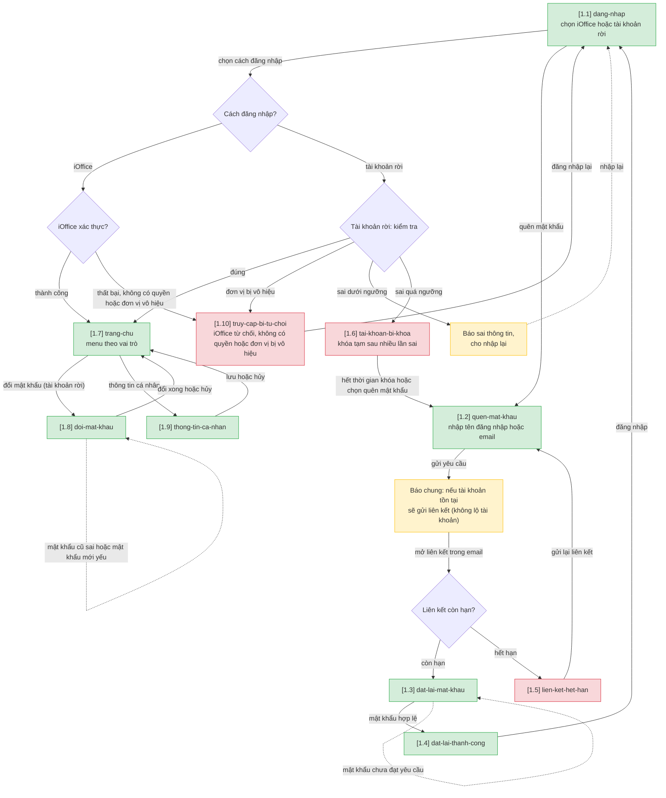
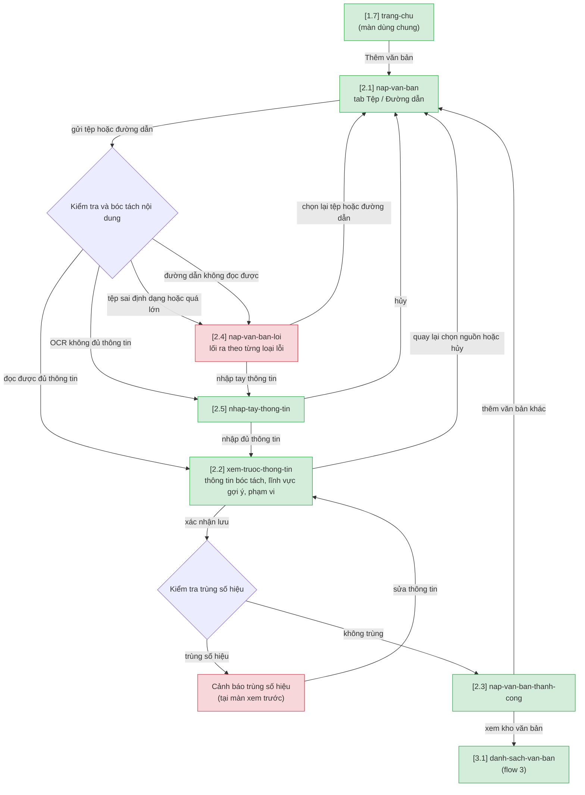
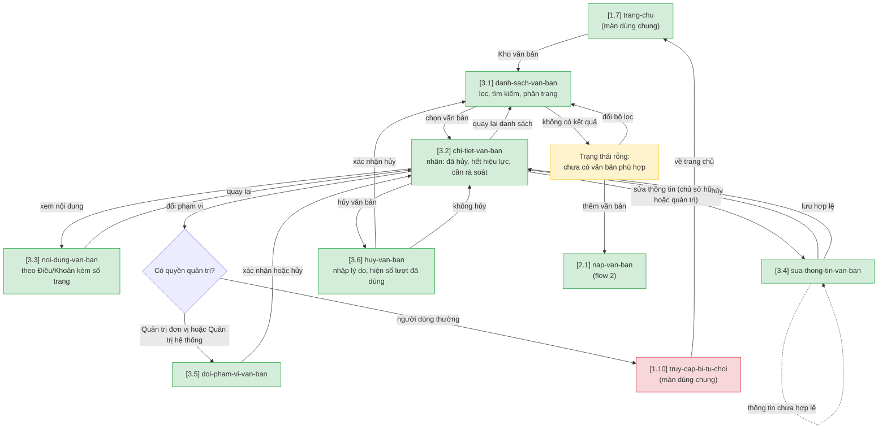
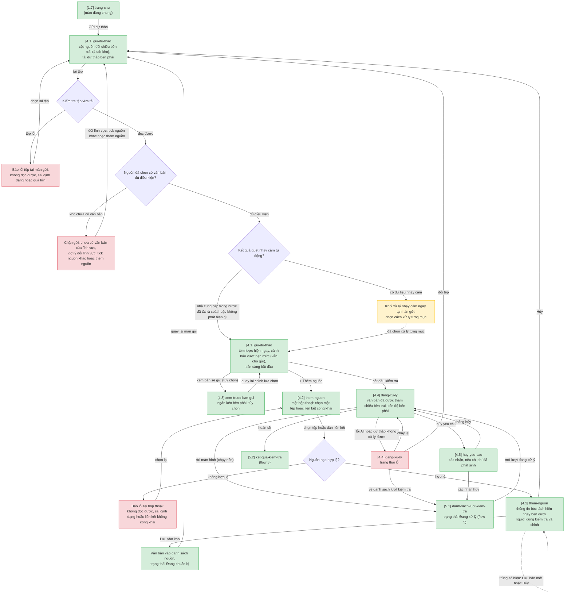
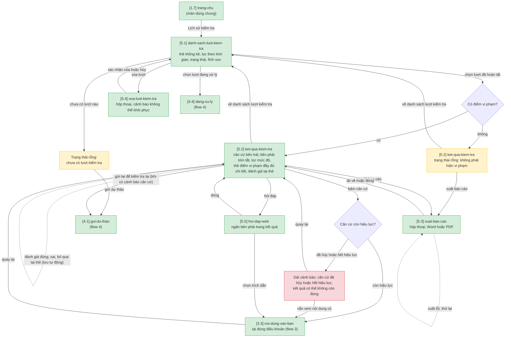
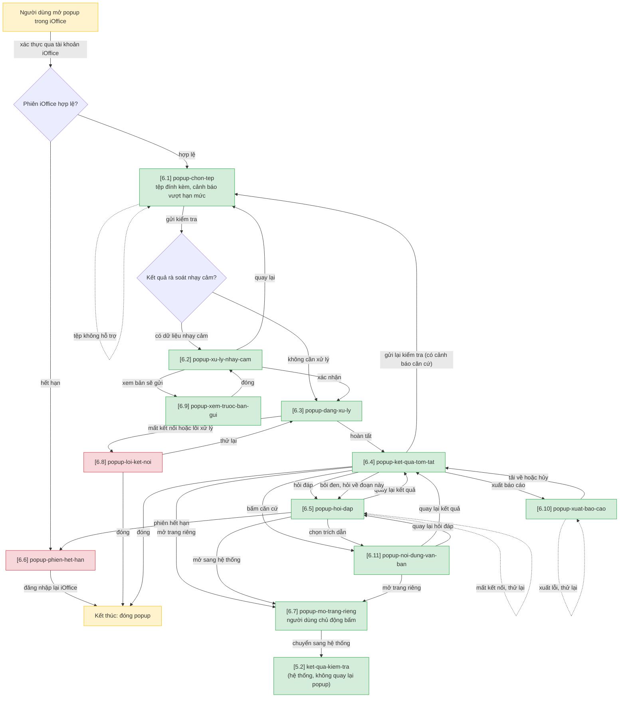
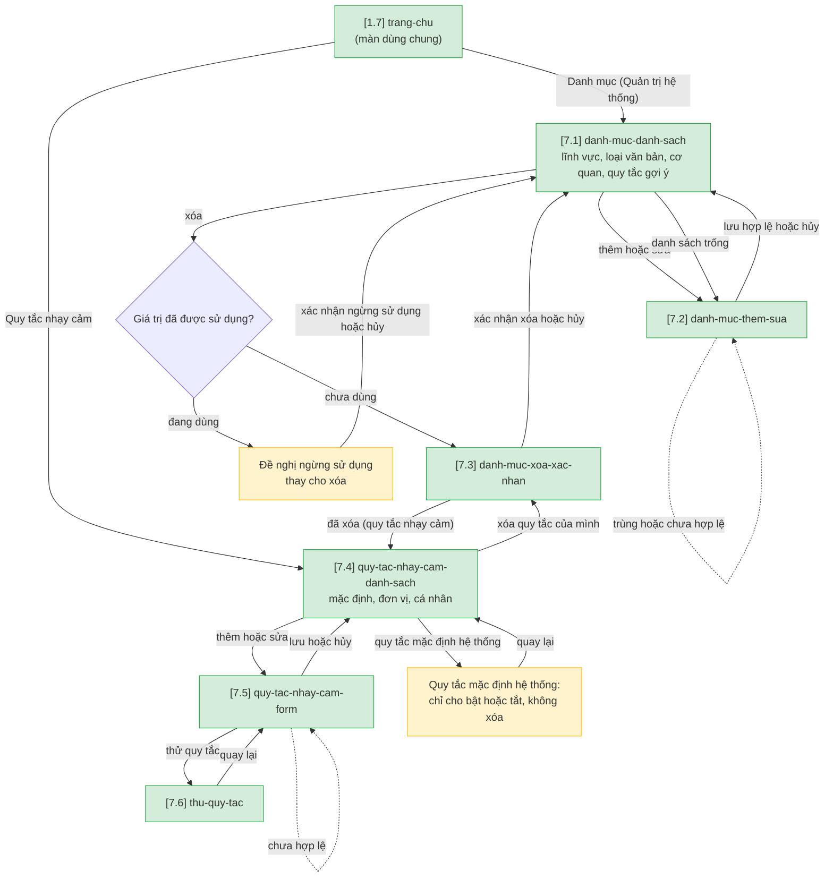
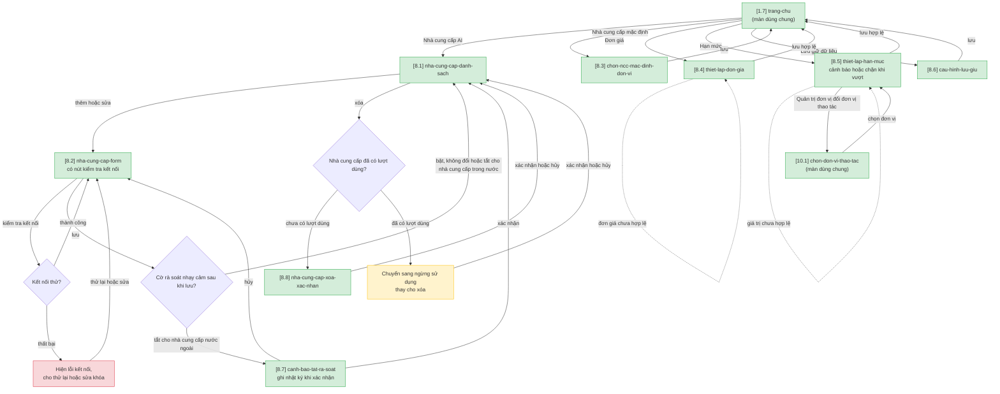
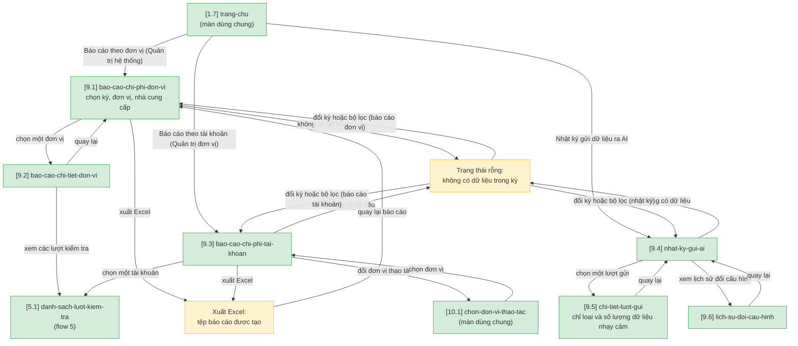
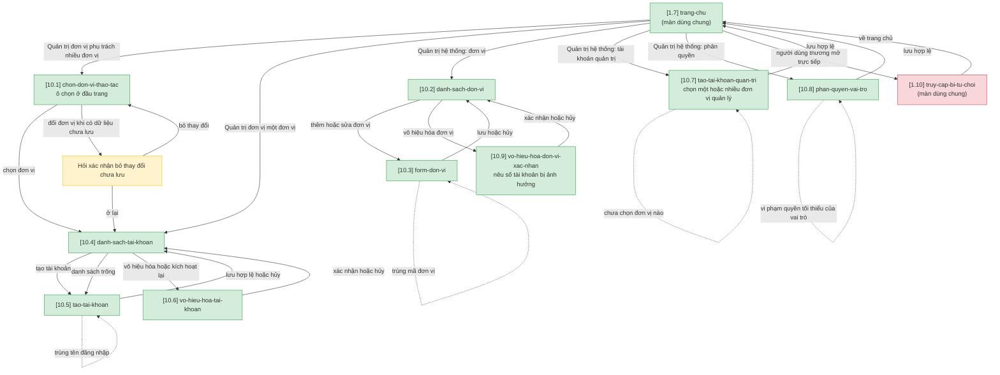

# Kiểm tra pháp lý văn bản dự thảo — User Flow

> Nguồn chia flow DUY NHẤT cho feature này. `/wireframe-ascii` và `/wireframe-html` đọc file này để biết flow nào gồm những màn nào — KHÔNG tự chia flow riêng.

## 1. User Flow (tổng)

> Phủ happy / error / edge cases. `[x.y]` = số màn hình (x = số flow, y = thứ tự màn), đối chiếu Mục 2.

### Flow 1: dang-nhap-tai-khoan-flow

### Flow 2: nap-van-ban-flow

### Flow 3: kho-van-ban-flow

### Flow 4: kiem-tra-phap-ly-flow

### Flow 5: ket-qua-kiem-tra-flow

### Flow 6: popup-ioffice-flow

### Flow 7: danh-muc-flow

### Flow 8: cau-hinh-ai-chi-phi-flow

### Flow 9: bao-cao-flow

### Flow 10: quan-tri-nguoi-dung-flow

## 2. Danh sách màn hình

> Cột `Slug` = định danh máy-đọc DUY NHẤT của màn. `[#]` dùng để đối chiếu Mục 1 và Mục 3.5. Màn "dùng chung" xuất hiện ở nhiều flow nhưng chỉ vẽ wireframe một lần.

| [#] | Slug | Màn hình | Mục đích | Thuộc flow |
|-----|------|----------|----------|------------|
| 1.1 | dang-nhap | Đăng nhập | Chọn đăng nhập bằng iOffice hoặc tài khoản rời | dang-nhap-tai-khoan-flow |
| 1.2 | quen-mat-khau | Quên mật khẩu | Nhập tên đăng nhập hoặc email để nhận liên kết đặt lại | dang-nhap-tai-khoan-flow |
| 1.3 | dat-lai-mat-khau | Đặt lại mật khẩu | Nhập mật khẩu mới từ liên kết | dang-nhap-tai-khoan-flow |
| 1.4 | dat-lai-thanh-cong | Đặt lại thành công | Báo kết quả, dẫn về đăng nhập | dang-nhap-tai-khoan-flow |
| 1.5 | lien-ket-het-han | Liên kết hết hạn | Báo liên kết không còn hiệu lực, cho gửi lại | dang-nhap-tai-khoan-flow |
| 1.6 | tai-khoan-bi-khoa | Tài khoản bị khóa tạm | Báo khóa tạm sau nhiều lần sai, nêu lối ra | dang-nhap-tai-khoan-flow |
| 1.7 | trang-chu | Trang chủ | Điểm vào chung: menu theo vai trò, thông báo trong ứng dụng, lối tắt (màn dùng chung) | dang-nhap-tai-khoan-flow (dùng chung) |
| 1.8 | doi-mat-khau | Đổi mật khẩu | Đổi mật khẩu tài khoản rời | dang-nhap-tai-khoan-flow |
| 1.9 | thong-tin-ca-nhan | Thông tin cá nhân | Xem và sửa thông tin cá nhân | dang-nhap-tai-khoan-flow |
| 1.10 | truy-cap-bi-tu-choi | Truy cập bị từ chối | iOffice từ chối, không có quyền hoặc đơn vị vô hiệu (màn dùng chung) | dang-nhap-tai-khoan-flow (dùng chung) |
| 2.1 | nap-van-ban | Nạp văn bản | Chọn nạp từ tệp hoặc từ đường dẫn | nap-van-ban-flow |
| 2.2 | xem-truoc-thong-tin | Xem trước thông tin bóc tách | Kiểm tra, sửa số hiệu, loại, cơ quan, ngày, lĩnh vực, phạm vi trước khi lưu | nap-van-ban-flow |
| 2.3 | nap-van-ban-thanh-cong | Nạp văn bản thành công | Báo kết quả, cho thêm văn bản khác hoặc xem kho | nap-van-ban-flow |
| 2.4 | nap-van-ban-loi | Nạp văn bản lỗi | Báo lỗi theo loại, nêu lối ra riêng cho từng loại | nap-van-ban-flow |
| 2.5 | nhap-tay-thong-tin | Nhập tay thông tin văn bản | Nhập thông tin khi bóc tách tự động không đủ | nap-van-ban-flow |
| 3.1 | danh-sach-van-ban | Danh sách văn bản pháp lý | Lọc, tìm kiếm, xem văn bản trong phạm vi được quyền | kho-van-ban-flow |
| 3.2 | chi-tiet-van-ban | Chi tiết văn bản | Thông tin, hiệu lực, văn bản liên quan, nhãn trạng thái | kho-van-ban-flow |
| 3.3 | noi-dung-van-ban | Nội dung văn bản | Xem theo Chương, Điều, Khoản kèm số trang (màn dùng chung flow 3 và 5) | kho-van-ban-flow (dùng chung) |
| 3.4 | sua-thong-tin-van-ban | Sửa thông tin văn bản | Sửa thông tin, lĩnh vực, hiệu lực, quan hệ giữa văn bản | kho-van-ban-flow |
| 3.5 | doi-pham-vi-van-ban | Đổi phạm vi sử dụng | Chọn phạm vi mới, chỉ hai vai trò quản trị | kho-van-ban-flow |
| 3.6 | huy-van-ban | Hủy văn bản | Nhập lý do, xác nhận hủy khỏi kho | kho-van-ban-flow |
| 4.1 | gui-du-thao | Gửi dự thảo | Không gian gửi kiểm tra: cột nguồn đối chiếu bên trái (tab Tất cả, Kho cá nhân, Kho đơn vị, Kho dùng chung; tick từng văn bản), tải dự thảo, tóm lược, xử lý nhạy cảm và bắt đầu kiểm tra cùng một màn | kiem-tra-phap-ly-flow |
| 4.2 | them-nguon | Thêm nguồn đối chiếu | Hộp thoại một màn: chọn một tệp hoặc liên kết công khai ở trên, thông tin bóc tách và phạm vi sử dụng theo vai trò hiện ngay bên dưới để kiểm tra, chỉnh rồi lưu vào kho | kiem-tra-phap-ly-flow |
| 4.3 | xem-truoc-ban-gui | Xem trước bản gửi | Ngăn kéo tùy chọn: xem nội dung đã che ẩn sẽ gửi | kiem-tra-phap-ly-flow |
| 4.4 | dang-xu-ly | Đang xử lý | Văn bản đã được tham chiếu (số đoạn, số điểm) bên trái; tiến độ, điểm vi phạm phát hiện dần, đoạn đang xét bên phải; trạng thái lỗi cho chạy lại hoặc đổi tệp | kiem-tra-phap-ly-flow |
| 4.5 | huy-yeu-cau | Hủy yêu cầu kiểm tra | Hộp thoại xác nhận hủy, nêu chi phí đã phát sinh | kiem-tra-phap-ly-flow |
| 5.1 | danh-sach-luot-kiem-tra | Danh sách lượt kiểm tra | Thẻ thống kê, lịch sử, trạng thái, số điểm vi phạm, chi phí | ket-qua-kiem-tra-flow |
| 5.2 | ket-qua-kiem-tra | Kết quả kiểm tra | Căn cứ bên trái có số điểm vi phạm; bên phải tóm tắt, lọc mức độ, thẻ điểm vi phạm đủ vị trí, trích đoạn, căn cứ, giải thích, đề xuất, đánh giá | ket-qua-kiem-tra-flow |
| 5.3 | xuat-bao-cao | Xuất báo cáo | Hộp thoại chọn Word hoặc PDF và tải về | ket-qua-kiem-tra-flow |
| 5.4 | xoa-luot-kiem-tra | Xóa lượt kiểm tra | Hộp thoại cảnh báo không khôi phục, xác nhận xóa | ket-qua-kiem-tra-flow |
| 5.5 | hoi-dap-web | Hỏi đáp trong trang kết quả | Ngăn bên phải: hỏi AI về kết quả, lĩnh vực hoặc văn bản trong kho, có thể đính kèm thêm tệp lúc hỏi, có trích dẫn; mở được kèm đoạn bôi đen từ màn kết quả | ket-qua-kiem-tra-flow |
| 6.1 | popup-chon-tep | Popup: chọn tệp | Chọn tệp đính kèm iOffice; tên lượt, tóm lược, lĩnh vực, ngày xét hiệu lực, kho đối chiếu kèm số văn bản nguồn, cảnh báo hạn mức | popup-ioffice-flow |
| 6.2 | popup-xu-ly-nhay-cam | Popup: xử lý nhạy cảm | Xử lý dữ liệu nhạy cảm trong khung nhỏ, nêu nhà cung cấp nhận dữ liệu, cho xem bản sẽ gửi | popup-ioffice-flow |
| 6.3 | popup-dang-xu-ly | Popup: đang xử lý | Tiến độ, văn bản đã được tham chiếu (số đoạn, số điểm), điểm vi phạm phát hiện dần, đoạn đang đối chiếu | popup-ioffice-flow |
| 6.4 | popup-ket-qua-tom-tat | Popup: kết quả kiểm tra (đầy đủ) | Đủ như màn kết quả web: thông tin lượt, tóm tắt, lọc mức độ, căn cứ đã dùng, thẻ điểm vi phạm, đánh giá, bôi đen hỏi sâu, xuất báo cáo, hỏi đáp | popup-ioffice-flow |
| 6.5 | popup-hoi-dap | Popup: hỏi đáp | Đủ như hỏi đáp web: chọn ngữ cảnh, xóa hội thoại, đính kèm tệp, trích dẫn mở trong popup, hỏi theo đoạn bôi đen | popup-ioffice-flow |
| 6.6 | popup-phien-het-han | Popup: phiên hết hạn | Báo phiên iOffice hết hạn, hướng dẫn đăng nhập lại | popup-ioffice-flow |
| 6.7 | popup-mo-trang-rieng | Popup: mở trang riêng | Người dùng chủ động chuyển sang hệ thống kiểm tra pháp lý | popup-ioffice-flow |
| 6.8 | popup-loi-ket-noi | Popup: lỗi kết nối | Báo mất kết nối hoặc lỗi xử lý, cho thử lại | popup-ioffice-flow |
| 6.9 | popup-xem-truoc-ban-gui | Popup: xem trước bản gửi | Xem nội dung đã che ẩn sẽ gửi ra AI, duyệt từng mục nhạy cảm | popup-ioffice-flow |
| 6.10 | popup-xuat-bao-cao | Popup: xuất báo cáo | Chọn Word hoặc PDF, mức độ, kèm đề xuất rồi tải về | popup-ioffice-flow |
| 6.11 | popup-noi-dung-van-ban | Popup: nội dung văn bản | Xem điều khoản được trích dẫn ngay trong popup | popup-ioffice-flow |
| 7.1 | danh-muc-danh-sach | Danh mục | Xem danh sách lĩnh vực, loại văn bản, cơ quan, quy tắc gợi ý | danh-muc-flow |
| 7.2 | danh-muc-them-sua | Thêm hoặc sửa giá trị danh mục | Nhập giá trị, kiểm tra trùng | danh-muc-flow |
| 7.3 | danh-muc-xoa-xac-nhan | Xác nhận xóa | Xác nhận xóa (dùng chung cho danh mục và quy tắc nhạy cảm) | danh-muc-flow |
| 7.4 | quy-tac-nhay-cam-danh-sach | Quy tắc dữ liệu nhạy cảm | Xem quy tắc mặc định, của đơn vị, của cá nhân | danh-muc-flow |
| 7.5 | quy-tac-nhay-cam-form | Thêm hoặc sửa quy tắc nhạy cảm | Nhập tên loại, từ khóa hoặc mẫu, cách xử lý mặc định | danh-muc-flow |
| 7.6 | thu-quy-tac | Thử quy tắc | Thử quy tắc trên đoạn văn bản mẫu | danh-muc-flow |
| 8.1 | nha-cung-cap-danh-sach | Nhà cung cấp AI | Xem nhà cung cấp, loại, model, trạng thái | cau-hinh-ai-chi-phi-flow |
| 8.2 | nha-cung-cap-form | Thêm hoặc sửa nhà cung cấp AI | Nhập thông tin, khóa, cờ rà soát; kiểm tra kết nối | cau-hinh-ai-chi-phi-flow |
| 8.3 | chon-ncc-mac-dinh-don-vi | Chọn nhà cung cấp mặc định cho đơn vị | Gán nhà cung cấp mặc định, nêu chế độ rà soát áp dụng | cau-hinh-ai-chi-phi-flow |
| 8.4 | thiet-lap-don-gia | Thiết lập đơn giá | Nhập đơn giá token vào, ra và ngày hiệu lực | cau-hinh-ai-chi-phi-flow |
| 8.5 | thiet-lap-han-muc | Thiết lập hạn mức | Đặt ngân sách, số lượt, cách xử lý khi vượt | cau-hinh-ai-chi-phi-flow |
| 8.6 | cau-hinh-luu-giu | Cấu hình lưu giữ dữ liệu | Đặt thời hạn lưu dữ liệu dự thảo | cau-hinh-ai-chi-phi-flow |
| 8.7 | canh-bao-tat-ra-soat | Cảnh báo tắt rà soát nhạy cảm | Xác nhận khi tắt rà soát với nhà cung cấp nước ngoài, ghi nhật ký | cau-hinh-ai-chi-phi-flow |
| 8.8 | nha-cung-cap-xoa-xac-nhan | Xác nhận xóa nhà cung cấp | Xác nhận xóa nhà cung cấp chưa có lượt dùng | cau-hinh-ai-chi-phi-flow |
| 9.1 | bao-cao-chi-phi-don-vi | Báo cáo chi phí theo đơn vị | Lượt, token, chi phí, phần trăm hạn mức theo đơn vị | bao-cao-flow |
| 9.2 | bao-cao-chi-tiet-don-vi | Báo cáo chi tiết đơn vị | Các lượt kiểm tra của một đơn vị | bao-cao-flow |
| 9.3 | bao-cao-chi-phi-tai-khoan | Báo cáo chi phí theo tài khoản | Lượt, chi phí theo tài khoản trong đơn vị | bao-cao-flow |
| 9.4 | nhat-ky-gui-ai | Nhật ký gửi dữ liệu ra AI | Danh sách lượt gửi và trạng thái rà soát nhạy cảm | bao-cao-flow |
| 9.5 | chi-tiet-luot-gui | Chi tiết lượt gửi | Loại và số lượng dữ liệu nhạy cảm, cách xử lý (không hiện giá trị gốc) | bao-cao-flow |
| 9.6 | lich-su-doi-cau-hinh | Lịch sử đổi cấu hình rà soát | Người đổi, thời điểm, giá trị trước và sau | bao-cao-flow |
| 10.1 | chon-don-vi-thao-tac | Chọn đơn vị thao tác | Ô chọn đơn vị cho Quản trị đơn vị nhiều đơn vị (màn dùng chung) | quan-tri-nguoi-dung-flow (dùng chung) |
| 10.2 | danh-sach-don-vi | Danh sách đơn vị | Xem đơn vị, trạng thái, số người dùng | quan-tri-nguoi-dung-flow |
| 10.3 | form-don-vi | Thêm hoặc sửa đơn vị | Nhập thông tin đơn vị, kiểm tra trùng mã | quan-tri-nguoi-dung-flow |
| 10.4 | danh-sach-tai-khoan | Danh sách tài khoản | Tài khoản trong các đơn vị được phân công | quan-tri-nguoi-dung-flow |
| 10.5 | tao-tai-khoan | Tạo tài khoản | Tạo tài khoản rời cho người dùng | quan-tri-nguoi-dung-flow |
| 10.6 | vo-hieu-hoa-tai-khoan | Vô hiệu hóa tài khoản | Xác nhận vô hiệu hóa hoặc kích hoạt lại | quan-tri-nguoi-dung-flow |
| 10.7 | tao-tai-khoan-quan-tri | Tạo tài khoản quản trị | Tạo tài khoản quản trị và gán một hoặc nhiều đơn vị | quan-tri-nguoi-dung-flow |
| 10.8 | phan-quyen-vai-tro | Phân quyền theo vai trò | Ma trận quyền theo chức năng | quan-tri-nguoi-dung-flow |
| 10.9 | vo-hieu-hoa-don-vi-xac-nhan | Xác nhận vô hiệu hóa đơn vị | Nêu số tài khoản bị ảnh hưởng, xác nhận | quan-tri-nguoi-dung-flow |

## 3. Danh sách flow

| Flow-slug | Tên flow | Màn hình gồm | Cases phủ |
|-----------|----------|--------------|-----------|
| dang-nhap-tai-khoan-flow | Đăng nhập và tài khoản cá nhân | dang-nhap, quen-mat-khau, dat-lai-mat-khau, dat-lai-thanh-cong, lien-ket-het-han, tai-khoan-bi-khoa, trang-chu, doi-mat-khau, thong-tin-ca-nhan, truy-cap-bi-tu-choi | happy (đăng nhập), error (sai nhiều lần, iOffice từ chối), edge (đơn vị vô hiệu, liên kết hết hạn, không lộ tài khoản) |
| nap-van-ban-flow | Nạp văn bản vào kho | nap-van-ban, xem-truoc-thong-tin, nap-van-ban-thanh-cong, nap-van-ban-loi, nhap-tay-thong-tin | happy (tệp, link), error (sai định dạng, link không đọc được), edge (OCR thiếu thông tin, trùng số hiệu) |
| kho-van-ban-flow | Quản lý kho văn bản | danh-sach-van-ban, chi-tiet-van-ban, noi-dung-van-ban, sua-thong-tin-van-ban, doi-pham-vi-van-ban, huy-van-ban | happy (xem, sửa, hủy), error (dữ liệu chưa hợp lệ), edge (văn bản đã hủy, hết hiệu lực, cần rà soát, danh sách rỗng, người dùng thường đổi phạm vi) |
| kiem-tra-phap-ly-flow | Gửi dự thảo kiểm tra pháp lý | gui-du-thao, them-nguon, xem-truoc-ban-gui, dang-xu-ly, huy-yeu-cau | happy (gửi, theo dõi), error (tệp lỗi, AI lỗi, nguồn nạp không hợp lệ), edge (kho thiếu văn bản, vượt hạn mức vẫn gửi, bỏ qua khối nhạy cảm, thêm nguồn, trùng số hiệu, hủy, rời màn hình) |
| ket-qua-kiem-tra-flow | Xem và xử lý kết quả kiểm tra | danh-sach-luot-kiem-tra, ket-qua-kiem-tra, xuat-bao-cao, xoa-luot-kiem-tra, hoi-dap-web | happy (xem kết quả, đánh giá, xuất, hỏi đáp), error (xuất lỗi), edge (không có vi phạm, căn cứ hết hiệu lực, danh sách rỗng, xóa lượt) |
| popup-ioffice-flow | Popup nhúng trong iOffice (khung nhỏ) | popup-chon-tep, popup-xu-ly-nhay-cam, popup-dang-xu-ly, popup-ket-qua-tom-tat, popup-hoi-dap, popup-phien-het-han, popup-mo-trang-rieng, popup-loi-ket-noi, popup-xem-truoc-ban-gui, popup-xuat-bao-cao, popup-noi-dung-van-ban | happy (chọn tệp, kết quả, hỏi đáp), error (mất kết nối), edge (phiên hết hạn, tệp không hỗ trợ, mở trang riêng) |
| danh-muc-flow | Danh mục và quy tắc dữ liệu nhạy cảm | danh-muc-danh-sach, danh-muc-them-sua, danh-muc-xoa-xac-nhan, quy-tac-nhay-cam-danh-sach, quy-tac-nhay-cam-form, thu-quy-tac | happy (thêm, sửa, xóa danh mục, quy tắc nhạy cảm), error (trùng, không hợp lệ), edge (xóa giá trị đang dùng, quy tắc mặc định hệ thống) |
| cau-hinh-ai-chi-phi-flow | Cấu hình AI, đơn giá, hạn mức | nha-cung-cap-danh-sach, nha-cung-cap-form, chon-ncc-mac-dinh-don-vi, thiet-lap-don-gia, thiet-lap-han-muc, cau-hinh-luu-giu, canh-bao-tat-ra-soat, nha-cung-cap-xoa-xac-nhan | happy (cấu hình nhà cung cấp, đơn giá, hạn mức, lưu giữ), error (kết nối thất bại), edge (tắt rà soát nhà cung cấp nước ngoài, xóa nhà cung cấp đã dùng) |
| bao-cao-flow | Báo cáo và nhật ký | bao-cao-chi-phi-don-vi, bao-cao-chi-tiet-don-vi, bao-cao-chi-phi-tai-khoan, nhat-ky-gui-ai, chi-tiet-luot-gui, lich-su-doi-cau-hinh | happy (báo cáo, nhật ký, chi tiết), error (không áp dụng), edge (không có dữ liệu trong kỳ, đổi đơn vị thao tác) |
| quan-tri-nguoi-dung-flow | Quản trị đơn vị, tài khoản, phân quyền | chon-don-vi-thao-tac, danh-sach-don-vi, form-don-vi, danh-sach-tai-khoan, tao-tai-khoan, vo-hieu-hoa-tai-khoan, tao-tai-khoan-quan-tri, phan-quyen-vai-tro, vo-hieu-hoa-don-vi-xac-nhan | happy (đơn vị, tài khoản, phân quyền), error (trùng tên đăng nhập, trùng mã đơn vị, thiếu quyền tối thiểu), edge (vô hiệu hóa đơn vị, đổi đơn vị khi chưa lưu, người dùng thường mở trực tiếp) |

### 3.1 Vai trò theo flow

| Flow | Người dùng | Quản trị đơn vị | Quản trị hệ thống |
|------|:---:|:---:|:---:|
| 1 dang-nhap-tai-khoan-flow | có | có | có |
| 2 nap-van-ban-flow | có (phạm vi cá nhân) | có (cá nhân, đơn vị) | có (mọi phạm vi) |
| 3 kho-van-ban-flow | có (xem, sửa, hủy văn bản của mình; không đổi phạm vi) | có (thêm đổi phạm vi trong đơn vị phụ trách) | có |
| 4 kiem-tra-phap-ly-flow | có | có | có |
| 5 ket-qua-kiem-tra-flow | có (lượt của mình) | có | có |
| 6 popup-ioffice-flow | có | có | không áp dụng |
| 7 danh-muc-flow | quy tắc nhạy cảm cá nhân | quy tắc nhạy cảm đơn vị | danh mục và quy tắc mặc định |
| 8 cau-hinh-ai-chi-phi-flow | không | hạn mức trong đơn vị | có |
| 9 bao-cao-flow | không | báo cáo tài khoản, nhật ký của đơn vị | báo cáo theo đơn vị, nhật ký toàn hệ thống |
| 10 quan-tri-nguoi-dung-flow | không | tài khoản trong đơn vị | đơn vị, tài khoản quản trị, phân quyền |

Truy cập chức năng ngoài quyền: hiển thị truy-cap-bi-tu-choi [1.10].

## 3.5. Chuyển màn (transitions)

> Nguồn DUY NHẤT cho chuyển màn màn→màn. Rút từ Mục 1; bước trung gian (điểm quyết định, trạng thái) gộp vào cột Điều kiện. Các màn quản trị của flow 7 đến 10 (danh mục, quy tắc nhạy cảm, cấu hình AI, báo cáo, quản trị người dùng) cùng có menu bên trái để chuyển qua lại trong cùng nhóm; các cạnh menu này không liệt kê từng dòng.

| Từ màn [#] | Đến màn [#] | Trigger | Điều kiện |
|-----------|------------|---------|-----------|
| dang-nhap [1.1] | tai-khoan-bi-khoa [1.6] | chọn cách đăng nhập | Cách đăng nhập?: tài khoản rời → Tài khoản rời: kiểm tra: sai quá ngưỡng |
| dang-nhap [1.1] | dang-nhap [1.1] | chọn cách đăng nhập | Cách đăng nhập?: tài khoản rời → Tài khoản rời: kiểm tra: sai dưới ngưỡng → nhập lại |
| dang-nhap [1.1] | truy-cap-bi-tu-choi [1.10] | chọn cách đăng nhập | Cách đăng nhập?: tài khoản rời → Tài khoản rời: kiểm tra: đơn vị bị vô hiệu |
| dang-nhap [1.1] | trang-chu [1.7] | chọn cách đăng nhập | Cách đăng nhập?: tài khoản rời → Tài khoản rời: kiểm tra: đúng |
| dang-nhap [1.1] | truy-cap-bi-tu-choi [1.10] | chọn cách đăng nhập | Cách đăng nhập?: iOffice → iOffice xác thực?: thất bại, không có quyền hoặc đơn vị vô hiệu |
| dang-nhap [1.1] | trang-chu [1.7] | chọn cách đăng nhập | Cách đăng nhập?: iOffice → iOffice xác thực?: thành công |
| dang-nhap [1.1] | quen-mat-khau [1.2] | quên mật khẩu | — |
| trang-chu [1.7] | doi-mat-khau [1.8] | đổi mật khẩu (tài khoản rời) | — |
| trang-chu [1.7] | thong-tin-ca-nhan [1.9] | thông tin cá nhân | — |
| truy-cap-bi-tu-choi [1.10] | dang-nhap [1.1] | đăng nhập lại | — |
| tai-khoan-bi-khoa [1.6] | quen-mat-khau [1.2] | hết thời gian khóa hoặc chọn quên mật khẩu | — |
| quen-mat-khau [1.2] | lien-ket-het-han [1.5] | gửi yêu cầu | mở liên kết trong email → Liên kết còn hạn?: hết hạn |
| quen-mat-khau [1.2] | dat-lai-mat-khau [1.3] | gửi yêu cầu | mở liên kết trong email → Liên kết còn hạn?: còn hạn |
| lien-ket-het-han [1.5] | quen-mat-khau [1.2] | gửi lại liên kết | — |
| dat-lai-mat-khau [1.3] | dat-lai-thanh-cong [1.4] | mật khẩu hợp lệ | — |
| dat-lai-mat-khau [1.3] | dat-lai-mat-khau [1.3] | mật khẩu chưa đạt yêu cầu | — |
| dat-lai-thanh-cong [1.4] | dang-nhap [1.1] | đăng nhập | — |
| doi-mat-khau [1.8] | trang-chu [1.7] | đổi xong hoặc hủy | — |
| doi-mat-khau [1.8] | doi-mat-khau [1.8] | mật khẩu cũ sai hoặc mật khẩu mới yếu | — |
| thong-tin-ca-nhan [1.9] | trang-chu [1.7] | lưu hoặc hủy | — |
| trang-chu [1.7] | nap-van-ban [2.1] | Thêm văn bản | — |
| nap-van-ban [2.1] | nap-van-ban-loi [2.4] | gửi tệp hoặc đường dẫn | Kiểm tra và bóc tách nội dung: đường dẫn không đọc được |
| nap-van-ban [2.1] | nap-van-ban-loi [2.4] | gửi tệp hoặc đường dẫn | Kiểm tra và bóc tách nội dung: tệp sai định dạng hoặc quá lớn |
| nap-van-ban [2.1] | nhap-tay-thong-tin [2.5] | gửi tệp hoặc đường dẫn | Kiểm tra và bóc tách nội dung: OCR không đủ thông tin |
| nap-van-ban [2.1] | xem-truoc-thong-tin [2.2] | gửi tệp hoặc đường dẫn | Kiểm tra và bóc tách nội dung: đọc được đủ thông tin |
| xem-truoc-thong-tin [2.2] | xem-truoc-thong-tin [2.2] | xác nhận lưu | Kiểm tra trùng số hiệu: trùng số hiệu → sửa thông tin |
| xem-truoc-thong-tin [2.2] | nap-van-ban-thanh-cong [2.3] | xác nhận lưu | Kiểm tra trùng số hiệu: không trùng |
| xem-truoc-thong-tin [2.2] | nap-van-ban [2.1] | quay lại chọn nguồn hoặc hủy | — |
| nhap-tay-thong-tin [2.5] | xem-truoc-thong-tin [2.2] | nhập đủ thông tin | — |
| nhap-tay-thong-tin [2.5] | nap-van-ban [2.1] | hủy | — |
| nap-van-ban-loi [2.4] | nap-van-ban [2.1] | chọn lại tệp hoặc đường dẫn | — |
| nap-van-ban-loi [2.4] | nhap-tay-thong-tin [2.5] | nhập tay thông tin | — |
| nap-van-ban-thanh-cong [2.3] | nap-van-ban [2.1] | thêm văn bản khác | — |
| nap-van-ban-thanh-cong [2.3] | danh-sach-van-ban [3.1] | xem kho văn bản | — |
| trang-chu [1.7] | danh-sach-van-ban [3.1] | Kho văn bản | — |
| danh-sach-van-ban [3.1] | chi-tiet-van-ban [3.2] | chọn văn bản | — |
| danh-sach-van-ban [3.1] | nap-van-ban [2.1] | không có kết quả | thêm văn bản |
| danh-sach-van-ban [3.1] | danh-sach-van-ban [3.1] | không có kết quả | đổi bộ lọc |
| chi-tiet-van-ban [3.2] | noi-dung-van-ban [3.3] | xem nội dung | — |
| chi-tiet-van-ban [3.2] | sua-thong-tin-van-ban [3.4] | sửa thông tin (chủ sở hữu hoặc quản trị) | — |
| chi-tiet-van-ban [3.2] | truy-cap-bi-tu-choi [1.10] | đổi phạm vi | Có quyền quản trị?: người dùng thường |
| chi-tiet-van-ban [3.2] | doi-pham-vi-van-ban [3.5] | đổi phạm vi | Có quyền quản trị?: Quản trị đơn vị hoặc Quản trị hệ thống |
| chi-tiet-van-ban [3.2] | huy-van-ban [3.6] | hủy văn bản | — |
| chi-tiet-van-ban [3.2] | danh-sach-van-ban [3.1] | quay lại danh sách | — |
| noi-dung-van-ban [3.3] | chi-tiet-van-ban [3.2] | quay lại | — |
| sua-thong-tin-van-ban [3.4] | chi-tiet-van-ban [3.2] | lưu hợp lệ | — |
| sua-thong-tin-van-ban [3.4] | sua-thong-tin-van-ban [3.4] | thông tin chưa hợp lệ | — |
| sua-thong-tin-van-ban [3.4] | chi-tiet-van-ban [3.2] | hủy | — |
| doi-pham-vi-van-ban [3.5] | chi-tiet-van-ban [3.2] | xác nhận hoặc hủy | — |
| truy-cap-bi-tu-choi [1.10] | trang-chu [1.7] | về trang chủ | — |
| huy-van-ban [3.6] | danh-sach-van-ban [3.1] | xác nhận hủy | — |
| huy-van-ban [3.6] | chi-tiet-van-ban [3.2] | không hủy | — |
| trang-chu [1.7] | gui-du-thao [4.1] | Gửi dự thảo | — |
| gui-du-thao [4.1] | gui-du-thao [4.1] | tải tệp | Kiểm tra tệp vừa tải: tệp lỗi → chọn lại tệp |
| gui-du-thao [4.1] | gui-du-thao [4.1] | tải tệp | Kiểm tra nguồn: kho chưa có văn bản → đổi lĩnh vực, tick nguồn khác hoặc thêm nguồn |
| gui-du-thao [4.1] | gui-du-thao [4.1] | tải tệp | Kết quả quét nhạy cảm tự động?: có dữ liệu nhạy cảm → xử lý từng mục tại khối nhạy cảm của màn |
| gui-du-thao [4.1] | gui-du-thao [4.1] | tải tệp | Kết quả quét nhạy cảm tự động?: nhà cung cấp trong nước đã tắt rà soát hoặc không phát hiện gì → tóm lược sẵn sàng |
| gui-du-thao [4.1] | them-nguon [4.2] | + Thêm nguồn | — |
| them-nguon [4.2] | them-nguon [4.2] | chọn tệp hoặc dán liên kết | Nguồn nạp hợp lệ?: hợp lệ → thông tin bóc tách hiện ngay bên dưới |
| them-nguon [4.2] | them-nguon [4.2] | chọn tệp hoặc dán liên kết | Nguồn nạp hợp lệ?: không hợp lệ → báo lỗi, chọn lại |
| them-nguon [4.2] | gui-du-thao [4.1] | Lưu vào kho | Văn bản vào danh sách nguồn, trạng thái Đang chuẩn bị |
| them-nguon [4.2] | gui-du-thao [4.1] | Hủy | — |
| gui-du-thao [4.1] | xem-truoc-ban-gui [4.3] | xem bản sẽ gửi | Tùy chọn |
| xem-truoc-ban-gui [4.3] | gui-du-thao [4.1] | quay lại chỉnh lựa chọn | — |
| gui-du-thao [4.1] | dang-xu-ly [4.4] | bắt đầu kiểm tra | Đã chọn tệp, nguồn và mọi mục nhạy cảm đã có cách xử lý |
| dang-xu-ly [4.4] | ket-qua-kiem-tra [5.2] | hoàn tất | — |
| dang-xu-ly [4.4] | dang-xu-ly [4.4] | lỗi AI hoặc dự thảo không xử lý được | Hiện trạng thái lỗi trên cùng màn |
| dang-xu-ly [4.4] | huy-yeu-cau [4.5] | hủy yêu cầu | — |
| dang-xu-ly [4.4] | danh-sach-luot-kiem-tra [5.1] | rời màn hình (chạy nền) | — |
| dang-xu-ly [4.4] | dang-xu-ly [4.4] | chạy lại | Từ trạng thái lỗi |
| dang-xu-ly [4.4] | gui-du-thao [4.1] | đổi tệp | Từ trạng thái lỗi |
| dang-xu-ly [4.4] | danh-sach-luot-kiem-tra [5.1] | về danh sách lượt kiểm tra | Từ trạng thái lỗi |
| huy-yeu-cau [4.5] | danh-sach-luot-kiem-tra [5.1] | xác nhận hủy | — |
| huy-yeu-cau [4.5] | dang-xu-ly [4.4] | không hủy | — |
| danh-sach-luot-kiem-tra [5.1] | dang-xu-ly [4.4] | chọn lượt đang xử lý | — |
| trang-chu [1.7] | danh-sach-luot-kiem-tra [5.1] | Lịch sử kiểm tra | — |
| danh-sach-luot-kiem-tra [5.1] | ket-qua-kiem-tra [5.2] | chọn lượt đã hoàn tất | Có điểm vi phạm?: có → thẻ điểm vi phạm đầy đủ |
| danh-sach-luot-kiem-tra [5.1] | ket-qua-kiem-tra [5.2] | chọn lượt đã hoàn tất | Có điểm vi phạm?: không → trạng thái rỗng, không phát hiện vi phạm |
| danh-sach-luot-kiem-tra [5.1] | gui-du-thao [4.1] | chưa có lượt nào | gửi dự thảo |
| danh-sach-luot-kiem-tra [5.1] | xoa-luot-kiem-tra [5.4] | xóa lượt | — |
| xoa-luot-kiem-tra [5.4] | danh-sach-luot-kiem-tra [5.1] | xác nhận xóa hoặc hủy | — |
| ket-qua-kiem-tra [5.2] | ket-qua-kiem-tra [5.2] | đánh giá đúng, sai, bỏ qua tại thẻ | Lưu tự động |
| ket-qua-kiem-tra [5.2] | noi-dung-van-ban [3.3] | bấm căn cứ | Căn cứ còn hiệu lực?: còn hiệu lực |
| ket-qua-kiem-tra [5.2] | noi-dung-van-ban [3.3] | bấm căn cứ | Căn cứ còn hiệu lực?: đã hủy hoặc hết hiệu lực → vẫn xem nội dung cũ kèm dải cảnh báo |
| noi-dung-van-ban [3.3] | ket-qua-kiem-tra [5.2] | quay lại | — |
| ket-qua-kiem-tra [5.2] | xuat-bao-cao [5.3] | xuất báo cáo | — |
| xuat-bao-cao [5.3] | ket-qua-kiem-tra [5.2] | tải về hoặc đóng | — |
| xuat-bao-cao [5.3] | xuat-bao-cao [5.3] | xuất lỗi, thử lại | — |
| ket-qua-kiem-tra [5.2] | hoi-dap-web [5.5] | hỏi đáp | — |
| ket-qua-kiem-tra [5.2] | hoi-dap-web [5.5] | bôi đen đoạn rồi chọn Hỏi về đoạn này | Đoạn từ 5 đến 2000 ký tự; ngữ cảnh Lượt kiểm tra, kèm trích dẫn đoạn. Vượt 2000 ký tự → ở lại màn kết quả, báo lỗi |
| hoi-dap-web [5.5] | noi-dung-van-ban [3.3] | chọn trích dẫn | — |
| hoi-dap-web [5.5] | ket-qua-kiem-tra [5.2] | đóng | — |
| ket-qua-kiem-tra [5.2] | gui-du-thao [4.1] | gửi lại để kiểm tra lại | Chỉ khi có cảnh báo căn cứ |
| ket-qua-kiem-tra [5.2] | danh-sach-luot-kiem-tra [5.1] | về danh sách lượt kiểm tra | — |
| (điểm vào) Người dùng mở popup trong iOffice | popup-phien-het-han [6.6] | xác thực qua tài khoản iOffice | Phiên iOffice hợp lệ?: hết hạn |
| (điểm vào) Người dùng mở popup trong iOffice | popup-chon-tep [6.1] | xác thực qua tài khoản iOffice | Phiên iOffice hợp lệ?: hợp lệ |
| popup-chon-tep [6.1] | popup-xu-ly-nhay-cam [6.2] | gửi kiểm tra | Kết quả rà soát nhạy cảm?: có dữ liệu nhạy cảm |
| popup-chon-tep [6.1] | popup-dang-xu-ly [6.3] | gửi kiểm tra | Kết quả rà soát nhạy cảm?: không cần xử lý |
| popup-chon-tep [6.1] | popup-chon-tep [6.1] | tệp không hỗ trợ | — |
| popup-xu-ly-nhay-cam [6.2] | popup-dang-xu-ly [6.3] | xác nhận | — |
| popup-xu-ly-nhay-cam [6.2] | popup-chon-tep [6.1] | quay lại | — |
| popup-xu-ly-nhay-cam [6.2] | popup-xem-truoc-ban-gui [6.9] | xem bản sẽ gửi | — |
| popup-xem-truoc-ban-gui [6.9] | popup-xu-ly-nhay-cam [6.2] | đóng | — |
| popup-dang-xu-ly [6.3] | popup-ket-qua-tom-tat [6.4] | hoàn tất | — |
| popup-dang-xu-ly [6.3] | popup-loi-ket-noi [6.8] | mất kết nối hoặc lỗi xử lý | — |
| popup-loi-ket-noi [6.8] | popup-dang-xu-ly [6.3] | thử lại | — |
| popup-ket-qua-tom-tat [6.4] | popup-hoi-dap [6.5] | hỏi đáp | — |
| popup-ket-qua-tom-tat [6.4] | popup-hoi-dap [6.5] | bôi đen, hỏi về đoạn này | Đoạn từ 5 đến 2000 ký tự; ngữ cảnh Lượt kiểm tra kèm trích dẫn đoạn |
| popup-ket-qua-tom-tat [6.4] | popup-xuat-bao-cao [6.10] | xuất báo cáo | Người gửi, kết quả còn lưu giữ |
| popup-xuat-bao-cao [6.10] | popup-ket-qua-tom-tat [6.4] | tải về hoặc hủy | — |
| popup-xuat-bao-cao [6.10] | popup-xuat-bao-cao [6.10] | chưa chọn mức độ hoặc xuất lỗi | — |
| popup-ket-qua-tom-tat [6.4] | popup-noi-dung-van-ban [6.11] | bấm căn cứ | — |
| popup-ket-qua-tom-tat [6.4] | popup-chon-tep [6.1] | gửi lại kiểm tra | Có cảnh báo căn cứ đã thay đổi |
| popup-ket-qua-tom-tat [6.4] | popup-mo-trang-rieng [6.7] | mở trang riêng | — |
| popup-hoi-dap [6.5] | popup-ket-qua-tom-tat [6.4] | quay lại kết quả | — |
| popup-hoi-dap [6.5] | popup-noi-dung-van-ban [6.11] | chọn trích dẫn | — |
| popup-noi-dung-van-ban [6.11] | popup-ket-qua-tom-tat [6.4] | quay lại | Mở từ kết quả |
| popup-noi-dung-van-ban [6.11] | popup-hoi-dap [6.5] | quay lại | Mở từ hỏi đáp |
| popup-noi-dung-van-ban [6.11] | popup-mo-trang-rieng [6.7] | mở trang riêng | — |
| popup-hoi-dap [6.5] | popup-phien-het-han [6.6] | phiên hết hạn | — |
| popup-hoi-dap [6.5] | popup-hoi-dap [6.5] | mất kết nối, thử lại | — |
| popup-hoi-dap [6.5] | popup-mo-trang-rieng [6.7] | mở sang hệ thống | — |
| popup-mo-trang-rieng [6.7] | ket-qua-kiem-tra [5.2] | chuyển sang hệ thống | — |
| trang-chu [1.7] | danh-muc-danh-sach [7.1] | Danh mục (Quản trị hệ thống) | — |
| trang-chu [1.7] | quy-tac-nhay-cam-danh-sach [7.4] | Quy tắc nhạy cảm | — |
| danh-muc-danh-sach [7.1] | danh-muc-them-sua [7.2] | thêm hoặc sửa | — |
| danh-muc-danh-sach [7.1] | danh-muc-them-sua [7.2] | danh sách trống | — |
| danh-muc-danh-sach [7.1] | danh-muc-xoa-xac-nhan [7.3] | xóa | Giá trị đã được sử dụng?: đang dùng → hộp thoại chỉ cho Ngừng sử dụng hoặc hủy |
| danh-muc-danh-sach [7.1] | danh-muc-xoa-xac-nhan [7.3] | xóa | Giá trị đã được sử dụng?: chưa dùng |
| danh-muc-them-sua [7.2] | danh-muc-danh-sach [7.1] | lưu hợp lệ hoặc hủy | — |
| danh-muc-them-sua [7.2] | danh-muc-them-sua [7.2] | trùng hoặc chưa hợp lệ | — |
| danh-muc-xoa-xac-nhan [7.3] | danh-muc-danh-sach [7.1] | xác nhận xóa hoặc hủy | — |
| danh-muc-xoa-xac-nhan [7.3] | quy-tac-nhay-cam-danh-sach [7.4] | đã xóa (quy tắc nhạy cảm) | — |
| quy-tac-nhay-cam-danh-sach [7.4] | quy-tac-nhay-cam-form [7.5] | thêm hoặc sửa | — |
| quy-tac-nhay-cam-danh-sach [7.4] | danh-muc-xoa-xac-nhan [7.3] | xóa quy tắc của mình | — |
| quy-tac-nhay-cam-danh-sach [7.4] | quy-tac-nhay-cam-danh-sach [7.4] | quy tắc mặc định hệ thống | quay lại |
| quy-tac-nhay-cam-form [7.5] | quy-tac-nhay-cam-danh-sach [7.4] | lưu hoặc hủy | — |
| quy-tac-nhay-cam-form [7.5] | quy-tac-nhay-cam-form [7.5] | chưa hợp lệ | — |
| quy-tac-nhay-cam-form [7.5] | thu-quy-tac [7.6] | thử quy tắc | — |
| thu-quy-tac [7.6] | quy-tac-nhay-cam-form [7.5] | quay lại | — |
| trang-chu [1.7] | nha-cung-cap-danh-sach [8.1] | Nhà cung cấp AI | — |
| trang-chu [1.7] | chon-ncc-mac-dinh-don-vi [8.3] | Nhà cung cấp mặc định | — |
| trang-chu [1.7] | thiet-lap-don-gia [8.4] | Đơn giá | — |
| trang-chu [1.7] | thiet-lap-han-muc [8.5] | Hạn mức | — |
| trang-chu [1.7] | cau-hinh-luu-giu [8.6] | Lưu giữ dữ liệu | — |
| nha-cung-cap-danh-sach [8.1] | nha-cung-cap-form [8.2] | thêm hoặc sửa | — |
| nha-cung-cap-danh-sach [8.1] | nha-cung-cap-xoa-xac-nhan [8.8] | xóa | Nhà cung cấp đã có lượt dùng?: đã có lượt dùng → hộp thoại chỉ cho Ngừng sử dụng hoặc hủy |
| nha-cung-cap-danh-sach [8.1] | nha-cung-cap-xoa-xac-nhan [8.8] | xóa | Nhà cung cấp đã có lượt dùng?: chưa có lượt dùng |
| nha-cung-cap-form [8.2] | nha-cung-cap-form [8.2] | kiểm tra kết nối | Kết nối thử?: thất bại → thử lại hoặc sửa |
| nha-cung-cap-form [8.2] | nha-cung-cap-form [8.2] | kiểm tra kết nối | Kết nối thử?: thành công |
| nha-cung-cap-form [8.2] | canh-bao-tat-ra-soat [8.7] | chọn Tắt rà soát nhạy cảm | Nhà cung cấp loại Nước ngoài |
| nha-cung-cap-form [8.2] | nha-cung-cap-danh-sach [8.1] | lưu hoặc hủy | Rà soát bật, không đổi hoặc tắt cho nhà cung cấp trong nước, hoặc đã xác nhận tắt |
| canh-bao-tat-ra-soat [8.7] | nha-cung-cap-form [8.2] | xác nhận tắt | Quay lại biểu mẫu để lưu |
| canh-bao-tat-ra-soat [8.7] | nha-cung-cap-form [8.2] | hủy | — |
| nha-cung-cap-xoa-xac-nhan [8.8] | nha-cung-cap-danh-sach [8.1] | xác nhận hoặc hủy | — |
| chon-ncc-mac-dinh-don-vi [8.3] | chon-ncc-mac-dinh-don-vi [8.3] | lưu hợp lệ | Ở lại màn, báo đã lưu |
| thiet-lap-don-gia [8.4] | thiet-lap-don-gia [8.4] | lưu hợp lệ | Ở lại màn, lịch sử đơn giá thêm dòng mới |
| thiet-lap-don-gia [8.4] | thiet-lap-don-gia [8.4] | đơn giá chưa hợp lệ | — |
| thiet-lap-han-muc [8.5] | thiet-lap-han-muc [8.5] | lưu hợp lệ | Ở lại màn, báo đã lưu |
| thiet-lap-han-muc [8.5] | thiet-lap-han-muc [8.5] | giá trị chưa hợp lệ | — |
| thiet-lap-han-muc [8.5] | chon-don-vi-thao-tac [10.1] | Quản trị đơn vị đổi đơn vị thao tác | — |
| cau-hinh-luu-giu [8.6] | cau-hinh-luu-giu [8.6] | lưu hợp lệ | Ở lại màn, báo đã lưu |
| chon-don-vi-thao-tac [10.1] | thiet-lap-han-muc [8.5] | chọn đơn vị | — |
| trang-chu [1.7] | bao-cao-chi-phi-don-vi [9.1] | Báo cáo theo đơn vị (Quản trị hệ thống) | — |
| trang-chu [1.7] | bao-cao-chi-phi-tai-khoan [9.3] | Báo cáo theo tài khoản (Quản trị đơn vị) | — |
| trang-chu [1.7] | nhat-ky-gui-ai [9.4] | Nhật ký gửi dữ liệu ra AI | — |
| bao-cao-chi-phi-don-vi [9.1] | bao-cao-chi-tiet-don-vi [9.2] | chọn một đơn vị | — |
| bao-cao-chi-phi-don-vi [9.1] | nhat-ky-gui-ai [9.4] | không có dữ liệu | đổi kỳ hoặc bộ lọc (nhật ký) |
| bao-cao-chi-phi-don-vi [9.1] | bao-cao-chi-phi-tai-khoan [9.3] | không có dữ liệu | đổi kỳ hoặc bộ lọc (báo cáo tài khoản) |
| bao-cao-chi-phi-don-vi [9.1] | bao-cao-chi-phi-don-vi [9.1] | không có dữ liệu | đổi kỳ hoặc bộ lọc (báo cáo đơn vị) |
| bao-cao-chi-phi-don-vi [9.1] | bao-cao-chi-phi-don-vi [9.1] | xuất Excel | quay lại báo cáo |
| bao-cao-chi-tiet-don-vi [9.2] | bao-cao-chi-phi-don-vi [9.1] | quay lại | — |
| bao-cao-chi-tiet-don-vi [9.2] | danh-sach-luot-kiem-tra [5.1] | xem các lượt kiểm tra | — |
| bao-cao-chi-phi-tai-khoan [9.3] | nhat-ky-gui-ai [9.4] | không có dữ liệu | đổi kỳ hoặc bộ lọc (nhật ký) |
| bao-cao-chi-phi-tai-khoan [9.3] | bao-cao-chi-phi-tai-khoan [9.3] | không có dữ liệu | đổi kỳ hoặc bộ lọc (báo cáo tài khoản) |
| bao-cao-chi-phi-tai-khoan [9.3] | bao-cao-chi-phi-don-vi [9.1] | không có dữ liệu | đổi kỳ hoặc bộ lọc (báo cáo đơn vị) |
| bao-cao-chi-phi-tai-khoan [9.3] | bao-cao-chi-phi-don-vi [9.1] | xuất Excel | quay lại báo cáo |
| bao-cao-chi-phi-tai-khoan [9.3] | danh-sach-luot-kiem-tra [5.1] | chọn một tài khoản | — |
| bao-cao-chi-phi-tai-khoan [9.3] | chon-don-vi-thao-tac [10.1] | đổi đơn vị thao tác | — |
| nhat-ky-gui-ai [9.4] | chi-tiet-luot-gui [9.5] | chọn một lượt gửi | — |
| nhat-ky-gui-ai [9.4] | lich-su-doi-cau-hinh [9.6] | xem lịch sử đổi cấu hình | — |
| nhat-ky-gui-ai [9.4] | nhat-ky-gui-ai [9.4] | không có dữ liệu | đổi kỳ hoặc bộ lọc (nhật ký) |
| nhat-ky-gui-ai [9.4] | bao-cao-chi-phi-tai-khoan [9.3] | không có dữ liệu | đổi kỳ hoặc bộ lọc (báo cáo tài khoản) |
| nhat-ky-gui-ai [9.4] | bao-cao-chi-phi-don-vi [9.1] | không có dữ liệu | đổi kỳ hoặc bộ lọc (báo cáo đơn vị) |
| chi-tiet-luot-gui [9.5] | nhat-ky-gui-ai [9.4] | quay lại | — |
| lich-su-doi-cau-hinh [9.6] | nhat-ky-gui-ai [9.4] | quay lại | — |
| chon-don-vi-thao-tac [10.1] | bao-cao-chi-phi-tai-khoan [9.3] | chọn đơn vị | — |
| trang-chu [1.7] | chon-don-vi-thao-tac [10.1] | Quản trị đơn vị phụ trách nhiều đơn vị | — |
| trang-chu [1.7] | danh-sach-tai-khoan [10.4] | Quản trị đơn vị một đơn vị | — |
| trang-chu [1.7] | danh-sach-don-vi [10.2] | Quản trị hệ thống: đơn vị | — |
| trang-chu [1.7] | tao-tai-khoan-quan-tri [10.7] | Quản trị hệ thống: tài khoản quản trị | — |
| trang-chu [1.7] | phan-quyen-vai-tro [10.8] | Quản trị hệ thống: phân quyền | — |
| trang-chu [1.7] | truy-cap-bi-tu-choi [1.10] | người dùng thường mở trực tiếp | — |
| chon-don-vi-thao-tac [10.1] | danh-sach-tai-khoan [10.4] | chọn đơn vị | — |
| chon-don-vi-thao-tac [10.1] | danh-sach-tai-khoan [10.4] | đổi đơn vị khi có dữ liệu chưa lưu | ở lại |
| chon-don-vi-thao-tac [10.1] | chon-don-vi-thao-tac [10.1] | đổi đơn vị khi có dữ liệu chưa lưu | bỏ thay đổi |
| danh-sach-don-vi [10.2] | form-don-vi [10.3] | thêm hoặc sửa đơn vị | — |
| danh-sach-don-vi [10.2] | vo-hieu-hoa-don-vi-xac-nhan [10.9] | vô hiệu hóa đơn vị | — |
| form-don-vi [10.3] | danh-sach-don-vi [10.2] | lưu hoặc hủy | — |
| form-don-vi [10.3] | form-don-vi [10.3] | trùng mã đơn vị | — |
| danh-sach-tai-khoan [10.4] | tao-tai-khoan [10.5] | tạo tài khoản | — |
| danh-sach-tai-khoan [10.4] | tao-tai-khoan [10.5] | danh sách trống | — |
| danh-sach-tai-khoan [10.4] | vo-hieu-hoa-tai-khoan [10.6] | vô hiệu hóa hoặc kích hoạt lại | — |
| tao-tai-khoan [10.5] | danh-sach-tai-khoan [10.4] | lưu hợp lệ hoặc hủy | — |
| tao-tai-khoan [10.5] | tao-tai-khoan [10.5] | trùng tên đăng nhập | — |
| vo-hieu-hoa-tai-khoan [10.6] | danh-sach-tai-khoan [10.4] | xác nhận hoặc hủy | — |
| tao-tai-khoan-quan-tri [10.7] | danh-sach-tai-khoan [10.4] | lưu hợp lệ hoặc hủy | — |
| tao-tai-khoan-quan-tri [10.7] | tao-tai-khoan-quan-tri [10.7] | chưa chọn đơn vị nào | — |
| phan-quyen-vai-tro [10.8] | phan-quyen-vai-tro [10.8] | lưu hợp lệ | Ở lại màn, báo đã lưu |
| phan-quyen-vai-tro [10.8] | phan-quyen-vai-tro [10.8] | vi phạm quyền tối thiểu của vai trò | — |
| vo-hieu-hoa-don-vi-xac-nhan [10.9] | danh-sach-don-vi [10.2] | xác nhận hoặc hủy | — |

## 4. Open Questions

Tất cả OQ-1 đến OQ-10 đã được chốt ngày 2026-10-16; QĐ-19 đến QĐ-25 bổ sung ngày 2026-10-17 theo bố cục mới. Giá trị chốt là đầu vào cho SRS và wireframe.

- [x] OQ-1: Sai mật khẩu tối đa 5 lần thì khóa tạm 15 phút.
- [x] OQ-2: Liên kết đặt lại mật khẩu có hiệu lực 30 phút, dùng một lần.
- [x] OQ-3: Tệp văn bản nạp kho và tệp dự thảo chỉ nhận PDF và Word, tối đa 50MB.
- [x] OQ-4: Dữ liệu bóc tách được giữ trong phiên khi quay lại bước trước, mất khi đóng trình duyệt.
- [x] OQ-5: Trùng số hiệu thì cảnh báo và cho chọn "Lưu bản mới" hoặc "Hủy", không ghi đè.
- [x] OQ-6: Kho chưa có văn bản của lĩnh vực đã chọn thì chặn gửi, gợi ý đổi lĩnh vực hoặc phạm vi (khớp với sơ đồ).
- [x] OQ-7: Thông báo trong ứng dụng khi kiểm tra chạy nền xong, email là tùy chọn.
- [x] OQ-8: Nhãn "cần rà soát" của văn bản nạp từ link tự bỏ khi người dùng lưu lại.
- [x] OQ-9: Giữ 10 flow, không tách thêm.
- [x] OQ-10: Popup iOffice rộng khoảng 480px (chốt ban đầu 400px, điều chỉnh ngày 2026-10-17 cho cân đối với thiết kế). Người dùng được kéo để thu nhỏ hoặc mở rộng, hoặc mở sang hệ thống ở cửa sổ khác (khớp với `popup-mo-trang-rieng` [6.7]).

### Quyết định bổ sung cho SRS (chốt cùng ngày)

- QĐ-11: Ba mức vi phạm giữ nguyên: Nghiêm trọng, Cần chỉnh sửa, Lưu ý. Màu và biểu tượng từng mức quyết ở bước wireframe.
- QĐ-12: Văn bản được đối chiếu theo hiệu lực tại ngày kiểm tra, người dùng có thể đổi ngày trên màn `gui-du-thao` [4.1].
- QĐ-13: Cảnh báo vượt hạn mức nêu phần trăm đã dùng, không hiện số tiền cho người dùng thường.
- QĐ-14: Chỉ Quản trị thấy chi phí của lượt kiểm tra, người dùng thường không thấy cột chi phí.
- QĐ-15: Mã lỗi theo dạng `E-kiem-tra-phap-ly-NNN`, wording lỗi tiếng Việt do BA soạn và người dùng duyệt.
- QĐ-16: Dữ liệu dự thảo lưu mặc định 90 ngày.
- QĐ-17: Hạn mức theo ngân sách tháng (đồng) và số lượt tối đa.
- QĐ-18: Hỏi đáp gắn với lượt kiểm tra hoặc lĩnh vực đã chọn; ngoài ra cho hỏi theo văn bản trong kho, hoặc đính kèm thêm tệp ngay lúc hỏi để AI đọc trực tiếp. Áp dụng cho `hoi-dap-web` [5.5] và `popup-hoi-dap` [6.5].
- QĐ-19: Màn gửi dự thảo dùng bố cục hai cột tràn khung 1440: cột trái "Nguồn đối chiếu" có 4 tab (Tất cả mặc định, Kho cá nhân, Kho đơn vị, Kho dùng chung), người dùng được bỏ tích từng văn bản; cột phải gồm tải tệp, tóm lược, khối nhạy cảm và nút Bắt đầu kiểm tra.
- QĐ-20: Dữ liệu nhạy cảm được quét tự động ngay sau khi tải tệp (quét nội bộ, chưa gửi gì ra ngoài). Xem trước bản gửi là tùy chọn, mở bằng ngăn kéo.
- QĐ-21: Màn đang xử lý giữ cột nguồn bên trái với trạng thái đang đối chiếu; lỗi hiển thị thành trạng thái của chính màn này, hủy là hộp thoại.
- QĐ-22: Màn kết quả gộp tổng quan, danh sách, chi tiết và đánh giá thành một màn `ket-qua-kiem-tra` [5.2]; xuất báo cáo, xóa lượt là hộp thoại, hỏi đáp là ngăn bên phải.
- QĐ-23: "Thêm nguồn" từ màn gửi là một hộp thoại duy nhất: chọn tệp hoặc dán liên kết ở trên, thông tin bóc tách hiện ngay bên dưới để kiểm tra và chỉnh (như nạp văn bản ở flow 2) rồi Lưu vào kho, không tách bước; mỗi lần một tệp. Phạm vi sử dụng theo vai trò như nạp văn bản ở flow 2: Người dùng chỉ Cá nhân; Quản trị đơn vị thêm Đơn vị hoặc Một số đơn vị (trong đơn vị phụ trách) và chọn đơn vị; Quản trị hệ thống thêm Toàn hệ thống (dùng chung). Mặc định Cá nhân.
- QĐ-24: Liên kết thêm nguồn chỉ nhận trang văn bản công khai. Danh sách nguồn được phép vẫn là điểm mở của nạp văn bản (flow 2).
- QĐ-25: Văn bản vừa thêm có trạng thái Đang chuẩn bị, chưa dùng được trong lượt kiểm tra cho tới khi tách xong Điều, Khoản.
- QĐ-26: Trên màn kết quả, người dùng bôi đen một đoạn chữ trong thẻ điểm vi phạm rồi chọn "Hỏi về đoạn này" (như cơ chế chọn đoạn rồi trả lời): mở ngăn hỏi đáp ngữ cảnh Lượt kiểm tra, đoạn hiện thành thẻ trích dẫn và chip "Đang hỏi về"; mỗi câu hỏi gắn tối đa một đoạn, 5 đến 2000 ký tự. Hỗ trợ cả trên web và popup iOffice `[GIẢ ĐỊNH]`. Không thêm màn mới, flow tổng (Mục 1) không đổi.
- QĐ-27: Popup iOffice có đủ thông tin như màn web tương ứng (kết quả đầy đủ thay cho tóm tắt 5 điểm, đánh giá, xuất báo cáo, hỏi đáp kèm bôi đen hỏi sâu), xếp một cột và cuộn dọc; thêm 3 màn xem trước bản gửi, xuất báo cáo, nội dung văn bản. Chỉ giữ hai khác biệt: nguồn đối chiếu là toàn bộ văn bản đủ điều kiện của các kho đã chọn, và quét nhạy cảm sau khi bấm Gửi kiểm tra.
