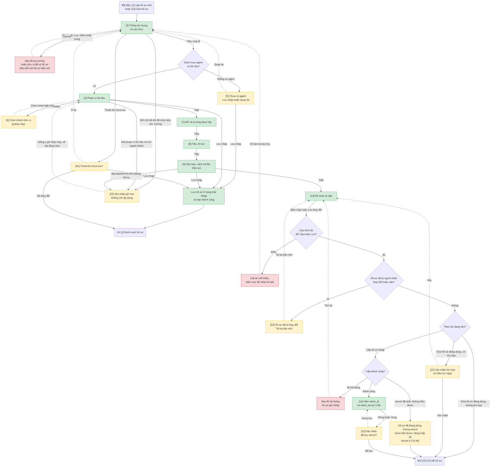
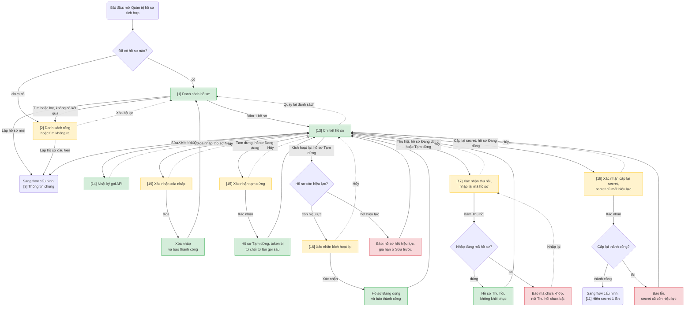

# Quản trị hồ sơ tích hợp — User Flow

> Nguồn chia flow DUY NHẤT cho feature này. `/wireframe-ascii` và `/wireframe-html` đọc file này để biết flow nào gồm những màn nào — KHÔNG tự chia flow riêng.

## 1. User Flow (tổng)

> Phủ happy / error / edge cases. `[n]` = số màn hình đối chiếu Mục 2. Các tab [3] → [9] chuyển qua lại tự do bằng thanh tab (xem Mục 3.5).

### Flow: cau-hinh-ho-so-flow

### Flow: quan-ly-ho-so-flow

## 2. Danh sách màn hình

> Cột `Slug` = định danh máy-đọc DUY NHẤT của màn (khớp `## Screen: {slug}` bên wireframe + node KG). `[#]` chỉ để đối chiếu Mục 1/3.5.

| [#] | Slug | Màn hình | Mục đích | Thuộc flow |
|-----|------|----------|----------|------------|
| 1 | ds-ho-so | Danh sách hồ sơ tích hợp | Xem, tìm kiếm, lọc hồ sơ; nhãn trạng thái (Nháp, Đang dùng, Tạm dừng, Thu hồi, Hết hiệu lực); cột hạn hiệu lực; vào Lập hồ sơ mới hoặc Chi tiết | quan-ly-ho-so-flow |
| 2 | ds-ho-so-rong | Danh sách rỗng | Chưa có hồ sơ nào, hoặc tìm / lọc không ra kết quả; nút Lập hồ sơ đầu tiên hoặc Xóa bộ lọc | quan-ly-ho-so-flow |
| 3 | ho-so-chung | Thông tin chung và xác thực | Mã hồ sơ, tên đơn vị tích hợp, đầu mối liên hệ, văn bản đề nghị; `client_id`; chế độ được dùng (Đơn vị / Cá nhân / cả hai); danh sách IP | cau-hinh-ho-so-flow |
| 4 | ho-so-pham-vi | Phạm vi dữ liệu | Chọn agent; toàn agent hay 1 nhánh đơn vị; loại văn bản; trạng thái cố định | cau-hinh-ho-so-flow |
| 5 | ho-so-pham-vi-khong-agent | Phạm vi — chưa có agent | Trạng thái rỗng khi danh mục agent không có dữ liệu; Lưu nháp hoặc Quay lại | cau-hinh-ho-so-flow |
| 6 | chon-nhanh-don-vi | Chọn nhánh đơn vị | Popup cây đơn vị để chọn đơn vị gốc của nhánh | cau-hinh-ho-so-flow |
| 7 | ho-so-api-truong | API và trường được lấy | Chọn API (FC-002 → FC-012); chọn trường theo nhóm CB / MR / NC; khối con kèm theo | cau-hinh-ho-so-flow |
| 8 | ho-so-tieu-chi | Tiêu chí lọc | Chọn tiêu chí lọc được dùng và giá trị lọc cố định; khóa tiêu chí không hợp chế độ | cau-hinh-ho-so-flow |
| 9 | ho-so-gioi-han | Giới hạn, cách trả file, hiệu lực | Khoảng ngày tối đa, số bản ghi mỗi trang, khung giờ, số lượt gọi, thời hạn token; cách trả file (kèm Base64); hiệu lực từ ngày – đến ngày | cau-hinh-ho-so-flow |
| 10 | ho-so-ra-soat | Rà soát và cấp | Tóm tắt toàn bộ cấu hình; danh sách chỗ thiếu; cảnh báo tĩnh (trường Nhạy cảm, trạng thái chưa phát hành); nút Cấp hoặc Lưu thay đổi | cau-hinh-ho-so-flow |
| 11 | hien-secret | Hiện client_id và client_secret | Hiện secret đúng 1 lần sau khi cấp hoặc cấp lại; nút sao chép | cau-hinh-ho-so-flow (dùng lại từ quan-ly-ho-so-flow) |
| 12 | xac-nhan-da-luu-secret | Xác nhận đã lưu secret | Hộp xác nhận khi đóng màn hiện secret | cau-hinh-ho-so-flow |
| 13 | ho-so-chi-tiet | Chi tiết hồ sơ | Xem toàn bộ cấu hình; nút thao tác theo trạng thái (Mục 3.6) | quan-ly-ho-so-flow |
| 14 | nhat-ky-goi-api | Nhật ký gọi API | Lọc theo thời gian, API, mã kết quả; bảng nhật ký; trạng thái rỗng và đang tải; không hiện secret, mật khẩu, token | quan-ly-ho-so-flow |
| 15 | xac-nhan-tam-dung | Xác nhận tạm dừng | Nêu hệ quả: token bị từ chối từ lần gọi sau | quan-ly-ho-so-flow |
| 16 | xac-nhan-kich-hoat-lai | Xác nhận kích hoạt lại | Nêu hệ quả: phục hồi quyền gọi API ngay | quan-ly-ho-so-flow |
| 17 | xac-nhan-thu-hoi | Xác nhận thu hồi | Nhập lại mã hồ sơ để bật nút Thu hồi; nêu hệ quả không khôi phục | quan-ly-ho-so-flow |
| 18 | xac-nhan-cap-lai-secret | Xác nhận cấp lại secret | Nêu hệ quả: secret cũ mất hiệu lực, hệ thống tích hợp đang chạy không lấy được token mới, token đã cấp dùng được tới hết hạn | quan-ly-ho-so-flow |
| 19 | xac-nhan-xoa-nhap | Xác nhận xóa nháp | Xóa hồ sơ Nháp | quan-ly-ho-so-flow |
| 20 | xac-nhan-roi-form | Xác nhận thoát khi chưa lưu | Lưu nháp / Bỏ thay đổi / Ở lại; dùng chung cho lập và sửa | cau-hinh-ho-so-flow |
| 21 | xac-nhan-thu-hep | Xác nhận thu hẹp phạm vi | Liệt kê phần bị thu hẹp (bớt trường, API, tiêu chí, nhánh, loại văn bản); nêu có hiệu lực ngay, nên báo trước cho đơn vị tích hợp | cau-hinh-ho-so-flow |
| 22 | xac-nhan-go-muc-phu-thuoc | Xác nhận gỡ mục không còn áp dụng | Liệt kê trường, tiêu chí sẽ bị gỡ khi đổi chế độ, đổi phạm vi hoặc bật Base64 | cau-hinh-ho-so-flow |
| 23 | xung-dot-chinh-sua | Hồ sơ đã bị thay đổi | Báo người sửa và giờ sửa; Tải lại bản mới (mất phần đang nhập chưa lưu); nếu hồ sơ đã được cấp thì chuyển sang Chi tiết | cau-hinh-ho-so-flow |

## 3. Danh sách flow

| Flow-slug | Tên flow | Màn hình gồm | Cases phủ |
|-----------|----------|--------------|-----------|
| cau-hinh-ho-so-flow | Lập và sửa hồ sơ tích hợp | ho-so-chung → ho-so-pham-vi (→ ho-so-pham-vi-khong-agent, chon-nhanh-don-vi) → ho-so-api-truong → ho-so-tieu-chi → ho-so-gioi-han → ho-so-ra-soat → hien-secret → xac-nhan-da-luu-secret; xac-nhan-roi-form, xac-nhan-thu-hep, xac-nhan-go-muc-phu-thuoc, xung-dot-chinh-sua | happy (lập, cấp, hiện secret), error (thiếu hoặc trùng, thiếu cấu hình, lỗi cấp), edge (chưa có agent, đổi chế độ khi đã chọn tiêu chí, thoát chưa lưu, thu hẹp phạm vi, xung đột đồng thời, đóng màn secret chưa sao chép, cấp lỗi một phần) |
| quan-ly-ho-so-flow | Quản lý hồ sơ đã có | ds-ho-so, ds-ho-so-rong, ho-so-chi-tiet, nhat-ky-goi-api, xac-nhan-tam-dung, xac-nhan-kich-hoat-lai, xac-nhan-thu-hoi, xac-nhan-cap-lai-secret, xac-nhan-xoa-nhap | happy (xem, tạm dừng, kích hoạt lại, thu hồi, cấp lại secret, xóa nháp, xem nhật ký), error (mã thu hồi sai, cấp lại secret lỗi), edge (danh sách rỗng, hồ sơ hết hiệu lực không kích hoạt lại được) |

## 3.5. Chuyển màn (transitions)

> Nguồn DUY NHẤT cho chuyển màn màn→màn (edge NAVIGATES_TO). `/wireframe-html` + `/prototype-html` đọc bảng này để nối nút/điều hướng — KHÔNG tự suy lại từ prose/mermaid. 1 dòng = 1 chuyển.

| Từ màn [#] | Đến màn [#] | Trigger | Điều kiện |
|-----------|------------|---------|-----------|
| Danh sách hồ sơ [1] | Danh sách rỗng [2] | Tìm hoặc lọc | Không có kết quả |
| Danh sách rỗng [2] | Danh sách hồ sơ [1] | Xóa bộ lọc | Đang có bộ lọc |
| Danh sách hồ sơ [1] | Thông tin chung [3] | Lập hồ sơ mới | — |
| Danh sách rỗng [2] | Thông tin chung [3] | Lập hồ sơ đầu tiên | Chưa có hồ sơ nào |
| Danh sách hồ sơ [1] | Chi tiết hồ sơ [13] | Bấm 1 hồ sơ | — |
| Chi tiết hồ sơ [13] | Danh sách hồ sơ [1] | Quay lại danh sách | — |
| Chi tiết hồ sơ [13] | Thông tin chung [3] | Sửa | Hồ sơ Nháp, Đang dùng hoặc Tạm dừng |
| Chi tiết hồ sơ [13] | Nhật ký gọi API [14] | Xem nhật ký | Hồ sơ Đang dùng, Tạm dừng hoặc Thu hồi |
| Nhật ký gọi API [14] | Chi tiết hồ sơ [13] | Quay lại | — |
| Chi tiết hồ sơ [13] | Xác nhận xóa nháp [19] | Xóa nháp | Hồ sơ Nháp |
| Xác nhận xóa nháp [19] | Danh sách hồ sơ [1] | Xóa | Xóa thành công (hết hồ sơ thì hiện [2]) |
| Xác nhận xóa nháp [19] | Chi tiết hồ sơ [13] | Hủy | — |
| Chi tiết hồ sơ [13] | Xác nhận tạm dừng [15] | Tạm dừng | Hồ sơ Đang dùng |
| Xác nhận tạm dừng [15] | Chi tiết hồ sơ [13] | Xác nhận | Hồ sơ chuyển Tạm dừng |
| Xác nhận tạm dừng [15] | Chi tiết hồ sơ [13] | Hủy | Giữ nguyên |
| Chi tiết hồ sơ [13] | Xác nhận kích hoạt lại [16] | Kích hoạt lại | Hồ sơ Tạm dừng, còn hiệu lực |
| Chi tiết hồ sơ [13] | (giữ nguyên) [13] | Kích hoạt lại | Hồ sơ Tạm dừng, hết hiệu lực → báo gia hạn ở Sửa trước |
| Xác nhận kích hoạt lại [16] | Chi tiết hồ sơ [13] | Xác nhận | Hồ sơ chuyển Đang dùng |
| Xác nhận kích hoạt lại [16] | Chi tiết hồ sơ [13] | Hủy | Giữ nguyên |
| Chi tiết hồ sơ [13] | Xác nhận thu hồi [17] | Thu hồi | Hồ sơ Đang dùng hoặc Tạm dừng |
| Xác nhận thu hồi [17] | Chi tiết hồ sơ [13] | Bấm Thu hồi | Nhập đúng mã hồ sơ → hồ sơ chuyển Thu hồi |
| Xác nhận thu hồi [17] | (giữ nguyên) [17] | Bấm Thu hồi | Nhập sai mã → báo mã chưa khớp, nút chưa bật |
| Xác nhận thu hồi [17] | Chi tiết hồ sơ [13] | Hủy | Giữ nguyên |
| Chi tiết hồ sơ [13] | Xác nhận cấp lại secret [18] | Cấp lại secret | Hồ sơ Đang dùng |
| Xác nhận cấp lại secret [18] | Hiện secret [11] | Xác nhận | Cấp lại thành công |
| Xác nhận cấp lại secret [18] | Chi tiết hồ sơ [13] | Xác nhận | Lỗi hệ thống → báo lỗi, secret cũ còn hiệu lực |
| Xác nhận cấp lại secret [18] | Chi tiết hồ sơ [13] | Hủy | Giữ nguyên |
| Thông tin chung [3] | Phạm vi dữ liệu [4] | Tiếp | Hợp lệ, danh mục agent có dữ liệu |
| Thông tin chung [3] | Phạm vi — chưa có agent [5] | Tiếp | Hợp lệ, danh mục agent rỗng |
| Thông tin chung [3] | (giữ nguyên) [3] | Tiếp hoặc Lưu | Thiếu, sai định dạng, trùng mã hồ sơ hoặc `client_id` → báo lỗi tại trường |
| Thông tin chung [3] | (giữ nguyên) [3] | Tiếp hoặc Lưu | Đơn vị đã có hồ sơ → báo lỗi kèm liên kết mở hồ sơ hiện có |
| Thông tin chung [3] | Chi tiết hồ sơ [13] | Bấm liên kết "Mở hồ sơ hiện có" | Đơn vị đã có hồ sơ |
| Phạm vi — chưa có agent [5] | Thông tin chung [3] | Quay lại | — |
| Phạm vi — chưa có agent [5] | Danh sách hồ sơ [1] | Lưu nháp | — |
| Phạm vi dữ liệu [4] | Chọn nhánh đơn vị [6] | Chọn nhánh | Chọn "1 nhánh" thay vì toàn agent |
| Chọn nhánh đơn vị [6] | Phạm vi dữ liệu [4] | Chọn xong hoặc Hủy | — |
| Phạm vi dữ liệu [4] | API và trường được lấy [7] | Tiếp | Hợp lệ |
| API và trường được lấy [7] | Tiêu chí lọc [8] | Tiếp | Hợp lệ |
| Tiêu chí lọc [8] | Giới hạn, cách trả file, hiệu lực [9] | Tiếp | Hợp lệ |
| Giới hạn, cách trả file, hiệu lực [9] | Rà soát và cấp [10] | Tiếp | Hợp lệ |
| Tab [3] → [9] | Tab [3] → [9] khác | Bấm tab | Tự do chuyển qua lại |
| Thông tin chung [3], Phạm vi dữ liệu [4], Giới hạn [9] | Xác nhận gỡ mục [22] | Đổi chế độ, đổi phạm vi hoặc bật Base64 | Đã có trường hoặc tiêu chí không còn áp dụng |
| Xác nhận gỡ mục [22] | Tab đang sửa | Đồng ý | Gỡ các mục, giữ thay đổi vừa chọn |
| Xác nhận gỡ mục [22] | Tab đang sửa | Hủy | Hoàn tác thay đổi vừa chọn |
| Tab [3] → [9] | Danh sách hồ sơ [1] | Lưu nháp | Hồ sơ Nháp, hợp lệ |
| Tab [3] → [9] | Xác nhận thoát chưa lưu [20] | Thoát form | Có thay đổi chưa lưu |
| Xác nhận thoát chưa lưu [20] | Danh sách hồ sơ [1] | Lưu nháp hoặc Bỏ thay đổi | Đang lập hồ sơ Nháp (Sửa hồ sơ đang dùng thì về [13]) |
| Xác nhận thoát chưa lưu [20] | Tab đang sửa | Ở lại | — |
| Tab [3] → [9] | Hồ sơ đã bị thay đổi [23] | Lưu nháp | Hồ sơ đã bị người khác thay đổi |
| Rà soát và cấp [10] | Tab thiếu cấu hình | Bấm Cấp hoặc Lưu thay đổi, rồi bấm mục thiếu | Cấu hình chưa đủ → liệt kê chỗ thiếu |
| Rà soát và cấp [10] | Hồ sơ đã bị thay đổi [23] | Bấm Cấp hoặc Lưu thay đổi | Hồ sơ đã bị người khác thay đổi hoặc đã được cấp |
| Hồ sơ đã bị thay đổi [23] | Rà soát và cấp [10] | Tải lại bản mới | Hồ sơ chưa được cấp |
| Hồ sơ đã bị thay đổi [23] | Chi tiết hồ sơ [13] | Tải lại bản mới | Hồ sơ đã được cấp |
| Rà soát và cấp [10] | Hiện secret [11] | Cấp | Hồ sơ Nháp, đủ cấu hình, cấp thành công |
| Rà soát và cấp [10] | (giữ nguyên) [10] | Cấp | Lỗi hệ thống → báo lỗi, hồ sơ giữ Nháp, cho thử lại |
| Rà soát và cấp [10] | Chi tiết hồ sơ [13] | Cấp | Secret đã sinh nhưng không hiện được → hồ sơ Đang dùng, dùng Cấp lại secret ở [13] |
| Rà soát và cấp [10] | Xác nhận thu hẹp [21] | Lưu thay đổi | Sửa hồ sơ đang dùng, có thu hẹp phạm vi |
| Rà soát và cấp [10] | Chi tiết hồ sơ [13] | Lưu thay đổi | Sửa hồ sơ đang dùng, không thu hẹp |
| Xác nhận thu hẹp [21] | Chi tiết hồ sơ [13] | Xác nhận | Lưu thay đổi thành công |
| Xác nhận thu hẹp [21] | Rà soát và cấp [10] | Hủy | — |
| Hiện secret [11] | Xác nhận đã lưu secret [12] | Đóng hoặc Xong | — |
| Xác nhận đã lưu secret [12] | Chi tiết hồ sơ [13] | Xác nhận đã lưu | — |
| Xác nhận đã lưu secret [12] | Hiện secret [11] | Chưa lưu, quay lại | — |

## 3.6. Trạng thái hồ sơ × thao tác

> Hết hiệu lực là nhãn phát sinh theo ngày (áp lên Đang dùng hoặc Tạm dừng), không phải trạng thái lưu. Hồ sơ hết hiệu lực vẫn Sửa được để gia hạn. Các ô đánh dấu [GIẢ ĐỊNH] chờ xác nhận ở Mục 4.

| Trạng thái | Sửa | Cấp | Tạm dừng | Kích hoạt lại | Thu hồi | Cấp lại secret | Xóa | Xem nhật ký |
|---|---|---|---|---|---|---|---|---|
| Nháp | Có | Có | Không | Không | Không | Không | Có | Không |
| Đang dùng | Có [GIẢ ĐỊNH] | Không | Có | Không | Có | Có | Không | Có |
| Tạm dừng | Có [GIẢ ĐỊNH] | Không | Không | Có (còn hiệu lực) | Có | Không [GIẢ ĐỊNH] | Không | Có |
| Thu hồi | Không | Không | Không | Không | Không | Không | Không | Có |

## 4. Open Questions

- [ ] OQ-1: Hồ sơ đang dùng sửa trực tiếp được (mặc định đã áp dụng ở Mục 3.6). Cần người có thẩm quyền xác nhận.
- [ ] OQ-2: Hồ sơ thu hồi không khôi phục, không xóa, vẫn xem được nhật ký (mặc định đã áp dụng). Cần xác nhận.
- [ ] OQ-3: Nhật ký chỉ có bảng tóm tắt, chưa có xem chi tiết từng dòng (tham số, kết quả); khoảng thời gian tối đa mỗi lần xem chưa chốt.
- [ ] OQ-4: Quyết định "không cần xác nhận đồng ý khi cấp trường Nhạy cảm hoặc trạng thái chưa phát hành" lệch với SRS NFR-10 và catalog Mục 9.3 bước 4 (ghi "chỉ cấp khi đơn vị chủ quản đồng ý bằng văn bản"). Cần 1 CR sửa SRS và catalog cho khớp, hoặc giữ NFR-10 là quy trình ngoài hệ thống.
- [ ] OQ-5: Catalog Mục 9.3 bước 5 – 6 có môi trường thử nghiệm rồi mới chính thức; flow này chưa có khái niệm môi trường. Cần xác nhận bỏ qua có chủ đích, hay hồ sơ gắn với môi trường.
- [ ] OQ-6: "Đơn vị đã có hồ sơ" xác định theo mã nào (tên đơn vị, mã đơn vị hay agent)? Cần chốt trước khi viết SRS cho phần quản trị hồ sơ.
- [ ] OQ-7: Hai quản trị cùng sửa 1 hồ sơ: hiện chọn "Tải lại bản mới, mất phần đang nhập chưa lưu". Có cần giữ lại phần đang nhập để so sánh hay không.
